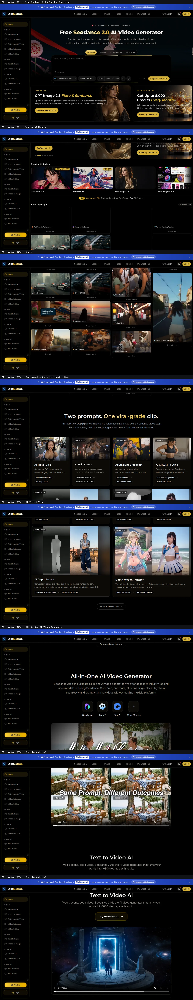
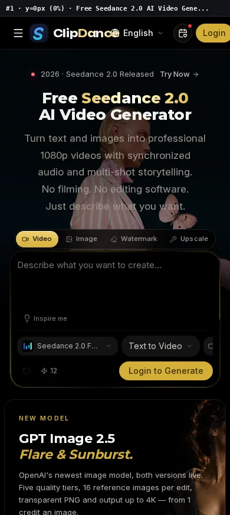

# UI Design System & Master Generation Blueprint: clipdance-ai

> **Seedance 2.0 - Free AI Video Generator · Text/Image to Video** (https://clipdance.ai) — Create cinematic AI videos with Seedance 2.0. Text-to-video, image-to-video, native audio. The Seedance 2.0 AI video generator. Free to s...





---

## 1. Executive Visual Persona & Design Archetype

- **Brand Essence & Persona**: **Seedance 2.0 - Free AI Video Generator · Text/Image to Video** (`https://clipdance.ai`). Create cinematic AI videos with Seedance 2.0. Text-to-video, image-to-video, native audio. The Seedance 2.0 AI video generator. Free to s...
- **Capture Provenance**: Live browser capture (`tier1_fast`, HTTP `200`, captured `2026-11-24`).
- **Visual Archetype**: **Dark-Substrate WebGL / Canvas Interactive Experience (`#000000` / `#8a6b0d`)**.
- **Anti-AI-Slop Differentiators**:
  - **Live-Computed Chromatic Polarity**: Anchors the viewport in `#000000` (live computed `body` `background-color` (`computed_styles.json`)) paired with `#ffffff` primary typography and `#8a6b0d` accents.
  - **Grounded Typographic Hierarchy**: Pairs `Montserrat` for display copy (`Free Seedance 2.0 AI Video Generator`) with `fontInter` and `Noto Sans Mono`.
  - **Calibrated Spatial Grid & Motion**: Combines `1220px` container bounds (`gap: var(--gap)`, padding `2px`) with `cubic-bezier(0,0,.2,1)` easing and Three.js / WebGL Canvas Pipeline.

---

## 2. Spatial Architecture & Modular Grid Mathematics

### Viewport Allocation & Container Geometry
- **Captured Journey Filmstrips**: Desktop `1280×6624px` (`assets/desktop-journey.webp`, `8` keyframes up to `y=0px` / doc `900px`), Mobile `390×872px` (`assets/mobile-journey.webp`, `1` keyframes).
- **Master Container Bounds**: `1220px` (measured `<main>` bounding box width within `1440px` desktop viewport).
- **Canvas Lateral Padding & Spacing**: `2px` lateral canvas padding with `var(--gap)` grid gap.
- **Border Radius Scale**: `3.35544e+07px`, `var(--radius)`, `.25rem`, `var(--radius-2xl)`.

### Responsive Breakpoint Architecture
- **Desktop Layout**: 2-column persistent left sidebar (`208px`, <aside.my-3>) + `1220px` main content stage at `1440px` (`max-width: 1220px`, `gap: var(--gap)`).
- **Mobile Layout**: Single-column vertical stack at `390px` viewport width with collapsed `<aside.my-3>` drawer navigation and `2px` horizontal padding.
- **Extracted CSS Media Queries**: `@media (min-width:40rem)`, `@media (min-width:48rem)`, `@media (min-width:64rem)`, `@media (min-width:80rem)`.

---

## 3. Color System, Materiality & Atmospheric Lighting

### Semantic Palette & Source Grounding
| Semantic Role | Ground-Truth Value | Extracted Live / CSS Source |
|---|---|---|
| **Primary Canvas Substrate** | `#000000` | live computed `body` `background-color` (`computed_styles.json`) |
| **Primary Typography Ink** | `#ffffff` | live computed `button` `color` (`computed_styles.json`) |
| **Elevated Surface / Card Substrate** | `#18181b` | `var(--card-foreground)` in `:root` |
| **Interactive Accent / Highlight** | `#8a6b0d` | `var(--primary)` in `:root` |
| **Secondary / Muted Copy** | `#71717a` | `var(--muted-foreground)` in `:root` |
| **Structural Hairline Border** | `#e4e4e7` | `var(--border)` in `:root` |
| **Variable Token (`--background`)** | `#fafafa` | `var(--background)` in `:root` |
| **Variable Token (`--secondary`)** | `#f4f4f5` | `var(--secondary)` in `:root` |
| **Variable Token (`--secondary-foreground`)** | `#27272a` | `var(--secondary-foreground)` in `:root` |
| **Variable Token (`--destructive`)** | `#d92d20` | `var(--destructive)` in `:root` |

### Sanitized Root CSS Variables (`ui-ux.md` Ground Truth)
| Variable Name | Extracted Value | Semantic Role |
|---|---|---|
| `--background` | `#fafafa` | Canvas / Surface Token |
| `--foreground` | `#18181b` | Typography Ink Token |
| `--card` | `#fff` | Color / Atmospheric Token |
| `--card-foreground` | `#18181b` | Typography Ink Token |
| `--popover` | `#fff` | Color / Atmospheric Token |
| `--popover-foreground` | `#18181b` | Typography Ink Token |
| `--primary` | `#8a6b0d` | Brand / Palette Token |
| `--primary-foreground` | `#fff` | Typography Ink Token |
| `--secondary` | `#f4f4f5` | Brand / Palette Token |
| `--secondary-foreground` | `#27272a` | Typography Ink Token |
| `--muted` | `#f4f4f5` | Color / Atmospheric Token |
| `--muted-foreground` | `#71717a` | Typography Ink Token |
| `--accent` | `#f4f4f5` | Brand / Palette Token |
| `--accent-foreground` | `#8a6b0d` | Typography Ink Token |
| `--destructive` | `#d92d20` | Color / Atmospheric Token |
| `--destructive-foreground` | `#fff` | Typography Ink Token |

---

## 4. Typographic Scale & Editorial Hierarchy

### Font Family Stacks
- **Display Typography**: `Montserrat`.
- **Primary Body Stack**: `fontInter`.
- **Technical / Metadata Stack**: `Noto Sans Mono`.

### Typographic Scale & Rules (Live Computed & Stylesheet Grounded)
- **Hero Display (`H1`)**: live computed `h1` (`font-size: 40px`, `line-height: 43.2px`, `font-weight: 800`, `letter-spacing: -1px`); CSS variables `--text-4xl: 2.25rem`, `--text-4xl--line-height: calc(2.5/2.25)`, `--text-5xl: 3rem`.
- **Section Heading (`H2`)**: live computed `h2` (`font-size: 40px`, `line-height: 48px`, `font-weight: 600`, `letter-spacing: -0.4px`); CSS variables `--text-2xl: 1.5rem`, `--text-2xl--line-height: calc(2/1.5)`, `--text-3xl: 1.875rem`.
- **Body Copy**: live computed `body` (`font-size: 16px`, `line-height: 24px`, `font-weight: 400`); CSS variables `--text-base: 1rem`, `--text-base--line-height: calc(1.5/1)`; rule `p` (`line-height: var(--leading-relaxed)`).
- **Metadata & Navigation Labels**: live computed `nav/a` (`font-size: 16px`, `line-height: 24px`, `font-weight: 400`); CSS variables `--font-mono: var(--font-noto-sans-mono)`, `--font-noto-sans-mono: "Noto Sans Mono", "Noto Sans Mono Fallback"`, `--text-xs: .75rem`.

---

## 5. Choreographed Motion & Interaction Physics

### Primary Easing Curves
- **Extracted Timing Functions**: `cubic-bezier(0,0,.2,1)`, `cubic-bezier(.4,0,.2,1)`, `cubic-bezier(0,1,.34,1)`.

### Per-Element Transition & Choreography Rules
- **Selector `layer theme`**: `transition: .15s` extracted from `clipdance-ai` stylesheet.
- **Selector `.transition`**: `transition: var(--tw-ease,var(--default-transition-timing-function))` extracted from `clipdance-ai` stylesheet.
- **Selector `transform\]`**: `transition: var(--tw-ease,var(--default-transition-timing-function))` extracted from `clipdance-ai` stylesheet.
- **Extracted Easing Curve (`cubic-bezier(0,0,.2,1)`)**: Governs interactive state transitions across `<header.inset-x-0>` and `<section.w-full>`.
- **Runtime Interaction Engine**: Integrates Three.js / WebGL Canvas Pipeline with `prefers-reduced-motion: reduce` fallback guards.
### Measured Runtime Scroll & Interaction Telemetry (`behavioral_journey_v2`)
- **Scroll Driver Mode**: `wheel` (max document height `900px`, deepest scrollY reached `0px` across `8` desktop keyframes).
- **Detected Scroll / Motion Libraries**: `WebGL/Canvas`.
- **Nav / Drawer Probe (`Video`)**: Triggered visual change (pixel diff `35.349`, captured in `assets/state-nav.webp`); revealed links: Seedance 2.0 Fast Fas..., Veo 3 AI video with d..., Vidu Q3 AI video with..., Kling V3 AI video wit..., MiniMax H3 2K AI vide..., Wan 3.0 Alibaba omni-....
- **Interactive Control Probe (`accordion` · `Seedance 2.0 Fast-Portrait`)**: Triggered visual diff `11.101` (attr `false -> true`, captured in `assets/state-interactive.webp`).
- **Route Transition Architecture**: First internal navigation (`/blog`) measured as `direct` in `5740ms`.

---

## 6. Component Wireframe & Structural DOM Map

### Visual Layout Schematic — Desktop (`1440px`, Grounded in `dom.html` & Landmark Bounding Boxes)
```
┌────────────────────────────────────────────────────────────────────────┐
│ DESKTOP VIEWPORT (1440px) — Sidebar (208px) + Main (1220px)            │
│ ====================================================================== │
│ +--[ SIDEBAR (208px) ]--+--[ MAIN CONTENT STAGE (1220px) ]-----------+ │
│ | <aside.my-3>          | [ <header.inset-x-0 | Seedance 2.5 · Blo ] | │
│ | - Seedance 2.5        | ------------------------------------------ | │
│ | - Blog                | HERO STAGE: <section.relative>             | │
│ | - Pricing             | H1: Free Seedance 2.0 AI Video Generator   | │
│ | - My Creations        | Bg:#000000 Ink:#ffffff Acc:#8a6b0d         | │
│ | x=12 h=776px rail     | ------------------------------------------ | │
│ |                       | SHOWCASE: <section.w-full> max:1220px      | │
│ |                       | [GPT Image 2.5 Flar] [Get Up to 8,000 Cr]  | │
│ |                       | DETAIL: <section.py-5>                     | │
│ +-----------------------+--------------------------------------------+ │
│ [ FOOTER (<footer.border-t>   ) | https://clipdance.ai                 │
└────────────────────────────────────────────────────────────────────────┘
```

### Visual Layout Schematic — Mobile Reflow (`390px`)
```
┌────────────────────────────────────────────────────────────────────────┐
│ MOBILE VIEWPORT REFLOW (390px) — Collapsed Sidebar + 1-Col Stack       │
│ ====================================================================== │
│ [ DRAWER (<aside.my-3>          ) | <header.inset-x-0>                 │
│ ---------------------------------------------------------------------- │
│ | HERO STAGE (<section.relative>) — 390px Full-Width                 | │
│ | H1: Free Seedance 2.0 AI Video Generator                           | │
│ ---------------------------------------------------------------------- │
│ | SHOWCASE STACK (<section.w-full>) — 1-Col (gap: var(--gap))        | │
│ | [ Card 1: GPT Image 2.5 Flare & Sunburst.                        ] | │
│ | [ Card 2: Get Up to 8,000 Credits Every Month.                   ] | │
│ ---------------------------------------------------------------------- │
│ | DETAIL STACK (<section.py-5>) — 1-Col (Popular AI Models)          | │
│ ---------------------------------------------------------------------- │
│ [ FOOTER (<footer.border-t>     ) | Stacked 390px Colophon             │
└────────────────────────────────────────────────────────────────────────┘
```

### Granular DOM Region Breakdown
1. **Persistent Left Sidebar Navigation (<aside.my-3> — `208×776px` at `x=12`)**:
   - Fixed/sticky left rail `<aside class="my-3 ml-3">` (`208px` wide) paired with top bar `<header class="inset-x-0 top-0">` hosting `Seedance 2.0 - Free AI Video G` navigation (`Seedance 2.5 · Blog · Pricing · My Creations`), DOM attributes (`data-precedence="next"`, `data-href="/_next/static/chunks/..."`, `data-state="closed"`, `data-slot="sheet-trigger"`), and rule `nter_a1c1f49b-module__H0XvcG__cla... { font-family:fontInter,fontInter Fallback;font-style:normal }`.
2. **Hero Stage & Focal Lead (<section.relative> — `Free Seedance 2.0 AI Video Generat`)**:
   - Landmark `<section class="relative w-full">` inside `1220px` main stage presenting display lead `Free Seedance 2.0 AI Video Generator` and copy excerpt *"Turn text and images into professional 1080p videos with synchron"* over `#000000` canvas and `#ffffff` ink.
3. **Primary Showcase & Content Grid (<section.w-full> — `GPT Image 2.5 Flare & Sunburst.`)**:
   - Landmark `<section class="w-full mx-auto">` rendering section `GPT Image 2.5 Flare & Sunburst.` with copy *"2026 · Seedance 2.0 Released"*, asset references (`3455abe1a79cd15c-s.p.2fxd9z3s4zhc...`, `InterVariable-s.p.2c0y96ae70xfx.w...`, `e8f2fbee2754df70-s.p.1dqa_6e_ad4s...`, `seedance.png`), and grid rule `inter_a1c1f49b-module__H0XvcG__va... { --font-inter:"fontInter", "fontInter Fallback" }`.
4. **Interactive Detail & Feature Matrix (<section.py-5> — `Get Up to 8,000 Credits Every Mont`)**:
   - Landmark `<section class="py-5">` framing `Get Up to 8,000 Credits Every Month.` and `Popular AI Models` (*"Seedance 2.0 Fast-Portrait"*) with `#18181b` surface cards, `#8a6b0d` accents, and `rrat_84fd8339-module__Za0QWW__cla... { font-family:Montserrat,Montserrat Fallback;font-style:normal }`.
5. **Colophon & Global Directory Footer (<footer.border-t> — `https://clipdance.ai`)**:
   - Landmark `<footer class="border-t">` anchoring `Seedance 2.0 - Free AI Video Gen` footer links (`Seedance 2.5 · Blog · Pricing · My Creations`), copy *"OpenAI's newest image model, both versions live. Five qualit"*, and `#e4e4e7` structural dividers.
### Full Vertical Scroll Sequence (Desktop `1440×900` Keyframes)
- **Step 01** (`y=0px`, `0%`): Active landmark `Free Seedance 2.0 AI Video Generator` · sticky/fixed elements: `1`
- **Step 02** (`y=0px`, `8%`): Active landmark `Popular AI Models` · sticky/fixed elements: `1`
- **Step 03** (`y=0px`, `17%`): Active landmark `#hero` · sticky/fixed elements: `1`
- **Step 04** (`y=0px`, `25%`): Active landmark `Two prompts. One viral-grade clip.` · sticky/fixed elements: `1`
- **Step 05** (`y=0px`, `33%`): Active landmark `AI Travel Vlog` · sticky/fixed elements: `1`
- **Step 06** (`y=0px`, `42%`): Active landmark `All-in-One AI Video Generator` · sticky/fixed elements: `1`
- **Step 07** (`y=0px`, `50%`): Active landmark `Text to Video AI` · sticky/fixed elements: `1`
- **Step 08** (`y=0px`, `58%`): Active landmark `Text to Video AI` · sticky/fixed elements: `1`

### Multi-Page Internal Route Map
- **Listing Route (`/blog`)**: `https://clipdance.ai/blog` — H1: `Blog`, scrollHeight `3960px`, transition `direct` (`5740ms`)
- **Detail Route (`/templates/vlog`)**: `https://clipdance.ai/templates/vlog` — H1: `AI TRAVEL VLOG TEMPLATE`, scrollHeight `9139px`, transition `direct` (`2519ms`)
- **Listing Route (`/pricing`)**: `https://clipdance.ai/pricing` — H1: `Simple, Transparent Pricing`, scrollHeight `900px`, transition `direct` (`1168ms`)

---

## 7. Master Zero-Shot AI Generation Prompt

```markdown
# Master Zero-Shot Frontend Generation Prompt: clipdance-ai (Seedance 2.0 - Free AI Video Generator · Text/Image to Video)

You are a principal frontend architect and design systems engineer. Build a complete, production-ready web application replicating the exact design system, DOM landmarks, typographic hierarchy, color tokens, and motion physics of `clipdance-ai` (**Seedance 2.0 - Free AI Video Generator · Text/Image to Video** — `https://clipdance.ai`).

### 1. Visual Archetype & Anti-AI-Slop Mandates
- **Archetype**: Dark-Substrate WebGL / Canvas Interactive Experience (`#000000` / `#8a6b0d`).
- **Identity & Domain Context**: Create cinematic AI videos with Seedance 2.0. Text-to-video, image-to-video, native audio. The Seedance 2.0 AI video generator. Free to s...
- **Primary Substrate**: `#000000` (live computed `body` `background-color` (`computed_styles.json`)), **Primary Ink**: `#ffffff`, **Accent / Highlight**: `#8a6b0d`.
- **Site-Specific Differentiators**:
  - **Live-Computed Chromatic Polarity**: Anchors the viewport in `#000000` (live computed `body` `background-color` (`computed_styles.json`)) paired with `#ffffff` primary typography and `#8a6b0d` accents.
  - **Grounded Typographic Hierarchy**: Pairs `Montserrat` for display copy (`Free Seedance 2.0 AI Video Generator`) with `fontInter` and `Noto Sans Mono`.
  - **Calibrated Spatial Grid & Motion**: Combines `1220px` container bounds (`gap: var(--gap)`, padding `2px`) with `cubic-bezier(0,0,.2,1)` easing and Three.js / WebGL Canvas Pipeline.

### 2. Ground-Truth CSS Variables (`:root` Token Contract)
Declare and consume these exact custom properties extracted from `clipdance-ai` in your global stylesheet:

:root {
  /* Seedance 2.0 - Free AI Video Generator · Text/Image to Video (clipdance-ai) — Live-Grounded CSS Variables */
  --background: #fafafa; /* Canvas / Surface Token (clipdance-ai) */
  --foreground: #18181b; /* Typography Ink Token (clipdance-ai) */
  --card: #fff; /* Color / Atmospheric Token (clipdance-ai) */
  --card-foreground: #18181b; /* Typography Ink Token (clipdance-ai) */
  --popover: #fff; /* Color / Atmospheric Token (clipdance-ai) */
  --popover-foreground: #18181b; /* Typography Ink Token (clipdance-ai) */
  --primary: #8a6b0d; /* Brand / Palette Token (clipdance-ai) */
  --primary-foreground: #fff; /* Typography Ink Token (clipdance-ai) */
  --secondary: #f4f4f5; /* Brand / Palette Token (clipdance-ai) */
  --secondary-foreground: #27272a; /* Typography Ink Token (clipdance-ai) */
  --muted: #f4f4f5; /* Color / Atmospheric Token (clipdance-ai) */
  --muted-foreground: #71717a; /* Typography Ink Token (clipdance-ai) */
  --accent: #f4f4f5; /* Brand / Palette Token (clipdance-ai) */
  --accent-foreground: #8a6b0d; /* Typography Ink Token (clipdance-ai) */
  --destructive: #d92d20; /* Color / Atmospheric Token (clipdance-ai) */
  --destructive-foreground: #fff; /* Typography Ink Token (clipdance-ai) */
}

### 3. Semantic Color & Materiality Contract
Map every surface, ink, and border strictly to these source-grounded tokens:
- **Primary Canvas Substrate**: `#000000` — grounded in live computed `body` `background-color` (`computed_styles.json`)
- **Primary Typography Ink**: `#ffffff` — grounded in live computed `button` `color` (`computed_styles.json`)
- **Elevated Surface / Card Substrate**: `#18181b` — grounded in `var(--card-foreground)` in `:root`
- **Interactive Accent / Highlight**: `#8a6b0d` — grounded in `var(--primary)` in `:root`
- **Secondary / Muted Copy**: `#71717a` — grounded in `var(--muted-foreground)` in `:root`
- **Structural Hairline Border**: `#e4e4e7` — grounded in `var(--border)` in `:root`
- **Variable Token (`--background`)**: `#fafafa` — grounded in `var(--background)` in `:root`
- **Variable Token (`--secondary`)**: `#f4f4f5` — grounded in `var(--secondary)` in `:root`
- **Variable Token (`--secondary-foreground`)**: `#27272a` — grounded in `var(--secondary-foreground)` in `:root`
- **Variable Token (`--destructive`)**: `#d92d20` — grounded in `var(--destructive)` in `:root`

### 4. Spatial Grid, Container Bounds & Responsive Breakpoints
- **Desktop Viewport Reference**: `1280×6624px` (multi-frame vertical journey filmstrip (6624px), `1440px` standard desktop width).
- **Mobile Viewport Reference**: `390×872px` (full-page live capture (872px), `390px` standard mobile width).
- **Container Max-Width**: `1220px` (measured `<main>` bounding box width within `1440px` desktop viewport)
- **Padding & Gutters**: `2px` lateral canvas padding with `var(--gap)` grid gap
- **Desktop Grid**: 2-column persistent left sidebar (`208px`, <aside.my-3>) + `1220px` main content stage at `1440px` (`max-width: 1220px`, `gap: var(--gap)`)
- **Mobile Adaptation**: Single-column vertical stack at `390px` viewport width with collapsed `<aside.my-3>` drawer navigation and `2px` horizontal padding
- **Media Queries**: `@media (min-width:40rem)`, `@media (min-width:48rem)`, `@media (min-width:64rem)`, `@media (min-width:80rem)`
- **Corner Radii**: `3.35544e+07px`, `var(--radius)`, `.25rem`, `var(--radius-2xl)`

### 5. Typography & Editorial Scale Contract
- **Display Font Stack**: `Montserrat`
- **Body Font Stack**: `fontInter`
- **Monospace / Technical Font Stack**: `Noto Sans Mono`
- **H1 Display Rule**: live computed `h1` (`font-size: 40px`, `line-height: 43.2px`, `font-weight: 800`, `letter-spacing: -1px`); CSS variables `--text-4xl: 2.25rem`, `--text-4xl--line-height: calc(2.5/2.25)`, `--text-5xl: 3rem`
- **H2 Section Rule**: live computed `h2` (`font-size: 40px`, `line-height: 48px`, `font-weight: 600`, `letter-spacing: -0.4px`); CSS variables `--text-2xl: 1.5rem`, `--text-2xl--line-height: calc(2/1.5)`, `--text-3xl: 1.875rem`
- **Body Copy Rule**: live computed `body` (`font-size: 16px`, `line-height: 24px`, `font-weight: 400`); CSS variables `--text-base: 1rem`, `--text-base--line-height: calc(1.5/1)`; rule `p` (`line-height: var(--leading-relaxed)`)
- **Metadata & Index Rule**: live computed `nav/a` (`font-size: 16px`, `line-height: 24px`, `font-weight: 400`); CSS variables `--font-mono: var(--font-noto-sans-mono)`, `--font-noto-sans-mono: "Noto Sans Mono", "Noto Sans Mono Fallback"`, `--text-xs: .75rem`

### 6. Component Hierarchy, Verbatim Copy & Real DOM Landmarks
Scaffold `clipdance-ai` (`Seedance 2.0 - Free AI Video Generator · Text/Image to Video`) with these exact structural regions, extracted copy, and CSS rules from `dom.html`:
1. **Persistent Left Sidebar Navigation (<aside.my-3> — `208×776px` at `x=12`)**:
   - DOM & Selectors: Fixed/sticky left rail `<aside class="my-3 ml-3">` (`208px` wide) paired with top bar `<header class="inset-x-0 top-0">` hosting `Seedance 2.0 - Free AI Video G` navigation (`Seedance 2.5 · Blog · Pricing · My Creations`), DOM attributes (`data-precedence="next"`, `data-href="/_next/static/chunks/..."`, `data-state="closed"`, `data-slot="sheet-trigger"`), and rule `nter_a1c1f49b-module__H0XvcG__cla... { font-family:fontInter,fontInter Fallback;font-style:normal }`.
   - Responsive Contract: Header `Persistent Left Sidebar Navigation (<aside.my-3> — `208×776px` at `x=12`)` (`clipdance-ai`) adapts across `@media (min-width:40rem)`, `@media (min-width:48rem)`, `@media (min-width:64rem)`, `@media (min-width:80rem)` with `cubic-bezier(0,0,.2,1)`, `cubic-bezier(.4,0,.2,1)`, `cubic-bezier(0,1,.34,1)` transitions and links `Seedance 2.5 · Blog · Pricing · My Creations`.
2. **Hero Stage & Focal Lead (<section.relative> — `Free Seedance 2.0 AI Video Generat`)**:
   - DOM & Selectors: Landmark `<section class="relative w-full">` inside `1220px` main stage presenting display lead `Free Seedance 2.0 AI Video Generator` and copy excerpt *"Turn text and images into professional 1080p videos with synchron"* over `#000000` canvas and `#ffffff` ink.
   - Responsive Contract: Hero stage (`1280×6624px` desktop / `390×872px` mobile) sets `#000000` background with `#ffffff` headline `Free Seedance 2.0 AI Video Generator`.
3. **Primary Showcase & Content Grid (<section.w-full> — `GPT Image 2.5 Flare & Sunburst.`)**:
   - DOM & Selectors: Landmark `<section class="w-full mx-auto">` rendering section `GPT Image 2.5 Flare & Sunburst.` with copy *"2026 · Seedance 2.0 Released"*, asset references (`3455abe1a79cd15c-s.p.2fxd9z3s4zhc...`, `InterVariable-s.p.2c0y96ae70xfx.w...`, `e8f2fbee2754df70-s.p.1dqa_6e_ad4s...`, `seedance.png`), and grid rule `inter_a1c1f49b-module__H0XvcG__va... { --font-inter:"fontInter", "fontInter Fallback" }`.
   - Responsive Contract: Showcase grid `Primary Showcase & Content Grid (<section.w-full> — `GPT Image 2.5 Flare & Sunburst.`)` applies 2-column persistent left sidebar (`208px`, <aside.my-3>) + `1220px` main content stage at `1440px` (`max-width: 1220px`, `gap: var(--gap)`) on desktop and Single-column vertical stack at `390px` viewport width with collapsed `<aside.my-3>` drawer navigation and `2px` horizontal padding on mobile.
4. **Interactive Detail & Feature Matrix (<section.py-5> — `Get Up to 8,000 Credits Every Mont`)**:
   - DOM & Selectors: Landmark `<section class="py-5">` framing `Get Up to 8,000 Credits Every Month.` and `Popular AI Models` (*"Seedance 2.0 Fast-Portrait"*) with `#18181b` surface cards, `#8a6b0d` accents, and `rrat_84fd8339-module__Za0QWW__cla... { font-family:Montserrat,Montserrat Fallback;font-style:normal }`.
   - Responsive Contract: Detail module `Interactive Detail & Feature Matrix (<section.py-5> — `Get Up to 8,000 Credits Every Mont`)` uses `3.35544e+07px`, `var(--radius)`, `.25rem`, `var(--radius-2xl)` radii, `#8a6b0d` highlights, and assets (3455abe1a79cd15c-s.p.2fxd9z3s4zhc..., InterVariable-s.p.2c0y96ae70xfx.w..., e8f2fbee2754df70-s.p.1dqa_6e_ad4s...).
5. **Colophon & Global Directory Footer (<footer.border-t> — `https://clipdance.ai`)**:
   - DOM & Selectors: Landmark `<footer class="border-t">` anchoring `Seedance 2.0 - Free AI Video Gen` footer links (`Seedance 2.5 · Blog · Pricing · My Creations`), copy *"OpenAI's newest image model, both versions live. Five qualit"*, and `#e4e4e7` structural dividers.
   - Responsive Contract: Footer `Colophon & Global Directory Footer (<footer.border-t> — `https://clipdance.ai`)` aligns to `1220px` (measured `<main>` bounding box width within `1440px` desktop viewport) with `2px` lateral canvas padding with `var(--gap)` grid gap and attributes (data-precedence="next", data-href="/_next/static/chunks/...", data-state="closed").

#### Verbatim DOM Copy Excerpts (`dom.html`)
- Copy Excerpt 1: *"Turn text and images into professional 1080p videos with synchronized audio and mu..."*
- Copy Excerpt 2: *"2026 · Seedance 2.0 Released"*
- Copy Excerpt 3: *"Seedance 2.0 Fast-Portrait"*
- Copy Excerpt 4: *"OpenAI's newest image model, both versions live. Five quality tiers, 16 reference..."*

### 7. Motion, Extracted Stylesheet Rules & Interaction Choreography
- **Primary Easing Functions**: `cubic-bezier(0,0,.2,1)`, `cubic-bezier(.4,0,.2,1)`, `cubic-bezier(0,1,.34,1)`
- **Extracted Stylesheet Rules (`clipdance-ai`)**:
- `nter_a1c1f49b-module__H0XvcG__cla... { font-family:fontInter,fontInter Fallback;font-style:normal }`
- `inter_a1c1f49b-module__H0XvcG__va... { --font-inter:"fontInter", "fontInter Fallback" }`
- `rrat_84fd8339-module__Za0QWW__cla... { font-family:Montserrat,Montserrat Fallback;font-style:normal }`
- `errat_84fd8339-module__Za0QWW__va... { --font-montserrat:"Montserrat", "Montserrat Fallback" }`
- `nded_508ed426-module__Wcxoya__cla... { font-family:Unbounded,Unbounded Fallback;font-style:normal;font-weight:700 }`
- **Per-Selector Transition Rules**:
- **Selector `layer theme`**: `transition: .15s` extracted from `clipdance-ai` stylesheet.
- **Selector `.transition`**: `transition: var(--tw-ease,var(--default-transition-timing-function))` extracted from `clipdance-ai` stylesheet.
- **Selector `transform\]`**: `transition: var(--tw-ease,var(--default-transition-timing-function))` extracted from `clipdance-ai` stylesheet.
- **Extracted Easing Curve (`cubic-bezier(0,0,.2,1)`)**: Governs interactive state transitions across `<header.inset-x-0>` and `<section.w-full>`.
- **Runtime Interaction Engine**: Integrates Three.js / WebGL Canvas Pipeline with `prefers-reduced-motion: reduce` fallback guards.
### 7b. Full-Page Scroll Choreography, Interactive States & Multi-Page Routes
- **Scroll Mechanics**: Implement `wheel` vertical progression up to `900px` across 8 distinct viewport chapters using WebGL/Canvas.
- **Vertical Chapter Sequence**: Free Seedance 2.0 AI Video... (0%) -> Popular AI Models (8%) -> #hero (17%) -> Two prompts. One viral-grad... (25%) -> AI Travel Vlog (33%) -> All-in-One AI Video Generator (42%) -> Text to Video AI (50%) -> Text to Video AI (58%).
- **Navigation Drawer / Menu State**: Replicate interactive menu toggle (`Video`) with Escape-to-close keyboard handling.
- **Multi-Page Routes**: Scaffold internal routes `/blog` (listing, direct), `/templates/vlog` (detail, direct), `/pricing` (listing, direct) sharing the global header/footer shell and design tokens.

### 8. Technical Deliverables
- Implement in Next.js (App Router) with TypeScript and Tailwind CSS consuming the `:root` custom properties defined above for `clipdance-ai`.
- Reproduce both the `1440px` desktop architecture and `390px` mobile breakpoint transitions, preserving semantic HTML5 landmarks (`<header>`, `<nav>`, `<main>`, `<section>`, `<footer>`) and `prefers-reduced-motion` accessibility guards.
```
---

## 8. Full-Page Scroll Journey, Interactive States & Subpage Inventory

### Desktop Scroll Keyframes (`1440×900` WebP)
| Step | Scroll Y | Progress | Active Landmark / Section | Sticky/Fixed | Visual Asset |
| :---: | :---: | :---: | :--- | :---: | :--- |
| `#01` | `0px` | `0%` | Free Seedance 2.0 AI Video Generator | `1` | [desktop-step-01.webp](assets/desktop-step-01.webp) |
| `#02` | `0px` | `8%` | Popular AI Models | `1` | [desktop-step-02.webp](assets/desktop-step-02.webp) |
| `#03` | `0px` | `17%` | #hero | `1` | [desktop-step-03.webp](assets/desktop-step-03.webp) |
| `#04` | `0px` | `25%` | Two prompts. One viral-grade clip. | `1` | [desktop-step-04.webp](assets/desktop-step-04.webp) |
| `#05` | `0px` | `33%` | AI Travel Vlog | `1` | [desktop-step-05.webp](assets/desktop-step-05.webp) |
| `#06` | `0px` | `42%` | All-in-One AI Video Generator | `1` | [desktop-step-06.webp](assets/desktop-step-06.webp) |
| `#07` | `0px` | `50%` | Text to Video AI | `1` | [desktop-step-07.webp](assets/desktop-step-07.webp) |
| `#08` | `0px` | `58%` | Text to Video AI | `1` | [desktop-step-08.webp](assets/desktop-step-08.webp) |

### Mobile Condensed Keyframes (`390×844` WebP)
| Step | Scroll Y | Progress | Active Landmark | Visual Asset |
| :---: | :---: | :---: | :--- | :--- |
| `#01` | `0px` | `0%` | Free Seedance 2.0 AI Video Generator | [mobile-step-01.webp](assets/mobile-step-01.webp) |

### Interactive UI State Captures (`1440×900` WebP)
| State Type | Trigger / Observation | Visual Asset |
| :--- | :--- | :--- |
| `nav_menu` | Nav/Menu opened (`Video`, diff `35.349`) | [state-nav.webp](assets/state-nav.webp) |
| `interactive_control` | Control `accordion` (`Seedance 2.0 Fast-Portrait`, diff `11.101`) | [state-interactive.webp](assets/state-interactive.webp) |

### Internal Subpage Filmstrips (`1080px` Wide WebP)
| # | Template | Route URL | H1 / Title | Scroll Height | Transition | Filmstrip Asset |
| :-: | :---: | :--- | :--- | :---: | :---: | :--- |
| `1` | `listing` | `https://clipdance.ai/blog` | Blog | `3960px` | `direct` (`5740ms`) | [subpage-01-blog.webp](assets/subpage-01-blog.webp) |
| `2` | `detail` | `https://clipdance.ai/templates/vlog` | AI TRAVEL VLOG TEMPLATE | `9139px` | `direct` (`2519ms`) | [subpage-02-templates-vlog.webp](assets/subpage-02-templates-vlog.webp) |
| `3` | `listing` | `https://clipdance.ai/pricing` | Simple, Transparent Pricing | `900px` | `direct` (`1168ms`) | [subpage-03-pricing.webp](assets/subpage-03-pricing.webp) |

