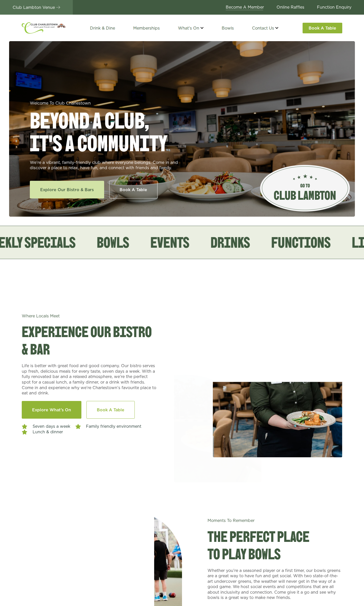
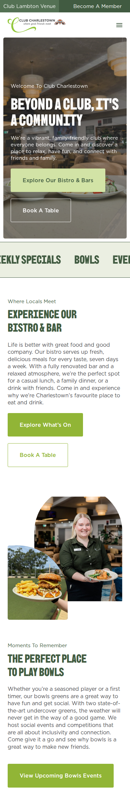

# UI Design System & Master Generation Blueprint: clubcharlestown-com-au

> **Home · Club Charlestown** (https://clubcharlestown.com.au/) — We're a vibrant, family-friendly club where everyone belongs. Come in and discover a place to relax, have fun, and connect with friends a...



---

## 1. Executive Visual Persona & Design Archetype

- **Brand Essence & Persona**: **Home · Club Charlestown** (`https://clubcharlestown.com.au/`). We're a vibrant, family-friendly club where everyone belongs. Come in and discover a place to relax, have fun, and connect with friends a...
- **Capture Provenance**: Live browser capture (`tier1_fast`, HTTP `200`, captured `2026-11-23`).
- **Visual Archetype**: **Light-Substrate Editorial & Modular Grid System (`#ffffff` canvas, `#333333` ink, `#eb8f00` accent)**.
- **Anti-AI-Slop Differentiators**:
  - **Live-Computed Chromatic Polarity**: Anchors the viewport in `#ffffff` (live computed `body` `background-color` (`computed_styles.json`)) paired with `#333333` primary typography and `#eb8f00` accents.
  - **Grounded Typographic Hierarchy**: Pairs `gotham` for display copy (`Welcome To Club Charlestown`) with `Segoe UI` and not declared in live computed styles (uses primary stack / `ui-monospace`).
  - **Calibrated Spatial Grid & Motion**: Combines `1600px` container bounds (`gap: .5rem`, padding `.75rem`) with `cubic-bezier(0.77,0,0.175,1)` easing and GSAP Timeline & ScrollTrigger, Three.js / WebGL Canvas Pipeline.

---

## 2. Spatial Architecture & Modular Grid Mathematics



### Viewport Allocation & Container Geometry
- **Captured Viewport Dimensions**: Desktop `1440×2400px` (`assets/desktop.png`, clamped at 2400px live multi-section capture), Mobile `390×2400px` (`assets/mobile.png`, clamped at 2400px live multi-section capture).
- **Master Container Bounds**: `1600px` (non-`@media` desktop container stylesheet rule).
- **Canvas Lateral Padding & Spacing**: `.75rem` lateral canvas padding with `.5rem` grid gap.
- **Border Radius Scale**: `3px`, `50%`, `var(--border-radius)`, `2px`.

### Responsive Breakpoint Architecture
- **Desktop Layout**: Multi-column CSS Grid / Flexbox layout at `1440px` (`max-width: 1600px`, `gap: .5rem`).
- **Mobile Layout**: Single-column vertical stack at `390px` viewport width with `.75rem` horizontal padding.
- **Extracted CSS Media Queries**: `@media (max-width:991px)`, `@media (max-width:575px)`, `@media (min-width:768px)`, `@media (max-width:767px)`.

---

## 3. Color System, Materiality & Atmospheric Lighting

### Semantic Palette & Source Grounding
| Semantic Role | Ground-Truth Value | Extracted Live / CSS Source |
|---|---|---|
| **Primary Canvas Substrate** | `#ffffff` | live computed `body` `background-color` (`computed_styles.json`) |
| **Primary Typography Ink** | `#333333` | live computed `main` `color` (`computed_styles.json`) |
| **Elevated Surface / Card Substrate** | `#f9fafb` | `var(--bg-color-disabled)` in `:root` |
| **Interactive Accent / Highlight** | `#eb8f00` | `.ui-state-active a:visited { color: #eb8f00 }` |
| **Secondary / Muted Copy** | `#8d8d8d` | `var(--ss-font-placeholder-color)` in `:root` |
| **Structural Hairline Border** | `#dcdee2` | `var(--ss-border-color)` in `:root` |
| **Variable Token (`--ss-primary-color`)** | `#5897fb` | `var(--ss-primary-color)` in `:root` |
| **Variable Token (`--ss-font-color`)** | `#4d4d4d` | `var(--ss-font-color)` in `:root` |
| **Variable Token (`--ss-highlight-color`)** | `#fffb8c` | `var(--ss-highlight-color)` in `:root` |
| **Variable Token (`--ss-success-color`)** | `#00b755` | `var(--ss-success-color)` in `:root` |
| **Variable Token (`--ss-error-color`)** | `#dc3545` | `var(--ss-error-color)` in `:root` |

### Sanitized Root CSS Variables (`ui-ux.md` Ground Truth)
| Variable Name | Extracted Value | Semantic Role |
|---|---|---|
| `--ss-primary-color` | `#5897fb` | Brand / Palette Token |
| `--ss-bg-color` | `#ffffff` | Canvas / Surface Token |
| `--ss-font-color` | `#4d4d4d` | Brand / Palette Token |
| `--ss-font-placeholder-color` | `#8d8d8d` | Brand / Palette Token |
| `--ss-disabled-color` | `#dcdee2` | Brand / Palette Token |
| `--ss-border-color` | `#dcdee2` | Brand / Palette Token |
| `--ss-highlight-color` | `#fffb8c` | Canvas / Surface Token |
| `--ss-success-color` | `#00b755` | Brand / Palette Token |
| `--ss-error-color` | `#dc3545` | Brand / Palette Token |
| `--ss-focus-color` | `#5897fb` | Brand / Palette Token |
| `--ss-main-height` | `30px` | Layout / Spatial Grid Token |
| `--ss-content-height` | `300px` | Layout / Spatial Grid Token |
| `--ss-spacing-l` | `7px` | Layout / Spatial Grid Token |
| `--ss-spacing-m` | `5px` | Layout / Spatial Grid Token |
| `--ss-spacing-s` | `3px` | Layout / Spatial Grid Token |
| `--ss-animation-timing` | `0.2s` | Motion / Easing Token |

---

## 4. Typographic Scale & Editorial Hierarchy

### Font Family Stacks
- **Display Typography**: `gotham`.
- **Primary Body Stack**: `Segoe UI`.
- **Technical / Metadata Stack**: not declared in live computed styles (uses primary stack / `ui-monospace`).

### Typographic Scale & Rules (Live Computed & Stylesheet Grounded)
- **Hero Display (`H1`)**: live computed `h1` (`font-size: 16px`, `line-height: 18.4px`, `font-weight: 400`); CSS variables `--page-title-display: block`, `--display: flex`, `--n-menu-wrapper-display: flex`.
- **Section Heading (`H2`)**: live computed `h2` (`font-size: 90px`, `line-height: 90px`, `font-weight: 400`).
- **Body Copy**: live computed `body` (`font-size: 16px`, `line-height: 24px`, `font-weight: 400`); rule `p` (`font-size: var(--form-desc-size)`).
- **Metadata & Navigation Labels**: live computed `nav/a` (`font-size: 16px`, `line-height: 24px`, `font-weight: 400`); CSS variables `--label-padding: 0px 0px 5px 0px`, `--arrow-prev-caption-spacing: 15px`, `--arrow-next-caption-spacing: 15px`.

---

## 5. Choreographed Motion & Interaction Physics

### Primary Easing Curves
- **Extracted Timing Functions**: `cubic-bezier(0.77,0,0.175,1)`, `cubic-bezier(0.4,0,0.2,1)`, `cubic-bezier(0.2,0,0,1)`.

### Per-Element Transition & Choreography Rules
- **Selector `textarea`**: `transition: all .3s` extracted from `clubcharlestown-com-au` stylesheet.
- **Selector `button`**: `transition: all .3s` extracted from `clubcharlestown-com-au` stylesheet.
- **Selector `-holder .site-navigation-toggle-i...`**: `transition: all .2s ease-in-out` extracted from `clubcharlestown-com-au` stylesheet.
- **Extracted Easing Curve (`cubic-bezier(0.77,0,0.175,1)`)**: Governs interactive state transitions across `<header.elementor>` and `<main.post-7>`.
- **Runtime Interaction Engine**: Integrates GSAP Timeline & ScrollTrigger, Three.js / WebGL Canvas Pipeline, Swiper Touch Carousel Engine, Lottie Vector Animation Player with `prefers-reduced-motion: reduce` fallback guards.

---

## 6. Component Wireframe & Structural DOM Map

### Visual Layout Schematic — Desktop (`1440px`, Grounded in `dom.html` & Landmark Bounding Boxes)
```
┌────────────────────────────────────────────────────────────────────────┐
│ DESKTOP VIEWPORT (1440px) — Home · Club Charlestown                    │
│ ====================================================================== │
│ [ <header.elementor> (1440x163px)     | What's On What's On · What's ] │
│ ---------------------------------------------------------------------- │
│ | HERO STAGE: <main.site-main> (w=1440px)                            | │
│ | H1: Welcome To Club Charlestown                                    | │
│ | Substrate: #ffffff | Ink: #333333 | Accent: #eb8f00                | │
│ ---------------------------------------------------------------------- │
│ | SHOWCASE GRID (<main.post-7>) max-w: 1600px                        | │
│ | +------------------------------+  +------------------------------+ | │
│ | | Welcome to Club Charlestown  |  | Beyond a Club, It's a Commun | | │
│ | +------------------------------+  +------------------------------+ | │
│ ---------------------------------------------------------------------- │
│ | DETAIL MODULE (<main.page>) — Club Lambton                         | │
│ ---------------------------------------------------------------------- │
│ [ FOOTER (<footer.elementor>  ) | https://clubcharlestown.com.au/      │
└────────────────────────────────────────────────────────────────────────┘
```

### Visual Layout Schematic — Mobile Reflow (`390px`)
```
┌────────────────────────────────────────────────────────────────────────┐
│ MOBILE VIEWPORT REFLOW (390px) — Single-Column Stack (gap: .5rem)      │
│ ====================================================================== │
│ [ HEADER BAR (<header.elementor>      ) | Compact Menu (390px)         │
│ ---------------------------------------------------------------------- │
│ | HERO STAGE (<main.site-main>) — 390px Vertical Lead                | │
│ | H1: Welcome To Club Charlestown                                    | │
│ ---------------------------------------------------------------------- │
│ | SHOWCASE STACK (<main.post-7>) — 1-Col Stack                       | │
│ | [ Item 1: Welcome to Club Charlestown                            ] | │
│ | [ Item 2: Beyond a Club, It's a Community                        ] | │
│ ---------------------------------------------------------------------- │
│ | DETAIL STACK (<main.page>) — 1-Col (Club Lambton)                  | │
│ ---------------------------------------------------------------------- │
│ [ FOOTER (<footer.elementor>  ) | Stacked 390px Colophon               │
└────────────────────────────────────────────────────────────────────────┘
```

### Granular DOM Region Breakdown
1. **Brand Header & Navigation Bar (<header.elementor> — `clubcharlestown-com-au`)**:
   - Landmark `<header class="elementor elementor-27">` (`1440x163px`) hosting `Home · Club Charlestown` navigation (`What's On What's On · What's On · Functions · Courtesy Bus · Bowls Bowls`), DOM attributes (`data-elementor-device-mode="desktop"`, `data-elementor-type="header"`, `data-elementor-id="27"`, `data-elementor-post-type="elementor_library"`), and stylesheet rule `.tk-gotham-xnarrow { font-family: "gotham-xnarrow",sans-serif; }`.
2. **Hero Stage & Focal Lead (<main.site-main> — `Welcome To Club Charlestown`)**:
   - Landmark `<main class="site-main post-7">` presenting display lead `Welcome To Club Charlestown` and copy excerpt *"We’re a vibrant, family-friendly club where everyone belongs. Com"* over `#ffffff` canvas and `#333333` ink.
3. **Primary Showcase & Content Grid (<main.post-7> — `Welcome to Club Charlestown`)**:
   - Landmark `<main class="site-main post-7">` rendering section `Welcome to Club Charlestown` with copy *"Explore our Bistro & Bars Explore our Bistro & Bars"*, asset references (`recaptcha__en.js`, `www.googletagmanager.com`, `embed`, `ckx4srt.css`), and grid rule `.tk-gotham-narrow { font-family: "gotham-narrow",sans-serif; }`.
4. **Interactive Detail & Feature Matrix (<main.page> — `Beyond a Club, It's a Community`)**:
   - Landmark `<main class="site-main post-7">` framing `Beyond a Club, It's a Community` and `Club Lambton` (*"Explore our Bistro & Bars"*) with `#f9fafb` surface cards, `#eb8f00` accents, and `.tk-gotham-condensed { font-family: "gotham-condensed",sans-serif; }`.
5. **Colophon & Global Directory Footer (<footer.elementor> — `https://clubcharlestown.com.au/`)**:
   - Landmark `<footer class="elementor elementor-63">` anchoring `Home · Club Charlestown` footer links (`What's On What's On · What's On · Functions · Courtesy Bus · Bowls Bowls`), copy *"Book a Table Book a Table"*, and `#dcdee2` structural dividers.

---

## 7. Master Zero-Shot AI Generation Prompt

```markdown
# Master Zero-Shot Frontend Generation Prompt: clubcharlestown-com-au (Home · Club Charlestown)

You are a principal frontend architect and design systems engineer. Build a complete, production-ready web application replicating the exact design system, DOM landmarks, typographic hierarchy, color tokens, and motion physics of `clubcharlestown-com-au` (**Home · Club Charlestown** — `https://clubcharlestown.com.au/`).

### 1. Visual Archetype & Anti-AI-Slop Mandates
- **Archetype**: Light-Substrate Editorial & Modular Grid System (`#ffffff` canvas, `#333333` ink, `#eb8f00` accent).
- **Identity & Domain Context**: We're a vibrant, family-friendly club where everyone belongs. Come in and discover a place to relax, have fun, and connect with friends a...
- **Primary Substrate**: `#ffffff` (live computed `body` `background-color` (`computed_styles.json`)), **Primary Ink**: `#333333`, **Accent / Highlight**: `#eb8f00`.
- **Site-Specific Differentiators**:
  - **Live-Computed Chromatic Polarity**: Anchors the viewport in `#ffffff` (live computed `body` `background-color` (`computed_styles.json`)) paired with `#333333` primary typography and `#eb8f00` accents.
  - **Grounded Typographic Hierarchy**: Pairs `gotham` for display copy (`Welcome To Club Charlestown`) with `Segoe UI` and not declared in live computed styles (uses primary stack / `ui-monospace`).
  - **Calibrated Spatial Grid & Motion**: Combines `1600px` container bounds (`gap: .5rem`, padding `.75rem`) with `cubic-bezier(0.77,0,0.175,1)` easing and GSAP Timeline & ScrollTrigger, Three.js / WebGL Canvas Pipeline.

### 2. Ground-Truth CSS Variables (`:root` Token Contract)
Declare and consume these exact custom properties extracted from `clubcharlestown-com-au` in your global stylesheet:

:root {
  /* Home · Club Charlestown (clubcharlestown-com-au) — Live-Grounded CSS Variables */
  --ss-primary-color: #5897fb; /* Brand / Palette Token (clubcharlestown-com-au) */
  --ss-bg-color: #ffffff; /* Canvas / Surface Token (clubcharlestown-com-au) */
  --ss-font-color: #4d4d4d; /* Brand / Palette Token (clubcharlestown-com-au) */
  --ss-font-placeholder-color: #8d8d8d; /* Brand / Palette Token (clubcharlestown-com-au) */
  --ss-disabled-color: #dcdee2; /* Brand / Palette Token (clubcharlestown-com-au) */
  --ss-border-color: #dcdee2; /* Brand / Palette Token (clubcharlestown-com-au) */
  --ss-highlight-color: #fffb8c; /* Canvas / Surface Token (clubcharlestown-com-au) */
  --ss-success-color: #00b755; /* Brand / Palette Token (clubcharlestown-com-au) */
  --ss-error-color: #dc3545; /* Brand / Palette Token (clubcharlestown-com-au) */
  --ss-focus-color: #5897fb; /* Brand / Palette Token (clubcharlestown-com-au) */
  --ss-main-height: 30px; /* Layout / Spatial Grid Token (clubcharlestown-com-au) */
  --ss-content-height: 300px; /* Layout / Spatial Grid Token (clubcharlestown-com-au) */
  --ss-spacing-l: 7px; /* Layout / Spatial Grid Token (clubcharlestown-com-au) */
  --ss-spacing-m: 5px; /* Layout / Spatial Grid Token (clubcharlestown-com-au) */
  --ss-spacing-s: 3px; /* Layout / Spatial Grid Token (clubcharlestown-com-au) */
  --ss-animation-timing: 0.2s; /* Motion / Easing Token (clubcharlestown-com-au) */
}

### 3. Semantic Color & Materiality Contract
Map every surface, ink, and border strictly to these source-grounded tokens:
- **Primary Canvas Substrate**: `#ffffff` — grounded in live computed `body` `background-color` (`computed_styles.json`)
- **Primary Typography Ink**: `#333333` — grounded in live computed `main` `color` (`computed_styles.json`)
- **Elevated Surface / Card Substrate**: `#f9fafb` — grounded in `var(--bg-color-disabled)` in `:root`
- **Interactive Accent / Highlight**: `#eb8f00` — grounded in `.ui-state-active a:visited { color: #eb8f00 }`
- **Secondary / Muted Copy**: `#8d8d8d` — grounded in `var(--ss-font-placeholder-color)` in `:root`
- **Structural Hairline Border**: `#dcdee2` — grounded in `var(--ss-border-color)` in `:root`
- **Variable Token (`--ss-primary-color`)**: `#5897fb` — grounded in `var(--ss-primary-color)` in `:root`
- **Variable Token (`--ss-font-color`)**: `#4d4d4d` — grounded in `var(--ss-font-color)` in `:root`
- **Variable Token (`--ss-highlight-color`)**: `#fffb8c` — grounded in `var(--ss-highlight-color)` in `:root`
- **Variable Token (`--ss-success-color`)**: `#00b755` — grounded in `var(--ss-success-color)` in `:root`
- **Variable Token (`--ss-error-color`)**: `#dc3545` — grounded in `var(--ss-error-color)` in `:root`

### 4. Spatial Grid, Container Bounds & Responsive Breakpoints
- **Desktop Viewport Reference**: `1440×2400px` (clamped at 2400px live multi-section capture, `1440px` standard desktop width).
- **Mobile Viewport Reference**: `390×2400px` (clamped at 2400px live multi-section capture, `390px` standard mobile width).
- **Container Max-Width**: `1600px` (non-`@media` desktop container stylesheet rule)
- **Padding & Gutters**: `.75rem` lateral canvas padding with `.5rem` grid gap
- **Desktop Grid**: Multi-column CSS Grid / Flexbox layout at `1440px` (`max-width: 1600px`, `gap: .5rem`)
- **Mobile Adaptation**: Single-column vertical stack at `390px` viewport width with `.75rem` horizontal padding
- **Media Queries**: `@media (max-width:991px)`, `@media (max-width:575px)`, `@media (min-width:768px)`, `@media (max-width:767px)`
- **Corner Radii**: `3px`, `50%`, `var(--border-radius)`, `2px`

### 5. Typography & Editorial Scale Contract
- **Display Font Stack**: `gotham`
- **Body Font Stack**: `Segoe UI`
- **Monospace / Technical Font Stack**: not declared in live computed styles (uses primary stack / `ui-monospace`)
- **H1 Display Rule**: live computed `h1` (`font-size: 16px`, `line-height: 18.4px`, `font-weight: 400`); CSS variables `--page-title-display: block`, `--display: flex`, `--n-menu-wrapper-display: flex`
- **H2 Section Rule**: live computed `h2` (`font-size: 90px`, `line-height: 90px`, `font-weight: 400`)
- **Body Copy Rule**: live computed `body` (`font-size: 16px`, `line-height: 24px`, `font-weight: 400`); rule `p` (`font-size: var(--form-desc-size)`)
- **Metadata & Index Rule**: live computed `nav/a` (`font-size: 16px`, `line-height: 24px`, `font-weight: 400`); CSS variables `--label-padding: 0px 0px 5px 0px`, `--arrow-prev-caption-spacing: 15px`, `--arrow-next-caption-spacing: 15px`

### 6. Component Hierarchy, Verbatim Copy & Real DOM Landmarks
Scaffold `clubcharlestown-com-au` (`Home · Club Charlestown`) with these exact structural regions, extracted copy, and CSS rules from `dom.html`:
1. **Brand Header & Navigation Bar (<header.elementor> — `clubcharlestown-com-au`)**:
   - DOM & Selectors: Landmark `<header class="elementor elementor-27">` (`1440x163px`) hosting `Home · Club Charlestown` navigation (`What's On What's On · What's On · Functions · Courtesy Bus · Bowls Bowls`), DOM attributes (`data-elementor-device-mode="desktop"`, `data-elementor-type="header"`, `data-elementor-id="27"`, `data-elementor-post-type="elementor_library"`), and stylesheet rule `.tk-gotham-xnarrow { font-family: "gotham-xnarrow",sans-serif; }`.
   - Responsive Contract: Header `Brand Header & Navigation Bar (<header.elementor> — `clubcharlestown-com-au`)` (`clubcharlestown-com-au`) adapts across `@media (max-width:991px)`, `@media (max-width:575px)`, `@media (min-width:768px)`, `@media (max-width:767px)` with `cubic-bezier(0.77,0,0.175,1)`, `cubic-bezier(0.4,0,0.2,1)`, `cubic-bezier(0.2,0,0,1)` transitions and links `What's On What's On · What's On · Functions · Courtesy Bus · Bowls Bowls`.
2. **Hero Stage & Focal Lead (<main.site-main> — `Welcome To Club Charlestown`)**:
   - DOM & Selectors: Landmark `<main class="site-main post-7">` presenting display lead `Welcome To Club Charlestown` and copy excerpt *"We’re a vibrant, family-friendly club where everyone belongs. Com"* over `#ffffff` canvas and `#333333` ink.
   - Responsive Contract: Hero stage (`1440×2400px` desktop / `390×2400px` mobile) sets `#ffffff` background with `#333333` headline `Welcome To Club Charlestown`.
3. **Primary Showcase & Content Grid (<main.post-7> — `Welcome to Club Charlestown`)**:
   - DOM & Selectors: Landmark `<main class="site-main post-7">` rendering section `Welcome to Club Charlestown` with copy *"Explore our Bistro & Bars Explore our Bistro & Bars"*, asset references (`recaptcha__en.js`, `www.googletagmanager.com`, `embed`, `ckx4srt.css`), and grid rule `.tk-gotham-narrow { font-family: "gotham-narrow",sans-serif; }`.
   - Responsive Contract: Showcase grid `Primary Showcase & Content Grid (<main.post-7> — `Welcome to Club Charlestown`)` applies Multi-column CSS Grid / Flexbox layout at `1440px` (`max-width: 1600px`, `gap: .5rem`) on desktop and Single-column vertical stack at `390px` viewport width with `.75rem` horizontal padding on mobile.
4. **Interactive Detail & Feature Matrix (<main.page> — `Beyond a Club, It's a Community`)**:
   - DOM & Selectors: Landmark `<main class="site-main post-7">` framing `Beyond a Club, It's a Community` and `Club Lambton` (*"Explore our Bistro & Bars"*) with `#f9fafb` surface cards, `#eb8f00` accents, and `.tk-gotham-condensed { font-family: "gotham-condensed",sans-serif; }`.
   - Responsive Contract: Detail module `Interactive Detail & Feature Matrix (<main.page> — `Beyond a Club, It's a Community`)` uses `3px`, `50%`, `var(--border-radius)`, `2px` radii, `#eb8f00` highlights, and assets (recaptcha__en.js, www.googletagmanager.com, embed).
5. **Colophon & Global Directory Footer (<footer.elementor> — `https://clubcharlestown.com.au/`)**:
   - DOM & Selectors: Landmark `<footer class="elementor elementor-63">` anchoring `Home · Club Charlestown` footer links (`What's On What's On · What's On · Functions · Courtesy Bus · Bowls Bowls`), copy *"Book a Table Book a Table"*, and `#dcdee2` structural dividers.
   - Responsive Contract: Footer `Colophon & Global Directory Footer (<footer.elementor> — `https://clubcharlestown.com.au/`)` aligns to `1600px` (non-`@media` desktop container stylesheet rule) with `.75rem` lateral canvas padding with `.5rem` grid gap and attributes (data-elementor-device-mode="desktop", data-elementor-type="header", data-elementor-id="27").

#### Verbatim DOM Copy Excerpts (`dom.html`)
- Copy Excerpt 1: *"We’re a vibrant, family-friendly club where everyone belongs. Come in and discover..."*
- Copy Excerpt 2: *"Explore our Bistro & Bars Explore our Bistro & Bars"*
- Copy Excerpt 3: *"Explore our Bistro & Bars"*
- Copy Excerpt 4: *"Book a Table Book a Table"*

### 7. Motion, Extracted Stylesheet Rules & Interaction Choreography
- **Primary Easing Functions**: `cubic-bezier(0.77,0,0.175,1)`, `cubic-bezier(0.4,0,0.2,1)`, `cubic-bezier(0.2,0,0,1)`
- **Extracted Stylesheet Rules (`clubcharlestown-com-au`)**:
- `.tk-gotham-xnarrow { font-family: "gotham-xnarrow",sans-serif; }`
- `.tk-gotham-narrow { font-family: "gotham-narrow",sans-serif; }`
- `.tk-gotham-condensed { font-family: "gotham-condensed",sans-serif; }`
- `.tk-gotham { font-family: "gotham",sans-serif; }`
- `.dce-visibility-section-hidden { display: none !important; }`
- **Per-Selector Transition Rules**:
- **Selector `textarea`**: `transition: all .3s` extracted from `clubcharlestown-com-au` stylesheet.
- **Selector `button`**: `transition: all .3s` extracted from `clubcharlestown-com-au` stylesheet.
- **Selector `-holder .site-navigation-toggle-i...`**: `transition: all .2s ease-in-out` extracted from `clubcharlestown-com-au` stylesheet.
- **Extracted Easing Curve (`cubic-bezier(0.77,0,0.175,1)`)**: Governs interactive state transitions across `<header.elementor>` and `<main.post-7>`.
- **Runtime Interaction Engine**: Integrates GSAP Timeline & ScrollTrigger, Three.js / WebGL Canvas Pipeline, Swiper Touch Carousel Engine, Lottie Vector Animation Player with `prefers-reduced-motion: reduce` fallback guards.

### 8. Technical Deliverables
- Implement in Next.js (App Router) with TypeScript and Tailwind CSS consuming the `:root` custom properties defined above for `clubcharlestown-com-au`.
- Reproduce both the `1440px` desktop architecture and `390px` mobile breakpoint transitions, preserving semantic HTML5 landmarks (`<header>`, `<nav>`, `<main>`, `<section>`, `<footer>`) and `prefers-reduced-motion` accessibility guards.
```
