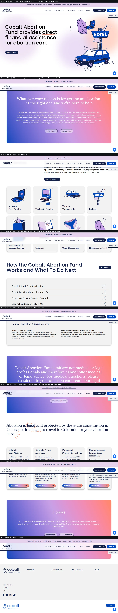
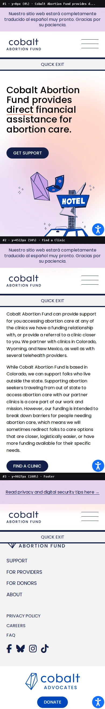

# UI Design System & Master Generation Blueprint: cobaltaf-org

> **Cobalt Abortion Fund** (https://cobaltaf.org/) — Read privacy and digital security tips here →





---

## 1. Executive Visual Persona & Design Archetype

- **Brand Essence & Persona**: **Cobalt Abortion Fund** (`https://cobaltaf.org/`). Read privacy and digital security tips here →
- **Capture Provenance**: Live browser capture (`tier1_fast`, HTTP `200`, captured `2026-11-24`).
- **Visual Archetype**: **Light-Substrate Editorial & Modular Grid System (`#ffffff` canvas, `#000000` ink, `#0000ff` accent)**.
- **Anti-AI-Slop Differentiators**:
  - **Live-Computed Chromatic Polarity**: Anchors the viewport in `#ffffff` (live computed `browser-default` `background-color` (`computed_styles.json`)) paired with `#000000` primary typography and `#0000ff` accents.
  - **Grounded Typographic Hierarchy**: Pairs `bookmania` for display copy (`Abortion Seekers`) with `Poppins`.
  - **Calibrated Spatial Grid & Motion**: Combines `100rem` container bounds (`gap: 2%`, padding `8px`) with `cubic-bezier(0.23,1,0.32,1)` easing and Three.js / WebGL Canvas Pipeline, Swiper Touch Carousel Engine.

---

## 2. Spatial Architecture & Modular Grid Mathematics

### Viewport Allocation & Container Geometry
- **Captured Journey Filmstrips**: Desktop `1280×6624px` (`assets/desktop-journey.webp`, `8` keyframes up to `y=6741px` / doc `7718px`), Mobile `390×2616px` (`assets/mobile-journey.webp`, `3` keyframes).
- **Master Container Bounds**: `100rem` (non-`@media` desktop container stylesheet rule).
- **Canvas Lateral Padding & Spacing**: `8px` lateral canvas padding with `2%` grid gap.
- **Border Radius Scale**: `8px`, `var(--border-radius)`, `50%`, `4px`.

### Responsive Breakpoint Architecture
- **Desktop Layout**: Multi-column CSS Grid / Flexbox layout at `1440px` (`max-width: 100rem`, `gap: 2%`).
- **Mobile Layout**: Single-column vertical stack at `390px` viewport width with `8px` horizontal padding.
- **Extracted CSS Media Queries**: `@media only screen and (max-width: 750px)`, `@media only screen and (max-width: 600px)`, `@media (max-width: 640px)`, `@media screen and (-webkit-min-device-pixel-ratio: 0)`.

---

## 3. Color System, Materiality & Atmospheric Lighting

### Semantic Palette & Source Grounding
| Semantic Role | Ground-Truth Value | Extracted Live / CSS Source |
|---|---|---|
| **Primary Canvas Substrate** | `#ffffff` | live computed `browser-default` `background-color` (`computed_styles.json`) |
| **Primary Typography Ink** | `#000000` | live computed `h1` `color` (`computed_styles.json`) |
| **Elevated Surface / Card Substrate** | `#dddddd` | `var(--wp-editor-canvas-background)` in `:root` |
| **Interactive Accent / Highlight** | `#0000ff` | `#sb_instagram .sbi_follow_btn a { background: blue }` (`#0000ff`) |
| **Secondary / Muted Copy** | `#468847` | `var(--success-text-color)` in `:root` |
| **Structural Hairline Border** | `#dcdee2` | `var(--ss-border-color)` in `:root` |
| **Variable Token (`--ss-primary-color`)** | `#5897fb` | `var(--ss-primary-color)` in `:root` |
| **Variable Token (`--ss-font-color`)** | `#4d4d4d` | `var(--ss-font-color)` in `:root` |
| **Variable Token (`--ss-font-placeholder-color`)** | `#8d8d8d` | `var(--ss-font-placeholder-color)` in `:root` |
| **Variable Token (`--ss-highlight-color`)** | `#fffb8c` | `var(--ss-highlight-color)` in `:root` |
| **Variable Token (`--ss-success-color`)** | `#00b755` | `var(--ss-success-color)` in `:root` |
| **Variable Token (`--ss-error-color`)** | `#dc3545` | `var(--ss-error-color)` in `:root` |

### Sanitized Root CSS Variables (`ui-ux.md` Ground Truth)
| Variable Name | Extracted Value | Semantic Role |
|---|---|---|
| `--ss-primary-color` | `#5897fb` | Brand / Palette Token |
| `--ss-bg-color` | `#ffffff` | Canvas / Surface Token |
| `--ss-font-color` | `#4d4d4d` | Brand / Palette Token |
| `--ss-font-placeholder-color` | `#8d8d8d` | Brand / Palette Token |
| `--ss-disabled-color` | `#dcdee2` | Brand / Palette Token |
| `--ss-border-color` | `#dcdee2` | Brand / Palette Token |
| `--ss-highlight-color` | `#fffb8c` | Canvas / Surface Token |
| `--ss-success-color` | `#00b755` | Brand / Palette Token |
| `--ss-error-color` | `#dc3545` | Brand / Palette Token |
| `--ss-focus-color` | `#5897fb` | Brand / Palette Token |
| `--ss-main-height` | `30px` | Layout / Spatial Grid Token |
| `--ss-content-height` | `300px` | Layout / Spatial Grid Token |
| `--ss-spacing-l` | `7px` | Layout / Spatial Grid Token |
| `--ss-spacing-m` | `5px` | Layout / Spatial Grid Token |
| `--ss-spacing-s` | `3px` | Layout / Spatial Grid Token |
| `--ss-animation-timing` | `0.2s` | Motion / Easing Token |

---

## 4. Typographic Scale & Editorial Hierarchy

### Font Family Stacks
- **Display Typography**: `bookmania`.
- **Primary Body Stack**: `Poppins`.
- **Technical / Metadata Stack**: not declared in live computed styles (uses primary stack / `ui-monospace`).

### Typographic Scale & Rules (Live Computed & Stylesheet Grounded)
- **Hero Display (`H1`)**: live computed `h1` (`font-size: 95.368px`, `line-height: 100.136px`, `font-weight: 400`); rule `,h1` (`font-size: clamp(2.5658rem,1.4795rem + 5...`, `font-weight: 400`).
- **Section Heading (`H2`)**: live computed `h2` (`font-size: 61.0352px`, `line-height: 64.087px`, `font-weight: 500`); rule `,h2` (`font-size: clamp(2.0273rem,1.4553rem + 2...`, `font-weight: 500`).
- **Body Copy**: live computed `body` (`font-size: 16px`, `line-height: 19.2px`, `font-weight: 400`); rule `p` (`font-size: var(--form-desc-size)`).
- **Metadata & Navigation Labels**: live computed `nav/a` (`font-size: 16px`, `line-height: 19.2px`, `font-weight: 400`); CSS variables `--container-small: 76rem`, `--label-padding: 0px 0px 5px 0px`; rule `,small` (`font-size: clamp(.8rem,.9173rem + -.1422...`).

---

## 5. Choreographed Motion & Interaction Physics

### Primary Easing Curves
- **Extracted Timing Functions**: `cubic-bezier(0.23,1,0.32,1)`, `cubic-bezier(0.77,0,0.175,1)`, `cubic-bezier(.28,.84,.42,1)`.

### Per-Element Transition & Choreography Rules
- **Selector `.with_frm_style .frm_form_fields`**: `transition: opacity 0.1s linear` extracted from `cobaltaf-org` stylesheet.
- **Selector `with_frm_style input:-webkit-auto...`**: `transition: background-color 5000s ease-in-out 0s` extracted from `cobaltaf-org` stylesheet.
- **Selector `rm_inside_container > textarea::p...`**: `transition: opacity 0.3s ease-in` extracted from `cobaltaf-org` stylesheet.
- **Extracted Easing Curve (`cubic-bezier(0.23,1,0.32,1)`)**: Governs interactive state transitions across `<header.header>` and `<section.section-2>`.
- **Runtime Interaction Engine**: Integrates Three.js / WebGL Canvas Pipeline, Swiper Touch Carousel Engine with `prefers-reduced-motion: reduce` fallback guards.
### Measured Runtime Scroll & Interaction Telemetry (`behavioral_journey_v2`)
- **Scroll Driver Mode**: `native` (max document height `7718px`, deepest scrollY reached `6741px` across `8` desktop keyframes).
- **Detected Scroll / Motion Libraries**: Native browser scroll / standard CSS transitions.
- **Hover Physics (`primary_cta` · `GET SUPPORT`)**: `color`: `rgb(255, 255, 255)` -> `rgb(134, 141, 161)`; `backgroundColor`: `rgb(19, 32, 72)` -> `rgb(140, 146, 166)` (`transition-duration: 0.3s, 0.3s`, `timing: ease-in, ease-in`).
- **Interactive Control Probe (`accordion` · `Step 2: Our Coordinator Reaches O...`)**: Triggered visual diff `10.388` (attr ` -> `, captured in `assets/state-interactive.webp`).
- **Route Transition Architecture**: First internal navigation (`/services/`) measured as `direct` in `902ms`.

---

## 6. Component Wireframe & Structural DOM Map

### Visual Layout Schematic — Desktop (`1440px`, Grounded in `dom.html` & Landmark Bounding Boxes)
```
┌────────────────────────────────────────────────────────────────────────┐
│ DESKTOP VIEWPORT (1440px) — Cobalt Abortion Fund                       │
│ ====================================================================== │
│ [ <header.header> (1440x89px)         | Support · Services · Find A  ] │
│ ---------------------------------------------------------------------- │
│ | HERO STAGE: <section.section> (w=1440px)                           | │
│ | H1: Abortion Seekers                                               | │
│ | Substrate: #ffffff | Ink: #000000 | Accent: #0000ff                | │
│ ---------------------------------------------------------------------- │
│ | SHOWCASE GRID (<section.section-2>) max-w: 100rem                  | │
│ | +------------------------------+  +------------------------------+ | │
│ | | Cobalt Abortion Fund provide |  | Whatever your reason is for  | | │
│ | +------------------------------+  +------------------------------+ | │
│ ---------------------------------------------------------------------- │
│ | DETAIL MODULE (<section.section-3>) — Our Services                 | │
│ ---------------------------------------------------------------------- │
│ [ FOOTER (<footer.footer>     ) | https://cobaltaf.org/                │
└────────────────────────────────────────────────────────────────────────┘
```

### Visual Layout Schematic — Mobile Reflow (`390px`)
```
┌────────────────────────────────────────────────────────────────────────┐
│ MOBILE VIEWPORT REFLOW (390px) — Single-Column Stack (gap: 2%)         │
│ ====================================================================== │
│ [ HEADER BAR (<header.header>         ) | Compact Menu (390px)         │
│ ---------------------------------------------------------------------- │
│ | HERO STAGE (<section.section>) — 390px Vertical Lead               | │
│ | H1: Abortion Seekers                                               | │
│ ---------------------------------------------------------------------- │
│ | SHOWCASE STACK (<section.section-2>) — 1-Col Stack                 | │
│ | [ Item 1: Cobalt Abortion Fund provides direct financial as...   ] | │
│ | [ Item 2: Whatever your reason is for getting an abortion,...    ] | │
│ ---------------------------------------------------------------------- │
│ | DETAIL STACK (<section.section-3>) — 1-Col (Our Services)          | │
│ ---------------------------------------------------------------------- │
│ [ FOOTER (<footer.footer>     ) | Stacked 390px Colophon               │
└────────────────────────────────────────────────────────────────────────┘
```

### Granular DOM Region Breakdown
1. **Brand Header & Navigation Bar (<header.header> — `cobaltaf-org`)**:
   - Landmark `<header class="header js-header">` (`1440x89px`) hosting `Cobalt Abortion Fund` navigation (`Support · Services · Find A Clinic · Resources · Necesito Apoyo`), DOM attributes (`data-acsb-sr-alert="true"`, `data-acsb-sr-only="true"`, `data-acsb-force-visible="true"`, `data-acsb`), and stylesheet rule `.with_frm_style .frm_button.frm_h... { display:none; }`.
2. **Hero Stage & Focal Lead (<section.section> — `Abortion Seekers`)**:
   - Landmark `<section class="section section-1">` presenting display lead `Abortion Seekers` and copy excerpt *"Read privacy and digital security tips here →"* over `#ffffff` canvas and `#000000` ink.
3. **Primary Showcase & Content Grid (<section.section-2> — `Cobalt Abortion Fund provides dire`)**:
   - Landmark `<section class="section section-2">` rendering section `Cobalt Abortion Fund provides direct financial as...` with copy *"Cobalt Abortion Fund provides direct financial assistance for abo"*, asset references (`analytics.js`, `gtm.js`, `static.addtoany.com`, `maps.googleapis.com`), and grid rule `le .frm-show-form div.frm_descrip... { text-align: var(--form-align); }`.
4. **Interactive Detail & Feature Matrix (<section.section-3> — `Whatever your reason is for gettin`)**:
   - Landmark `<section class="section section-3">` framing `Whatever your reason is for getting an abortion,...` and `Our Services` (*"We exist to support anyone seeking abortion care at one of the cl"*) with `#dddddd` surface cards, `#0000ff` accents, and `input:-webkit-autofill { -webkit-box-shadow: 0 0 0 30px white inset; }`.
5. **Colophon & Global Directory Footer (<footer.footer> — `https://cobaltaf.org/`)**:
   - Landmark `<footer class="footer">` anchoring `Cobalt Abortion Fund` footer links (`Support · Services · Find A Clinic · Resources · Necesito Apoyo`), copy *"We know there are many barriers people face while trying to "*, and `#dcdee2` structural dividers.
### Full Vertical Scroll Sequence (Desktop `1440×900` Keyframes)
- **Step 01** (`y=0px`, `0%`): Active landmark `Cobalt Abortion Fund provides direct financial as...` · sticky/fixed elements: `4`
- **Step 02** (`y=850px`, `13%`): Active landmark `Whatever your reason is for getting an abortion,...` · sticky/fixed elements: `4`
- **Step 03** (`y=1700px`, `25%`): Active landmark `Our Services` · sticky/fixed elements: `4`
- **Step 04** (`y=2550px`, `38%`): Active landmark `How the Cobalt Abortion Fund Works and What To Do...` · sticky/fixed elements: `4`
- **Step 05** (`y=4250px`, `62%`): Active landmark `Hours of Operation + Response Time` · sticky/fixed elements: `4`
- **Step 06** (`y=5100px`, `75%`): Active landmark `Cobalt Abortion Fund staff are not medical or leg...` · sticky/fixed elements: `4`
- **Step 07** (`y=5950px`, `87%`): Active landmark `Donors` · sticky/fixed elements: `4`
- **Step 08** (`y=6741px`, `99%`): Active landmark `Footer` · sticky/fixed elements: `4`

### Multi-Page Internal Route Map
- **Listing Route (`/services/`)**: `https://cobaltaf.org/services/` — H1: `Services`, scrollHeight `8106px`, transition `direct` (`902ms`)
- **Other Route (`/find-a-clinic/`)**: `https://cobaltaf.org/find-a-clinic/` — H1: `Find A Clinic`, scrollHeight `10792px`, transition `direct` (`769ms`)
- **Other Route (`/resources/`)**: `https://cobaltaf.org/resources/` — H1: `Resources`, scrollHeight `6977px`, transition `direct` (`1374ms`)

---

## 7. Master Zero-Shot AI Generation Prompt

```markdown
# Master Zero-Shot Frontend Generation Prompt: cobaltaf-org (Cobalt Abortion Fund)

You are a principal frontend architect and design systems engineer. Build a complete, production-ready web application replicating the exact design system, DOM landmarks, typographic hierarchy, color tokens, and motion physics of `cobaltaf-org` (**Cobalt Abortion Fund** — `https://cobaltaf.org/`).

### 1. Visual Archetype & Anti-AI-Slop Mandates
- **Archetype**: Light-Substrate Editorial & Modular Grid System (`#ffffff` canvas, `#000000` ink, `#0000ff` accent).
- **Identity & Domain Context**: Read privacy and digital security tips here →
- **Primary Substrate**: `#ffffff` (live computed `browser-default` `background-color` (`computed_styles.json`)), **Primary Ink**: `#000000`, **Accent / Highlight**: `#0000ff`.
- **Site-Specific Differentiators**:
  - **Live-Computed Chromatic Polarity**: Anchors the viewport in `#ffffff` (live computed `browser-default` `background-color` (`computed_styles.json`)) paired with `#000000` primary typography and `#0000ff` accents.
  - **Grounded Typographic Hierarchy**: Pairs `bookmania` for display copy (`Abortion Seekers`) with `Poppins`.
  - **Calibrated Spatial Grid & Motion**: Combines `100rem` container bounds (`gap: 2%`, padding `8px`) with `cubic-bezier(0.23,1,0.32,1)` easing and Three.js / WebGL Canvas Pipeline, Swiper Touch Carousel Engine.

### 2. Ground-Truth CSS Variables (`:root` Token Contract)
Declare and consume these exact custom properties extracted from `cobaltaf-org` in your global stylesheet:

:root {
  /* Cobalt Abortion Fund (cobaltaf-org) — Live-Grounded CSS Variables */
  --ss-primary-color: #5897fb; /* Brand / Palette Token (cobaltaf-org) */
  --ss-bg-color: #ffffff; /* Canvas / Surface Token (cobaltaf-org) */
  --ss-font-color: #4d4d4d; /* Brand / Palette Token (cobaltaf-org) */
  --ss-font-placeholder-color: #8d8d8d; /* Brand / Palette Token (cobaltaf-org) */
  --ss-disabled-color: #dcdee2; /* Brand / Palette Token (cobaltaf-org) */
  --ss-border-color: #dcdee2; /* Brand / Palette Token (cobaltaf-org) */
  --ss-highlight-color: #fffb8c; /* Canvas / Surface Token (cobaltaf-org) */
  --ss-success-color: #00b755; /* Brand / Palette Token (cobaltaf-org) */
  --ss-error-color: #dc3545; /* Brand / Palette Token (cobaltaf-org) */
  --ss-focus-color: #5897fb; /* Brand / Palette Token (cobaltaf-org) */
  --ss-main-height: 30px; /* Layout / Spatial Grid Token (cobaltaf-org) */
  --ss-content-height: 300px; /* Layout / Spatial Grid Token (cobaltaf-org) */
  --ss-spacing-l: 7px; /* Layout / Spatial Grid Token (cobaltaf-org) */
  --ss-spacing-m: 5px; /* Layout / Spatial Grid Token (cobaltaf-org) */
  --ss-spacing-s: 3px; /* Layout / Spatial Grid Token (cobaltaf-org) */
  --ss-animation-timing: 0.2s; /* Motion / Easing Token (cobaltaf-org) */
}

### 3. Semantic Color & Materiality Contract
Map every surface, ink, and border strictly to these source-grounded tokens:
- **Primary Canvas Substrate**: `#ffffff` — grounded in live computed `browser-default` `background-color` (`computed_styles.json`)
- **Primary Typography Ink**: `#000000` — grounded in live computed `h1` `color` (`computed_styles.json`)
- **Elevated Surface / Card Substrate**: `#dddddd` — grounded in `var(--wp-editor-canvas-background)` in `:root`
- **Interactive Accent / Highlight**: `#0000ff` — grounded in `#sb_instagram .sbi_follow_btn a { background: blue }` (`#0000ff`)
- **Secondary / Muted Copy**: `#468847` — grounded in `var(--success-text-color)` in `:root`
- **Structural Hairline Border**: `#dcdee2` — grounded in `var(--ss-border-color)` in `:root`
- **Variable Token (`--ss-primary-color`)**: `#5897fb` — grounded in `var(--ss-primary-color)` in `:root`
- **Variable Token (`--ss-font-color`)**: `#4d4d4d` — grounded in `var(--ss-font-color)` in `:root`
- **Variable Token (`--ss-font-placeholder-color`)**: `#8d8d8d` — grounded in `var(--ss-font-placeholder-color)` in `:root`
- **Variable Token (`--ss-highlight-color`)**: `#fffb8c` — grounded in `var(--ss-highlight-color)` in `:root`
- **Variable Token (`--ss-success-color`)**: `#00b755` — grounded in `var(--ss-success-color)` in `:root`
- **Variable Token (`--ss-error-color`)**: `#dc3545` — grounded in `var(--ss-error-color)` in `:root`

### 4. Spatial Grid, Container Bounds & Responsive Breakpoints
- **Desktop Viewport Reference**: `1280×6624px` (multi-frame vertical journey filmstrip (6624px), `1440px` standard desktop width).
- **Mobile Viewport Reference**: `390×2616px` (multi-frame vertical journey filmstrip (2616px), `390px` standard mobile width).
- **Container Max-Width**: `100rem` (non-`@media` desktop container stylesheet rule)
- **Padding & Gutters**: `8px` lateral canvas padding with `2%` grid gap
- **Desktop Grid**: Multi-column CSS Grid / Flexbox layout at `1440px` (`max-width: 100rem`, `gap: 2%`)
- **Mobile Adaptation**: Single-column vertical stack at `390px` viewport width with `8px` horizontal padding
- **Media Queries**: `@media only screen and (max-width: 750px)`, `@media only screen and (max-width: 600px)`, `@media (max-width: 640px)`, `@media screen and (-webkit-min-device-pixel-ratio: 0)`
- **Corner Radii**: `8px`, `var(--border-radius)`, `50%`, `4px`

### 5. Typography & Editorial Scale Contract
- **Display Font Stack**: `bookmania`
- **Body Font Stack**: `Poppins`
- **Monospace / Technical Font Stack**: not declared in live computed styles (uses primary stack / `ui-monospace`)
- **H1 Display Rule**: live computed `h1` (`font-size: 95.368px`, `line-height: 100.136px`, `font-weight: 400`); rule `,h1` (`font-size: clamp(2.5658rem,1.4795rem + 5...`, `font-weight: 400`)
- **H2 Section Rule**: live computed `h2` (`font-size: 61.0352px`, `line-height: 64.087px`, `font-weight: 500`); rule `,h2` (`font-size: clamp(2.0273rem,1.4553rem + 2...`, `font-weight: 500`)
- **Body Copy Rule**: live computed `body` (`font-size: 16px`, `line-height: 19.2px`, `font-weight: 400`); rule `p` (`font-size: var(--form-desc-size)`)
- **Metadata & Index Rule**: live computed `nav/a` (`font-size: 16px`, `line-height: 19.2px`, `font-weight: 400`); CSS variables `--container-small: 76rem`, `--label-padding: 0px 0px 5px 0px`; rule `,small` (`font-size: clamp(.8rem,.9173rem + -.1422...`)

### 6. Component Hierarchy, Verbatim Copy & Real DOM Landmarks
Scaffold `cobaltaf-org` (`Cobalt Abortion Fund`) with these exact structural regions, extracted copy, and CSS rules from `dom.html`:
1. **Brand Header & Navigation Bar (<header.header> — `cobaltaf-org`)**:
   - DOM & Selectors: Landmark `<header class="header js-header">` (`1440x89px`) hosting `Cobalt Abortion Fund` navigation (`Support · Services · Find A Clinic · Resources · Necesito Apoyo`), DOM attributes (`data-acsb-sr-alert="true"`, `data-acsb-sr-only="true"`, `data-acsb-force-visible="true"`, `data-acsb`), and stylesheet rule `.with_frm_style .frm_button.frm_h... { display:none; }`.
   - Responsive Contract: Header `Brand Header & Navigation Bar (<header.header> — `cobaltaf-org`)` (`cobaltaf-org`) adapts across `@media only screen and (max-width: 750px)`, `@media only screen and (max-width: 600px)`, `@media (max-width: 640px)`, `@media screen and (-webkit-min-device-pixel-ratio: 0)` with `cubic-bezier(0.23,1,0.32,1)`, `cubic-bezier(0.77,0,0.175,1)`, `cubic-bezier(.28,.84,.42,1)` transitions and links `Support · Services · Find A Clinic · Resources · Necesito Apoyo`.
2. **Hero Stage & Focal Lead (<section.section> — `Abortion Seekers`)**:
   - DOM & Selectors: Landmark `<section class="section section-1">` presenting display lead `Abortion Seekers` and copy excerpt *"Read privacy and digital security tips here →"* over `#ffffff` canvas and `#000000` ink.
   - Responsive Contract: Hero stage (`1280×6624px` desktop / `390×2616px` mobile) sets `#ffffff` background with `#000000` headline `Abortion Seekers`.
3. **Primary Showcase & Content Grid (<section.section-2> — `Cobalt Abortion Fund provides dire`)**:
   - DOM & Selectors: Landmark `<section class="section section-2">` rendering section `Cobalt Abortion Fund provides direct financial as...` with copy *"Cobalt Abortion Fund provides direct financial assistance for abo"*, asset references (`analytics.js`, `gtm.js`, `static.addtoany.com`, `maps.googleapis.com`), and grid rule `le .frm-show-form div.frm_descrip... { text-align: var(--form-align); }`.
   - Responsive Contract: Showcase grid `Primary Showcase & Content Grid (<section.section-2> — `Cobalt Abortion Fund provides dire`)` applies Multi-column CSS Grid / Flexbox layout at `1440px` (`max-width: 100rem`, `gap: 2%`) on desktop and Single-column vertical stack at `390px` viewport width with `8px` horizontal padding on mobile.
4. **Interactive Detail & Feature Matrix (<section.section-3> — `Whatever your reason is for gettin`)**:
   - DOM & Selectors: Landmark `<section class="section section-3">` framing `Whatever your reason is for getting an abortion,...` and `Our Services` (*"We exist to support anyone seeking abortion care at one of the cl"*) with `#dddddd` surface cards, `#0000ff` accents, and `input:-webkit-autofill { -webkit-box-shadow: 0 0 0 30px white inset; }`.
   - Responsive Contract: Detail module `Interactive Detail & Feature Matrix (<section.section-3> — `Whatever your reason is for gettin`)` uses `8px`, `var(--border-radius)`, `50%`, `4px` radii, `#0000ff` highlights, and assets (analytics.js, gtm.js, static.addtoany.com).
5. **Colophon & Global Directory Footer (<footer.footer> — `https://cobaltaf.org/`)**:
   - DOM & Selectors: Landmark `<footer class="footer">` anchoring `Cobalt Abortion Fund` footer links (`Support · Services · Find A Clinic · Resources · Necesito Apoyo`), copy *"We know there are many barriers people face while trying to "*, and `#dcdee2` structural dividers.
   - Responsive Contract: Footer `Colophon & Global Directory Footer (<footer.footer> — `https://cobaltaf.org/`)` aligns to `100rem` (non-`@media` desktop container stylesheet rule) with `8px` lateral canvas padding with `2%` grid gap and attributes (data-acsb-sr-alert="true", data-acsb-sr-only="true", data-acsb-force-visible="true").

#### Verbatim DOM Copy Excerpts (`dom.html`)
- Copy Excerpt 1: *"Read privacy and digital security tips here →"*
- Copy Excerpt 2: *"Cobalt Abortion Fund provides direct financial assistance for abortion care."*
- Copy Excerpt 3: *"We exist to support anyone seeking abortion care at one of the clinics or teleheal..."*
- Copy Excerpt 4: *"We know there are many barriers people face while trying to access abortion care...."*

### 7. Motion, Extracted Stylesheet Rules & Interaction Choreography
- **Primary Easing Functions**: `cubic-bezier(0.23,1,0.32,1)`, `cubic-bezier(0.77,0,0.175,1)`, `cubic-bezier(.28,.84,.42,1)`
- **Extracted Stylesheet Rules (`cobaltaf-org`)**:
- `.with_frm_style .frm_button.frm_h... { display:none; }`
- `le .frm-show-form div.frm_descrip... { text-align: var(--form-align); }`
- `input:-webkit-autofill { -webkit-box-shadow: 0 0 0 30px white inset; }`
- `.with_frm_style fieldset { min-width:0;display: block; }`
- `.with_frm_style fieldset fieldset { border:none;margin:0;padding:0;background-color:transparent; }`
- **Per-Selector Transition Rules**:
- **Selector `.with_frm_style .frm_form_fields`**: `transition: opacity 0.1s linear` extracted from `cobaltaf-org` stylesheet.
- **Selector `with_frm_style input:-webkit-auto...`**: `transition: background-color 5000s ease-in-out 0s` extracted from `cobaltaf-org` stylesheet.
- **Selector `rm_inside_container > textarea::p...`**: `transition: opacity 0.3s ease-in` extracted from `cobaltaf-org` stylesheet.
- **Extracted Easing Curve (`cubic-bezier(0.23,1,0.32,1)`)**: Governs interactive state transitions across `<header.header>` and `<section.section-2>`.
- **Runtime Interaction Engine**: Integrates Three.js / WebGL Canvas Pipeline, Swiper Touch Carousel Engine with `prefers-reduced-motion: reduce` fallback guards.
### 7b. Full-Page Scroll Choreography, Interactive States & Multi-Page Routes
- **Scroll Mechanics**: Implement `native` vertical progression up to `7718px` across 8 distinct viewport chapters.
- **Vertical Chapter Sequence**: Cobalt Abortion Fund provid... (0%) -> Whatever your reason is for... (13%) -> Our Services (25%) -> How the Cobalt Abortion Fun... (38%) -> Hours of Operation + Respon... (62%) -> Cobalt Abortion Fund staff... (75%) -> Donors (87%) -> Footer (99%).
- **Hover Micro-Interaction (`primary_cta`)**: Animate `color, backgroundColor` with `0.3s, 0.3s ease-in, ease-in`.
- **Multi-Page Routes**: Scaffold internal routes `/services/` (listing, direct), `/find-a-clinic/` (other, direct), `/resources/` (other, direct) sharing the global header/footer shell and design tokens.

### 8. Technical Deliverables
- Implement in Next.js (App Router) with TypeScript and Tailwind CSS consuming the `:root` custom properties defined above for `cobaltaf-org`.
- Reproduce both the `1440px` desktop architecture and `390px` mobile breakpoint transitions, preserving semantic HTML5 landmarks (`<header>`, `<nav>`, `<main>`, `<section>`, `<footer>`) and `prefers-reduced-motion` accessibility guards.
```
---

## 8. Full-Page Scroll Journey, Interactive States & Subpage Inventory

### Desktop Scroll Keyframes (`1440×900` WebP)
| Step | Scroll Y | Progress | Active Landmark / Section | Sticky/Fixed | Visual Asset |
| :---: | :---: | :---: | :--- | :---: | :--- |
| `#01` | `0px` | `0%` | Cobalt Abortion Fund provides direct financia... | `4` | [desktop-step-01.webp](assets/desktop-step-01.webp) |
| `#02` | `850px` | `13%` | Whatever your reason is for getting an aborti... | `4` | [desktop-step-02.webp](assets/desktop-step-02.webp) |
| `#03` | `1700px` | `25%` | Our Services | `4` | [desktop-step-03.webp](assets/desktop-step-03.webp) |
| `#04` | `2550px` | `38%` | How the Cobalt Abortion Fund Works and What T... | `4` | [desktop-step-04.webp](assets/desktop-step-04.webp) |
| `#05` | `4250px` | `62%` | Hours of Operation + Response Time | `4` | [desktop-step-05.webp](assets/desktop-step-05.webp) |
| `#06` | `5100px` | `75%` | Cobalt Abortion Fund staff are not medical or... | `4` | [desktop-step-06.webp](assets/desktop-step-06.webp) |
| `#07` | `5950px` | `87%` | Donors | `4` | [desktop-step-07.webp](assets/desktop-step-07.webp) |
| `#08` | `6741px` | `99%` | Footer | `4` | [desktop-step-08.webp](assets/desktop-step-08.webp) |

### Mobile Condensed Keyframes (`390×844` WebP)
| Step | Scroll Y | Progress | Active Landmark | Visual Asset |
| :---: | :---: | :---: | :--- | :--- |
| `#01` | `0px` | `0%` | Cobalt Abortion Fund provides direct fina... | [mobile-step-01.webp](assets/mobile-step-01.webp) |
| `#02` | `4513px` | `50%` | Find a Clinic | [mobile-step-02.webp](assets/mobile-step-02.webp) |
| `#03` | `9027px` | `100%` | Footer | [mobile-step-03.webp](assets/mobile-step-03.webp) |

### Interactive UI State Captures (`1440×900` WebP)
| State Type | Trigger / Observation | Visual Asset |
| :--- | :--- | :--- |
| `interactive_control` | Control `accordion` (`Step 2: Our Coordinator Reach...`, diff `10.388`) | [state-interactive.webp](assets/state-interactive.webp) |

### Internal Subpage Filmstrips (`1080px` Wide WebP)
| # | Template | Route URL | H1 / Title | Scroll Height | Transition | Filmstrip Asset |
| :-: | :---: | :--- | :--- | :---: | :---: | :--- |
| `1` | `listing` | `https://cobaltaf.org/services/` | Services | `8106px` | `direct` (`902ms`) | [subpage-01-services.webp](assets/subpage-01-services.webp) |
| `2` | `other` | `https://cobaltaf.org/find-a-clinic/` | Find A Clinic | `10792px` | `direct` (`769ms`) | [subpage-02-find-a-clinic.webp](assets/subpage-02-find-a-clinic.webp) |
| `3` | `other` | `https://cobaltaf.org/resources/` | Resources | `6977px` | `direct` (`1374ms`) | [subpage-03-resources.webp](assets/subpage-03-resources.webp) |

