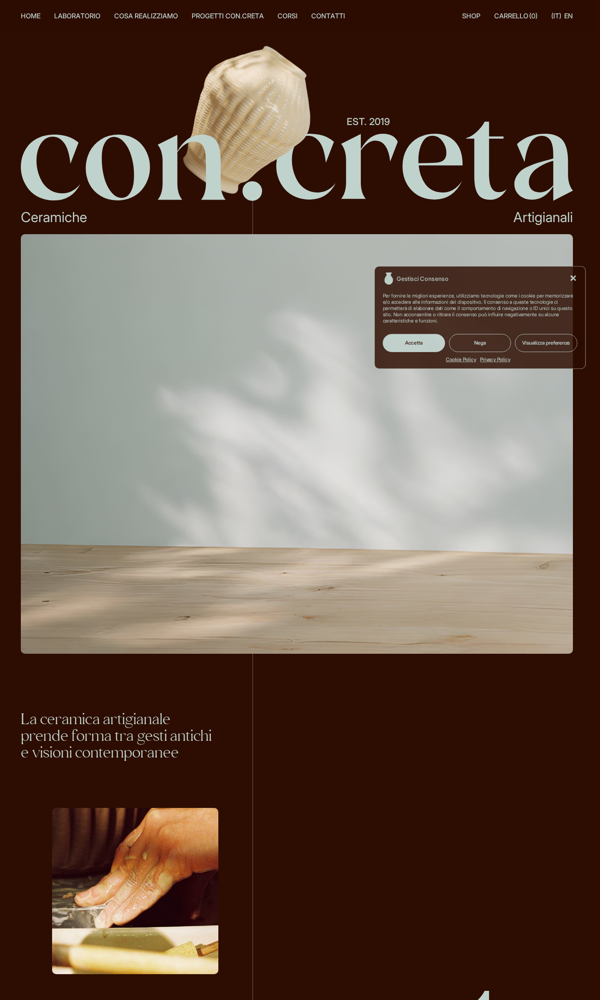
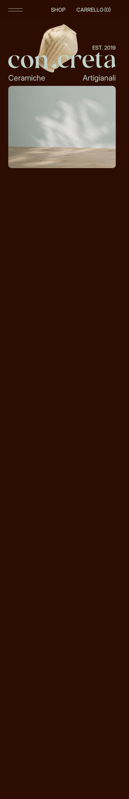

# UI Design System & Master Generation Blueprint: concretaceramiche-it

> **Concreta Ceramiche Artigianali Fatte a Mano** (https://concretaceramiche.it/) — Ceramiche artigianali uniche, realizzate a mano nei Castelli Romani. Gres, stampa 3D e tradizione familiare in ogni pezzo. Scopri la coll...



---

## 1. Executive Visual Persona & Design Archetype

- **Brand Essence & Persona**: **Concreta Ceramiche Artigianali Fatte a Mano** (`https://concretaceramiche.it/`). Ceramiche artigianali uniche, realizzate a mano nei Castelli Romani. Gres, stampa 3D e tradizione familiare in ogni pezzo. Scopri la coll...
- **Capture Provenance**: Live browser capture (`tier1_fast`, HTTP `200`, captured `2026-11-23`).
- **Visual Archetype**: **High-Contrast Obsidian / Atmospheric Design System (`#2d0d01` canvas, `#c0d2cc` ink, `#ff0000` accent)**.
- **Anti-AI-Slop Differentiators**:
  - **Live-Computed Chromatic Polarity**: Anchors the viewport in `#2d0d01` (live computed `body` `background-color` (`computed_styles.json`)) paired with `#c0d2cc` primary typography and `#ff0000` accents.
  - **Grounded Typographic Hierarchy**: Pairs `Elgoc` for display copy (`ConCreta ceramiche artigianali Roma`) with `Elgoc` and `SFMono-Regular`.
  - **Calibrated Spatial Grid & Motion**: Combines `1325px` container bounds (`gap: 12px`, padding `15px`) with `cubic-bezier(.5856,.0703,.4143,.9297)` easing and Three.js / WebGL Canvas Pipeline, Swiper Touch Carousel Engine.

---

## 2. Spatial Architecture & Modular Grid Mathematics



### Viewport Allocation & Container Geometry
- **Captured Viewport Dimensions**: Desktop `1440×2400px` (`assets/desktop.png`, clamped at 2400px live multi-section capture), Mobile `390×2400px` (`assets/mobile.png`, clamped at 2400px live multi-section capture).
- **Master Container Bounds**: `1325px` (measured widest bounded `<section>` landmark width on `1440px` desktop).
- **Canvas Lateral Padding & Spacing**: `15px` lateral canvas padding with `12px` grid gap.
- **Border Radius Scale**: `4px`, `3px`, `50%`, `.25rem`.

### Responsive Breakpoint Architecture
- **Desktop Layout**: Multi-column CSS Grid / Flexbox layout at `1440px` (`max-width: 1325px`, `gap: 12px`).
- **Mobile Layout**: Single-column vertical stack at `390px` viewport width with `15px` horizontal padding.
- **Extracted CSS Media Queries**: `@media only screen and (min-width:768px)`, `@media only screen and (min-width:1168px)`, `@media screen and (prefers-reduced-motion:reduce)`, `@media (max-width:600px)`.

---

## 3. Color System, Materiality & Atmospheric Lighting

### Semantic Palette & Source Grounding
| Semantic Role | Ground-Truth Value | Extracted Live / CSS Source |
|---|---|---|
| **Primary Canvas Substrate** | `#2d0d01` | live computed `body` `background-color` (`computed_styles.json`) |
| **Primary Typography Ink** | `#c0d2cc` | live computed `h1` `color` (`computed_styles.json`) |
| **Elevated Surface / Card Substrate** | `#cd2653` | `d__products .wc-block-grid__pro... { background: #cd2653 }` |
| **Interactive Accent / Highlight** | `#ff0000` | `.woocommerce a.remove { color: red }` (`#ff0000`) |
| **Secondary / Muted Copy** | `#767676` | `var(--wc-subtext)` in `:root` |
| **Structural Hairline Border** | `#230806` | `var(--wc-form-border-color)` in `:root` (`rgba(32, 7, 7, 0.8)`) |
| **Variable Token (`--wp-block-synced-color`)** | `#7a00df` | `var(--wp-block-synced-color)` in `:root` |
| **Variable Token (`--wp-editor-canvas-background`)** | `#dddddd` | `var(--wp-editor-canvas-background)` in `:root` |
| **Variable Token (`--wp-admin-theme-color`)** | `#007cba` | `var(--wp-admin-theme-color)` in `:root` |
| **Variable Token (`--wp-admin-theme-color-darker-10`)** | `#006ba1` | `var(--wp-admin-theme-color-darker-10)` in `:root` |
| **Variable Token (`--wp-admin-theme-color-darker-20`)** | `#005a87` | `var(--wp-admin-theme-color-darker-20)` in `:root` |
| **Variable Token (`--woocommerce`)** | `#720eec` | `var(--woocommerce)` in `:root` |
| **Variable Token (`--wc-green`)** | `#008a20` | `var(--wc-green)` in `:root` |

### Sanitized Root CSS Variables (`ui-ux.md` Ground Truth)
| Variable Name | Extracted Value | Semantic Role |
|---|---|---|
| `--wp-block-synced-color` | `#7a00df` | Brand / Palette Token |
| `--wp-block-synced-color--rgb` | `122,0,223` | Brand / Palette Token |
| `--wp-bound-block-color` | `var(--wp-block-synced-color)` | Brand / Palette Token |
| `--wp-editor-canvas-background` | `#ddd` | Canvas / Surface Token |
| `--wp-admin-theme-color` | `#007cba` | Brand / Palette Token |
| `--wp-admin-theme-color--rgb` | `0,124,186` | Brand / Palette Token |
| `--wp-admin-theme-color-darker-10` | `#006ba1` | Canvas / Surface Token |
| `--wp-admin-theme-color-darker-10--rgb` | `0,107,160.5` | Canvas / Surface Token |
| `--wp-admin-theme-color-darker-20` | `#005a87` | Canvas / Surface Token |
| `--wp-admin-theme-color-darker-20--rgb` | `0,90,135` | Canvas / Surface Token |
| `--wp-admin-border-width-focus` | `2px` | Layout / Spatial Grid Token |
| `--wp-admin--admin-bar--position-offset` | `var(--wp-admin--admin-bar--height,0px)` | Dimension / Scale Token |
| `--drawer-width` | `480px` | Layout / Spatial Grid Token |
| `--neg-drawer-width` | `calc(var(--drawer-width) * -1)` | Layout / Spatial Grid Token |
| `--woocommerce` | `#720eec` | Color / Atmospheric Token |
| `--wc-green` | `#008a20` | Color / Atmospheric Token |

---

## 4. Typographic Scale & Editorial Hierarchy

### Font Family Stacks
- **Display Typography**: `Elgoc`.
- **Primary Body Stack**: `Elgoc`.
- **Technical / Metadata Stack**: `SFMono-Regular`.

### Typographic Scale & Rules (Live Computed & Stylesheet Grounded)
- **Hero Display (`H1`)**: live computed `h1` (`font-size: 16px`, `line-height: 16px`, `font-weight: 400`); rule `h1` (`font-size: 25px`, `line-height: 32px`).
- **Section Heading (`H2`)**: live computed `h2` (`font-size: 40px`, `line-height: 40px`, `font-weight: 400`).
- **Body Copy**: live computed `body` (`font-size: 16px`, `line-height: 16px`, `font-weight: 400`); CSS variables `--cmplz_category_body_font_size: 12px`; rule `p` (`font-weight: 500`).
- **Metadata & Navigation Labels**: live computed `nav/a` (`font-size: 16px`, `line-height: 16px`, `font-weight: 400`); rule `small` (`font-size: 15px`).

---

## 5. Choreographed Motion & Interaction Physics

### Primary Easing Curves
- **Extracted Timing Functions**: `cubic-bezier(.5856,.0703,.4143,.9297)`, `cubic-bezier(.795,-.035,0,1)`, `cubic-bezier(.075,.82,.165,1)`.

### Per-Element Transition & Choreography Rules
- **Selector `mponents-notice-banner__content ....`**: `transition: all .2s ease-in-out` extracted from `concretaceramiche-it` stylesheet.
- **Selector `.wc-block-components-button:not(....`**: `transition: box-shadow .1s linear` extracted from `concretaceramiche-it` stylesheet.
- **Selector `k-components-radio-control__input...`**: `transition: opacity .2s ease` extracted from `concretaceramiche-it` stylesheet.
- **Extracted Easing Curve (`cubic-bezier(.5856,.0703,.4143,.9297)`)**: Governs interactive state transitions across `<header.negative>` and `<section.logo>`.
- **Runtime Interaction Engine**: Integrates Three.js / WebGL Canvas Pipeline, Swiper Touch Carousel Engine with `prefers-reduced-motion: reduce` fallback guards.

---

## 6. Component Wireframe & Structural DOM Map

### Visual Layout Schematic — Desktop (`1440px`, Grounded in `dom.html` & Landmark Bounding Boxes)
```
┌────────────────────────────────────────────────────────────────────────┐
│ DESKTOP VIEWPORT (1440px) — Concreta Ceramiche Artigianali Fatte a Man │
│ ====================================================================== │
│ [ <header.negative> (1425x78px)       | h o m e h o m e · c o r s i  ] │
│ ---------------------------------------------------------------------- │
│ | HERO STAGE: <section.rank-math-schema> (w=1425px)                  | │
│ | H1: ConCreta ceramiche artigianali Roma                            | │
│ | Substrate: #2d0d01 | Ink: #c0d2cc | Accent: #ff0000                | │
│ ---------------------------------------------------------------------- │
│ | SHOWCASE GRID (<section.logo>) max-w: 1325px                       | │
│ | +------------------------------+  +------------------------------+ | │
│ | | La ceramica artigianale pren |  | Oggetti in ceramica nati dal | | │
│ | +------------------------------+  +------------------------------+ | │
│ ---------------------------------------------------------------------- │
│ | DETAIL MODULE (<section.wp-singular>) — Un luogo dove la terr      | │
│ ---------------------------------------------------------------------- │
│ [ FOOTER (<footer.page-templat) | https://concretaceramiche.it/        │
└────────────────────────────────────────────────────────────────────────┘
```

### Visual Layout Schematic — Mobile Reflow (`390px`)
```
┌────────────────────────────────────────────────────────────────────────┐
│ MOBILE VIEWPORT REFLOW (390px) — Single-Column Stack (gap: 12px)       │
│ ====================================================================== │
│ [ HEADER BAR (<header.negative>       ) | Compact Menu (390px)         │
│ ---------------------------------------------------------------------- │
│ | HERO STAGE (<section.rank-math-schem) — 390px Vertical Lead        | │
│ | H1: ConCreta ceramiche artigianali Roma                            | │
│ ---------------------------------------------------------------------- │
│ | SHOWCASE STACK (<section.logo>) — 1-Col Stack                      | │
│ | [ Item 1: La ceramica artigianale prende forma tra gesti an...   ] | │
│ | [ Item 2: Oggetti in ceramica nati dall’incontro tra tecnic...   ] | │
│ ---------------------------------------------------------------------- │
│ | DETAIL STACK (<section.wp-singular>) — 1-Col (Un luogo dove la t)  | │
│ ---------------------------------------------------------------------- │
│ [ FOOTER (<footer.page-templat) | Stacked 390px Colophon               │
└────────────────────────────────────────────────────────────────────────┘
```

### Granular DOM Region Breakdown
1. **Brand Header & Navigation Bar (<header.negative> — `concretaceramiche-it`)**:
   - Landmark `<header class="negative fixed">` (`1425x78px`) hosting `Concreta Ceramiche Artigianali Fatte` navigation (`h o m e h o m e · c o r s i c o r s i · S h o p S h o p · EN · Home`), DOM attributes (`data-wp-strategy="defer"`, `data-wp-strategy="defer"`, `data-wp-strategy="defer"`, `data-wp-strategy="defer"`), and stylesheet rule `body.wc-modal--open { overflow:hidden }`.
2. **Hero Stage & Focal Lead (<section.rank-math-schema> — `ConCreta ceramiche artigianali Rom`)**:
   - Landmark `<section class="rank-math-schema">` presenting display lead `ConCreta ceramiche artigianali Roma` and copy excerpt *"Nel cuore dei Castelli Romani, diamo forma a oggetti che uniscono"* over `#2d0d01` canvas and `#c0d2cc` ink.
3. **Primary Showcase & Content Grid (<section.logo> — `La ceramica artigianale prende for`)**:
   - Landmark `<section class="logo">` rendering section `La ceramica artigianale prende forma tra gesti an...` with copy *"l a b o r a t o r i o l a b o r a t o r i o"*, asset references (`Elgoc-Bold.woff2`, `Elgoc-Regular.woff2`, `Inter28pt-Medium.woff2`, `Inter28pt-Regular.woff2`), and grid rule `products .wc-block-grid__product-... { display:block;position:relative;text-decoration:none }`.
4. **Interactive Detail & Feature Matrix (<section.wp-singular> — `Oggetti in ceramica nati dall’inco`)**:
   - Landmark `<section class="wp-singular">` framing `Oggetti in ceramica nati dall’incontro tra tecnic...` and `Un luogo dove la terra diventa forma e prende vita` (*"l a b o r a t o r i o"*) with `#cd2653` surface cards, `#ff0000` accents, and `roducts .wc-block-grid__product-i... { border:0;box-shadow:none;outline:0;text-decoration:none }`.
5. **Colophon & Global Directory Footer (<footer.page-template> — `https://concretaceramiche.it/`)**:
   - Landmark `<footer class="page-template">` anchoring `Concreta Ceramiche Artigianali F` footer links (`h o m e h o m e · c o r s i c o r s i · S h o p S h o p · EN · Home`), copy *"c o s a r e a l i z z i a m o c o s a r e a l i z z i a m o"*, and `#230806` structural dividers.

---

## 7. Master Zero-Shot AI Generation Prompt

```markdown
# Master Zero-Shot Frontend Generation Prompt: concretaceramiche-it (Concreta Ceramiche Artigianali Fatte a Mano)

You are a principal frontend architect and design systems engineer. Build a complete, production-ready web application replicating the exact design system, DOM landmarks, typographic hierarchy, color tokens, and motion physics of `concretaceramiche-it` (**Concreta Ceramiche Artigianali Fatte a Mano** — `https://concretaceramiche.it/`).

### 1. Visual Archetype & Anti-AI-Slop Mandates
- **Archetype**: High-Contrast Obsidian / Atmospheric Design System (`#2d0d01` canvas, `#c0d2cc` ink, `#ff0000` accent).
- **Identity & Domain Context**: Ceramiche artigianali uniche, realizzate a mano nei Castelli Romani. Gres, stampa 3D e tradizione familiare in ogni pezzo. Scopri la coll...
- **Primary Substrate**: `#2d0d01` (live computed `body` `background-color` (`computed_styles.json`)), **Primary Ink**: `#c0d2cc`, **Accent / Highlight**: `#ff0000`.
- **Site-Specific Differentiators**:
  - **Live-Computed Chromatic Polarity**: Anchors the viewport in `#2d0d01` (live computed `body` `background-color` (`computed_styles.json`)) paired with `#c0d2cc` primary typography and `#ff0000` accents.
  - **Grounded Typographic Hierarchy**: Pairs `Elgoc` for display copy (`ConCreta ceramiche artigianali Roma`) with `Elgoc` and `SFMono-Regular`.
  - **Calibrated Spatial Grid & Motion**: Combines `1325px` container bounds (`gap: 12px`, padding `15px`) with `cubic-bezier(.5856,.0703,.4143,.9297)` easing and Three.js / WebGL Canvas Pipeline, Swiper Touch Carousel Engine.

### 2. Ground-Truth CSS Variables (`:root` Token Contract)
Declare and consume these exact custom properties extracted from `concretaceramiche-it` in your global stylesheet:

:root {
  /* Concreta Ceramiche Artigianali Fatte a Mano (concretaceramiche-it) — Live-Grounded CSS Variables */
  --wp-block-synced-color: #7a00df; /* Brand / Palette Token (concretaceramiche-it) */
  --wp-block-synced-color--rgb: 122,0,223; /* Brand / Palette Token (concretaceramiche-it) */
  --wp-bound-block-color: var(--wp-block-synced-color); /* Brand / Palette Token (concretaceramiche-it) */
  --wp-editor-canvas-background: #ddd; /* Canvas / Surface Token (concretaceramiche-it) */
  --wp-admin-theme-color: #007cba; /* Brand / Palette Token (concretaceramiche-it) */
  --wp-admin-theme-color--rgb: 0,124,186; /* Brand / Palette Token (concretaceramiche-it) */
  --wp-admin-theme-color-darker-10: #006ba1; /* Canvas / Surface Token (concretaceramiche-it) */
  --wp-admin-theme-color-darker-10--rgb: 0,107,160.5; /* Canvas / Surface Token (concretaceramiche-it) */
  --wp-admin-theme-color-darker-20: #005a87; /* Canvas / Surface Token (concretaceramiche-it) */
  --wp-admin-theme-color-darker-20--rgb: 0,90,135; /* Canvas / Surface Token (concretaceramiche-it) */
  --wp-admin-border-width-focus: 2px; /* Layout / Spatial Grid Token (concretaceramiche-it) */
  --wp-admin--admin-bar--position-offset: var(--wp-admin--admin-bar--height,0px); /* Dimension / Scale Token (concretaceramiche-it) */
  --drawer-width: 480px; /* Layout / Spatial Grid Token (concretaceramiche-it) */
  --neg-drawer-width: calc(var(--drawer-width) * -1); /* Layout / Spatial Grid Token (concretaceramiche-it) */
  --woocommerce: #720eec; /* Color / Atmospheric Token (concretaceramiche-it) */
  --wc-green: #008a20; /* Color / Atmospheric Token (concretaceramiche-it) */
}

### 3. Semantic Color & Materiality Contract
Map every surface, ink, and border strictly to these source-grounded tokens:
- **Primary Canvas Substrate**: `#2d0d01` — grounded in live computed `body` `background-color` (`computed_styles.json`)
- **Primary Typography Ink**: `#c0d2cc` — grounded in live computed `h1` `color` (`computed_styles.json`)
- **Elevated Surface / Card Substrate**: `#cd2653` — grounded in `d__products .wc-block-grid__pro... { background: #cd2653 }`
- **Interactive Accent / Highlight**: `#ff0000` — grounded in `.woocommerce a.remove { color: red }` (`#ff0000`)
- **Secondary / Muted Copy**: `#767676` — grounded in `var(--wc-subtext)` in `:root`
- **Structural Hairline Border**: `#230806` — grounded in `var(--wc-form-border-color)` in `:root` (`rgba(32, 7, 7, 0.8)`)
- **Variable Token (`--wp-block-synced-color`)**: `#7a00df` — grounded in `var(--wp-block-synced-color)` in `:root`
- **Variable Token (`--wp-editor-canvas-background`)**: `#dddddd` — grounded in `var(--wp-editor-canvas-background)` in `:root`
- **Variable Token (`--wp-admin-theme-color`)**: `#007cba` — grounded in `var(--wp-admin-theme-color)` in `:root`
- **Variable Token (`--wp-admin-theme-color-darker-10`)**: `#006ba1` — grounded in `var(--wp-admin-theme-color-darker-10)` in `:root`
- **Variable Token (`--wp-admin-theme-color-darker-20`)**: `#005a87` — grounded in `var(--wp-admin-theme-color-darker-20)` in `:root`
- **Variable Token (`--woocommerce`)**: `#720eec` — grounded in `var(--woocommerce)` in `:root`
- **Variable Token (`--wc-green`)**: `#008a20` — grounded in `var(--wc-green)` in `:root`

### 4. Spatial Grid, Container Bounds & Responsive Breakpoints
- **Desktop Viewport Reference**: `1440×2400px` (clamped at 2400px live multi-section capture, `1440px` standard desktop width).
- **Mobile Viewport Reference**: `390×2400px` (clamped at 2400px live multi-section capture, `390px` standard mobile width).
- **Container Max-Width**: `1325px` (measured widest bounded `<section>` landmark width on `1440px` desktop)
- **Padding & Gutters**: `15px` lateral canvas padding with `12px` grid gap
- **Desktop Grid**: Multi-column CSS Grid / Flexbox layout at `1440px` (`max-width: 1325px`, `gap: 12px`)
- **Mobile Adaptation**: Single-column vertical stack at `390px` viewport width with `15px` horizontal padding
- **Media Queries**: `@media only screen and (min-width:768px)`, `@media only screen and (min-width:1168px)`, `@media screen and (prefers-reduced-motion:reduce)`, `@media (max-width:600px)`
- **Corner Radii**: `4px`, `3px`, `50%`, `.25rem`

### 5. Typography & Editorial Scale Contract
- **Display Font Stack**: `Elgoc`
- **Body Font Stack**: `Elgoc`
- **Monospace / Technical Font Stack**: `SFMono-Regular`
- **H1 Display Rule**: live computed `h1` (`font-size: 16px`, `line-height: 16px`, `font-weight: 400`); rule `h1` (`font-size: 25px`, `line-height: 32px`)
- **H2 Section Rule**: live computed `h2` (`font-size: 40px`, `line-height: 40px`, `font-weight: 400`)
- **Body Copy Rule**: live computed `body` (`font-size: 16px`, `line-height: 16px`, `font-weight: 400`); CSS variables `--cmplz_category_body_font_size: 12px`; rule `p` (`font-weight: 500`)
- **Metadata & Index Rule**: live computed `nav/a` (`font-size: 16px`, `line-height: 16px`, `font-weight: 400`); rule `small` (`font-size: 15px`)

### 6. Component Hierarchy, Verbatim Copy & Real DOM Landmarks
Scaffold `concretaceramiche-it` (`Concreta Ceramiche Artigianali Fatte a Mano`) with these exact structural regions, extracted copy, and CSS rules from `dom.html`:
1. **Brand Header & Navigation Bar (<header.negative> — `concretaceramiche-it`)**:
   - DOM & Selectors: Landmark `<header class="negative fixed">` (`1425x78px`) hosting `Concreta Ceramiche Artigianali Fatte` navigation (`h o m e h o m e · c o r s i c o r s i · S h o p S h o p · EN · Home`), DOM attributes (`data-wp-strategy="defer"`, `data-wp-strategy="defer"`, `data-wp-strategy="defer"`, `data-wp-strategy="defer"`), and stylesheet rule `body.wc-modal--open { overflow:hidden }`.
   - Responsive Contract: Header `Brand Header & Navigation Bar (<header.negative> — `concretaceramiche-it`)` (`concretaceramiche-it`) adapts across `@media only screen and (min-width:768px)`, `@media only screen and (min-width:1168px)`, `@media screen and (prefers-reduced-motion:reduce)`, `@media (max-width:600px)` with `cubic-bezier(.5856,.0703,.4143,.9297)`, `cubic-bezier(.795,-.035,0,1)`, `cubic-bezier(.075,.82,.165,1)` transitions and links `h o m e h o m e · c o r s i c o r s i · S h o p S h o p · EN · Home`.
2. **Hero Stage & Focal Lead (<section.rank-math-schema> — `ConCreta ceramiche artigianali Rom`)**:
   - DOM & Selectors: Landmark `<section class="rank-math-schema">` presenting display lead `ConCreta ceramiche artigianali Roma` and copy excerpt *"Nel cuore dei Castelli Romani, diamo forma a oggetti che uniscono"* over `#2d0d01` canvas and `#c0d2cc` ink.
   - Responsive Contract: Hero stage (`1440×2400px` desktop / `390×2400px` mobile) sets `#2d0d01` background with `#c0d2cc` headline `ConCreta ceramiche artigianali Roma`.
3. **Primary Showcase & Content Grid (<section.logo> — `La ceramica artigianale prende for`)**:
   - DOM & Selectors: Landmark `<section class="logo">` rendering section `La ceramica artigianale prende forma tra gesti an...` with copy *"l a b o r a t o r i o l a b o r a t o r i o"*, asset references (`Elgoc-Bold.woff2`, `Elgoc-Regular.woff2`, `Inter28pt-Medium.woff2`, `Inter28pt-Regular.woff2`), and grid rule `products .wc-block-grid__product-... { display:block;position:relative;text-decoration:none }`.
   - Responsive Contract: Showcase grid `Primary Showcase & Content Grid (<section.logo> — `La ceramica artigianale prende for`)` applies Multi-column CSS Grid / Flexbox layout at `1440px` (`max-width: 1325px`, `gap: 12px`) on desktop and Single-column vertical stack at `390px` viewport width with `15px` horizontal padding on mobile.
4. **Interactive Detail & Feature Matrix (<section.wp-singular> — `Oggetti in ceramica nati dall’inco`)**:
   - DOM & Selectors: Landmark `<section class="wp-singular">` framing `Oggetti in ceramica nati dall’incontro tra tecnic...` and `Un luogo dove la terra diventa forma e prende vita` (*"l a b o r a t o r i o"*) with `#cd2653` surface cards, `#ff0000` accents, and `roducts .wc-block-grid__product-i... { border:0;box-shadow:none;outline:0;text-decoration:none }`.
   - Responsive Contract: Detail module `Interactive Detail & Feature Matrix (<section.wp-singular> — `Oggetti in ceramica nati dall’inco`)` uses `4px`, `3px`, `50%`, `.25rem` radii, `#ff0000` highlights, and assets (Elgoc-Bold.woff2, Elgoc-Regular.woff2, Inter28pt-Medium.woff2).
5. **Colophon & Global Directory Footer (<footer.page-template> — `https://concretaceramiche.it/`)**:
   - DOM & Selectors: Landmark `<footer class="page-template">` anchoring `Concreta Ceramiche Artigianali F` footer links (`h o m e h o m e · c o r s i c o r s i · S h o p S h o p · EN · Home`), copy *"c o s a r e a l i z z i a m o c o s a r e a l i z z i a m o"*, and `#230806` structural dividers.
   - Responsive Contract: Footer `Colophon & Global Directory Footer (<footer.page-template> — `https://concretaceramiche.it/`)` aligns to `1325px` (measured widest bounded `<section>` landmark width on `1440px` desktop) with `15px` lateral canvas padding with `12px` grid gap and attributes (data-wp-strategy="defer", data-wp-strategy="defer", data-wp-strategy="defer").

#### Verbatim DOM Copy Excerpts (`dom.html`)
- Copy Excerpt 1: *"Nel cuore dei Castelli Romani, diamo forma a oggetti che uniscono antiche manualit..."*
- Copy Excerpt 2: *"l a b o r a t o r i o l a b o r a t o r i o"*
- Copy Excerpt 3: *"l a b o r a t o r i o"*
- Copy Excerpt 4: *"c o s a r e a l i z z i a m o c o s a r e a l i z z i a m o"*

### 7. Motion, Extracted Stylesheet Rules & Interaction Choreography
- **Primary Easing Functions**: `cubic-bezier(.5856,.0703,.4143,.9297)`, `cubic-bezier(.795,-.035,0,1)`, `cubic-bezier(.075,.82,.165,1)`
- **Extracted Stylesheet Rules (`concretaceramiche-it`)**:
- `body.wc-modal--open { overflow:hidden }`
- `products .wc-block-grid__product-... { display:block;position:relative;text-decoration:none }`
- `roducts .wc-block-grid__product-i... { border:0;box-shadow:none;outline:0;text-decoration:none }`
- `ducts .wc-block-grid__product-ima... { height:auto;max-width:100%;width:100% }`
- `.wc-block-grid__product-title { color:inherit;display:block;font-family:inherit;font-size:inherit;font-w... }`
- **Per-Selector Transition Rules**:
- **Selector `mponents-notice-banner__content ....`**: `transition: all .2s ease-in-out` extracted from `concretaceramiche-it` stylesheet.
- **Selector `.wc-block-components-button:not(....`**: `transition: box-shadow .1s linear` extracted from `concretaceramiche-it` stylesheet.
- **Selector `k-components-radio-control__input...`**: `transition: opacity .2s ease` extracted from `concretaceramiche-it` stylesheet.
- **Extracted Easing Curve (`cubic-bezier(.5856,.0703,.4143,.9297)`)**: Governs interactive state transitions across `<header.negative>` and `<section.logo>`.
- **Runtime Interaction Engine**: Integrates Three.js / WebGL Canvas Pipeline, Swiper Touch Carousel Engine with `prefers-reduced-motion: reduce` fallback guards.

### 8. Technical Deliverables
- Implement in Next.js (App Router) with TypeScript and Tailwind CSS consuming the `:root` custom properties defined above for `concretaceramiche-it`.
- Reproduce both the `1440px` desktop architecture and `390px` mobile breakpoint transitions, preserving semantic HTML5 landmarks (`<header>`, `<nav>`, `<main>`, `<section>`, `<footer>`) and `prefers-reduced-motion` accessibility guards.
```
