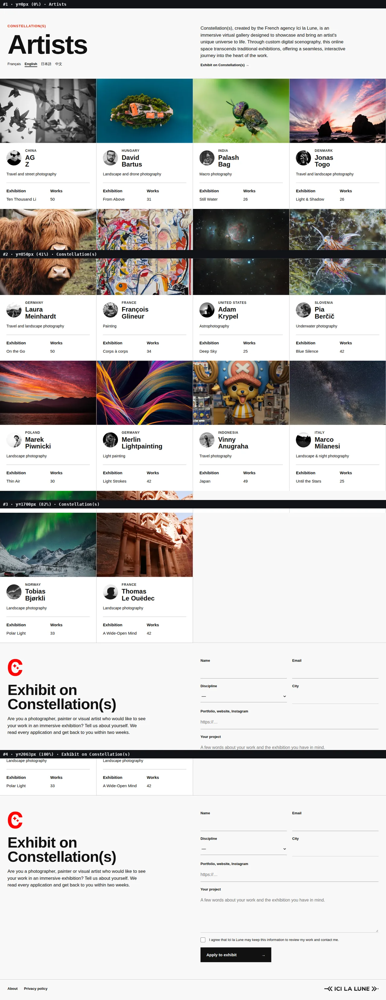
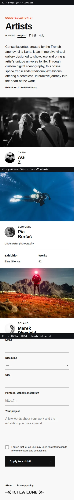

# UI Design System & Master Generation Blueprint: constellations-icilalune-com

> **Constellation(s) — Immersive virtual 3D art exhibitions** (https://constellations.icilalune.com/) — Immersive virtual galleries: step into the worlds of AG Z, David Bartus, Palash Bag, Jonas Togo, Laura Meinhardt, François Glineur, Adam...





---

## 1. Executive Visual Persona & Design Archetype

- **Brand Essence & Persona**: **Constellation(s) — Immersive virtual 3D art exhibitions** (`https://constellations.icilalune.com/`). Immersive virtual galleries: step into the worlds of AG Z, David Bartus, Palash Bag, Jonas Togo, Laura Meinhardt, François Glineur, Adam...
- **Capture Provenance**: Live browser capture (`tier2_webgl`, HTTP `200`, captured `2026-11-24`).
- **Visual Archetype**: **Light-Substrate Editorial & Modular Grid System (`#f8f8f8` canvas, `#111111` ink, `#ec3013` accent)**.
- **Anti-AI-Slop Differentiators**:
  - **Live-Computed Chromatic Polarity**: Anchors the viewport in `#f8f8f8` (live computed `body` `background-color` (`computed_styles.json`)) paired with `#111111` primary typography and `#ec3013` accents.
  - **Grounded Typographic Hierarchy**: Pairs `Arimo` for display copy (`Artists`) with `Helvetica Neue`.
  - **Calibrated Spatial Grid & Motion**: Combines `1440px` container bounds (`gap: 16px 32px`, padding `28px`) with `cubic-bezier(0.25,0.1,0.25,1)` easing.

---

## 2. Spatial Architecture & Modular Grid Mathematics

### Viewport Allocation & Container Geometry
- **Captured Journey Filmstrips**: Desktop `1280×3312px` (`assets/desktop-journey.webp`, `4` keyframes up to `y=2063px` / doc `2963px`), Mobile `390×2616px` (`assets/mobile-journey.webp`, `3` keyframes).
- **Master Container Bounds**: `1440px` (full-bleed `100%` desktop stage measured on `1440px` viewport).
- **Canvas Lateral Padding & Spacing**: `28px` lateral canvas padding with `16px 32px` grid gap.
- **Border Radius Scale**: `var(--radius-md)`, `50%`, `var(--radius-lg)`, `2px`.

### Responsive Breakpoint Architecture
- **Desktop Layout**: Multi-column CSS Grid / Flexbox layout at `1440px` (`max-width: 1440px`, `gap: 16px 32px`).
- **Mobile Layout**: Single-column vertical stack at `390px` viewport width with `28px` horizontal padding.
- **Extracted CSS Media Queries**: no `@media` queries in captured stylesheet (fluid viewport scaling).

---

## 3. Color System, Materiality & Atmospheric Lighting

### Semantic Palette & Source Grounding
| Semantic Role | Ground-Truth Value | Extracted Live / CSS Source |
|---|---|---|
| **Primary Canvas Substrate** | `#f8f8f8` | live computed `body` `background-color` (`computed_styles.json`) |
| **Primary Typography Ink** | `#111111` | live computed `h1` `color` (`computed_styles.json`) |
| **Elevated Surface / Card Substrate** | `#f3f2f2` | `var(--color-bg)` in `:root` |
| **Interactive Accent / Highlight** | `#ec3013` | `var(--color-accent)` in `:root` |
| **Secondary / Muted Copy** | `#201e1d` | `var(--color-text)` in `:root` |
| **Structural Hairline Border** | `#201e1d` | `var(--color-divider)` in `:root` |
| **Variable Token (`--color-surface`)** | `#eae9e9` | `var(--color-surface)` in `:root` |
| **Variable Token (`--color-accent-2`)** | `#e15b47` | `var(--color-accent-2)` in `:root` |
| **Variable Token (`--color-neutral-100`)** | `#f8f4f4` | `var(--color-neutral-100)` in `:root` |
| **Variable Token (`--color-neutral-200`)** | `#eae7e7` | `var(--color-neutral-200)` in `:root` |
| **Variable Token (`--color-neutral-300`)** | `#d7d3d3` | `var(--color-neutral-300)` in `:root` |
| **Variable Token (`--color-neutral-400`)** | `#bab6b6` | `var(--color-neutral-400)` in `:root` |
| **Variable Token (`--color-neutral-500`)** | `#9b9797` | `var(--color-neutral-500)` in `:root` |
| **Variable Token (`--color-neutral-600`)** | `#7d7979` | `var(--color-neutral-600)` in `:root` |
| **Variable Token (`--color-neutral-700`)** | `#605d5d` | `var(--color-neutral-700)` in `:root` |
| **Variable Token (`--color-neutral-800`)** | `#444141` | `var(--color-neutral-800)` in `:root` |
| **Variable Token (`--color-neutral-900`)** | `#2d2b2b` | `var(--color-neutral-900)` in `:root` |
| **Variable Token (`--color-accent-100`)** | `#fff2ef` | `var(--color-accent-100)` in `:root` |

### Sanitized Root CSS Variables (`ui-ux.md` Ground Truth)
| Variable Name | Extracted Value | Semantic Role |
|---|---|---|
| `--color-bg` | `#f3f2f2` | Canvas / Surface Token |
| `--color-surface` | `#eae9e9` | Canvas / Surface Token |
| `--color-text` | `#201e1d` | Typography Ink Token |
| `--color-accent` | `#ec3013` | Brand / Palette Token |
| `--color-accent-2` | `#e15b47` | Brand / Palette Token |
| `--color-divider` | `color-mix(in srgb, #201e1d 40%, transparent)` | Brand / Palette Token |
| `--color-neutral-100` | `#f8f4f4` | Brand / Palette Token |
| `--color-neutral-200` | `#eae7e7` | Brand / Palette Token |
| `--color-neutral-300` | `#d7d3d3` | Brand / Palette Token |
| `--color-neutral-400` | `#bab6b6` | Brand / Palette Token |
| `--color-neutral-500` | `#9b9797` | Brand / Palette Token |
| `--color-neutral-600` | `#7d7979` | Brand / Palette Token |
| `--color-neutral-700` | `#605d5d` | Brand / Palette Token |
| `--color-neutral-800` | `#444141` | Brand / Palette Token |
| `--color-neutral-900` | `#2d2b2b` | Brand / Palette Token |
| `--color-accent-100` | `#fff2ef` | Brand / Palette Token |

---

## 4. Typographic Scale & Editorial Hierarchy

### Font Family Stacks
- **Display Typography**: `Arimo`.
- **Primary Body Stack**: `Helvetica Neue`.
- **Technical / Metadata Stack**: not declared in live computed styles (uses primary stack / `ui-monospace`).

### Typographic Scale & Rules (Live Computed & Stylesheet Grounded)
- **Hero Display (`H1`)**: live computed `h1` (`font-size: 100.8px`, `line-height: 92.736px`, `font-weight: 800`, `letter-spacing: -3.024px`); rule `h1` (`font-size: 42px`).
- **Section Heading (`H2`)**: live computed `h2` (`font-size: 56px`, `line-height: 53.2px`, `font-weight: 800`, `letter-spacing: -1.12px`); rule `h2` (`font-size: 32px`).
- **Body Copy**: live computed `body` (`font-size: 15px`, `line-height: 23.25px`, `font-weight: 400`); CSS variables `--font-body: "Archivo", system-ui, sans-serif`; rule `body` (`font-size: 15px`, `line-height: 1.55`, `font-weight: 400`).
- **Metadata & Navigation Labels**: live computed `nav/a` (`font-size: 15px`, `line-height: 23.25px`, `font-weight: 400`).

---

## 5. Choreographed Motion & Interaction Physics

### Primary Easing Curves
- **Extracted Timing Functions**: `cubic-bezier(0.25,0.1,0.25,1)`.

### Per-Element Transition & Choreography Rules
- **Selector `::after`**: `transition: 0s !important` extracted from `constellations-icilalune-com` stylesheet.
- **Selector `style]`**: `transition: unset` extracted from `constellations-icilalune-com` stylesheet.
- **Selector `style]`**: `transition: unset` extracted from `constellations-icilalune-com` stylesheet.
- **Standard CSS Easing (`cubic-bezier(0.25,0.1,0.25,1)`)**: Default timing curve (no custom `cubic-bezier()` declared in captured CSS).
- **State & Hover Choreography**: Opacity and transform transitions on `<section.sc-interp>` and `<section.scp0>` interactive targets.
### Measured Runtime Scroll & Interaction Telemetry (`behavioral_journey_v2`)
- **Scroll Driver Mode**: `native` (max document height `2963px`, deepest scrollY reached `2063px` across `4` desktop keyframes).
- **Detected Scroll / Motion Libraries**: Native browser scroll / standard CSS transitions.

---

## 6. Component Wireframe & Structural DOM Map

### Visual Layout Schematic — Desktop (`1440px`, Grounded in `dom.html` & Landmark Bounding Boxes)
```
┌────────────────────────────────────────────────────────────────────────┐
│ DESKTOP VIEWPORT (1440px) — Constellation(s) — Immersive virtual 3D ar │
│ ====================================================================== │
│ [ <header.sc-host> (1440px)           | Overview · Index · Archive · ] │
│ ---------------------------------------------------------------------- │
│ | HERO STAGE: <section.sc-interp> (w=1440px)                         | │
│ | H1: Artists                                                        | │
│ | Substrate: #f8f8f8 | Ink: #111111 | Accent: #ec3013                | │
│ ---------------------------------------------------------------------- │
│ | SHOWCASE GRID (<section.scp0>) max-w: 1440px                       | │
│ | +------------------------------+  +------------------------------+ | │
│ | | Immersive virtual galleries: |  | AG Z — Ten Thousand Li · Tra | | │
│ | +------------------------------+  +------------------------------+ | │
│ ---------------------------------------------------------------------- │
│ | DETAIL MODULE (<section.scp1>) — David Bartus — From A             | │
│ ---------------------------------------------------------------------- │
│ [ FOOTER (<footer.scp2>       ) | https://constellations.icilalune.co  │
└────────────────────────────────────────────────────────────────────────┘
```

### Visual Layout Schematic — Mobile Reflow (`390px`)
```
┌────────────────────────────────────────────────────────────────────────┐
│ MOBILE VIEWPORT REFLOW (390px) — Single-Column Stack (gap: 16px 32p)   │
│ ====================================================================== │
│ [ HEADER BAR (<header.sc-host>        ) | Compact Menu (390px)         │
│ ---------------------------------------------------------------------- │
│ | HERO STAGE (<section.sc-interp>) — 390px Vertical Lead             | │
│ | H1: Artists                                                        | │
│ ---------------------------------------------------------------------- │
│ | SHOWCASE STACK (<section.scp0>) — 1-Col Stack                      | │
│ | [ Item 1: Immersive virtual galleries: step into the world       ] | │
│ | [ Item 2: AG Z — Ten Thousand Li · Travel and street photo       ] | │
│ ---------------------------------------------------------------------- │
│ | DETAIL STACK (<section.scp1>) — 1-Col (David Bartus — Fro)         | │
│ ---------------------------------------------------------------------- │
│ [ FOOTER (<footer.scp2>       ) | Stacked 390px Colophon               │
└────────────────────────────────────────────────────────────────────────┘
```

### Granular DOM Region Breakdown
1. **Brand Header & Navigation Bar (<header.sc-host> — `constellations-icilalune-com`)**:
   - Landmark `<header class="sc-host">` (`1440px`) hosting `Constellation(s) — Immersive virtual` navigation (`Overview · Index · Archive · About · Contact`), DOM attributes (`data-dc-tpl="1"`, `data-dc-tpl="2"`, `data-dc-tpl="3"`, `data-sc-name="Root"`), and stylesheet rule `html { -webkit-text-size-adjust:100%;text-size-adjust:100% }`.
2. **Hero Stage & Focal Lead (<section.sc-interp> — `Artists`)**:
   - Landmark `<section class="sc-interp">` presenting display lead `Artists` and copy excerpt *"Immersive virtual galleries: step into the worlds of AG Z, David "* over `#f8f8f8` canvas and `#111111` ink.
3. **Primary Showcase & Content Grid (<section.scp0> — `Immersive virtual galleries: step `)**:
   - Landmark `<section class="scp0">` rendering section `Immersive virtual galleries: step into the world` with copy *"AG Z — Ten Thousand Li · Travel and street photography, China"*, asset references (`manifest.webmanifest`, `favicon.svg`, `favicon-32.png`, `favicon-16.png`), and grid rule `body { background: var(--color-bg); color: var(--color-text); font-family: var(... }`.
4. **Interactive Detail & Feature Matrix (<section.scp1> — `AG Z — Ten Thousand Li · Travel an`)**:
   - Landmark `<section class="scp1">` framing `AG Z — Ten Thousand Li · Travel and street photo` and `David Bartus — From Above · Landscape and drone ` (*"David Bartus — From Above · Landscape and drone photography, Hung"*) with `#f3f2f2` surface cards, `#ec3013` accents, and `h4 { font-family: var(--font-heading); font-weight: var(--font-heading-weight); }`.
5. **Colophon & Global Directory Footer (<footer.scp2> — `https://constellations.icilalune.com/`)**:
   - Landmark `<footer class="scp2">` anchoring `Constellation(s) — Immersive vir` footer links (`Overview · Index · Archive · About · Contact`), copy *"Palash Bag — Still Water · Macro photography, India"*, and `#201e1d` structural dividers.
### Full Vertical Scroll Sequence (Desktop `1440×900` Keyframes)
- **Step 01** (`y=0px`, `0%`): Active landmark `Artists` · sticky/fixed elements: `1`
- **Step 02** (`y=850px`, `41%`): Active landmark `Constellation(s)` · sticky/fixed elements: `1`
- **Step 03** (`y=1700px`, `82%`): Active landmark `Constellation(s)` · sticky/fixed elements: `1`
- **Step 04** (`y=2063px`, `100%`): Active landmark `Exhibit on Constellation(s)` · sticky/fixed elements: `1`

---

## 7. Master Zero-Shot AI Generation Prompt

```markdown
# Master Zero-Shot Frontend Generation Prompt: constellations-icilalune-com (Constellation(s) — Immersive virtual 3D art exhibitions)

You are a principal frontend architect and design systems engineer. Build a complete, production-ready web application replicating the exact design system, DOM landmarks, typographic hierarchy, color tokens, and motion physics of `constellations-icilalune-com` (**Constellation(s) — Immersive virtual 3D art exhibitions** — `https://constellations.icilalune.com/`).

### 1. Visual Archetype & Anti-AI-Slop Mandates
- **Archetype**: Light-Substrate Editorial & Modular Grid System (`#f8f8f8` canvas, `#111111` ink, `#ec3013` accent).
- **Identity & Domain Context**: Immersive virtual galleries: step into the worlds of AG Z, David Bartus, Palash Bag, Jonas Togo, Laura Meinhardt, François Glineur, Adam...
- **Primary Substrate**: `#f8f8f8` (live computed `body` `background-color` (`computed_styles.json`)), **Primary Ink**: `#111111`, **Accent / Highlight**: `#ec3013`.
- **Site-Specific Differentiators**:
  - **Live-Computed Chromatic Polarity**: Anchors the viewport in `#f8f8f8` (live computed `body` `background-color` (`computed_styles.json`)) paired with `#111111` primary typography and `#ec3013` accents.
  - **Grounded Typographic Hierarchy**: Pairs `Arimo` for display copy (`Artists`) with `Helvetica Neue`.
  - **Calibrated Spatial Grid & Motion**: Combines `1440px` container bounds (`gap: 16px 32px`, padding `28px`) with `cubic-bezier(0.25,0.1,0.25,1)` easing.

### 2. Ground-Truth CSS Variables (`:root` Token Contract)
Declare and consume these exact custom properties extracted from `constellations-icilalune-com` in your global stylesheet:

:root {
  /* Constellation(s) — Immersive virtual 3D art exhibitions (constellations-icilalune-com) — Live-Grounded CSS Variables */
  --color-bg: #f3f2f2; /* Canvas / Surface Token (constellations-icilalune-com) */
  --color-surface: #eae9e9; /* Canvas / Surface Token (constellations-icilalune-com) */
  --color-text: #201e1d; /* Typography Ink Token (constellations-icilalune-com) */
  --color-accent: #ec3013; /* Brand / Palette Token (constellations-icilalune-com) */
  --color-accent-2: #e15b47; /* Brand / Palette Token (constellations-icilalune-com) */
  --color-divider: color-mix(in srgb, #201e1d 40%, transparent); /* Brand / Palette Token (constellations-icilalune-com) */
  --color-neutral-100: #f8f4f4; /* Brand / Palette Token (constellations-icilalune-com) */
  --color-neutral-200: #eae7e7; /* Brand / Palette Token (constellations-icilalune-com) */
  --color-neutral-300: #d7d3d3; /* Brand / Palette Token (constellations-icilalune-com) */
  --color-neutral-400: #bab6b6; /* Brand / Palette Token (constellations-icilalune-com) */
  --color-neutral-500: #9b9797; /* Brand / Palette Token (constellations-icilalune-com) */
  --color-neutral-600: #7d7979; /* Brand / Palette Token (constellations-icilalune-com) */
  --color-neutral-700: #605d5d; /* Brand / Palette Token (constellations-icilalune-com) */
  --color-neutral-800: #444141; /* Brand / Palette Token (constellations-icilalune-com) */
  --color-neutral-900: #2d2b2b; /* Brand / Palette Token (constellations-icilalune-com) */
  --color-accent-100: #fff2ef; /* Brand / Palette Token (constellations-icilalune-com) */
}

### 3. Semantic Color & Materiality Contract
Map every surface, ink, and border strictly to these source-grounded tokens:
- **Primary Canvas Substrate**: `#f8f8f8` — grounded in live computed `body` `background-color` (`computed_styles.json`)
- **Primary Typography Ink**: `#111111` — grounded in live computed `h1` `color` (`computed_styles.json`)
- **Elevated Surface / Card Substrate**: `#f3f2f2` — grounded in `var(--color-bg)` in `:root`
- **Interactive Accent / Highlight**: `#ec3013` — grounded in `var(--color-accent)` in `:root`
- **Secondary / Muted Copy**: `#201e1d` — grounded in `var(--color-text)` in `:root`
- **Structural Hairline Border**: `#201e1d` — grounded in `var(--color-divider)` in `:root`
- **Variable Token (`--color-surface`)**: `#eae9e9` — grounded in `var(--color-surface)` in `:root`
- **Variable Token (`--color-accent-2`)**: `#e15b47` — grounded in `var(--color-accent-2)` in `:root`
- **Variable Token (`--color-neutral-100`)**: `#f8f4f4` — grounded in `var(--color-neutral-100)` in `:root`
- **Variable Token (`--color-neutral-200`)**: `#eae7e7` — grounded in `var(--color-neutral-200)` in `:root`
- **Variable Token (`--color-neutral-300`)**: `#d7d3d3` — grounded in `var(--color-neutral-300)` in `:root`
- **Variable Token (`--color-neutral-400`)**: `#bab6b6` — grounded in `var(--color-neutral-400)` in `:root`
- **Variable Token (`--color-neutral-500`)**: `#9b9797` — grounded in `var(--color-neutral-500)` in `:root`
- **Variable Token (`--color-neutral-600`)**: `#7d7979` — grounded in `var(--color-neutral-600)` in `:root`
- **Variable Token (`--color-neutral-700`)**: `#605d5d` — grounded in `var(--color-neutral-700)` in `:root`
- **Variable Token (`--color-neutral-800`)**: `#444141` — grounded in `var(--color-neutral-800)` in `:root`
- **Variable Token (`--color-neutral-900`)**: `#2d2b2b` — grounded in `var(--color-neutral-900)` in `:root`
- **Variable Token (`--color-accent-100`)**: `#fff2ef` — grounded in `var(--color-accent-100)` in `:root`

### 4. Spatial Grid, Container Bounds & Responsive Breakpoints
- **Desktop Viewport Reference**: `1280×3312px` (multi-frame vertical journey filmstrip (3312px), `1440px` standard desktop width).
- **Mobile Viewport Reference**: `390×2616px` (multi-frame vertical journey filmstrip (2616px), `390px` standard mobile width).
- **Container Max-Width**: `1440px` (full-bleed `100%` desktop stage measured on `1440px` viewport)
- **Padding & Gutters**: `28px` lateral canvas padding with `16px 32px` grid gap
- **Desktop Grid**: Multi-column CSS Grid / Flexbox layout at `1440px` (`max-width: 1440px`, `gap: 16px 32px`)
- **Mobile Adaptation**: Single-column vertical stack at `390px` viewport width with `28px` horizontal padding
- **Media Queries**: no `@media` queries in captured stylesheet (fluid viewport scaling)
- **Corner Radii**: `var(--radius-md)`, `50%`, `var(--radius-lg)`, `2px`

### 5. Typography & Editorial Scale Contract
- **Display Font Stack**: `Arimo`
- **Body Font Stack**: `Helvetica Neue`
- **Monospace / Technical Font Stack**: not declared in live computed styles (uses primary stack / `ui-monospace`)
- **H1 Display Rule**: live computed `h1` (`font-size: 100.8px`, `line-height: 92.736px`, `font-weight: 800`, `letter-spacing: -3.024px`); rule `h1` (`font-size: 42px`)
- **H2 Section Rule**: live computed `h2` (`font-size: 56px`, `line-height: 53.2px`, `font-weight: 800`, `letter-spacing: -1.12px`); rule `h2` (`font-size: 32px`)
- **Body Copy Rule**: live computed `body` (`font-size: 15px`, `line-height: 23.25px`, `font-weight: 400`); CSS variables `--font-body: "Archivo", system-ui, sans-serif`; rule `body` (`font-size: 15px`, `line-height: 1.55`, `font-weight: 400`)
- **Metadata & Index Rule**: live computed `nav/a` (`font-size: 15px`, `line-height: 23.25px`, `font-weight: 400`)

### 6. Component Hierarchy, Verbatim Copy & Real DOM Landmarks
Scaffold `constellations-icilalune-com` (`Constellation(s) — Immersive virtual 3D art exhibitions`) with these exact structural regions, extracted copy, and CSS rules from `dom.html`:
1. **Brand Header & Navigation Bar (<header.sc-host> — `constellations-icilalune-com`)**:
   - DOM & Selectors: Landmark `<header class="sc-host">` (`1440px`) hosting `Constellation(s) — Immersive virtual` navigation (`Overview · Index · Archive · About · Contact`), DOM attributes (`data-dc-tpl="1"`, `data-dc-tpl="2"`, `data-dc-tpl="3"`, `data-sc-name="Root"`), and stylesheet rule `html { -webkit-text-size-adjust:100%;text-size-adjust:100% }`.
   - Responsive Contract: Header `Brand Header & Navigation Bar (<header.sc-host> — `constellations-icilalune-com`)` (`constellations-icilalune-com`) adapts across no `@media` queries in captured stylesheet (fluid viewport scaling) with `cubic-bezier(0.25,0.1,0.25,1)` transitions and links `Overview · Index · Archive · About · Contact`.
2. **Hero Stage & Focal Lead (<section.sc-interp> — `Artists`)**:
   - DOM & Selectors: Landmark `<section class="sc-interp">` presenting display lead `Artists` and copy excerpt *"Immersive virtual galleries: step into the worlds of AG Z, David "* over `#f8f8f8` canvas and `#111111` ink.
   - Responsive Contract: Hero stage (`1280×3312px` desktop / `390×2616px` mobile) sets `#f8f8f8` background with `#111111` headline `Artists`.
3. **Primary Showcase & Content Grid (<section.scp0> — `Immersive virtual galleries: step `)**:
   - DOM & Selectors: Landmark `<section class="scp0">` rendering section `Immersive virtual galleries: step into the world` with copy *"AG Z — Ten Thousand Li · Travel and street photography, China"*, asset references (`manifest.webmanifest`, `favicon.svg`, `favicon-32.png`, `favicon-16.png`), and grid rule `body { background: var(--color-bg); color: var(--color-text); font-family: var(... }`.
   - Responsive Contract: Showcase grid `Primary Showcase & Content Grid (<section.scp0> — `Immersive virtual galleries: step `)` applies Multi-column CSS Grid / Flexbox layout at `1440px` (`max-width: 1440px`, `gap: 16px 32px`) on desktop and Single-column vertical stack at `390px` viewport width with `28px` horizontal padding on mobile.
4. **Interactive Detail & Feature Matrix (<section.scp1> — `AG Z — Ten Thousand Li · Travel an`)**:
   - DOM & Selectors: Landmark `<section class="scp1">` framing `AG Z — Ten Thousand Li · Travel and street photo` and `David Bartus — From Above · Landscape and drone ` (*"David Bartus — From Above · Landscape and drone photography, Hung"*) with `#f3f2f2` surface cards, `#ec3013` accents, and `h4 { font-family: var(--font-heading); font-weight: var(--font-heading-weight); }`.
   - Responsive Contract: Detail module `Interactive Detail & Feature Matrix (<section.scp1> — `AG Z — Ten Thousand Li · Travel an`)` uses `var(--radius-md)`, `50%`, `var(--radius-lg)`, `2px` radii, `#ec3013` highlights, and assets (manifest.webmanifest, favicon.svg, favicon-32.png).
5. **Colophon & Global Directory Footer (<footer.scp2> — `https://constellations.icilalune.com/`)**:
   - DOM & Selectors: Landmark `<footer class="scp2">` anchoring `Constellation(s) — Immersive vir` footer links (`Overview · Index · Archive · About · Contact`), copy *"Palash Bag — Still Water · Macro photography, India"*, and `#201e1d` structural dividers.
   - Responsive Contract: Footer `Colophon & Global Directory Footer (<footer.scp2> — `https://constellations.icilalune.com/`)` aligns to `1440px` (full-bleed `100%` desktop stage measured on `1440px` viewport) with `28px` lateral canvas padding with `16px 32px` grid gap and attributes (data-dc-tpl="1", data-dc-tpl="2", data-dc-tpl="3").

#### Verbatim DOM Copy Excerpts (`dom.html`)
- Copy Excerpt 1: *"Immersive virtual galleries: step into the worlds of AG Z, David Bartus, Palash Ba..."*
- Copy Excerpt 2: *"AG Z — Ten Thousand Li · Travel and street photography, China"*
- Copy Excerpt 3: *"David Bartus — From Above · Landscape and drone photography, Hungary"*
- Copy Excerpt 4: *"Palash Bag — Still Water · Macro photography, India"*

### 7. Motion, Extracted Stylesheet Rules & Interaction Choreography
- **Primary Easing Functions**: `cubic-bezier(0.25,0.1,0.25,1)`
- **Extracted Stylesheet Rules (`constellations-icilalune-com`)**:
- `html { -webkit-text-size-adjust:100%;text-size-adjust:100% }`
- `body { background: var(--color-bg); color: var(--color-text); font-family: var(... }`
- `h4 { font-family: var(--font-heading); font-weight: var(--font-heading-weight); }`
- `.grayscale { filter:grayscale(1) contrast(1.08) }`
- `after { box-sizing: border-box; }`
- **Per-Selector Transition Rules**:
- **Selector `::after`**: `transition: 0s !important` extracted from `constellations-icilalune-com` stylesheet.
- **Selector `style]`**: `transition: unset` extracted from `constellations-icilalune-com` stylesheet.
- **Selector `style]`**: `transition: unset` extracted from `constellations-icilalune-com` stylesheet.
- **Standard CSS Easing (`cubic-bezier(0.25,0.1,0.25,1)`)**: Default timing curve (no custom `cubic-bezier()` declared in captured CSS).
- **State & Hover Choreography**: Opacity and transform transitions on `<section.sc-interp>` and `<section.scp0>` interactive targets.
### 7b. Full-Page Scroll Choreography, Interactive States & Multi-Page Routes
- **Scroll Mechanics**: Implement `native` vertical progression up to `2963px` across 4 distinct viewport chapters.
- **Vertical Chapter Sequence**: Artists (0%) -> Constellation(s) (41%) -> Constellation(s) (82%) -> Exhibit on Constellation(s) (100%).

### 8. Technical Deliverables
- Implement in Next.js (App Router) with TypeScript and Tailwind CSS consuming the `:root` custom properties defined above for `constellations-icilalune-com`.
- Reproduce both the `1440px` desktop architecture and `390px` mobile breakpoint transitions, preserving semantic HTML5 landmarks (`<header>`, `<nav>`, `<main>`, `<section>`, `<footer>`) and `prefers-reduced-motion` accessibility guards.
```
---

## 8. Full-Page Scroll Journey, Interactive States & Subpage Inventory

### Desktop Scroll Keyframes (`1440×900` WebP)
| Step | Scroll Y | Progress | Active Landmark / Section | Sticky/Fixed | Visual Asset |
| :---: | :---: | :---: | :--- | :---: | :--- |
| `#01` | `0px` | `0%` | Artists | `1` | [desktop-step-01.webp](assets/desktop-step-01.webp) |
| `#02` | `850px` | `41%` | Constellation(s) | `1` | [desktop-step-02.webp](assets/desktop-step-02.webp) |
| `#03` | `1700px` | `82%` | Constellation(s) | `1` | [desktop-step-03.webp](assets/desktop-step-03.webp) |
| `#04` | `2063px` | `100%` | Exhibit on Constellation(s) | `1` | [desktop-step-04.webp](assets/desktop-step-04.webp) |

### Mobile Condensed Keyframes (`390×844` WebP)
| Step | Scroll Y | Progress | Active Landmark | Visual Asset |
| :---: | :---: | :---: | :--- | :--- |
| `#01` | `0px` | `0%` | Artists | [mobile-step-01.webp](assets/mobile-step-01.webp) |
| `#02` | `4014px` | `50%` | Constellation(s) | [mobile-step-02.webp](assets/mobile-step-02.webp) |
| `#03` | `8029px` | `100%` | Constellation(s) | [mobile-step-03.webp](assets/mobile-step-03.webp) |

