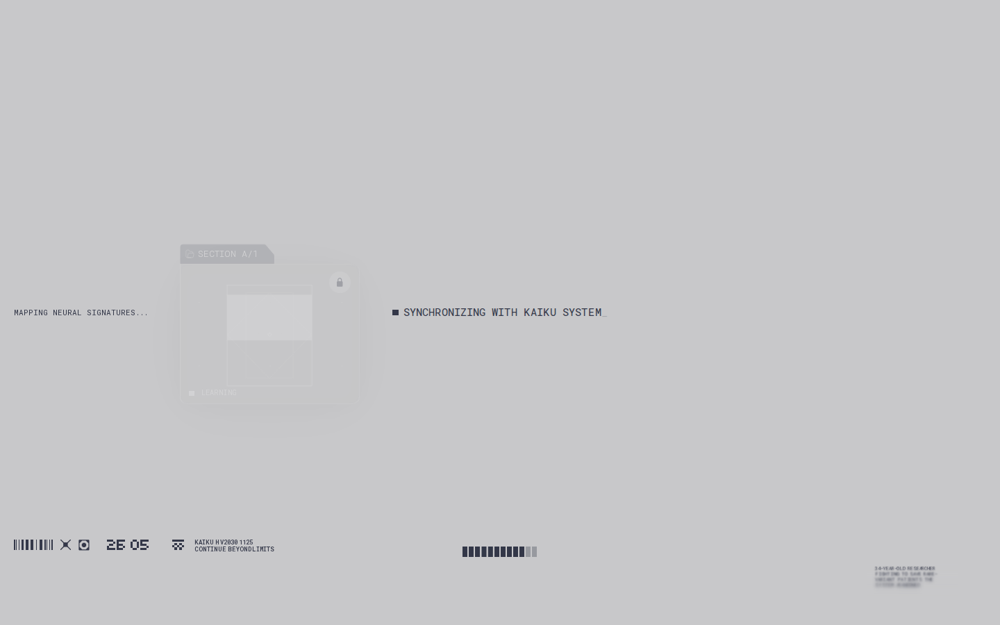
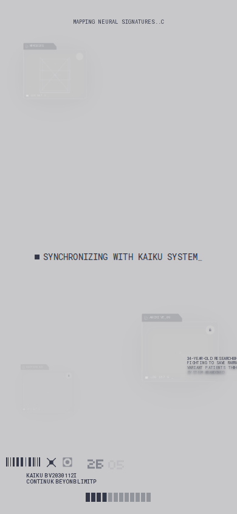

# UI Design System & Master Generation Blueprint: continuance-ai

> **Continuance - A novel by Chris Bennett** (https://continuance.ai/) — A near-future thriller about the people we'd do anything to keep — and what it costs when we succeed.



---

## 1. Executive Visual Persona & Design Archetype

- **Brand Essence & Persona**: **Continuance - A novel by Chris Bennett** (`https://continuance.ai/`). A near-future thriller about the people we'd do anything to keep — and what it costs when we succeed.
- **Capture Provenance**: Live browser capture (`tier1_fast`, HTTP `200`, captured `2026-11-23`).
- **Visual Archetype**: **Light-Gallery WebGL / Canvas Interactive Experience (`#f4f4f4` / `#343849`)**.
- **Anti-AI-Slop Differentiators**:
  - **Live-Computed Chromatic Polarity**: Anchors the viewport in `#f4f4f4` (live computed `body` `background-color` (`computed_styles.json`)) paired with `#000000` primary typography and `#343849` accents.
  - **Grounded Typographic Hierarchy**: Pairs `objectSans` for display copy (`C O N T I N U A N C E`) with `Roboto Mono` and `Roboto Mono`.
  - **Calibrated Spatial Grid & Motion**: Combines `1440px` container bounds (`gap: 47.9806px`, padding `20.3398px`) with `cubic-bezier(.22,1,.36,1)` easing and Three.js / WebGL Canvas Pipeline, Swiper Touch Carousel Engine.

---

## 2. Spatial Architecture & Modular Grid Mathematics



### Viewport Allocation & Container Geometry
- **Captured Viewport Dimensions**: Desktop `1440×900px` (`assets/desktop.png`, single-viewport 100vh live capture (900px)), Mobile `390×844px` (`assets/mobile.png`, single-viewport 100vh live capture (844px)).
- **Master Container Bounds**: `1440px` (live computed `body` `max-width`).
- **Canvas Lateral Padding & Spacing**: `20.3398px` lateral canvas padding with `47.9806px` grid gap.
- **Border Radius Scale**: `43px`, `999px`, `7.201px`, `4px`.

### Responsive Breakpoint Architecture
- **Desktop Layout**: Multi-column CSS Grid / Flexbox layout at `1440px` (`max-width: 1440px`, `gap: 47.9806px`).
- **Mobile Layout**: Single-column vertical stack at `390px` viewport width with `20.3398px` horizontal padding.
- **Extracted CSS Media Queries**: `@media (max-width:1023px)`, `@media (max-width:767px)`, `@media (min-width:1024px)`, `@media (min-width:768px)`.

---

## 3. Color System, Materiality & Atmospheric Lighting

### Semantic Palette & Source Grounding
| Semantic Role | Ground-Truth Value | Extracted Live / CSS Source |
|---|---|---|
| **Primary Canvas Substrate** | `#f4f4f4` | live computed `body` `background-color` (`computed_styles.json`) |
| **Primary Typography Ink** | `#000000` | live computed `button` `color` (`computed_styles.json`) |
| **Elevated Surface / Card Substrate** | `#c8c8ca` | live computed `main` `background-color` (`computed_styles.json`) |
| **Interactive Accent / Highlight** | `#343849` | live computed `a` `color` (`computed_styles.json`) |
| **Secondary / Muted Copy** | `#343849` | live computed `p` `color` (`computed_styles.json`) |
| **Structural Hairline Border** | `#ffa500` | `to { stroke: #ffa500 }` |

### Sanitized Root CSS Variables (`ui-ux.md` Ground Truth)
| Variable Name | Extracted Value | Semantic Role |
|---|---|---|
| `--hero-tilt-gap` | `5px` | Layout / Spatial Grid Token |
| `--c-brand-primary-rgb` | `52,56,73` | Brand / Palette Token |
| `--c-brand-primary` | `rgb(var(--c-brand-primary-rgb))` | Brand / Palette Token |
| `--c-brand-secondary-rgb` | `173,138,255` | Brand / Palette Token |
| `--c-brand-secondary` | `rgb(var(--c-brand-secondary-rgb))` | Brand / Palette Token |
| `--c-light-gray-rgb` | `217,217,217` | Canvas / Surface Token |
| `--c-light-gray` | `rgb(var(--c-light-gray-rgb))` | Canvas / Surface Token |
| `--c-orange-rgb` | `255,153,0,1` | Design System Custom Token |
| `--c-orange` | `rgb(var(--c-orange-rgb))` | Color / Atmospheric Token |
| `--c-bg-primary-rgb` | `244,244,244` | Canvas / Surface Token |
| `--c-bg-primary` | `rgb(var(--c-bg-primary-rgb))` | Canvas / Surface Token |
| `--c-bg-secondary-rgb` | `0,0,0` | Canvas / Surface Token |
| `--c-bg-secondary` | `rgb(var(--c-bg-secondary-rgb))` | Canvas / Surface Token |
| `--c-bg-tertiary-rgb` | `255,255,255` | Canvas / Surface Token |
| `--c-bg-tertiary` | `rgb(var(--c-bg-tertiary-rgb))` | Canvas / Surface Token |
| `--c-bg-soft-gray-rgb` | `244,244,244` | Canvas / Surface Token |

---

## 4. Typographic Scale & Editorial Hierarchy

### Font Family Stacks
- **Display Typography**: `objectSans`.
- **Primary Body Stack**: `Roboto Mono`.
- **Technical / Metadata Stack**: `Roboto Mono`.

### Typographic Scale & Rules (Live Computed & Stylesheet Grounded)
- **Hero Display (`H1`)**: live computed `h1` (`font-size: 187.864px`, `line-height: 216.044px`, `font-weight: 400`, `letter-spacing: -3px`); rule `,h1` (`font-size: var(--font-size-4xl)`).
- **Section Heading (`H2`)**: observed font-size ladder: `187.864px`, `16px`, `11.068px`, `.75rem`, `var(--font-size-sx)`.
- **Body Copy**: live computed `body` (`font-size: 16px`, `line-height: 18.4px`, `font-weight: 400`); CSS variables `--font-family-body: "Roboto Mono","Roboto Mono Fallback"`.
- **Metadata & Navigation Labels**: live computed `nav/a` (`font-size: 16px`, `line-height: 18.4px`, `font-weight: 400`).

---

## 5. Choreographed Motion & Interaction Physics

### Primary Easing Curves
- **Extracted Timing Functions**: `cubic-bezier(.22,1,.36,1)`, `cubic-bezier(.85,0,.15,1)`, `cubic-bezier(.87,0,.13,1)`.

### Per-Element Transition & Choreography Rules
- **Selector `oter_hp-footer__disclaimer-btn__T...`**: `transition: transform .5s ease` extracted from `continuance-ai` stylesheet.
- **Selector `.HpFooter_hp-footer__disclaimer__...`**: `transition: max-height .5s ease` extracted from `continuance-ai` stylesheet.
- **Selector `media(max-width:767px)`**: `transition: transform .1s ease .1s` extracted from `continuance-ai` stylesheet.
- **Extracted Easing Curve (`cubic-bezier(.22,1,.36,1)`)**: Governs interactive state transitions across `<nav.SiteIndexNav_site-index-nav__60kV3>` and `<main.home:nth(2)>`.
- **Runtime Interaction Engine**: Integrates Three.js / WebGL Canvas Pipeline, Swiper Touch Carousel Engine, Lottie Vector Animation Player with `prefers-reduced-motion: reduce` fallback guards.

---

## 6. Component Wireframe & Structural DOM Map

### Visual Layout Schematic — Desktop (`1440px`, Grounded in `dom.html` & Landmark Bounding Boxes)
```
┌────────────────────────────────────────────────────────────────────────┐
│ DESKTOP VIEWPORT (1440px) — Continuance - A novel by Chris Bennett     │
│ ====================================================================== │
│ [ <nav.SiteIndexNav_site (1x1px)      | Get the book · Why now · Abo ] │
│ ---------------------------------------------------------------------- │
│ | HERO STAGE: <main.home> (w=1440px)                                 | │
│ | H1: C O N T I N U A N C E                                          | │
│ | Substrate: #f4f4f4 | Ink: #000000 | Accent: #343849                | │
│ ---------------------------------------------------------------------- │
│ | SHOWCASE GRID (<main.home:nth(2)>) max-w: 1440px                   | │
│ | +------------------------------+  +------------------------------+ | │
│ | | C o n t i n u a n c e        |  | Mapping neural signatures... | | │
│ | +------------------------------+  +------------------------------+ | │
│ ---------------------------------------------------------------------- │
│ | DETAIL MODULE (<main.home:nth(3)>) — Synchronizing with Ka         | │
│ ---------------------------------------------------------------------- │
│ [ FOOTER (<footer.Footer_foote) | https://continuance.ai/              │
└────────────────────────────────────────────────────────────────────────┘
```

### Visual Layout Schematic — Mobile Reflow (`390px`)
```
┌────────────────────────────────────────────────────────────────────────┐
│ MOBILE VIEWPORT REFLOW (390px) — Single-Column Stack (gap: 47.9806p)   │
│ ====================================================================== │
│ [ HEADER BAR (<nav.SiteIndexNav_site-i) | Compact Menu (390px)         │
│ ---------------------------------------------------------------------- │
│ | HERO STAGE (<main.home>) — 390px Vertical Lead                     | │
│ | H1: C O N T I N U A N C E                                          | │
│ ---------------------------------------------------------------------- │
│ | SHOWCASE STACK (<main.home:nth(2)>) — 1-Col Stack                  | │
│ | [ Item 1: C o n t i n u a n c e                                  ] | │
│ | [ Item 2: Mapping neural signatures...                           ] | │
│ ---------------------------------------------------------------------- │
│ | DETAIL STACK (<main.home:nth(3)>) — 1-Col (Synchronizing with)     | │
│ ---------------------------------------------------------------------- │
│ [ FOOTER (<footer.Footer_foote) | Stacked 390px Colophon               │
└────────────────────────────────────────────────────────────────────────┘
```

### Granular DOM Region Breakdown
1. **Brand Header & Navigation Bar (<nav.SiteIndexNav_site-index-nav__60kV3> — `continuance-ai`)**:
   - Landmark `<nav class="SiteIndexNav_site-index-nav__60kV3">` (`1x1px`) hosting `Continuance - A novel by Chris Benne` navigation (`Get the book · Why now · About the author · Top secret · Privacy policy`), DOM attributes (`data-precedence="next"`, `data-precedence="next"`, `data-precedence="next"`, `data-precedence="next"`), and stylesheet rule `.Device_device__yuADF { position:absolute;top:0;left:0;width:100%;height:100% }`.
2. **Hero Stage & Focal Lead (<main.home> — `C O N T I N U A N C E`)**:
   - Landmark `<main class="home">` presenting display lead `C O N T I N U A N C E` and copy excerpt *"MAPPING NEURAL SIGNATURES..."* over `#f4f4f4` canvas and `#000000` ink.
3. **Primary Showcase & Content Grid (<main.home:nth(2)> — `C o n t i n u a n c e`)**:
   - Landmark `<main class="home">` rendering section `C o n t i n u a n c e` with copy *"Mapping neural signatures..."*, asset references (`0807ff31c16ab04c.css`, `a4eac32ba22d1fcc.css`, `a5188067206b89ec.css`, `5b6568268f4e7c11.css`), and grid rule `.Device_device__rune___9Rho { border:0;outline:0;box-shadow:none;-webkit-appearance:none;-moz-appearan... }`.
4. **Interactive Detail & Feature Matrix (<main.home:nth(3)> — `Mapping neural signatures...`)**:
   - Landmark `<main class="home">` framing `Mapping neural signatures...` and `Synchronizing with Kaiku System _` (*"Synchronizing with Kaiku System _"*) with `#c8c8ca` surface cards, `#343849` accents, and `evice_device__rune___9Rho:focus-v... { outline:0;box-shadow:none }`.
5. **Colophon & Global Directory Footer (<footer.Footer_footer__2_6CR> — `https://continuance.ai/`)**:
   - Landmark `<footer class="Footer_footer__2_6CR">` anchoring `Continuance - A novel by Chris B` footer links (`Get the book · Why now · About the author · Top secret · Privacy policy`), copy *"Synchronizing with Kaiku System"*, and `#ffa500` structural dividers.

---

## 7. Master Zero-Shot AI Generation Prompt

```markdown
# Master Zero-Shot Frontend Generation Prompt: continuance-ai (Continuance - A novel by Chris Bennett)

You are a principal frontend architect and design systems engineer. Build a complete, production-ready web application replicating the exact design system, DOM landmarks, typographic hierarchy, color tokens, and motion physics of `continuance-ai` (**Continuance - A novel by Chris Bennett** — `https://continuance.ai/`).

### 1. Visual Archetype & Anti-AI-Slop Mandates
- **Archetype**: Light-Gallery WebGL / Canvas Interactive Experience (`#f4f4f4` / `#343849`).
- **Identity & Domain Context**: A near-future thriller about the people we'd do anything to keep — and what it costs when we succeed.
- **Primary Substrate**: `#f4f4f4` (live computed `body` `background-color` (`computed_styles.json`)), **Primary Ink**: `#000000`, **Accent / Highlight**: `#343849`.
- **Site-Specific Differentiators**:
  - **Live-Computed Chromatic Polarity**: Anchors the viewport in `#f4f4f4` (live computed `body` `background-color` (`computed_styles.json`)) paired with `#000000` primary typography and `#343849` accents.
  - **Grounded Typographic Hierarchy**: Pairs `objectSans` for display copy (`C O N T I N U A N C E`) with `Roboto Mono` and `Roboto Mono`.
  - **Calibrated Spatial Grid & Motion**: Combines `1440px` container bounds (`gap: 47.9806px`, padding `20.3398px`) with `cubic-bezier(.22,1,.36,1)` easing and Three.js / WebGL Canvas Pipeline, Swiper Touch Carousel Engine.

### 2. Ground-Truth CSS Variables (`:root` Token Contract)
Declare and consume these exact custom properties extracted from `continuance-ai` in your global stylesheet:

:root {
  /* Continuance - A novel by Chris Bennett (continuance-ai) — Live-Grounded CSS Variables */
  --hero-tilt-gap: 5px; /* Layout / Spatial Grid Token (continuance-ai) */
  --c-brand-primary-rgb: 52,56,73; /* Brand / Palette Token (continuance-ai) */
  --c-brand-primary: rgb(var(--c-brand-primary-rgb)); /* Brand / Palette Token (continuance-ai) */
  --c-brand-secondary-rgb: 173,138,255; /* Brand / Palette Token (continuance-ai) */
  --c-brand-secondary: rgb(var(--c-brand-secondary-rgb)); /* Brand / Palette Token (continuance-ai) */
  --c-light-gray-rgb: 217,217,217; /* Canvas / Surface Token (continuance-ai) */
  --c-light-gray: rgb(var(--c-light-gray-rgb)); /* Canvas / Surface Token (continuance-ai) */
  --c-orange-rgb: 255,153,0,1; /* Design System Custom Token (continuance-ai) */
  --c-orange: rgb(var(--c-orange-rgb)); /* Color / Atmospheric Token (continuance-ai) */
  --c-bg-primary-rgb: 244,244,244; /* Canvas / Surface Token (continuance-ai) */
  --c-bg-primary: rgb(var(--c-bg-primary-rgb)); /* Canvas / Surface Token (continuance-ai) */
  --c-bg-secondary-rgb: 0,0,0; /* Canvas / Surface Token (continuance-ai) */
  --c-bg-secondary: rgb(var(--c-bg-secondary-rgb)); /* Canvas / Surface Token (continuance-ai) */
  --c-bg-tertiary-rgb: 255,255,255; /* Canvas / Surface Token (continuance-ai) */
  --c-bg-tertiary: rgb(var(--c-bg-tertiary-rgb)); /* Canvas / Surface Token (continuance-ai) */
  --c-bg-soft-gray-rgb: 244,244,244; /* Canvas / Surface Token (continuance-ai) */
}

### 3. Semantic Color & Materiality Contract
Map every surface, ink, and border strictly to these source-grounded tokens:
- **Primary Canvas Substrate**: `#f4f4f4` — grounded in live computed `body` `background-color` (`computed_styles.json`)
- **Primary Typography Ink**: `#000000` — grounded in live computed `button` `color` (`computed_styles.json`)
- **Elevated Surface / Card Substrate**: `#c8c8ca` — grounded in live computed `main` `background-color` (`computed_styles.json`)
- **Interactive Accent / Highlight**: `#343849` — grounded in live computed `a` `color` (`computed_styles.json`)
- **Secondary / Muted Copy**: `#343849` — grounded in live computed `p` `color` (`computed_styles.json`)
- **Structural Hairline Border**: `#ffa500` — grounded in `to { stroke: #ffa500 }`

### 4. Spatial Grid, Container Bounds & Responsive Breakpoints
- **Desktop Viewport Reference**: `1440×900px` (single-viewport 100vh live capture (900px), `1440px` standard desktop width).
- **Mobile Viewport Reference**: `390×844px` (single-viewport 100vh live capture (844px), `390px` standard mobile width).
- **Container Max-Width**: `1440px` (live computed `body` `max-width`)
- **Padding & Gutters**: `20.3398px` lateral canvas padding with `47.9806px` grid gap
- **Desktop Grid**: Multi-column CSS Grid / Flexbox layout at `1440px` (`max-width: 1440px`, `gap: 47.9806px`)
- **Mobile Adaptation**: Single-column vertical stack at `390px` viewport width with `20.3398px` horizontal padding
- **Media Queries**: `@media (max-width:1023px)`, `@media (max-width:767px)`, `@media (min-width:1024px)`, `@media (min-width:768px)`
- **Corner Radii**: `43px`, `999px`, `7.201px`, `4px`

### 5. Typography & Editorial Scale Contract
- **Display Font Stack**: `objectSans`
- **Body Font Stack**: `Roboto Mono`
- **Monospace / Technical Font Stack**: `Roboto Mono`
- **H1 Display Rule**: live computed `h1` (`font-size: 187.864px`, `line-height: 216.044px`, `font-weight: 400`, `letter-spacing: -3px`); rule `,h1` (`font-size: var(--font-size-4xl)`)
- **H2 Section Rule**: observed font-size ladder: `187.864px`, `16px`, `11.068px`, `.75rem`, `var(--font-size-sx)`
- **Body Copy Rule**: live computed `body` (`font-size: 16px`, `line-height: 18.4px`, `font-weight: 400`); CSS variables `--font-family-body: "Roboto Mono","Roboto Mono Fallback"`
- **Metadata & Index Rule**: live computed `nav/a` (`font-size: 16px`, `line-height: 18.4px`, `font-weight: 400`)

### 6. Component Hierarchy, Verbatim Copy & Real DOM Landmarks
Scaffold `continuance-ai` (`Continuance - A novel by Chris Bennett`) with these exact structural regions, extracted copy, and CSS rules from `dom.html`:
1. **Brand Header & Navigation Bar (<nav.SiteIndexNav_site-index-nav__60kV3> — `continuance-ai`)**:
   - DOM & Selectors: Landmark `<nav class="SiteIndexNav_site-index-nav__60kV3">` (`1x1px`) hosting `Continuance - A novel by Chris Benne` navigation (`Get the book · Why now · About the author · Top secret · Privacy policy`), DOM attributes (`data-precedence="next"`, `data-precedence="next"`, `data-precedence="next"`, `data-precedence="next"`), and stylesheet rule `.Device_device__yuADF { position:absolute;top:0;left:0;width:100%;height:100% }`.
   - Responsive Contract: Header `Brand Header & Navigation Bar (<nav.SiteIndexNav_site-index-nav__60kV3> — `continuance-ai`)` (`continuance-ai`) adapts across `@media (max-width:1023px)`, `@media (max-width:767px)`, `@media (min-width:1024px)`, `@media (min-width:768px)` with `cubic-bezier(.22,1,.36,1)`, `cubic-bezier(.85,0,.15,1)`, `cubic-bezier(.87,0,.13,1)` transitions and links `Get the book · Why now · About the author · Top secret · Privacy policy`.
2. **Hero Stage & Focal Lead (<main.home> — `C O N T I N U A N C E`)**:
   - DOM & Selectors: Landmark `<main class="home">` presenting display lead `C O N T I N U A N C E` and copy excerpt *"MAPPING NEURAL SIGNATURES..."* over `#f4f4f4` canvas and `#000000` ink.
   - Responsive Contract: Hero stage (`1440×900px` desktop / `390×844px` mobile) sets `#f4f4f4` background with `#000000` headline `C O N T I N U A N C E`.
3. **Primary Showcase & Content Grid (<main.home:nth(2)> — `C o n t i n u a n c e`)**:
   - DOM & Selectors: Landmark `<main class="home">` rendering section `C o n t i n u a n c e` with copy *"Mapping neural signatures..."*, asset references (`0807ff31c16ab04c.css`, `a4eac32ba22d1fcc.css`, `a5188067206b89ec.css`, `5b6568268f4e7c11.css`), and grid rule `.Device_device__rune___9Rho { border:0;outline:0;box-shadow:none;-webkit-appearance:none;-moz-appearan... }`.
   - Responsive Contract: Showcase grid `Primary Showcase & Content Grid (<main.home:nth(2)> — `C o n t i n u a n c e`)` applies Multi-column CSS Grid / Flexbox layout at `1440px` (`max-width: 1440px`, `gap: 47.9806px`) on desktop and Single-column vertical stack at `390px` viewport width with `20.3398px` horizontal padding on mobile.
4. **Interactive Detail & Feature Matrix (<main.home:nth(3)> — `Mapping neural signatures...`)**:
   - DOM & Selectors: Landmark `<main class="home">` framing `Mapping neural signatures...` and `Synchronizing with Kaiku System _` (*"Synchronizing with Kaiku System _"*) with `#c8c8ca` surface cards, `#343849` accents, and `evice_device__rune___9Rho:focus-v... { outline:0;box-shadow:none }`.
   - Responsive Contract: Detail module `Interactive Detail & Feature Matrix (<main.home:nth(3)> — `Mapping neural signatures...`)` uses `43px`, `999px`, `7.201px`, `4px` radii, `#343849` highlights, and assets (0807ff31c16ab04c.css, a4eac32ba22d1fcc.css, a5188067206b89ec.css).
5. **Colophon & Global Directory Footer (<footer.Footer_footer__2_6CR> — `https://continuance.ai/`)**:
   - DOM & Selectors: Landmark `<footer class="Footer_footer__2_6CR">` anchoring `Continuance - A novel by Chris B` footer links (`Get the book · Why now · About the author · Top secret · Privacy policy`), copy *"Synchronizing with Kaiku System"*, and `#ffa500` structural dividers.
   - Responsive Contract: Footer `Colophon & Global Directory Footer (<footer.Footer_footer__2_6CR> — `https://continuance.ai/`)` aligns to `1440px` (live computed `body` `max-width`) with `20.3398px` lateral canvas padding with `47.9806px` grid gap and attributes (data-precedence="next", data-precedence="next", data-precedence="next").

#### Verbatim DOM Copy Excerpts (`dom.html`)
- Copy Excerpt 1: *"MAPPING NEURAL SIGNATURES..."*
- Copy Excerpt 2: *"Mapping neural signatures..."*
- Copy Excerpt 3: *"Synchronizing with Kaiku System _"*
- Copy Excerpt 4: *"Synchronizing with Kaiku System"*

### 7. Motion, Extracted Stylesheet Rules & Interaction Choreography
- **Primary Easing Functions**: `cubic-bezier(.22,1,.36,1)`, `cubic-bezier(.85,0,.15,1)`, `cubic-bezier(.87,0,.13,1)`
- **Extracted Stylesheet Rules (`continuance-ai`)**:
- `.Device_device__yuADF { position:absolute;top:0;left:0;width:100%;height:100% }`
- `.Device_device__rune___9Rho { border:0;outline:0;box-shadow:none;-webkit-appearance:none;-moz-appearan... }`
- `evice_device__rune___9Rho:focus-v... { outline:0;box-shadow:none }`
- `.Device_device__video__OqNOo { opacity:0;pointer-events:none;will-change:opacity }`
- `video__OqNOo.Device_--is-active__... { animation:fadeIn .3s linear forwards }`
- **Per-Selector Transition Rules**:
- **Selector `oter_hp-footer__disclaimer-btn__T...`**: `transition: transform .5s ease` extracted from `continuance-ai` stylesheet.
- **Selector `.HpFooter_hp-footer__disclaimer__...`**: `transition: max-height .5s ease` extracted from `continuance-ai` stylesheet.
- **Selector `media(max-width:767px)`**: `transition: transform .1s ease .1s` extracted from `continuance-ai` stylesheet.
- **Extracted Easing Curve (`cubic-bezier(.22,1,.36,1)`)**: Governs interactive state transitions across `<nav.SiteIndexNav_site-index-nav__60kV3>` and `<main.home:nth(2)>`.
- **Runtime Interaction Engine**: Integrates Three.js / WebGL Canvas Pipeline, Swiper Touch Carousel Engine, Lottie Vector Animation Player with `prefers-reduced-motion: reduce` fallback guards.

### 8. Technical Deliverables
- Implement in Next.js (App Router) with TypeScript and Tailwind CSS consuming the `:root` custom properties defined above for `continuance-ai`.
- Reproduce both the `1440px` desktop architecture and `390px` mobile breakpoint transitions, preserving semantic HTML5 landmarks (`<header>`, `<nav>`, `<main>`, `<section>`, `<footer>`) and `prefers-reduced-motion` accessibility guards.
```
