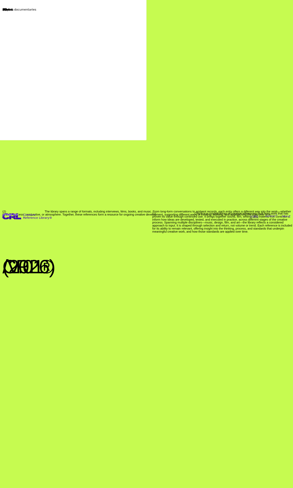
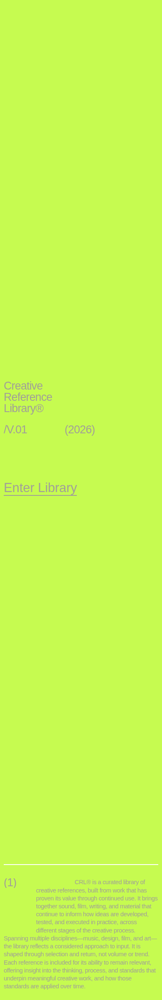

# UI Design System & Master Generation Blueprint: crl-2026-webflow-io

> **Creative Reference Library · CRL** (https://crl-2026.webflow.io/) — CRL® is a curated library of creative references — music, film, books, and writing that shape how ideas are developed, tested, and made....



---

## 1. Executive Visual Persona & Design Archetype

- **Brand Essence & Persona**: **Creative Reference Library · CRL** (`https://crl-2026.webflow.io/`). CRL® is a curated library of creative references — music, film, books, and writing that shape how ideas are developed, tested, and made....
- **Visual Archetype**: **Light-Gallery WebGL / Canvas Interactive Experience (`#c6fb50` / `#d9d9d9`)**.
- **Anti-AI-Slop Differentiators**:
  - **Source-Grounded Chromatic Polarity**: Anchors the viewport in `#c6fb50` (`var(--swatch--brand)` in `:root`) paired with `#000` primary typography and `#d9d9d9` accents.
  - **Extracted Typographic Hierarchy**: Pairs `Neue Haas Grotesk Text Pro` for display copy (`Creative Reference Library`) with `Oswald` and not declared in static CSS (uses primary stack / `ui-monospace`).
  - **Calibrated Spatial Grid & Motion**: Combines `940px` container bounds (`gap: 16px`, padding `9px`) with `cubic-bezier(.55,.085,.68,.53)` easing and Lenis Smooth Scroll (`data-lenis`), Three.js / WebGL Canvas Pipeline.

---

## 2. Spatial Architecture & Modular Grid Mathematics



### Viewport Allocation & Container Geometry
- **Captured Viewport Dimensions**: Desktop `1440×2400px` (`assets/desktop.png`, capped at 2400px multi-section capture), Mobile `390×2400px` (`assets/mobile.png`, capped at 2400px multi-section capture).
- **Master Container Bounds**: `940px` extracted from `crl-2026-webflow-io` stylesheet.
- **Canvas Lateral Padding & Spacing**: `9px` lateral canvas padding with `16px` grid gap.
- **Border Radius Scale**: `3px`, `100%`, `50%`, `var(--radius--small)`.

### Responsive Breakpoint Architecture
- **Desktop Layout**: Multi-column CSS Grid / Flexbox layout at `1440px` (`max-width: 940px`, `gap: 16px`).
- **Mobile Layout**: Single-column vertical stack at `390px` viewport width with `9px` horizontal padding.
- **Extracted CSS Media Queries**: `@media screen and (max-width:991px)`, `@media screen and (max-width:767px)`, `@media screen and (max-width:479px)`, `@media (min-width:768px)`.

---

## 3. Color System, Materiality & Atmospheric Lighting

### Semantic Palette & Source Grounding
| Semantic Role | Ground-Truth Value | Extracted CSS Source / Selector |
|---|---|---|
| **Primary Canvas Substrate** | `#c6fb50` | `var(--swatch--brand)` in `:root` |
| **Primary Typography Ink** | `#a1a098` | `var(--swatch--dark)` in `:root` |
| **Elevated Surface / Card Substrate** | `#000` | `var(--swatch--black)` in `:root` |
| **Interactive Accent / Highlight** | `#d9d9d9` | `var(--swatch--grey)` in `:root` |
| **Secondary / Muted Copy** | `#0000` | `a { background-color: #0000 }` |
| **Structural Hairline Border** | `#ff0` | `mark { background: #ff0 }` |

### Sanitized Root CSS Variables (`ui-ux.md` Ground Truth)
| Variable Name | Extracted Value | Semantic Role |
|---|---|---|
| `--w-backdrop-animation` | `initial` | Motion / Easing Token |
| `--_theme---background` | `var(--swatch--light)` | Canvas / Surface Token |
| `--_text-style---font-family` | `var(--_typography---font--primary-family)` | Typography Ink Token |
| `--_theme---text` | `var(--swatch--black)` | Typography Ink Token |
| `--_text-style---font-size` | `var(--_typography---font-size--text-main)` | Typography Ink Token |
| `--_text-style---line-height` | `var(--_typography---line-height--1)` | Typography Ink Token |
| `--_text-style---font-weight` | `var(--_typography---font--primary-medium)` | Typography Ink Token |
| `--_text-style---letter-spacing` | `var(--_typography---letter-spacing--0-01em)` | Typography Ink Token |
| `--_spacing---space--gap--6` | `var(--size--2rem)` | Layout / Spatial Grid Token |
| `--size--0-5rem` | `.5rem` | Layout / Spatial Grid Token |
| `--_spacing---space--gap--2` | `var(--size--0-5rem)` | Layout / Spatial Grid Token |
| `--_spacing---space--gap--1` | `var(--size--0-25rem)` | Layout / Spatial Grid Token |
| `--_spacing---space--gap--4` | `var(--size--1rem)` | Layout / Spatial Grid Token |
| `--_spacing---space--gap--7` | `var(--size--3rem)` | Layout / Spatial Grid Token |
| `--max-width--full` | `100%` | Layout / Spatial Grid Token |
| `--max-width--small` | `80rem` | Layout / Spatial Grid Token |

---

## 4. Typographic Scale & Editorial Hierarchy

### Font Family Stacks
- **Display Typography**: `Neue Haas Grotesk Text Pro`.
- **Primary Body Stack**: `Oswald`.
- **Technical / Metadata Stack**: not declared in static CSS (uses primary stack / `ui-monospace`).

### Typographic Scale & Rules (Extracted from Stylesheet & Variables)
- **Hero Display (`H1`)**: rule `h1` (`font-size: var(--_text-style---font-size)`, `line-height: var(--_text-style---l...`, `letter-spacing: var(--_text-style---l...`, `font-weight: var(--_text-s...`).
- **Section Heading (`H2`)**: rule `h2` (`font-size: var(--_text-style---font-size)`, `line-height: var(--_text-style---l...`, `letter-spacing: var(--_text-style---l...`, `font-weight: var(--_text-s...`).
- **Body Copy**: rule `p` (`font-size: var(--_text-style---font-size)`, `line-height: var(--_text-style---l...`, `letter-spacing: var(--_text-style---l...`, `font-weight: var(--_text-s...`).
- **Metadata & Navigation Labels**: CSS variables `--_text-style---letter-spacing: var(--_typography---letter-spacing--0-01em)`, `--max-width--small: 80rem`, `--radius--small: .5rem`.

---

## 5. Choreographed Motion & Interaction Physics

### Primary Easing Curves
- **Extracted Timing Functions**: `cubic-bezier(.55,.085,.68,.53)`, `cubic-bezier(.55,.055,.675,.19)`, `cubic-bezier(.895,.03,.685,.22)`.

### Per-Element Transition & Choreography Rules
- **Selector `.w-webflow-badge>img`**: `transition: unset` extracted from `crl-2026-webflow-io` stylesheet.
- **Selector `.w-slider-dot`**: `transition: background-color .1s,color .1s` extracted from `crl-2026-webflow-io` stylesheet.
- **Selector `.w-lightbox-control`**: `transition: all .3s` extracted from `crl-2026-webflow-io` stylesheet.
- **Extracted Easing Curve (`cubic-bezier(.55,.085,.68,.53)`)**: Governs interactive state transitions across `<header.w-mod-js>` and `<section.home_hero>`.
- **Runtime Interaction Engine**: Integrates Lenis Smooth Scroll (`data-lenis`), Three.js / WebGL Canvas Pipeline with `prefers-reduced-motion: reduce` fallback guards.

---

## 6. Component Wireframe & Structural DOM Map

### Visual Layout Schematic (Grounded in `dom.html` — `1440px` Desktop & `390px` Mobile Reflow)
```
┌────────────────────────────────────────────────────────────────────────┐
│ DESKTOP VIEWPORT (1440px) — Creative Reference Library · CRL           │
│ ====================================================================== │
│ [ <header.w-mod-js>        | Index · Library · About · Library (20) ]  │
│ ---------------------------------------------------------------------- │
│ | HERO STAGE: <section.home_hero>                                  |   │
│ | H1: Creative Reference Library                                   |   │
│ | Substrate: #c6fb50    | Ink: #000       | Accent: #d9d9d9        |   │
│ ---------------------------------------------------------------------- │
│ | SHOWCASE GRID (<section.home_hero>       ) max-w: 940px          |   │
│ | +------------------------------+  +------------------------------+ | │
│ | | crl®                         |  | /V.01                        | | │
│ | +------------------------------+  +------------------------------+ | │
│ ---------------------------------------------------------------------- │
│ | MOBILE VIEWPORT REFLOW (390px) — Single-Column Stack (gap: 16px  ) | │
│ | [<header.w-mod-js>] -> [<section.home_hero] -> [<section.home_hero]  │
│ ---------------------------------------------------------------------- │
│ [ FOOTER (<footer.wf-oswald-n7-a) | https://crl-2026.webflow.io/       │
└────────────────────────────────────────────────────────────────────────┘
```

### Granular DOM Region Breakdown
1. **Brand Header & Navigation Bar (<header.w-mod-js> — `crl-2026-webflow-io`)**:
   - Landmark `<header class="w-mod-js">` hosting `Creative Reference Library · CRL` navigation (`Index · Library · About · Library (20) · Instagram`), DOM attributes (`data-wf-domain="crl-2026.webflow.io"`, `data-wf-page="6a0fce3b3983a9d8a80eb4d1"`, `data-wf-site="6a0fce3b3983a9d8a80eb4d0"`, `data-page="home"`), and stylesheet rule `html { -webkit-text-size-adjust:100%;-ms-text-size-adjust:100%;font-family:sans... }`.
2. **Hero Stage & Focal Lead (<section.home_hero> — `Creative Reference Library`)**:
   - Landmark `<section class="home_hero">` presenting display lead `Creative Reference Library` and copy excerpt *"Creative Reference Library®"* over `#c6fb50` canvas and `#000` ink.
3. **Primary Showcase & Content Grid (<section.home_hero> — `crl®`)**:
   - Landmark `<section class="home_hero">` rendering section `crl®` with copy *"(1) CRL® is a curated library of creative references, built from "*, asset references (`cdn.prod.website-files.com`, `crl-2026.shared.1c24320b9.min.css`, `fonts.googleapis.com`, `fonts.gstatic.com`), and grid rule `summary { display:block }`.
4. **Interactive Detail & Feature Matrix (<section.home_hero> — `/V.01`)**:
   - Landmark `<section class="home_hero">` framing `/V.01` and `(2026)` (*"(2) The library spans a range of formats, including interviews, f"*) with `#000` surface cards, `#d9d9d9` accents, and `video { vertical-align:baseline;display:inline-block }`.
5. **Colophon & Global Directory Footer (<footer.wf-oswald-n7-active> — `https://crl-2026.webflow.io/`)**:
   - Landmark `<footer class="wf-oswald-n7-active">` anchoring `Creative Reference Library · CRL` footer links (`Index · Library · About · Library (20) · Instagram`), copy *"CRL® is a curated library of creative references, built from"*, and `#ff0` structural dividers.

---

## 7. Master Zero-Shot AI Generation Prompt

```markdown
# Master Zero-Shot Frontend Generation Prompt: crl-2026-webflow-io (Creative Reference Library · CRL)

You are a principal frontend architect and design systems engineer. Build a complete, production-ready web application replicating the exact design system, DOM landmarks, typographic hierarchy, color tokens, and motion physics of `crl-2026-webflow-io` (**Creative Reference Library · CRL** — `https://crl-2026.webflow.io/`).

### 1. Visual Archetype & Anti-AI-Slop Mandates
- **Archetype**: Light-Gallery WebGL / Canvas Interactive Experience (`#c6fb50` / `#d9d9d9`).
- **Identity & Domain Context**: CRL® is a curated library of creative references — music, film, books, and writing that shape how ideas are developed, tested, and made....
- **Primary Substrate**: `#c6fb50` (`var(--swatch--brand)` in `:root`), **Primary Ink**: `#000`, **Accent / Highlight**: `#d9d9d9`.
- **Site-Specific Differentiators**:
  - **Source-Grounded Chromatic Polarity**: Anchors the viewport in `#c6fb50` (`var(--swatch--brand)` in `:root`) paired with `#000` primary typography and `#d9d9d9` accents.
  - **Extracted Typographic Hierarchy**: Pairs `Neue Haas Grotesk Text Pro` for display copy (`Creative Reference Library`) with `Oswald` and not declared in static CSS (uses primary stack / `ui-monospace`).
  - **Calibrated Spatial Grid & Motion**: Combines `940px` container bounds (`gap: 16px`, padding `9px`) with `cubic-bezier(.55,.085,.68,.53)` easing and Lenis Smooth Scroll (`data-lenis`), Three.js / WebGL Canvas Pipeline.

### 2. Ground-Truth CSS Variables (`:root` Token Contract)
Declare and consume these exact custom properties extracted from `crl-2026-webflow-io` in your global stylesheet:

:root {
  /* Creative Reference Library · CRL (crl-2026-webflow-io) — Ground-Truth Extracted CSS Variables */
  --w-backdrop-animation: initial; /* Motion / Easing Token (crl-2026-webflow-io) */
  --_theme---background: var(--swatch--light); /* Canvas / Surface Token (crl-2026-webflow-io) */
  --_text-style---font-family: var(--_typography---font--primary-family); /* Typography Ink Token (crl-2026-webflow-io) */
  --_theme---text: var(--swatch--black); /* Typography Ink Token (crl-2026-webflow-io) */
  --_text-style---font-size: var(--_typography---font-size--text-main); /* Typography Ink Token (crl-2026-webflow-io) */
  --_text-style---line-height: var(--_typography---line-height--1); /* Typography Ink Token (crl-2026-webflow-io) */
  --_text-style---font-weight: var(--_typography---font--primary-medium); /* Typography Ink Token (crl-2026-webflow-io) */
  --_text-style---letter-spacing: var(--_typography---letter-spacing--0-01em); /* Typography Ink Token (crl-2026-webflow-io) */
  --_spacing---space--gap--6: var(--size--2rem); /* Layout / Spatial Grid Token (crl-2026-webflow-io) */
  --size--0-5rem: .5rem; /* Layout / Spatial Grid Token (crl-2026-webflow-io) */
  --_spacing---space--gap--2: var(--size--0-5rem); /* Layout / Spatial Grid Token (crl-2026-webflow-io) */
  --_spacing---space--gap--1: var(--size--0-25rem); /* Layout / Spatial Grid Token (crl-2026-webflow-io) */
  --_spacing---space--gap--4: var(--size--1rem); /* Layout / Spatial Grid Token (crl-2026-webflow-io) */
  --_spacing---space--gap--7: var(--size--3rem); /* Layout / Spatial Grid Token (crl-2026-webflow-io) */
  --max-width--full: 100%; /* Layout / Spatial Grid Token (crl-2026-webflow-io) */
  --max-width--small: 80rem; /* Layout / Spatial Grid Token (crl-2026-webflow-io) */
}

### 3. Semantic Color & Materiality Contract
Map every surface, ink, and border strictly to these source-grounded tokens:
- **Primary Canvas Substrate**: `#c6fb50` — grounded in `var(--swatch--brand)` in `:root`
- **Primary Typography Ink**: `#a1a098` — grounded in `var(--swatch--dark)` in `:root`
- **Elevated Surface / Card Substrate**: `#000` — grounded in `var(--swatch--black)` in `:root`
- **Interactive Accent / Highlight**: `#d9d9d9` — grounded in `var(--swatch--grey)` in `:root`
- **Secondary / Muted Copy**: `#0000` — grounded in `a { background-color: #0000 }`
- **Structural Hairline Border**: `#ff0` — grounded in `mark { background: #ff0 }`

### 4. Spatial Grid, Container Bounds & Responsive Breakpoints
- **Desktop Viewport Reference**: `1440×2400px` (capped at 2400px multi-section capture, `1440px` standard desktop width).
- **Mobile Viewport Reference**: `390×2400px` (capped at 2400px multi-section capture, `390px` standard mobile width).
- **Container Max-Width**: `940px` extracted from `crl-2026-webflow-io` stylesheet
- **Padding & Gutters**: `9px` lateral canvas padding with `16px` grid gap
- **Desktop Grid**: Multi-column CSS Grid / Flexbox layout at `1440px` (`max-width: 940px`, `gap: 16px`)
- **Mobile Adaptation**: Single-column vertical stack at `390px` viewport width with `9px` horizontal padding
- **Media Queries**: `@media screen and (max-width:991px)`, `@media screen and (max-width:767px)`, `@media screen and (max-width:479px)`, `@media (min-width:768px)`
- **Corner Radii**: `3px`, `100%`, `50%`, `var(--radius--small)`

### 5. Typography & Editorial Scale Contract
- **Display Font Stack**: `Neue Haas Grotesk Text Pro`
- **Body Font Stack**: `Oswald`
- **Monospace / Technical Font Stack**: not declared in static CSS (uses primary stack / `ui-monospace`)
- **H1 Display Rule**: rule `h1` (`font-size: var(--_text-style---font-size)`, `line-height: var(--_text-style---l...`, `letter-spacing: var(--_text-style---l...`, `font-weight: var(--_text-s...`)
- **H2 Section Rule**: rule `h2` (`font-size: var(--_text-style---font-size)`, `line-height: var(--_text-style---l...`, `letter-spacing: var(--_text-style---l...`, `font-weight: var(--_text-s...`)
- **Body Copy Rule**: rule `p` (`font-size: var(--_text-style---font-size)`, `line-height: var(--_text-style---l...`, `letter-spacing: var(--_text-style---l...`, `font-weight: var(--_text-s...`)
- **Metadata & Index Rule**: CSS variables `--_text-style---letter-spacing: var(--_typography---letter-spacing--0-01em)`, `--max-width--small: 80rem`, `--radius--small: .5rem`

### 6. Component Hierarchy, Verbatim Copy & Real DOM Landmarks
Scaffold `crl-2026-webflow-io` (`Creative Reference Library · CRL`) with these exact structural regions, extracted copy, and CSS rules from `dom.html`:
1. **Brand Header & Navigation Bar (<header.w-mod-js> — `crl-2026-webflow-io`)**:
   - DOM & Selectors: Landmark `<header class="w-mod-js">` hosting `Creative Reference Library · CRL` navigation (`Index · Library · About · Library (20) · Instagram`), DOM attributes (`data-wf-domain="crl-2026.webflow.io"`, `data-wf-page="6a0fce3b3983a9d8a80eb4d1"`, `data-wf-site="6a0fce3b3983a9d8a80eb4d0"`, `data-page="home"`), and stylesheet rule `html { -webkit-text-size-adjust:100%;-ms-text-size-adjust:100%;font-family:sans... }`.
   - Responsive Contract: Header `Brand Header & Navigation Bar (<header.w-mod-js> — `crl-2026-webflow-io`)` (`crl-2026-webflow-io`) adapts across `@media screen and (max-width:991px)`, `@media screen and (max-width:767px)`, `@media screen and (max-width:479px)`, `@media (min-width:768px)` with `cubic-bezier(.55,.085,.68,.53)`, `cubic-bezier(.55,.055,.675,.19)`, `cubic-bezier(.895,.03,.685,.22)` transitions and links `Index · Library · About · Library (20) · Instagram`.
2. **Hero Stage & Focal Lead (<section.home_hero> — `Creative Reference Library`)**:
   - DOM & Selectors: Landmark `<section class="home_hero">` presenting display lead `Creative Reference Library` and copy excerpt *"Creative Reference Library®"* over `#c6fb50` canvas and `#000` ink.
   - Responsive Contract: Hero stage (`1440×2400px` desktop / `390×2400px` mobile) sets `#c6fb50` background with `#000` headline `Creative Reference Library`.
3. **Primary Showcase & Content Grid (<section.home_hero> — `crl®`)**:
   - DOM & Selectors: Landmark `<section class="home_hero">` rendering section `crl®` with copy *"(1) CRL® is a curated library of creative references, built from "*, asset references (`cdn.prod.website-files.com`, `crl-2026.shared.1c24320b9.min.css`, `fonts.googleapis.com`, `fonts.gstatic.com`), and grid rule `summary { display:block }`.
   - Responsive Contract: Showcase grid `Primary Showcase & Content Grid (<section.home_hero> — `crl®`)` applies Multi-column CSS Grid / Flexbox layout at `1440px` (`max-width: 940px`, `gap: 16px`) on desktop and Single-column vertical stack at `390px` viewport width with `9px` horizontal padding on mobile.
4. **Interactive Detail & Feature Matrix (<section.home_hero> — `/V.01`)**:
   - DOM & Selectors: Landmark `<section class="home_hero">` framing `/V.01` and `(2026)` (*"(2) The library spans a range of formats, including interviews, f"*) with `#000` surface cards, `#d9d9d9` accents, and `video { vertical-align:baseline;display:inline-block }`.
   - Responsive Contract: Detail module `Interactive Detail & Feature Matrix (<section.home_hero> — `/V.01`)` uses `3px`, `100%`, `50%`, `var(--radius--small)` radii, `#d9d9d9` highlights, and assets (cdn.prod.website-files.com, crl-2026.shared.1c24320b9.min.css, fonts.googleapis.com).
5. **Colophon & Global Directory Footer (<footer.wf-oswald-n7-active> — `https://crl-2026.webflow.io/`)**:
   - DOM & Selectors: Landmark `<footer class="wf-oswald-n7-active">` anchoring `Creative Reference Library · CRL` footer links (`Index · Library · About · Library (20) · Instagram`), copy *"CRL® is a curated library of creative references, built from"*, and `#ff0` structural dividers.
   - Responsive Contract: Footer `Colophon & Global Directory Footer (<footer.wf-oswald-n7-active> — `https://crl-2026.webflow.io/`)` aligns to `940px` extracted from `crl-2026-webflow-io` stylesheet with `9px` lateral canvas padding with `16px` grid gap and attributes (data-wf-domain="crl-2026.webflow.io", data-wf-page="6a0fce3b3983a9d8a80eb4d1", data-wf-site="6a0fce3b3983a9d8a80eb4d0").

#### Verbatim DOM Copy Excerpts (`dom.html`)
- Copy Excerpt 1: *"Creative Reference Library®"*
- Copy Excerpt 2: *"(1) CRL® is a curated library of creative references, built from work that has pro..."*
- Copy Excerpt 3: *"(2) The library spans a range of formats, including interviews, films, books, and..."*
- Copy Excerpt 4: *"CRL® is a curated library of creative references, built from work that has proven..."*

### 7. Motion, Extracted Stylesheet Rules & Interaction Choreography
- **Primary Easing Functions**: `cubic-bezier(.55,.085,.68,.53)`, `cubic-bezier(.55,.055,.675,.19)`, `cubic-bezier(.895,.03,.685,.22)`
- **Extracted Stylesheet Rules (`crl-2026-webflow-io`)**:
- `html { -webkit-text-size-adjust:100%;-ms-text-size-adjust:100%;font-family:sans... }`
- `summary { display:block }`
- `video { vertical-align:baseline;display:inline-block }`
- `template { display:none }`
- `strong { font-weight:700 }`
- **Per-Selector Transition Rules**:
- **Selector `.w-webflow-badge>img`**: `transition: unset` extracted from `crl-2026-webflow-io` stylesheet.
- **Selector `.w-slider-dot`**: `transition: background-color .1s,color .1s` extracted from `crl-2026-webflow-io` stylesheet.
- **Selector `.w-lightbox-control`**: `transition: all .3s` extracted from `crl-2026-webflow-io` stylesheet.
- **Extracted Easing Curve (`cubic-bezier(.55,.085,.68,.53)`)**: Governs interactive state transitions across `<header.w-mod-js>` and `<section.home_hero>`.
- **Runtime Interaction Engine**: Integrates Lenis Smooth Scroll (`data-lenis`), Three.js / WebGL Canvas Pipeline with `prefers-reduced-motion: reduce` fallback guards.

### 8. Technical Deliverables
- Implement in Next.js (App Router) with TypeScript and Tailwind CSS consuming the `:root` custom properties defined above for `crl-2026-webflow-io`.
- Reproduce both the `1440px` desktop architecture and `390px` mobile breakpoint transitions, preserving semantic HTML5 landmarks (`<header>`, `<nav>`, `<main>`, `<section>`, `<footer>`) and `prefers-reduced-motion` accessibility guards.
```
