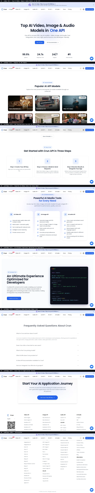
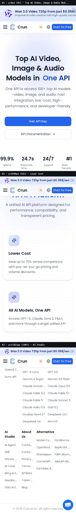

# UI Design System & Master Generation Blueprint: crun-ai

> **One API for All Top AI Models – Cost-Effective AI API · Crun** (https://crun.ai) — One API to access all top AI models—video, image, audio, and text. Fast integration, 30–70% cost savings, high-performance, and developer...





---

## 1. Executive Visual Persona & Design Archetype

- **Brand Essence & Persona**: **One API for All Top AI Models – Cost-Effective AI API · Crun** (`https://crun.ai`). One API to access all top AI models—video, image, audio, and text. Fast integration, 30–70% cost savings, high-performance, and developer...
- **Capture Provenance**: Live browser capture (`tier1_fast`, HTTP `200`, captured `2026-11-24`).
- **Visual Archetype**: **Light-Substrate Editorial & Modular Grid System (`#ffffff` canvas, `#141414` ink, `#337ecc` accent)**.
- **Anti-AI-Slop Differentiators**:
  - **Live-Computed Chromatic Polarity**: Anchors the viewport in `#ffffff` (live computed `body` `background-color` (`computed_styles.json`)) paired with `#141414` primary typography and `#337ecc` accents.
  - **Grounded Typographic Hierarchy**: Uses `Poppins` across display (`Top AI Video, Image & Audio Models i`) and body copy.
  - **Calibrated Spatial Grid & Motion**: Combines `1392px` container bounds (`gap: 4px`, padding `14px`) with `cubic-bezier(.4,0,1,1)` easing and Three.js / WebGL Canvas Pipeline, Swiper Touch Carousel Engine.

---

## 2. Spatial Architecture & Modular Grid Mathematics

### Viewport Allocation & Container Geometry
- **Captured Journey Filmstrips**: Desktop `1280×6624px` (`assets/desktop-journey.webp`, `8` keyframes up to `y=6833px` / doc `7773px`), Mobile `390×2616px` (`assets/mobile-journey.webp`, `3` keyframes).
- **Master Container Bounds**: `1392px` (measured widest bounded `<section>` landmark width on `1440px` desktop).
- **Canvas Lateral Padding & Spacing**: `14px` lateral canvas padding with `4px` grid gap.
- **Border Radius Scale**: `var(--el-notification-radius)`, `.5rem`, `10px`, `9999px`.

### Responsive Breakpoint Architecture
- **Desktop Layout**: Multi-column CSS Grid / Flexbox layout at `1440px` (`max-width: 1392px`, `gap: 4px`).
- **Mobile Layout**: Single-column vertical stack at `390px` viewport width with `14px` horizontal padding.
- **Extracted CSS Media Queries**: `@media (max-width:1024px)`, `@media (prefers-reduced-motion:reduce),print`, `@media (min-width:640px)`, `@media (min-width:768px)`.

---

## 3. Color System, Materiality & Atmospheric Lighting

### Semantic Palette & Source Grounding
| Semantic Role | Ground-Truth Value | Extracted Live / CSS Source |
|---|---|---|
| **Primary Canvas Substrate** | `#ffffff` | live computed `body` `background-color` (`computed_styles.json`) |
| **Primary Typography Ink** | `#141414` | live computed `body` `color` (`computed_styles.json`) |
| **Elevated Surface / Card Substrate** | `#e6e8eb` | `var(--bgColor-15)` in `:root` |
| **Interactive Accent / Highlight** | `#337ecc` | `var(--el-color-primary-dark-2)` in `:root` |
| **Secondary / Muted Copy** | `#8d9095` | `var(--el-text-color-placeholder)` in `:root` |
| **Structural Hairline Border** | `#d1d5db` | `var(--border-color)` in `:root` |
| **Variable Token (`--themeColor`)** | `#2563eb` | `var(--themeColor)` in `:root` |
| **Variable Token (`--themeColor-100`)** | `#f0f7ff` | `var(--themeColor-100)` in `:root` |
| **Variable Token (`--themeColor-200`)** | `#cce3ff` | `var(--themeColor-200)` in `:root` |
| **Variable Token (`--themeColor-300`)** | `#a3c9ff` | `var(--themeColor-300)` in `:root` |
| **Variable Token (`--themeColor-400`)** | `#7aadff` | `var(--themeColor-400)` in `:root` |
| **Variable Token (`--themeColor-500`)** | `#4f8af7` | `var(--themeColor-500)` in `:root` |
| **Variable Token (`--themeColor-700`)** | `#1647c4` | `var(--themeColor-700)` in `:root` |
| **Variable Token (`--themeColor-800`)** | `#092f9e` | `var(--themeColor-800)` in `:root` |
| **Variable Token (`--themeColor-900`)** | `#011b78` | `var(--themeColor-900)` in `:root` |
| **Variable Token (`--themeColor-1000`)** | `#000f52` | `var(--themeColor-1000)` in `:root` |

### Sanitized Root CSS Variables (`ui-ux.md` Ground Truth)
| Variable Name | Extracted Value | Semantic Role |
|---|---|---|
| `--themeColor` | `#2563eb` | Brand / Palette Token |
| `--themeColor-100` | `#f0f7ff` | Brand / Palette Token |
| `--themeColor-200` | `#cce3ff` | Brand / Palette Token |
| `--themeColor-300` | `#a3c9ff` | Brand / Palette Token |
| `--themeColor-400` | `#7aadff` | Brand / Palette Token |
| `--themeColor-500` | `#4f8af7` | Brand / Palette Token |
| `--themeColor-600` | `#2563eb` | Brand / Palette Token |
| `--themeColor-700` | `#1647c4` | Brand / Palette Token |
| `--themeColor-800` | `#092f9e` | Brand / Palette Token |
| `--themeColor-900` | `#011b78` | Brand / Palette Token |
| `--themeColor-1000` | `#000f52` | Brand / Palette Token |
| `--themeColor-trans0` | `rgba(37,99,235,0)` | Brand / Palette Token |
| `--themeColor-trans3` | `rgba(37,99,235,.03)` | Brand / Palette Token |
| `--themeColor-trans4` | `rgba(37,99,235,.04)` | Brand / Palette Token |
| `--themeColor-trans5` | `rgba(37,99,235,.05)` | Brand / Palette Token |
| `--themeColor-trans6` | `rgba(37,99,235,.06)` | Brand / Palette Token |

---

## 4. Typographic Scale & Editorial Hierarchy

### Font Family Stacks
- **Display Typography**: `Poppins`.
- **Primary Body Stack**: `Poppins`.
- **Technical / Metadata Stack**: not declared in live computed styles (uses primary stack / `ui-monospace`).

### Typographic Scale & Rules (Live Computed & Stylesheet Grounded)
- **Hero Display (`H1`)**: live computed `h1` (`font-size: 60px`, `line-height: 75px`, `font-weight: 700`, `letter-spacing: -1.5px`); CSS variables `--text-4xl: 2.25rem`, `--text-4xl--line-height: 1.11111`, `--text-5xl: 3rem`; rule `h1` (`font-size: 2em`).
- **Section Heading (`H2`)**: live computed `h2` (`font-size: 48px`, `line-height: 48px`, `font-weight: 700`); CSS variables `--text-2xl: 1.5rem`, `--text-2xl--line-height: 1.33333`, `--text-3xl: 1.875rem`; rule `h2` (`font-size: 1.5em`).
- **Body Copy**: live computed `body` (`font-size: 16px`, `line-height: 24px`, `font-weight: 400`); CSS variables `--el-font-size-base: 14px`, `--text-base: 1rem`, `--text-base--line-height: 1.5`.
- **Metadata & Navigation Labels**: live computed `nav/a` (`font-size: 16px`, `line-height: 24px`, `font-weight: 400`); CSS variables `--el-font-size-small: 13px`, `--el-font-size-extra-small: 12px`, `--el-border-radius-small: 2px`.

---

## 5. Choreographed Motion & Interaction Physics

### Primary Easing Curves
- **Extracted Timing Functions**: `cubic-bezier(.4,0,1,1)`, `cubic-bezier(0,0,.2,1)`, `cubic-bezier(.4,0,.2,1)`.

### Per-Element Transition & Choreography Rules
- **Selector `.el-notification`**: `transition: opacity var(--el-transition-duration),transform var(--el-trans...` extracted from `crun-ai` stylesheet.
- **Selector `print`**: `transition: 1ms!important` extracted from `crun-ai` stylesheet.
- **Selector `80%`**: `transition: cubic-bezier(.4,0,1,1)` extracted from `crun-ai` stylesheet.
- **Extracted Easing Curve (`cubic-bezier(.4,0,1,1)`)**: Governs interactive state transitions across `<header.left-0>` and `<section.pt-10>`.
- **Runtime Interaction Engine**: Integrates Three.js / WebGL Canvas Pipeline, Swiper Touch Carousel Engine with `prefers-reduced-motion: reduce` fallback guards.
### Measured Runtime Scroll & Interaction Telemetry (`behavioral_journey_v2`)
- **Scroll Driver Mode**: `native` (max document height `7773px`, deepest scrollY reached `6833px` across `8` desktop keyframes).
- **Detected Scroll / Motion Libraries**: Native browser scroll / standard CSS transitions.
- **Hover Physics (`primary_cta` · `Crun`)**: Computed transition `0s` / `ease` (no static color/transform shift captured at rest).
- **Theme Toggle Probe (`Toggle Theme`)**: Toggled body background `rgb(255, 255, 255)` -> `rgb(2, 6, 23)` and ink `rgb(20, 20, 20)` -> `rgb(248, 250, 252)`.
- **Route Transition Architecture**: First internal navigation (`/pricing`) measured as `MPA` in `1838ms`.

---

## 6. Component Wireframe & Structural DOM Map

### Visual Layout Schematic — Desktop (`1440px`, Grounded in `dom.html` & Landmark Bounding Boxes)
```
┌────────────────────────────────────────────────────────────────────────┐
│ DESKTOP VIEWPORT (1440px) — One API for All Top AI Models – Cost-Effec │
│ ====================================================================== │
│ [ <header.left-0> (1440x141px)        | AI Agent NEW · Seedance 2.5  ] │
│ ---------------------------------------------------------------------- │
│ | HERO STAGE: <section.relative> (w=1440px)                          | │
│ | H1: Top AI Video, Image & Audio Models in One API                  | │
│ | Substrate: #ffffff | Ink: #141414 | Accent: #337ecc                | │
│ ---------------------------------------------------------------------- │
│ | SHOWCASE GRID (<section.pt-10>) max-w: 1392px                      | │
│ | +------------------------------+  +------------------------------+ | │
│ | | Wan 3.0 Video 720p from just |  | Empower AI video creation wi | | │
│ | +------------------------------+  +------------------------------+ | │
│ ---------------------------------------------------------------------- │
│ | DETAIL MODULE (<section.pt-8>) — Video API Seedance 2.             | │
│ ---------------------------------------------------------------------- │
│ [ FOOTER (<footer.right-0>    ) | https://crun.ai                      │
└────────────────────────────────────────────────────────────────────────┘
```

### Visual Layout Schematic — Mobile Reflow (`390px`)
```
┌────────────────────────────────────────────────────────────────────────┐
│ MOBILE VIEWPORT REFLOW (390px) — Single-Column Stack (gap: 4px)        │
│ ====================================================================== │
│ [ HEADER BAR (<header.left-0>         ) | Compact Menu (390px)         │
│ ---------------------------------------------------------------------- │
│ | HERO STAGE (<section.relative>) — 390px Vertical Lead              | │
│ | H1: Top AI Video, Image & Audio Models in One API                  | │
│ ---------------------------------------------------------------------- │
│ | SHOWCASE STACK (<section.pt-10>) — 1-Col Stack                     | │
│ | [ Item 1: Wan 3.0 Video 720p from just $0.058/sec                ] | │
│ | [ Item 2: Empower AI video creation with high-quality visu       ] | │
│ ---------------------------------------------------------------------- │
│ | DETAIL STACK (<section.pt-8>) — 1-Col (Video API Seedance)         | │
│ ---------------------------------------------------------------------- │
│ [ FOOTER (<footer.right-0>    ) | Stacked 390px Colophon               │
└────────────────────────────────────────────────────────────────────────┘
```

### Granular DOM Region Breakdown
1. **Brand Header & Navigation Bar (<header.left-0> — `crun-ai`)**:
   - Landmark `<header class="left-0 right-0">` (`1440x141px`) hosting `One API for All Top AI Models – Cost` navigation (`AI Agent NEW · Seedance 2.5 HOT · Wan 3.0 HOT · Kling 4.0 · Seedance 2.0`), DOM attributes (`data-gtag`, `data-v-88db481d`, `data-v-b2c0d9f1`, `data-v-2f8ea121`), and stylesheet rule `.el-notification.right { right:16px }`.
2. **Hero Stage & Focal Lead (<section.relative> — `Top AI Video, Image & Audio Models`)**:
   - Landmark `<section class="relative flex">` presenting display lead `Top AI Video, Image & Audio Models in One API` and copy excerpt *"Wan 3.0 Video 720p from just $0.058/sec"* over `#ffffff` canvas and `#141414` ink.
3. **Primary Showcase & Content Grid (<section.pt-10> — `Wan 3.0 Video 720p from just $0.05`)**:
   - Landmark `<section class="pt-10 relative">` rendering section `Wan 3.0 Video 720p from just $0.058/sec` with copy *"Empower AI video creation with high-quality visuals at just 58% o"*, asset references (`entry.BwM3ZDM3.css`, `el-notification.D1R47t8o.css`, `index.ByFwvLCV.css`, `advantagesGrid.o3VIx7N9.css`), and grid rule `cation .el-notification__closeBtn... { color:var(--el-notification-close-hover-color) }`.
4. **Interactive Detail & Feature Matrix (<section.pt-8> — `Empower AI video creation with hig`)**:
   - Landmark `<section class="pt-8 px-4">` framing `Empower AI video creation with high-quality visu` and `Video API Seedance 2.5 HOT Wan 3.0 HOT Seedance ` (*"Video API Seedance 2.5 HOT Wan 3.0 HOT Seedance 2.5 Flash NEW Kli"*) with `#e6e8eb` surface cards, `#337ecc` accents, and `notification .el-notification--pr... { --el-notification-icon-color:var(--el-color-primary);color:var(--el-noti... }`.
5. **Colophon & Global Directory Footer (<footer.right-0> — `https://crun.ai`)**:
   - Landmark `<footer class="right-0">` anchoring `One API for All Top AI Models – ` footer links (`AI Agent NEW · Seedance 2.5 HOT · Wan 3.0 HOT · Kling 4.0 · Seedance 2.0`), copy *"Seedance 2.5 Flash NEW"*, and `#d1d5db` structural dividers.
### Full Vertical Scroll Sequence (Desktop `1440×900` Keyframes)
- **Step 01** (`y=0px`, `0%`): Active landmark `Top AI Video, Image & Audio Models in One API` · sticky/fixed elements: `1`
- **Step 02** (`y=810px`, `12%`): Active landmark `Popular AI API Models` · sticky/fixed elements: `1`
- **Step 03** (`y=1700px`, `25%`): Active landmark `Get Started with Crun API in Three Steps` · sticky/fixed elements: `1`
- **Step 04** (`y=2550px`, `37%`): Active landmark `Powerful AI Media Tools for Every Need` · sticky/fixed elements: `1`
- **Step 05** (`y=4250px`, `62%`): Active landmark `An Ultimate Experience Optimized for Developers` · sticky/fixed elements: `1`
- **Step 06** (`y=5100px`, `75%`): Active landmark `Frequently Asked Questions About Crun` · sticky/fixed elements: `1`
- **Step 07** (`y=5950px`, `87%`): Active landmark `Start Your AI Application Journey` · sticky/fixed elements: `1`
- **Step 08** (`y=6833px`, `100%`): Active landmark `Alternative` · sticky/fixed elements: `1`

### Multi-Page Internal Route Map
- **Listing Route (`/pricing`)**: `https://crun.ai/pricing` — H1: `Pricing`, scrollHeight `900px`, transition `MPA` (`1838ms`)
- **Detail Route (`/models/wan-3-video`)**: `https://crun.ai/models/wan-3-video` — H1: `Wan 3.0 AI Video Generator & API`, scrollHeight `8290px`, transition `direct` (`1564ms`)
- **Detail Route (`/models/seedance-2-5`)**: `https://crun.ai/models/seedance-2-5` — H1: `Seedance 2.5 API`, scrollHeight `8383px`, transition `direct` (`1072ms`)

---

## 7. Master Zero-Shot AI Generation Prompt

```markdown
# Master Zero-Shot Frontend Generation Prompt: crun-ai (One API for All Top AI Models – Cost-Effective AI API · Crun)

You are a principal frontend architect and design systems engineer. Build a complete, production-ready web application replicating the exact design system, DOM landmarks, typographic hierarchy, color tokens, and motion physics of `crun-ai` (**One API for All Top AI Models – Cost-Effective AI API · Crun** — `https://crun.ai`).

### 1. Visual Archetype & Anti-AI-Slop Mandates
- **Archetype**: Light-Substrate Editorial & Modular Grid System (`#ffffff` canvas, `#141414` ink, `#337ecc` accent).
- **Identity & Domain Context**: One API to access all top AI models—video, image, audio, and text. Fast integration, 30–70% cost savings, high-performance, and developer...
- **Primary Substrate**: `#ffffff` (live computed `body` `background-color` (`computed_styles.json`)), **Primary Ink**: `#141414`, **Accent / Highlight**: `#337ecc`.
- **Site-Specific Differentiators**:
  - **Live-Computed Chromatic Polarity**: Anchors the viewport in `#ffffff` (live computed `body` `background-color` (`computed_styles.json`)) paired with `#141414` primary typography and `#337ecc` accents.
  - **Grounded Typographic Hierarchy**: Uses `Poppins` across display (`Top AI Video, Image & Audio Models i`) and body copy.
  - **Calibrated Spatial Grid & Motion**: Combines `1392px` container bounds (`gap: 4px`, padding `14px`) with `cubic-bezier(.4,0,1,1)` easing and Three.js / WebGL Canvas Pipeline, Swiper Touch Carousel Engine.

### 2. Ground-Truth CSS Variables (`:root` Token Contract)
Declare and consume these exact custom properties extracted from `crun-ai` in your global stylesheet:

:root {
  /* One API for All Top AI Models – Cost-Effective AI API · Crun (crun-ai) — Live-Grounded CSS Variables */
  --themeColor: #2563eb; /* Brand / Palette Token (crun-ai) */
  --themeColor-100: #f0f7ff; /* Brand / Palette Token (crun-ai) */
  --themeColor-200: #cce3ff; /* Brand / Palette Token (crun-ai) */
  --themeColor-300: #a3c9ff; /* Brand / Palette Token (crun-ai) */
  --themeColor-400: #7aadff; /* Brand / Palette Token (crun-ai) */
  --themeColor-500: #4f8af7; /* Brand / Palette Token (crun-ai) */
  --themeColor-600: #2563eb; /* Brand / Palette Token (crun-ai) */
  --themeColor-700: #1647c4; /* Brand / Palette Token (crun-ai) */
  --themeColor-800: #092f9e; /* Brand / Palette Token (crun-ai) */
  --themeColor-900: #011b78; /* Brand / Palette Token (crun-ai) */
  --themeColor-1000: #000f52; /* Brand / Palette Token (crun-ai) */
  --themeColor-trans0: rgba(37,99,235,0); /* Brand / Palette Token (crun-ai) */
  --themeColor-trans3: rgba(37,99,235,.03); /* Brand / Palette Token (crun-ai) */
  --themeColor-trans4: rgba(37,99,235,.04); /* Brand / Palette Token (crun-ai) */
  --themeColor-trans5: rgba(37,99,235,.05); /* Brand / Palette Token (crun-ai) */
  --themeColor-trans6: rgba(37,99,235,.06); /* Brand / Palette Token (crun-ai) */
}

### 3. Semantic Color & Materiality Contract
Map every surface, ink, and border strictly to these source-grounded tokens:
- **Primary Canvas Substrate**: `#ffffff` — grounded in live computed `body` `background-color` (`computed_styles.json`)
- **Primary Typography Ink**: `#141414` — grounded in live computed `body` `color` (`computed_styles.json`)
- **Elevated Surface / Card Substrate**: `#e6e8eb` — grounded in `var(--bgColor-15)` in `:root`
- **Interactive Accent / Highlight**: `#337ecc` — grounded in `var(--el-color-primary-dark-2)` in `:root`
- **Secondary / Muted Copy**: `#8d9095` — grounded in `var(--el-text-color-placeholder)` in `:root`
- **Structural Hairline Border**: `#d1d5db` — grounded in `var(--border-color)` in `:root`
- **Variable Token (`--themeColor`)**: `#2563eb` — grounded in `var(--themeColor)` in `:root`
- **Variable Token (`--themeColor-100`)**: `#f0f7ff` — grounded in `var(--themeColor-100)` in `:root`
- **Variable Token (`--themeColor-200`)**: `#cce3ff` — grounded in `var(--themeColor-200)` in `:root`
- **Variable Token (`--themeColor-300`)**: `#a3c9ff` — grounded in `var(--themeColor-300)` in `:root`
- **Variable Token (`--themeColor-400`)**: `#7aadff` — grounded in `var(--themeColor-400)` in `:root`
- **Variable Token (`--themeColor-500`)**: `#4f8af7` — grounded in `var(--themeColor-500)` in `:root`
- **Variable Token (`--themeColor-700`)**: `#1647c4` — grounded in `var(--themeColor-700)` in `:root`
- **Variable Token (`--themeColor-800`)**: `#092f9e` — grounded in `var(--themeColor-800)` in `:root`
- **Variable Token (`--themeColor-900`)**: `#011b78` — grounded in `var(--themeColor-900)` in `:root`
- **Variable Token (`--themeColor-1000`)**: `#000f52` — grounded in `var(--themeColor-1000)` in `:root`

### 4. Spatial Grid, Container Bounds & Responsive Breakpoints
- **Desktop Viewport Reference**: `1280×6624px` (multi-frame vertical journey filmstrip (6624px), `1440px` standard desktop width).
- **Mobile Viewport Reference**: `390×2616px` (multi-frame vertical journey filmstrip (2616px), `390px` standard mobile width).
- **Container Max-Width**: `1392px` (measured widest bounded `<section>` landmark width on `1440px` desktop)
- **Padding & Gutters**: `14px` lateral canvas padding with `4px` grid gap
- **Desktop Grid**: Multi-column CSS Grid / Flexbox layout at `1440px` (`max-width: 1392px`, `gap: 4px`)
- **Mobile Adaptation**: Single-column vertical stack at `390px` viewport width with `14px` horizontal padding
- **Media Queries**: `@media (max-width:1024px)`, `@media (prefers-reduced-motion:reduce),print`, `@media (min-width:640px)`, `@media (min-width:768px)`
- **Corner Radii**: `var(--el-notification-radius)`, `.5rem`, `10px`, `9999px`

### 5. Typography & Editorial Scale Contract
- **Display Font Stack**: `Poppins`
- **Body Font Stack**: `Poppins`
- **Monospace / Technical Font Stack**: not declared in live computed styles (uses primary stack / `ui-monospace`)
- **H1 Display Rule**: live computed `h1` (`font-size: 60px`, `line-height: 75px`, `font-weight: 700`, `letter-spacing: -1.5px`); CSS variables `--text-4xl: 2.25rem`, `--text-4xl--line-height: 1.11111`, `--text-5xl: 3rem`; rule `h1` (`font-size: 2em`)
- **H2 Section Rule**: live computed `h2` (`font-size: 48px`, `line-height: 48px`, `font-weight: 700`); CSS variables `--text-2xl: 1.5rem`, `--text-2xl--line-height: 1.33333`, `--text-3xl: 1.875rem`; rule `h2` (`font-size: 1.5em`)
- **Body Copy Rule**: live computed `body` (`font-size: 16px`, `line-height: 24px`, `font-weight: 400`); CSS variables `--el-font-size-base: 14px`, `--text-base: 1rem`, `--text-base--line-height: 1.5`
- **Metadata & Index Rule**: live computed `nav/a` (`font-size: 16px`, `line-height: 24px`, `font-weight: 400`); CSS variables `--el-font-size-small: 13px`, `--el-font-size-extra-small: 12px`, `--el-border-radius-small: 2px`

### 6. Component Hierarchy, Verbatim Copy & Real DOM Landmarks
Scaffold `crun-ai` (`One API for All Top AI Models – Cost-Effective AI API · Crun`) with these exact structural regions, extracted copy, and CSS rules from `dom.html`:
1. **Brand Header & Navigation Bar (<header.left-0> — `crun-ai`)**:
   - DOM & Selectors: Landmark `<header class="left-0 right-0">` (`1440x141px`) hosting `One API for All Top AI Models – Cost` navigation (`AI Agent NEW · Seedance 2.5 HOT · Wan 3.0 HOT · Kling 4.0 · Seedance 2.0`), DOM attributes (`data-gtag`, `data-v-88db481d`, `data-v-b2c0d9f1`, `data-v-2f8ea121`), and stylesheet rule `.el-notification.right { right:16px }`.
   - Responsive Contract: Header `Brand Header & Navigation Bar (<header.left-0> — `crun-ai`)` (`crun-ai`) adapts across `@media (max-width:1024px)`, `@media (prefers-reduced-motion:reduce),print`, `@media (min-width:640px)`, `@media (min-width:768px)` with `cubic-bezier(.4,0,1,1)`, `cubic-bezier(0,0,.2,1)`, `cubic-bezier(.4,0,.2,1)` transitions and links `AI Agent NEW · Seedance 2.5 HOT · Wan 3.0 HOT · Kling 4.0 · Seedance 2.0`.
2. **Hero Stage & Focal Lead (<section.relative> — `Top AI Video, Image & Audio Models`)**:
   - DOM & Selectors: Landmark `<section class="relative flex">` presenting display lead `Top AI Video, Image & Audio Models in One API` and copy excerpt *"Wan 3.0 Video 720p from just $0.058/sec"* over `#ffffff` canvas and `#141414` ink.
   - Responsive Contract: Hero stage (`1280×6624px` desktop / `390×2616px` mobile) sets `#ffffff` background with `#141414` headline `Top AI Video, Image & Audio Models in One API`.
3. **Primary Showcase & Content Grid (<section.pt-10> — `Wan 3.0 Video 720p from just $0.05`)**:
   - DOM & Selectors: Landmark `<section class="pt-10 relative">` rendering section `Wan 3.0 Video 720p from just $0.058/sec` with copy *"Empower AI video creation with high-quality visuals at just 58% o"*, asset references (`entry.BwM3ZDM3.css`, `el-notification.D1R47t8o.css`, `index.ByFwvLCV.css`, `advantagesGrid.o3VIx7N9.css`), and grid rule `cation .el-notification__closeBtn... { color:var(--el-notification-close-hover-color) }`.
   - Responsive Contract: Showcase grid `Primary Showcase & Content Grid (<section.pt-10> — `Wan 3.0 Video 720p from just $0.05`)` applies Multi-column CSS Grid / Flexbox layout at `1440px` (`max-width: 1392px`, `gap: 4px`) on desktop and Single-column vertical stack at `390px` viewport width with `14px` horizontal padding on mobile.
4. **Interactive Detail & Feature Matrix (<section.pt-8> — `Empower AI video creation with hig`)**:
   - DOM & Selectors: Landmark `<section class="pt-8 px-4">` framing `Empower AI video creation with high-quality visu` and `Video API Seedance 2.5 HOT Wan 3.0 HOT Seedance ` (*"Video API Seedance 2.5 HOT Wan 3.0 HOT Seedance 2.5 Flash NEW Kli"*) with `#e6e8eb` surface cards, `#337ecc` accents, and `notification .el-notification--pr... { --el-notification-icon-color:var(--el-color-primary);color:var(--el-noti... }`.
   - Responsive Contract: Detail module `Interactive Detail & Feature Matrix (<section.pt-8> — `Empower AI video creation with hig`)` uses `var(--el-notification-radius)`, `.5rem`, `10px`, `9999px` radii, `#337ecc` highlights, and assets (entry.BwM3ZDM3.css, el-notification.D1R47t8o.css, index.ByFwvLCV.css).
5. **Colophon & Global Directory Footer (<footer.right-0> — `https://crun.ai`)**:
   - DOM & Selectors: Landmark `<footer class="right-0">` anchoring `One API for All Top AI Models – ` footer links (`AI Agent NEW · Seedance 2.5 HOT · Wan 3.0 HOT · Kling 4.0 · Seedance 2.0`), copy *"Seedance 2.5 Flash NEW"*, and `#d1d5db` structural dividers.
   - Responsive Contract: Footer `Colophon & Global Directory Footer (<footer.right-0> — `https://crun.ai`)` aligns to `1392px` (measured widest bounded `<section>` landmark width on `1440px` desktop) with `14px` lateral canvas padding with `4px` grid gap and attributes (data-gtag, data-v-88db481d, data-v-b2c0d9f1).

#### Verbatim DOM Copy Excerpts (`dom.html`)
- Copy Excerpt 1: *"Wan 3.0 Video 720p from just $0.058/sec"*
- Copy Excerpt 2: *"Empower AI video creation with high-quality visuals at just 58% of the official price"*
- Copy Excerpt 3: *"Video API Seedance 2.5 HOT Wan 3.0 HOT Seedance 2.5 Flash NEW Kling 4.0 Seedance 2..."*
- Copy Excerpt 4: *"Seedance 2.5 Flash NEW"*

### 7. Motion, Extracted Stylesheet Rules & Interaction Choreography
- **Primary Easing Functions**: `cubic-bezier(.4,0,1,1)`, `cubic-bezier(0,0,.2,1)`, `cubic-bezier(.4,0,.2,1)`
- **Extracted Stylesheet Rules (`crun-ai`)**:
- `.el-notification.right { right:16px }`
- `cation .el-notification__closeBtn... { color:var(--el-notification-close-hover-color) }`
- `notification .el-notification--pr... { --el-notification-icon-color:var(--el-color-primary);color:var(--el-noti... }`
- `notification .el-notification--su... { --el-notification-icon-color:var(--el-color-success);color:var(--el-noti... }`
- `.el-notification .el-notification... { --el-notification-icon-color:var(--el-color-info);color:var(--el-notific... }`
- **Per-Selector Transition Rules**:
- **Selector `.el-notification`**: `transition: opacity var(--el-transition-duration),transform var(--el-trans...` extracted from `crun-ai` stylesheet.
- **Selector `print`**: `transition: 1ms!important` extracted from `crun-ai` stylesheet.
- **Selector `80%`**: `transition: cubic-bezier(.4,0,1,1)` extracted from `crun-ai` stylesheet.
- **Extracted Easing Curve (`cubic-bezier(.4,0,1,1)`)**: Governs interactive state transitions across `<header.left-0>` and `<section.pt-10>`.
- **Runtime Interaction Engine**: Integrates Three.js / WebGL Canvas Pipeline, Swiper Touch Carousel Engine with `prefers-reduced-motion: reduce` fallback guards.
### 7b. Full-Page Scroll Choreography, Interactive States & Multi-Page Routes
- **Scroll Mechanics**: Implement `native` vertical progression up to `7773px` across 8 distinct viewport chapters.
- **Vertical Chapter Sequence**: Top AI Video, Image & Audio... (0%) -> Popular AI API Models (12%) -> Get Started with Crun API i... (25%) -> Powerful AI Media Tools for... (37%) -> An Ultimate Experience Opti... (62%) -> Frequently Asked Questions... (75%) -> Start Your AI Application J... (87%) -> Alternative (100%).
- **Multi-Page Routes**: Scaffold internal routes `/pricing` (listing, MPA), `/models/wan-3-video` (detail, direct), `/models/seedance-2-5` (detail, direct) sharing the global header/footer shell and design tokens.

### 8. Technical Deliverables
- Implement in Next.js (App Router) with TypeScript and Tailwind CSS consuming the `:root` custom properties defined above for `crun-ai`.
- Reproduce both the `1440px` desktop architecture and `390px` mobile breakpoint transitions, preserving semantic HTML5 landmarks (`<header>`, `<nav>`, `<main>`, `<section>`, `<footer>`) and `prefers-reduced-motion` accessibility guards.
```
---

## 8. Full-Page Scroll Journey, Interactive States & Subpage Inventory

### Desktop Scroll Keyframes (`1440×900` WebP)
| Step | Scroll Y | Progress | Active Landmark / Section | Sticky/Fixed | Visual Asset |
| :---: | :---: | :---: | :--- | :---: | :--- |
| `#01` | `0px` | `0%` | Top AI Video, Image & Audio Models in One API | `1` | [desktop-step-01.webp](assets/desktop-step-01.webp) |
| `#02` | `810px` | `12%` | Popular AI API Models | `1` | [desktop-step-02.webp](assets/desktop-step-02.webp) |
| `#03` | `1700px` | `25%` | Get Started with Crun API in Three Steps | `1` | [desktop-step-03.webp](assets/desktop-step-03.webp) |
| `#04` | `2550px` | `37%` | Powerful AI Media Tools for Every Need | `1` | [desktop-step-04.webp](assets/desktop-step-04.webp) |
| `#05` | `4250px` | `62%` | An Ultimate Experience Optimized for Developers | `1` | [desktop-step-05.webp](assets/desktop-step-05.webp) |
| `#06` | `5100px` | `75%` | Frequently Asked Questions About Crun | `1` | [desktop-step-06.webp](assets/desktop-step-06.webp) |
| `#07` | `5950px` | `87%` | Start Your AI Application Journey | `1` | [desktop-step-07.webp](assets/desktop-step-07.webp) |
| `#08` | `6833px` | `100%` | Alternative | `1` | [desktop-step-08.webp](assets/desktop-step-08.webp) |

### Mobile Condensed Keyframes (`390×844` WebP)
| Step | Scroll Y | Progress | Active Landmark | Visual Asset |
| :---: | :---: | :---: | :--- | :--- |
| `#01` | `0px` | `0%` | Top AI Video, Image & Audio Models in One... | [mobile-step-01.webp](assets/mobile-step-01.webp) |
| `#02` | `5890px` | `50%` | Lower Cost | [mobile-step-02.webp](assets/mobile-step-02.webp) |
| `#03` | `11821px` | `100%` | AI Studio | [mobile-step-03.webp](assets/mobile-step-03.webp) |

### Internal Subpage Filmstrips (`1080px` Wide WebP)
| # | Template | Route URL | H1 / Title | Scroll Height | Transition | Filmstrip Asset |
| :-: | :---: | :--- | :--- | :---: | :---: | :--- |
| `1` | `listing` | `https://crun.ai/pricing` | Pricing | `900px` | `MPA` (`1838ms`) | [subpage-01-pricing.webp](assets/subpage-01-pricing.webp) |
| `2` | `detail` | `https://crun.ai/models/wan-3-video` | Wan 3.0 AI Video Generator & API | `8290px` | `direct` (`1564ms`) | [subpage-02-models-wan-3-video.webp](assets/subpage-02-models-wan-3-video.webp) |
| `3` | `detail` | `https://crun.ai/models/seedance-2-5` | Seedance 2.5 API | `8383px` | `direct` (`1072ms`) | [subpage-03-models-seedance-2-5.webp](assets/subpage-03-models-seedance-2-5.webp) |

