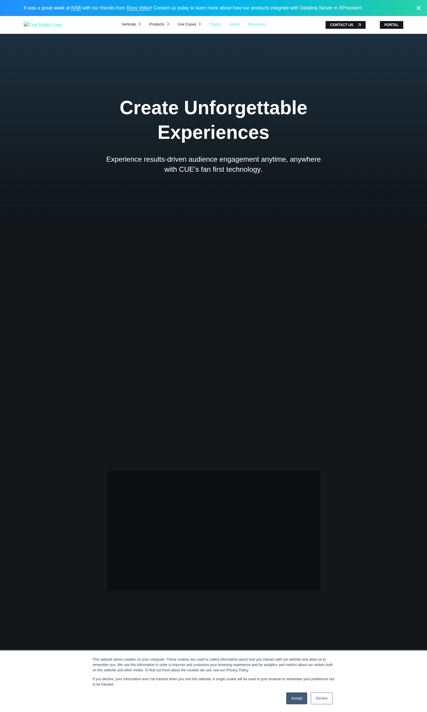

# UI Design System & Master Generation Blueprint: cue-onebranding-webflow-io

> **Cue - Creating Unforgettable Experiences** (https://cue-onebranding.webflow.io/) — Fan-first technology for premium brands and event experiences. Take your events to the next level with CUE and experience true fan engage...



---

## 1. Executive Visual Persona & Design Archetype

- **Brand Essence & Persona**: **Cue - Creating Unforgettable Experiences** (`https://cue-onebranding.webflow.io/`). Fan-first technology for premium brands and event experiences. Take your events to the next level with CUE and experience true fan engage...
- **Visual Archetype**: **High-Contrast Obsidian / Atmospheric Design System (`#13171a` canvas, `#f5f5f7` ink, `#e4e5e5` accent)**.
- **Anti-AI-Slop Differentiators**:
  - **Source-Grounded Chromatic Polarity**: Anchors the viewport in `#13171a` (`var(--color--black)` in `:root`) paired with `#f5f5f7` primary typography and `#e4e5e5` accents.
  - **Extracted Typographic Hierarchy**: Pairs `Poppins` for display copy (`Create Unforgettable Experiences`) with `Arial` and not declared in static CSS (uses primary stack / `ui-monospace`).
  - **Calibrated Spatial Grid & Motion**: Combines `940px` container bounds (`gap: 16px`, padding `9px`) with `cubic-bezier(.165,.84,.44,1)` easing and GSAP Timeline & ScrollTrigger, Three.js / WebGL Canvas Pipeline.

---

## 2. Spatial Architecture & Modular Grid Mathematics


### Viewport Allocation & Container Geometry
- **Captured Viewport Dimensions**: Desktop `1440×2400px` (`assets/desktop.png`, capped at 2400px multi-section capture), Mobile `390×2400px` (`assets/mobile.png`, capped at 2400px multi-section capture).
- **Master Container Bounds**: `940px` extracted from `cue-onebranding-webflow-io` stylesheet.
- **Canvas Lateral Padding & Spacing**: `9px` lateral canvas padding with `16px` grid gap.
- **Border Radius Scale**: `3px`, `100%`, `50%`, `2px`.

### Responsive Breakpoint Architecture
- **Desktop Layout**: Multi-column CSS Grid / Flexbox layout at `1440px` (`max-width: 940px`, `gap: 16px`).
- **Mobile Layout**: Single-column vertical stack at `390px` viewport width with `9px` horizontal padding.
- **Extracted CSS Media Queries**: `@media screen and (max-width:991px)`, `@media screen and (max-width:767px)`, `@media screen and (max-width:479px)`, `@media (min-width:768px)`.

---

## 3. Color System, Materiality & Atmospheric Lighting

### Semantic Palette & Source Grounding
| Semantic Role | Ground-Truth Value | Extracted CSS Source / Selector |
|---|---|---|
| **Primary Canvas Substrate** | `#13171a` | `var(--color--black)` in `:root` |
| **Primary Typography Ink** | `#3aebdb` | `var(--color--aqua)` in `:root` |
| **Elevated Surface / Card Substrate** | `#f5f5f7` | `var(--color--gray)` in `:root` |
| **Interactive Accent / Highlight** | `#e4e5e5` | `var(--color--mid-gray)` in `:root` |
| **Secondary / Muted Copy** | `#030b15` | `var(--color--dark-blue)` in `:root` |
| **Structural Hairline Border** | `#010012` | `var(--color--deep-blue)` in `:root` |
| **Variable Token (`--on-light-gradient`)** | `#03b7e8` | `var(--on-light-gradient)` in `:root` |
| **Variable Token (`--on-light-gradient`)** | `#2f68e9` | `var(--on-light-gradient)` in `:root` |

### Sanitized Root CSS Variables (`ui-ux.md` Ground Truth)
| Variable Name | Extracted Value | Semantic Role |
|---|---|---|
| `--color--black` | `#13171a` | Canvas / Surface Token |
| `--color--aqua` | `#3aebdb` | Brand / Palette Token |
| `--color--white` | `white` | Canvas / Surface Token |
| `--radius--small` | `.25rem` | Elevation / Border Token |
| `--color--gray` | `#f5f5f7` | Brand / Palette Token |
| `--color--mid-gray` | `#e4e5e5` | Brand / Palette Token |
| `--color--dark-blue` | `#030b15` | Canvas / Surface Token |
| `--gap--2-5` | `2.5rem` | Layout / Spatial Grid Token |
| `--page-padding` | `0px` | Layout / Spatial Grid Token |
| `--color--deep-blue` | `#010012` | Brand / Palette Token |
| `--radius--main` | `.75rem` | Elevation / Border Token |
| `--transition-speed` | `1.5s` | Motion / Easing Token |
| `--on-light-gradient` | `linear-gradient(82deg, #03b7e8 2.55%, #2f68e9 100.58%)` | Canvas / Surface Token |
| `--speed` | `100s` | Motion / Easing Token |
| `--cue-onebranding--bg` | `#13171a` | Canvas Substrate (from `var(--color--black)` in `:root`) |
| `--cue-onebranding--ink` | `#f5f5f7` | Primary Typography Ink (stylesheet-derived) |

---

## 4. Typographic Scale & Editorial Hierarchy

### Font Family Stacks
- **Display Typography**: `Poppins`.
- **Primary Body Stack**: `Arial`.
- **Technical / Metadata Stack**: not declared in static CSS (uses primary stack / `ui-monospace`).

### Typographic Scale & Rules (Extracted from Stylesheet & Variables)
- **Hero Display (`H1`)**: not explicitly declared on tag in static CSS (stylesheet font-size ladder: `2em`, `80%`, `75%`, `1em`, `14px`).
- **Section Heading (`H2`)**: rule `,h2` (`font-size: 2.5rem`).
- **Body Copy**: rule `p` (`font-size: inherit`, `line-height: inherit`, `font-weight: 400!important`).
- **Metadata & Navigation Labels**: CSS variables `--radius--small: .25rem`.

---

## 5. Choreographed Motion & Interaction Physics

### Primary Easing Curves
- **Extracted Timing Functions**: `cubic-bezier(.165,.84,.44,1)`.

### Per-Element Transition & Choreography Rules
- **Selector `.w-webflow-badge>img`**: `transition: unset` extracted from `cue-onebranding-webflow-io` stylesheet.
- **Selector `.w-slider-dot`**: `transition: background-color .1s,color .1s` extracted from `cue-onebranding-webflow-io` stylesheet.
- **Selector `.w-lightbox-control`**: `transition: all .3s` extracted from `cue-onebranding-webflow-io` stylesheet.
- **Extracted Easing Curve (`cubic-bezier(.165,.84,.44,1)`)**: Governs interactive state transitions across `<header.section>` and `<section.section>`.
- **Runtime Interaction Engine**: Integrates GSAP Timeline & ScrollTrigger, Three.js / WebGL Canvas Pipeline, Swiper Touch Carousel Engine with `prefers-reduced-motion: reduce` fallback guards.

---

## 6. Component Wireframe & Structural DOM Map

### Visual Layout Schematic (Grounded in `dom.html` — `1440px` Desktop & `390px` Mobile Reflow)
```
┌────────────────────────────────────────────────────────────────────────┐
│ DESKTOP VIEWPORT (1440px) — Cue - Creating Unforgettable Experiences   │
│ ====================================================================== │
│ [ <header.section>         | NAB · Ross Video · REQUEST A DEMO · WE ]  │
│ ---------------------------------------------------------------------- │
│ | HERO STAGE: <section.section>                                    |   │
│ | H1: Create Unforgettable Experiences                             |   │
│ | Substrate: #13171a    | Ink: #f5f5f7    | Accent: #e4e5e5        |   │
│ ---------------------------------------------------------------------- │
│ | SHOWCASE GRID (<section.section>         ) max-w: 940px          |   │
│ | +------------------------------+  +------------------------------+ | │
│ | | Sports                       |  | High schools                 | | │
│ | +------------------------------+  +------------------------------+ | │
│ ---------------------------------------------------------------------- │
│ | MOBILE VIEWPORT REFLOW (390px) — Single-Column Stack (gap: 16px  ) | │
│ | [<header.section>] -> [<section.section>] -> [<section.section>] |   │
│ ---------------------------------------------------------------------- │
│ [ FOOTER (<footer.footer>       ) | https://cue-onebranding.webflow.io │
└────────────────────────────────────────────────────────────────────────┘
```

### Granular DOM Region Breakdown
1. **Brand Header & Navigation Bar (<header.section> — `cue-onebranding-webflow-io`)**:
   - Landmark `<header class="section cc-header-centered-gradient">` hosting `Cue - Creating Unforgettable Experie` navigation (`NAB · Ross Video · REQUEST A DEMO · WE ARE CUE`), DOM attributes (`data-wf-domain="cue-onebranding.webfl..."`, `data-wf-page="662871ca1b5c639c39515607"`, `data-wf-site="662871ca1b5c639c39515603"`, `data-ads-portal-id="8068777"`), and stylesheet rule `html { -webkit-text-size-adjust:100%;-ms-text-size-adjust:100%;font-family:sans... }`.
2. **Hero Stage & Focal Lead (<section.section> — `Create Unforgettable Experiences`)**:
   - Landmark `<section class="section cc-2col-text-cta">` presenting display lead `Create Unforgettable Experiences` and copy excerpt *"This website stores cookies on your computer. These cookies are u"* over `#13171a` canvas and `#f5f5f7` ink.
3. **Primary Showcase & Content Grid (<section.section> — `Sports`)**:
   - Landmark `<section class="section cc-video-zoom">` rendering section `Sports` with copy *"If you decline, your information won’t be tracked when you visit "*, asset references (`cdn.prod.website-files.com`, `cue-onebranding.shared.e83737123....`, `clarity.js`, `odet0ilb8r`), and grid rule `summary { display:block }`.
4. **Interactive Detail & Feature Matrix (<section.section> — `High schools`)**:
   - Landmark `<section class="section cc-product-starter">` framing `High schools` and `Agency` (*"Reach out to the team if you need to publish something."*) with `#f5f5f7` surface cards, `#e4e5e5` accents, and `video { vertical-align:baseline;display:inline-block }`.
5. **Colophon & Global Directory Footer (<footer.footer> — `https://cue-onebranding.webflow.io/`)**:
   - Landmark `<footer class="footer">` anchoring `Cue - Creating Unforgettable Exp` footer links (`NAB · Ross Video · REQUEST A DEMO · WE ARE CUE`), copy *"It was a great week at NAB with our friends from Ross Video "*, and `#010012` structural dividers.

---

## 7. Master Zero-Shot AI Generation Prompt

```markdown
# Master Zero-Shot Frontend Generation Prompt: cue-onebranding-webflow-io (Cue - Creating Unforgettable Experiences)

You are a principal frontend architect and design systems engineer. Build a complete, production-ready web application replicating the exact design system, DOM landmarks, typographic hierarchy, color tokens, and motion physics of `cue-onebranding-webflow-io` (**Cue - Creating Unforgettable Experiences** — `https://cue-onebranding.webflow.io/`).

### 1. Visual Archetype & Anti-AI-Slop Mandates
- **Archetype**: High-Contrast Obsidian / Atmospheric Design System (`#13171a` canvas, `#f5f5f7` ink, `#e4e5e5` accent).
- **Identity & Domain Context**: Fan-first technology for premium brands and event experiences. Take your events to the next level with CUE and experience true fan engage...
- **Primary Substrate**: `#13171a` (`var(--color--black)` in `:root`), **Primary Ink**: `#f5f5f7`, **Accent / Highlight**: `#e4e5e5`.
- **Site-Specific Differentiators**:
  - **Source-Grounded Chromatic Polarity**: Anchors the viewport in `#13171a` (`var(--color--black)` in `:root`) paired with `#f5f5f7` primary typography and `#e4e5e5` accents.
  - **Extracted Typographic Hierarchy**: Pairs `Poppins` for display copy (`Create Unforgettable Experiences`) with `Arial` and not declared in static CSS (uses primary stack / `ui-monospace`).
  - **Calibrated Spatial Grid & Motion**: Combines `940px` container bounds (`gap: 16px`, padding `9px`) with `cubic-bezier(.165,.84,.44,1)` easing and GSAP Timeline & ScrollTrigger, Three.js / WebGL Canvas Pipeline.

### 2. Ground-Truth CSS Variables (`:root` Token Contract)
Declare and consume these exact custom properties extracted from `cue-onebranding-webflow-io` in your global stylesheet:

:root {
  /* Cue - Creating Unforgettable Experiences (cue-onebranding-webflow-io) — Ground-Truth Extracted CSS Variables */
  --color--black: #13171a; /* Canvas / Surface Token (cue-onebranding-webflow-io) */
  --color--aqua: #3aebdb; /* Brand / Palette Token (cue-onebranding-webflow-io) */
  --color--white: white; /* Canvas / Surface Token (cue-onebranding-webflow-io) */
  --radius--small: .25rem; /* Elevation / Border Token (cue-onebranding-webflow-io) */
  --color--gray: #f5f5f7; /* Brand / Palette Token (cue-onebranding-webflow-io) */
  --color--mid-gray: #e4e5e5; /* Brand / Palette Token (cue-onebranding-webflow-io) */
  --color--dark-blue: #030b15; /* Canvas / Surface Token (cue-onebranding-webflow-io) */
  --gap--2-5: 2.5rem; /* Layout / Spatial Grid Token (cue-onebranding-webflow-io) */
  --page-padding: 0px; /* Layout / Spatial Grid Token (cue-onebranding-webflow-io) */
  --color--deep-blue: #010012; /* Brand / Palette Token (cue-onebranding-webflow-io) */
  --radius--main: .75rem; /* Elevation / Border Token (cue-onebranding-webflow-io) */
  --transition-speed: 1.5s; /* Motion / Easing Token (cue-onebranding-webflow-io) */
  --on-light-gradient: linear-gradient(82deg, #03b7e8 2.55%, #2f68e9 100.58%); /* Canvas / Surface Token (cue-onebranding-webflow-io) */
  --speed: 100s; /* Motion / Easing Token (cue-onebranding-webflow-io) */
  --cue-onebranding--bg: #13171a; /* Canvas Substrate (from `var(--color--black)` in `:root`) (cue-onebranding-webflow-io) */
  --cue-onebranding--ink: #f5f5f7; /* Primary Typography Ink (stylesheet-derived) (cue-onebranding-webflow-io) */
}

### 3. Semantic Color & Materiality Contract
Map every surface, ink, and border strictly to these source-grounded tokens:
- **Primary Canvas Substrate**: `#13171a` — grounded in `var(--color--black)` in `:root`
- **Primary Typography Ink**: `#3aebdb` — grounded in `var(--color--aqua)` in `:root`
- **Elevated Surface / Card Substrate**: `#f5f5f7` — grounded in `var(--color--gray)` in `:root`
- **Interactive Accent / Highlight**: `#e4e5e5` — grounded in `var(--color--mid-gray)` in `:root`
- **Secondary / Muted Copy**: `#030b15` — grounded in `var(--color--dark-blue)` in `:root`
- **Structural Hairline Border**: `#010012` — grounded in `var(--color--deep-blue)` in `:root`
- **Variable Token (`--on-light-gradient`)**: `#03b7e8` — grounded in `var(--on-light-gradient)` in `:root`
- **Variable Token (`--on-light-gradient`)**: `#2f68e9` — grounded in `var(--on-light-gradient)` in `:root`

### 4. Spatial Grid, Container Bounds & Responsive Breakpoints
- **Desktop Viewport Reference**: `1440×2400px` (capped at 2400px multi-section capture, `1440px` standard desktop width).
- **Mobile Viewport Reference**: `390×2400px` (capped at 2400px multi-section capture, `390px` standard mobile width).
- **Container Max-Width**: `940px` extracted from `cue-onebranding-webflow-io` stylesheet
- **Padding & Gutters**: `9px` lateral canvas padding with `16px` grid gap
- **Desktop Grid**: Multi-column CSS Grid / Flexbox layout at `1440px` (`max-width: 940px`, `gap: 16px`)
- **Mobile Adaptation**: Single-column vertical stack at `390px` viewport width with `9px` horizontal padding
- **Media Queries**: `@media screen and (max-width:991px)`, `@media screen and (max-width:767px)`, `@media screen and (max-width:479px)`, `@media (min-width:768px)`
- **Corner Radii**: `3px`, `100%`, `50%`, `2px`

### 5. Typography & Editorial Scale Contract
- **Display Font Stack**: `Poppins`
- **Body Font Stack**: `Arial`
- **Monospace / Technical Font Stack**: not declared in static CSS (uses primary stack / `ui-monospace`)
- **H1 Display Rule**: not explicitly declared on tag in static CSS (stylesheet font-size ladder: `2em`, `80%`, `75%`, `1em`, `14px`)
- **H2 Section Rule**: rule `,h2` (`font-size: 2.5rem`)
- **Body Copy Rule**: rule `p` (`font-size: inherit`, `line-height: inherit`, `font-weight: 400!important`)
- **Metadata & Index Rule**: CSS variables `--radius--small: .25rem`

### 6. Component Hierarchy, Verbatim Copy & Real DOM Landmarks
Scaffold `cue-onebranding-webflow-io` (`Cue - Creating Unforgettable Experiences`) with these exact structural regions, extracted copy, and CSS rules from `dom.html`:
1. **Brand Header & Navigation Bar (<header.section> — `cue-onebranding-webflow-io`)**:
   - DOM & Selectors: Landmark `<header class="section cc-header-centered-gradient">` hosting `Cue - Creating Unforgettable Experie` navigation (`NAB · Ross Video · REQUEST A DEMO · WE ARE CUE`), DOM attributes (`data-wf-domain="cue-onebranding.webfl..."`, `data-wf-page="662871ca1b5c639c39515607"`, `data-wf-site="662871ca1b5c639c39515603"`, `data-ads-portal-id="8068777"`), and stylesheet rule `html { -webkit-text-size-adjust:100%;-ms-text-size-adjust:100%;font-family:sans... }`.
   - Responsive Contract: Header `Brand Header & Navigation Bar (<header.section> — `cue-onebranding-webflow-io`)` (`cue-onebranding-webflow-io`) adapts across `@media screen and (max-width:991px)`, `@media screen and (max-width:767px)`, `@media screen and (max-width:479px)`, `@media (min-width:768px)` with `cubic-bezier(.165,.84,.44,1)` transitions and links `NAB · Ross Video · REQUEST A DEMO · WE ARE CUE`.
2. **Hero Stage & Focal Lead (<section.section> — `Create Unforgettable Experiences`)**:
   - DOM & Selectors: Landmark `<section class="section cc-2col-text-cta">` presenting display lead `Create Unforgettable Experiences` and copy excerpt *"This website stores cookies on your computer. These cookies are u"* over `#13171a` canvas and `#f5f5f7` ink.
   - Responsive Contract: Hero stage (`1440×2400px` desktop / `390×2400px` mobile) sets `#13171a` background with `#f5f5f7` headline `Create Unforgettable Experiences`.
3. **Primary Showcase & Content Grid (<section.section> — `Sports`)**:
   - DOM & Selectors: Landmark `<section class="section cc-video-zoom">` rendering section `Sports` with copy *"If you decline, your information won’t be tracked when you visit "*, asset references (`cdn.prod.website-files.com`, `cue-onebranding.shared.e83737123....`, `clarity.js`, `odet0ilb8r`), and grid rule `summary { display:block }`.
   - Responsive Contract: Showcase grid `Primary Showcase & Content Grid (<section.section> — `Sports`)` applies Multi-column CSS Grid / Flexbox layout at `1440px` (`max-width: 940px`, `gap: 16px`) on desktop and Single-column vertical stack at `390px` viewport width with `9px` horizontal padding on mobile.
4. **Interactive Detail & Feature Matrix (<section.section> — `High schools`)**:
   - DOM & Selectors: Landmark `<section class="section cc-product-starter">` framing `High schools` and `Agency` (*"Reach out to the team if you need to publish something."*) with `#f5f5f7` surface cards, `#e4e5e5` accents, and `video { vertical-align:baseline;display:inline-block }`.
   - Responsive Contract: Detail module `Interactive Detail & Feature Matrix (<section.section> — `High schools`)` uses `3px`, `100%`, `50%`, `2px` radii, `#e4e5e5` highlights, and assets (cdn.prod.website-files.com, cue-onebranding.shared.e83737123...., clarity.js).
5. **Colophon & Global Directory Footer (<footer.footer> — `https://cue-onebranding.webflow.io/`)**:
   - DOM & Selectors: Landmark `<footer class="footer">` anchoring `Cue - Creating Unforgettable Exp` footer links (`NAB · Ross Video · REQUEST A DEMO · WE ARE CUE`), copy *"It was a great week at NAB with our friends from Ross Video "*, and `#010012` structural dividers.
   - Responsive Contract: Footer `Colophon & Global Directory Footer (<footer.footer> — `https://cue-onebranding.webflow.io/`)` aligns to `940px` extracted from `cue-onebranding-webflow-io` stylesheet with `9px` lateral canvas padding with `16px` grid gap and attributes (data-wf-domain="cue-onebranding.webfl...", data-wf-page="662871ca1b5c639c39515607", data-wf-site="662871ca1b5c639c39515603").

#### Verbatim DOM Copy Excerpts (`dom.html`)
- Copy Excerpt 1: *"This website stores cookies on your computer. These cookies are used to collect in..."*
- Copy Excerpt 2: *"If you decline, your information won’t be tracked when you visit this website. A s..."*
- Copy Excerpt 3: *"Reach out to the team if you need to publish something."*
- Copy Excerpt 4: *"It was a great week at NAB with our friends from Ross Video ! Contact us today to..."*

### 7. Motion, Extracted Stylesheet Rules & Interaction Choreography
- **Primary Easing Functions**: `cubic-bezier(.165,.84,.44,1)`
- **Extracted Stylesheet Rules (`cue-onebranding-webflow-io`)**:
- `html { -webkit-text-size-adjust:100%;-ms-text-size-adjust:100%;font-family:sans... }`
- `summary { display:block }`
- `video { vertical-align:baseline;display:inline-block }`
- `template { display:none }`
- `strong { font-weight:700 }`
- **Per-Selector Transition Rules**:
- **Selector `.w-webflow-badge>img`**: `transition: unset` extracted from `cue-onebranding-webflow-io` stylesheet.
- **Selector `.w-slider-dot`**: `transition: background-color .1s,color .1s` extracted from `cue-onebranding-webflow-io` stylesheet.
- **Selector `.w-lightbox-control`**: `transition: all .3s` extracted from `cue-onebranding-webflow-io` stylesheet.
- **Extracted Easing Curve (`cubic-bezier(.165,.84,.44,1)`)**: Governs interactive state transitions across `<header.section>` and `<section.section>`.
- **Runtime Interaction Engine**: Integrates GSAP Timeline & ScrollTrigger, Three.js / WebGL Canvas Pipeline, Swiper Touch Carousel Engine with `prefers-reduced-motion: reduce` fallback guards.

### 8. Technical Deliverables
- Implement in Next.js (App Router) with TypeScript and Tailwind CSS consuming the `:root` custom properties defined above for `cue-onebranding-webflow-io`.
- Reproduce both the `1440px` desktop architecture and `390px` mobile breakpoint transitions, preserving semantic HTML5 landmarks (`<header>`, `<nav>`, `<main>`, `<section>`, `<footer>`) and `prefers-reduced-motion` accessibility guards.
```
