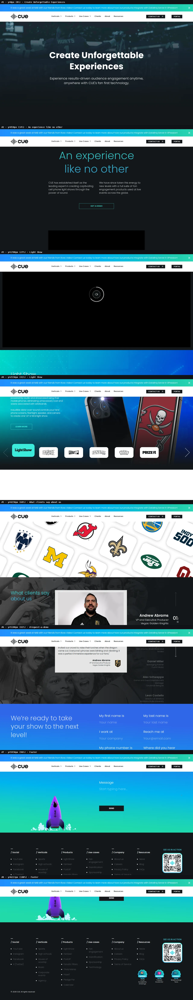
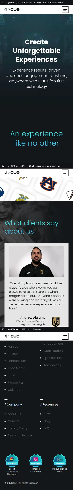

# UI Design System & Master Generation Blueprint: cue-onebranding-webflow-io

> **Cue - Creating Unforgettable Experiences** (https://cue-onebranding.webflow.io/) — Fan-first technology for premium brands and event experiences. Take your events to the next level with CUE and experience true fan engage...





---

## 1. Executive Visual Persona & Design Archetype

- **Brand Essence & Persona**: **Cue - Creating Unforgettable Experiences** (`https://cue-onebranding.webflow.io/`). Fan-first technology for premium brands and event experiences. Take your events to the next level with CUE and experience true fan engage...
- **Capture Provenance**: Live browser capture (`tier1_fast`, HTTP `200`, captured `2026-11-24`).
- **Visual Archetype**: **Light-Substrate Editorial & Modular Grid System (`#ffffff` canvas, `#13171a` ink, `#0000ff` accent)**.
- **Anti-AI-Slop Differentiators**:
  - **Live-Computed Chromatic Polarity**: Anchors the viewport in `#ffffff` (live computed `body` `background-color` (`computed_styles.json`)) paired with `#13171a` primary typography and `#0000ff` accents.
  - **Grounded Typographic Hierarchy**: Uses `Poppins` across display (`Create Unforgettable Experiences`) and body copy.
  - **Calibrated Spatial Grid & Motion**: Combines `90rem` container bounds (`gap: 16px`, padding `9px`) with `cubic-bezier(.165,.84,.44,1)` easing and GSAP Timeline & ScrollTrigger, Three.js / WebGL Canvas Pipeline.

---

## 2. Spatial Architecture & Modular Grid Mathematics

### Viewport Allocation & Container Geometry
- **Captured Journey Filmstrips**: Desktop `1280×6624px` (`assets/desktop-journey.webp`, `8` keyframes up to `y=6213px` / doc `7113px`), Mobile `390×2616px` (`assets/mobile-journey.webp`, `3` keyframes).
- **Master Container Bounds**: `90rem` (non-`@media` desktop container stylesheet rule).
- **Canvas Lateral Padding & Spacing**: `9px` lateral canvas padding with `16px` grid gap.
- **Border Radius Scale**: `3px`, `100%`, `50%`, `2px`.

### Responsive Breakpoint Architecture
- **Desktop Layout**: Multi-column CSS Grid / Flexbox layout at `1440px` (`max-width: 90rem`, `gap: 16px`).
- **Mobile Layout**: Single-column vertical stack at `390px` viewport width with `9px` horizontal padding.
- **Extracted CSS Media Queries**: `@media screen and (max-width:991px)`, `@media screen and (max-width:767px)`, `@media screen and (max-width:479px)`, `@media (min-width:768px)`.

---

## 3. Color System, Materiality & Atmospheric Lighting

### Semantic Palette & Source Grounding
| Semantic Role | Ground-Truth Value | Extracted Live / CSS Source |
|---|---|---|
| **Primary Canvas Substrate** | `#ffffff` | live computed `body` `background-color` (`computed_styles.json`) |
| **Primary Typography Ink** | `#13171a` | live computed `main` `color` (`computed_styles.json`) |
| **Elevated Surface / Card Substrate** | `#ffff00` | `mark { background: #ffff00 }` |
| **Interactive Accent / Highlight** | `#0000ff` | `.styles__nav-link.cc-cta:hover { background-color: blue }` (`#0000ff`) |
| **Secondary / Muted Copy** | `#808080` | `.u-text-gray { color: gray }` (`#808080`) |
| **Structural Hairline Border** | `#e2e2e2` | `blockquote { border-left: #e2e2e2 }` |
| **Variable Token (`--color--aqua`)** | `#3aebdb` | `var(--color--aqua)` in `:root` |
| **Variable Token (`--color--gray`)** | `#f5f5f7` | `var(--color--gray)` in `:root` |
| **Variable Token (`--color--mid-gray`)** | `#e4e5e5` | `var(--color--mid-gray)` in `:root` |
| **Variable Token (`--color--dark-blue`)** | `#030b15` | `var(--color--dark-blue)` in `:root` |
| **Variable Token (`--color--deep-blue`)** | `#010012` | `var(--color--deep-blue)` in `:root` |
| **Variable Token (`--on-light-gradient`)** | `#03b7e8` | `var(--on-light-gradient)` in `:root` |
| **Variable Token (`--on-light-gradient`)** | `#2f68e9` | `var(--on-light-gradient)` in `:root` |

### Sanitized Root CSS Variables (`ui-ux.md` Ground Truth)
| Variable Name | Extracted Value | Semantic Role |
|---|---|---|
| `--color--black` | `#13171a` | Canvas / Surface Token |
| `--color--aqua` | `#3aebdb` | Brand / Palette Token |
| `--color--white` | `white` | Canvas / Surface Token |
| `--radius--small` | `.25rem` | Elevation / Border Token |
| `--color--gray` | `#f5f5f7` | Brand / Palette Token |
| `--color--mid-gray` | `#e4e5e5` | Brand / Palette Token |
| `--color--dark-blue` | `#030b15` | Canvas / Surface Token |
| `--gap--2-5` | `2.5rem` | Layout / Spatial Grid Token |
| `--page-padding` | `0px` | Layout / Spatial Grid Token |
| `--color--deep-blue` | `#010012` | Brand / Palette Token |
| `--radius--main` | `.75rem` | Elevation / Border Token |
| `--on-light-gradient` | `linear-gradient(82deg, #03b7e8 2.55%, #2f68e9 100.58%)` | Canvas / Surface Token |
| `--transition-speed` | `1.5s` | Motion / Easing Token |
| `--speed` | `100s` | Motion / Easing Token |
| `--cue-onebranding--bg` | `#ffffff` | Canvas Substrate (from live computed `body` `background-color` (`computed_styles.json`)) |
| `--cue-onebranding--ink` | `#13171a` | Primary Typography Ink (computed-derived) |

---

## 4. Typographic Scale & Editorial Hierarchy

### Font Family Stacks
- **Display Typography**: `Poppins`.
- **Primary Body Stack**: `Poppins`.
- **Technical / Metadata Stack**: not declared in live computed styles (uses primary stack / `ui-monospace`).

### Typographic Scale & Rules (Live Computed & Stylesheet Grounded)
- **Hero Display (`H1`)**: live computed `h1` (`font-size: 64px`, `line-height: 83.2px`, `font-weight: 700`).
- **Section Heading (`H2`)**: live computed `h2` (`font-size: 36px`, `line-height: 43.2px`, `font-weight: 300`); rule `,h2` (`font-size: 2.5rem`).
- **Body Copy**: live computed `body` (`font-size: 16px`, `line-height: 22.4px`, `font-weight: 300`); rule `p` (`font-size: inherit`, `line-height: inherit`, `font-weight: 400`).
- **Metadata & Navigation Labels**: live computed `nav/a` (`font-size: 16px`, `line-height: 22.4px`, `font-weight: 300`); CSS variables `--radius--small: .25rem`.

---

## 5. Choreographed Motion & Interaction Physics

### Primary Easing Curves
- **Extracted Timing Functions**: `cubic-bezier(.165,.84,.44,1)`.

### Per-Element Transition & Choreography Rules
- **Selector `.w-webflow-badge>img`**: `transition: unset` extracted from `cue-onebranding-webflow-io` stylesheet.
- **Selector `.w-slider-dot`**: `transition: background-color .1s,color .1s` extracted from `cue-onebranding-webflow-io` stylesheet.
- **Selector `.w-lightbox-control`**: `transition: all .3s` extracted from `cue-onebranding-webflow-io` stylesheet.
- **Extracted Easing Curve (`cubic-bezier(.165,.84,.44,1)`)**: Governs interactive state transitions across `<header.section>` and `<section.cc-video-zoom>`.
- **Runtime Interaction Engine**: Integrates GSAP Timeline & ScrollTrigger, Three.js / WebGL Canvas Pipeline, Swiper Touch Carousel Engine with `prefers-reduced-motion: reduce` fallback guards.
### Measured Runtime Scroll & Interaction Telemetry (`behavioral_journey_v2`)
- **Scroll Driver Mode**: `native` (max document height `7113px`, deepest scrollY reached `6213px` across `8` desktop keyframes).
- **Detected Scroll / Motion Libraries**: `GSAP/ScrollTrigger`.
- **Hover Physics (`primary_cta` · `CONTACT US`)**: Computed transition `0.3s, 0.3s` / `cubic-bezier(0.165, 0.84, 0.44, 1), cubic-bezier(0.165, 0.84, 0.44, 1)` (no static color/transform shift captured at rest).
- **Route Transition Architecture**: First internal navigation (`/verticals/sports`) measured as `direct` in `864ms`.

---

## 6. Component Wireframe & Structural DOM Map

### Visual Layout Schematic — Desktop (`1440px`, Grounded in `dom.html` & Landmark Bounding Boxes)
```
┌────────────────────────────────────────────────────────────────────────┐
│ DESKTOP VIEWPORT (1440px) — Cue - Creating Unforgettable Experiences   │
│ ====================================================================== │
│ [ <header.section> (1440x706px)       | NAB · Ross Video · REQUEST A ] │
│ ---------------------------------------------------------------------- │
│ | HERO STAGE: <section.section> (w=1440px)                           | │
│ | H1: Create Unforgettable Experiences                               | │
│ | Substrate: #ffffff | Ink: #13171a | Accent: #0000ff                | │
│ ---------------------------------------------------------------------- │
│ | SHOWCASE GRID (<section.cc-video-zoom>) max-w: 90rem               | │
│ | +------------------------------+  +------------------------------+ | │
│ | | C r e a t e U n f o r g e t  |  | An experience like no other  | | │
│ | +------------------------------+  +------------------------------+ | │
│ ---------------------------------------------------------------------- │
│ | DETAIL MODULE (<section.cc-product-starte) — Fanatic Filters       | │
│ ---------------------------------------------------------------------- │
│ [ FOOTER (<footer.footer>     ) | https://cue-onebranding.webflow.io/  │
└────────────────────────────────────────────────────────────────────────┘
```

### Visual Layout Schematic — Mobile Reflow (`390px`)
```
┌────────────────────────────────────────────────────────────────────────┐
│ MOBILE VIEWPORT REFLOW (390px) — Single-Column Stack (gap: 16px)       │
│ ====================================================================== │
│ [ HEADER BAR (<header.section>        ) | Compact Menu (390px)         │
│ ---------------------------------------------------------------------- │
│ | HERO STAGE (<section.section>) — 390px Vertical Lead               | │
│ | H1: Create Unforgettable Experiences                               | │
│ ---------------------------------------------------------------------- │
│ | SHOWCASE STACK (<section.cc-video-zoom) — 1-Col Stack              | │
│ | [ Item 1: C r e a t e U n f o r g e t t a b l e E x p e r i...   ] | │
│ | [ Item 2: An experience like no other                            ] | │
│ ---------------------------------------------------------------------- │
│ | DETAIL STACK (<section.cc-product-star) — 1-Col (Fanatic Filters)  | │
│ ---------------------------------------------------------------------- │
│ [ FOOTER (<footer.footer>     ) | Stacked 390px Colophon               │
└────────────────────────────────────────────────────────────────────────┘
```

### Granular DOM Region Breakdown
1. **Brand Header & Navigation Bar (<header.section> — `cue-onebranding-webflow-io`)**:
   - Landmark `<header class="section cc-header-centered-gradient">` (`1440x706px`) hosting `Cue - Creating Unforgettable Experie` navigation (`NAB · Ross Video · REQUEST A DEMO · WE ARE CUE`), DOM attributes (`data-wf-domain="cue-onebranding.webfl..."`, `data-wf-page="662871ca1b5c639c39515607"`, `data-wf-site="662871ca1b5c639c39515603"`, `data-cookieconsent="ignore"`), and stylesheet rule `html { -webkit-text-size-adjust:100%;-ms-text-size-adjust:100%;font-family:sans... }`.
2. **Hero Stage & Focal Lead (<section.section> — `Create Unforgettable Experiences`)**:
   - Landmark `<section class="section cc-2col-text-cta">` presenting display lead `Create Unforgettable Experiences` and copy excerpt *"It was a great week at NAB with our friends from Ross Video! Cont"* over `#ffffff` canvas and `#13171a` ink.
3. **Primary Showcase & Content Grid (<section.cc-video-zoom> — `C r e a t e U n f o r g e t t a b `)**:
   - Landmark `<section class="section cc-video-zoom">` rendering section `C r e a t e U n f o r g e t t a b l e E x p e r i...` with copy *"C r e a t e U n f o r g e t t a b l e E x p e r i e n c e s"*, asset references (`cdn.prod.website-files.com`, `cue-onebranding.shared.e83737123....`, `insight.min.js`, `clarity.js`), and grid rule `summary { display:block }`.
4. **Interactive Detail & Feature Matrix (<section.cc-product-starter> — `An experience like no other`)**:
   - Landmark `<section class="section cc-product-starter">` framing `An experience like no other` and `Fanatic Filters` (*"U n f o r g e t t a b l e"*) with `#ffff00` surface cards, `#0000ff` accents, and `video { vertical-align:baseline;display:inline-block }`.
5. **Colophon & Global Directory Footer (<footer.footer> — `https://cue-onebranding.webflow.io/`)**:
   - Landmark `<footer class="footer">` anchoring `Cue - Creating Unforgettable Exp` footer links (`NAB · Ross Video · REQUEST A DEMO · WE ARE CUE`), copy *"E x p e r i e n c e s"*, and `#e2e2e2` structural dividers.
### Full Vertical Scroll Sequence (Desktop `1440×900` Keyframes)
- **Step 01** (`y=0px`, `0%`): Active landmark `Create Unforgettable Experiences` · sticky/fixed elements: `1`
- **Step 02** (`y=850px`, `14%`): Active landmark `An experience like no other` · sticky/fixed elements: `1`
- **Step 03** (`y=1700px`, `27%`): Active landmark `Light Show` · sticky/fixed elements: `1`
- **Step 04** (`y=2550px`, `41%`): Active landmark `Light Show` · sticky/fixed elements: `1`
- **Step 05** (`y=4250px`, `68%`): Active landmark `What clients say about us` · sticky/fixed elements: `1`
- **Step 06** (`y=5100px`, `82%`): Active landmark `#request-a-demo` · sticky/fixed elements: `1`
- **Step 07** (`y=5950px`, `96%`): Active landmark `Footer` · sticky/fixed elements: `1`
- **Step 08** (`y=6213px`, `100%`): Active landmark `Footer` · sticky/fixed elements: `1`

### Multi-Page Internal Route Map
- **Detail Route (`/verticals/sports`)**: `https://cue-onebranding.webflow.io/verticals/sports` — H1: `Sports`, scrollHeight `8213px`, transition `direct` (`864ms`)
- **About Route (`/about`)**: `https://cue-onebranding.webflow.io/about` — H1: `About CUE`, scrollHeight `7242px`, transition `direct` (`530ms`)
- **Detail Route (`/verticals/high-schools`)**: `https://cue-onebranding.webflow.io/verticals/high-schools` — H1: `High schools`, scrollHeight `7028px`, transition `direct` (`524ms`)

---

## 7. Master Zero-Shot AI Generation Prompt

```markdown
# Master Zero-Shot Frontend Generation Prompt: cue-onebranding-webflow-io (Cue - Creating Unforgettable Experiences)

You are a principal frontend architect and design systems engineer. Build a complete, production-ready web application replicating the exact design system, DOM landmarks, typographic hierarchy, color tokens, and motion physics of `cue-onebranding-webflow-io` (**Cue - Creating Unforgettable Experiences** — `https://cue-onebranding.webflow.io/`).

### 1. Visual Archetype & Anti-AI-Slop Mandates
- **Archetype**: Light-Substrate Editorial & Modular Grid System (`#ffffff` canvas, `#13171a` ink, `#0000ff` accent).
- **Identity & Domain Context**: Fan-first technology for premium brands and event experiences. Take your events to the next level with CUE and experience true fan engage...
- **Primary Substrate**: `#ffffff` (live computed `body` `background-color` (`computed_styles.json`)), **Primary Ink**: `#13171a`, **Accent / Highlight**: `#0000ff`.
- **Site-Specific Differentiators**:
  - **Live-Computed Chromatic Polarity**: Anchors the viewport in `#ffffff` (live computed `body` `background-color` (`computed_styles.json`)) paired with `#13171a` primary typography and `#0000ff` accents.
  - **Grounded Typographic Hierarchy**: Uses `Poppins` across display (`Create Unforgettable Experiences`) and body copy.
  - **Calibrated Spatial Grid & Motion**: Combines `90rem` container bounds (`gap: 16px`, padding `9px`) with `cubic-bezier(.165,.84,.44,1)` easing and GSAP Timeline & ScrollTrigger, Three.js / WebGL Canvas Pipeline.

### 2. Ground-Truth CSS Variables (`:root` Token Contract)
Declare and consume these exact custom properties extracted from `cue-onebranding-webflow-io` in your global stylesheet:

:root {
  /* Cue - Creating Unforgettable Experiences (cue-onebranding-webflow-io) — Live-Grounded CSS Variables */
  --color--black: #13171a; /* Canvas / Surface Token (cue-onebranding-webflow-io) */
  --color--aqua: #3aebdb; /* Brand / Palette Token (cue-onebranding-webflow-io) */
  --color--white: white; /* Canvas / Surface Token (cue-onebranding-webflow-io) */
  --radius--small: .25rem; /* Elevation / Border Token (cue-onebranding-webflow-io) */
  --color--gray: #f5f5f7; /* Brand / Palette Token (cue-onebranding-webflow-io) */
  --color--mid-gray: #e4e5e5; /* Brand / Palette Token (cue-onebranding-webflow-io) */
  --color--dark-blue: #030b15; /* Canvas / Surface Token (cue-onebranding-webflow-io) */
  --gap--2-5: 2.5rem; /* Layout / Spatial Grid Token (cue-onebranding-webflow-io) */
  --page-padding: 0px; /* Layout / Spatial Grid Token (cue-onebranding-webflow-io) */
  --color--deep-blue: #010012; /* Brand / Palette Token (cue-onebranding-webflow-io) */
  --radius--main: .75rem; /* Elevation / Border Token (cue-onebranding-webflow-io) */
  --on-light-gradient: linear-gradient(82deg, #03b7e8 2.55%, #2f68e9 100.58%); /* Canvas / Surface Token (cue-onebranding-webflow-io) */
  --transition-speed: 1.5s; /* Motion / Easing Token (cue-onebranding-webflow-io) */
  --speed: 100s; /* Motion / Easing Token (cue-onebranding-webflow-io) */
  --cue-onebranding--bg: #ffffff; /* Canvas Substrate (from live computed `body` `background-color` (`computed_styles.json`)) (cue-onebranding-webflow-io) */
  --cue-onebranding--ink: #13171a; /* Primary Typography Ink (computed-derived) (cue-onebranding-webflow-io) */
}

### 3. Semantic Color & Materiality Contract
Map every surface, ink, and border strictly to these source-grounded tokens:
- **Primary Canvas Substrate**: `#ffffff` — grounded in live computed `body` `background-color` (`computed_styles.json`)
- **Primary Typography Ink**: `#13171a` — grounded in live computed `main` `color` (`computed_styles.json`)
- **Elevated Surface / Card Substrate**: `#ffff00` — grounded in `mark { background: #ffff00 }`
- **Interactive Accent / Highlight**: `#0000ff` — grounded in `.styles__nav-link.cc-cta:hover { background-color: blue }` (`#0000ff`)
- **Secondary / Muted Copy**: `#808080` — grounded in `.u-text-gray { color: gray }` (`#808080`)
- **Structural Hairline Border**: `#e2e2e2` — grounded in `blockquote { border-left: #e2e2e2 }`
- **Variable Token (`--color--aqua`)**: `#3aebdb` — grounded in `var(--color--aqua)` in `:root`
- **Variable Token (`--color--gray`)**: `#f5f5f7` — grounded in `var(--color--gray)` in `:root`
- **Variable Token (`--color--mid-gray`)**: `#e4e5e5` — grounded in `var(--color--mid-gray)` in `:root`
- **Variable Token (`--color--dark-blue`)**: `#030b15` — grounded in `var(--color--dark-blue)` in `:root`
- **Variable Token (`--color--deep-blue`)**: `#010012` — grounded in `var(--color--deep-blue)` in `:root`
- **Variable Token (`--on-light-gradient`)**: `#03b7e8` — grounded in `var(--on-light-gradient)` in `:root`
- **Variable Token (`--on-light-gradient`)**: `#2f68e9` — grounded in `var(--on-light-gradient)` in `:root`

### 4. Spatial Grid, Container Bounds & Responsive Breakpoints
- **Desktop Viewport Reference**: `1280×6624px` (multi-frame vertical journey filmstrip (6624px), `1440px` standard desktop width).
- **Mobile Viewport Reference**: `390×2616px` (multi-frame vertical journey filmstrip (2616px), `390px` standard mobile width).
- **Container Max-Width**: `90rem` (non-`@media` desktop container stylesheet rule)
- **Padding & Gutters**: `9px` lateral canvas padding with `16px` grid gap
- **Desktop Grid**: Multi-column CSS Grid / Flexbox layout at `1440px` (`max-width: 90rem`, `gap: 16px`)
- **Mobile Adaptation**: Single-column vertical stack at `390px` viewport width with `9px` horizontal padding
- **Media Queries**: `@media screen and (max-width:991px)`, `@media screen and (max-width:767px)`, `@media screen and (max-width:479px)`, `@media (min-width:768px)`
- **Corner Radii**: `3px`, `100%`, `50%`, `2px`

### 5. Typography & Editorial Scale Contract
- **Display Font Stack**: `Poppins`
- **Body Font Stack**: `Poppins`
- **Monospace / Technical Font Stack**: not declared in live computed styles (uses primary stack / `ui-monospace`)
- **H1 Display Rule**: live computed `h1` (`font-size: 64px`, `line-height: 83.2px`, `font-weight: 700`)
- **H2 Section Rule**: live computed `h2` (`font-size: 36px`, `line-height: 43.2px`, `font-weight: 300`); rule `,h2` (`font-size: 2.5rem`)
- **Body Copy Rule**: live computed `body` (`font-size: 16px`, `line-height: 22.4px`, `font-weight: 300`); rule `p` (`font-size: inherit`, `line-height: inherit`, `font-weight: 400`)
- **Metadata & Index Rule**: live computed `nav/a` (`font-size: 16px`, `line-height: 22.4px`, `font-weight: 300`); CSS variables `--radius--small: .25rem`

### 6. Component Hierarchy, Verbatim Copy & Real DOM Landmarks
Scaffold `cue-onebranding-webflow-io` (`Cue - Creating Unforgettable Experiences`) with these exact structural regions, extracted copy, and CSS rules from `dom.html`:
1. **Brand Header & Navigation Bar (<header.section> — `cue-onebranding-webflow-io`)**:
   - DOM & Selectors: Landmark `<header class="section cc-header-centered-gradient">` (`1440x706px`) hosting `Cue - Creating Unforgettable Experie` navigation (`NAB · Ross Video · REQUEST A DEMO · WE ARE CUE`), DOM attributes (`data-wf-domain="cue-onebranding.webfl..."`, `data-wf-page="662871ca1b5c639c39515607"`, `data-wf-site="662871ca1b5c639c39515603"`, `data-cookieconsent="ignore"`), and stylesheet rule `html { -webkit-text-size-adjust:100%;-ms-text-size-adjust:100%;font-family:sans... }`.
   - Responsive Contract: Header `Brand Header & Navigation Bar (<header.section> — `cue-onebranding-webflow-io`)` (`cue-onebranding-webflow-io`) adapts across `@media screen and (max-width:991px)`, `@media screen and (max-width:767px)`, `@media screen and (max-width:479px)`, `@media (min-width:768px)` with `cubic-bezier(.165,.84,.44,1)` transitions and links `NAB · Ross Video · REQUEST A DEMO · WE ARE CUE`.
2. **Hero Stage & Focal Lead (<section.section> — `Create Unforgettable Experiences`)**:
   - DOM & Selectors: Landmark `<section class="section cc-2col-text-cta">` presenting display lead `Create Unforgettable Experiences` and copy excerpt *"It was a great week at NAB with our friends from Ross Video! Cont"* over `#ffffff` canvas and `#13171a` ink.
   - Responsive Contract: Hero stage (`1280×6624px` desktop / `390×2616px` mobile) sets `#ffffff` background with `#13171a` headline `Create Unforgettable Experiences`.
3. **Primary Showcase & Content Grid (<section.cc-video-zoom> — `C r e a t e U n f o r g e t t a b `)**:
   - DOM & Selectors: Landmark `<section class="section cc-video-zoom">` rendering section `C r e a t e U n f o r g e t t a b l e E x p e r i...` with copy *"C r e a t e U n f o r g e t t a b l e E x p e r i e n c e s"*, asset references (`cdn.prod.website-files.com`, `cue-onebranding.shared.e83737123....`, `insight.min.js`, `clarity.js`), and grid rule `summary { display:block }`.
   - Responsive Contract: Showcase grid `Primary Showcase & Content Grid (<section.cc-video-zoom> — `C r e a t e U n f o r g e t t a b `)` applies Multi-column CSS Grid / Flexbox layout at `1440px` (`max-width: 90rem`, `gap: 16px`) on desktop and Single-column vertical stack at `390px` viewport width with `9px` horizontal padding on mobile.
4. **Interactive Detail & Feature Matrix (<section.cc-product-starter> — `An experience like no other`)**:
   - DOM & Selectors: Landmark `<section class="section cc-product-starter">` framing `An experience like no other` and `Fanatic Filters` (*"U n f o r g e t t a b l e"*) with `#ffff00` surface cards, `#0000ff` accents, and `video { vertical-align:baseline;display:inline-block }`.
   - Responsive Contract: Detail module `Interactive Detail & Feature Matrix (<section.cc-product-starter> — `An experience like no other`)` uses `3px`, `100%`, `50%`, `2px` radii, `#0000ff` highlights, and assets (cdn.prod.website-files.com, cue-onebranding.shared.e83737123...., insight.min.js).
5. **Colophon & Global Directory Footer (<footer.footer> — `https://cue-onebranding.webflow.io/`)**:
   - DOM & Selectors: Landmark `<footer class="footer">` anchoring `Cue - Creating Unforgettable Exp` footer links (`NAB · Ross Video · REQUEST A DEMO · WE ARE CUE`), copy *"E x p e r i e n c e s"*, and `#e2e2e2` structural dividers.
   - Responsive Contract: Footer `Colophon & Global Directory Footer (<footer.footer> — `https://cue-onebranding.webflow.io/`)` aligns to `90rem` (non-`@media` desktop container stylesheet rule) with `9px` lateral canvas padding with `16px` grid gap and attributes (data-wf-domain="cue-onebranding.webfl...", data-wf-page="662871ca1b5c639c39515607", data-wf-site="662871ca1b5c639c39515603").

#### Verbatim DOM Copy Excerpts (`dom.html`)
- Copy Excerpt 1: *"It was a great week at NAB with our friends from Ross Video! Contact us today to l..."*
- Copy Excerpt 2: *"C r e a t e U n f o r g e t t a b l e E x p e r i e n c e s"*
- Copy Excerpt 3: *"U n f o r g e t t a b l e"*
- Copy Excerpt 4: *"E x p e r i e n c e s"*

### 7. Motion, Extracted Stylesheet Rules & Interaction Choreography
- **Primary Easing Functions**: `cubic-bezier(.165,.84,.44,1)`
- **Extracted Stylesheet Rules (`cue-onebranding-webflow-io`)**:
- `html { -webkit-text-size-adjust:100%;-ms-text-size-adjust:100%;font-family:sans... }`
- `summary { display:block }`
- `video { vertical-align:baseline;display:inline-block }`
- `template { display:none }`
- `strong { font-weight:700 }`
- **Per-Selector Transition Rules**:
- **Selector `.w-webflow-badge>img`**: `transition: unset` extracted from `cue-onebranding-webflow-io` stylesheet.
- **Selector `.w-slider-dot`**: `transition: background-color .1s,color .1s` extracted from `cue-onebranding-webflow-io` stylesheet.
- **Selector `.w-lightbox-control`**: `transition: all .3s` extracted from `cue-onebranding-webflow-io` stylesheet.
- **Extracted Easing Curve (`cubic-bezier(.165,.84,.44,1)`)**: Governs interactive state transitions across `<header.section>` and `<section.cc-video-zoom>`.
- **Runtime Interaction Engine**: Integrates GSAP Timeline & ScrollTrigger, Three.js / WebGL Canvas Pipeline, Swiper Touch Carousel Engine with `prefers-reduced-motion: reduce` fallback guards.
### 7b. Full-Page Scroll Choreography, Interactive States & Multi-Page Routes
- **Scroll Mechanics**: Implement `native` vertical progression up to `7113px` across 8 distinct viewport chapters using GSAP/ScrollTrigger.
- **Vertical Chapter Sequence**: Create Unforgettable Experi... (0%) -> An experience like no other (14%) -> Light Show (27%) -> Light Show (41%) -> What clients say about us (68%) -> #request-a-demo (82%) -> Footer (96%) -> Footer (100%).
- **Multi-Page Routes**: Scaffold internal routes `/verticals/sports` (detail, direct), `/about` (about, direct), `/verticals/high-schools` (detail, direct) sharing the global header/footer shell and design tokens.

### 8. Technical Deliverables
- Implement in Next.js (App Router) with TypeScript and Tailwind CSS consuming the `:root` custom properties defined above for `cue-onebranding-webflow-io`.
- Reproduce both the `1440px` desktop architecture and `390px` mobile breakpoint transitions, preserving semantic HTML5 landmarks (`<header>`, `<nav>`, `<main>`, `<section>`, `<footer>`) and `prefers-reduced-motion` accessibility guards.
```
---

## 8. Full-Page Scroll Journey, Interactive States & Subpage Inventory

### Desktop Scroll Keyframes (`1440×900` WebP)
| Step | Scroll Y | Progress | Active Landmark / Section | Sticky/Fixed | Visual Asset |
| :---: | :---: | :---: | :--- | :---: | :--- |
| `#01` | `0px` | `0%` | Create Unforgettable Experiences | `1` | [desktop-step-01.webp](assets/desktop-step-01.webp) |
| `#02` | `850px` | `14%` | An experience like no other | `1` | [desktop-step-02.webp](assets/desktop-step-02.webp) |
| `#03` | `1700px` | `27%` | Light Show | `1` | [desktop-step-03.webp](assets/desktop-step-03.webp) |
| `#04` | `2550px` | `41%` | Light Show | `1` | [desktop-step-04.webp](assets/desktop-step-04.webp) |
| `#05` | `4250px` | `68%` | What clients say about us | `1` | [desktop-step-05.webp](assets/desktop-step-05.webp) |
| `#06` | `5100px` | `82%` | #request-a-demo | `1` | [desktop-step-06.webp](assets/desktop-step-06.webp) |
| `#07` | `5950px` | `96%` | Footer | `1` | [desktop-step-07.webp](assets/desktop-step-07.webp) |
| `#08` | `6213px` | `100%` | Footer | `1` | [desktop-step-08.webp](assets/desktop-step-08.webp) |

### Mobile Condensed Keyframes (`390×844` WebP)
| Step | Scroll Y | Progress | Active Landmark | Visual Asset |
| :---: | :---: | :---: | :--- | :--- |
| `#01` | `0px` | `0%` | Create Unforgettable Experiences | [mobile-step-01.webp](assets/mobile-step-01.webp) |
| `#02` | `3340px` | `50%` | What clients say about us | [mobile-step-02.webp](assets/mobile-step-02.webp) |
| `#03` | `6680px` | `100%` | / Company | [mobile-step-03.webp](assets/mobile-step-03.webp) |

### Internal Subpage Filmstrips (`1080px` Wide WebP)
| # | Template | Route URL | H1 / Title | Scroll Height | Transition | Filmstrip Asset |
| :-: | :---: | :--- | :--- | :---: | :---: | :--- |
| `1` | `detail` | `https://cue-onebranding.webflow.io/verticals/sports` | Sports | `8213px` | `direct` (`864ms`) | [subpage-01-verticals-sports.webp](assets/subpage-01-verticals-sports.webp) |
| `2` | `about` | `https://cue-onebranding.webflow.io/about` | About CUE | `7242px` | `direct` (`530ms`) | [subpage-02-about.webp](assets/subpage-02-about.webp) |
| `3` | `detail` | `https://cue-onebranding.webflow.io/verticals/high-schools` | High schools | `7028px` | `direct` (`524ms`) | [subpage-03-verticals-high-schools.webp](assets/subpage-03-verticals-high-schools.webp) |

