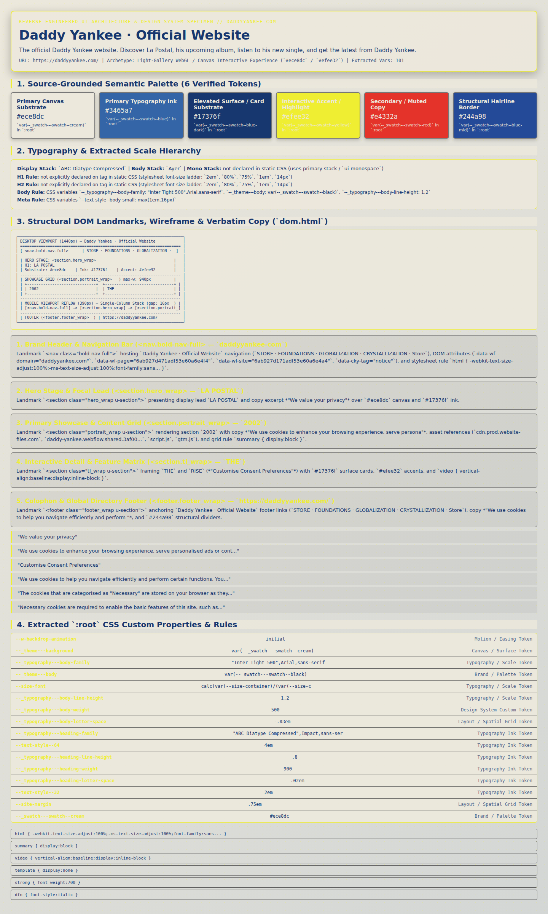
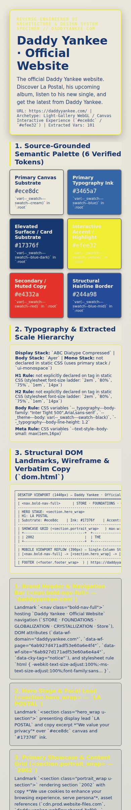

# UI Design System & Master Generation Blueprint: daddyyankee-com

> **Daddy Yankee · Official Website** (https://daddyyankee.com/) — The official Daddy Yankee website. Discover La Postal, his upcoming album, listen to his new single, and get the latest from Daddy Yankee.



---

## 1. Executive Visual Persona & Design Archetype

- **Brand Essence & Persona**: **Daddy Yankee · Official Website** (`https://daddyyankee.com/`). The official Daddy Yankee website. Discover La Postal, his upcoming album, listen to his new single, and get the latest from Daddy Yankee.
- **Visual Archetype**: **Light-Gallery WebGL / Canvas Interactive Experience (`#ece8dc` / `#efee32`)**.
- **Anti-AI-Slop Differentiators**:
  - **Source-Grounded Chromatic Polarity**: Anchors the viewport in `#ece8dc` (`var(--_swatch---swatch--cream)` in `:root`) paired with `#17376f` primary typography and `#efee32` accents.
  - **Extracted Typographic Hierarchy**: Pairs `ABC Diatype Compressed` for display copy (`LA POSTAL`) with `Ayer` and not declared in static CSS (uses primary stack / `ui-monospace`).
  - **Calibrated Spatial Grid & Motion**: Combines `940px` container bounds (`gap: 16px`, padding `9px`) with `cubic-bezier(.9,0,.1,1)` easing and Lenis Smooth Scroll (`data-lenis`), HTML5 `<canvas>` Interactive Viewport Surface.

---

## 2. Spatial Architecture & Modular Grid Mathematics



### Viewport Allocation & Container Geometry
- **Captured Viewport Dimensions**: Desktop `1440×2400px` (`assets/desktop.png`, capped at 2400px multi-section capture), Mobile `390×2400px` (`assets/mobile.png`, capped at 2400px multi-section capture).
- **Master Container Bounds**: `940px` extracted from `daddyyankee-com` stylesheet.
- **Canvas Lateral Padding & Spacing**: `9px` lateral canvas padding with `16px` grid gap.
- **Border Radius Scale**: `3px`, `100%`, `50%`, `4px`.

### Responsive Breakpoint Architecture
- **Desktop Layout**: Multi-column CSS Grid / Flexbox layout at `1440px` (`max-width: 940px`, `gap: 16px`).
- **Mobile Layout**: Single-column vertical stack at `390px` viewport width with `9px` horizontal padding.
- **Extracted CSS Media Queries**: `@media screen and (max-width:991px)`, `@media screen and (max-width:767px)`, `@media screen and (max-width:479px)`, `@media (min-width:768px)`.

---

## 3. Color System, Materiality & Atmospheric Lighting

### Semantic Palette & Source Grounding
| Semantic Role | Ground-Truth Value | Extracted CSS Source / Selector |
|---|---|---|
| **Primary Canvas Substrate** | `#ece8dc` | `var(--_swatch---swatch--cream)` in `:root` |
| **Primary Typography Ink** | `#3465a7` | `var(--_swatch---swatch--blue)` in `:root` |
| **Elevated Surface / Card Substrate** | `#17376f` | `var(--_swatch---swatch--blue-dark)` in `:root` |
| **Interactive Accent / Highlight** | `#efee32` | `var(--_swatch---swatch--yellow)` in `:root` |
| **Secondary / Muted Copy** | `#e4332a` | `var(--_swatch---swatch--red)` in `:root` |
| **Structural Hairline Border** | `#244a98` | `var(--_swatch---swatch--blue-mid)` in `:root` |

### Sanitized Root CSS Variables (`ui-ux.md` Ground Truth)
| Variable Name | Extracted Value | Semantic Role |
|---|---|---|
| `--w-backdrop-animation` | `initial` | Motion / Easing Token |
| `--_theme---background` | `var(--_swatch---swatch--cream)` | Canvas / Surface Token |
| `--_typography---body-family` | `"Inter Tight 500",Arial,sans-serif` | Typography / Scale Token |
| `--_theme---body` | `var(--_swatch---swatch--black)` | Brand / Palette Token |
| `--size-font` | `calc(var(--size-container)/(var(--size-container-ideal)/var(--size-unit)))` | Typography / Scale Token |
| `--_typography---body-line-height` | `1.2` | Typography / Scale Token |
| `--_typography---body-weight` | `500` | Design System Custom Token |
| `--_typography---body-letter-space` | `-.03em` | Layout / Spatial Grid Token |
| `--_typography---heading-family` | `"ABC Diatype Compressed",Impact,sans-serif` | Typography Ink Token |
| `--text-style--64` | `4em` | Typography Ink Token |
| `--_typography---heading-line-height` | `.8` | Typography Ink Token |
| `--_typography---heading-weight` | `900` | Typography Ink Token |
| `--_typography---heading-letter-space` | `-.02em` | Typography Ink Token |
| `--text-style--32` | `2em` | Typography Ink Token |
| `--site-margin` | `.75em` | Layout / Spatial Grid Token |
| `--_swatch---swatch--cream` | `#ece8dc` | Brand / Palette Token |

---

## 4. Typographic Scale & Editorial Hierarchy

### Font Family Stacks
- **Display Typography**: `ABC Diatype Compressed`.
- **Primary Body Stack**: `Ayer`.
- **Technical / Metadata Stack**: not declared in static CSS (uses primary stack / `ui-monospace`).

### Typographic Scale & Rules (Extracted from Stylesheet & Variables)
- **Hero Display (`H1`)**: not explicitly declared on tag in static CSS (stylesheet font-size ladder: `2em`, `80%`, `75%`, `1em`, `14px`).
- **Section Heading (`H2`)**: not explicitly declared on tag in static CSS (stylesheet font-size ladder: `2em`, `80%`, `75%`, `1em`, `14px`).
- **Body Copy**: CSS variables `--_typography---body-family: "Inter Tight 500",Arial,sans-serif`, `--_theme---body: var(--_swatch---swatch--black)`, `--_typography---body-line-height: 1.2`.
- **Metadata & Navigation Labels**: CSS variables `--text-style--body-small: max(1em,16px)`.

---

## 5. Choreographed Motion & Interaction Physics

### Primary Easing Curves
- **Extracted Timing Functions**: `cubic-bezier(.9,0,.1,1)`, `cubic-bezier(.215,.61,.355,1)`, `cubic-bezier(.32,.72,0,1)`.

### Per-Element Transition & Choreography Rules
- **Selector `.w-webflow-badge>img`**: `transition: unset` extracted from `daddyyankee-com` stylesheet.
- **Selector `.w-slider-dot`**: `transition: background-color .1s,color .1s` extracted from `daddyyankee-com` stylesheet.
- **Selector `.w-lightbox-control`**: `transition: all .3s` extracted from `daddyyankee-com` stylesheet.
- **Extracted Easing Curve (`cubic-bezier(.9,0,.1,1)`)**: Governs interactive state transitions across `<nav.bold-nav-full>` and `<section.portrait_wrap>`.
- **Runtime Interaction Engine**: Integrates Lenis Smooth Scroll (`data-lenis`), HTML5 `<canvas>` Interactive Viewport Surface with `prefers-reduced-motion: reduce` fallback guards.

---

## 6. Component Wireframe & Structural DOM Map

### Visual Layout Schematic (Grounded in `dom.html` — `1440px` Desktop & `390px` Mobile Reflow)
```
┌────────────────────────────────────────────────────────────────────────┐
│ DESKTOP VIEWPORT (1440px) — Daddy Yankee · Official Website            │
│ ====================================================================== │
│ [ <nav.bold-nav-full>      | STORE · FOUNDATIONS · GLOBALIZATION ·  ]  │
│ ---------------------------------------------------------------------- │
│ | HERO STAGE: <section.hero_wrap>                                  |   │
│ | H1: LA POSTAL                                                    |   │
│ | Substrate: #ece8dc    | Ink: #17376f    | Accent: #efee32        |   │
│ ---------------------------------------------------------------------- │
│ | SHOWCASE GRID (<section.portrait_wrap>   ) max-w: 940px          |   │
│ | +------------------------------+  +------------------------------+ | │
│ | | 2002                         |  | THE                          | | │
│ | +------------------------------+  +------------------------------+ | │
│ ---------------------------------------------------------------------- │
│ | MOBILE VIEWPORT REFLOW (390px) — Single-Column Stack (gap: 16px  ) | │
│ | [<nav.bold-nav-full] -> [<section.hero_wrap] -> [<section.portrait_] │
│ ---------------------------------------------------------------------- │
│ [ FOOTER (<footer.footer_wrap>  ) | https://daddyyankee.com/           │
└────────────────────────────────────────────────────────────────────────┘
```

### Granular DOM Region Breakdown
1. **Brand Header & Navigation Bar (<nav.bold-nav-full> — `daddyyankee-com`)**:
   - Landmark `<nav class="bold-nav-full">` hosting `Daddy Yankee · Official Website` navigation (`STORE · FOUNDATIONS · GLOBALIZATION · CRYSTALLIZATION · Store`), DOM attributes (`data-wf-domain="daddyyankee.com"`, `data-wf-page="6ab927d471adf53e60a6e4f4"`, `data-wf-site="6ab927d171adf53e60a6e4a4"`, `data-cky-tag="notice"`), and stylesheet rule `html { -webkit-text-size-adjust:100%;-ms-text-size-adjust:100%;font-family:sans... }`.
2. **Hero Stage & Focal Lead (<section.hero_wrap> — `LA POSTAL`)**:
   - Landmark `<section class="hero_wrap u-section">` presenting display lead `LA POSTAL` and copy excerpt *"We value your privacy"* over `#ece8dc` canvas and `#17376f` ink.
3. **Primary Showcase & Content Grid (<section.portrait_wrap> — `2002`)**:
   - Landmark `<section class="portrait_wrap u-section">` rendering section `2002` with copy *"We use cookies to enhance your browsing experience, serve persona"*, asset references (`cdn.prod.website-files.com`, `daddy-yankee.webflow.shared.3af00...`, `script.js`, `gtm.js`), and grid rule `summary { display:block }`.
4. **Interactive Detail & Feature Matrix (<section.tl_wrap> — `THE`)**:
   - Landmark `<section class="tl_wrap u-section">` framing `THE` and `RISE` (*"Customise Consent Preferences"*) with `#17376f` surface cards, `#efee32` accents, and `video { vertical-align:baseline;display:inline-block }`.
5. **Colophon & Global Directory Footer (<footer.footer_wrap> — `https://daddyyankee.com/`)**:
   - Landmark `<footer class="footer_wrap u-section">` anchoring `Daddy Yankee · Official Website` footer links (`STORE · FOUNDATIONS · GLOBALIZATION · CRYSTALLIZATION · Store`), copy *"We use cookies to help you navigate efficiently and perform "*, and `#244a98` structural dividers.

---

## 7. Master Zero-Shot AI Generation Prompt

```markdown
# Master Zero-Shot Frontend Generation Prompt: daddyyankee-com (Daddy Yankee · Official Website)

You are a principal frontend architect and design systems engineer. Build a complete, production-ready web application replicating the exact design system, DOM landmarks, typographic hierarchy, color tokens, and motion physics of `daddyyankee-com` (**Daddy Yankee · Official Website** — `https://daddyyankee.com/`).

### 1. Visual Archetype & Anti-AI-Slop Mandates
- **Archetype**: Light-Gallery WebGL / Canvas Interactive Experience (`#ece8dc` / `#efee32`).
- **Identity & Domain Context**: The official Daddy Yankee website. Discover La Postal, his upcoming album, listen to his new single, and get the latest from Daddy Yankee.
- **Primary Substrate**: `#ece8dc` (`var(--_swatch---swatch--cream)` in `:root`), **Primary Ink**: `#17376f`, **Accent / Highlight**: `#efee32`.
- **Site-Specific Differentiators**:
  - **Source-Grounded Chromatic Polarity**: Anchors the viewport in `#ece8dc` (`var(--_swatch---swatch--cream)` in `:root`) paired with `#17376f` primary typography and `#efee32` accents.
  - **Extracted Typographic Hierarchy**: Pairs `ABC Diatype Compressed` for display copy (`LA POSTAL`) with `Ayer` and not declared in static CSS (uses primary stack / `ui-monospace`).
  - **Calibrated Spatial Grid & Motion**: Combines `940px` container bounds (`gap: 16px`, padding `9px`) with `cubic-bezier(.9,0,.1,1)` easing and Lenis Smooth Scroll (`data-lenis`), HTML5 `<canvas>` Interactive Viewport Surface.

### 2. Ground-Truth CSS Variables (`:root` Token Contract)
Declare and consume these exact custom properties extracted from `daddyyankee-com` in your global stylesheet:

:root {
  /* Daddy Yankee · Official Website (daddyyankee-com) — Ground-Truth Extracted CSS Variables */
  --w-backdrop-animation: initial; /* Motion / Easing Token (daddyyankee-com) */
  --_theme---background: var(--_swatch---swatch--cream); /* Canvas / Surface Token (daddyyankee-com) */
  --_typography---body-family: "Inter Tight 500",Arial,sans-serif; /* Typography / Scale Token (daddyyankee-com) */
  --_theme---body: var(--_swatch---swatch--black); /* Brand / Palette Token (daddyyankee-com) */
  --size-font: calc(var(--size-container)/(var(--size-container-ideal)/var(--size-unit))); /* Typography / Scale Token (daddyyankee-com) */
  --_typography---body-line-height: 1.2; /* Typography / Scale Token (daddyyankee-com) */
  --_typography---body-weight: 500; /* Design System Custom Token (daddyyankee-com) */
  --_typography---body-letter-space: -.03em; /* Layout / Spatial Grid Token (daddyyankee-com) */
  --_typography---heading-family: "ABC Diatype Compressed",Impact,sans-serif; /* Typography Ink Token (daddyyankee-com) */
  --text-style--64: 4em; /* Typography Ink Token (daddyyankee-com) */
  --_typography---heading-line-height: .8; /* Typography Ink Token (daddyyankee-com) */
  --_typography---heading-weight: 900; /* Typography Ink Token (daddyyankee-com) */
  --_typography---heading-letter-space: -.02em; /* Typography Ink Token (daddyyankee-com) */
  --text-style--32: 2em; /* Typography Ink Token (daddyyankee-com) */
  --site-margin: .75em; /* Layout / Spatial Grid Token (daddyyankee-com) */
  --_swatch---swatch--cream: #ece8dc; /* Brand / Palette Token (daddyyankee-com) */
}

### 3. Semantic Color & Materiality Contract
Map every surface, ink, and border strictly to these source-grounded tokens:
- **Primary Canvas Substrate**: `#ece8dc` — grounded in `var(--_swatch---swatch--cream)` in `:root`
- **Primary Typography Ink**: `#3465a7` — grounded in `var(--_swatch---swatch--blue)` in `:root`
- **Elevated Surface / Card Substrate**: `#17376f` — grounded in `var(--_swatch---swatch--blue-dark)` in `:root`
- **Interactive Accent / Highlight**: `#efee32` — grounded in `var(--_swatch---swatch--yellow)` in `:root`
- **Secondary / Muted Copy**: `#e4332a` — grounded in `var(--_swatch---swatch--red)` in `:root`
- **Structural Hairline Border**: `#244a98` — grounded in `var(--_swatch---swatch--blue-mid)` in `:root`

### 4. Spatial Grid, Container Bounds & Responsive Breakpoints
- **Desktop Viewport Reference**: `1440×2400px` (capped at 2400px multi-section capture, `1440px` standard desktop width).
- **Mobile Viewport Reference**: `390×2400px` (capped at 2400px multi-section capture, `390px` standard mobile width).
- **Container Max-Width**: `940px` extracted from `daddyyankee-com` stylesheet
- **Padding & Gutters**: `9px` lateral canvas padding with `16px` grid gap
- **Desktop Grid**: Multi-column CSS Grid / Flexbox layout at `1440px` (`max-width: 940px`, `gap: 16px`)
- **Mobile Adaptation**: Single-column vertical stack at `390px` viewport width with `9px` horizontal padding
- **Media Queries**: `@media screen and (max-width:991px)`, `@media screen and (max-width:767px)`, `@media screen and (max-width:479px)`, `@media (min-width:768px)`
- **Corner Radii**: `3px`, `100%`, `50%`, `4px`

### 5. Typography & Editorial Scale Contract
- **Display Font Stack**: `ABC Diatype Compressed`
- **Body Font Stack**: `Ayer`
- **Monospace / Technical Font Stack**: not declared in static CSS (uses primary stack / `ui-monospace`)
- **H1 Display Rule**: not explicitly declared on tag in static CSS (stylesheet font-size ladder: `2em`, `80%`, `75%`, `1em`, `14px`)
- **H2 Section Rule**: not explicitly declared on tag in static CSS (stylesheet font-size ladder: `2em`, `80%`, `75%`, `1em`, `14px`)
- **Body Copy Rule**: CSS variables `--_typography---body-family: "Inter Tight 500",Arial,sans-serif`, `--_theme---body: var(--_swatch---swatch--black)`, `--_typography---body-line-height: 1.2`
- **Metadata & Index Rule**: CSS variables `--text-style--body-small: max(1em,16px)`

### 6. Component Hierarchy, Verbatim Copy & Real DOM Landmarks
Scaffold `daddyyankee-com` (`Daddy Yankee · Official Website`) with these exact structural regions, extracted copy, and CSS rules from `dom.html`:
1. **Brand Header & Navigation Bar (<nav.bold-nav-full> — `daddyyankee-com`)**:
   - DOM & Selectors: Landmark `<nav class="bold-nav-full">` hosting `Daddy Yankee · Official Website` navigation (`STORE · FOUNDATIONS · GLOBALIZATION · CRYSTALLIZATION · Store`), DOM attributes (`data-wf-domain="daddyyankee.com"`, `data-wf-page="6ab927d471adf53e60a6e4f4"`, `data-wf-site="6ab927d171adf53e60a6e4a4"`, `data-cky-tag="notice"`), and stylesheet rule `html { -webkit-text-size-adjust:100%;-ms-text-size-adjust:100%;font-family:sans... }`.
   - Responsive Contract: Header `Brand Header & Navigation Bar (<nav.bold-nav-full> — `daddyyankee-com`)` (`daddyyankee-com`) adapts across `@media screen and (max-width:991px)`, `@media screen and (max-width:767px)`, `@media screen and (max-width:479px)`, `@media (min-width:768px)` with `cubic-bezier(.9,0,.1,1)`, `cubic-bezier(.215,.61,.355,1)`, `cubic-bezier(.32,.72,0,1)` transitions and links `STORE · FOUNDATIONS · GLOBALIZATION · CRYSTALLIZATION · Store`.
2. **Hero Stage & Focal Lead (<section.hero_wrap> — `LA POSTAL`)**:
   - DOM & Selectors: Landmark `<section class="hero_wrap u-section">` presenting display lead `LA POSTAL` and copy excerpt *"We value your privacy"* over `#ece8dc` canvas and `#17376f` ink.
   - Responsive Contract: Hero stage (`1440×2400px` desktop / `390×2400px` mobile) sets `#ece8dc` background with `#17376f` headline `LA POSTAL`.
3. **Primary Showcase & Content Grid (<section.portrait_wrap> — `2002`)**:
   - DOM & Selectors: Landmark `<section class="portrait_wrap u-section">` rendering section `2002` with copy *"We use cookies to enhance your browsing experience, serve persona"*, asset references (`cdn.prod.website-files.com`, `daddy-yankee.webflow.shared.3af00...`, `script.js`, `gtm.js`), and grid rule `summary { display:block }`.
   - Responsive Contract: Showcase grid `Primary Showcase & Content Grid (<section.portrait_wrap> — `2002`)` applies Multi-column CSS Grid / Flexbox layout at `1440px` (`max-width: 940px`, `gap: 16px`) on desktop and Single-column vertical stack at `390px` viewport width with `9px` horizontal padding on mobile.
4. **Interactive Detail & Feature Matrix (<section.tl_wrap> — `THE`)**:
   - DOM & Selectors: Landmark `<section class="tl_wrap u-section">` framing `THE` and `RISE` (*"Customise Consent Preferences"*) with `#17376f` surface cards, `#efee32` accents, and `video { vertical-align:baseline;display:inline-block }`.
   - Responsive Contract: Detail module `Interactive Detail & Feature Matrix (<section.tl_wrap> — `THE`)` uses `3px`, `100%`, `50%`, `4px` radii, `#efee32` highlights, and assets (cdn.prod.website-files.com, daddy-yankee.webflow.shared.3af00..., script.js).
5. **Colophon & Global Directory Footer (<footer.footer_wrap> — `https://daddyyankee.com/`)**:
   - DOM & Selectors: Landmark `<footer class="footer_wrap u-section">` anchoring `Daddy Yankee · Official Website` footer links (`STORE · FOUNDATIONS · GLOBALIZATION · CRYSTALLIZATION · Store`), copy *"We use cookies to help you navigate efficiently and perform "*, and `#244a98` structural dividers.
   - Responsive Contract: Footer `Colophon & Global Directory Footer (<footer.footer_wrap> — `https://daddyyankee.com/`)` aligns to `940px` extracted from `daddyyankee-com` stylesheet with `9px` lateral canvas padding with `16px` grid gap and attributes (data-wf-domain="daddyyankee.com", data-wf-page="6ab927d471adf53e60a6e4f4", data-wf-site="6ab927d171adf53e60a6e4a4").

#### Verbatim DOM Copy Excerpts (`dom.html`)
- Copy Excerpt 1: *"We value your privacy"*
- Copy Excerpt 2: *"We use cookies to enhance your browsing experience, serve personalised ads or cont..."*
- Copy Excerpt 3: *"Customise Consent Preferences"*
- Copy Excerpt 4: *"We use cookies to help you navigate efficiently and perform certain functions. You..."*

### 7. Motion, Extracted Stylesheet Rules & Interaction Choreography
- **Primary Easing Functions**: `cubic-bezier(.9,0,.1,1)`, `cubic-bezier(.215,.61,.355,1)`, `cubic-bezier(.32,.72,0,1)`
- **Extracted Stylesheet Rules (`daddyyankee-com`)**:
- `html { -webkit-text-size-adjust:100%;-ms-text-size-adjust:100%;font-family:sans... }`
- `summary { display:block }`
- `video { vertical-align:baseline;display:inline-block }`
- `template { display:none }`
- `strong { font-weight:700 }`
- **Per-Selector Transition Rules**:
- **Selector `.w-webflow-badge>img`**: `transition: unset` extracted from `daddyyankee-com` stylesheet.
- **Selector `.w-slider-dot`**: `transition: background-color .1s,color .1s` extracted from `daddyyankee-com` stylesheet.
- **Selector `.w-lightbox-control`**: `transition: all .3s` extracted from `daddyyankee-com` stylesheet.
- **Extracted Easing Curve (`cubic-bezier(.9,0,.1,1)`)**: Governs interactive state transitions across `<nav.bold-nav-full>` and `<section.portrait_wrap>`.
- **Runtime Interaction Engine**: Integrates Lenis Smooth Scroll (`data-lenis`), HTML5 `<canvas>` Interactive Viewport Surface with `prefers-reduced-motion: reduce` fallback guards.

### 8. Technical Deliverables
- Implement in Next.js (App Router) with TypeScript and Tailwind CSS consuming the `:root` custom properties defined above for `daddyyankee-com`.
- Reproduce both the `1440px` desktop architecture and `390px` mobile breakpoint transitions, preserving semantic HTML5 landmarks (`<header>`, `<nav>`, `<main>`, `<section>`, `<footer>`) and `prefers-reduced-motion` accessibility guards.
```
