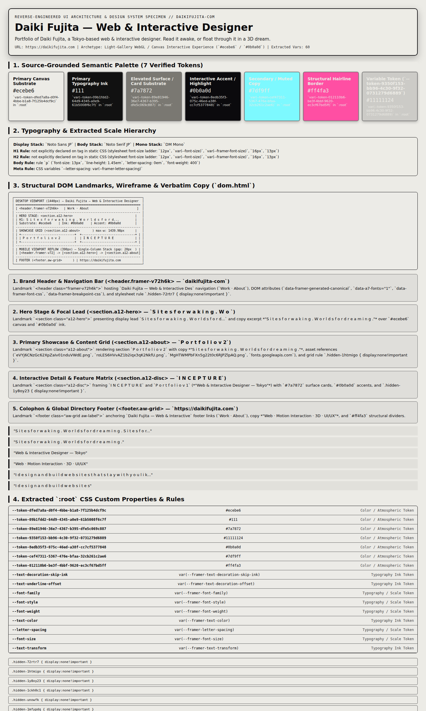
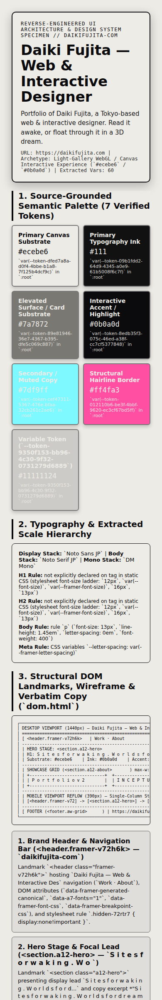

# UI Design System & Master Generation Blueprint: daikifujita-com

> **Daiki Fujita — Web & Interactive Designer** (https://daikifujita.com) — Portfolio of Daiki Fujita, a Tokyo-based web & interactive designer. Read it awake, or float through it in a 3D dream.



---

## 1. Executive Visual Persona & Design Archetype

- **Brand Essence & Persona**: **Daiki Fujita — Web & Interactive Designer** (`https://daikifujita.com`). Portfolio of Daiki Fujita, a Tokyo-based web & interactive designer. Read it awake, or float through it in a 3D dream.
- **Visual Archetype**: **Light-Gallery WebGL / Canvas Interactive Experience (`#ecebe6` / `#0b0a0d`)**.
- **Anti-AI-Slop Differentiators**:
  - **Source-Grounded Chromatic Polarity**: Anchors the viewport in `#ecebe6` (`var(--token-dfed7a8a-d0f4-4bbe-b1a8-7f125b4dcf9c)` in `:root`) paired with `#0b0a0d` primary typography and `#0b0a0d` accents.
  - **Extracted Typographic Hierarchy**: Pairs `Noto Sans JP` for display copy (`S i t e s f o r w a k i n g . W o r `) with `Noto Serif JP` and `DM Mono`.
  - **Calibrated Spatial Grid & Motion**: Combines `1439.98px` container bounds (`gap: 20px`, padding `18px`) with `cubic-bezier(.44,0,.56,1)` easing and Lenis Smooth Scroll (`data-lenis`), Three.js / WebGL Canvas Pipeline.

---

## 2. Spatial Architecture & Modular Grid Mathematics



### Viewport Allocation & Container Geometry
- **Captured Viewport Dimensions**: Desktop `1440×2400px` (`assets/desktop.png`, capped at 2400px multi-section capture), Mobile `390×2400px` (`assets/mobile.png`, capped at 2400px multi-section capture).
- **Master Container Bounds**: `1439.98px` extracted from `daikifujita-com` stylesheet.
- **Canvas Lateral Padding & Spacing**: `18px` lateral canvas padding with `20px` grid gap.
- **Border Radius Scale**: `8px`, `15px`, `2px`, `999px`.

### Responsive Breakpoint Architecture
- **Desktop Layout**: Multi-column CSS Grid / Flexbox layout at `1440px` (`max-width: 1439.98px`, `gap: 20px`).
- **Mobile Layout**: Single-column vertical stack at `390px` viewport width with `18px` horizontal padding.
- **Extracted CSS Media Queries**: `@media (min-width: 1440px)`, `@media (min-width: 810px) and (max-width: 1439.98px)`, `@media (max-width: 809.98px)`, `@media (max-width:1199px) and (min-width:810px)`.

---

## 3. Color System, Materiality & Atmospheric Lighting

### Semantic Palette & Source Grounding
| Semantic Role | Ground-Truth Value | Extracted CSS Source / Selector |
|---|---|---|
| **Primary Canvas Substrate** | `#ecebe6` | `var(--token-dfed7a8a-d0f4-4bbe-b1a8-7f125b4dcf9c)` in `:root` |
| **Primary Typography Ink** | `#111` | `var(--token-09b1fdd2-64d9-4345-a0e9-61b5008f6c7f)` in `:root` |
| **Elevated Surface / Card Substrate** | `#7a7872` | `var(--token-89e81946-36e7-4367-b395-dfe5c069c887)` in `:root` |
| **Interactive Accent / Highlight** | `#0b0a0d` | `var(--token-8edb35f3-075c-46ed-a38f-cc7cf5377848)` in `:root` |
| **Secondary / Muted Copy** | `#7df9ff` | `var(--token-cef47311-5367-476e-bfaa-32cb261c2ae6)` in `:root` |
| **Structural Hairline Border** | `#ff4fa3` | `var(--token-012110b6-be3f-4bbf-9620-ec3cf67bd5ff)` in `:root` |
| **Variable Token (`--token-9350f153-bb96-4c30-9f32-0731279d6889`)** | `#11111124` | `var(--token-9350f153-bb96-4c30-9f32-0731279d6889)` in `:root` |

### Sanitized Root CSS Variables (`ui-ux.md` Ground Truth)
| Variable Name | Extracted Value | Semantic Role |
|---|---|---|
| `--token-dfed7a8a-d0f4-4bbe-b1a8-7f125b4dcf9c` | `#ecebe6` | Color / Atmospheric Token |
| `--token-09b1fdd2-64d9-4345-a0e9-61b5008f6c7f` | `#111` | Color / Atmospheric Token |
| `--token-89e81946-36e7-4367-b395-dfe5c069c887` | `#7a7872` | Color / Atmospheric Token |
| `--token-9350f153-bb96-4c30-9f32-0731279d6889` | `#11111124` | Color / Atmospheric Token |
| `--token-8edb35f3-075c-46ed-a38f-cc7cf5377848` | `#0b0a0d` | Color / Atmospheric Token |
| `--token-cef47311-5367-476e-bfaa-32cb261c2ae6` | `#7df9ff` | Color / Atmospheric Token |
| `--token-012110b6-be3f-4bbf-9620-ec3cf67bd5ff` | `#ff4fa3` | Color / Atmospheric Token |
| `--text-decoration-skip-ink` | `var(--framer-text-decoration-skip-ink)` | Typography Ink Token |
| `--text-underline-offset` | `var(--framer-text-decoration-offset)` | Typography Ink Token |
| `--font-family` | `var(--framer-font-family)` | Typography / Scale Token |
| `--font-style` | `var(--framer-font-style)` | Typography / Scale Token |
| `--font-weight` | `var(--framer-font-weight)` | Typography / Scale Token |
| `--text-color` | `var(--framer-text-color)` | Typography Ink Token |
| `--letter-spacing` | `var(--framer-letter-spacing)` | Typography / Scale Token |
| `--font-size` | `var(--framer-font-size)` | Typography / Scale Token |
| `--text-transform` | `var(--framer-text-transform)` | Typography Ink Token |

---

## 4. Typographic Scale & Editorial Hierarchy

### Font Family Stacks
- **Display Typography**: `Noto Sans JP`.
- **Primary Body Stack**: `Noto Serif JP`.
- **Technical / Metadata Stack**: `DM Mono`.

### Typographic Scale & Rules (Extracted from Stylesheet & Variables)
- **Hero Display (`H1`)**: not explicitly declared on tag in static CSS (stylesheet font-size ladder: `12px`, `var(--font-size)`, `var(--framer-font-size)`, `16px`, `13px`).
- **Section Heading (`H2`)**: not explicitly declared on tag in static CSS (stylesheet font-size ladder: `12px`, `var(--font-size)`, `var(--framer-font-size)`, `16px`, `13px`).
- **Body Copy**: rule `p` (`font-size: 13px`, `line-height: 1.45em`, `letter-spacing: 0em`, `font-weight: 400`).
- **Metadata & Navigation Labels**: CSS variables `--letter-spacing: var(--framer-letter-spacing)`.

---

## 5. Choreographed Motion & Interaction Physics

### Primary Easing Curves
- **Extracted Timing Functions**: `cubic-bezier(.44,0,.56,1)`, `cubic-bezier(.19,1,.22,1)`, `cubic-bezier(.77,0,.18,1)`.

### Per-Element Transition & Choreography Rules
- **Selector `er-styles-preset-7zvg1x.rich-text...`**: `transition: color .2s cubic-bezier(.44,0,.56,1)` extracted from `daikifujita-com` stylesheet.
- **Selector `#__framer-editorbar-label`**: `transition: opacity 0.4s ease-out` extracted from `daikifujita-com` stylesheet.
- **Selector `.aw-u`**: `transition: background-size .7s var(--ease)` extracted from `daikifujita-com` stylesheet.
- **Extracted Easing Curve (`cubic-bezier(.44,0,.56,1)`)**: Governs interactive state transitions across `<header.framer-v72h6k>` and `<section.a12-about>`.
- **Runtime Interaction Engine**: Integrates Lenis Smooth Scroll (`data-lenis`), Three.js / WebGL Canvas Pipeline, Framer Motion Layout Physics with `prefers-reduced-motion: reduce` fallback guards.

---

## 6. Component Wireframe & Structural DOM Map

### Visual Layout Schematic (Grounded in `dom.html` — `1440px` Desktop & `390px` Mobile Reflow)
```
┌────────────────────────────────────────────────────────────────────────┐
│ DESKTOP VIEWPORT (1440px) — Daiki Fujita — Web & Interactive Designer  │
│ ====================================================================== │
│ [ <header.framer-v72h6k>   | Work · About                           ]  │
│ ---------------------------------------------------------------------- │
│ | HERO STAGE: <section.a12-hero>                                   |   │
│ | H1: S i t e s f o r w a k i n g . W o r l d s f o r d...         |   │
│ | Substrate: #ecebe6    | Ink: #0b0a0d    | Accent: #0b0a0d        |   │
│ ---------------------------------------------------------------------- │
│ | SHOWCASE GRID (<section.a12-about>       ) max-w: 1439.98px      |   │
│ | +------------------------------+  +------------------------------+ | │
│ | | P o r t f o l i o v 2        |  | I N C E P T U R E            | | │
│ | +------------------------------+  +------------------------------+ | │
│ ---------------------------------------------------------------------- │
│ | MOBILE VIEWPORT REFLOW (390px) — Single-Column Stack (gap: 20px  ) | │
│ | [<header.framer-v72] -> [<section.a12-hero>] -> [<section.a12-about] │
│ ---------------------------------------------------------------------- │
│ [ FOOTER (<footer.aw-grid>      ) | https://daikifujita.com            │
└────────────────────────────────────────────────────────────────────────┘
```

### Granular DOM Region Breakdown
1. **Brand Header & Navigation Bar (<header.framer-v72h6k> — `daikifujita-com`)**:
   - Landmark `<header class="framer-v72h6k">` hosting `Daiki Fujita — Web & Interactive Des` navigation (`Work · About`), DOM attributes (`data-framer-generated-canonical`, `data-a7-fonts="1"`, `data-framer-font-css`, `data-framer-breakpoint-css`), and stylesheet rule `.hidden-72rtr7 { display:none!important }`.
2. **Hero Stage & Focal Lead (<section.a12-hero> — `S i t e s f o r w a k i n g . W o `)**:
   - Landmark `<section class="a12-hero">` presenting display lead `S i t e s f o r w a k i n g . W o r l d s f o r d...` and copy excerpt *"S i t e s f o r w a k i n g . W o r l d s f o r d r e a m i n g ."* over `#ecebe6` canvas and `#0b0a0d` ink.
3. **Primary Showcase & Content Grid (<section.a12-about> — `P o r t f o l i o v 2`)**:
   - Landmark `<section class="a12-about">` rendering section `P o r t f o l i o v 2` with copy *"S i t e s f o r w a k i n g . W o r l d s f o r d r e a m i n g ."*, asset references (`eVYj6CNzGc62XpZaIv01nduVWdE.png`, `roLES6HVvAZ1b2iqx3qK2NkfU.png`, `MgHTWMPbFXn5g22t0c6RJPZlpAQ.png`, `fonts.googleapis.com`), and grid rule `.hidden-1htmigo { display:none!important }`.
4. **Interactive Detail & Feature Matrix (<section.a12-disc> — `I N C E P T U R E`)**:
   - Landmark `<section class="a12-disc">` framing `I N C E P T U R E` and `P o r t f o l i o v 1` (*"Web & Interactive Designer — Tokyo"*) with `#7a7872` surface cards, `#0b0a0d` accents, and `.hidden-1y8oy23 { display:none!important }`.
5. **Colophon & Global Directory Footer (<footer.aw-grid> — `https://daikifujita.com`)**:
   - Landmark `<footer class="aw-grid aw-label">` anchoring `Daiki Fujita — Web & Interactive` footer links (`Work · About`), copy *"Web · Motion Interaction · 3D · UI/UX"*, and `#ff4fa3` structural dividers.

---

## 7. Master Zero-Shot AI Generation Prompt

```markdown
# Master Zero-Shot Frontend Generation Prompt: daikifujita-com (Daiki Fujita — Web & Interactive Designer)

You are a principal frontend architect and design systems engineer. Build a complete, production-ready web application replicating the exact design system, DOM landmarks, typographic hierarchy, color tokens, and motion physics of `daikifujita-com` (**Daiki Fujita — Web & Interactive Designer** — `https://daikifujita.com`).

### 1. Visual Archetype & Anti-AI-Slop Mandates
- **Archetype**: Light-Gallery WebGL / Canvas Interactive Experience (`#ecebe6` / `#0b0a0d`).
- **Identity & Domain Context**: Portfolio of Daiki Fujita, a Tokyo-based web & interactive designer. Read it awake, or float through it in a 3D dream.
- **Primary Substrate**: `#ecebe6` (`var(--token-dfed7a8a-d0f4-4bbe-b1a8-7f125b4dcf9c)` in `:root`), **Primary Ink**: `#0b0a0d`, **Accent / Highlight**: `#0b0a0d`.
- **Site-Specific Differentiators**:
  - **Source-Grounded Chromatic Polarity**: Anchors the viewport in `#ecebe6` (`var(--token-dfed7a8a-d0f4-4bbe-b1a8-7f125b4dcf9c)` in `:root`) paired with `#0b0a0d` primary typography and `#0b0a0d` accents.
  - **Extracted Typographic Hierarchy**: Pairs `Noto Sans JP` for display copy (`S i t e s f o r w a k i n g . W o r `) with `Noto Serif JP` and `DM Mono`.
  - **Calibrated Spatial Grid & Motion**: Combines `1439.98px` container bounds (`gap: 20px`, padding `18px`) with `cubic-bezier(.44,0,.56,1)` easing and Lenis Smooth Scroll (`data-lenis`), Three.js / WebGL Canvas Pipeline.

### 2. Ground-Truth CSS Variables (`:root` Token Contract)
Declare and consume these exact custom properties extracted from `daikifujita-com` in your global stylesheet:

:root {
  /* Daiki Fujita — Web & Interactive Designer (daikifujita-com) — Ground-Truth Extracted CSS Variables */
  --token-dfed7a8a-d0f4-4bbe-b1a8-7f125b4dcf9c: #ecebe6; /* Color / Atmospheric Token (daikifujita-com) */
  --token-09b1fdd2-64d9-4345-a0e9-61b5008f6c7f: #111; /* Color / Atmospheric Token (daikifujita-com) */
  --token-89e81946-36e7-4367-b395-dfe5c069c887: #7a7872; /* Color / Atmospheric Token (daikifujita-com) */
  --token-9350f153-bb96-4c30-9f32-0731279d6889: #11111124; /* Color / Atmospheric Token (daikifujita-com) */
  --token-8edb35f3-075c-46ed-a38f-cc7cf5377848: #0b0a0d; /* Color / Atmospheric Token (daikifujita-com) */
  --token-cef47311-5367-476e-bfaa-32cb261c2ae6: #7df9ff; /* Color / Atmospheric Token (daikifujita-com) */
  --token-012110b6-be3f-4bbf-9620-ec3cf67bd5ff: #ff4fa3; /* Color / Atmospheric Token (daikifujita-com) */
  --text-decoration-skip-ink: var(--framer-text-decoration-skip-ink); /* Typography Ink Token (daikifujita-com) */
  --text-underline-offset: var(--framer-text-decoration-offset); /* Typography Ink Token (daikifujita-com) */
  --font-family: var(--framer-font-family); /* Typography / Scale Token (daikifujita-com) */
  --font-style: var(--framer-font-style); /* Typography / Scale Token (daikifujita-com) */
  --font-weight: var(--framer-font-weight); /* Typography / Scale Token (daikifujita-com) */
  --text-color: var(--framer-text-color); /* Typography Ink Token (daikifujita-com) */
  --letter-spacing: var(--framer-letter-spacing); /* Typography / Scale Token (daikifujita-com) */
  --font-size: var(--framer-font-size); /* Typography / Scale Token (daikifujita-com) */
  --text-transform: var(--framer-text-transform); /* Typography Ink Token (daikifujita-com) */
}

### 3. Semantic Color & Materiality Contract
Map every surface, ink, and border strictly to these source-grounded tokens:
- **Primary Canvas Substrate**: `#ecebe6` — grounded in `var(--token-dfed7a8a-d0f4-4bbe-b1a8-7f125b4dcf9c)` in `:root`
- **Primary Typography Ink**: `#111` — grounded in `var(--token-09b1fdd2-64d9-4345-a0e9-61b5008f6c7f)` in `:root`
- **Elevated Surface / Card Substrate**: `#7a7872` — grounded in `var(--token-89e81946-36e7-4367-b395-dfe5c069c887)` in `:root`
- **Interactive Accent / Highlight**: `#0b0a0d` — grounded in `var(--token-8edb35f3-075c-46ed-a38f-cc7cf5377848)` in `:root`
- **Secondary / Muted Copy**: `#7df9ff` — grounded in `var(--token-cef47311-5367-476e-bfaa-32cb261c2ae6)` in `:root`
- **Structural Hairline Border**: `#ff4fa3` — grounded in `var(--token-012110b6-be3f-4bbf-9620-ec3cf67bd5ff)` in `:root`
- **Variable Token (`--token-9350f153-bb96-4c30-9f32-0731279d6889`)**: `#11111124` — grounded in `var(--token-9350f153-bb96-4c30-9f32-0731279d6889)` in `:root`

### 4. Spatial Grid, Container Bounds & Responsive Breakpoints
- **Desktop Viewport Reference**: `1440×2400px` (capped at 2400px multi-section capture, `1440px` standard desktop width).
- **Mobile Viewport Reference**: `390×2400px` (capped at 2400px multi-section capture, `390px` standard mobile width).
- **Container Max-Width**: `1439.98px` extracted from `daikifujita-com` stylesheet
- **Padding & Gutters**: `18px` lateral canvas padding with `20px` grid gap
- **Desktop Grid**: Multi-column CSS Grid / Flexbox layout at `1440px` (`max-width: 1439.98px`, `gap: 20px`)
- **Mobile Adaptation**: Single-column vertical stack at `390px` viewport width with `18px` horizontal padding
- **Media Queries**: `@media (min-width: 1440px)`, `@media (min-width: 810px) and (max-width: 1439.98px)`, `@media (max-width: 809.98px)`, `@media (max-width:1199px) and (min-width:810px)`
- **Corner Radii**: `8px`, `15px`, `2px`, `999px`

### 5. Typography & Editorial Scale Contract
- **Display Font Stack**: `Noto Sans JP`
- **Body Font Stack**: `Noto Serif JP`
- **Monospace / Technical Font Stack**: `DM Mono`
- **H1 Display Rule**: not explicitly declared on tag in static CSS (stylesheet font-size ladder: `12px`, `var(--font-size)`, `var(--framer-font-size)`, `16px`, `13px`)
- **H2 Section Rule**: not explicitly declared on tag in static CSS (stylesheet font-size ladder: `12px`, `var(--font-size)`, `var(--framer-font-size)`, `16px`, `13px`)
- **Body Copy Rule**: rule `p` (`font-size: 13px`, `line-height: 1.45em`, `letter-spacing: 0em`, `font-weight: 400`)
- **Metadata & Index Rule**: CSS variables `--letter-spacing: var(--framer-letter-spacing)`

### 6. Component Hierarchy, Verbatim Copy & Real DOM Landmarks
Scaffold `daikifujita-com` (`Daiki Fujita — Web & Interactive Designer`) with these exact structural regions, extracted copy, and CSS rules from `dom.html`:
1. **Brand Header & Navigation Bar (<header.framer-v72h6k> — `daikifujita-com`)**:
   - DOM & Selectors: Landmark `<header class="framer-v72h6k">` hosting `Daiki Fujita — Web & Interactive Des` navigation (`Work · About`), DOM attributes (`data-framer-generated-canonical`, `data-a7-fonts="1"`, `data-framer-font-css`, `data-framer-breakpoint-css`), and stylesheet rule `.hidden-72rtr7 { display:none!important }`.
   - Responsive Contract: Header `Brand Header & Navigation Bar (<header.framer-v72h6k> — `daikifujita-com`)` (`daikifujita-com`) adapts across `@media (min-width: 1440px)`, `@media (min-width: 810px) and (max-width: 1439.98px)`, `@media (max-width: 809.98px)`, `@media (max-width:1199px) and (min-width:810px)` with `cubic-bezier(.44,0,.56,1)`, `cubic-bezier(.19,1,.22,1)`, `cubic-bezier(.77,0,.18,1)` transitions and links `Work · About`.
2. **Hero Stage & Focal Lead (<section.a12-hero> — `S i t e s f o r w a k i n g . W o `)**:
   - DOM & Selectors: Landmark `<section class="a12-hero">` presenting display lead `S i t e s f o r w a k i n g . W o r l d s f o r d...` and copy excerpt *"S i t e s f o r w a k i n g . W o r l d s f o r d r e a m i n g ."* over `#ecebe6` canvas and `#0b0a0d` ink.
   - Responsive Contract: Hero stage (`1440×2400px` desktop / `390×2400px` mobile) sets `#ecebe6` background with `#0b0a0d` headline `S i t e s f o r w a k i n g . W o r l d s f o r d...`.
3. **Primary Showcase & Content Grid (<section.a12-about> — `P o r t f o l i o v 2`)**:
   - DOM & Selectors: Landmark `<section class="a12-about">` rendering section `P o r t f o l i o v 2` with copy *"S i t e s f o r w a k i n g . W o r l d s f o r d r e a m i n g ."*, asset references (`eVYj6CNzGc62XpZaIv01nduVWdE.png`, `roLES6HVvAZ1b2iqx3qK2NkfU.png`, `MgHTWMPbFXn5g22t0c6RJPZlpAQ.png`, `fonts.googleapis.com`), and grid rule `.hidden-1htmigo { display:none!important }`.
   - Responsive Contract: Showcase grid `Primary Showcase & Content Grid (<section.a12-about> — `P o r t f o l i o v 2`)` applies Multi-column CSS Grid / Flexbox layout at `1440px` (`max-width: 1439.98px`, `gap: 20px`) on desktop and Single-column vertical stack at `390px` viewport width with `18px` horizontal padding on mobile.
4. **Interactive Detail & Feature Matrix (<section.a12-disc> — `I N C E P T U R E`)**:
   - DOM & Selectors: Landmark `<section class="a12-disc">` framing `I N C E P T U R E` and `P o r t f o l i o v 1` (*"Web & Interactive Designer — Tokyo"*) with `#7a7872` surface cards, `#0b0a0d` accents, and `.hidden-1y8oy23 { display:none!important }`.
   - Responsive Contract: Detail module `Interactive Detail & Feature Matrix (<section.a12-disc> — `I N C E P T U R E`)` uses `8px`, `15px`, `2px`, `999px` radii, `#0b0a0d` highlights, and assets (eVYj6CNzGc62XpZaIv01nduVWdE.png, roLES6HVvAZ1b2iqx3qK2NkfU.png, MgHTWMPbFXn5g22t0c6RJPZlpAQ.png).
5. **Colophon & Global Directory Footer (<footer.aw-grid> — `https://daikifujita.com`)**:
   - DOM & Selectors: Landmark `<footer class="aw-grid aw-label">` anchoring `Daiki Fujita — Web & Interactive` footer links (`Work · About`), copy *"Web · Motion Interaction · 3D · UI/UX"*, and `#ff4fa3` structural dividers.
   - Responsive Contract: Footer `Colophon & Global Directory Footer (<footer.aw-grid> — `https://daikifujita.com`)` aligns to `1439.98px` extracted from `daikifujita-com` stylesheet with `18px` lateral canvas padding with `20px` grid gap and attributes (data-framer-generated-canonical, data-a7-fonts="1", data-framer-font-css).

#### Verbatim DOM Copy Excerpts (`dom.html`)
- Copy Excerpt 1: *"S i t e s f o r w a k i n g . W o r l d s f o r d r e a m i n g . S i t e s f o r..."*
- Copy Excerpt 2: *"S i t e s f o r w a k i n g . W o r l d s f o r d r e a m i n g ."*
- Copy Excerpt 3: *"Web & Interactive Designer — Tokyo"*
- Copy Excerpt 4: *"Web · Motion Interaction · 3D · UI/UX"*

### 7. Motion, Extracted Stylesheet Rules & Interaction Choreography
- **Primary Easing Functions**: `cubic-bezier(.44,0,.56,1)`, `cubic-bezier(.19,1,.22,1)`, `cubic-bezier(.77,0,.18,1)`
- **Extracted Stylesheet Rules (`daikifujita-com`)**:
- `.hidden-72rtr7 { display:none!important }`
- `.hidden-1htmigo { display:none!important }`
- `.hidden-1y8oy23 { display:none!important }`
- `.hidden-1ckh0c1 { display:none!important }`
- `.hidden-unowfk { display:none!important }`
- **Per-Selector Transition Rules**:
- **Selector `er-styles-preset-7zvg1x.rich-text...`**: `transition: color .2s cubic-bezier(.44,0,.56,1)` extracted from `daikifujita-com` stylesheet.
- **Selector `#__framer-editorbar-label`**: `transition: opacity 0.4s ease-out` extracted from `daikifujita-com` stylesheet.
- **Selector `.aw-u`**: `transition: background-size .7s var(--ease)` extracted from `daikifujita-com` stylesheet.
- **Extracted Easing Curve (`cubic-bezier(.44,0,.56,1)`)**: Governs interactive state transitions across `<header.framer-v72h6k>` and `<section.a12-about>`.
- **Runtime Interaction Engine**: Integrates Lenis Smooth Scroll (`data-lenis`), Three.js / WebGL Canvas Pipeline, Framer Motion Layout Physics with `prefers-reduced-motion: reduce` fallback guards.

### 8. Technical Deliverables
- Implement in Next.js (App Router) with TypeScript and Tailwind CSS consuming the `:root` custom properties defined above for `daikifujita-com`.
- Reproduce both the `1440px` desktop architecture and `390px` mobile breakpoint transitions, preserving semantic HTML5 landmarks (`<header>`, `<nav>`, `<main>`, `<section>`, `<footer>`) and `prefers-reduced-motion` accessibility guards.
```
