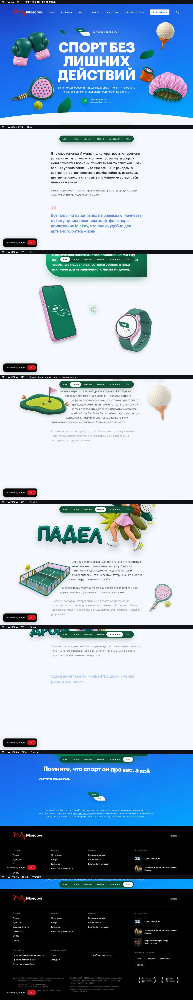

# UI Design System & Master Generation Blueprint: dailymoscow-ru_mirpay

> **Спорт без лишних действий — Mir Pay × Daily Moscow** (https://dailymoscow.ru/mirpay) — Бокс, гольф, бассейн, падел, скалодром и йога — и ни одного лишнего движения, когда дело доходит до оплаты




---

## 1. Executive Visual Persona & Design Archetype

- **Brand Essence & Persona**: **Спорт без лишних действий — Mir Pay × Daily Moscow** (`https://dailymoscow.ru/mirpay`). Бокс, гольф, бассейн, падел, скалодром и йога — и ни одного лишнего движения, когда дело доходит до оплаты
- **Capture Provenance**: Live browser capture (`tier1_fast`, HTTP `200`, captured `2026-11-24`).
- **Visual Archetype**: **Light-Substrate Editorial & Modular Grid System (`#f4f7fc` canvas, `#000000` ink, `#007bff` accent)**.
- **Anti-AI-Slop Differentiators**:
  - **Live-Computed Chromatic Polarity**: Anchors the viewport in `#f4f7fc` (live computed `section` `background-color` (`computed_styles.json`)) paired with `#000000` primary typography and `#007bff` accents.
  - **Grounded Typographic Hierarchy**: Pairs `MP Graphik` for display copy (`СПОРТ БЕЗ ЛИШНИХ ДЕЙСТВИЙ`) with `Manrope`.
  - **Calibrated Spatial Grid & Motion**: Combines `1392px` container bounds (`gap: 2px`, padding `48px`) with `cubic-bezier(.16,1,.3,1)` easing.

---

## 2. Spatial Architecture & Modular Grid Mathematics

### Viewport Allocation & Container Geometry
- **Captured Journey Filmstrips**: Desktop `1280×6624px` (`assets/desktop-journey.webp`, `8` keyframes up to `y=12362px` / doc `13262px`), Mobile `390×2616px` (`assets/mobile-journey.webp`, `3` keyframes).
- **Master Container Bounds**: `1392px` (measured widest bounded `<section>` landmark width on `1440px` desktop).
- **Canvas Lateral Padding & Spacing**: `48px` lateral canvas padding with `2px` grid gap.
- **Border Radius Scale**: `50%`, `6px`, `.5px`, `.5rem`.

### Responsive Breakpoint Architecture
- **Desktop Layout**: Multi-column CSS Grid / Flexbox layout at `1440px` (`max-width: 1392px`, `gap: 2px`).
- **Mobile Layout**: Single-column vertical stack at `390px` viewport width with `48px` horizontal padding.
- **Extracted CSS Media Queries**: `@media only screen and (max-width: 1100px)`, `@media only screen and (max-width: 940px)`, `@media only screen and (max-width: 630px)`, `@media (prefers-reduced-motion: reduce)`.

---

## 3. Color System, Materiality & Atmospheric Lighting

### Semantic Palette & Source Grounding
| Semantic Role | Ground-Truth Value | Extracted Live / CSS Source |
|---|---|---|
| **Primary Canvas Substrate** | `#f4f7fc` | live computed `section` `background-color` (`computed_styles.json`) |
| **Primary Typography Ink** | `#000000` | live computed `body` `color` (`computed_styles.json`) |
| **Elevated Surface / Card Substrate** | `#ffffff` | `.main-btn.active { background: #ffffff }` |
| **Interactive Accent / Highlight** | `#007bff` | `.privacy-consent__link { color: #007bff }` |
| **Secondary / Muted Copy** | `#7b7b81` | `var(--bl-muted)` in `:root` |
| **Structural Hairline Border** | `#efeff3` | `var(--bl-rule)` in `:root` |
| **Variable Token (`--dmf-muted`)** | `#9d9da4` | `var(--dmf-muted)` in `:root` |
| **Variable Token (`--bl-fill`)** | `#f6f6f9` | `var(--bl-fill)` in `:root` |
| **Variable Token (`--bl-accent`)** | `#d5181f` | `var(--bl-accent)` in `:root` |
| **Variable Token (`--blue`)** | `#1f5bd7` | `var(--blue)` in `:root` |
| **Variable Token (`--sky`)** | `#00aaff` | `var(--sky)` in `:root` |

### Sanitized Root CSS Variables (`ui-ux.md` Ground Truth)
| Variable Name | Extracted Value | Semantic Role |
|---|---|---|
| `--dmf-bg` | `#000` | Canvas / Surface Token |
| `--dmf-ink` | `#fff` | Typography Ink Token |
| `--dmf-muted` | `#9d9da4` | Color / Atmospheric Token |
| `--dmf-dim` | `#7b7b81` | Color / Atmospheric Token |
| `--dmf-rule` | `rgba(255, 255, 255, .14)` | Color / Atmospheric Token |
| `--dmf-surface` | `rgba(255, 255, 255, .05)` | Canvas / Surface Token |
| `--dmf-gap` | `32px` | Layout / Spatial Grid Token |
| `--dmf-rail` | `340px` | Dimension / Scale Token |
| `--bl-ink` | `#000` | Typography Ink Token |
| `--bl-muted` | `#7b7b81` | Color / Atmospheric Token |
| `--bl-dim` | `#9d9da4` | Color / Atmospheric Token |
| `--bl-rule` | `#efeff3` | Color / Atmospheric Token |
| `--bl-fill` | `#f6f6f9` | Color / Atmospheric Token |
| `--bl-accent` | `#d5181f` | Brand / Palette Token |
| `--blue` | `#1f5bd7` | Color / Atmospheric Token |
| `--sky` | `#00aaff` | Color / Atmospheric Token |

---

## 4. Typographic Scale & Editorial Hierarchy

### Font Family Stacks
- **Display Typography**: `MP Graphik`.
- **Primary Body Stack**: `Manrope`.
- **Technical / Metadata Stack**: not declared in live computed styles (uses primary stack / `ui-monospace`).

### Typographic Scale & Rules (Live Computed & Stylesheet Grounded)
- **Hero Display (`H1`)**: live computed `h1` (`font-size: 103.68px`, `line-height: 101.606px`, `font-weight: 700`, `letter-spacing: -3.1104px`); rule `h1` (`font-size: 56px`, `line-height: 60px`, `letter-spacing: -1.2px`).
- **Section Heading (`H2`)**: live computed `h2` (`font-size: 67.68px`, `line-height: 67.68px`, `font-weight: 700`, `letter-spacing: -2.7072px`); rule `.section-title` (`font-weight: 800`).
- **Body Copy**: live computed `body` (`font-size: 16px`, `line-height: 20.8px`, `font-weight: 400`); rule `p` (`font-size: 14px`).
- **Metadata & Navigation Labels**: live computed `nav/a` (`font-size: 16px`, `line-height: 20.8px`, `font-weight: 400`).

---

## 5. Choreographed Motion & Interaction Physics

### Primary Easing Curves
- **Extracted Timing Functions**: `cubic-bezier(.16,1,.3,1)`, `cubic-bezier(.34,1.56,.64,1)`, `cubic-bezier(.2,.7,.2,1)`.

### Per-Element Transition & Choreography Rules
- **Selector `.dm-awards__item`**: `transition: opacity .18s ease` extracted from `dailymoscow-ru_mirpay` stylesheet.
- **Selector `.dm-col__list a`**: `transition: color .18s ease` extracted from `dailymoscow-ru_mirpay` stylesheet.
- **Selector `.dm-action`**: `transition: border-color .18s ease, background .18s ease` extracted from `dailymoscow-ru_mirpay` stylesheet.
- **Extracted Easing Curve (`cubic-bezier(.16,1,.3,1)`)**: Governs interactive state transitions across `<header.header>` and `<section.m3-sec>`.
- **State & Hover Choreography**: Opacity and transform transitions on `<article.m3-body>` and `<section.m3-sec>` interactive targets.
### Measured Runtime Scroll & Interaction Telemetry (`behavioral_journey_v2`)
- **Scroll Driver Mode**: `native` (max document height `13262px`, deepest scrollY reached `12362px` across `8` desktop keyframes).
- **Detected Scroll / Motion Libraries**: Native browser scroll / standard CSS transitions.
- **Hover Physics (`primary_cta` · `ГОРОД`)**: `opacity`: `1` -> `0.75` (`transition-duration: 0.2s`, `timing: ease`).
- **Route Transition Architecture**: First internal navigation (`/cabinet/start`) measured as `MPA` in `1377ms`.

---

## 6. Component Wireframe & Structural DOM Map

### Visual Layout Schematic — Desktop (`1440px`, Grounded in `dom.html` & Landmark Bounding Boxes)
```
┌────────────────────────────────────────────────────────────────────────┐
│ DESKTOP VIEWPORT (1440px) — Спорт без лишних действий — Mir Pay × Dail │
│ ====================================================================== │
│ [ <header.header> (1440x120px)        | Бокс · Гольф · Бассейн · Пад ] │
│ ---------------------------------------------------------------------- │
│ | HERO STAGE: <article.m3-body> (w=1440px)                           | │
│ | H1: СПОРТ БЕЗ ЛИШНИХ ДЕЙСТВИЙ                                      | │
│ | Substrate: #f4f7fc | Ink: #000000 | Accent: #007bff                | │
│ ---------------------------------------------------------------------- │
│ | SHOWCASE GRID (<section.m3-sec>) max-w: 1392px                     | │
│ | +------------------------------+  +------------------------------+ | │
│ | | Спорт без лишних действий    |  | Начинала я с бокса           | | │
│ | +------------------------------+  +------------------------------+ | │
│ ---------------------------------------------------------------------- │
│ | DETAIL MODULE (<section.m3-sec:nth(2)>) — Потом был гольф          | │
│ ---------------------------------------------------------------------- │
│ [ FOOTER (<footer.footer>     ) | https://dailymoscow.ru/mirpay        │
└────────────────────────────────────────────────────────────────────────┘
```

### Visual Layout Schematic — Mobile Reflow (`390px`)
```
┌────────────────────────────────────────────────────────────────────────┐
│ MOBILE VIEWPORT REFLOW (390px) — Single-Column Stack (gap: 2px)        │
│ ====================================================================== │
│ [ HEADER BAR (<header.header>         ) | Compact Menu (390px)         │
│ ---------------------------------------------------------------------- │
│ | HERO STAGE (<article.m3-body>) — 390px Vertical Lead               | │
│ | H1: СПОРТ БЕЗ ЛИШНИХ ДЕЙСТВИЙ                                      | │
│ ---------------------------------------------------------------------- │
│ | SHOWCASE STACK (<section.m3-sec>) — 1-Col Stack                    | │
│ | [ Item 1: Спорт без лишних действий                              ] | │
│ | [ Item 2: Начинала я с бокса                                     ] | │
│ ---------------------------------------------------------------------- │
│ | DETAIL STACK (<section.m3-sec:nth(2)>) — 1-Col (Потом был гольф)   | │
│ ---------------------------------------------------------------------- │
│ [ FOOTER (<footer.footer>     ) | Stacked 390px Colophon               │
└────────────────────────────────────────────────────────────────────────┘
```

### Granular DOM Region Breakdown
1. **Brand Header & Navigation Bar (<header.header> — `dailymoscow-ru_mirpay`)**:
   - Landmark `<header class="header header-news">` (`1440x120px`) hosting `Спорт без лишних действий — Mir Pay ` navigation (`Бокс · Гольф · Бассейн · Падел · Скалодром`), DOM attributes (`data-pd="26"`, `data-mx="-.4"`, `data-sp=".5"`, `data-pd="-40"`), and stylesheet rule `.dm-footer__wrapper { max-width: 1280px; margin: 0 auto; padding: 0 16px; }`.
2. **Hero Stage & Focal Lead (<article.m3-body> — `СПОРТ БЕЗ ЛИШНИХ ДЕЙСТВИЙ`)**:
   - Landmark `<article class="m3-body">` presenting display lead `СПОРТ БЕЗ ЛИШНИХ ДЕЙСТВИЙ` and copy excerpt *"Бокс, гольф, бассейн, падел, скалодром и йога — и ни одного лишне"* over `#f4f7fc` canvas and `#000000` ink.
3. **Primary Showcase & Content Grid (<section.m3-sec> — `Спорт без лишних действий`)**:
   - Landmark `<section class="m3-sec">` rendering section `Спорт без лишних действий` with copy *"Елена Карнеева редактор Daily Moscow"*, asset references (`tag.js`, `mirpay`, `footer-v2.css`, `components.css`), and grid rule `.dm-footer__logo { display: block; line-height: 0; }`.
4. **Interactive Detail & Feature Matrix (<section.m3-sec:nth(2)> — `Начинала я с бокса`)**:
   - Landmark `<section class="m3-sec">` framing `Начинала я с бокса` and `Потом был гольф` (*"редактор Daily Moscow"*) with `#ffffff` surface cards, `#007bff` accents, and `.dm-footer__logo img { width: 220px; height: auto; }`.
5. **Colophon & Global Directory Footer (<footer.footer> — `https://dailymoscow.ru/mirpay`)**:
   - Landmark `<footer class="footer dm-footer">` anchoring `Спорт без лишних действий — Mir ` footer links (`Бокс · Гольф · Бассейн · Падел · Скалодром`), copy *"Я не спортсменка. Я женщина, которая время от времени вспоми"*, and `#efeff3` structural dividers.
### Full Vertical Scroll Sequence (Desktop `1440×900` Keyframes)
- **Step 01** (`y=0px`, `0%`): Active landmark `СПОРТ БЕЗ ЛИШНИХ ДЕЙСТВИЙ` · sticky/fixed elements: `1`
- **Step 02** (`y=850px`, `7%`): Active landmark `#box` · sticky/fixed elements: `2`
- **Step 03** (`y=3400px`, `28%`): Active landmark `#box` · sticky/fixed elements: `2`
- **Step 04** (`y=5100px`, `41%`): Active landmark `Дальше была вода, то есть аквакомплекс` · sticky/fixed elements: `2`
- **Step 05** (`y=7650px`, `62%`): Active landmark `#padel` · sticky/fixed elements: `2`
- **Step 06** (`y=9350px`, `76%`): Active landmark `#yoga` · sticky/fixed elements: `2`
- **Step 07** (`y=11900px`, `96%`): Active landmark `Footer` · sticky/fixed elements: `2`
- **Step 08** (`y=12362px`, `100%`): Active landmark `РУБРИКИ` · sticky/fixed elements: `2`

### Multi-Page Internal Route Map
- **Detail Route (`/cabinet/start`)**: `https://dailymoscow.ru/cabinet/start` — H1: `Свой блог в деловом СМИ`, scrollHeight `4272px`, transition `MPA` (`1377ms`)
- **About Route (`/about`)**: `https://dailymoscow.ru/about` — H1: `THE`, scrollHeight `10541px`, transition `direct` (`1094ms`)
- **Detail Route (`/static/search`)**: `https://dailymoscow.ru/static/search` — H1: `Поиск на Daily Moscow`, scrollHeight `2455px`, transition `direct` (`238ms`)

---

## 7. Master Zero-Shot AI Generation Prompt

```markdown
# Master Zero-Shot Frontend Generation Prompt: dailymoscow-ru_mirpay (Спорт без лишних действий — Mir Pay × Daily Moscow)

You are a principal frontend architect and design systems engineer. Build a complete, production-ready web application replicating the exact design system, DOM landmarks, typographic hierarchy, color tokens, and motion physics of `dailymoscow-ru_mirpay` (**Спорт без лишних действий — Mir Pay × Daily Moscow** — `https://dailymoscow.ru/mirpay`).

### 1. Visual Archetype & Anti-AI-Slop Mandates
- **Archetype**: Light-Substrate Editorial & Modular Grid System (`#f4f7fc` canvas, `#000000` ink, `#007bff` accent).
- **Identity & Domain Context**: Бокс, гольф, бассейн, падел, скалодром и йога — и ни одного лишнего движения, когда дело доходит до оплаты
- **Primary Substrate**: `#f4f7fc` (live computed `section` `background-color` (`computed_styles.json`)), **Primary Ink**: `#000000`, **Accent / Highlight**: `#007bff`.
- **Site-Specific Differentiators**:
  - **Live-Computed Chromatic Polarity**: Anchors the viewport in `#f4f7fc` (live computed `section` `background-color` (`computed_styles.json`)) paired with `#000000` primary typography and `#007bff` accents.
  - **Grounded Typographic Hierarchy**: Pairs `MP Graphik` for display copy (`СПОРТ БЕЗ ЛИШНИХ ДЕЙСТВИЙ`) with `Manrope`.
  - **Calibrated Spatial Grid & Motion**: Combines `1392px` container bounds (`gap: 2px`, padding `48px`) with `cubic-bezier(.16,1,.3,1)` easing.

### 2. Ground-Truth CSS Variables (`:root` Token Contract)
Declare and consume these exact custom properties extracted from `dailymoscow-ru_mirpay` in your global stylesheet:

:root {
  /* Спорт без лишних действий — Mir Pay × Daily Moscow (dailymoscow-ru_mirpay) — Live-Grounded CSS Variables */
  --dmf-bg: #000; /* Canvas / Surface Token (dailymoscow-ru_mirpay) */
  --dmf-ink: #fff; /* Typography Ink Token (dailymoscow-ru_mirpay) */
  --dmf-muted: #9d9da4; /* Color / Atmospheric Token (dailymoscow-ru_mirpay) */
  --dmf-dim: #7b7b81; /* Color / Atmospheric Token (dailymoscow-ru_mirpay) */
  --dmf-rule: rgba(255, 255, 255, .14); /* Color / Atmospheric Token (dailymoscow-ru_mirpay) */
  --dmf-surface: rgba(255, 255, 255, .05); /* Canvas / Surface Token (dailymoscow-ru_mirpay) */
  --dmf-gap: 32px; /* Layout / Spatial Grid Token (dailymoscow-ru_mirpay) */
  --dmf-rail: 340px; /* Dimension / Scale Token (dailymoscow-ru_mirpay) */
  --bl-ink: #000; /* Typography Ink Token (dailymoscow-ru_mirpay) */
  --bl-muted: #7b7b81; /* Color / Atmospheric Token (dailymoscow-ru_mirpay) */
  --bl-dim: #9d9da4; /* Color / Atmospheric Token (dailymoscow-ru_mirpay) */
  --bl-rule: #efeff3; /* Color / Atmospheric Token (dailymoscow-ru_mirpay) */
  --bl-fill: #f6f6f9; /* Color / Atmospheric Token (dailymoscow-ru_mirpay) */
  --bl-accent: #d5181f; /* Brand / Palette Token (dailymoscow-ru_mirpay) */
  --blue: #1f5bd7; /* Color / Atmospheric Token (dailymoscow-ru_mirpay) */
  --sky: #00aaff; /* Color / Atmospheric Token (dailymoscow-ru_mirpay) */
}

### 3. Semantic Color & Materiality Contract
Map every surface, ink, and border strictly to these source-grounded tokens:
- **Primary Canvas Substrate**: `#f4f7fc` — grounded in live computed `section` `background-color` (`computed_styles.json`)
- **Primary Typography Ink**: `#000000` — grounded in live computed `body` `color` (`computed_styles.json`)
- **Elevated Surface / Card Substrate**: `#ffffff` — grounded in `.main-btn.active { background: #ffffff }`
- **Interactive Accent / Highlight**: `#007bff` — grounded in `.privacy-consent__link { color: #007bff }`
- **Secondary / Muted Copy**: `#7b7b81` — grounded in `var(--bl-muted)` in `:root`
- **Structural Hairline Border**: `#efeff3` — grounded in `var(--bl-rule)` in `:root`
- **Variable Token (`--dmf-muted`)**: `#9d9da4` — grounded in `var(--dmf-muted)` in `:root`
- **Variable Token (`--bl-fill`)**: `#f6f6f9` — grounded in `var(--bl-fill)` in `:root`
- **Variable Token (`--bl-accent`)**: `#d5181f` — grounded in `var(--bl-accent)` in `:root`
- **Variable Token (`--blue`)**: `#1f5bd7` — grounded in `var(--blue)` in `:root`
- **Variable Token (`--sky`)**: `#00aaff` — grounded in `var(--sky)` in `:root`

### 4. Spatial Grid, Container Bounds & Responsive Breakpoints
- **Desktop Viewport Reference**: `1280×6624px` (multi-frame vertical journey filmstrip (6624px), `1440px` standard desktop width).
- **Mobile Viewport Reference**: `390×2616px` (multi-frame vertical journey filmstrip (2616px), `390px` standard mobile width).
- **Container Max-Width**: `1392px` (measured widest bounded `<section>` landmark width on `1440px` desktop)
- **Padding & Gutters**: `48px` lateral canvas padding with `2px` grid gap
- **Desktop Grid**: Multi-column CSS Grid / Flexbox layout at `1440px` (`max-width: 1392px`, `gap: 2px`)
- **Mobile Adaptation**: Single-column vertical stack at `390px` viewport width with `48px` horizontal padding
- **Media Queries**: `@media only screen and (max-width: 1100px)`, `@media only screen and (max-width: 940px)`, `@media only screen and (max-width: 630px)`, `@media (prefers-reduced-motion: reduce)`
- **Corner Radii**: `50%`, `6px`, `.5px`, `.5rem`

### 5. Typography & Editorial Scale Contract
- **Display Font Stack**: `MP Graphik`
- **Body Font Stack**: `Manrope`
- **Monospace / Technical Font Stack**: not declared in live computed styles (uses primary stack / `ui-monospace`)
- **H1 Display Rule**: live computed `h1` (`font-size: 103.68px`, `line-height: 101.606px`, `font-weight: 700`, `letter-spacing: -3.1104px`); rule `h1` (`font-size: 56px`, `line-height: 60px`, `letter-spacing: -1.2px`)
- **H2 Section Rule**: live computed `h2` (`font-size: 67.68px`, `line-height: 67.68px`, `font-weight: 700`, `letter-spacing: -2.7072px`); rule `.section-title` (`font-weight: 800`)
- **Body Copy Rule**: live computed `body` (`font-size: 16px`, `line-height: 20.8px`, `font-weight: 400`); rule `p` (`font-size: 14px`)
- **Metadata & Index Rule**: live computed `nav/a` (`font-size: 16px`, `line-height: 20.8px`, `font-weight: 400`)

### 6. Component Hierarchy, Verbatim Copy & Real DOM Landmarks
Scaffold `dailymoscow-ru_mirpay` (`Спорт без лишних действий — Mir Pay × Daily Moscow`) with these exact structural regions, extracted copy, and CSS rules from `dom.html`:
1. **Brand Header & Navigation Bar (<header.header> — `dailymoscow-ru_mirpay`)**:
   - DOM & Selectors: Landmark `<header class="header header-news">` (`1440x120px`) hosting `Спорт без лишних действий — Mir Pay ` navigation (`Бокс · Гольф · Бассейн · Падел · Скалодром`), DOM attributes (`data-pd="26"`, `data-mx="-.4"`, `data-sp=".5"`, `data-pd="-40"`), and stylesheet rule `.dm-footer__wrapper { max-width: 1280px; margin: 0 auto; padding: 0 16px; }`.
   - Responsive Contract: Header `Brand Header & Navigation Bar (<header.header> — `dailymoscow-ru_mirpay`)` (`dailymoscow-ru_mirpay`) adapts across `@media only screen and (max-width: 1100px)`, `@media only screen and (max-width: 940px)`, `@media only screen and (max-width: 630px)`, `@media (prefers-reduced-motion: reduce)` with `cubic-bezier(.16,1,.3,1)`, `cubic-bezier(.34,1.56,.64,1)`, `cubic-bezier(.2,.7,.2,1)` transitions and links `Бокс · Гольф · Бассейн · Падел · Скалодром`.
2. **Hero Stage & Focal Lead (<article.m3-body> — `СПОРТ БЕЗ ЛИШНИХ ДЕЙСТВИЙ`)**:
   - DOM & Selectors: Landmark `<article class="m3-body">` presenting display lead `СПОРТ БЕЗ ЛИШНИХ ДЕЙСТВИЙ` and copy excerpt *"Бокс, гольф, бассейн, падел, скалодром и йога — и ни одного лишне"* over `#f4f7fc` canvas and `#000000` ink.
   - Responsive Contract: Hero stage (`1280×6624px` desktop / `390×2616px` mobile) sets `#f4f7fc` background with `#000000` headline `СПОРТ БЕЗ ЛИШНИХ ДЕЙСТВИЙ`.
3. **Primary Showcase & Content Grid (<section.m3-sec> — `Спорт без лишних действий`)**:
   - DOM & Selectors: Landmark `<section class="m3-sec">` rendering section `Спорт без лишних действий` with copy *"Елена Карнеева редактор Daily Moscow"*, asset references (`tag.js`, `mirpay`, `footer-v2.css`, `components.css`), and grid rule `.dm-footer__logo { display: block; line-height: 0; }`.
   - Responsive Contract: Showcase grid `Primary Showcase & Content Grid (<section.m3-sec> — `Спорт без лишних действий`)` applies Multi-column CSS Grid / Flexbox layout at `1440px` (`max-width: 1392px`, `gap: 2px`) on desktop and Single-column vertical stack at `390px` viewport width with `48px` horizontal padding on mobile.
4. **Interactive Detail & Feature Matrix (<section.m3-sec:nth(2)> — `Начинала я с бокса`)**:
   - DOM & Selectors: Landmark `<section class="m3-sec">` framing `Начинала я с бокса` and `Потом был гольф` (*"редактор Daily Moscow"*) with `#ffffff` surface cards, `#007bff` accents, and `.dm-footer__logo img { width: 220px; height: auto; }`.
   - Responsive Contract: Detail module `Interactive Detail & Feature Matrix (<section.m3-sec:nth(2)> — `Начинала я с бокса`)` uses `50%`, `6px`, `.5px`, `.5rem` radii, `#007bff` highlights, and assets (tag.js, mirpay, footer-v2.css).
5. **Colophon & Global Directory Footer (<footer.footer> — `https://dailymoscow.ru/mirpay`)**:
   - DOM & Selectors: Landmark `<footer class="footer dm-footer">` anchoring `Спорт без лишних действий — Mir ` footer links (`Бокс · Гольф · Бассейн · Падел · Скалодром`), copy *"Я не спортсменка. Я женщина, которая время от времени вспоми"*, and `#efeff3` structural dividers.
   - Responsive Contract: Footer `Colophon & Global Directory Footer (<footer.footer> — `https://dailymoscow.ru/mirpay`)` aligns to `1392px` (measured widest bounded `<section>` landmark width on `1440px` desktop) with `48px` lateral canvas padding with `2px` grid gap and attributes (data-pd="26", data-mx="-.4", data-sp=".5").

#### Verbatim DOM Copy Excerpts (`dom.html`)
- Copy Excerpt 1: *"Бокс, гольф, бассейн, падел, скалодром и йога — и ни одного лишнего движения, когд..."*
- Copy Excerpt 2: *"Елена Карнеева редактор Daily Moscow"*
- Copy Excerpt 3: *"редактор Daily Moscow"*
- Copy Excerpt 4: *"Я не спортсменка. Я женщина, которая время от времени вспоминает, что тело — это т..."*

### 7. Motion, Extracted Stylesheet Rules & Interaction Choreography
- **Primary Easing Functions**: `cubic-bezier(.16,1,.3,1)`, `cubic-bezier(.34,1.56,.64,1)`, `cubic-bezier(.2,.7,.2,1)`
- **Extracted Stylesheet Rules (`dailymoscow-ru_mirpay`)**:
- `.dm-footer__wrapper { max-width: 1280px; margin: 0 auto; padding: 0 16px; }`
- `.dm-footer__logo { display: block; line-height: 0; }`
- `.dm-footer__logo img { width: 220px; height: auto; }`
- `.dm-awards { display: flex; align-items: center; gap: 20px; flex-wrap: wrap; }`
- `.dm-awards__item { display: block; line-height: 0; opacity: .75; transition: opacity .18s e... }`
- **Per-Selector Transition Rules**:
- **Selector `.dm-awards__item`**: `transition: opacity .18s ease` extracted from `dailymoscow-ru_mirpay` stylesheet.
- **Selector `.dm-col__list a`**: `transition: color .18s ease` extracted from `dailymoscow-ru_mirpay` stylesheet.
- **Selector `.dm-action`**: `transition: border-color .18s ease, background .18s ease` extracted from `dailymoscow-ru_mirpay` stylesheet.
- **Extracted Easing Curve (`cubic-bezier(.16,1,.3,1)`)**: Governs interactive state transitions across `<header.header>` and `<section.m3-sec>`.
- **State & Hover Choreography**: Opacity and transform transitions on `<article.m3-body>` and `<section.m3-sec>` interactive targets.
### 7b. Full-Page Scroll Choreography, Interactive States & Multi-Page Routes
- **Scroll Mechanics**: Implement `native` vertical progression up to `13262px` across 8 distinct viewport chapters.
- **Vertical Chapter Sequence**: СПОРТ БЕЗ ЛИШНИХ ДЕЙСТВИЙ (0%) -> #box (7%) -> #box (28%) -> Дальше была вода, то есть а... (41%) -> #padel (62%) -> #yoga (76%) -> Footer (96%) -> РУБРИКИ (100%).
- **Hover Micro-Interaction (`primary_cta`)**: Animate `opacity` with `0.2s ease`.
- **Multi-Page Routes**: Scaffold internal routes `/cabinet/start` (detail, MPA), `/about` (about, direct), `/static/search` (detail, direct) sharing the global header/footer shell and design tokens.

### 8. Technical Deliverables
- Implement in Next.js (App Router) with TypeScript and Tailwind CSS consuming the `:root` custom properties defined above for `dailymoscow-ru_mirpay`.
- Reproduce both the `1440px` desktop architecture and `390px` mobile breakpoint transitions, preserving semantic HTML5 landmarks (`<header>`, `<nav>`, `<main>`, `<section>`, `<footer>`) and `prefers-reduced-motion` accessibility guards.
```
---

## 8. Full-Page Scroll Journey, Interactive States & Subpage Inventory

### Desktop Scroll Keyframes (`1440×900` WebP)
| Step | Scroll Y | Progress | Active Landmark / Section | Sticky/Fixed | Visual Asset |
| :---: | :---: | :---: | :--- | :---: | :--- |
| `#01` | `0px` | `0%` | СПОРТ БЕЗ ЛИШНИХ ДЕЙСТВИЙ | `1` | [desktop-step-01.webp](assets/desktop-step-01.webp) |
| `#02` | `850px` | `7%` | #box | `2` | [desktop-step-02.webp](assets/desktop-step-02.webp) |
| `#03` | `3400px` | `28%` | #box | `2` | [desktop-step-03.webp](assets/desktop-step-03.webp) |
| `#04` | `5100px` | `41%` | Дальше была вода, то есть аквакомплекс | `2` | [desktop-step-04.webp](assets/desktop-step-04.webp) |
| `#05` | `7650px` | `62%` | #padel | `2` | [desktop-step-05.webp](assets/desktop-step-05.webp) |
| `#06` | `9350px` | `76%` | #yoga | `2` | [desktop-step-06.webp](assets/desktop-step-06.webp) |
| `#07` | `11900px` | `96%` | Footer | `2` | [desktop-step-07.webp](assets/desktop-step-07.webp) |
| `#08` | `12362px` | `100%` | РУБРИКИ | `2` | [desktop-step-08.webp](assets/desktop-step-08.webp) |

### Mobile Condensed Keyframes (`390×844` WebP)
| Step | Scroll Y | Progress | Active Landmark | Visual Asset |
| :---: | :---: | :---: | :--- | :--- |
| `#01` | `0px` | `0%` | СПОРТ БЕЗ ЛИШНИХ ДЕЙСТВИЙ | [mobile-step-01.webp](assets/mobile-step-01.webp) |
| `#02` | `7200px` | `50%` | #pool | [mobile-step-02.webp](assets/mobile-step-02.webp) |
| `#03` | `14400px` | `100%` | РЕКЛАМА | [mobile-step-03.webp](assets/mobile-step-03.webp) |

### Internal Subpage Filmstrips (`1080px` Wide WebP)
| # | Template | Route URL | H1 / Title | Scroll Height | Transition | Filmstrip Asset |
| :-: | :---: | :--- | :--- | :---: | :---: | :--- |
| `1` | `detail` | `https://dailymoscow.ru/cabinet/start` | Свой блог в деловом СМИ | `4272px` | `MPA` (`1377ms`) | [subpage-01-cabinet-start.webp](assets/subpage-01-cabinet-start.webp) |
| `2` | `about` | `https://dailymoscow.ru/about` | THE | `10541px` | `direct` (`1094ms`) | [subpage-02-about.webp](assets/subpage-02-about.webp) |
| `3` | `detail` | `https://dailymoscow.ru/static/search` | Поиск на Daily Moscow | `2455px` | `direct` (`238ms`) | [subpage-03-static-search.webp](assets/subpage-03-static-search.webp) |

