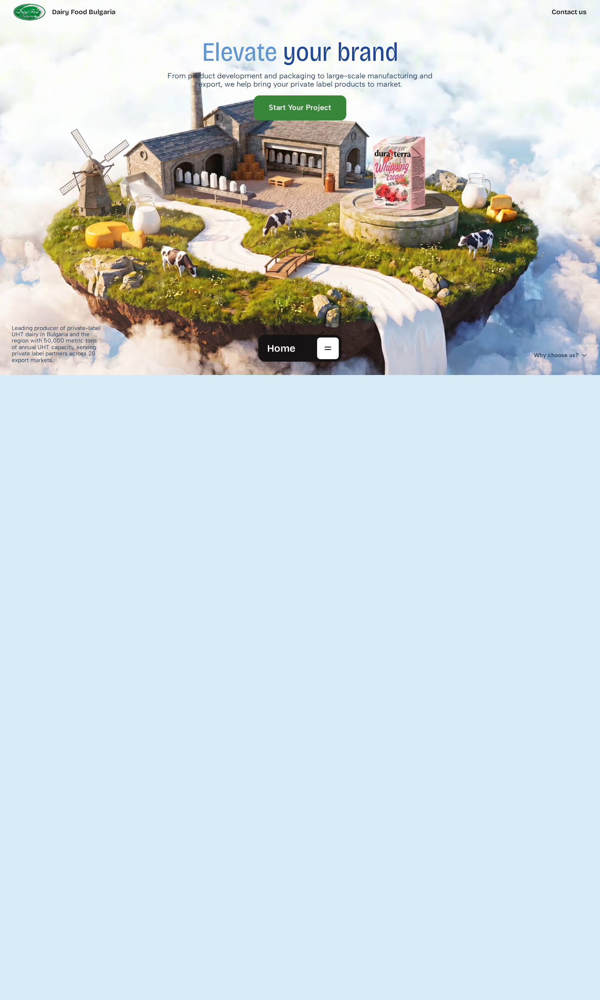

# UI Design System & Master Generation Blueprint: dairyfoodbg-com

> **Dairy Food Bulgaria — Private-Label UHT Dairy Manufacturer** (https://dairyfoodbg.com/) — Private-label manufacturer of UHT milk, creams and protein drinks. Four aseptic filling lines, 28 export markets, co-development from rec...



---

## 1. Executive Visual Persona & Design Archetype

- **Brand Essence & Persona**: **Dairy Food Bulgaria — Private-Label UHT Dairy Manufacturer** (`https://dairyfoodbg.com/`). Private-label manufacturer of UHT milk, creams and protein drinks. Four aseptic filling lines, 28 export markets, co-development from rec...
- **Capture Provenance**: Live browser capture (`tier1_fast`, HTTP `200`, captured `2026-11-23`).
- **Visual Archetype**: **Light-Gallery WebGL / Canvas Interactive Experience (`#ffffff` / `#0000ff`)**.
- **Anti-AI-Slop Differentiators**:
  - **Live-Computed Chromatic Polarity**: Anchors the viewport in `#ffffff` (live computed `body` `background-color` (`computed_styles.json`)) paired with `#0d2759` primary typography and `#0000ff` accents.
  - **Grounded Typographic Hierarchy**: Pairs `Verdana` for display copy (`Elevate your brand`) with `Albertsans` and `SFMono-Regular`.
  - **Calibrated Spatial Grid & Motion**: Combines `1440px` container bounds (`gap: 16px`, padding `32px`) with `cubic-bezier(.625,.05,0,1)` easing and Lenis Smooth Scroll (`data-lenis`), GSAP Timeline & ScrollTrigger.

---

## 2. Spatial Architecture & Modular Grid Mathematics


### Viewport Allocation & Container Geometry
- **Captured Viewport Dimensions**: Desktop `1440×2400px` (`assets/desktop.png`, clamped at 2400px live multi-section capture), Mobile `390×2400px` (`assets/mobile.png`, clamped at 2400px live multi-section capture).
- **Master Container Bounds**: `1440px` (full-bleed `100%` desktop stage measured on `1440px` viewport).
- **Canvas Lateral Padding & Spacing**: `32px` lateral canvas padding with `16px` grid gap.
- **Border Radius Scale**: `9999px`, `7px`, `3px`, `100%`.

### Responsive Breakpoint Architecture
- **Desktop Layout**: Multi-column CSS Grid / Flexbox layout at `1440px` (`max-width: 1440px`, `gap: 16px`).
- **Mobile Layout**: Single-column vertical stack at `390px` viewport width with `32px` horizontal padding.
- **Extracted CSS Media Queries**: `@media screen and (max-width:991px)`, `@media screen and (max-width:767px)`, `@media screen and (max-width:479px)`, `@media (min-width:768px)`.

---

## 3. Color System, Materiality & Atmospheric Lighting

### Semantic Palette & Source Grounding
| Semantic Role | Ground-Truth Value | Extracted Live / CSS Source |
|---|---|---|
| **Primary Canvas Substrate** | `#ffffff` | live computed `body` `background-color` (`computed_styles.json`) |
| **Primary Typography Ink** | `#0d2759` | live computed `button` `color` (`computed_styles.json`) |
| **Elevated Surface / Card Substrate** | `#d7ecf6` | live computed `footer` `background-color` (`computed_styles.json`) |
| **Interactive Accent / Highlight** | `#0000ff` | `.eu-bar__link { color: blue }` (`#0000ff`) |
| **Secondary / Muted Copy** | `#6b6b6b` | `var(--cc-color-muted)` in `:root` |
| **Structural Hairline Border** | `#e0e5f0` | `var(--_colors---semantic--border)` in `:root` (`21489524`) |
| **Variable Token (`--_colors---brand--green-hover`)** | `#2e7031` | `var(--_colors---brand--green-hover)` in `:root` |

### Sanitized Root CSS Variables (`ui-ux.md` Ground Truth)
| Variable Name | Extracted Value | Semantic Role |
|---|---|---|
| `--_type---family--body` | `Albertsans,Verdana,sans-serif` | Typography / Scale Token |
| `--_colors---semantic--content-primary` | `var(--_colors---neutral--700)` | Brand / Palette Token |
| `--_type---scale--base` | `1em` | Typography / Scale Token |
| `--_type---weight--regular` | `400` | Typography / Scale Token |
| `--_padding---section--lg` | `7.5em` | Layout / Spatial Grid Token |
| `--_padding---container--page` | `1.25em` | Layout / Spatial Grid Token |
| `--_padding---section--md` | `5em` | Layout / Spatial Grid Token |
| `--_colors---semantic--bg` | `var(--_colors---brand--cloud)` | Canvas / Surface Token |
| `--_component---sizing--container-small` | `64em` | Layout / Spatial Grid Token |
| `--_space---2xl` | `3em` | Layout / Spatial Grid Token |
| `--_space---sm` | `.5em` | Layout / Spatial Grid Token |
| `--_colors---brand--green-hover` | `#2e7031` | Brand / Palette Token |
| `--_type---scale--xs` | `.75em` | Typography / Scale Token |
| `--_type---weight--semibold` | `600` | Typography / Scale Token |
| `--_type---tracking--eyebrow` | `.2em` | Typography / Scale Token |
| `--_type---family--display` | `Bricolagegrotesquesemicondensed,Verdana,sans-serif` | Typography / Scale Token |

---

## 4. Typographic Scale & Editorial Hierarchy

### Font Family Stacks
- **Display Typography**: `Verdana`.
- **Primary Body Stack**: `Albertsans`.
- **Technical / Metadata Stack**: `SFMono-Regular`.

### Typographic Scale & Rules (Live Computed & Stylesheet Grounded)
- **Hero Display (`H1`)**: live computed `h1` (`font-size: 64px`, `line-height: 64px`, `font-weight: 400`); CSS variables `--_type---family--display: Bricolagegrotesquesemicondensed,Verdana,sans-serif`, `--_type---leading--display: 1`, `--_type---scale--display: 6em`.
- **Section Heading (`H2`)**: live computed `h2` (`font-size: 84px`, `line-height: 84px`, `font-weight: 400`).
- **Body Copy**: live computed `body` (`font-size: 16px`, `line-height: 19.2px`, `font-weight: 400`); CSS variables `--_type---family--body: Albertsans,Verdana,sans-serif`, `--_type---leading--body: 1.5`, `--_type---tracking--body: 0em`; rule `body` (`font-size: var(--size-font)`).
- **Metadata & Navigation Labels**: live computed `nav/a` (`font-size: 16px`, `line-height: 19.2px`, `font-weight: 400`); CSS variables `--_component---sizing--container-small: 64em`, `--_component---sizing--container-x-small: 48em`, `--cc-font-family-mono: ui-monospace, SFMono-Regular, Menlo, Consolas, monospace`.

---

## 5. Choreographed Motion & Interaction Physics

### Primary Easing Curves
- **Extracted Timing Functions**: `cubic-bezier(.625,.05,0,1)`, `cubic-bezier(.34,1.3,.64,1)`, `cubic-bezier(.22,1,.36,1)`.

### Per-Element Transition & Choreography Rules
- **Selector `.w-webflow-badge>img`**: `transition: unset` extracted from `dairyfoodbg-com` stylesheet.
- **Selector `.w-slider-dot`**: `transition: background-color .1s,color .1s` extracted from `dairyfoodbg-com` stylesheet.
- **Selector `.w-lightbox-control`**: `transition: all .3s` extracted from `dairyfoodbg-com` stylesheet.
- **Extracted Easing Curve (`cubic-bezier(.625,.05,0,1)`)**: Governs interactive state transitions across `<header.navbar>` and `<section.about>`.
- **Runtime Interaction Engine**: Integrates Lenis Smooth Scroll (`data-lenis`), GSAP Timeline & ScrollTrigger, Three.js / WebGL Canvas Pipeline with `prefers-reduced-motion: reduce` fallback guards.

---

## 6. Component Wireframe & Structural DOM Map

### Visual Layout Schematic — Desktop (`1440px`, Grounded in `dom.html` & Landmark Bounding Boxes)
```
┌────────────────────────────────────────────────────────────────────────┐
│ DESKTOP VIEWPORT (1440px) — Dairy Food Bulgaria — Private-Label UHT Da │
│ ====================================================================== │
│ [ <header.navbar> (1440x57px)         | Home · About · Products · Pa ] │
│ ---------------------------------------------------------------------- │
│ | HERO STAGE: <section.hero> (w=1440px)                              | │
│ | H1: Elevate your brand                                             | │
│ | Substrate: #ffffff | Ink: #0d2759 | Accent: #0000ff                | │
│ ---------------------------------------------------------------------- │
│ | SHOWCASE GRID (<section.about>) max-w: 1440px                      | │
│ | +------------------------------+  +------------------------------+ | │
│ | | Traditional craftsmanship wi |  | Customizable Products        | | │
│ | +------------------------------+  +------------------------------+ | │
│ ---------------------------------------------------------------------- │
│ | DETAIL MODULE (<section.home-products>) — Flexible Packaging       | │
│ ---------------------------------------------------------------------- │
│ [ FOOTER (<footer.site-footer>) | https://dairyfoodbg.com/             │
└────────────────────────────────────────────────────────────────────────┘
```

### Visual Layout Schematic — Mobile Reflow (`390px`)
```
┌────────────────────────────────────────────────────────────────────────┐
│ MOBILE VIEWPORT REFLOW (390px) — Single-Column Stack (gap: 16px)       │
│ ====================================================================== │
│ [ HEADER BAR (<header.navbar>         ) | Compact Menu (390px)         │
│ ---------------------------------------------------------------------- │
│ | HERO STAGE (<section.hero>) — 390px Vertical Lead                  | │
│ | H1: Elevate your brand                                             | │
│ ---------------------------------------------------------------------- │
│ | SHOWCASE STACK (<section.about>) — 1-Col Stack                     | │
│ | [ Item 1: Traditional craftsmanship with modern UHT technol...   ] | │
│ | [ Item 2: Customizable Products                                  ] | │
│ ---------------------------------------------------------------------- │
│ | DETAIL STACK (<section.home-products>) — 1-Col (Flexible Packaging)  │
│ ---------------------------------------------------------------------- │
│ [ FOOTER (<footer.site-footer>) | Stacked 390px Colophon               │
└────────────────────────────────────────────────────────────────────────┘
```

### Granular DOM Region Breakdown
1. **Brand Header & Navigation Bar (<header.navbar> — `dairyfoodbg-com`)**:
   - Landmark `<header class="navbar">` (`1440x57px`) hosting `Dairy Food Bulgaria — Private-Label ` navigation (`Home · About · Products · Packaging · Catalog`), DOM attributes (`data-wf-domain="dairyfoodbg.com"`, `data-wf-page="6a450776d63ee937af4d29d7"`, `data-wf-site="6a450773d63ee937af4d28ea"`, `data-cc-loaded`), and stylesheet rule `html { -webkit-text-size-adjust:100%;-ms-text-size-adjust:100%;font-family:sans... }`.
2. **Hero Stage & Focal Lead (<section.hero> — `Elevate your brand`)**:
   - Landmark `<section class="hero">` presenting display lead `Elevate your brand` and copy excerpt *"From product development and packaging to large-scale manufacturi"* over `#ffffff` canvas and `#0d2759` ink.
3. **Primary Showcase & Content Grid (<section.about> — `Traditional craftsmanship with mod`)**:
   - Landmark `<section class="about">` rendering section `Traditional craftsmanship with modern UHT technol...` with copy *"Leading producer of private-label UHT dairy in Bulgaria. Leading "*, asset references (`cdn.prod.website-files.com`, `dairy-food.shared.ce91a50f0.min.css`, `dairy-food.6a450776d63ee937af4d29...`, `clarity.js`), and grid rule `summary { display:block }`.
4. **Interactive Detail & Feature Matrix (<section.home-products> — `Customizable Products`)**:
   - Landmark `<section class="home-products">` framing `Customizable Products` and `Flexible Packaging` (*"Leading producer of private-label UHT dairy in Bulgaria."*) with `#d7ecf6` surface cards, `#0000ff` accents, and `video { vertical-align:baseline;display:inline-block }`.
5. **Colophon & Global Directory Footer (<footer.site-footer> — `https://dairyfoodbg.com/`)**:
   - Landmark `<footer class="site-footer">` anchoring `Dairy Food Bulgaria — Private-La` footer links (`Home · About · Products · Packaging · Catalog`), copy *"Start Your Project"*, and `#e0e5f0` structural dividers.

---

## 7. Master Zero-Shot AI Generation Prompt

```markdown
# Master Zero-Shot Frontend Generation Prompt: dairyfoodbg-com (Dairy Food Bulgaria — Private-Label UHT Dairy Manufacturer)

You are a principal frontend architect and design systems engineer. Build a complete, production-ready web application replicating the exact design system, DOM landmarks, typographic hierarchy, color tokens, and motion physics of `dairyfoodbg-com` (**Dairy Food Bulgaria — Private-Label UHT Dairy Manufacturer** — `https://dairyfoodbg.com/`).

### 1. Visual Archetype & Anti-AI-Slop Mandates
- **Archetype**: Light-Gallery WebGL / Canvas Interactive Experience (`#ffffff` / `#0000ff`).
- **Identity & Domain Context**: Private-label manufacturer of UHT milk, creams and protein drinks. Four aseptic filling lines, 28 export markets, co-development from rec...
- **Primary Substrate**: `#ffffff` (live computed `body` `background-color` (`computed_styles.json`)), **Primary Ink**: `#0d2759`, **Accent / Highlight**: `#0000ff`.
- **Site-Specific Differentiators**:
  - **Live-Computed Chromatic Polarity**: Anchors the viewport in `#ffffff` (live computed `body` `background-color` (`computed_styles.json`)) paired with `#0d2759` primary typography and `#0000ff` accents.
  - **Grounded Typographic Hierarchy**: Pairs `Verdana` for display copy (`Elevate your brand`) with `Albertsans` and `SFMono-Regular`.
  - **Calibrated Spatial Grid & Motion**: Combines `1440px` container bounds (`gap: 16px`, padding `32px`) with `cubic-bezier(.625,.05,0,1)` easing and Lenis Smooth Scroll (`data-lenis`), GSAP Timeline & ScrollTrigger.

### 2. Ground-Truth CSS Variables (`:root` Token Contract)
Declare and consume these exact custom properties extracted from `dairyfoodbg-com` in your global stylesheet:

:root {
  /* Dairy Food Bulgaria — Private-Label UHT Dairy Manufacturer (dairyfoodbg-com) — Live-Grounded CSS Variables */
  --_type---family--body: Albertsans,Verdana,sans-serif; /* Typography / Scale Token (dairyfoodbg-com) */
  --_colors---semantic--content-primary: var(--_colors---neutral--700); /* Brand / Palette Token (dairyfoodbg-com) */
  --_type---scale--base: 1em; /* Typography / Scale Token (dairyfoodbg-com) */
  --_type---weight--regular: 400; /* Typography / Scale Token (dairyfoodbg-com) */
  --_padding---section--lg: 7.5em; /* Layout / Spatial Grid Token (dairyfoodbg-com) */
  --_padding---container--page: 1.25em; /* Layout / Spatial Grid Token (dairyfoodbg-com) */
  --_padding---section--md: 5em; /* Layout / Spatial Grid Token (dairyfoodbg-com) */
  --_colors---semantic--bg: var(--_colors---brand--cloud); /* Canvas / Surface Token (dairyfoodbg-com) */
  --_component---sizing--container-small: 64em; /* Layout / Spatial Grid Token (dairyfoodbg-com) */
  --_space---2xl: 3em; /* Layout / Spatial Grid Token (dairyfoodbg-com) */
  --_space---sm: .5em; /* Layout / Spatial Grid Token (dairyfoodbg-com) */
  --_colors---brand--green-hover: #2e7031; /* Brand / Palette Token (dairyfoodbg-com) */
  --_type---scale--xs: .75em; /* Typography / Scale Token (dairyfoodbg-com) */
  --_type---weight--semibold: 600; /* Typography / Scale Token (dairyfoodbg-com) */
  --_type---tracking--eyebrow: .2em; /* Typography / Scale Token (dairyfoodbg-com) */
  --_type---family--display: Bricolagegrotesquesemicondensed,Verdana,sans-serif; /* Typography / Scale Token (dairyfoodbg-com) */
}

### 3. Semantic Color & Materiality Contract
Map every surface, ink, and border strictly to these source-grounded tokens:
- **Primary Canvas Substrate**: `#ffffff` — grounded in live computed `body` `background-color` (`computed_styles.json`)
- **Primary Typography Ink**: `#0d2759` — grounded in live computed `button` `color` (`computed_styles.json`)
- **Elevated Surface / Card Substrate**: `#d7ecf6` — grounded in live computed `footer` `background-color` (`computed_styles.json`)
- **Interactive Accent / Highlight**: `#0000ff` — grounded in `.eu-bar__link { color: blue }` (`#0000ff`)
- **Secondary / Muted Copy**: `#6b6b6b` — grounded in `var(--cc-color-muted)` in `:root`
- **Structural Hairline Border**: `#e0e5f0` — grounded in `var(--_colors---semantic--border)` in `:root` (`21489524`)
- **Variable Token (`--_colors---brand--green-hover`)**: `#2e7031` — grounded in `var(--_colors---brand--green-hover)` in `:root`

### 4. Spatial Grid, Container Bounds & Responsive Breakpoints
- **Desktop Viewport Reference**: `1440×2400px` (clamped at 2400px live multi-section capture, `1440px` standard desktop width).
- **Mobile Viewport Reference**: `390×2400px` (clamped at 2400px live multi-section capture, `390px` standard mobile width).
- **Container Max-Width**: `1440px` (full-bleed `100%` desktop stage measured on `1440px` viewport)
- **Padding & Gutters**: `32px` lateral canvas padding with `16px` grid gap
- **Desktop Grid**: Multi-column CSS Grid / Flexbox layout at `1440px` (`max-width: 1440px`, `gap: 16px`)
- **Mobile Adaptation**: Single-column vertical stack at `390px` viewport width with `32px` horizontal padding
- **Media Queries**: `@media screen and (max-width:991px)`, `@media screen and (max-width:767px)`, `@media screen and (max-width:479px)`, `@media (min-width:768px)`
- **Corner Radii**: `9999px`, `7px`, `3px`, `100%`

### 5. Typography & Editorial Scale Contract
- **Display Font Stack**: `Verdana`
- **Body Font Stack**: `Albertsans`
- **Monospace / Technical Font Stack**: `SFMono-Regular`
- **H1 Display Rule**: live computed `h1` (`font-size: 64px`, `line-height: 64px`, `font-weight: 400`); CSS variables `--_type---family--display: Bricolagegrotesquesemicondensed,Verdana,sans-serif`, `--_type---leading--display: 1`, `--_type---scale--display: 6em`
- **H2 Section Rule**: live computed `h2` (`font-size: 84px`, `line-height: 84px`, `font-weight: 400`)
- **Body Copy Rule**: live computed `body` (`font-size: 16px`, `line-height: 19.2px`, `font-weight: 400`); CSS variables `--_type---family--body: Albertsans,Verdana,sans-serif`, `--_type---leading--body: 1.5`, `--_type---tracking--body: 0em`; rule `body` (`font-size: var(--size-font)`)
- **Metadata & Index Rule**: live computed `nav/a` (`font-size: 16px`, `line-height: 19.2px`, `font-weight: 400`); CSS variables `--_component---sizing--container-small: 64em`, `--_component---sizing--container-x-small: 48em`, `--cc-font-family-mono: ui-monospace, SFMono-Regular, Menlo, Consolas, monospace`

### 6. Component Hierarchy, Verbatim Copy & Real DOM Landmarks
Scaffold `dairyfoodbg-com` (`Dairy Food Bulgaria — Private-Label UHT Dairy Manufacturer`) with these exact structural regions, extracted copy, and CSS rules from `dom.html`:
1. **Brand Header & Navigation Bar (<header.navbar> — `dairyfoodbg-com`)**:
   - DOM & Selectors: Landmark `<header class="navbar">` (`1440x57px`) hosting `Dairy Food Bulgaria — Private-Label ` navigation (`Home · About · Products · Packaging · Catalog`), DOM attributes (`data-wf-domain="dairyfoodbg.com"`, `data-wf-page="6a450776d63ee937af4d29d7"`, `data-wf-site="6a450773d63ee937af4d28ea"`, `data-cc-loaded`), and stylesheet rule `html { -webkit-text-size-adjust:100%;-ms-text-size-adjust:100%;font-family:sans... }`.
   - Responsive Contract: Header `Brand Header & Navigation Bar (<header.navbar> — `dairyfoodbg-com`)` (`dairyfoodbg-com`) adapts across `@media screen and (max-width:991px)`, `@media screen and (max-width:767px)`, `@media screen and (max-width:479px)`, `@media (min-width:768px)` with `cubic-bezier(.625,.05,0,1)`, `cubic-bezier(.34,1.3,.64,1)`, `cubic-bezier(.22,1,.36,1)` transitions and links `Home · About · Products · Packaging · Catalog`.
2. **Hero Stage & Focal Lead (<section.hero> — `Elevate your brand`)**:
   - DOM & Selectors: Landmark `<section class="hero">` presenting display lead `Elevate your brand` and copy excerpt *"From product development and packaging to large-scale manufacturi"* over `#ffffff` canvas and `#0d2759` ink.
   - Responsive Contract: Hero stage (`1440×2400px` desktop / `390×2400px` mobile) sets `#ffffff` background with `#0d2759` headline `Elevate your brand`.
3. **Primary Showcase & Content Grid (<section.about> — `Traditional craftsmanship with mod`)**:
   - DOM & Selectors: Landmark `<section class="about">` rendering section `Traditional craftsmanship with modern UHT technol...` with copy *"Leading producer of private-label UHT dairy in Bulgaria. Leading "*, asset references (`cdn.prod.website-files.com`, `dairy-food.shared.ce91a50f0.min.css`, `dairy-food.6a450776d63ee937af4d29...`, `clarity.js`), and grid rule `summary { display:block }`.
   - Responsive Contract: Showcase grid `Primary Showcase & Content Grid (<section.about> — `Traditional craftsmanship with mod`)` applies Multi-column CSS Grid / Flexbox layout at `1440px` (`max-width: 1440px`, `gap: 16px`) on desktop and Single-column vertical stack at `390px` viewport width with `32px` horizontal padding on mobile.
4. **Interactive Detail & Feature Matrix (<section.home-products> — `Customizable Products`)**:
   - DOM & Selectors: Landmark `<section class="home-products">` framing `Customizable Products` and `Flexible Packaging` (*"Leading producer of private-label UHT dairy in Bulgaria."*) with `#d7ecf6` surface cards, `#0000ff` accents, and `video { vertical-align:baseline;display:inline-block }`.
   - Responsive Contract: Detail module `Interactive Detail & Feature Matrix (<section.home-products> — `Customizable Products`)` uses `9999px`, `7px`, `3px`, `100%` radii, `#0000ff` highlights, and assets (cdn.prod.website-files.com, dairy-food.shared.ce91a50f0.min.css, dairy-food.6a450776d63ee937af4d29...).
5. **Colophon & Global Directory Footer (<footer.site-footer> — `https://dairyfoodbg.com/`)**:
   - DOM & Selectors: Landmark `<footer class="site-footer">` anchoring `Dairy Food Bulgaria — Private-La` footer links (`Home · About · Products · Packaging · Catalog`), copy *"Start Your Project"*, and `#e0e5f0` structural dividers.
   - Responsive Contract: Footer `Colophon & Global Directory Footer (<footer.site-footer> — `https://dairyfoodbg.com/`)` aligns to `1440px` (full-bleed `100%` desktop stage measured on `1440px` viewport) with `32px` lateral canvas padding with `16px` grid gap and attributes (data-wf-domain="dairyfoodbg.com", data-wf-page="6a450776d63ee937af4d29d7", data-wf-site="6a450773d63ee937af4d28ea").

#### Verbatim DOM Copy Excerpts (`dom.html`)
- Copy Excerpt 1: *"From product development and packaging to large-scale manufacturing and export, we..."*
- Copy Excerpt 2: *"Leading producer of private-label UHT dairy in Bulgaria. Leading producer of priva..."*
- Copy Excerpt 3: *"Leading producer of private-label UHT dairy in Bulgaria."*
- Copy Excerpt 4: *"Start Your Project"*

### 7. Motion, Extracted Stylesheet Rules & Interaction Choreography
- **Primary Easing Functions**: `cubic-bezier(.625,.05,0,1)`, `cubic-bezier(.34,1.3,.64,1)`, `cubic-bezier(.22,1,.36,1)`
- **Extracted Stylesheet Rules (`dairyfoodbg-com`)**:
- `html { -webkit-text-size-adjust:100%;-ms-text-size-adjust:100%;font-family:sans... }`
- `summary { display:block }`
- `video { vertical-align:baseline;display:inline-block }`
- `template { display:none }`
- `strong { font-weight:700 }`
- **Per-Selector Transition Rules**:
- **Selector `.w-webflow-badge>img`**: `transition: unset` extracted from `dairyfoodbg-com` stylesheet.
- **Selector `.w-slider-dot`**: `transition: background-color .1s,color .1s` extracted from `dairyfoodbg-com` stylesheet.
- **Selector `.w-lightbox-control`**: `transition: all .3s` extracted from `dairyfoodbg-com` stylesheet.
- **Extracted Easing Curve (`cubic-bezier(.625,.05,0,1)`)**: Governs interactive state transitions across `<header.navbar>` and `<section.about>`.
- **Runtime Interaction Engine**: Integrates Lenis Smooth Scroll (`data-lenis`), GSAP Timeline & ScrollTrigger, Three.js / WebGL Canvas Pipeline with `prefers-reduced-motion: reduce` fallback guards.

### 8. Technical Deliverables
- Implement in Next.js (App Router) with TypeScript and Tailwind CSS consuming the `:root` custom properties defined above for `dairyfoodbg-com`.
- Reproduce both the `1440px` desktop architecture and `390px` mobile breakpoint transitions, preserving semantic HTML5 landmarks (`<header>`, `<nav>`, `<main>`, `<section>`, `<footer>`) and `prefers-reduced-motion` accessibility guards.
```
