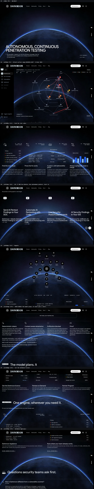
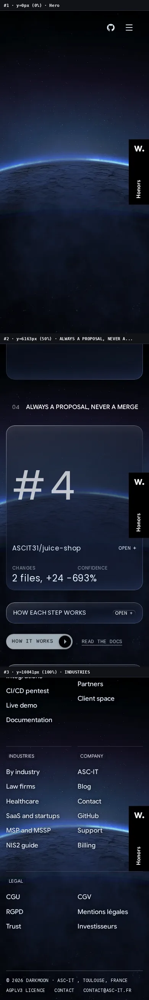

# UI Design System & Master Generation Blueprint: dark-moon-org

> **Darkmoon: Autonomous AI Penetration Testing Platform** (https://dark-moon.org/) — Darkmoon is an open-source, AI-powered autonomous penetration testing platform. 50 specialized AI agents covering web, cloud, identity, C...





---

## 1. Executive Visual Persona & Design Archetype

- **Brand Essence & Persona**: **Darkmoon: Autonomous AI Penetration Testing Platform** (`https://dark-moon.org/`). Darkmoon is an open-source, AI-powered autonomous penetration testing platform. 50 specialized AI agents covering web, cloud, identity, C...
- **Capture Provenance**: Live browser capture (`tier1_fast`, HTTP `200`, captured `2026-11-24`).
- **Visual Archetype**: **High-Contrast Obsidian / Atmospheric Design System (`#000000` canvas, `#ffffff` ink, `#f97316` accent)**.
- **Anti-AI-Slop Differentiators**:
  - **Live-Computed Chromatic Polarity**: Anchors the viewport in `#000000` (live computed `body` `background-color` (`computed_styles.json`)) paired with `#ffffff` primary typography and `#f97316` accents.
  - **Grounded Typographic Hierarchy**: Pairs `googleSans` for display copy (`Darkmoon, Autonomous AI Penetration `) with `Poppins` and `Google Sans Code`.
  - **Calibrated Spatial Grid & Motion**: Combines `1217px` container bounds (`gap: 2px`, padding `1px`) with `cubic-bezier(0,0,.2,1)` easing and Three.js / WebGL Canvas Pipeline.

---

## 2. Spatial Architecture & Modular Grid Mathematics

### Viewport Allocation & Container Geometry
- **Captured Journey Filmstrips**: Desktop `1280×6624px` (`assets/desktop-journey.webp`, `8` keyframes up to `y=14400px` / doc `17359px`), Mobile `390×2616px` (`assets/mobile-journey.webp`, `3` keyframes).
- **Master Container Bounds**: `1217px` (measured widest bounded `<section>` landmark width on `1440px` desktop).
- **Canvas Lateral Padding & Spacing**: `1px` lateral canvas padding with `2px` grid gap.
- **Border Radius Scale**: `100px`, `99px`, `.25rem`, `15px`.

### Responsive Breakpoint Architecture
- **Desktop Layout**: 2-column persistent left sidebar (`212px`, <aside.dm-sidebar>) + `1429px` main content stage at `1440px` (`max-width: 1217px`, `gap: 2px`).
- **Mobile Layout**: Single-column vertical stack at `390px` viewport width with collapsed `<aside.dm-sidebar>` drawer navigation and `1px` horizontal padding.
- **Extracted CSS Media Queries**: `@media (prefers-reduced-motion:reduce)`, `@media (min-width:40rem)`, `@media (min-width:48rem)`, `@media (min-width:64rem)`.

---

## 3. Color System, Materiality & Atmospheric Lighting

### Semantic Palette & Source Grounding
| Semantic Role | Ground-Truth Value | Extracted Live / CSS Source |
|---|---|---|
| **Primary Canvas Substrate** | `#000000` | live computed `body` `background-color` (`computed_styles.json`) |
| **Primary Typography Ink** | `#ffffff` | live computed `h1` `color` (`computed_styles.json`) |
| **Elevated Surface / Card Substrate** | `#151515` | `var(--dm-card)` in `:root` |
| **Interactive Accent / Highlight** | `#f97316` | `.ecl.ecl .dm-badge--high:before { background-color: #f97316 }` |
| **Secondary / Muted Copy** | `#9a9aa6` | `var(--muted-foreground)` in `:root` |
| **Structural Hairline Border** | `#5c6168` | `var(--dc-line)` in `:root` |

### Sanitized Root CSS Variables (`ui-ux.md` Ground Truth)
| Variable Name | Extracted Value | Semantic Role |
|---|---|---|
| `--radius` | `15px` | Elevation / Border Token |
| `--background` | `#000` | Canvas / Surface Token |
| `--dm-gutter` | `clamp(.75rem,1.6vw,1.75rem)` | Layout / Spatial Grid Token |
| `--dm-inset` | `clamp(1rem,4.5vw,6rem)` | Dimension / Scale Token |
| `--dm-page-x` | `clamp(1rem,2.22vw,2.25rem)` | Dimension / Scale Token |
| `--dm-card` | `#151515` | Color / Atmospheric Token |
| `--dm-line` | `#ffffff42` | Color / Atmospheric Token |
| `--dm-card-line` | `#ffffff2e` | Color / Atmospheric Token |
| `--dm-card-radius` | `.5rem` | Elevation / Border Token |
| `--dm-card-gap` | `clamp(1rem,1.25vw,1.25rem)` | Layout / Spatial Grid Token |
| `--dm-section-top` | `clamp(1.5rem,2.22vw,2.25rem)` | Dimension / Scale Token |
| `--dm-section-bottom` | `clamp(6rem,17.8vw,17.75rem)` | Dimension / Scale Token |
| `--dm-stack-gap` | `clamp(4rem,13vw,13rem)` | Layout / Spatial Grid Token |
| `--dm-display` | `clamp(3.25rem,7.8vw,7.75rem)` | Dimension / Scale Token |
| `--dm-statement` | `clamp(1.75rem,3.33vw,3.35rem)` | Dimension / Scale Token |
| `--dm-h3` | `clamp(1.5rem,2.22vw,2.25rem)` | Typography / Scale Token |

---

## 4. Typographic Scale & Editorial Hierarchy

### Font Family Stacks
- **Display Typography**: `googleSans`.
- **Primary Body Stack**: `Poppins`.
- **Technical / Metadata Stack**: `Google Sans Code`.

### Typographic Scale & Rules (Live Computed & Stylesheet Grounded)
- **Hero Display (`H1`)**: live computed `h1` (`font-size: 16px`, `line-height: 24px`, `font-weight: 500`); CSS variables `--dm-display: clamp(3.25rem,7.8vw,7.75rem)`, `--m-display: clamp(3.5rem,calc(2rem + 8.2vw),4.5rem)`, `--m-h1: clamp(2.25rem,calc(1.25rem + 5.13vw),2.75rem)`; rule `h1` (`font-size: min(var(--m-h1),calc((100vw -...`, `line-height: .95`, `letter-spacing: -.02em`).
- **Section Heading (`H2`)**: live computed `h2` (`font-size: 47.952px`, `line-height: 47.952px`, `font-weight: 500`, `letter-spacing: -0.47952px`); rule `h2` (`letter-spacing: -.01em`).
- **Body Copy**: live computed `body` (`font-size: 16px`, `line-height: 24px`, `font-weight: 400`); CSS variables `--dm-body: clamp(1rem,1.11vw,1.125rem)`, `--dm-body-lh: 1.45`, `--text-base: 1rem`; rule `p` (`font-size: .9375rem`, `line-height: 1.4`).
- **Metadata & Navigation Labels**: live computed `nav/a` (`font-size: 16px`, `line-height: 24px`, `font-weight: 400`); CSS variables `--dm-label: .78rem`, `--font-mono: var(--font-code)`, `--text-xs: .75rem`; rule `small` (`font-size: 80%`).

---

## 5. Choreographed Motion & Interaction Physics

### Primary Easing Curves
- **Extracted Timing Functions**: `cubic-bezier(0,0,.2,1)`, `cubic-bezier(.4,0,.2,1)`, `cubic-bezier(.16,1,.3,1)`.

### Per-Element Transition & Choreography Rules
- **Selector `layer theme`**: `transition: .15s` extracted from `dark-moon-org` stylesheet.
- **Selector `.dm-pill`**: `transition: background-color .15s,color .15s,transform .15s` extracted from `dark-moon-org` stylesheet.
- **Selector `.transition`**: `transition: var(--tw-ease,var(--default-transition-timing-function))` extracted from `dark-moon-org` stylesheet.
- **Extracted Easing Curve (`cubic-bezier(0,0,.2,1)`)**: Governs interactive state transitions across `<header.inset-x-0>` and `<section.scroll-mt-24>`.
- **Runtime Interaction Engine**: Integrates Three.js / WebGL Canvas Pipeline with `prefers-reduced-motion: reduce` fallback guards.
### Measured Runtime Scroll & Interaction Telemetry (`behavioral_journey_v2`)
- **Scroll Driver Mode**: `native` (max document height `17359px`, deepest scrollY reached `14400px` across `8` desktop keyframes).
- **Detected Scroll / Motion Libraries**: Native browser scroll / standard CSS transitions.
- **Nav / Drawer Probe (`Open menu`)**: Triggered visual change (pixel diff `27.343`, captured in `assets/state-nav.webp`); revealed links: Client space, EN, FR.
- **Hover Physics (`primary_cta` · `STAR DARKMOON ↗`)**: `color`: `rgb(220, 234, 244)` -> `rgb(255, 255, 255)` (`transition-duration: 0.2s`, `timing: ease`).
- **Interactive Control Probe (`tab`)**: Tested `02` (diff `2.13`).
- **Route Transition Architecture**: First internal navigation (`/blog/`) measured as `SPA` in `1335ms`.

---

## 6. Component Wireframe & Structural DOM Map

### Visual Layout Schematic — Desktop (`1440px`, Grounded in `dom.html` & Landmark Bounding Boxes)
```
┌────────────────────────────────────────────────────────────────────────┐
│ DESKTOP VIEWPORT (1440px) — Sidebar (212px) + Main (1429px)            │
│ ====================================================================== │
│ +--[ SIDEBAR (212px) ]--+--[ MAIN CONTENT STAGE (1429px) ]-----------+ │
│ | <aside.dm-sidebar>    | [ <header.inset-x-0 | Product · Attack p ] | │
│ | - Product             | ------------------------------------------ | │
│ | - Attack paths        | HERO STAGE: <section.dm-hero>              | │
│ | - Pricing             | H1: Darkmoon, Autonomous AI Penetration Te | │
│ | - Docs                | Bg:#000000 Ink:#ffffff Acc:#f97316         | │
│ | x=0 h=804px rail      | ------------------------------------------ | │
│ |                       | SHOWCASE: <section.scroll-mt-2 max:1217px  | │
│ |                       | [Attack surface cam] [Not a scanner. An ]  | │
│ |                       | DETAIL: <section.dc>                       | │
│ +-----------------------+--------------------------------------------+ │
│ [ FOOTER (<footer.relative>   ) | https://dark-moon.org/               │
└────────────────────────────────────────────────────────────────────────┘
```

### Visual Layout Schematic — Mobile Reflow (`390px`)
```
┌────────────────────────────────────────────────────────────────────────┐
│ MOBILE VIEWPORT REFLOW (390px) — Collapsed Sidebar + 1-Col Stack       │
│ ====================================================================== │
│ [ DRAWER (<aside.dm-sidebar>    ) | <header.inset-x-0>                 │
│ ---------------------------------------------------------------------- │
│ | HERO STAGE (<section.dm-hero>) — 390px Full-Width                  | │
│ | H1: Darkmoon, Autonomous AI Penetration Testing Platform           | │
│ ---------------------------------------------------------------------- │
│ | SHOWCASE STACK (<section.scroll-mt-24>) — 1-Col (gap: 2px)         | │
│ | [ Card 1: Attack surface camp_20260426_3d2f · 26 Apr 2026        ] | │
│ | [ Card 2: Not a scanner. An autonomous security conductor.       ] | │
│ ---------------------------------------------------------------------- │
│ | DETAIL STACK (<section.dc>) — 1-Col (Darkmoon + Splunk:)           | │
│ ---------------------------------------------------------------------- │
│ [ FOOTER (<footer.relative>     ) | Stacked 390px Colophon             │
└────────────────────────────────────────────────────────────────────────┘
```

### Granular DOM Region Breakdown
1. **Persistent Left Sidebar Navigation (<aside.dm-sidebar> — `212×804px` at `x=0`)**:
   - Fixed/sticky left rail `<aside class="dm-sidebar rl">` (`212px` wide) paired with top bar `<header class="inset-x-0 top-0">` hosting `Darkmoon: Autonomous AI Penetr` navigation (`Product · Attack paths · Pricing · Docs · Blog`), DOM attributes (`data-route-lang="en"`, `data-precedence="next"`, `data-precedence="next"`, `data-precedence="next"`), and rule `before { box-sizing:border-box;border:0 solid;margin:0;padding:0 }`.
2. **Hero Stage & Focal Lead (<section.dm-hero> — `Darkmoon, Autonomous AI Penetratio`)**:
   - Landmark `<section class="dm-hero w6">` inside `1429px` main stage presenting display lead `Darkmoon, Autonomous AI Penetration Testing Platform` and copy excerpt *"AUTONOMOUS, CONTINUOUS PENETRATION TESTING"* over `#000000` canvas and `#ffffff` ink.
3. **Primary Showcase & Content Grid (<section.scroll-mt-24> — `Attack surface camp_20260426_3d2f `)**:
   - Landmark `<section class="scroll-mt-24 overflow-clip">` rendering section `Attack surface camp_20260426_3d2f · 26 Apr 2026` with copy *"Autonomous, continuous penetration testing"*, asset references (`eafabf029ad39a43-s.p.woff2`, `3d4d48715202a72c.css`, `6e008cfa72251405.css`, `e824d722814de74c.css`), and grid rule `file-selector-button { box-sizing:border-box;border:0 solid;margin:0;padding:0 }`.
4. **Interactive Detail & Feature Matrix (<section.dc> — `Not a scanner. An autonomous secur`)**:
   - Landmark `<section class="dc dc--default">` framing `Not a scanner. An autonomous security conductor.` and `Darkmoon + Splunk: Send AI Pentest Findings to Yo...` (*"Autonomous, continuous"*) with `#151515` surface cards, `#f97316` accents, and `strong { font-weight:bolder }`.
5. **Colophon & Global Directory Footer (<footer.relative> — `https://dark-moon.org/`)**:
   - Landmark `<footer class="relative bg-white">` anchoring `Darkmoon: Autonomous AI Penetrat` footer links (`Product · Attack paths · Pricing · Docs · Blog`), copy *"penetration testing"*, and `#5c6168` structural dividers.
### Full Vertical Scroll Sequence (Desktop `1440×900` Keyframes)
- **Step 01** (`y=0px`, `0%`): Active landmark `#product` · sticky/fixed elements: `2`
- **Step 02** (`y=850px`, `5%`): Active landmark `Attack surface camp_20260426_3d2f · 26 Apr 2026` · sticky/fixed elements: `2`
- **Step 03** (`y=3400px`, `21%`): Active landmark `Find the root cause` · sticky/fixed elements: `2`
- **Step 04** (`y=5950px`, `36%`): Active landmark `SEE IT RUN Two minutes. One autonomous pentest, s...` · sticky/fixed elements: `2`
- **Step 05** (`y=8500px`, `52%`): Active landmark `#agents` · sticky/fixed elements: `2`
- **Step 06** (`y=11050px`, `67%`): Active landmark `OPEN SOURCE The model plans. It never gets a shell.` · sticky/fixed elements: `2`
- **Step 07** (`y=13600px`, `83%`): Active landmark `Get the Darkmoon licence` · sticky/fixed elements: `2`
- **Step 08** (`y=14400px`, `87%`): Active landmark `Darkmoon Appliance` · sticky/fixed elements: `2`

### Multi-Page Internal Route Map
- **Listing Route (`/blog/`)**: `https://dark-moon.org/blog/` — H1: `Latest`, scrollHeight `23208px`, transition `SPA` (`1335ms`)
- **Detail Route (`/for/ai-developers/`)**: `https://dark-moon.org/for/ai-developers/` — H1: `LLM & MCP security testing`, scrollHeight `4802px`, transition `direct` (`769ms`)
- **About Route (`/contact`)**: `https://dark-moon.org/contact` — H1: `Talk to the team.`, scrollHeight `4965px`, transition `direct` (`691ms`)

---

## 7. Master Zero-Shot AI Generation Prompt

```markdown
# Master Zero-Shot Frontend Generation Prompt: dark-moon-org (Darkmoon: Autonomous AI Penetration Testing Platform)

You are a principal frontend architect and design systems engineer. Build a complete, production-ready web application replicating the exact design system, DOM landmarks, typographic hierarchy, color tokens, and motion physics of `dark-moon-org` (**Darkmoon: Autonomous AI Penetration Testing Platform** — `https://dark-moon.org/`).

### 1. Visual Archetype & Anti-AI-Slop Mandates
- **Archetype**: High-Contrast Obsidian / Atmospheric Design System (`#000000` canvas, `#ffffff` ink, `#f97316` accent).
- **Identity & Domain Context**: Darkmoon is an open-source, AI-powered autonomous penetration testing platform. 50 specialized AI agents covering web, cloud, identity, C...
- **Primary Substrate**: `#000000` (live computed `body` `background-color` (`computed_styles.json`)), **Primary Ink**: `#ffffff`, **Accent / Highlight**: `#f97316`.
- **Site-Specific Differentiators**:
  - **Live-Computed Chromatic Polarity**: Anchors the viewport in `#000000` (live computed `body` `background-color` (`computed_styles.json`)) paired with `#ffffff` primary typography and `#f97316` accents.
  - **Grounded Typographic Hierarchy**: Pairs `googleSans` for display copy (`Darkmoon, Autonomous AI Penetration `) with `Poppins` and `Google Sans Code`.
  - **Calibrated Spatial Grid & Motion**: Combines `1217px` container bounds (`gap: 2px`, padding `1px`) with `cubic-bezier(0,0,.2,1)` easing and Three.js / WebGL Canvas Pipeline.

### 2. Ground-Truth CSS Variables (`:root` Token Contract)
Declare and consume these exact custom properties extracted from `dark-moon-org` in your global stylesheet:

:root {
  /* Darkmoon: Autonomous AI Penetration Testing Platform (dark-moon-org) — Live-Grounded CSS Variables */
  --radius: 15px; /* Elevation / Border Token (dark-moon-org) */
  --background: #000; /* Canvas / Surface Token (dark-moon-org) */
  --dm-gutter: clamp(.75rem,1.6vw,1.75rem); /* Layout / Spatial Grid Token (dark-moon-org) */
  --dm-inset: clamp(1rem,4.5vw,6rem); /* Dimension / Scale Token (dark-moon-org) */
  --dm-page-x: clamp(1rem,2.22vw,2.25rem); /* Dimension / Scale Token (dark-moon-org) */
  --dm-card: #151515; /* Color / Atmospheric Token (dark-moon-org) */
  --dm-line: #ffffff42; /* Color / Atmospheric Token (dark-moon-org) */
  --dm-card-line: #ffffff2e; /* Color / Atmospheric Token (dark-moon-org) */
  --dm-card-radius: .5rem; /* Elevation / Border Token (dark-moon-org) */
  --dm-card-gap: clamp(1rem,1.25vw,1.25rem); /* Layout / Spatial Grid Token (dark-moon-org) */
  --dm-section-top: clamp(1.5rem,2.22vw,2.25rem); /* Dimension / Scale Token (dark-moon-org) */
  --dm-section-bottom: clamp(6rem,17.8vw,17.75rem); /* Dimension / Scale Token (dark-moon-org) */
  --dm-stack-gap: clamp(4rem,13vw,13rem); /* Layout / Spatial Grid Token (dark-moon-org) */
  --dm-display: clamp(3.25rem,7.8vw,7.75rem); /* Dimension / Scale Token (dark-moon-org) */
  --dm-statement: clamp(1.75rem,3.33vw,3.35rem); /* Dimension / Scale Token (dark-moon-org) */
  --dm-h3: clamp(1.5rem,2.22vw,2.25rem); /* Typography / Scale Token (dark-moon-org) */
}

### 3. Semantic Color & Materiality Contract
Map every surface, ink, and border strictly to these source-grounded tokens:
- **Primary Canvas Substrate**: `#000000` — grounded in live computed `body` `background-color` (`computed_styles.json`)
- **Primary Typography Ink**: `#ffffff` — grounded in live computed `h1` `color` (`computed_styles.json`)
- **Elevated Surface / Card Substrate**: `#151515` — grounded in `var(--dm-card)` in `:root`
- **Interactive Accent / Highlight**: `#f97316` — grounded in `.ecl.ecl .dm-badge--high:before { background-color: #f97316 }`
- **Secondary / Muted Copy**: `#9a9aa6` — grounded in `var(--muted-foreground)` in `:root`
- **Structural Hairline Border**: `#5c6168` — grounded in `var(--dc-line)` in `:root`

### 4. Spatial Grid, Container Bounds & Responsive Breakpoints
- **Desktop Viewport Reference**: `1280×6624px` (multi-frame vertical journey filmstrip (6624px), `1440px` standard desktop width).
- **Mobile Viewport Reference**: `390×2616px` (multi-frame vertical journey filmstrip (2616px), `390px` standard mobile width).
- **Container Max-Width**: `1217px` (measured widest bounded `<section>` landmark width on `1440px` desktop)
- **Padding & Gutters**: `1px` lateral canvas padding with `2px` grid gap
- **Desktop Grid**: 2-column persistent left sidebar (`212px`, <aside.dm-sidebar>) + `1429px` main content stage at `1440px` (`max-width: 1217px`, `gap: 2px`)
- **Mobile Adaptation**: Single-column vertical stack at `390px` viewport width with collapsed `<aside.dm-sidebar>` drawer navigation and `1px` horizontal padding
- **Media Queries**: `@media (prefers-reduced-motion:reduce)`, `@media (min-width:40rem)`, `@media (min-width:48rem)`, `@media (min-width:64rem)`
- **Corner Radii**: `100px`, `99px`, `.25rem`, `15px`

### 5. Typography & Editorial Scale Contract
- **Display Font Stack**: `googleSans`
- **Body Font Stack**: `Poppins`
- **Monospace / Technical Font Stack**: `Google Sans Code`
- **H1 Display Rule**: live computed `h1` (`font-size: 16px`, `line-height: 24px`, `font-weight: 500`); CSS variables `--dm-display: clamp(3.25rem,7.8vw,7.75rem)`, `--m-display: clamp(3.5rem,calc(2rem + 8.2vw),4.5rem)`, `--m-h1: clamp(2.25rem,calc(1.25rem + 5.13vw),2.75rem)`; rule `h1` (`font-size: min(var(--m-h1),calc((100vw -...`, `line-height: .95`, `letter-spacing: -.02em`)
- **H2 Section Rule**: live computed `h2` (`font-size: 47.952px`, `line-height: 47.952px`, `font-weight: 500`, `letter-spacing: -0.47952px`); rule `h2` (`letter-spacing: -.01em`)
- **Body Copy Rule**: live computed `body` (`font-size: 16px`, `line-height: 24px`, `font-weight: 400`); CSS variables `--dm-body: clamp(1rem,1.11vw,1.125rem)`, `--dm-body-lh: 1.45`, `--text-base: 1rem`; rule `p` (`font-size: .9375rem`, `line-height: 1.4`)
- **Metadata & Index Rule**: live computed `nav/a` (`font-size: 16px`, `line-height: 24px`, `font-weight: 400`); CSS variables `--dm-label: .78rem`, `--font-mono: var(--font-code)`, `--text-xs: .75rem`; rule `small` (`font-size: 80%`)

### 6. Component Hierarchy, Verbatim Copy & Real DOM Landmarks
Scaffold `dark-moon-org` (`Darkmoon: Autonomous AI Penetration Testing Platform`) with these exact structural regions, extracted copy, and CSS rules from `dom.html`:
1. **Persistent Left Sidebar Navigation (<aside.dm-sidebar> — `212×804px` at `x=0`)**:
   - DOM & Selectors: Fixed/sticky left rail `<aside class="dm-sidebar rl">` (`212px` wide) paired with top bar `<header class="inset-x-0 top-0">` hosting `Darkmoon: Autonomous AI Penetr` navigation (`Product · Attack paths · Pricing · Docs · Blog`), DOM attributes (`data-route-lang="en"`, `data-precedence="next"`, `data-precedence="next"`, `data-precedence="next"`), and rule `before { box-sizing:border-box;border:0 solid;margin:0;padding:0 }`.
   - Responsive Contract: Header `Persistent Left Sidebar Navigation (<aside.dm-sidebar> — `212×804px` at `x=0`)` (`dark-moon-org`) adapts across `@media (prefers-reduced-motion:reduce)`, `@media (min-width:40rem)`, `@media (min-width:48rem)`, `@media (min-width:64rem)` with `cubic-bezier(0,0,.2,1)`, `cubic-bezier(.4,0,.2,1)`, `cubic-bezier(.16,1,.3,1)` transitions and links `Product · Attack paths · Pricing · Docs · Blog`.
2. **Hero Stage & Focal Lead (<section.dm-hero> — `Darkmoon, Autonomous AI Penetratio`)**:
   - DOM & Selectors: Landmark `<section class="dm-hero w6">` inside `1429px` main stage presenting display lead `Darkmoon, Autonomous AI Penetration Testing Platform` and copy excerpt *"AUTONOMOUS, CONTINUOUS PENETRATION TESTING"* over `#000000` canvas and `#ffffff` ink.
   - Responsive Contract: Hero stage (`1280×6624px` desktop / `390×2616px` mobile) sets `#000000` background with `#ffffff` headline `Darkmoon, Autonomous AI Penetration Testing Platform`.
3. **Primary Showcase & Content Grid (<section.scroll-mt-24> — `Attack surface camp_20260426_3d2f `)**:
   - DOM & Selectors: Landmark `<section class="scroll-mt-24 overflow-clip">` rendering section `Attack surface camp_20260426_3d2f · 26 Apr 2026` with copy *"Autonomous, continuous penetration testing"*, asset references (`eafabf029ad39a43-s.p.woff2`, `3d4d48715202a72c.css`, `6e008cfa72251405.css`, `e824d722814de74c.css`), and grid rule `file-selector-button { box-sizing:border-box;border:0 solid;margin:0;padding:0 }`.
   - Responsive Contract: Showcase grid `Primary Showcase & Content Grid (<section.scroll-mt-24> — `Attack surface camp_20260426_3d2f `)` applies 2-column persistent left sidebar (`212px`, <aside.dm-sidebar>) + `1429px` main content stage at `1440px` (`max-width: 1217px`, `gap: 2px`) on desktop and Single-column vertical stack at `390px` viewport width with collapsed `<aside.dm-sidebar>` drawer navigation and `1px` horizontal padding on mobile.
4. **Interactive Detail & Feature Matrix (<section.dc> — `Not a scanner. An autonomous secur`)**:
   - DOM & Selectors: Landmark `<section class="dc dc--default">` framing `Not a scanner. An autonomous security conductor.` and `Darkmoon + Splunk: Send AI Pentest Findings to Yo...` (*"Autonomous, continuous"*) with `#151515` surface cards, `#f97316` accents, and `strong { font-weight:bolder }`.
   - Responsive Contract: Detail module `Interactive Detail & Feature Matrix (<section.dc> — `Not a scanner. An autonomous secur`)` uses `100px`, `99px`, `.25rem`, `15px` radii, `#f97316` highlights, and assets (eafabf029ad39a43-s.p.woff2, 3d4d48715202a72c.css, 6e008cfa72251405.css).
5. **Colophon & Global Directory Footer (<footer.relative> — `https://dark-moon.org/`)**:
   - DOM & Selectors: Landmark `<footer class="relative bg-white">` anchoring `Darkmoon: Autonomous AI Penetrat` footer links (`Product · Attack paths · Pricing · Docs · Blog`), copy *"penetration testing"*, and `#5c6168` structural dividers.
   - Responsive Contract: Footer `Colophon & Global Directory Footer (<footer.relative> — `https://dark-moon.org/`)` aligns to `1217px` (measured widest bounded `<section>` landmark width on `1440px` desktop) with `1px` lateral canvas padding with `2px` grid gap and attributes (data-route-lang="en", data-precedence="next", data-precedence="next").

#### Verbatim DOM Copy Excerpts (`dom.html`)
- Copy Excerpt 1: *"AUTONOMOUS, CONTINUOUS PENETRATION TESTING"*
- Copy Excerpt 2: *"Autonomous, continuous penetration testing"*
- Copy Excerpt 3: *"Autonomous, continuous"*
- Copy Excerpt 4: *"penetration testing"*

### 7. Motion, Extracted Stylesheet Rules & Interaction Choreography
- **Primary Easing Functions**: `cubic-bezier(0,0,.2,1)`, `cubic-bezier(.4,0,.2,1)`, `cubic-bezier(.16,1,.3,1)`
- **Extracted Stylesheet Rules (`dark-moon-org`)**:
- `before { box-sizing:border-box;border:0 solid;margin:0;padding:0 }`
- `file-selector-button { box-sizing:border-box;border:0 solid;margin:0;padding:0 }`
- `strong { font-weight:bolder }`
- `small { font-size:80% }`
- `sup { vertical-align:baseline;font-size:75%;line-height:0;position:relative }`
- **Per-Selector Transition Rules**:
- **Selector `layer theme`**: `transition: .15s` extracted from `dark-moon-org` stylesheet.
- **Selector `.dm-pill`**: `transition: background-color .15s,color .15s,transform .15s` extracted from `dark-moon-org` stylesheet.
- **Selector `.transition`**: `transition: var(--tw-ease,var(--default-transition-timing-function))` extracted from `dark-moon-org` stylesheet.
- **Extracted Easing Curve (`cubic-bezier(0,0,.2,1)`)**: Governs interactive state transitions across `<header.inset-x-0>` and `<section.scroll-mt-24>`.
- **Runtime Interaction Engine**: Integrates Three.js / WebGL Canvas Pipeline with `prefers-reduced-motion: reduce` fallback guards.
### 7b. Full-Page Scroll Choreography, Interactive States & Multi-Page Routes
- **Scroll Mechanics**: Implement `native` vertical progression up to `17359px` across 8 distinct viewport chapters.
- **Vertical Chapter Sequence**: #product (0%) -> Attack surface camp_2026042... (5%) -> Find the root cause (21%) -> SEE IT RUN Two minutes. One... (36%) -> #agents (52%) -> OPEN SOURCE The model plans... (67%) -> Get the Darkmoon licence (83%) -> Darkmoon Appliance (87%).
- **Navigation Drawer / Menu State**: Replicate interactive menu toggle (`Open menu`) with Escape-to-close keyboard handling.
- **Hover Micro-Interaction (`primary_cta`)**: Animate `color` with `0.2s ease`.
- **Multi-Page Routes**: Scaffold internal routes `/blog/` (listing, SPA), `/for/ai-developers/` (detail, direct), `/contact` (about, direct) sharing the global header/footer shell and design tokens.

### 8. Technical Deliverables
- Implement in Next.js (App Router) with TypeScript and Tailwind CSS consuming the `:root` custom properties defined above for `dark-moon-org`.
- Reproduce both the `1440px` desktop architecture and `390px` mobile breakpoint transitions, preserving semantic HTML5 landmarks (`<header>`, `<nav>`, `<main>`, `<section>`, `<footer>`) and `prefers-reduced-motion` accessibility guards.
```
---

## 8. Full-Page Scroll Journey, Interactive States & Subpage Inventory

### Desktop Scroll Keyframes (`1440×900` WebP)
| Step | Scroll Y | Progress | Active Landmark / Section | Sticky/Fixed | Visual Asset |
| :---: | :---: | :---: | :--- | :---: | :--- |
| `#01` | `0px` | `0%` | #product | `2` | [desktop-step-01.webp](assets/desktop-step-01.webp) |
| `#02` | `850px` | `5%` | Attack surface camp_20260426_3d2f · 26 Apr 2026 | `2` | [desktop-step-02.webp](assets/desktop-step-02.webp) |
| `#03` | `3400px` | `21%` | Find the root cause | `2` | [desktop-step-03.webp](assets/desktop-step-03.webp) |
| `#04` | `5950px` | `36%` | SEE IT RUN Two minutes. One autonomous pentes... | `2` | [desktop-step-04.webp](assets/desktop-step-04.webp) |
| `#05` | `8500px` | `52%` | #agents | `2` | [desktop-step-05.webp](assets/desktop-step-05.webp) |
| `#06` | `11050px` | `67%` | OPEN SOURCE The model plans. It never gets a... | `2` | [desktop-step-06.webp](assets/desktop-step-06.webp) |
| `#07` | `13600px` | `83%` | Get the Darkmoon licence | `2` | [desktop-step-07.webp](assets/desktop-step-07.webp) |
| `#08` | `14400px` | `87%` | Darkmoon Appliance | `2` | [desktop-step-08.webp](assets/desktop-step-08.webp) |

### Mobile Condensed Keyframes (`390×844` WebP)
| Step | Scroll Y | Progress | Active Landmark | Visual Asset |
| :---: | :---: | :---: | :--- | :--- |
| `#01` | `0px` | `0%` | Hero | [mobile-step-01.webp](assets/mobile-step-01.webp) |
| `#02` | `6163px` | `50%` | ALWAYS A PROPOSAL, NEVER A MERGE | [mobile-step-02.webp](assets/mobile-step-02.webp) |
| `#03` | `10841px` | `100%` | INDUSTRIES | [mobile-step-03.webp](assets/mobile-step-03.webp) |

### Interactive UI State Captures (`1440×900` WebP)
| State Type | Trigger / Observation | Visual Asset |
| :--- | :--- | :--- |
| `nav_menu` | Nav/Menu opened (`Open menu`, diff `27.343`) | [state-nav.webp](assets/state-nav.webp) |

### Internal Subpage Filmstrips (`1080px` Wide WebP)
| # | Template | Route URL | H1 / Title | Scroll Height | Transition | Filmstrip Asset |
| :-: | :---: | :--- | :--- | :---: | :---: | :--- |
| `1` | `listing` | `https://dark-moon.org/blog/` | Latest | `23208px` | `SPA` (`1335ms`) | [subpage-01-blog.webp](assets/subpage-01-blog.webp) |
| `2` | `detail` | `https://dark-moon.org/for/ai-developers/` | LLM & MCP security testing | `4802px` | `direct` (`769ms`) | [subpage-02-for-ai-developers.webp](assets/subpage-02-for-ai-developers.webp) |
| `3` | `about` | `https://dark-moon.org/contact` | Talk to the team. | `4965px` | `direct` (`691ms`) | [subpage-03-contact.webp](assets/subpage-03-contact.webp) |

