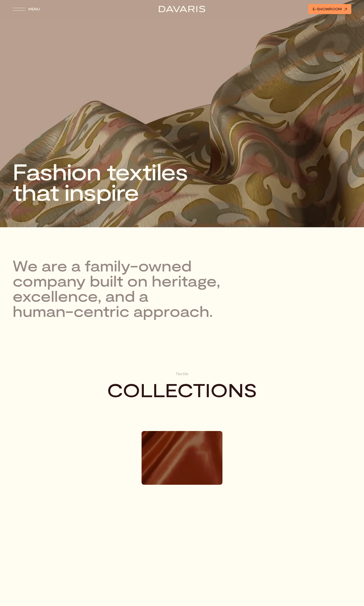

# UI Design System & Master Generation Blueprint: davaris-gr

> **Homepage - Davaris** (https://davaris.gr/) — We are a family-owned company built on heritage, excellence, and a human-centric approach. Taking all the necessary steps for the protect...



---

## 1. Executive Visual Persona & Design Archetype

- **Brand Essence & Persona**: **Homepage - Davaris** (`https://davaris.gr/`). We are a family-owned company built on heritage, excellence, and a human-centric approach. Taking all the necessary steps for the protect...
- **Visual Archetype**: **High-Contrast Obsidian / Atmospheric Design System (`#0d6efd` canvas, `#6610f2` ink, `#d63384` accent)**.
- **Anti-AI-Slop Differentiators**:
  - **Source-Grounded Chromatic Polarity**: Anchors the viewport in `#0d6efd` (`var(--bs-blue)` in `:root`) paired with `#6610f2` primary typography and `#d63384` accents.
  - **Extracted Typographic Hierarchy**: Pairs `Moderat` for display copy (`Fashion textiles that inspire`) with `Moderat Extended` and `Moderat Mono`.
  - **Calibrated Spatial Grid & Motion**: Combines `1023.98px` container bounds (`gap: 1rem`, padding `2rem`) with `cubic-bezier(.7,0,.2,1)` easing and Lenis Smooth Scroll (`data-lenis`), GSAP Timeline & ScrollTrigger.

---

## 2. Spatial Architecture & Modular Grid Mathematics


### Viewport Allocation & Container Geometry
- **Captured Viewport Dimensions**: Desktop `1440×2400px` (`assets/desktop.png`, capped at 2400px multi-section capture), Mobile `390×2400px` (`assets/mobile.png`, capped at 2400px multi-section capture).
- **Master Container Bounds**: `1023.98px` extracted from `davaris-gr` stylesheet.
- **Canvas Lateral Padding & Spacing**: `2rem` lateral canvas padding with `1rem` grid gap.
- **Border Radius Scale**: `50%`, `.375rem`, `.25rem`, `var(--bs-border-radius)`.

### Responsive Breakpoint Architecture
- **Desktop Layout**: Multi-column CSS Grid / Flexbox layout at `1440px` (`max-width: 1023.98px`, `gap: 1rem`).
- **Mobile Layout**: Single-column vertical stack at `390px` viewport width with `2rem` horizontal padding.
- **Extracted CSS Media Queries**: `@media (max-width:1023.98px)`, `@media (prefers-reduced-motion:no-preference)`, `@media (min-width:1200px)`, `@media (min-width:576px)`.

---

## 3. Color System, Materiality & Atmospheric Lighting

### Semantic Palette & Source Grounding
| Semantic Role | Ground-Truth Value | Extracted CSS Source / Selector |
|---|---|---|
| **Primary Canvas Substrate** | `#0d6efd` | `var(--bs-blue)` in `:root` |
| **Primary Typography Ink** | `#6610f2` | `var(--bs-indigo)` in `:root` |
| **Elevated Surface / Card Substrate** | `#6f42c1` | `var(--bs-purple)` in `:root` |
| **Interactive Accent / Highlight** | `#d63384` | `var(--bs-pink)` in `:root` |
| **Secondary / Muted Copy** | `#dc3545` | `var(--bs-red)` in `:root` |
| **Structural Hairline Border** | `#fd7e14` | `var(--bs-orange)` in `:root` |
| **Variable Token (`--bs-yellow`)** | `#ffc107` | `var(--bs-yellow)` in `:root` |
| **Variable Token (`--bs-green`)** | `#198754` | `var(--bs-green)` in `:root` |
| **Variable Token (`--bs-teal`)** | `#20c997` | `var(--bs-teal)` in `:root` |
| **Variable Token (`--bs-cyan`)** | `#0dcaf0` | `var(--bs-cyan)` in `:root` |
| **Variable Token (`--bs-black`)** | `#000` | `var(--bs-black)` in `:root` |

### Sanitized Root CSS Variables (`ui-ux.md` Ground Truth)
| Variable Name | Extracted Value | Semantic Role |
|---|---|---|
| `--space-xs` | `clamp(1rem, 2.2vw, 2.65rem)` | Layout / Spatial Grid Token |
| `--space-sm` | `clamp(1.875rem, 4.43vw, 5.3125rem)` | Layout / Spatial Grid Token |
| `--space-md` | `clamp(2.5rem, 6.5vw, 7.8125rem)` | Layout / Spatial Grid Token |
| `--space-lg` | `clamp(3.75rem, 8.85vw, 10.625rem)` | Layout / Spatial Grid Token |
| `--block-spacing` | `var(--space-lg)` | Layout / Spatial Grid Token |
| `--bs-blue` | `#0d6efd` | Color / Atmospheric Token |
| `--bs-indigo` | `#6610f2` | Color / Atmospheric Token |
| `--bs-purple` | `#6f42c1` | Color / Atmospheric Token |
| `--bs-pink` | `#d63384` | Typography Ink Token |
| `--bs-red` | `#dc3545` | Color / Atmospheric Token |
| `--bs-orange` | `#fd7e14` | Color / Atmospheric Token |
| `--bs-yellow` | `#ffc107` | Color / Atmospheric Token |
| `--bs-green` | `#198754` | Color / Atmospheric Token |
| `--bs-teal` | `#20c997` | Color / Atmospheric Token |
| `--bs-cyan` | `#0dcaf0` | Color / Atmospheric Token |
| `--bs-black` | `#000` | Canvas / Surface Token |

---

## 4. Typographic Scale & Editorial Hierarchy

### Font Family Stacks
- **Display Typography**: `Moderat`.
- **Primary Body Stack**: `Moderat Extended`.
- **Technical / Metadata Stack**: `Moderat Mono`.

### Typographic Scale & Rules (Extracted from Stylesheet & Variables)
- **Hero Display (`H1`)**: CSS variables `--fs-h1: clamp(3.75rem, 3.09rem + 2.817vw, 5.625rem)`, `--lh-h1: .9`; rule `,.h1` (`line-height: 1.2`, `font-weight: 500`).
- **Section Heading (`H2`)**: CSS variables `--fs-h2: clamp(2.125rem, 1.4rem + 3.6vw, 4.688rem)`, `--lh-h2: 1`; rule `,.h2` (`font-size: calc(1.325rem + .9vw)`).
- **Body Copy**: CSS variables `--bs-body-font-family: var(--bs-font-sans-serif)`, `--bs-body-font-size: 1rem`, `--bs-body-font-weight: 400`; rule `p` (`font-size: 1.125rem`).
- **Metadata & Navigation Labels**: not explicitly declared on tag in static CSS (stylesheet font-size ladder: `1rem`, `var(--bs-body-font-size)`, `2.5rem`, `2rem`, `1.75rem`).

---

## 5. Choreographed Motion & Interaction Physics

### Primary Easing Curves
- **Extracted Timing Functions**: `cubic-bezier(.7,0,.2,1)`, `cubic-bezier(0,.3,.4,1)`, `cubic-bezier(.19,1,.22,1)`.

### Per-Element Transition & Choreography Rules
- **Selector `.btn`**: `transition: color .15s ease-in-out,background-color .15s ease-in-out,borde...` extracted from `davaris-gr` stylesheet.
- **Selector `media(prefers-reduced-motion:reduce)`**: `transition: none` extracted from `davaris-gr` stylesheet.
- **Selector `.form-control`**: `transition: border-color .15s ease-in-out,box-shadow .15s ease-in-out` extracted from `davaris-gr` stylesheet.
- **Extracted Easing Curve (`cubic-bezier(.7,0,.2,1)`)**: Governs interactive state transitions across `<header.site-header>` and `<section.scrolled-text>`.
- **Runtime Interaction Engine**: Integrates Lenis Smooth Scroll (`data-lenis`), GSAP Timeline & ScrollTrigger, Barba.js Page Transition Router with `prefers-reduced-motion: reduce` fallback guards.

---

## 6. Component Wireframe & Structural DOM Map

### Visual Layout Schematic (Grounded in `dom.html` — `1440px` Desktop & `390px` Mobile Reflow)
```
┌────────────────────────────────────────────────────────────────────────┐
│ DESKTOP VIEWPORT (1440px) — Homepage - Davaris                         │
│ ====================================================================== │
│ [ <header.site-header>     | Overview · Index · Archive · About · C ]  │
│ ---------------------------------------------------------------------- │
│ | HERO STAGE: <section.hero>                                       |   │
│ | H1: Fashion textiles that inspire                                |   │
│ | Substrate: #0d6efd    | Ink: #6610f2    | Accent: #d63384        |   │
│ ---------------------------------------------------------------------- │
│ | SHOWCASE GRID (<section.scrolled-text>   ) max-w: 1023.98px      |   │
│ | +------------------------------+  +------------------------------+ | │
│ | | We are a family-owned compan |  | Collections                  | | │
│ | +------------------------------+  +------------------------------+ | │
│ ---------------------------------------------------------------------- │
│ | MOBILE VIEWPORT REFLOW (390px) — Single-Column Stack (gap: 1rem  ) | │
│ | [<header.site-heade] -> [<section.hero>] -> [<section.scrolled-] |   │
│ ---------------------------------------------------------------------- │
│ [ FOOTER (<footer.nav-primary__f) | https://davaris.gr/                │
└────────────────────────────────────────────────────────────────────────┘
```

### Granular DOM Region Breakdown
1. **Brand Header & Navigation Bar (<header.site-header> — `davaris-gr`)**:
   - Landmark `<header class="site-header">` hosting `Homepage - Davaris` navigation (`Overview · Index · Archive · About · Contact`), DOM attributes (`data-cfasync="false"`, `data-no-minify="true"`, `data-no-optimize="1"`, `data-noptimize="1"`), and stylesheet rule `.flickity-enabled { position:relative }`.
2. **Hero Stage & Focal Lead (<section.hero> — `Fashion textiles that inspire`)**:
   - Landmark `<section class="hero hero--video">` presenting display lead `Fashion textiles that inspire` and copy excerpt *"E-Showroom E-Showroom"* over `#0d6efd` canvas and `#6610f2` ink.
3. **Primary Showcase & Content Grid (<section.scrolled-text> — `We are a family-owned company buil`)**:
   - Landmark `<section class="scrolled-text u-escape-container">` rendering section `We are a family-owned company built on heritage,...` with copy *"Collections Collections Plain Explore Collection Fancy Explore Co"*, asset references (`favicon.ico`, `favicon.svg`, `apple-touch-icon.png`, `site.webmanifest`), and grid rule `.flickity-enabled:focus { outline:none }`.
4. **Interactive Detail & Feature Matrix (<section.collections-media> — `Collections`)**:
   - Landmark `<section class="collections-media u-escape-container">` framing `Collections` and `Plain Collection` (*"Plain Explore Collection"*) with `#6f42c1` surface cards, `#d63384` accents, and `.flickity-viewport { overflow:hidden;position:relative;height:100%;touch-action:pan-y }`.
5. **Colophon & Global Directory Footer (<footer.nav-primary__footer> — `https://davaris.gr/`)**:
   - Landmark `<footer class="nav-primary__footer">` anchoring `Homepage - Davaris` footer links (`Overview · Index · Archive · About · Contact`), copy *"Explore Collection"*, and `#fd7e14` structural dividers.

---

## 7. Master Zero-Shot AI Generation Prompt

```markdown
# Master Zero-Shot Frontend Generation Prompt: davaris-gr (Homepage - Davaris)

You are a principal frontend architect and design systems engineer. Build a complete, production-ready web application replicating the exact design system, DOM landmarks, typographic hierarchy, color tokens, and motion physics of `davaris-gr` (**Homepage - Davaris** — `https://davaris.gr/`).

### 1. Visual Archetype & Anti-AI-Slop Mandates
- **Archetype**: High-Contrast Obsidian / Atmospheric Design System (`#0d6efd` canvas, `#6610f2` ink, `#d63384` accent).
- **Identity & Domain Context**: We are a family-owned company built on heritage, excellence, and a human-centric approach. Taking all the necessary steps for the protect...
- **Primary Substrate**: `#0d6efd` (`var(--bs-blue)` in `:root`), **Primary Ink**: `#6610f2`, **Accent / Highlight**: `#d63384`.
- **Site-Specific Differentiators**:
  - **Source-Grounded Chromatic Polarity**: Anchors the viewport in `#0d6efd` (`var(--bs-blue)` in `:root`) paired with `#6610f2` primary typography and `#d63384` accents.
  - **Extracted Typographic Hierarchy**: Pairs `Moderat` for display copy (`Fashion textiles that inspire`) with `Moderat Extended` and `Moderat Mono`.
  - **Calibrated Spatial Grid & Motion**: Combines `1023.98px` container bounds (`gap: 1rem`, padding `2rem`) with `cubic-bezier(.7,0,.2,1)` easing and Lenis Smooth Scroll (`data-lenis`), GSAP Timeline & ScrollTrigger.

### 2. Ground-Truth CSS Variables (`:root` Token Contract)
Declare and consume these exact custom properties extracted from `davaris-gr` in your global stylesheet:

:root {
  /* Homepage - Davaris (davaris-gr) — Ground-Truth Extracted CSS Variables */
  --space-xs: clamp(1rem, 2.2vw, 2.65rem); /* Layout / Spatial Grid Token (davaris-gr) */
  --space-sm: clamp(1.875rem, 4.43vw, 5.3125rem); /* Layout / Spatial Grid Token (davaris-gr) */
  --space-md: clamp(2.5rem, 6.5vw, 7.8125rem); /* Layout / Spatial Grid Token (davaris-gr) */
  --space-lg: clamp(3.75rem, 8.85vw, 10.625rem); /* Layout / Spatial Grid Token (davaris-gr) */
  --block-spacing: var(--space-lg); /* Layout / Spatial Grid Token (davaris-gr) */
  --bs-blue: #0d6efd; /* Color / Atmospheric Token (davaris-gr) */
  --bs-indigo: #6610f2; /* Color / Atmospheric Token (davaris-gr) */
  --bs-purple: #6f42c1; /* Color / Atmospheric Token (davaris-gr) */
  --bs-pink: #d63384; /* Typography Ink Token (davaris-gr) */
  --bs-red: #dc3545; /* Color / Atmospheric Token (davaris-gr) */
  --bs-orange: #fd7e14; /* Color / Atmospheric Token (davaris-gr) */
  --bs-yellow: #ffc107; /* Color / Atmospheric Token (davaris-gr) */
  --bs-green: #198754; /* Color / Atmospheric Token (davaris-gr) */
  --bs-teal: #20c997; /* Color / Atmospheric Token (davaris-gr) */
  --bs-cyan: #0dcaf0; /* Color / Atmospheric Token (davaris-gr) */
  --bs-black: #000; /* Canvas / Surface Token (davaris-gr) */
}

### 3. Semantic Color & Materiality Contract
Map every surface, ink, and border strictly to these source-grounded tokens:
- **Primary Canvas Substrate**: `#0d6efd` — grounded in `var(--bs-blue)` in `:root`
- **Primary Typography Ink**: `#6610f2` — grounded in `var(--bs-indigo)` in `:root`
- **Elevated Surface / Card Substrate**: `#6f42c1` — grounded in `var(--bs-purple)` in `:root`
- **Interactive Accent / Highlight**: `#d63384` — grounded in `var(--bs-pink)` in `:root`
- **Secondary / Muted Copy**: `#dc3545` — grounded in `var(--bs-red)` in `:root`
- **Structural Hairline Border**: `#fd7e14` — grounded in `var(--bs-orange)` in `:root`
- **Variable Token (`--bs-yellow`)**: `#ffc107` — grounded in `var(--bs-yellow)` in `:root`
- **Variable Token (`--bs-green`)**: `#198754` — grounded in `var(--bs-green)` in `:root`
- **Variable Token (`--bs-teal`)**: `#20c997` — grounded in `var(--bs-teal)` in `:root`
- **Variable Token (`--bs-cyan`)**: `#0dcaf0` — grounded in `var(--bs-cyan)` in `:root`
- **Variable Token (`--bs-black`)**: `#000` — grounded in `var(--bs-black)` in `:root`

### 4. Spatial Grid, Container Bounds & Responsive Breakpoints
- **Desktop Viewport Reference**: `1440×2400px` (capped at 2400px multi-section capture, `1440px` standard desktop width).
- **Mobile Viewport Reference**: `390×2400px` (capped at 2400px multi-section capture, `390px` standard mobile width).
- **Container Max-Width**: `1023.98px` extracted from `davaris-gr` stylesheet
- **Padding & Gutters**: `2rem` lateral canvas padding with `1rem` grid gap
- **Desktop Grid**: Multi-column CSS Grid / Flexbox layout at `1440px` (`max-width: 1023.98px`, `gap: 1rem`)
- **Mobile Adaptation**: Single-column vertical stack at `390px` viewport width with `2rem` horizontal padding
- **Media Queries**: `@media (max-width:1023.98px)`, `@media (prefers-reduced-motion:no-preference)`, `@media (min-width:1200px)`, `@media (min-width:576px)`
- **Corner Radii**: `50%`, `.375rem`, `.25rem`, `var(--bs-border-radius)`

### 5. Typography & Editorial Scale Contract
- **Display Font Stack**: `Moderat`
- **Body Font Stack**: `Moderat Extended`
- **Monospace / Technical Font Stack**: `Moderat Mono`
- **H1 Display Rule**: CSS variables `--fs-h1: clamp(3.75rem, 3.09rem + 2.817vw, 5.625rem)`, `--lh-h1: .9`; rule `,.h1` (`line-height: 1.2`, `font-weight: 500`)
- **H2 Section Rule**: CSS variables `--fs-h2: clamp(2.125rem, 1.4rem + 3.6vw, 4.688rem)`, `--lh-h2: 1`; rule `,.h2` (`font-size: calc(1.325rem + .9vw)`)
- **Body Copy Rule**: CSS variables `--bs-body-font-family: var(--bs-font-sans-serif)`, `--bs-body-font-size: 1rem`, `--bs-body-font-weight: 400`; rule `p` (`font-size: 1.125rem`)
- **Metadata & Index Rule**: not explicitly declared on tag in static CSS (stylesheet font-size ladder: `1rem`, `var(--bs-body-font-size)`, `2.5rem`, `2rem`, `1.75rem`)

### 6. Component Hierarchy, Verbatim Copy & Real DOM Landmarks
Scaffold `davaris-gr` (`Homepage - Davaris`) with these exact structural regions, extracted copy, and CSS rules from `dom.html`:
1. **Brand Header & Navigation Bar (<header.site-header> — `davaris-gr`)**:
   - DOM & Selectors: Landmark `<header class="site-header">` hosting `Homepage - Davaris` navigation (`Overview · Index · Archive · About · Contact`), DOM attributes (`data-cfasync="false"`, `data-no-minify="true"`, `data-no-optimize="1"`, `data-noptimize="1"`), and stylesheet rule `.flickity-enabled { position:relative }`.
   - Responsive Contract: Header `Brand Header & Navigation Bar (<header.site-header> — `davaris-gr`)` (`davaris-gr`) adapts across `@media (max-width:1023.98px)`, `@media (prefers-reduced-motion:no-preference)`, `@media (min-width:1200px)`, `@media (min-width:576px)` with `cubic-bezier(.7,0,.2,1)`, `cubic-bezier(0,.3,.4,1)`, `cubic-bezier(.19,1,.22,1)` transitions and links `Overview · Index · Archive · About · Contact`.
2. **Hero Stage & Focal Lead (<section.hero> — `Fashion textiles that inspire`)**:
   - DOM & Selectors: Landmark `<section class="hero hero--video">` presenting display lead `Fashion textiles that inspire` and copy excerpt *"E-Showroom E-Showroom"* over `#0d6efd` canvas and `#6610f2` ink.
   - Responsive Contract: Hero stage (`1440×2400px` desktop / `390×2400px` mobile) sets `#0d6efd` background with `#6610f2` headline `Fashion textiles that inspire`.
3. **Primary Showcase & Content Grid (<section.scrolled-text> — `We are a family-owned company buil`)**:
   - DOM & Selectors: Landmark `<section class="scrolled-text u-escape-container">` rendering section `We are a family-owned company built on heritage,...` with copy *"Collections Collections Plain Explore Collection Fancy Explore Co"*, asset references (`favicon.ico`, `favicon.svg`, `apple-touch-icon.png`, `site.webmanifest`), and grid rule `.flickity-enabled:focus { outline:none }`.
   - Responsive Contract: Showcase grid `Primary Showcase & Content Grid (<section.scrolled-text> — `We are a family-owned company buil`)` applies Multi-column CSS Grid / Flexbox layout at `1440px` (`max-width: 1023.98px`, `gap: 1rem`) on desktop and Single-column vertical stack at `390px` viewport width with `2rem` horizontal padding on mobile.
4. **Interactive Detail & Feature Matrix (<section.collections-media> — `Collections`)**:
   - DOM & Selectors: Landmark `<section class="collections-media u-escape-container">` framing `Collections` and `Plain Collection` (*"Plain Explore Collection"*) with `#6f42c1` surface cards, `#d63384` accents, and `.flickity-viewport { overflow:hidden;position:relative;height:100%;touch-action:pan-y }`.
   - Responsive Contract: Detail module `Interactive Detail & Feature Matrix (<section.collections-media> — `Collections`)` uses `50%`, `.375rem`, `.25rem`, `var(--bs-border-radius)` radii, `#d63384` highlights, and assets (favicon.ico, favicon.svg, apple-touch-icon.png).
5. **Colophon & Global Directory Footer (<footer.nav-primary__footer> — `https://davaris.gr/`)**:
   - DOM & Selectors: Landmark `<footer class="nav-primary__footer">` anchoring `Homepage - Davaris` footer links (`Overview · Index · Archive · About · Contact`), copy *"Explore Collection"*, and `#fd7e14` structural dividers.
   - Responsive Contract: Footer `Colophon & Global Directory Footer (<footer.nav-primary__footer> — `https://davaris.gr/`)` aligns to `1023.98px` extracted from `davaris-gr` stylesheet with `2rem` lateral canvas padding with `1rem` grid gap and attributes (data-cfasync="false", data-no-minify="true", data-no-optimize="1").

#### Verbatim DOM Copy Excerpts (`dom.html`)
- Copy Excerpt 1: *"E-Showroom E-Showroom"*
- Copy Excerpt 2: *"Collections Collections Plain Explore Collection Fancy Explore Collection Prints E..."*
- Copy Excerpt 3: *"Plain Explore Collection"*
- Copy Excerpt 4: *"Explore Collection"*

### 7. Motion, Extracted Stylesheet Rules & Interaction Choreography
- **Primary Easing Functions**: `cubic-bezier(.7,0,.2,1)`, `cubic-bezier(0,.3,.4,1)`, `cubic-bezier(.19,1,.22,1)`
- **Extracted Stylesheet Rules (`davaris-gr`)**:
- `.flickity-enabled { position:relative }`
- `.flickity-enabled:focus { outline:none }`
- `.flickity-viewport { overflow:hidden;position:relative;height:100%;touch-action:pan-y }`
- `.flickity-slider { position:absolute;width:100%;height:100%;left:0 }`
- `.flickity-rtl .flickity-slider { left:unset;right:0 }`
- **Per-Selector Transition Rules**:
- **Selector `.btn`**: `transition: color .15s ease-in-out,background-color .15s ease-in-out,borde...` extracted from `davaris-gr` stylesheet.
- **Selector `media(prefers-reduced-motion:reduce)`**: `transition: none` extracted from `davaris-gr` stylesheet.
- **Selector `.form-control`**: `transition: border-color .15s ease-in-out,box-shadow .15s ease-in-out` extracted from `davaris-gr` stylesheet.
- **Extracted Easing Curve (`cubic-bezier(.7,0,.2,1)`)**: Governs interactive state transitions across `<header.site-header>` and `<section.scrolled-text>`.
- **Runtime Interaction Engine**: Integrates Lenis Smooth Scroll (`data-lenis`), GSAP Timeline & ScrollTrigger, Barba.js Page Transition Router with `prefers-reduced-motion: reduce` fallback guards.

### 8. Technical Deliverables
- Implement in Next.js (App Router) with TypeScript and Tailwind CSS consuming the `:root` custom properties defined above for `davaris-gr`.
- Reproduce both the `1440px` desktop architecture and `390px` mobile breakpoint transitions, preserving semantic HTML5 landmarks (`<header>`, `<nav>`, `<main>`, `<section>`, `<footer>`) and `prefers-reduced-motion` accessibility guards.
```
