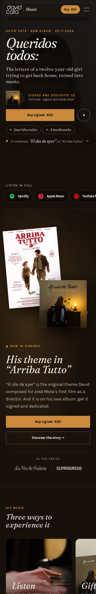

# UI Design System & Master Generation Blueprint: davidcata-com_en-musica

> **Music — “Queridos todos:” and “Origen”, by David Catá** (https://davidcata.com/en/musica/) — The music of David Catá: his new album “Queridos todos:” (20 November 2026), pre-order signed and dedicated, and the instrumental album “...


---

## 1. Executive Visual Persona & Design Archetype

- **Brand Essence & Persona**: **Music — “Queridos todos:” and “Origen”, by David Catá** (`https://davidcata.com/en/musica/`). The music of David Catá: his new album “Queridos todos:” (20 November 2026), pre-order signed and dedicated, and the instrumental album “...
- **Capture Provenance**: Live browser capture (`tier1_fast`, HTTP `200`, captured `2026-11-23`).
- **Visual Archetype**: **Light-Gallery WebGL / Canvas Interactive Experience (`#f2eee7` / `#cc8b3d`)**.
- **Anti-AI-Slop Differentiators**:
  - **Live-Computed Chromatic Polarity**: Anchors the viewport in `#f2eee7` (live computed `body` `background-color` (`computed_styles.json`)) paired with `#18110b` primary typography and `#cc8b3d` accents.
  - **Grounded Typographic Hierarchy**: Pairs `Fraunces` for display copy (`Queridos todos:`) with `Karla` and `SFMono-Regular`.
  - **Calibrated Spatial Grid & Motion**: Combines `72rem` container bounds (`gap: 32px`, padding `1.5rem`) with `cubic-bezier(0,0,.2,1)` easing and Three.js / WebGL Canvas Pipeline.

---

## 2. Spatial Architecture & Modular Grid Mathematics



### Viewport Allocation & Container Geometry
- **Captured Viewport Dimensions**: Desktop `1440×2400px` (`assets/desktop.png`, clamped at 2400px live multi-section capture), Mobile `390×2400px` (`assets/mobile.png`, clamped at 2400px live multi-section capture).
- **Master Container Bounds**: `72rem` (non-`@media` desktop container stylesheet rule).
- **Canvas Lateral Padding & Spacing**: `1.5rem` lateral canvas padding with `32px` grid gap.
- **Border Radius Scale**: `.25rem`, `1rem`, `14px`, `3px`.

### Responsive Breakpoint Architecture
- **Desktop Layout**: Multi-column CSS Grid / Flexbox layout at `1440px` (`max-width: 72rem`, `gap: 32px`).
- **Mobile Layout**: Single-column vertical stack at `390px` viewport width with `1.5rem` horizontal padding.
- **Extracted CSS Media Queries**: `@media (prefers-reduced-motion:reduce)`, `@media (min-width:768px)`, `@media (max-width:767px)`, `@media (max-width:639px)`.

---

## 3. Color System, Materiality & Atmospheric Lighting

### Semantic Palette & Source Grounding
| Semantic Role | Ground-Truth Value | Extracted Live / CSS Source |
|---|---|---|
| **Primary Canvas Substrate** | `#f2eee7` | live computed `body` `background-color` (`computed_styles.json`) |
| **Primary Typography Ink** | `#18110b` | live computed `button` `color` (`computed_styles.json`) |
| **Elevated Surface / Card Substrate** | `#cc8b3d` | live computed `button` `background-color` (`computed_styles.json`) |
| **Interactive Accent / Highlight** | `#cc8b3d` | live computed `button` `background-color` (`computed_styles.json`) |
| **Secondary / Muted Copy** | `#cc8b3d` | live computed `p` `color` (`computed_styles.json`) |
| **Structural Hairline Border** | `#d1cdc7` | `15 { border-color: #d1cdc7 }` |
| **Variable Token (`--tinta-pluma`)** | `#1f3a78` | `var(--tinta-pluma)` in `:root` |

### Sanitized Root CSS Variables (`ui-ux.md` Ground Truth)
| Variable Name | Extracted Value | Semantic Role |
|---|---|---|
| `--f-titular` | `"Fraunces",Georgia,serif` | Dimension / Scale Token |
| `--f-texto` | `"Karla",system-ui,sans-serif` | Typography Ink Token |
| `--papel` | `242 238 231` | Design System Custom Token |
| `--sala` | `10 9 8` | Design System Custom Token |
| `--hilo` | `158 43 37` | Design System Custom Token |
| `--renglon` | `2.25rem` | Dimension / Scale Token |
| `--tinta-pluma` | `#1f3a78` | Canvas / Surface Token |
| `--f-mano` | `"Caveat","Caveat Fallback"` | Design System Custom Token |
| `--marca` | `29, 185, 84` | Design System Custom Token |
| `--movil` | `0% 50%` | Dimension / Scale Token |
| `--pos` | `50% 50%` | Dimension / Scale Token |
| `--acento` | `204, 139, 61` | Design System Custom Token |
| `--tw-border-spacing-x` | `0` | Layout / Spatial Grid Token |
| `--tw-border-spacing-y` | `0` | Layout / Spatial Grid Token |
| `--davidcata-com-en-bg` | `#f2eee7` | Canvas Substrate (from live computed `body` `background-color` (`computed_styles.json`)) |
| `--davidcata-com-en-ink` | `#18110b` | Primary Typography Ink (computed-derived) |

---

## 4. Typographic Scale & Editorial Hierarchy

### Font Family Stacks
- **Display Typography**: `Fraunces`.
- **Primary Body Stack**: `Karla`.
- **Technical / Metadata Stack**: `SFMono-Regular`.

### Typographic Scale & Rules (Live Computed & Stylesheet Grounded)
- **Hero Display (`H1`)**: live computed `h1` (`font-size: 168px`, `line-height: 151.2px`, `font-weight: 300`, `letter-spacing: -7.56px`).
- **Section Heading (`H2`)**: live computed `h2` (`font-size: 73.6px`, `line-height: 73.6px`, `font-weight: 300`); rule `h2` (`font-size: 1.55rem`, `line-height: 1.15`, `letter-spacing: -.02em`).
- **Body Copy**: live computed `body` (`font-size: 16px`, `line-height: 24px`, `font-weight: 400`); rule `p` (`font-size: 15px`, `line-height: 1.75`).
- **Metadata & Navigation Labels**: live computed `nav/a` (`font-size: 16px`, `line-height: 24px`, `font-weight: 400`).

---

## 5. Choreographed Motion & Interaction Physics

### Primary Easing Curves
- **Extracted Timing Functions**: `cubic-bezier(0,0,.2,1)`, `cubic-bezier(.4,0,.6,1)`, `cubic-bezier(.4,0,.2,1)`.

### Per-Element Transition & Choreography Rules
- **Selector `.transition`**: `transition: cubic-bezier(0,0,.2,1)` extracted from `davidcata-com_en-musica` stylesheet.
- **Selector `ansition-\[opacity\2c filter\2c t...`**: `transition: cubic-bezier(0,0,.2,1)` extracted from `davidcata-com_en-musica` stylesheet.
- **Selector `ansition-\[opacity\2c transform\2...`**: `transition: cubic-bezier(0,0,.2,1)` extracted from `davidcata-com_en-musica` stylesheet.
- **Extracted Easing Curve (`cubic-bezier(0,0,.2,1)`)**: Governs interactive state transitions across `<header.mundo-calido>` and `<section.overflow-clip>`.
- **Runtime Interaction Engine**: Integrates Three.js / WebGL Canvas Pipeline with `prefers-reduced-motion: reduce` fallback guards.

---

## 6. Component Wireframe & Structural DOM Map

### Visual Layout Schematic — Desktop (`1440px`, Grounded in `dom.html` & Landmark Bounding Boxes)
```
┌────────────────────────────────────────────────────────────────────────┐
│ DESKTOP VIEWPORT (1440px) — Music — “Queridos todos:” and “Origen”, by │
│ ====================================================================== │
│ [ <header.mundo-calido> (1440x80px)   | In cinemas · Albums ▾ · Orig ] │
│ ---------------------------------------------------------------------- │
│ | HERO STAGE: <section.h-hero> (w=1440px)                            | │
│ | H1: Queridos todos:                                                | │
│ | Substrate: #f2eee7 | Ink: #18110b | Accent: #cc8b3d                | │
│ ---------------------------------------------------------------------- │
│ | SHOWCASE GRID (<section.overflow-clip>) max-w: 72rem               | │
│ | +------------------------------+  +------------------------------+ | │
│ | | His theme in “Arriba Tutto”  |  | Three ways to experience it  | | │
│ | +------------------------------+  +------------------------------+ | │
│ ---------------------------------------------------------------------- │
│ | DETAIL MODULE (<section.border-t>) — Two albums. One memor         | │
│ ---------------------------------------------------------------------- │
│ [ FOOTER (<footer.bg-papel>   ) | https://davidcata.com/en/musica/     │
└────────────────────────────────────────────────────────────────────────┘
```

### Visual Layout Schematic — Mobile Reflow (`390px`)
```
┌────────────────────────────────────────────────────────────────────────┐
│ MOBILE VIEWPORT REFLOW (390px) — Single-Column Stack (gap: 32px)       │
│ ====================================================================== │
│ [ HEADER BAR (<header.mundo-calido>   ) | Compact Menu (390px)         │
│ ---------------------------------------------------------------------- │
│ | HERO STAGE (<section.h-hero>) — 390px Vertical Lead                | │
│ | H1: Queridos todos:                                                | │
│ ---------------------------------------------------------------------- │
│ | SHOWCASE STACK (<section.overflow-clip) — 1-Col Stack              | │
│ | [ Item 1: His theme in “Arriba Tutto”                            ] | │
│ | [ Item 2: Three ways to experience it                            ] | │
│ ---------------------------------------------------------------------- │
│ | DETAIL STACK (<section.border-t>) — 1-Col (Two albums. One me)     | │
│ ---------------------------------------------------------------------- │
│ [ FOOTER (<footer.bg-papel>   ) | Stacked 390px Colophon               │
└────────────────────────────────────────────────────────────────────────┘
```

### Granular DOM Region Breakdown
1. **Brand Header & Navigation Bar (<header.mundo-calido> — `davidcata-com_en-musica`)**:
   - Landmark `<header class="mundo-calido mundo-musica">` (`1440x80px`) hosting `Music — “Queridos todos:” and “Orige` navigation (`In cinemas · Albums ▾ · Origen Album · 2023 · Listen · Concerts`), DOM attributes (`data-mundo="sala"`, `data-hero="oscuro"`, `data-precedence="next"`, `data-precedence="next"`), and stylesheet rule `.__className_91b9f0 { font-family:Fraunces,Fraunces Fallback }`.
2. **Hero Stage & Focal Lead (<section.h-hero> — `Queridos todos:`)**:
   - Landmark `<section class="h-hero relative">` presenting display lead `Queridos todos:` and copy excerpt *"DAVID CATÁ · NEW ALBUM · 20.11.2026"* over `#f2eee7` canvas and `#18110b` ink.
3. **Primary Showcase & Content Grid (<section.overflow-clip> — `His theme in “Arriba Tutto”`)**:
   - Landmark `<section class="overflow-clip pb-14">` rendering section `His theme in “Arriba Tutto”` with copy *"Queridos todos: New album · 20.11.2026"*, asset references (`6ba5f591ae6c56f6-s.p.woff2`, `af4bf8399d1aacdf-s.p.woff2`, `b7ae23d8a9c319da-s.p.woff2`, `cd-queridos-limpio-240.webp`), and grid rule `.__variable_91b9f0 { --f-titular:"Fraunces","Fraunces Fallback" }`.
4. **Interactive Detail & Feature Matrix (<section.border-t> — `Three ways to experience it`)**:
   - Landmark `<section class="border-t py-20">` framing `Three ways to experience it` and `Two albums. One memory.` (*"New album · 20.11.2026"*) with `#cc8b3d` surface cards, `#cc8b3d` accents, and `.__className_ef4962 { font-family:Karla,Karla Fallback;font-style:normal }`.
5. **Colophon & Global Directory Footer (<footer.bg-papel> — `https://davidcata.com/en/musica/`)**:
   - Landmark `<footer class="bg-papel text-tinta">` anchoring `Music — “Queridos todos:” and “O` footer links (`In cinemas · Albums ▾ · Origen Album · 2023 · Listen · Concerts`), copy *"Origen Album · 2023"*, and `#d1cdc7` structural dividers.

---

## 7. Master Zero-Shot AI Generation Prompt

```markdown
# Master Zero-Shot Frontend Generation Prompt: davidcata-com_en-musica (Music — “Queridos todos:” and “Origen”, by David Catá)

You are a principal frontend architect and design systems engineer. Build a complete, production-ready web application replicating the exact design system, DOM landmarks, typographic hierarchy, color tokens, and motion physics of `davidcata-com_en-musica` (**Music — “Queridos todos:” and “Origen”, by David Catá** — `https://davidcata.com/en/musica/`).

### 1. Visual Archetype & Anti-AI-Slop Mandates
- **Archetype**: Light-Gallery WebGL / Canvas Interactive Experience (`#f2eee7` / `#cc8b3d`).
- **Identity & Domain Context**: The music of David Catá: his new album “Queridos todos:” (20 November 2026), pre-order signed and dedicated, and the instrumental album “...
- **Primary Substrate**: `#f2eee7` (live computed `body` `background-color` (`computed_styles.json`)), **Primary Ink**: `#18110b`, **Accent / Highlight**: `#cc8b3d`.
- **Site-Specific Differentiators**:
  - **Live-Computed Chromatic Polarity**: Anchors the viewport in `#f2eee7` (live computed `body` `background-color` (`computed_styles.json`)) paired with `#18110b` primary typography and `#cc8b3d` accents.
  - **Grounded Typographic Hierarchy**: Pairs `Fraunces` for display copy (`Queridos todos:`) with `Karla` and `SFMono-Regular`.
  - **Calibrated Spatial Grid & Motion**: Combines `72rem` container bounds (`gap: 32px`, padding `1.5rem`) with `cubic-bezier(0,0,.2,1)` easing and Three.js / WebGL Canvas Pipeline.

### 2. Ground-Truth CSS Variables (`:root` Token Contract)
Declare and consume these exact custom properties extracted from `davidcata-com_en-musica` in your global stylesheet:

:root {
  /* Music — “Queridos todos:” and “Origen”, by David Catá (davidcata-com_en-musica) — Live-Grounded CSS Variables */
  --f-titular: "Fraunces",Georgia,serif; /* Dimension / Scale Token (davidcata-com_en-musica) */
  --f-texto: "Karla",system-ui,sans-serif; /* Typography Ink Token (davidcata-com_en-musica) */
  --papel: 242 238 231; /* Design System Custom Token (davidcata-com_en-musica) */
  --sala: 10 9 8; /* Design System Custom Token (davidcata-com_en-musica) */
  --hilo: 158 43 37; /* Design System Custom Token (davidcata-com_en-musica) */
  --renglon: 2.25rem; /* Dimension / Scale Token (davidcata-com_en-musica) */
  --tinta-pluma: #1f3a78; /* Canvas / Surface Token (davidcata-com_en-musica) */
  --f-mano: "Caveat","Caveat Fallback"; /* Design System Custom Token (davidcata-com_en-musica) */
  --marca: 29, 185, 84; /* Design System Custom Token (davidcata-com_en-musica) */
  --movil: 0% 50%; /* Dimension / Scale Token (davidcata-com_en-musica) */
  --pos: 50% 50%; /* Dimension / Scale Token (davidcata-com_en-musica) */
  --acento: 204, 139, 61; /* Design System Custom Token (davidcata-com_en-musica) */
  --tw-border-spacing-x: 0; /* Layout / Spatial Grid Token (davidcata-com_en-musica) */
  --tw-border-spacing-y: 0; /* Layout / Spatial Grid Token (davidcata-com_en-musica) */
  --davidcata-com-en-bg: #f2eee7; /* Canvas Substrate (from live computed `body` `background-color` (`computed_styles.json`)) (davidcata-com_en-musica) */
  --davidcata-com-en-ink: #18110b; /* Primary Typography Ink (computed-derived) (davidcata-com_en-musica) */
}

### 3. Semantic Color & Materiality Contract
Map every surface, ink, and border strictly to these source-grounded tokens:
- **Primary Canvas Substrate**: `#f2eee7` — grounded in live computed `body` `background-color` (`computed_styles.json`)
- **Primary Typography Ink**: `#18110b` — grounded in live computed `button` `color` (`computed_styles.json`)
- **Elevated Surface / Card Substrate**: `#cc8b3d` — grounded in live computed `button` `background-color` (`computed_styles.json`)
- **Interactive Accent / Highlight**: `#cc8b3d` — grounded in live computed `button` `background-color` (`computed_styles.json`)
- **Secondary / Muted Copy**: `#cc8b3d` — grounded in live computed `p` `color` (`computed_styles.json`)
- **Structural Hairline Border**: `#d1cdc7` — grounded in `15 { border-color: #d1cdc7 }`
- **Variable Token (`--tinta-pluma`)**: `#1f3a78` — grounded in `var(--tinta-pluma)` in `:root`

### 4. Spatial Grid, Container Bounds & Responsive Breakpoints
- **Desktop Viewport Reference**: `1440×2400px` (clamped at 2400px live multi-section capture, `1440px` standard desktop width).
- **Mobile Viewport Reference**: `390×2400px` (clamped at 2400px live multi-section capture, `390px` standard mobile width).
- **Container Max-Width**: `72rem` (non-`@media` desktop container stylesheet rule)
- **Padding & Gutters**: `1.5rem` lateral canvas padding with `32px` grid gap
- **Desktop Grid**: Multi-column CSS Grid / Flexbox layout at `1440px` (`max-width: 72rem`, `gap: 32px`)
- **Mobile Adaptation**: Single-column vertical stack at `390px` viewport width with `1.5rem` horizontal padding
- **Media Queries**: `@media (prefers-reduced-motion:reduce)`, `@media (min-width:768px)`, `@media (max-width:767px)`, `@media (max-width:639px)`
- **Corner Radii**: `.25rem`, `1rem`, `14px`, `3px`

### 5. Typography & Editorial Scale Contract
- **Display Font Stack**: `Fraunces`
- **Body Font Stack**: `Karla`
- **Monospace / Technical Font Stack**: `SFMono-Regular`
- **H1 Display Rule**: live computed `h1` (`font-size: 168px`, `line-height: 151.2px`, `font-weight: 300`, `letter-spacing: -7.56px`)
- **H2 Section Rule**: live computed `h2` (`font-size: 73.6px`, `line-height: 73.6px`, `font-weight: 300`); rule `h2` (`font-size: 1.55rem`, `line-height: 1.15`, `letter-spacing: -.02em`)
- **Body Copy Rule**: live computed `body` (`font-size: 16px`, `line-height: 24px`, `font-weight: 400`); rule `p` (`font-size: 15px`, `line-height: 1.75`)
- **Metadata & Index Rule**: live computed `nav/a` (`font-size: 16px`, `line-height: 24px`, `font-weight: 400`)

### 6. Component Hierarchy, Verbatim Copy & Real DOM Landmarks
Scaffold `davidcata-com_en-musica` (`Music — “Queridos todos:” and “Origen”, by David Catá`) with these exact structural regions, extracted copy, and CSS rules from `dom.html`:
1. **Brand Header & Navigation Bar (<header.mundo-calido> — `davidcata-com_en-musica`)**:
   - DOM & Selectors: Landmark `<header class="mundo-calido mundo-musica">` (`1440x80px`) hosting `Music — “Queridos todos:” and “Orige` navigation (`In cinemas · Albums ▾ · Origen Album · 2023 · Listen · Concerts`), DOM attributes (`data-mundo="sala"`, `data-hero="oscuro"`, `data-precedence="next"`, `data-precedence="next"`), and stylesheet rule `.__className_91b9f0 { font-family:Fraunces,Fraunces Fallback }`.
   - Responsive Contract: Header `Brand Header & Navigation Bar (<header.mundo-calido> — `davidcata-com_en-musica`)` (`davidcata-com_en-musica`) adapts across `@media (prefers-reduced-motion:reduce)`, `@media (min-width:768px)`, `@media (max-width:767px)`, `@media (max-width:639px)` with `cubic-bezier(0,0,.2,1)`, `cubic-bezier(.4,0,.6,1)`, `cubic-bezier(.4,0,.2,1)` transitions and links `In cinemas · Albums ▾ · Origen Album · 2023 · Listen · Concerts`.
2. **Hero Stage & Focal Lead (<section.h-hero> — `Queridos todos:`)**:
   - DOM & Selectors: Landmark `<section class="h-hero relative">` presenting display lead `Queridos todos:` and copy excerpt *"DAVID CATÁ · NEW ALBUM · 20.11.2026"* over `#f2eee7` canvas and `#18110b` ink.
   - Responsive Contract: Hero stage (`1440×2400px` desktop / `390×2400px` mobile) sets `#f2eee7` background with `#18110b` headline `Queridos todos:`.
3. **Primary Showcase & Content Grid (<section.overflow-clip> — `His theme in “Arriba Tutto”`)**:
   - DOM & Selectors: Landmark `<section class="overflow-clip pb-14">` rendering section `His theme in “Arriba Tutto”` with copy *"Queridos todos: New album · 20.11.2026"*, asset references (`6ba5f591ae6c56f6-s.p.woff2`, `af4bf8399d1aacdf-s.p.woff2`, `b7ae23d8a9c319da-s.p.woff2`, `cd-queridos-limpio-240.webp`), and grid rule `.__variable_91b9f0 { --f-titular:"Fraunces","Fraunces Fallback" }`.
   - Responsive Contract: Showcase grid `Primary Showcase & Content Grid (<section.overflow-clip> — `His theme in “Arriba Tutto”`)` applies Multi-column CSS Grid / Flexbox layout at `1440px` (`max-width: 72rem`, `gap: 32px`) on desktop and Single-column vertical stack at `390px` viewport width with `1.5rem` horizontal padding on mobile.
4. **Interactive Detail & Feature Matrix (<section.border-t> — `Three ways to experience it`)**:
   - DOM & Selectors: Landmark `<section class="border-t py-20">` framing `Three ways to experience it` and `Two albums. One memory.` (*"New album · 20.11.2026"*) with `#cc8b3d` surface cards, `#cc8b3d` accents, and `.__className_ef4962 { font-family:Karla,Karla Fallback;font-style:normal }`.
   - Responsive Contract: Detail module `Interactive Detail & Feature Matrix (<section.border-t> — `Three ways to experience it`)` uses `.25rem`, `1rem`, `14px`, `3px` radii, `#cc8b3d` highlights, and assets (6ba5f591ae6c56f6-s.p.woff2, af4bf8399d1aacdf-s.p.woff2, b7ae23d8a9c319da-s.p.woff2).
5. **Colophon & Global Directory Footer (<footer.bg-papel> — `https://davidcata.com/en/musica/`)**:
   - DOM & Selectors: Landmark `<footer class="bg-papel text-tinta">` anchoring `Music — “Queridos todos:” and “O` footer links (`In cinemas · Albums ▾ · Origen Album · 2023 · Listen · Concerts`), copy *"Origen Album · 2023"*, and `#d1cdc7` structural dividers.
   - Responsive Contract: Footer `Colophon & Global Directory Footer (<footer.bg-papel> — `https://davidcata.com/en/musica/`)` aligns to `72rem` (non-`@media` desktop container stylesheet rule) with `1.5rem` lateral canvas padding with `32px` grid gap and attributes (data-mundo="sala", data-hero="oscuro", data-precedence="next").

#### Verbatim DOM Copy Excerpts (`dom.html`)
- Copy Excerpt 1: *"DAVID CATÁ · NEW ALBUM · 20.11.2026"*
- Copy Excerpt 2: *"Queridos todos: New album · 20.11.2026"*
- Copy Excerpt 3: *"New album · 20.11.2026"*
- Copy Excerpt 4: *"Origen Album · 2023"*

### 7. Motion, Extracted Stylesheet Rules & Interaction Choreography
- **Primary Easing Functions**: `cubic-bezier(0,0,.2,1)`, `cubic-bezier(.4,0,.6,1)`, `cubic-bezier(.4,0,.2,1)`
- **Extracted Stylesheet Rules (`davidcata-com_en-musica`)**:
- `.__className_91b9f0 { font-family:Fraunces,Fraunces Fallback }`
- `.__variable_91b9f0 { --f-titular:"Fraunces","Fraunces Fallback" }`
- `.__className_ef4962 { font-family:Karla,Karla Fallback;font-style:normal }`
- `.__variable_ef4962 { --f-texto:"Karla","Karla Fallback" }`
- `before { box-sizing:border-box;border:0 solid e5e7eb }`
- **Per-Selector Transition Rules**:
- **Selector `.transition`**: `transition: cubic-bezier(0,0,.2,1)` extracted from `davidcata-com_en-musica` stylesheet.
- **Selector `ansition-\[opacity\2c filter\2c t...`**: `transition: cubic-bezier(0,0,.2,1)` extracted from `davidcata-com_en-musica` stylesheet.
- **Selector `ansition-\[opacity\2c transform\2...`**: `transition: cubic-bezier(0,0,.2,1)` extracted from `davidcata-com_en-musica` stylesheet.
- **Extracted Easing Curve (`cubic-bezier(0,0,.2,1)`)**: Governs interactive state transitions across `<header.mundo-calido>` and `<section.overflow-clip>`.
- **Runtime Interaction Engine**: Integrates Three.js / WebGL Canvas Pipeline with `prefers-reduced-motion: reduce` fallback guards.

### 8. Technical Deliverables
- Implement in Next.js (App Router) with TypeScript and Tailwind CSS consuming the `:root` custom properties defined above for `davidcata-com_en-musica`.
- Reproduce both the `1440px` desktop architecture and `390px` mobile breakpoint transitions, preserving semantic HTML5 landmarks (`<header>`, `<nav>`, `<main>`, `<section>`, `<footer>`) and `prefers-reduced-motion` accessibility guards.
```
