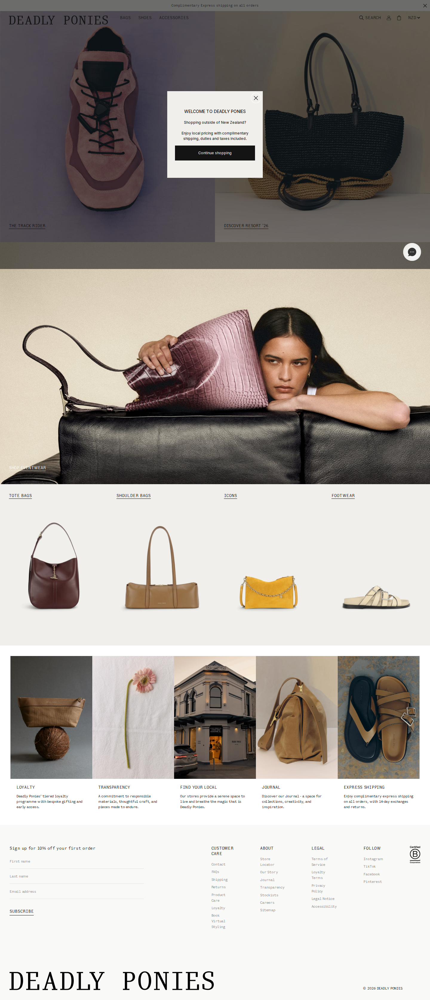
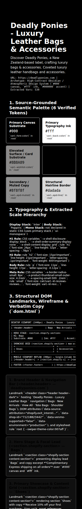

# UI Design System & Master Generation Blueprint: deadlyponies-com

> **Deadly Ponies - Luxury Leather Bags & Accessories** (https://deadlyponies.com) — Discover Deadly Ponies, a New Zealand-based label, crafting luxury bags & accessories. Coveted luxury leather handbags and accessories.



---

## 1. Executive Visual Persona & Design Archetype

- **Brand Essence & Persona**: **Deadly Ponies - Luxury Leather Bags & Accessories** (`https://deadlyponies.com`). Discover Deadly Ponies, a New Zealand-based label, crafting luxury bags & accessories. Coveted luxury leather handbags and accessories.
- **Visual Archetype**: **High-Contrast Obsidian / Atmospheric Design System (`#000` canvas, `#fff` ink, `#000000` accent)**.
- **Anti-AI-Slop Differentiators**:
  - **Source-Grounded Chromatic Polarity**: Anchors the viewport in `#000` (`var(--fore-color)` in `:root`) paired with `#fff` primary typography and `#000000` accents.
  - **Extracted Typographic Hierarchy**: Pairs `Inter` for display copy (`Bags`) with `Poppins` and not declared in static CSS (uses primary stack / `ui-monospace`).
  - **Calibrated Spatial Grid & Motion**: Combines `360px` container bounds (`gap: 2rem`, padding `10px`) with `cubic-bezier(0.5,0,0.5,1)` easing and GSAP Timeline & ScrollTrigger, Swiper Touch Carousel Engine.

---

## 2. Spatial Architecture & Modular Grid Mathematics



### Viewport Allocation & Container Geometry
- **Captured Viewport Dimensions**: Desktop `1440×3346px` (`assets/desktop.png`, full-page scroll capture), Mobile `390×2400px` (`assets/mobile.png`, capped at 2400px multi-section capture).
- **Master Container Bounds**: `360px` extracted from `deadlyponies-com` stylesheet.
- **Canvas Lateral Padding & Spacing**: `10px` lateral canvas padding with `2rem` grid gap.
- **Border Radius Scale**: `50%`, `4px`, `5px`, `0px`.

### Responsive Breakpoint Architecture
- **Desktop Layout**: Multi-column CSS Grid / Flexbox layout at `1440px` (`max-width: 360px`, `gap: 2rem`).
- **Mobile Layout**: Single-column vertical stack at `390px` viewport width with `10px` horizontal padding.
- **Extracted CSS Media Queries**: `@media screen and (forced-colors:active)`, `@media screen and (width<=750px)`, `@media (max-width: 767.98px)`, `@media only screen and (max-width:768px)`.

---

## 3. Color System, Materiality & Atmospheric Lighting

### Semantic Palette & Source Grounding
| Semantic Role | Ground-Truth Value | Extracted CSS Source / Selector |
|---|---|---|
| **Primary Canvas Substrate** | `#000` | `var(--fore-color)` in `:root` |
| **Primary Typography Ink** | `#fff` | `var(--back-color)` in `:root` |
| **Elevated Surface / Card Substrate** | `#8B8A89` | `var(--wishlist-color)` in `:root` |
| **Interactive Accent / Highlight** | `#000000` | `var(--text-color)` in `:root` |
| **Secondary / Muted Copy** | `#8f8f8f` | `var(--apd-muted)` in `:root` |
| **Structural Hairline Border** | `#dadada` | `var(--apd-line)` in `:root` |

### Sanitized Root CSS Variables (`ui-ux.md` Ground Truth)
| Variable Name | Extracted Value | Semantic Role |
|---|---|---|
| `--height-full` | `100vh` | Layout / Spatial Grid Token |
| `--height-fill` | `calc( 100vh - var(--nav-height) )` | Layout / Spatial Grid Token |
| `--font-deadly` | `"Deadly", sans-serif` | Typography / Scale Token |
| `--nav-main-height` | `46px` | Layout / Spatial Grid Token |
| `--nav-height` | `var(--nav-main-height)` | Layout / Spatial Grid Token |
| `--fore-color` | `#000` | Brand / Palette Token |
| `--back-color` | `#fff` | Brand / Palette Token |
| `--top-padding` | `100px` | Layout / Spatial Grid Token |
| `--wishlist-color` | `#8B8A89` | Brand / Palette Token |
| `--row-gap` | `40px` | Layout / Spatial Grid Token |
| `--col-gap` | `10px` | Layout / Spatial Grid Token |
| `--text-color` | `#000000` | Typography Ink Token |
| `--section-height` | `90vh` | Layout / Spatial Grid Token |
| `--apd-bg` | `#fff` | Canvas / Surface Token |
| `--apd-text` | `#000` | Typography Ink Token |
| `--apd-muted` | `#8f8f8f` | Color / Atmospheric Token |

---

## 4. Typographic Scale & Editorial Hierarchy

### Font Family Stacks
- **Display Typography**: `Inter`.
- **Primary Body Stack**: `Poppins`.
- **Technical / Metadata Stack**: not declared in static CSS (uses primary stack / `ui-monospace`).

### Typographic Scale & Rules (Extracted from Stylesheet & Variables)
- **Hero Display (`H1`)**: CSS variables `--x-shell-disclosure-display: block`, `--x-shell-order-summary-display: none`, `--x-shell-content-display: grid`; rule `h1` (`font-size: 26px`, `line-height: 32px`, `letter-spacing: -.78px`).
- **Section Heading (`H2`)**: rule `h2` (`font-size: 15px!important`, `line-height: 21px!important`, `letter-spacing: .1px!important`, `font-weight: 400!important`).
- **Body Copy**: rule `p` (`font-size: 11px`, `line-height: 17px`, `letter-spacing: -0.12px`).
- **Metadata & Navigation Labels**: CSS variables `--x-border-radius-small: 8px`, `--x-product-thumbnail-small-outer-size: 4.2rem`, `--x-spacing-small-500: .2rem`; rule `small` (`font-size: calc(var(--kl-reviews-reviews...`, `font-weight: var(--kl-revi...`).

---

## 5. Choreographed Motion & Interaction Physics

### Primary Easing Curves
- **Extracted Timing Functions**: `cubic-bezier(0.5,0,0.5,1)`, `cubic-bezier(0.4,0,0.2,1)`, `cubic-bezier(.3,.5,.5,1)`.

### Per-Element Transition & Choreography Rules
- **Selector `.swiper-wrapper`**: `transition: var(--swiper-wrapper-transition-timing-function,initial)` extracted from `deadlyponies-com` stylesheet.
- **Selector `.swiper-pagination`**: `transition: .3s opacity` extracted from `deadlyponies-com` stylesheet.
- **Selector `n-bullets-dynamic .swiper-paginat...`**: `transition: .2s transform,.2s top` extracted from `deadlyponies-com` stylesheet.
- **Extracted Easing Curve (`cubic-bezier(0.5,0,0.5,1)`)**: Governs interactive state transitions across `<header.header>` and `<section.shopify-section>`.
- **Runtime Interaction Engine**: Integrates GSAP Timeline & ScrollTrigger, Swiper Touch Carousel Engine with `prefers-reduced-motion: reduce` fallback guards.

---

## 6. Component Wireframe & Structural DOM Map

### Visual Layout Schematic (Grounded in `dom.html` — `1440px` Desktop & `390px` Mobile Reflow)
```
┌────────────────────────────────────────────────────────────────────────┐
│ DESKTOP VIEWPORT (1440px) — Deadly Ponies - Luxury Leather Bags & Acce │
│ ====================================================================== │
│ [ <header.header>          | Bags · New Arrivals · View All · Tote  ]  │
│ ---------------------------------------------------------------------- │
│ | HERO STAGE: <section.shopify-section>                            |   │
│ | H1: Bags                                                         |   │
│ | Substrate: #000       | Ink: #fff       | Accent: #000000        |   │
│ ---------------------------------------------------------------------- │
│ | SHOWCASE GRID (<section.shopify-section> ) max-w: 360px          |   │
│ | +------------------------------+  +------------------------------+ | │
│ | | Shoes                        |  | Accessories                  | | │
│ | +------------------------------+  +------------------------------+ | │
│ ---------------------------------------------------------------------- │
│ | MOBILE VIEWPORT REFLOW (390px) — Single-Column Stack (gap: 2rem  ) | │
│ | [<header.header>] -> [<section.shopify-s] -> [<section.shopify-s] |  │
│ ---------------------------------------------------------------------- │
│ [ FOOTER (<footer.footer>       ) | https://deadlyponies.com           │
└────────────────────────────────────────────────────────────────────────┘
```

### Granular DOM Region Breakdown
1. **Brand Header & Navigation Bar (<header.header> — `deadlyponies-com`)**:
   - Landmark `<header class="header header--dark">` hosting `Deadly Ponies - Luxury Leather Bags ` navigation (`Bags · New Arrivals · View All · Tote Bags · Shoulder Bags`), DOM attributes (`data-source-attribution="shopify.exit_intersti..."`, `data-shop-id="71218823442"`, `data-venmo-supported="false"`, `data-environment="production"`), and stylesheet rule `root { --swiper-theme-color:007aff }`.
2. **Hero Stage & Focal Lead (<section.shopify-section> — `Bags`)**:
   - Landmark `<section class="shopify-section content-section">` presenting display lead `Bags` and copy excerpt *"Complimentary Express shipping on all orders"* over `#000` canvas and `#fff` ink.
3. **Primary Showcase & Content Grid (<section.shopify-section> — `Shoes`)**:
   - Landmark `<section class="shopify-section content-section">` rendering section `Shoes` with copy *"Receive 10% off your first purchase · Sign up"*, asset references (`93837`, `loader.js`, `01H2CKQHWBM22V9RBNTG4KH275`, `swym-ext-shopify.js`), and grid rule `swiper-container { margin-left:auto;margin-right:auto;position:relative;overflow:hidden;lis... }`.
4. **Interactive Detail & Feature Matrix (<section.shopify-section> — `Accessories`)**:
   - Landmark `<section class="shopify-section content-section">` framing `Accessories` and `Loyalty` (*"Bags Category New Arrivals View All Tote Bags Shoulder Bags Cross"*) with `#8B8A89` surface cards, `#000000` accents, and `.swiper-vertical>.swiper-wrapper { flex-direction:column }`.
5. **Colophon & Global Directory Footer (<footer.footer> — `https://deadlyponies.com`)**:
   - Landmark `<footer class="footer">` anchoring `Deadly Ponies - Luxury Leather B` footer links (`Bags · New Arrivals · View All · Tote Bags · Shoulder Bags`), copy *"Occassion Dressing"*, and `#dadada` structural dividers.

---

## 7. Master Zero-Shot AI Generation Prompt

```markdown
# Master Zero-Shot Frontend Generation Prompt: deadlyponies-com (Deadly Ponies - Luxury Leather Bags & Accessories)

You are a principal frontend architect and design systems engineer. Build a complete, production-ready web application replicating the exact design system, DOM landmarks, typographic hierarchy, color tokens, and motion physics of `deadlyponies-com` (**Deadly Ponies - Luxury Leather Bags & Accessories** — `https://deadlyponies.com`).

### 1. Visual Archetype & Anti-AI-Slop Mandates
- **Archetype**: High-Contrast Obsidian / Atmospheric Design System (`#000` canvas, `#fff` ink, `#000000` accent).
- **Identity & Domain Context**: Discover Deadly Ponies, a New Zealand-based label, crafting luxury bags & accessories. Coveted luxury leather handbags and accessories.
- **Primary Substrate**: `#000` (`var(--fore-color)` in `:root`), **Primary Ink**: `#fff`, **Accent / Highlight**: `#000000`.
- **Site-Specific Differentiators**:
  - **Source-Grounded Chromatic Polarity**: Anchors the viewport in `#000` (`var(--fore-color)` in `:root`) paired with `#fff` primary typography and `#000000` accents.
  - **Extracted Typographic Hierarchy**: Pairs `Inter` for display copy (`Bags`) with `Poppins` and not declared in static CSS (uses primary stack / `ui-monospace`).
  - **Calibrated Spatial Grid & Motion**: Combines `360px` container bounds (`gap: 2rem`, padding `10px`) with `cubic-bezier(0.5,0,0.5,1)` easing and GSAP Timeline & ScrollTrigger, Swiper Touch Carousel Engine.

### 2. Ground-Truth CSS Variables (`:root` Token Contract)
Declare and consume these exact custom properties extracted from `deadlyponies-com` in your global stylesheet:

:root {
  /* Deadly Ponies - Luxury Leather Bags & Accessories (deadlyponies-com) — Ground-Truth Extracted CSS Variables */
  --height-full: 100vh; /* Layout / Spatial Grid Token (deadlyponies-com) */
  --height-fill: calc( 100vh - var(--nav-height) ); /* Layout / Spatial Grid Token (deadlyponies-com) */
  --font-deadly: "Deadly", sans-serif; /* Typography / Scale Token (deadlyponies-com) */
  --nav-main-height: 46px; /* Layout / Spatial Grid Token (deadlyponies-com) */
  --nav-height: var(--nav-main-height); /* Layout / Spatial Grid Token (deadlyponies-com) */
  --fore-color: #000; /* Brand / Palette Token (deadlyponies-com) */
  --back-color: #fff; /* Brand / Palette Token (deadlyponies-com) */
  --top-padding: 100px; /* Layout / Spatial Grid Token (deadlyponies-com) */
  --wishlist-color: #8B8A89; /* Brand / Palette Token (deadlyponies-com) */
  --row-gap: 40px; /* Layout / Spatial Grid Token (deadlyponies-com) */
  --col-gap: 10px; /* Layout / Spatial Grid Token (deadlyponies-com) */
  --text-color: #000000; /* Typography Ink Token (deadlyponies-com) */
  --section-height: 90vh; /* Layout / Spatial Grid Token (deadlyponies-com) */
  --apd-bg: #fff; /* Canvas / Surface Token (deadlyponies-com) */
  --apd-text: #000; /* Typography Ink Token (deadlyponies-com) */
  --apd-muted: #8f8f8f; /* Color / Atmospheric Token (deadlyponies-com) */
}

### 3. Semantic Color & Materiality Contract
Map every surface, ink, and border strictly to these source-grounded tokens:
- **Primary Canvas Substrate**: `#000` — grounded in `var(--fore-color)` in `:root`
- **Primary Typography Ink**: `#fff` — grounded in `var(--back-color)` in `:root`
- **Elevated Surface / Card Substrate**: `#8B8A89` — grounded in `var(--wishlist-color)` in `:root`
- **Interactive Accent / Highlight**: `#000000` — grounded in `var(--text-color)` in `:root`
- **Secondary / Muted Copy**: `#8f8f8f` — grounded in `var(--apd-muted)` in `:root`
- **Structural Hairline Border**: `#dadada` — grounded in `var(--apd-line)` in `:root`

### 4. Spatial Grid, Container Bounds & Responsive Breakpoints
- **Desktop Viewport Reference**: `1440×3346px` (full-page scroll capture, `1440px` standard desktop width).
- **Mobile Viewport Reference**: `390×2400px` (capped at 2400px multi-section capture, `390px` standard mobile width).
- **Container Max-Width**: `360px` extracted from `deadlyponies-com` stylesheet
- **Padding & Gutters**: `10px` lateral canvas padding with `2rem` grid gap
- **Desktop Grid**: Multi-column CSS Grid / Flexbox layout at `1440px` (`max-width: 360px`, `gap: 2rem`)
- **Mobile Adaptation**: Single-column vertical stack at `390px` viewport width with `10px` horizontal padding
- **Media Queries**: `@media screen and (forced-colors:active)`, `@media screen and (width<=750px)`, `@media (max-width: 767.98px)`, `@media only screen and (max-width:768px)`
- **Corner Radii**: `50%`, `4px`, `5px`, `0px`

### 5. Typography & Editorial Scale Contract
- **Display Font Stack**: `Inter`
- **Body Font Stack**: `Poppins`
- **Monospace / Technical Font Stack**: not declared in static CSS (uses primary stack / `ui-monospace`)
- **H1 Display Rule**: CSS variables `--x-shell-disclosure-display: block`, `--x-shell-order-summary-display: none`, `--x-shell-content-display: grid`; rule `h1` (`font-size: 26px`, `line-height: 32px`, `letter-spacing: -.78px`)
- **H2 Section Rule**: rule `h2` (`font-size: 15px!important`, `line-height: 21px!important`, `letter-spacing: .1px!important`, `font-weight: 400!important`)
- **Body Copy Rule**: rule `p` (`font-size: 11px`, `line-height: 17px`, `letter-spacing: -0.12px`)
- **Metadata & Index Rule**: CSS variables `--x-border-radius-small: 8px`, `--x-product-thumbnail-small-outer-size: 4.2rem`, `--x-spacing-small-500: .2rem`; rule `small` (`font-size: calc(var(--kl-reviews-reviews...`, `font-weight: var(--kl-revi...`)

### 6. Component Hierarchy, Verbatim Copy & Real DOM Landmarks
Scaffold `deadlyponies-com` (`Deadly Ponies - Luxury Leather Bags & Accessories`) with these exact structural regions, extracted copy, and CSS rules from `dom.html`:
1. **Brand Header & Navigation Bar (<header.header> — `deadlyponies-com`)**:
   - DOM & Selectors: Landmark `<header class="header header--dark">` hosting `Deadly Ponies - Luxury Leather Bags ` navigation (`Bags · New Arrivals · View All · Tote Bags · Shoulder Bags`), DOM attributes (`data-source-attribution="shopify.exit_intersti..."`, `data-shop-id="71218823442"`, `data-venmo-supported="false"`, `data-environment="production"`), and stylesheet rule `root { --swiper-theme-color:007aff }`.
   - Responsive Contract: Header `Brand Header & Navigation Bar (<header.header> — `deadlyponies-com`)` (`deadlyponies-com`) adapts across `@media screen and (forced-colors:active)`, `@media screen and (width<=750px)`, `@media (max-width: 767.98px)`, `@media only screen and (max-width:768px)` with `cubic-bezier(0.5,0,0.5,1)`, `cubic-bezier(0.4,0,0.2,1)`, `cubic-bezier(.3,.5,.5,1)` transitions and links `Bags · New Arrivals · View All · Tote Bags · Shoulder Bags`.
2. **Hero Stage & Focal Lead (<section.shopify-section> — `Bags`)**:
   - DOM & Selectors: Landmark `<section class="shopify-section content-section">` presenting display lead `Bags` and copy excerpt *"Complimentary Express shipping on all orders"* over `#000` canvas and `#fff` ink.
   - Responsive Contract: Hero stage (`1440×3346px` desktop / `390×2400px` mobile) sets `#000` background with `#fff` headline `Bags`.
3. **Primary Showcase & Content Grid (<section.shopify-section> — `Shoes`)**:
   - DOM & Selectors: Landmark `<section class="shopify-section content-section">` rendering section `Shoes` with copy *"Receive 10% off your first purchase · Sign up"*, asset references (`93837`, `loader.js`, `01H2CKQHWBM22V9RBNTG4KH275`, `swym-ext-shopify.js`), and grid rule `swiper-container { margin-left:auto;margin-right:auto;position:relative;overflow:hidden;lis... }`.
   - Responsive Contract: Showcase grid `Primary Showcase & Content Grid (<section.shopify-section> — `Shoes`)` applies Multi-column CSS Grid / Flexbox layout at `1440px` (`max-width: 360px`, `gap: 2rem`) on desktop and Single-column vertical stack at `390px` viewport width with `10px` horizontal padding on mobile.
4. **Interactive Detail & Feature Matrix (<section.shopify-section> — `Accessories`)**:
   - DOM & Selectors: Landmark `<section class="shopify-section content-section">` framing `Accessories` and `Loyalty` (*"Bags Category New Arrivals View All Tote Bags Shoulder Bags Cross"*) with `#8B8A89` surface cards, `#000000` accents, and `.swiper-vertical>.swiper-wrapper { flex-direction:column }`.
   - Responsive Contract: Detail module `Interactive Detail & Feature Matrix (<section.shopify-section> — `Accessories`)` uses `50%`, `4px`, `5px`, `0px` radii, `#000000` highlights, and assets (93837, loader.js, 01H2CKQHWBM22V9RBNTG4KH275).
5. **Colophon & Global Directory Footer (<footer.footer> — `https://deadlyponies.com`)**:
   - DOM & Selectors: Landmark `<footer class="footer">` anchoring `Deadly Ponies - Luxury Leather B` footer links (`Bags · New Arrivals · View All · Tote Bags · Shoulder Bags`), copy *"Occassion Dressing"*, and `#dadada` structural dividers.
   - Responsive Contract: Footer `Colophon & Global Directory Footer (<footer.footer> — `https://deadlyponies.com`)` aligns to `360px` extracted from `deadlyponies-com` stylesheet with `10px` lateral canvas padding with `2rem` grid gap and attributes (data-source-attribution="shopify.exit_intersti...", data-shop-id="71218823442", data-venmo-supported="false").

#### Verbatim DOM Copy Excerpts (`dom.html`)
- Copy Excerpt 1: *"Complimentary Express shipping on all orders"*
- Copy Excerpt 2: *"Receive 10% off your first purchase · Sign up"*
- Copy Excerpt 3: *"Bags Category New Arrivals View All Tote Bags Shoulder Bags Crossbody Bags Clutche..."*
- Copy Excerpt 4: *"Occassion Dressing"*

### 7. Motion, Extracted Stylesheet Rules & Interaction Choreography
- **Primary Easing Functions**: `cubic-bezier(0.5,0,0.5,1)`, `cubic-bezier(0.4,0,0.2,1)`, `cubic-bezier(.3,.5,.5,1)`
- **Extracted Stylesheet Rules (`deadlyponies-com`)**:
- `root { --swiper-theme-color:007aff }`
- `swiper-container { margin-left:auto;margin-right:auto;position:relative;overflow:hidden;lis... }`
- `.swiper-vertical>.swiper-wrapper { flex-direction:column }`
- `.swiper-wrapper { transform:translate3d(0px,0,0) }`
- `.swiper-horizontal { touch-action:pan-y }`
- **Per-Selector Transition Rules**:
- **Selector `.swiper-wrapper`**: `transition: var(--swiper-wrapper-transition-timing-function,initial)` extracted from `deadlyponies-com` stylesheet.
- **Selector `.swiper-pagination`**: `transition: .3s opacity` extracted from `deadlyponies-com` stylesheet.
- **Selector `n-bullets-dynamic .swiper-paginat...`**: `transition: .2s transform,.2s top` extracted from `deadlyponies-com` stylesheet.
- **Extracted Easing Curve (`cubic-bezier(0.5,0,0.5,1)`)**: Governs interactive state transitions across `<header.header>` and `<section.shopify-section>`.
- **Runtime Interaction Engine**: Integrates GSAP Timeline & ScrollTrigger, Swiper Touch Carousel Engine with `prefers-reduced-motion: reduce` fallback guards.

### 8. Technical Deliverables
- Implement in Next.js (App Router) with TypeScript and Tailwind CSS consuming the `:root` custom properties defined above for `deadlyponies-com`.
- Reproduce both the `1440px` desktop architecture and `390px` mobile breakpoint transitions, preserving semantic HTML5 landmarks (`<header>`, `<nav>`, `<main>`, `<section>`, `<footer>`) and `prefers-reduced-motion` accessibility guards.
```
