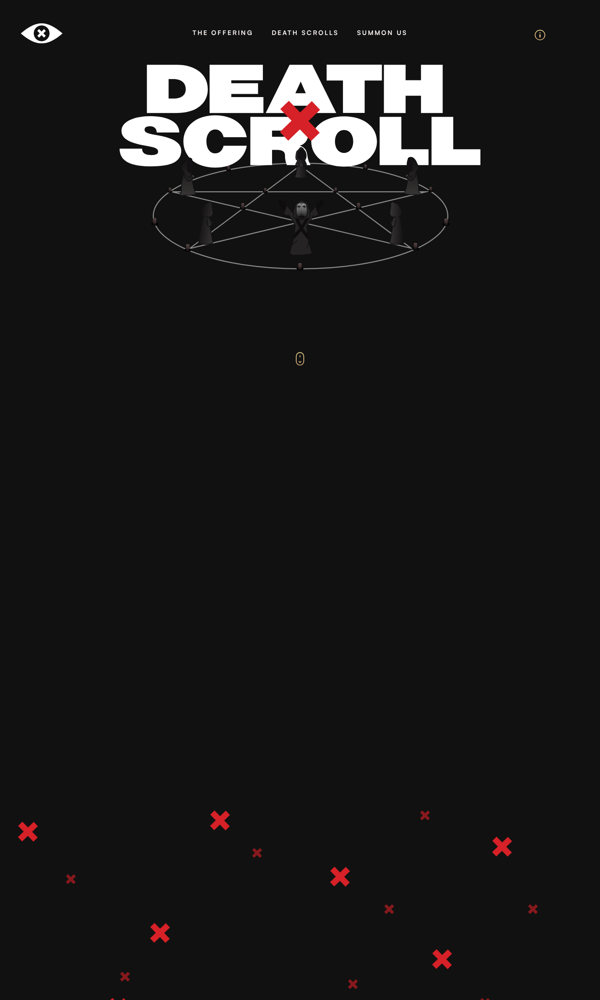
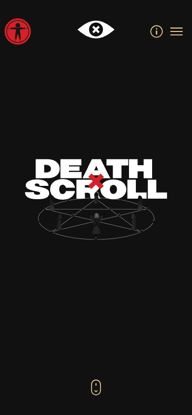

# UI Design System & Master Generation Blueprint: deathbyscroll-com

> **Death by Scroll** (https://deathbyscroll.com) — Killer scroll animation. Perfect for product launches, microsites, and explainers. Create a cult-like devotion to your brand.



---

## 1. Executive Visual Persona & Design Archetype

- **Brand Essence & Persona**: **Death by Scroll** (`https://deathbyscroll.com`). Killer scroll animation. Perfect for product launches, microsites, and explainers. Create a cult-like devotion to your brand.
- **Capture Provenance**: Live browser capture (`tier1_fast`, HTTP `200`, captured `2026-11-23`).
- **Visual Archetype**: **Dark-Substrate WebGL / Canvas Interactive Experience (`#111111` / `#ff0000`)**.
- **Anti-AI-Slop Differentiators**:
  - **Live-Computed Chromatic Polarity**: Anchors the viewport in `#111111` (live computed `body` `background-color` (`computed_styles.json`)) paired with `#ffffff` primary typography and `#ff0000` accents.
  - **Grounded Typographic Hierarchy**: Pairs `Girthy` for display copy (`DEATH BY SCROLL. KILLER SCROLL ANIMA`) with `Satoshi` and not declared in live computed styles (uses primary stack / `ui-monospace`).
  - **Calibrated Spatial Grid & Motion**: Combines `1920px` container bounds (`gap: 1.5rem`, padding `24px`) with `cubic-bezier(0.2,1,0.3,1)` easing and Lenis Smooth Scroll (`data-lenis`), HTML5 `<canvas>` Interactive Viewport Surface.

---

## 2. Spatial Architecture & Modular Grid Mathematics



### Viewport Allocation & Container Geometry
- **Captured Viewport Dimensions**: Desktop `1440×2400px` (`assets/desktop.png`, clamped at 2400px live multi-section capture), Mobile `390×844px` (`assets/mobile.png`, single-viewport 100vh live capture (844px)).
- **Master Container Bounds**: `1920px` (non-`@media` desktop container stylesheet rule).
- **Canvas Lateral Padding & Spacing**: `24px` lateral canvas padding with `1.5rem` grid gap.
- **Border Radius Scale**: `0px 0px 8px 8px`, `6px`, `0px`, `1.25rem`.

### Responsive Breakpoint Architecture
- **Desktop Layout**: Multi-column CSS Grid / Flexbox layout at `1440px` (`max-width: 1920px`, `gap: 1.5rem`).
- **Mobile Layout**: Single-column vertical stack at `390px` viewport width with `24px` horizontal padding.
- **Extracted CSS Media Queries**: `@media screen and (min-width:768px)`, `@media screen and (min-width:1600px)`, `@media (prefers-reduced-motion:reduce)`, `@media screen and (min-width:1020px)`.

---

## 3. Color System, Materiality & Atmospheric Lighting

### Semantic Palette & Source Grounding
| Semantic Role | Ground-Truth Value | Extracted Live / CSS Source |
|---|---|---|
| **Primary Canvas Substrate** | `#111111` | live computed `body` `background-color` (`computed_styles.json`) |
| **Primary Typography Ink** | `#ffffff` | live computed `h1` `color` (`computed_styles.json`) |
| **Elevated Surface / Card Substrate** | `#000000` | `.dxs-footer { background-color: black }` (`#000000`) |
| **Interactive Accent / Highlight** | `#ff0000` | `.dxs-menu__link:hover { color: red }` (`#ff0000`) |
| **Secondary / Muted Copy** | `#ff5e5e` | `var(--color-red-muted)` in `:root` |
| **Structural Hairline Border** | `#d52127` | `.narrative-heading.narrative-he... { stroke: #d52127 }` |
| **Variable Token (`--color-medium-grey`)** | `#282828` | `var(--color-medium-grey)` in `:root` |
| **Variable Token (`--color-dark-grey`)** | `#1e1e1e` | `var(--color-dark-grey)` in `:root` |
| **Variable Token (`--color-light-grey`)** | `#777777` | `var(--color-light-grey)` in `:root` |
| **Variable Token (`--color-off-white`)** | `#f4efed` | `var(--color-off-white)` in `:root` |
| **Variable Token (`--color-highlight`)** | `#e8e8e8` | `var(--color-highlight)` in `:root` |
| **Variable Token (`--color-purple`)** | `#ae5eff` | `var(--color-purple)` in `:root` |
| **Variable Token (`--color-red-white`)** | `#fad2d2` | `var(--color-red-white)` in `:root` |
| **Variable Token (`--color-green`)** | `#4cc44c` | `var(--color-green)` in `:root` |
| **Variable Token (`--color-shadow-2`)** | `#212121` | `var(--color-shadow-2)` in `:root` |
| **Variable Token (`--color-shadow-3`)** | `#222222` | `var(--color-shadow-3)` in `:root` |
| **Variable Token (`--color-brass`)** | `#f9de95` | `var(--color-brass)` in `:root` |
| **Variable Token (`--color-brass-dark`)** | `#e7b882` | `var(--color-brass-dark)` in `:root` |

### Sanitized Root CSS Variables (`ui-ux.md` Ground Truth)
| Variable Name | Extracted Value | Semantic Role |
|---|---|---|
| `--color-off-black` | `#111` | Canvas / Surface Token |
| `--color-medium-grey` | `#282828` | Brand / Palette Token |
| `--color-dark-grey` | `#1e1e1e` | Canvas / Surface Token |
| `--color-light-grey` | `#777` | Canvas / Surface Token |
| `--color-off-white` | `#f4efed` | Canvas / Surface Token |
| `--color-highlight` | `#e8e8e8` | Canvas / Surface Token |
| `--color-red` | `#d52127` | Brand / Palette Token |
| `--color-purple` | `#ae5eff` | Brand / Palette Token |
| `--color-red-rgb` | `213,33,39` | Brand / Palette Token |
| `--color-red-muted` | `#ff5e5e` | Brand / Palette Token |
| `--color-red-white` | `#fad2d2` | Canvas / Surface Token |
| `--color-green` | `#4cc44c` | Brand / Palette Token |
| `--color-shadow-2` | `#212121` | Brand / Palette Token |
| `--color-shadow-3` | `#222` | Brand / Palette Token |
| `--color-brass` | `#f9de95` | Brand / Palette Token |
| `--color-brass-dark` | `#e7b882` | Canvas / Surface Token |

---

## 4. Typographic Scale & Editorial Hierarchy

### Font Family Stacks
- **Display Typography**: `Girthy`.
- **Primary Body Stack**: `Satoshi`.
- **Technical / Metadata Stack**: not declared in live computed styles (uses primary stack / `ui-monospace`).

### Typographic Scale & Rules (Live Computed & Stylesheet Grounded)
- **Hero Display (`H1`)**: live computed `h1` (`font-size: 66px`, `line-height: 66px`, `font-weight: 400`); CSS variables `--font-size--h1: 2.3125rem`, `--line-height--h1: 2.375rem`.
- **Section Heading (`H2`)**: live computed `h2` (`font-size: 54px`, `line-height: 54px`, `font-weight: 400`); CSS variables `--font-size--h2: 2.5rem`, `--line-height--h2: 3rem`; rule `h2` (`font-size: 1.5rem`, `line-height: 1.2`, `letter-spacing: 2px`, `font-weight: 600`).
- **Body Copy**: live computed `body` (`font-size: 16px`, `line-height: 22px`, `font-weight: 400`); CSS variables `--typeface-body: "Satoshi",sans-serif`, `--typeface-body-bold: "Satoshi Black",sans-serif`, `--line-height--body: 1.375rem`; rule `p` (`font-size: 1rem`, `line-height: 1.25rem`).
- **Metadata & Navigation Labels**: live computed `nav/a` (`font-size: 16px`, `line-height: 22px`, `font-weight: 400`).

---

## 5. Choreographed Motion & Interaction Physics

### Primary Easing Curves
- **Extracted Timing Functions**: `cubic-bezier(0.2,1,0.3,1)`, `cubic-bezier(.2,1,.3,1)`, `cubic-bezier(.22,1,.36,1)`.

### Per-Element Transition & Choreography Rules
- **Selector `:root`**: `transition: var(--global-duration) var(--global-timing)` extracted from `deathbyscroll-com` stylesheet.
- **Selector `.outline-text span:after`**: `transition: opacity .3s ease` extracted from `deathbyscroll-com` stylesheet.
- **Selector `a svg`**: `transition: fill .5s cubic-bezier(0.2,1,0.3,1)` extracted from `deathbyscroll-com` stylesheet.
- **Extracted Easing Curve (`cubic-bezier(0.2,1,0.3,1)`)**: Governs interactive state transitions across `<header.dxs-header>` and `<section.temple-scene>`.
- **Runtime Interaction Engine**: Integrates Lenis Smooth Scroll (`data-lenis`), HTML5 `<canvas>` Interactive Viewport Surface with `prefers-reduced-motion: reduce` fallback guards.

---

## 6. Component Wireframe & Structural DOM Map

### Visual Layout Schematic — Desktop (`1440px`, Grounded in `dom.html` & Landmark Bounding Boxes)
```
┌────────────────────────────────────────────────────────────────────────┐
│ DESKTOP VIEWPORT (1440px) — Death by Scroll                            │
│ ====================================================================== │
│ [ <header.dxs-header> (1440x160px)    | Summon us Summon us          ] │
│ ---------------------------------------------------------------------- │
│ | HERO STAGE: <section.guided-player> (w=1440px)                     | │
│ | H1: DEATH BY SCROLL. KILLER SCROLL ANIMATION                       | │
│ | Substrate: #111111 | Ink: #ffffff | Accent: #ff0000                | │
│ ---------------------------------------------------------------------- │
│ | SHOWCASE GRID (<section.temple-scene>) max-w: 1920px               | │
│ | +------------------------------+  +------------------------------+ | │
│ | | Death by Scroll. Killer scro |  | Scene player                 | | │
│ | +------------------------------+  +------------------------------+ | │
│ ---------------------------------------------------------------------- │
│ | DETAIL MODULE (<section.heads-scene>) — Don't just get people      | │
│ ---------------------------------------------------------------------- │
│ [ FOOTER (<footer.dxs-footer> ) | https://deathbyscroll.com            │
└────────────────────────────────────────────────────────────────────────┘
```

### Visual Layout Schematic — Mobile Reflow (`390px`)
```
┌────────────────────────────────────────────────────────────────────────┐
│ MOBILE VIEWPORT REFLOW (390px) — Single-Column Stack (gap: 1.5rem)     │
│ ====================================================================== │
│ [ HEADER BAR (<header.dxs-header>     ) | Compact Menu (390px)         │
│ ---------------------------------------------------------------------- │
│ | HERO STAGE (<section.guided-player>) — 390px Vertical Lead         | │
│ | H1: DEATH BY SCROLL. KILLER SCROLL ANIMATION                       | │
│ ---------------------------------------------------------------------- │
│ | SHOWCASE STACK (<section.temple-scene>) — 1-Col Stack              | │
│ | [ Item 1: Death by Scroll. Killer scroll animation               ] | │
│ | [ Item 2: Scene player                                           ] | │
│ ---------------------------------------------------------------------- │
│ | DETAIL STACK (<section.heads-scene>) — 1-Col (Don't just get peo)  | │
│ ---------------------------------------------------------------------- │
│ [ FOOTER (<footer.dxs-footer> ) | Stacked 390px Colophon               │
└────────────────────────────────────────────────────────────────────────┘
```

### Granular DOM Region Breakdown
1. **Brand Header & Navigation Bar (<header.dxs-header> — `deathbyscroll-com`)**:
   - Landmark `<header class="dxs-header">` (`1440x160px`) hosting `Death by Scroll` navigation (`Summon us Summon us`), DOM attributes (`data-open-accessibility="accessibility-toggle-..."`, `data-end-announce="Summon Us. The page n..."`, `data-guided="prev"`, `data-guided="playpause"`), and stylesheet rule `root { --font-size--h1:5.375rem;--font-size--h2:4rem;--line-height--h1:5.375rem... }`.
2. **Hero Stage & Focal Lead (<section.guided-player> — `DEATH BY SCROLL. KILLER SCROLL ANI`)**:
   - Landmark `<section class="guided-player">` presenting display lead `DEATH BY SCROLL. KILLER SCROLL ANIMATION` and copy excerpt *"A circle of hooded cult members stands on a pentagram sigil in th"* over `#111111` canvas and `#ffffff` ink.
3. **Primary Showcase & Content Grid (<section.temple-scene> — `Death by Scroll. Killer scroll ani`)**:
   - Landmark `<section class="temple-scene">` rendering section `Death by Scroll. Killer scroll animation` with copy *"Animation is turned off. Each scene is described in turn below."*, asset references (`tg-girthyultra-webfont.woff2`, `Satoshi-Bold.woff2`, `styles.min.css`, `favicon.png`), and grid rule `html { -webkit-text-size-adjust:100%;line-height:1.15 }`.
4. **Interactive Detail & Feature Matrix (<section.heads-scene> — `Scene player`)**:
   - Landmark `<section class="heads-scene">` framing `Scene player` and `Don't just get people's attention, get inside the...` (*"Play moves through the scenes on its own, naming each chapter. Ne"*) with `#000000` surface cards, `#ff0000` accents, and `main { display:block }`.
5. **Colophon & Global Directory Footer (<footer.dxs-footer> — `https://deathbyscroll.com`)**:
   - Landmark `<footer class="dxs-footer">` anchoring `Death by Scroll` footer links (`Summon us Summon us`), copy *"A cult leaders head splits up like a Russian doll revealing "*, and `#d52127` structural dividers.

---

## 7. Master Zero-Shot AI Generation Prompt

```markdown
# Master Zero-Shot Frontend Generation Prompt: deathbyscroll-com (Death by Scroll)

You are a principal frontend architect and design systems engineer. Build a complete, production-ready web application replicating the exact design system, DOM landmarks, typographic hierarchy, color tokens, and motion physics of `deathbyscroll-com` (**Death by Scroll** — `https://deathbyscroll.com`).

### 1. Visual Archetype & Anti-AI-Slop Mandates
- **Archetype**: Dark-Substrate WebGL / Canvas Interactive Experience (`#111111` / `#ff0000`).
- **Identity & Domain Context**: Killer scroll animation. Perfect for product launches, microsites, and explainers. Create a cult-like devotion to your brand.
- **Primary Substrate**: `#111111` (live computed `body` `background-color` (`computed_styles.json`)), **Primary Ink**: `#ffffff`, **Accent / Highlight**: `#ff0000`.
- **Site-Specific Differentiators**:
  - **Live-Computed Chromatic Polarity**: Anchors the viewport in `#111111` (live computed `body` `background-color` (`computed_styles.json`)) paired with `#ffffff` primary typography and `#ff0000` accents.
  - **Grounded Typographic Hierarchy**: Pairs `Girthy` for display copy (`DEATH BY SCROLL. KILLER SCROLL ANIMA`) with `Satoshi` and not declared in live computed styles (uses primary stack / `ui-monospace`).
  - **Calibrated Spatial Grid & Motion**: Combines `1920px` container bounds (`gap: 1.5rem`, padding `24px`) with `cubic-bezier(0.2,1,0.3,1)` easing and Lenis Smooth Scroll (`data-lenis`), HTML5 `<canvas>` Interactive Viewport Surface.

### 2. Ground-Truth CSS Variables (`:root` Token Contract)
Declare and consume these exact custom properties extracted from `deathbyscroll-com` in your global stylesheet:

:root {
  /* Death by Scroll (deathbyscroll-com) — Live-Grounded CSS Variables */
  --color-off-black: #111; /* Canvas / Surface Token (deathbyscroll-com) */
  --color-medium-grey: #282828; /* Brand / Palette Token (deathbyscroll-com) */
  --color-dark-grey: #1e1e1e; /* Canvas / Surface Token (deathbyscroll-com) */
  --color-light-grey: #777; /* Canvas / Surface Token (deathbyscroll-com) */
  --color-off-white: #f4efed; /* Canvas / Surface Token (deathbyscroll-com) */
  --color-highlight: #e8e8e8; /* Canvas / Surface Token (deathbyscroll-com) */
  --color-red: #d52127; /* Brand / Palette Token (deathbyscroll-com) */
  --color-purple: #ae5eff; /* Brand / Palette Token (deathbyscroll-com) */
  --color-red-rgb: 213,33,39; /* Brand / Palette Token (deathbyscroll-com) */
  --color-red-muted: #ff5e5e; /* Brand / Palette Token (deathbyscroll-com) */
  --color-red-white: #fad2d2; /* Canvas / Surface Token (deathbyscroll-com) */
  --color-green: #4cc44c; /* Brand / Palette Token (deathbyscroll-com) */
  --color-shadow-2: #212121; /* Brand / Palette Token (deathbyscroll-com) */
  --color-shadow-3: #222; /* Brand / Palette Token (deathbyscroll-com) */
  --color-brass: #f9de95; /* Brand / Palette Token (deathbyscroll-com) */
  --color-brass-dark: #e7b882; /* Canvas / Surface Token (deathbyscroll-com) */
}

### 3. Semantic Color & Materiality Contract
Map every surface, ink, and border strictly to these source-grounded tokens:
- **Primary Canvas Substrate**: `#111111` — grounded in live computed `body` `background-color` (`computed_styles.json`)
- **Primary Typography Ink**: `#ffffff` — grounded in live computed `h1` `color` (`computed_styles.json`)
- **Elevated Surface / Card Substrate**: `#000000` — grounded in `.dxs-footer { background-color: black }` (`#000000`)
- **Interactive Accent / Highlight**: `#ff0000` — grounded in `.dxs-menu__link:hover { color: red }` (`#ff0000`)
- **Secondary / Muted Copy**: `#ff5e5e` — grounded in `var(--color-red-muted)` in `:root`
- **Structural Hairline Border**: `#d52127` — grounded in `.narrative-heading.narrative-he... { stroke: #d52127 }`
- **Variable Token (`--color-medium-grey`)**: `#282828` — grounded in `var(--color-medium-grey)` in `:root`
- **Variable Token (`--color-dark-grey`)**: `#1e1e1e` — grounded in `var(--color-dark-grey)` in `:root`
- **Variable Token (`--color-light-grey`)**: `#777777` — grounded in `var(--color-light-grey)` in `:root`
- **Variable Token (`--color-off-white`)**: `#f4efed` — grounded in `var(--color-off-white)` in `:root`
- **Variable Token (`--color-highlight`)**: `#e8e8e8` — grounded in `var(--color-highlight)` in `:root`
- **Variable Token (`--color-purple`)**: `#ae5eff` — grounded in `var(--color-purple)` in `:root`
- **Variable Token (`--color-red-white`)**: `#fad2d2` — grounded in `var(--color-red-white)` in `:root`
- **Variable Token (`--color-green`)**: `#4cc44c` — grounded in `var(--color-green)` in `:root`
- **Variable Token (`--color-shadow-2`)**: `#212121` — grounded in `var(--color-shadow-2)` in `:root`
- **Variable Token (`--color-shadow-3`)**: `#222222` — grounded in `var(--color-shadow-3)` in `:root`
- **Variable Token (`--color-brass`)**: `#f9de95` — grounded in `var(--color-brass)` in `:root`
- **Variable Token (`--color-brass-dark`)**: `#e7b882` — grounded in `var(--color-brass-dark)` in `:root`

### 4. Spatial Grid, Container Bounds & Responsive Breakpoints
- **Desktop Viewport Reference**: `1440×2400px` (clamped at 2400px live multi-section capture, `1440px` standard desktop width).
- **Mobile Viewport Reference**: `390×844px` (single-viewport 100vh live capture (844px), `390px` standard mobile width).
- **Container Max-Width**: `1920px` (non-`@media` desktop container stylesheet rule)
- **Padding & Gutters**: `24px` lateral canvas padding with `1.5rem` grid gap
- **Desktop Grid**: Multi-column CSS Grid / Flexbox layout at `1440px` (`max-width: 1920px`, `gap: 1.5rem`)
- **Mobile Adaptation**: Single-column vertical stack at `390px` viewport width with `24px` horizontal padding
- **Media Queries**: `@media screen and (min-width:768px)`, `@media screen and (min-width:1600px)`, `@media (prefers-reduced-motion:reduce)`, `@media screen and (min-width:1020px)`
- **Corner Radii**: `0px 0px 8px 8px`, `6px`, `0px`, `1.25rem`

### 5. Typography & Editorial Scale Contract
- **Display Font Stack**: `Girthy`
- **Body Font Stack**: `Satoshi`
- **Monospace / Technical Font Stack**: not declared in live computed styles (uses primary stack / `ui-monospace`)
- **H1 Display Rule**: live computed `h1` (`font-size: 66px`, `line-height: 66px`, `font-weight: 400`); CSS variables `--font-size--h1: 2.3125rem`, `--line-height--h1: 2.375rem`
- **H2 Section Rule**: live computed `h2` (`font-size: 54px`, `line-height: 54px`, `font-weight: 400`); CSS variables `--font-size--h2: 2.5rem`, `--line-height--h2: 3rem`; rule `h2` (`font-size: 1.5rem`, `line-height: 1.2`, `letter-spacing: 2px`, `font-weight: 600`)
- **Body Copy Rule**: live computed `body` (`font-size: 16px`, `line-height: 22px`, `font-weight: 400`); CSS variables `--typeface-body: "Satoshi",sans-serif`, `--typeface-body-bold: "Satoshi Black",sans-serif`, `--line-height--body: 1.375rem`; rule `p` (`font-size: 1rem`, `line-height: 1.25rem`)
- **Metadata & Index Rule**: live computed `nav/a` (`font-size: 16px`, `line-height: 22px`, `font-weight: 400`)

### 6. Component Hierarchy, Verbatim Copy & Real DOM Landmarks
Scaffold `deathbyscroll-com` (`Death by Scroll`) with these exact structural regions, extracted copy, and CSS rules from `dom.html`:
1. **Brand Header & Navigation Bar (<header.dxs-header> — `deathbyscroll-com`)**:
   - DOM & Selectors: Landmark `<header class="dxs-header">` (`1440x160px`) hosting `Death by Scroll` navigation (`Summon us Summon us`), DOM attributes (`data-open-accessibility="accessibility-toggle-..."`, `data-end-announce="Summon Us. The page n..."`, `data-guided="prev"`, `data-guided="playpause"`), and stylesheet rule `root { --font-size--h1:5.375rem;--font-size--h2:4rem;--line-height--h1:5.375rem... }`.
   - Responsive Contract: Header `Brand Header & Navigation Bar (<header.dxs-header> — `deathbyscroll-com`)` (`deathbyscroll-com`) adapts across `@media screen and (min-width:768px)`, `@media screen and (min-width:1600px)`, `@media (prefers-reduced-motion:reduce)`, `@media screen and (min-width:1020px)` with `cubic-bezier(0.2,1,0.3,1)`, `cubic-bezier(.2,1,.3,1)`, `cubic-bezier(.22,1,.36,1)` transitions and links `Summon us Summon us`.
2. **Hero Stage & Focal Lead (<section.guided-player> — `DEATH BY SCROLL. KILLER SCROLL ANI`)**:
   - DOM & Selectors: Landmark `<section class="guided-player">` presenting display lead `DEATH BY SCROLL. KILLER SCROLL ANIMATION` and copy excerpt *"A circle of hooded cult members stands on a pentagram sigil in th"* over `#111111` canvas and `#ffffff` ink.
   - Responsive Contract: Hero stage (`1440×2400px` desktop / `390×844px` mobile) sets `#111111` background with `#ffffff` headline `DEATH BY SCROLL. KILLER SCROLL ANIMATION`.
3. **Primary Showcase & Content Grid (<section.temple-scene> — `Death by Scroll. Killer scroll ani`)**:
   - DOM & Selectors: Landmark `<section class="temple-scene">` rendering section `Death by Scroll. Killer scroll animation` with copy *"Animation is turned off. Each scene is described in turn below."*, asset references (`tg-girthyultra-webfont.woff2`, `Satoshi-Bold.woff2`, `styles.min.css`, `favicon.png`), and grid rule `html { -webkit-text-size-adjust:100%;line-height:1.15 }`.
   - Responsive Contract: Showcase grid `Primary Showcase & Content Grid (<section.temple-scene> — `Death by Scroll. Killer scroll ani`)` applies Multi-column CSS Grid / Flexbox layout at `1440px` (`max-width: 1920px`, `gap: 1.5rem`) on desktop and Single-column vertical stack at `390px` viewport width with `24px` horizontal padding on mobile.
4. **Interactive Detail & Feature Matrix (<section.heads-scene> — `Scene player`)**:
   - DOM & Selectors: Landmark `<section class="heads-scene">` framing `Scene player` and `Don't just get people's attention, get inside the...` (*"Play moves through the scenes on its own, naming each chapter. Ne"*) with `#000000` surface cards, `#ff0000` accents, and `main { display:block }`.
   - Responsive Contract: Detail module `Interactive Detail & Feature Matrix (<section.heads-scene> — `Scene player`)` uses `0px 0px 8px 8px`, `6px`, `0px`, `1.25rem` radii, `#ff0000` highlights, and assets (tg-girthyultra-webfont.woff2, Satoshi-Bold.woff2, styles.min.css).
5. **Colophon & Global Directory Footer (<footer.dxs-footer> — `https://deathbyscroll.com`)**:
   - DOM & Selectors: Landmark `<footer class="dxs-footer">` anchoring `Death by Scroll` footer links (`Summon us Summon us`), copy *"A cult leaders head splits up like a Russian doll revealing "*, and `#d52127` structural dividers.
   - Responsive Contract: Footer `Colophon & Global Directory Footer (<footer.dxs-footer> — `https://deathbyscroll.com`)` aligns to `1920px` (non-`@media` desktop container stylesheet rule) with `24px` lateral canvas padding with `1.5rem` grid gap and attributes (data-open-accessibility="accessibility-toggle-...", data-end-announce="Summon Us. The page n...", data-guided="prev").

#### Verbatim DOM Copy Excerpts (`dom.html`)
- Copy Excerpt 1: *"A circle of hooded cult members stands on a pentagram sigil in the dark. Candles l..."*
- Copy Excerpt 2: *"Animation is turned off. Each scene is described in turn below."*
- Copy Excerpt 3: *"Play moves through the scenes on its own, naming each chapter. Next and Previous s..."*
- Copy Excerpt 4: *"A cult leaders head splits up like a Russian doll revealing layers beneath. We fly..."*

### 7. Motion, Extracted Stylesheet Rules & Interaction Choreography
- **Primary Easing Functions**: `cubic-bezier(0.2,1,0.3,1)`, `cubic-bezier(.2,1,.3,1)`, `cubic-bezier(.22,1,.36,1)`
- **Extracted Stylesheet Rules (`deathbyscroll-com`)**:
- `root { --font-size--h1:5.375rem;--font-size--h2:4rem;--line-height--h1:5.375rem... }`
- `html { -webkit-text-size-adjust:100%;line-height:1.15 }`
- `main { display:block }`
- `pre { font-family:monospace,monospace;font-size:1em }`
- `strong { font-weight:bolder }`
- **Per-Selector Transition Rules**:
- **Selector `:root`**: `transition: var(--global-duration) var(--global-timing)` extracted from `deathbyscroll-com` stylesheet.
- **Selector `.outline-text span:after`**: `transition: opacity .3s ease` extracted from `deathbyscroll-com` stylesheet.
- **Selector `a svg`**: `transition: fill .5s cubic-bezier(0.2,1,0.3,1)` extracted from `deathbyscroll-com` stylesheet.
- **Extracted Easing Curve (`cubic-bezier(0.2,1,0.3,1)`)**: Governs interactive state transitions across `<header.dxs-header>` and `<section.temple-scene>`.
- **Runtime Interaction Engine**: Integrates Lenis Smooth Scroll (`data-lenis`), HTML5 `<canvas>` Interactive Viewport Surface with `prefers-reduced-motion: reduce` fallback guards.

### 8. Technical Deliverables
- Implement in Next.js (App Router) with TypeScript and Tailwind CSS consuming the `:root` custom properties defined above for `deathbyscroll-com`.
- Reproduce both the `1440px` desktop architecture and `390px` mobile breakpoint transitions, preserving semantic HTML5 landmarks (`<header>`, `<nav>`, `<main>`, `<section>`, `<footer>`) and `prefers-reduced-motion` accessibility guards.
```
