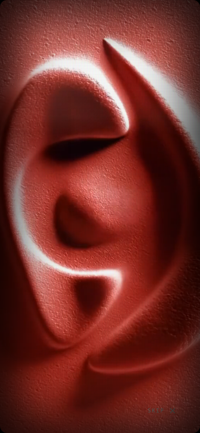

# UI Design System & Master Generation Blueprint: degacsid-com

> **DEGACSID** (https://degacsid.com/) — The Only Creative Partner You'll Need. Full Service Creative Agency that handles everything from strategy, conception, design, execution,...


---

## 1. Executive Visual Persona & Design Archetype

- **Brand Essence & Persona**: **DEGACSID** (`https://degacsid.com/`). The Only Creative Partner You'll Need. Full Service Creative Agency that handles everything from strategy, conception, design, execution,...
- **Capture Provenance**: Live browser capture (`tier1_fast`, HTTP `200`, captured `2026-11-23`).
- **Visual Archetype**: **Light-Gallery WebGL / Canvas Interactive Experience (`#fffcf9` / `#e55655`)**.
- **Anti-AI-Slop Differentiators**:
  - **Live-Computed Chromatic Polarity**: Anchors the viewport in `#fffcf9` (live computed `body` `background-color` (`computed_styles.json`)) paired with `#000000` primary typography and `#e55655` accents.
  - **Grounded Typographic Hierarchy**: Pairs `Helvetica Neue` for display copy (`DEGACSID`) with `Return of the Boss` and `IBM Plex Mono`.
  - **Calibrated Spatial Grid & Motion**: Combines `1440px` container bounds (`gap: 12px`, padding `10px`) with `cubic-bezier(0.5,0,0.2,1)` easing and HTML5 `<canvas>` Interactive Viewport Surface.

---

## 2. Spatial Architecture & Modular Grid Mathematics



### Viewport Allocation & Container Geometry
- **Captured Viewport Dimensions**: Desktop `1440×900px` (`assets/desktop.png`, single-viewport 100vh live capture (900px)), Mobile `390×844px` (`assets/mobile.png`, single-viewport 100vh live capture (844px)).
- **Master Container Bounds**: `1440px` (full-bleed `100%` viewport stage).
- **Canvas Lateral Padding & Spacing**: `10px` lateral canvas padding with `12px` grid gap.
- **Border Radius Scale**: `50%`, `2px`.

### Responsive Breakpoint Architecture
- **Desktop Layout**: Multi-column CSS Grid / Flexbox layout at `1440px` (`max-width: 1440px`, `gap: 12px`).
- **Mobile Layout**: Single-column vertical stack at `390px` viewport width with `10px` horizontal padding.
- **Extracted CSS Media Queries**: no `@media` queries in captured stylesheet (fluid viewport scaling).

---

## 3. Color System, Materiality & Atmospheric Lighting

### Semantic Palette & Source Grounding
| Semantic Role | Ground-Truth Value | Extracted Live / CSS Source |
|---|---|---|
| **Primary Canvas Substrate** | `#fffcf9` | live computed `body` `background-color` (`computed_styles.json`) |
| **Primary Typography Ink** | `#000000` | live computed `body` `color` (`computed_styles.json`) |
| **Elevated Surface / Card Substrate** | `#0a0a0c` | live computed `button` `background-color` (`computed_styles.json`) |
| **Interactive Accent / Highlight** | `#e55655` | `.navg9eskz-mi:focus-visible .na... { color: #e55655 }` |
| **Secondary / Muted Copy** | `#fff4e7` | live computed `a` `color` (`computed_styles.json`) |
| **Structural Hairline Border** | `#fff4e7` | hairline divider derived from live computed `a` `color` (`computed_styles.json`) |

### Sanitized Root CSS Variables (`ui-ux.md` Ground Truth)
| Variable Name | Extracted Value | Semantic Role |
|---|---|---|
| `--crt-safe` | `31px` | Dimension / Scale Token |
| `--degacsid-com-bg` | `#fffcf9` | Canvas Substrate (from live computed `body` `background-color` (`computed_styles.json`)) |
| `--degacsid-com-ink` | `#000000` | Primary Typography Ink (computed-derived) |
| `--degacsid-com-surface` | `#0a0a0c` | Surface Substrate (computed-derived) |
| `--degacsid-com-accent` | `#e55655` | Interactive Accent (computed-derived) |
| `--degacsid-com-muted` | `#fff4e7` | Secondary Ink (computed-derived) |
| `--degacsid-com-border` | `#fff4e7` | Structural Border (computed-derived) |
| `--degacsid-com-container` | `1440px` | Container Bound (computed-derived) |
| `--degacsid-com-gap` | `12px` | Grid Gutter (computed-derived) |
| `--degacsid-com-pad` | `10px` | Lateral Padding (computed-derived) |
| `--degacsid-com-ease` | `cubic-bezier(0.5,0,0.2,1)` | Primary Easing Function |
| `--degacsid-com-radius` | `50%` | Corner Radius (computed-derived) |
| `--degacsid-com-fs-base` | `16px` | Observed Font Size Token |

---

## 4. Typographic Scale & Editorial Hierarchy

### Font Family Stacks
- **Display Typography**: `Helvetica Neue`.
- **Primary Body Stack**: `Return of the Boss`.
- **Technical / Metadata Stack**: `IBM Plex Mono`.

### Typographic Scale & Rules (Live Computed & Stylesheet Grounded)
- **Hero Display (`H1`)**: observed font-size ladder: `16px`, `11px`, `10px`, `0.62em`.
- **Section Heading (`H2`)**: observed font-size ladder: `16px`, `11px`, `10px`, `0.62em`.
- **Body Copy**: live computed `body` (`font-size: 16px`, `line-height: normal`, `font-weight: 400`).
- **Metadata & Navigation Labels**: live computed `nav/a` (`font-size: 16px`, `line-height: normal`, `font-weight: 400`).

---

## 5. Choreographed Motion & Interaction Physics

### Primary Easing Curves
- **Extracted Timing Functions**: `cubic-bezier(0.5,0,0.2,1)`, `cubic-bezier(0.2,0.8,0.2,1)`.

### Per-Element Transition & Choreography Rules
- **Selector `.navg9eskz-mi .navg9eskz-lbl`**: `transition: color .13s ease` extracted from `degacsid-com` stylesheet.
- **Selector `.navg9eskz-mi .navg9eskz-arw`**: `transition: opacity .15s ease, transform .15s ease` extracted from `degacsid-com` stylesheet.
- **Selector `style]`**: `transition: opacity 260ms` extracted from `degacsid-com` stylesheet.
- **Extracted Easing Curve (`cubic-bezier(0.5,0,0.2,1)`)**: Governs interactive state transitions across `<header.cls-1>` and `<div.navg9eskz-lbl>`.
- **Runtime Interaction Engine**: Integrates HTML5 `<canvas>` Interactive Viewport Surface with `prefers-reduced-motion: reduce` fallback guards.

---

## 6. Component Wireframe & Structural DOM Map

### Visual Layout Schematic — Desktop (`1440px`, Grounded in `dom.html` & Landmark Bounding Boxes)
```
┌────────────────────────────────────────────────────────────────────────┐
│ DESKTOP VIEWPORT (1440px) — DEGACSID                                   │
│ ====================================================================== │
│ [ <header.cls-1> (1440px)             | ▶︎ SERVICES · ▶︎ PROCESS · ▶ ] │
│ ---------------------------------------------------------------------- │
│ | HERO STAGE: <div.navg9eskz-mi> (w=1440px)                          | │
│ | H1: DEGACSID                                                       | │
│ | Substrate: #fffcf9 | Ink: #000000 | Accent: #e55655                | │
│ ---------------------------------------------------------------------- │
│ | SHOWCASE GRID (<div.navg9eskz-lbl>) max-w: 1440px                  | │
│ | +------------------------------+  +------------------------------+ | │
│ | | Featured Work & Interactive  |  | Technical Architecture & Nar | | │
│ | +------------------------------+  +------------------------------+ | │
│ ---------------------------------------------------------------------- │
│ | DETAIL MODULE (<div.navg9eskz-arw>) — Global Directory & Co        | │
│ ---------------------------------------------------------------------- │
│ [ FOOTER (<footer>            ) | https://degacsid.com/                │
└────────────────────────────────────────────────────────────────────────┘
```

### Visual Layout Schematic — Mobile Reflow (`390px`)
```
┌────────────────────────────────────────────────────────────────────────┐
│ MOBILE VIEWPORT REFLOW (390px) — Single-Column Stack (gap: 12px)       │
│ ====================================================================== │
│ [ HEADER BAR (<header.cls-1>          ) | Compact Menu (390px)         │
│ ---------------------------------------------------------------------- │
│ | HERO STAGE (<div.navg9eskz-mi>) — 390px Vertical Lead              | │
│ | H1: DEGACSID                                                       | │
│ ---------------------------------------------------------------------- │
│ | SHOWCASE STACK (<div.navg9eskz-lbl>) — 1-Col Stack                 | │
│ | [ Item 1: Featured Work & Interactive Showcase                   ] | │
│ | [ Item 2: Technical Architecture & Narrative                     ] | │
│ ---------------------------------------------------------------------- │
│ | DETAIL STACK (<div.navg9eskz-arw>) — 1-Col (Global Directory &)    | │
│ ---------------------------------------------------------------------- │
│ [ FOOTER (<footer>            ) | Stacked 390px Colophon               │
└────────────────────────────────────────────────────────────────────────┘
```

### Granular DOM Region Breakdown
1. **Brand Header & Navigation Bar (<header.cls-1> — `degacsid-com`)**:
   - Landmark `<header class="cls-1">` (`1440px`) hosting `DEGACSID` navigation (`▶︎ SERVICES · ▶︎ PROCESS · ▶︎ CASE STUDIES · ▶︎ ABOUT · ▶︎ CONTACT`), DOM attributes (`data-name="Layer 1"`), and stylesheet rule `font-face { font-family:Return of the Boss;src:url(/fonts/ReturnOfTheBoss.ttf) forma... }`.
2. **Hero Stage & Focal Lead (<div.navg9eskz-mi> — `DEGACSID`)**:
   - Landmark `<div class="navg9eskz-mi">` presenting display lead `DEGACSID` and copy excerpt *"The Only Creative Partner You'll Need. Full Service Creative Agen"* over `#fffcf9` canvas and `#000000` ink.
3. **Primary Showcase & Content Grid (<div.navg9eskz-lbl> — `Featured Work & Interactive Showca`)**:
   - Landmark `<div class="navg9eskz-lbl">` rendering section `Featured Work & Interactive Showcase` with copy *"DEGACSID"*, asset references (`favicon.ico`, `favicon.svg`, `apple-touch-icon.png`, `main-D5gnYzr4.js`), and grid rule `root { margin:0;padding:0;width:100%;height:100% }`.
4. **Interactive Detail & Feature Matrix (<div.navg9eskz-arw> — `Technical Architecture & Narrative`)**:
   - Landmark `<div class="navg9eskz-arw">` framing `Technical Architecture & Narrative` and `Global Directory & Contact` (*"Featured Work & Interactive Showcase"*) with `#0a0a0c` surface cards, `#e55655` accents, and `body { background:fffcf9;overflow:hidden;-webkit-font-smoothing:antialiased }`.
5. **Colophon & Global Directory Footer (<footer> — `https://degacsid.com/`)**:
   - Landmark `<footer>` landmark anchoring `DEGACSID` footer links (`▶︎ SERVICES · ▶︎ PROCESS · ▶︎ CASE STUDIES · ▶︎ ABOUT · ▶︎ CONTACT`), copy *"Technical Architecture & Narrative"*, and `#fff4e7` structural dividers.

---

## 7. Master Zero-Shot AI Generation Prompt

```markdown
# Master Zero-Shot Frontend Generation Prompt: degacsid-com (DEGACSID)

You are a principal frontend architect and design systems engineer. Build a complete, production-ready web application replicating the exact design system, DOM landmarks, typographic hierarchy, color tokens, and motion physics of `degacsid-com` (**DEGACSID** — `https://degacsid.com/`).

### 1. Visual Archetype & Anti-AI-Slop Mandates
- **Archetype**: Light-Gallery WebGL / Canvas Interactive Experience (`#fffcf9` / `#e55655`).
- **Identity & Domain Context**: The Only Creative Partner You'll Need. Full Service Creative Agency that handles everything from strategy, conception, design, execution,...
- **Primary Substrate**: `#fffcf9` (live computed `body` `background-color` (`computed_styles.json`)), **Primary Ink**: `#000000`, **Accent / Highlight**: `#e55655`.
- **Site-Specific Differentiators**:
  - **Live-Computed Chromatic Polarity**: Anchors the viewport in `#fffcf9` (live computed `body` `background-color` (`computed_styles.json`)) paired with `#000000` primary typography and `#e55655` accents.
  - **Grounded Typographic Hierarchy**: Pairs `Helvetica Neue` for display copy (`DEGACSID`) with `Return of the Boss` and `IBM Plex Mono`.
  - **Calibrated Spatial Grid & Motion**: Combines `1440px` container bounds (`gap: 12px`, padding `10px`) with `cubic-bezier(0.5,0,0.2,1)` easing and HTML5 `<canvas>` Interactive Viewport Surface.

### 2. Ground-Truth CSS Variables (`:root` Token Contract)
Declare and consume these exact custom properties extracted from `degacsid-com` in your global stylesheet:

:root {
  /* DEGACSID (degacsid-com) — Live-Grounded CSS Variables */
  --crt-safe: 31px; /* Dimension / Scale Token (degacsid-com) */
  --degacsid-com-bg: #fffcf9; /* Canvas Substrate (from live computed `body` `background-color` (`computed_styles.json`)) (degacsid-com) */
  --degacsid-com-ink: #000000; /* Primary Typography Ink (computed-derived) (degacsid-com) */
  --degacsid-com-surface: #0a0a0c; /* Surface Substrate (computed-derived) (degacsid-com) */
  --degacsid-com-accent: #e55655; /* Interactive Accent (computed-derived) (degacsid-com) */
  --degacsid-com-muted: #fff4e7; /* Secondary Ink (computed-derived) (degacsid-com) */
  --degacsid-com-border: #fff4e7; /* Structural Border (computed-derived) (degacsid-com) */
  --degacsid-com-container: 1440px; /* Container Bound (computed-derived) (degacsid-com) */
  --degacsid-com-gap: 12px; /* Grid Gutter (computed-derived) (degacsid-com) */
  --degacsid-com-pad: 10px; /* Lateral Padding (computed-derived) (degacsid-com) */
  --degacsid-com-ease: cubic-bezier(0.5,0,0.2,1); /* Primary Easing Function (degacsid-com) */
  --degacsid-com-radius: 50%; /* Corner Radius (computed-derived) (degacsid-com) */
  --degacsid-com-fs-base: 16px; /* Observed Font Size Token (degacsid-com) */
}

### 3. Semantic Color & Materiality Contract
Map every surface, ink, and border strictly to these source-grounded tokens:
- **Primary Canvas Substrate**: `#fffcf9` — grounded in live computed `body` `background-color` (`computed_styles.json`)
- **Primary Typography Ink**: `#000000` — grounded in live computed `body` `color` (`computed_styles.json`)
- **Elevated Surface / Card Substrate**: `#0a0a0c` — grounded in live computed `button` `background-color` (`computed_styles.json`)
- **Interactive Accent / Highlight**: `#e55655` — grounded in `.navg9eskz-mi:focus-visible .na... { color: #e55655 }`
- **Secondary / Muted Copy**: `#fff4e7` — grounded in live computed `a` `color` (`computed_styles.json`)
- **Structural Hairline Border**: `#fff4e7` — grounded in hairline divider derived from live computed `a` `color` (`computed_styles.json`)

### 4. Spatial Grid, Container Bounds & Responsive Breakpoints
- **Desktop Viewport Reference**: `1440×900px` (single-viewport 100vh live capture (900px), `1440px` standard desktop width).
- **Mobile Viewport Reference**: `390×844px` (single-viewport 100vh live capture (844px), `390px` standard mobile width).
- **Container Max-Width**: `1440px` (full-bleed `100%` viewport stage)
- **Padding & Gutters**: `10px` lateral canvas padding with `12px` grid gap
- **Desktop Grid**: Multi-column CSS Grid / Flexbox layout at `1440px` (`max-width: 1440px`, `gap: 12px`)
- **Mobile Adaptation**: Single-column vertical stack at `390px` viewport width with `10px` horizontal padding
- **Media Queries**: no `@media` queries in captured stylesheet (fluid viewport scaling)
- **Corner Radii**: `50%`, `2px`

### 5. Typography & Editorial Scale Contract
- **Display Font Stack**: `Helvetica Neue`
- **Body Font Stack**: `Return of the Boss`
- **Monospace / Technical Font Stack**: `IBM Plex Mono`
- **H1 Display Rule**: observed font-size ladder: `16px`, `11px`, `10px`, `0.62em`
- **H2 Section Rule**: observed font-size ladder: `16px`, `11px`, `10px`, `0.62em`
- **Body Copy Rule**: live computed `body` (`font-size: 16px`, `line-height: normal`, `font-weight: 400`)
- **Metadata & Index Rule**: live computed `nav/a` (`font-size: 16px`, `line-height: normal`, `font-weight: 400`)

### 6. Component Hierarchy, Verbatim Copy & Real DOM Landmarks
Scaffold `degacsid-com` (`DEGACSID`) with these exact structural regions, extracted copy, and CSS rules from `dom.html`:
1. **Brand Header & Navigation Bar (<header.cls-1> — `degacsid-com`)**:
   - DOM & Selectors: Landmark `<header class="cls-1">` (`1440px`) hosting `DEGACSID` navigation (`▶︎ SERVICES · ▶︎ PROCESS · ▶︎ CASE STUDIES · ▶︎ ABOUT · ▶︎ CONTACT`), DOM attributes (`data-name="Layer 1"`), and stylesheet rule `font-face { font-family:Return of the Boss;src:url(/fonts/ReturnOfTheBoss.ttf) forma... }`.
   - Responsive Contract: Header `Brand Header & Navigation Bar (<header.cls-1> — `degacsid-com`)` (`degacsid-com`) adapts across no `@media` queries in captured stylesheet (fluid viewport scaling) with `cubic-bezier(0.5,0,0.2,1)`, `cubic-bezier(0.2,0.8,0.2,1)` transitions and links `▶︎ SERVICES · ▶︎ PROCESS · ▶︎ CASE STUDIES · ▶︎ ABOUT · ▶︎ CONTACT`.
2. **Hero Stage & Focal Lead (<div.navg9eskz-mi> — `DEGACSID`)**:
   - DOM & Selectors: Landmark `<div class="navg9eskz-mi">` presenting display lead `DEGACSID` and copy excerpt *"The Only Creative Partner You'll Need. Full Service Creative Agen"* over `#fffcf9` canvas and `#000000` ink.
   - Responsive Contract: Hero stage (`1440×900px` desktop / `390×844px` mobile) sets `#fffcf9` background with `#000000` headline `DEGACSID`.
3. **Primary Showcase & Content Grid (<div.navg9eskz-lbl> — `Featured Work & Interactive Showca`)**:
   - DOM & Selectors: Landmark `<div class="navg9eskz-lbl">` rendering section `Featured Work & Interactive Showcase` with copy *"DEGACSID"*, asset references (`favicon.ico`, `favicon.svg`, `apple-touch-icon.png`, `main-D5gnYzr4.js`), and grid rule `root { margin:0;padding:0;width:100%;height:100% }`.
   - Responsive Contract: Showcase grid `Primary Showcase & Content Grid (<div.navg9eskz-lbl> — `Featured Work & Interactive Showca`)` applies Multi-column CSS Grid / Flexbox layout at `1440px` (`max-width: 1440px`, `gap: 12px`) on desktop and Single-column vertical stack at `390px` viewport width with `10px` horizontal padding on mobile.
4. **Interactive Detail & Feature Matrix (<div.navg9eskz-arw> — `Technical Architecture & Narrative`)**:
   - DOM & Selectors: Landmark `<div class="navg9eskz-arw">` framing `Technical Architecture & Narrative` and `Global Directory & Contact` (*"Featured Work & Interactive Showcase"*) with `#0a0a0c` surface cards, `#e55655` accents, and `body { background:fffcf9;overflow:hidden;-webkit-font-smoothing:antialiased }`.
   - Responsive Contract: Detail module `Interactive Detail & Feature Matrix (<div.navg9eskz-arw> — `Technical Architecture & Narrative`)` uses `50%`, `2px` radii, `#e55655` highlights, and assets (favicon.ico, favicon.svg, apple-touch-icon.png).
5. **Colophon & Global Directory Footer (<footer> — `https://degacsid.com/`)**:
   - DOM & Selectors: Landmark `<footer>` landmark anchoring `DEGACSID` footer links (`▶︎ SERVICES · ▶︎ PROCESS · ▶︎ CASE STUDIES · ▶︎ ABOUT · ▶︎ CONTACT`), copy *"Technical Architecture & Narrative"*, and `#fff4e7` structural dividers.
   - Responsive Contract: Footer `Colophon & Global Directory Footer (<footer> — `https://degacsid.com/`)` aligns to `1440px` (full-bleed `100%` viewport stage) with `10px` lateral canvas padding with `12px` grid gap and attributes (data-name="Layer 1").

#### Verbatim DOM Copy Excerpts (`dom.html`)
- Lead Copy: *"The Only Creative Partner You'll Need. Full Service Creative Agency that handles everything from strategy, conception, design, execution,..."*

### 7. Motion, Extracted Stylesheet Rules & Interaction Choreography
- **Primary Easing Functions**: `cubic-bezier(0.5,0,0.2,1)`, `cubic-bezier(0.2,0.8,0.2,1)`
- **Extracted Stylesheet Rules (`degacsid-com`)**:
- `font-face { font-family:Return of the Boss;src:url(/fonts/ReturnOfTheBoss.ttf) forma... }`
- `root { margin:0;padding:0;width:100%;height:100% }`
- `body { background:fffcf9;overflow:hidden;-webkit-font-smoothing:antialiased }`
- `canvas { display:block }`
- `button { font:inherit }`
- **Per-Selector Transition Rules**:
- **Selector `.navg9eskz-mi .navg9eskz-lbl`**: `transition: color .13s ease` extracted from `degacsid-com` stylesheet.
- **Selector `.navg9eskz-mi .navg9eskz-arw`**: `transition: opacity .15s ease, transform .15s ease` extracted from `degacsid-com` stylesheet.
- **Selector `style]`**: `transition: opacity 260ms` extracted from `degacsid-com` stylesheet.
- **Extracted Easing Curve (`cubic-bezier(0.5,0,0.2,1)`)**: Governs interactive state transitions across `<header.cls-1>` and `<div.navg9eskz-lbl>`.
- **Runtime Interaction Engine**: Integrates HTML5 `<canvas>` Interactive Viewport Surface with `prefers-reduced-motion: reduce` fallback guards.

### 8. Technical Deliverables
- Implement in Next.js (App Router) with TypeScript and Tailwind CSS consuming the `:root` custom properties defined above for `degacsid-com`.
- Reproduce both the `1440px` desktop architecture and `390px` mobile breakpoint transitions, preserving semantic HTML5 landmarks (`<header>`, `<nav>`, `<main>`, `<section>`, `<footer>`) and `prefers-reduced-motion` accessibility guards.
```
