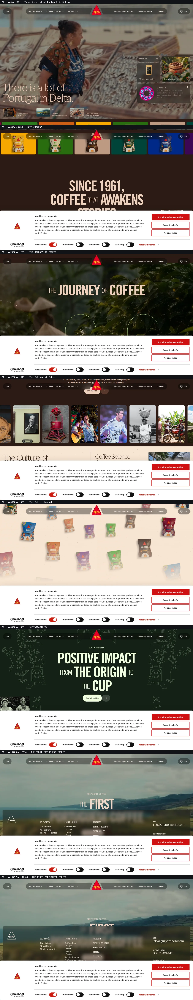
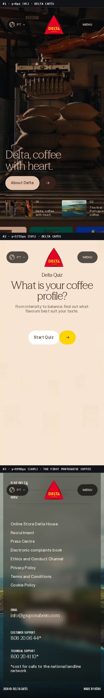

# UI Design System & Master Generation Blueprint: deltacafes-com_en

> **Delta, coffee with heart · Delta Cafés — The coffee of your life** (https://deltacafes.com/en) — Discover Delta Cafés: Portuguese coffee heritage, culture, sustainability, and experiences from bean to cup for every coffee lover.





---

## 1. Executive Visual Persona & Design Archetype

- **Brand Essence & Persona**: **Delta, coffee with heart · Delta Cafés — The coffee of your life** (`https://deltacafes.com/en`). Discover Delta Cafés: Portuguese coffee heritage, culture, sustainability, and experiences from bean to cup for every coffee lover.
- **Capture Provenance**: Live browser capture (`tier1_fast`, HTTP `200`, captured `2026-11-24`).
- **Visual Archetype**: **Dark-Substrate WebGL / Canvas Interactive Experience (`#2b1b14` / `#f7a200`)**.
- **Anti-AI-Slop Differentiators**:
  - **Live-Computed Chromatic Polarity**: Anchors the viewport in `#2b1b14` (live computed `body` `background-color` (`computed_styles.json`)) paired with `#fcf3ed` primary typography and `#f7a200` accents.
  - **Grounded Typographic Hierarchy**: Pairs `delta-season` for display copy (`Since 1961, coffee that awakens stor`) with `trade-gothic`.
  - **Calibrated Spatial Grid & Motion**: Combines `1440px` container bounds (`gap: 21.784px`, padding `6px`) with `cubic-bezier(.215,.61,.355,1)` easing and Lenis Smooth Scroll (`data-lenis`), Three.js / WebGL Canvas Pipeline.

---

## 2. Spatial Architecture & Modular Grid Mathematics

### Viewport Allocation & Container Geometry
- **Captured Journey Filmstrips**: Desktop `1280×6624px` (`assets/desktop-journey.webp`, `8` keyframes up to `y=10257px` / doc `11157px`), Mobile `390×2616px` (`assets/mobile-journey.webp`, `3` keyframes).
- **Master Container Bounds**: `1440px` (full-bleed `100%` desktop stage measured on `1440px` viewport).
- **Canvas Lateral Padding & Spacing**: `6px` lateral canvas padding with `21.784px` grid gap.
- **Border Radius Scale**: `6px`, `var(--cell-radius)`, `8px`, `4px`.

### Responsive Breakpoint Architecture
- **Desktop Layout**: Multi-column CSS Grid / Flexbox layout at `1440px` (`max-width: 1440px`, `gap: 21.784px`).
- **Mobile Layout**: Single-column vertical stack at `390px` viewport width with `6px` horizontal padding.
- **Extracted CSS Media Queries**: `@media only screen and (min-width:2000px)`, `@media only screen and (max-width:1023px)`, `@media only screen and (max-width:743px)`, `@media only screen and (max-width:410px)`.

---

## 3. Color System, Materiality & Atmospheric Lighting

### Semantic Palette & Source Grounding
| Semantic Role | Ground-Truth Value | Extracted Live / CSS Source |
|---|---|---|
| **Primary Canvas Substrate** | `#2b1b14` | live computed `body` `background-color` (`computed_styles.json`) |
| **Primary Typography Ink** | `#fcf3ed` | live computed `a` `color` (`computed_styles.json`) |
| **Elevated Surface / Card Substrate** | `#000000` | `:after { background-color: black }` (`#000000`) |
| **Interactive Accent / Highlight** | `#f7a200` | `var(--color-product-superior-accent-500)` in `:root` |
| **Secondary / Muted Copy** | `#e3c1ad` | live computed `h1` `color` (`computed_styles.json`) |
| **Structural Hairline Border** | `#cccccc` | `var(--iti-border-color)` in `:root` |
| **Variable Token (`--color-white`)** | `#ffffff` | `var(--color-white)` in `:root` |
| **Variable Token (`--color-geral-delta-yellow`)** | `#ffd300` | `var(--color-geral-delta-yellow)` in `:root` |

### Sanitized Root CSS Variables (`ui-ux.md` Ground Truth)
| Variable Name | Extracted Value | Semantic Role |
|---|---|---|
| `--initial-100vh` | `100vh` | Layout / Spatial Grid Token |
| `--native-scrollbar-width` | `0px` | Layout / Spatial Grid Token |
| `--computed-100vh` | `100vh` | Layout / Spatial Grid Token |
| `--computed-100vw` | `calc(100vw - var(--native-scrollbar-width))` | Layout / Spatial Grid Token |
| `--grid-columns` | `32` | Layout / Spatial Grid Token |
| `--grid-gap` | `clamp(12px, 8.412px + 100vw * .0092, 24px)` | Layout / Spatial Grid Token |
| `--grid-half-gap` | `calc(var(--grid-gap)*.5)` | Layout / Spatial Grid Token |
| `--grid-margin` | `clamp(12px, 8.412px + 100vw * .0092, 24px)` | Layout / Spatial Grid Token |
| `--grid-padding` | `calc(var(--grid-margin) - var(--grid-gap)*.5)` | Layout / Spatial Grid Token |
| `--grid-width` | `calc(var(--100vw) - var(--grid-margin)*2)` | Layout / Spatial Grid Token |
| `--modal-width` | `calc(var(--modal-row-width) + var(--grid-half-gap))` | Layout / Spatial Grid Token |
| `--color-black` | `#000` | Canvas / Surface Token |
| `--color-white` | `#fff` | Canvas / Surface Token |
| `--color-geral-black` | `#000` | Canvas / Surface Token |
| `--color-geral-white` | `#fff` | Canvas / Surface Token |
| `--color-geral-delta-yellow` | `#ffd300` | Brand / Palette Token |

---

## 4. Typographic Scale & Editorial Hierarchy

### Font Family Stacks
- **Display Typography**: `delta-season`.
- **Primary Body Stack**: `trade-gothic`.
- **Technical / Metadata Stack**: not declared in live computed styles (uses primary stack / `ui-monospace`).

### Typographic Scale & Rules (Live Computed & Stylesheet Grounded)
- **Hero Display (`H1`)**: live computed `h1` (`font-size: 77.28px`, `line-height: 77.28px`, `font-weight: 300`, `letter-spacing: -1.5456px`); rule `.title` (`font-size: 16px`, `line-height: 1em`, `letter-spacing: -.03em`, `font-weight: 700`).
- **Section Heading (`H2`)**: live computed `h2` (`font-size: 77.28px`, `line-height: 77.28px`, `font-weight: 300`, `letter-spacing: -1.5456px`); rule `h2` (`font-size: 12px`, `line-height: 1.3em`, `letter-spacing: -.01em`, `font-weight: 700`).
- **Body Copy**: live computed `body` (`font-size: 16px`, `line-height: 16px`, `font-weight: 400`); rule `p` (`font-size: clamp(14px,13.415px + 100vw *...`, `line-height: 1.2em`, `letter-spacing: .02em`, `font-weight: 420`).
- **Metadata & Navigation Labels**: live computed `nav/a` (`font-size: 11.84px`, `line-height: 14.208px`, `font-weight: 650`, `letter-spacing: 0.7104px`).

---

## 5. Choreographed Motion & Interaction Physics

### Primary Easing Curves
- **Extracted Timing Functions**: `cubic-bezier(.215,.61,.355,1)`, `cubic-bezier(.165,.84,.44,1)`, `cubic-bezier(.19,1,.22,1)`.

### Per-Element Transition & Choreography Rules
- **Selector `hild .cta-container .label[data-v...`**: `transition: transform .25s cubic-bezier(.215,.61,.355,1)` extracted from `deltacafes-com_en` stylesheet.
- **Selector `hild(2) .cta-container img[data-v...`**: `transition: transform .5s cubic-bezier(.215,.61,.355,1)` extracted from `deltacafes-com_en` stylesheet.
- **Selector `er .media-container .media[data-v...`**: `transition: transform .5s cubic-bezier(.215,.61,.355,1)` extracted from `deltacafes-com_en` stylesheet.
- **Extracted Easing Curve (`cubic-bezier(.215,.61,.355,1)`)**: Governs interactive state transitions across `<header.lenis>` and `<section.scroller>`.
- **Runtime Interaction Engine**: Integrates Lenis Smooth Scroll (`data-lenis`), Three.js / WebGL Canvas Pipeline, Lottie Vector Animation Player with `prefers-reduced-motion: reduce` fallback guards.
### Measured Runtime Scroll & Interaction Telemetry (`behavioral_journey_v2`)
- **Scroll Driver Mode**: `native` (max document height `11157px`, deepest scrollY reached `10257px` across `8` desktop keyframes).
- **Detected Scroll / Motion Libraries**: `Lenis`, `WebGL/Canvas`.
- **Hover Physics (`primary_cta` · `Products`)**: Computed transition `0s` / `ease` (no static color/transform shift captured at rest).
- **Route Transition Architecture**: First internal navigation (`/en/products`) measured as `MPA` in `1115ms`.

---

## 6. Component Wireframe & Structural DOM Map

### Visual Layout Schematic — Desktop (`1440px`, Grounded in `dom.html` & Landmark Bounding Boxes)
```
┌────────────────────────────────────────────────────────────────────────┐
│ DESKTOP VIEWPORT (1440px) — Delta, coffee with heart · Delta Cafés — T │
│ ====================================================================== │
│ [ <header.lenis> (1440x1127px)        | About Delta · The Azores Cof ] │
│ ---------------------------------------------------------------------- │
│ | HERO STAGE: <section.main> (w=1440px)                              | │
│ | H1: Since 1961, coffee that awakens stories                        | │
│ | Substrate: #2b1b14 | Ink: #fcf3ed | Accent: #f7a200                | │
│ ---------------------------------------------------------------------- │
│ | SHOWCASE GRID (<section.scroller>) max-w: 1440px                   | │
│ | +------------------------------+  +------------------------------+ | │
│ | | The journey of coffee        |  | The Culture of Coffee        | | │
│ | +------------------------------+  +------------------------------+ | │
│ ---------------------------------------------------------------------- │
│ | DETAIL MODULE (<section.is-ready>) — Coffee Science Centre         | │
│ ---------------------------------------------------------------------- │
│ [ FOOTER (<footer.bg-mask-defs) | https://deltacafes.com/en            │
└────────────────────────────────────────────────────────────────────────┘
```

### Visual Layout Schematic — Mobile Reflow (`390px`)
```
┌────────────────────────────────────────────────────────────────────────┐
│ MOBILE VIEWPORT REFLOW (390px) — Single-Column Stack (gap: 21.784px)   │
│ ====================================================================== │
│ [ HEADER BAR (<header.lenis>          ) | Compact Menu (390px)         │
│ ---------------------------------------------------------------------- │
│ | HERO STAGE (<section.main>) — 390px Vertical Lead                  | │
│ | H1: Since 1961, coffee that awakens stories                        | │
│ ---------------------------------------------------------------------- │
│ | SHOWCASE STACK (<section.scroller>) — 1-Col Stack                  | │
│ | [ Item 1: The journey of coffee                                  ] | │
│ | [ Item 2: The Culture of Coffee                                  ] | │
│ ---------------------------------------------------------------------- │
│ | DETAIL STACK (<section.is-ready>) — 1-Col (Coffee Science Cen)     | │
│ ---------------------------------------------------------------------- │
│ [ FOOTER (<footer.bg-mask-defs) | Stacked 390px Colophon               │
└────────────────────────────────────────────────────────────────────────┘
```

### Granular DOM Region Breakdown
1. **Brand Header & Navigation Bar (<header.lenis> — `deltacafes-com_en`)**:
   - Landmark `<header class="lenis">` (`1440x1127px`) hosting `Delta, coffee with heart · Delta Caf` navigation (`About Delta · The Azores Coffee · Products · The coffee cycle · Delta Sustainability`), DOM attributes (`data-website-id="0f29d428-885f-44b8-ae..."`, `data-onload`, `data-onerror`, `data-hid="googleTagManager"`), and stylesheet rule `first-child { grid-column:1/19;grid-row:1/2;border-radius:max(23.2px,23.2px + 100vw *... }`.
2. **Hero Stage & Focal Lead (<section.main> — `Since 1961, coffee that awakens st`)**:
   - Landmark `<section class="main">` presenting display lead `Since 1961, coffee that awakens stories` and copy excerpt *"coffee that awakens"* over `#2b1b14` canvas and `#fcf3ed` ink.
3. **Primary Showcase & Content Grid (<section.scroller> — `The journey of coffee`)**:
   - Landmark `<section class="scroller">` rendering section `The journey of coffee` with copy *"Delta Cafés was born in Campo Maior from a family’s dream. Today,"*, asset references (`entry.DAMcazEw.css`, `Footer.BmMrv4ac.css`, `TransitionLogoMask.DT4Lfp-V.css`, `TagFlag.BCy09Tyz.css`), and grid rule `.svg-wrapper { position:relative;width:52px;height:22px }`.
4. **Interactive Detail & Feature Matrix (<section.is-ready> — `The Culture of Coffee`)**:
   - Landmark `<section class="is-ready">` framing `The Culture of Coffee` and `Coffee Science Centre` (*"1986 Start of activity in Spain"*) with `#000000` surface cards, `#f7a200` accents, and `path { fill:var(--item-color) }`.
5. **Colophon & Global Directory Footer (<footer.bg-mask-defs> — `https://deltacafes.com/en`)**:
   - Landmark `<footer class="bg-mask-defs">` anchoring `Delta, coffee with heart · Delta` footer links (`About Delta · The Azores Coffee · Products · The coffee cycle · Delta Sustainability`), copy *"Start of activity in Spain"*, and `#cccccc` structural dividers.
### Full Vertical Scroll Sequence (Desktop `1440×900` Keyframes)
- **Step 01** (`y=0px`, `0%`): Active landmark `There is a lot of Portugal in Delta.` · sticky/fixed elements: `1`
- **Step 02** (`y=850px`, `8%`): Active landmark `LOTE CHÁVENA` · sticky/fixed elements: `2`
- **Step 03** (`y=2550px`, `25%`): Active landmark `THE JOURNEY OF COFFEE` · sticky/fixed elements: `2`
- **Step 04** (`y=4250px`, `41%`): Active landmark `The Culture of Coffee` · sticky/fixed elements: `2`
- **Step 05** (`y=6800px`, `66%`): Active landmark `The Coffee Journal` · sticky/fixed elements: `2`
- **Step 06** (`y=8500px`, `83%`): Active landmark `SUSTAINABILITY` · sticky/fixed elements: `2`
- **Step 07** (`y=10200px`, `99%`): Active landmark `THE FIRST PORTUGUESE COFFEE` · sticky/fixed elements: `2`
- **Step 08** (`y=10257px`, `100%`): Active landmark `THE FIRST PORTUGUESE COFFEE` · sticky/fixed elements: `2`

### Multi-Page Internal Route Map
- **Detail Route (`/en/products`)**: `https://deltacafes.com/en/products` — H1: `PRODUCTS`, scrollHeight `6018px`, transition `MPA` (`1115ms`)
- **Detail Route (`/en/the-azores-coffee`)**: `https://deltacafes.com/en/the-azores-coffee` — H1: `THE FIRST PORTUGUESE COFFEE`, scrollHeight `10739px`, transition `direct` (`1678ms`)
- **Detail Route (`/en/history`)**: `https://deltacafes.com/en/history` — H1: `60 + YEARS FROM THREE TO NEARLY 4,000. 60 YEARS O...`, scrollHeight `78685px`, transition `direct` (`2051ms`)

---

## 7. Master Zero-Shot AI Generation Prompt

```markdown
# Master Zero-Shot Frontend Generation Prompt: deltacafes-com_en (Delta, coffee with heart · Delta Cafés — The coffee of your life)

You are a principal frontend architect and design systems engineer. Build a complete, production-ready web application replicating the exact design system, DOM landmarks, typographic hierarchy, color tokens, and motion physics of `deltacafes-com_en` (**Delta, coffee with heart · Delta Cafés — The coffee of your life** — `https://deltacafes.com/en`).

### 1. Visual Archetype & Anti-AI-Slop Mandates
- **Archetype**: Dark-Substrate WebGL / Canvas Interactive Experience (`#2b1b14` / `#f7a200`).
- **Identity & Domain Context**: Discover Delta Cafés: Portuguese coffee heritage, culture, sustainability, and experiences from bean to cup for every coffee lover.
- **Primary Substrate**: `#2b1b14` (live computed `body` `background-color` (`computed_styles.json`)), **Primary Ink**: `#fcf3ed`, **Accent / Highlight**: `#f7a200`.
- **Site-Specific Differentiators**:
  - **Live-Computed Chromatic Polarity**: Anchors the viewport in `#2b1b14` (live computed `body` `background-color` (`computed_styles.json`)) paired with `#fcf3ed` primary typography and `#f7a200` accents.
  - **Grounded Typographic Hierarchy**: Pairs `delta-season` for display copy (`Since 1961, coffee that awakens stor`) with `trade-gothic`.
  - **Calibrated Spatial Grid & Motion**: Combines `1440px` container bounds (`gap: 21.784px`, padding `6px`) with `cubic-bezier(.215,.61,.355,1)` easing and Lenis Smooth Scroll (`data-lenis`), Three.js / WebGL Canvas Pipeline.

### 2. Ground-Truth CSS Variables (`:root` Token Contract)
Declare and consume these exact custom properties extracted from `deltacafes-com_en` in your global stylesheet:

:root {
  /* Delta, coffee with heart · Delta Cafés — The coffee of your life (deltacafes-com_en) — Live-Grounded CSS Variables */
  --initial-100vh: 100vh; /* Layout / Spatial Grid Token (deltacafes-com_en) */
  --native-scrollbar-width: 0px; /* Layout / Spatial Grid Token (deltacafes-com_en) */
  --computed-100vh: 100vh; /* Layout / Spatial Grid Token (deltacafes-com_en) */
  --computed-100vw: calc(100vw - var(--native-scrollbar-width)); /* Layout / Spatial Grid Token (deltacafes-com_en) */
  --grid-columns: 32; /* Layout / Spatial Grid Token (deltacafes-com_en) */
  --grid-gap: clamp(12px, 8.412px + 100vw * .0092, 24px); /* Layout / Spatial Grid Token (deltacafes-com_en) */
  --grid-half-gap: calc(var(--grid-gap)*.5); /* Layout / Spatial Grid Token (deltacafes-com_en) */
  --grid-margin: clamp(12px, 8.412px + 100vw * .0092, 24px); /* Layout / Spatial Grid Token (deltacafes-com_en) */
  --grid-padding: calc(var(--grid-margin) - var(--grid-gap)*.5); /* Layout / Spatial Grid Token (deltacafes-com_en) */
  --grid-width: calc(var(--100vw) - var(--grid-margin)*2); /* Layout / Spatial Grid Token (deltacafes-com_en) */
  --modal-width: calc(var(--modal-row-width) + var(--grid-half-gap)); /* Layout / Spatial Grid Token (deltacafes-com_en) */
  --color-black: #000; /* Canvas / Surface Token (deltacafes-com_en) */
  --color-white: #fff; /* Canvas / Surface Token (deltacafes-com_en) */
  --color-geral-black: #000; /* Canvas / Surface Token (deltacafes-com_en) */
  --color-geral-white: #fff; /* Canvas / Surface Token (deltacafes-com_en) */
  --color-geral-delta-yellow: #ffd300; /* Brand / Palette Token (deltacafes-com_en) */
}

### 3. Semantic Color & Materiality Contract
Map every surface, ink, and border strictly to these source-grounded tokens:
- **Primary Canvas Substrate**: `#2b1b14` — grounded in live computed `body` `background-color` (`computed_styles.json`)
- **Primary Typography Ink**: `#fcf3ed` — grounded in live computed `a` `color` (`computed_styles.json`)
- **Elevated Surface / Card Substrate**: `#000000` — grounded in `:after { background-color: black }` (`#000000`)
- **Interactive Accent / Highlight**: `#f7a200` — grounded in `var(--color-product-superior-accent-500)` in `:root`
- **Secondary / Muted Copy**: `#e3c1ad` — grounded in live computed `h1` `color` (`computed_styles.json`)
- **Structural Hairline Border**: `#cccccc` — grounded in `var(--iti-border-color)` in `:root`
- **Variable Token (`--color-white`)**: `#ffffff` — grounded in `var(--color-white)` in `:root`
- **Variable Token (`--color-geral-delta-yellow`)**: `#ffd300` — grounded in `var(--color-geral-delta-yellow)` in `:root`

### 4. Spatial Grid, Container Bounds & Responsive Breakpoints
- **Desktop Viewport Reference**: `1280×6624px` (multi-frame vertical journey filmstrip (6624px), `1440px` standard desktop width).
- **Mobile Viewport Reference**: `390×2616px` (multi-frame vertical journey filmstrip (2616px), `390px` standard mobile width).
- **Container Max-Width**: `1440px` (full-bleed `100%` desktop stage measured on `1440px` viewport)
- **Padding & Gutters**: `6px` lateral canvas padding with `21.784px` grid gap
- **Desktop Grid**: Multi-column CSS Grid / Flexbox layout at `1440px` (`max-width: 1440px`, `gap: 21.784px`)
- **Mobile Adaptation**: Single-column vertical stack at `390px` viewport width with `6px` horizontal padding
- **Media Queries**: `@media only screen and (min-width:2000px)`, `@media only screen and (max-width:1023px)`, `@media only screen and (max-width:743px)`, `@media only screen and (max-width:410px)`
- **Corner Radii**: `6px`, `var(--cell-radius)`, `8px`, `4px`

### 5. Typography & Editorial Scale Contract
- **Display Font Stack**: `delta-season`
- **Body Font Stack**: `trade-gothic`
- **Monospace / Technical Font Stack**: not declared in live computed styles (uses primary stack / `ui-monospace`)
- **H1 Display Rule**: live computed `h1` (`font-size: 77.28px`, `line-height: 77.28px`, `font-weight: 300`, `letter-spacing: -1.5456px`); rule `.title` (`font-size: 16px`, `line-height: 1em`, `letter-spacing: -.03em`, `font-weight: 700`)
- **H2 Section Rule**: live computed `h2` (`font-size: 77.28px`, `line-height: 77.28px`, `font-weight: 300`, `letter-spacing: -1.5456px`); rule `h2` (`font-size: 12px`, `line-height: 1.3em`, `letter-spacing: -.01em`, `font-weight: 700`)
- **Body Copy Rule**: live computed `body` (`font-size: 16px`, `line-height: 16px`, `font-weight: 400`); rule `p` (`font-size: clamp(14px,13.415px + 100vw *...`, `line-height: 1.2em`, `letter-spacing: .02em`, `font-weight: 420`)
- **Metadata & Index Rule**: live computed `nav/a` (`font-size: 11.84px`, `line-height: 14.208px`, `font-weight: 650`, `letter-spacing: 0.7104px`)

### 6. Component Hierarchy, Verbatim Copy & Real DOM Landmarks
Scaffold `deltacafes-com_en` (`Delta, coffee with heart · Delta Cafés — The coffee of your life`) with these exact structural regions, extracted copy, and CSS rules from `dom.html`:
1. **Brand Header & Navigation Bar (<header.lenis> — `deltacafes-com_en`)**:
   - DOM & Selectors: Landmark `<header class="lenis">` (`1440x1127px`) hosting `Delta, coffee with heart · Delta Caf` navigation (`About Delta · The Azores Coffee · Products · The coffee cycle · Delta Sustainability`), DOM attributes (`data-website-id="0f29d428-885f-44b8-ae..."`, `data-onload`, `data-onerror`, `data-hid="googleTagManager"`), and stylesheet rule `first-child { grid-column:1/19;grid-row:1/2;border-radius:max(23.2px,23.2px + 100vw *... }`.
   - Responsive Contract: Header `Brand Header & Navigation Bar (<header.lenis> — `deltacafes-com_en`)` (`deltacafes-com_en`) adapts across `@media only screen and (min-width:2000px)`, `@media only screen and (max-width:1023px)`, `@media only screen and (max-width:743px)`, `@media only screen and (max-width:410px)` with `cubic-bezier(.215,.61,.355,1)`, `cubic-bezier(.165,.84,.44,1)`, `cubic-bezier(.19,1,.22,1)` transitions and links `About Delta · The Azores Coffee · Products · The coffee cycle · Delta Sustainability`.
2. **Hero Stage & Focal Lead (<section.main> — `Since 1961, coffee that awakens st`)**:
   - DOM & Selectors: Landmark `<section class="main">` presenting display lead `Since 1961, coffee that awakens stories` and copy excerpt *"coffee that awakens"* over `#2b1b14` canvas and `#fcf3ed` ink.
   - Responsive Contract: Hero stage (`1280×6624px` desktop / `390×2616px` mobile) sets `#2b1b14` background with `#fcf3ed` headline `Since 1961, coffee that awakens stories`.
3. **Primary Showcase & Content Grid (<section.scroller> — `The journey of coffee`)**:
   - DOM & Selectors: Landmark `<section class="scroller">` rendering section `The journey of coffee` with copy *"Delta Cafés was born in Campo Maior from a family’s dream. Today,"*, asset references (`entry.DAMcazEw.css`, `Footer.BmMrv4ac.css`, `TransitionLogoMask.DT4Lfp-V.css`, `TagFlag.BCy09Tyz.css`), and grid rule `.svg-wrapper { position:relative;width:52px;height:22px }`.
   - Responsive Contract: Showcase grid `Primary Showcase & Content Grid (<section.scroller> — `The journey of coffee`)` applies Multi-column CSS Grid / Flexbox layout at `1440px` (`max-width: 1440px`, `gap: 21.784px`) on desktop and Single-column vertical stack at `390px` viewport width with `6px` horizontal padding on mobile.
4. **Interactive Detail & Feature Matrix (<section.is-ready> — `The Culture of Coffee`)**:
   - DOM & Selectors: Landmark `<section class="is-ready">` framing `The Culture of Coffee` and `Coffee Science Centre` (*"1986 Start of activity in Spain"*) with `#000000` surface cards, `#f7a200` accents, and `path { fill:var(--item-color) }`.
   - Responsive Contract: Detail module `Interactive Detail & Feature Matrix (<section.is-ready> — `The Culture of Coffee`)` uses `6px`, `var(--cell-radius)`, `8px`, `4px` radii, `#f7a200` highlights, and assets (entry.DAMcazEw.css, Footer.BmMrv4ac.css, TransitionLogoMask.DT4Lfp-V.css).
5. **Colophon & Global Directory Footer (<footer.bg-mask-defs> — `https://deltacafes.com/en`)**:
   - DOM & Selectors: Landmark `<footer class="bg-mask-defs">` anchoring `Delta, coffee with heart · Delta` footer links (`About Delta · The Azores Coffee · Products · The coffee cycle · Delta Sustainability`), copy *"Start of activity in Spain"*, and `#cccccc` structural dividers.
   - Responsive Contract: Footer `Colophon & Global Directory Footer (<footer.bg-mask-defs> — `https://deltacafes.com/en`)` aligns to `1440px` (full-bleed `100%` desktop stage measured on `1440px` viewport) with `6px` lateral canvas padding with `21.784px` grid gap and attributes (data-website-id="0f29d428-885f-44b8-ae...", data-onload, data-onerror).

#### Verbatim DOM Copy Excerpts (`dom.html`)
- Copy Excerpt 1: *"coffee that awakens"*
- Copy Excerpt 2: *"Delta Cafés was born in Campo Maior from a family’s dream. Today, it is part of th..."*
- Copy Excerpt 3: *"1986 Start of activity in Spain"*
- Copy Excerpt 4: *"Start of activity in Spain"*

### 7. Motion, Extracted Stylesheet Rules & Interaction Choreography
- **Primary Easing Functions**: `cubic-bezier(.215,.61,.355,1)`, `cubic-bezier(.165,.84,.44,1)`, `cubic-bezier(.19,1,.22,1)`
- **Extracted Stylesheet Rules (`deltacafes-com_en`)**:
- `first-child { grid-column:1/19;grid-row:1/2;border-radius:max(23.2px,23.2px + 100vw *... }`
- `.svg-wrapper { position:relative;width:52px;height:22px }`
- `path { fill:var(--item-color) }`
- `active { cursor:grabbing }`
- `after { position:absolute;content:"";inset:0;pointer-events:none;z-index:3;backg... }`
- **Per-Selector Transition Rules**:
- **Selector `hild .cta-container .label[data-v...`**: `transition: transform .25s cubic-bezier(.215,.61,.355,1)` extracted from `deltacafes-com_en` stylesheet.
- **Selector `hild(2) .cta-container img[data-v...`**: `transition: transform .5s cubic-bezier(.215,.61,.355,1)` extracted from `deltacafes-com_en` stylesheet.
- **Selector `er .media-container .media[data-v...`**: `transition: transform .5s cubic-bezier(.215,.61,.355,1)` extracted from `deltacafes-com_en` stylesheet.
- **Extracted Easing Curve (`cubic-bezier(.215,.61,.355,1)`)**: Governs interactive state transitions across `<header.lenis>` and `<section.scroller>`.
- **Runtime Interaction Engine**: Integrates Lenis Smooth Scroll (`data-lenis`), Three.js / WebGL Canvas Pipeline, Lottie Vector Animation Player with `prefers-reduced-motion: reduce` fallback guards.
### 7b. Full-Page Scroll Choreography, Interactive States & Multi-Page Routes
- **Scroll Mechanics**: Implement `native` vertical progression up to `11157px` across 8 distinct viewport chapters using Lenis, WebGL/Canvas.
- **Vertical Chapter Sequence**: There is a lot of Portugal... (0%) -> LOTE CHÁVENA (8%) -> THE JOURNEY OF COFFEE (25%) -> The Culture of Coffee (41%) -> The Coffee Journal (66%) -> SUSTAINABILITY (83%) -> THE FIRST PORTUGUESE COFFEE (99%) -> THE FIRST PORTUGUESE COFFEE (100%).
- **Multi-Page Routes**: Scaffold internal routes `/en/products` (detail, MPA), `/en/the-azores-coffee` (detail, direct), `/en/history` (detail, direct) sharing the global header/footer shell and design tokens.

### 8. Technical Deliverables
- Implement in Next.js (App Router) with TypeScript and Tailwind CSS consuming the `:root` custom properties defined above for `deltacafes-com_en`.
- Reproduce both the `1440px` desktop architecture and `390px` mobile breakpoint transitions, preserving semantic HTML5 landmarks (`<header>`, `<nav>`, `<main>`, `<section>`, `<footer>`) and `prefers-reduced-motion` accessibility guards.
```
---

## 8. Full-Page Scroll Journey, Interactive States & Subpage Inventory

### Desktop Scroll Keyframes (`1440×900` WebP)
| Step | Scroll Y | Progress | Active Landmark / Section | Sticky/Fixed | Visual Asset |
| :---: | :---: | :---: | :--- | :---: | :--- |
| `#01` | `0px` | `0%` | There is a lot of Portugal in Delta. | `1` | [desktop-step-01.webp](assets/desktop-step-01.webp) |
| `#02` | `850px` | `8%` | LOTE CHÁVENA | `2` | [desktop-step-02.webp](assets/desktop-step-02.webp) |
| `#03` | `2550px` | `25%` | THE JOURNEY OF COFFEE | `2` | [desktop-step-03.webp](assets/desktop-step-03.webp) |
| `#04` | `4250px` | `41%` | The Culture of Coffee | `2` | [desktop-step-04.webp](assets/desktop-step-04.webp) |
| `#05` | `6800px` | `66%` | The Coffee Journal | `2` | [desktop-step-05.webp](assets/desktop-step-05.webp) |
| `#06` | `8500px` | `83%` | SUSTAINABILITY | `2` | [desktop-step-06.webp](assets/desktop-step-06.webp) |
| `#07` | `10200px` | `99%` | THE FIRST PORTUGUESE COFFEE | `2` | [desktop-step-07.webp](assets/desktop-step-07.webp) |
| `#08` | `10257px` | `100%` | THE FIRST PORTUGUESE COFFEE | `2` | [desktop-step-08.webp](assets/desktop-step-08.webp) |

### Mobile Condensed Keyframes (`390×844` WebP)
| Step | Scroll Y | Progress | Active Landmark | Visual Asset |
| :---: | :---: | :---: | :--- | :--- |
| `#01` | `0px` | `0%` | DELTA CAFÉS | [mobile-step-01.webp](assets/mobile-step-01.webp) |
| `#02` | `5755px` | `50%` | DELTA CAFÉS | [mobile-step-02.webp](assets/mobile-step-02.webp) |
| `#03` | `9998px` | `100%` | THE FIRST PORTUGUESE COFFEE | [mobile-step-03.webp](assets/mobile-step-03.webp) |

### Internal Subpage Filmstrips (`1080px` Wide WebP)
| # | Template | Route URL | H1 / Title | Scroll Height | Transition | Filmstrip Asset |
| :-: | :---: | :--- | :--- | :---: | :---: | :--- |
| `1` | `detail` | `https://deltacafes.com/en/products` | PRODUCTS | `6018px` | `MPA` (`1115ms`) | [subpage-01-en-products.webp](assets/subpage-01-en-products.webp) |
| `2` | `detail` | `https://deltacafes.com/en/the-azores-coffee` | THE FIRST PORTUGUESE COFFEE | `10739px` | `direct` (`1678ms`) | [subpage-02-en-the-azores-coffee.webp](assets/subpage-02-en-the-azores-coffee.webp) |
| `3` | `detail` | `https://deltacafes.com/en/history` | 60 + YEARS FROM THREE TO NEARLY 4,000... | `78685px` | `direct` (`2051ms`) | [subpage-03-en-history.webp](assets/subpage-03-en-history.webp) |

