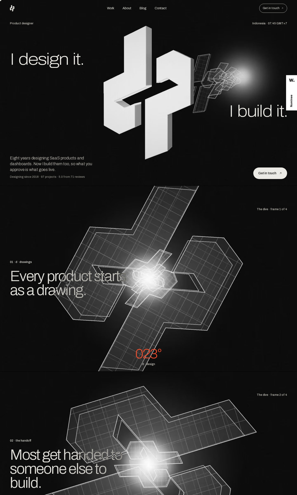

# UI Design System & Master Generation Blueprint: dennypratama-com

> **Denny Pratama · Product designer who now builds what he designs** (https://dennypratama.com) — Eight years designing SaaS products and dashboards, now building them too. I design it. I build it.



---

## 1. Executive Visual Persona & Design Archetype

- **Brand Essence & Persona**: **Denny Pratama · Product designer who now builds what he designs** (`https://dennypratama.com`). Eight years designing SaaS products and dashboards, now building them too. I design it. I build it.
- **Capture Provenance**: Live browser capture (`tier1_fast`, HTTP `200`, captured `2026-11-23`).
- **Visual Archetype**: **Dark-Substrate WebGL / Canvas Interactive Experience (`#0c0c0b` / `#ff0000`)**.
- **Anti-AI-Slop Differentiators**:
  - **Live-Computed Chromatic Polarity**: Anchors the viewport in `#0c0c0b` (live computed `body` `background-color` (`computed_styles.json`)) paired with `#ffffff` primary typography and `#ff0000` accents.
  - **Grounded Typographic Hierarchy**: Pairs `Archivo` for display copy (`Denny Pratama, product designer. I d`) with `Archivo Fallback` and `ui-monospace)`.
  - **Calibrated Spatial Grid & Motion**: Combines `1440px` container bounds (`gap: 40px`, padding `var(--pad)`) with `cubic-bezier(.16,1,.3,1)` easing and Lenis Smooth Scroll (`data-lenis`), GSAP Timeline & ScrollTrigger.

---

## 2. Spatial Architecture & Modular Grid Mathematics


### Viewport Allocation & Container Geometry
- **Captured Viewport Dimensions**: Desktop `1440×2400px` (`assets/desktop.png`, clamped at 2400px live multi-section capture), Mobile `390×2400px` (`assets/mobile.png`, clamped at 2400px live multi-section capture).
- **Master Container Bounds**: `1440px` (full-bleed `100%` desktop stage measured on `1440px` viewport).
- **Canvas Lateral Padding & Spacing**: `var(--pad)` lateral canvas padding with `40px` grid gap.
- **Border Radius Scale**: `var(--r-s)`, `var(--r-full)`, `50%`, `var(--r-m)`.

### Responsive Breakpoint Architecture
- **Desktop Layout**: Multi-column CSS Grid / Flexbox layout at `1440px` (`max-width: 1440px`, `gap: 40px`).
- **Mobile Layout**: Single-column vertical stack at `390px` viewport width with `var(--pad)` horizontal padding.
- **Extracted CSS Media Queries**: `@media (max-width:1359px)`, `@media (max-width:1023px)`, `@media (max-width:767px)`, `@media (max-width:900px)`.

---

## 3. Color System, Materiality & Atmospheric Lighting

### Semantic Palette & Source Grounding
| Semantic Role | Ground-Truth Value | Extracted Live / CSS Source |
|---|---|---|
| **Primary Canvas Substrate** | `#0c0c0b` | live computed `body` `background-color` (`computed_styles.json`) |
| **Primary Typography Ink** | `#ffffff` | live computed `body` `color` (`computed_styles.json`) |
| **Elevated Surface / Card Substrate** | `#ff0000` | `.site ::selection { background: red }` (`#ff0000`) |
| **Interactive Accent / Highlight** | `#ff0000` | `.btn:before { background: red }` (`#ff0000`) |
| **Secondary / Muted Copy** | `#c9c6be` | live computed `p` `color` (`computed_styles.json`) |
| **Structural Hairline Border** | `#2c2b2a` | `var(--line)` in `:root` (`eceae424`) |
| **Variable Token (`--ink-2`)** | `#151514` | `var(--ink-2)` in `:root` |
| **Variable Token (`--ink-3`)** | `#1f1f1d` | `var(--ink-3)` in `:root` |
| **Variable Token (`--bone`)** | `#eceae4` | `var(--bone)` in `:root` |
| **Variable Token (`--bone-3`)** | `#e2dfd8` | `var(--bone-3)` in `:root` |
| **Variable Token (`--mute`)** | `#8c8a84` | `var(--mute)` in `:root` |
| **Variable Token (`--dim`)** | `#3b3a36` | `var(--dim)` in `:root` |
| **Variable Token (`--pm`)** | `#5f5d57` | `var(--pm)` in `:root` |
| **Variable Token (`--red`)** | `#ff4f2b` | `var(--red)` in `:root` |
| **Variable Token (`--ok`)** | `#3ccf7d` | `var(--ok)` in `:root` |

### Sanitized Root CSS Variables (`ui-ux.md` Ground Truth)
| Variable Name | Extracted Value | Semantic Role |
|---|---|---|
| `--ink` | `#0c0c0b` | Typography Ink Token |
| `--ink-2` | `#151514` | Typography Ink Token |
| `--ink-3` | `#1f1f1d` | Typography Ink Token |
| `--bone` | `#eceae4` | Color / Atmospheric Token |
| `--bone-2` | `#c9c6be` | Color / Atmospheric Token |
| `--bone-3` | `#e2dfd8` | Color / Atmospheric Token |
| `--mute` | `#8c8a84` | Color / Atmospheric Token |
| `--dim` | `#3b3a36` | Color / Atmospheric Token |
| `--line` | `#eceae424` | Color / Atmospheric Token |
| `--line-2` | `#eceae447` | Color / Atmospheric Token |
| `--lp` | `#0c0c0b24` | Color / Atmospheric Token |
| `--lp2` | `#0c0c0b52` | Color / Atmospheric Token |
| `--pm` | `#5f5d57` | Color / Atmospheric Token |
| `--red` | `#ff4f2b` | Color / Atmospheric Token |
| `--ok` | `#3ccf7d` | Color / Atmospheric Token |
| `--e-out` | `cubic-bezier(.16,1,.3,1)` | Motion / Timing Token |

---

## 4. Typographic Scale & Editorial Hierarchy

### Font Family Stacks
- **Display Typography**: `Archivo`.
- **Primary Body Stack**: `Archivo Fallback`.
- **Technical / Metadata Stack**: `ui-monospace)`.

### Typographic Scale & Rules (Live Computed & Stylesheet Grounded)
- **Hero Display (`H1`)**: live computed `h1` (`font-size: 32px`, `line-height: 24px`, `font-weight: 700`); CSS variables `--fs-h1: 64px`, `--lh-h1: 64px`; rule `h1` (`font-size: var(--fs-mega)`, `line-height: var(--lh-mega)`).
- **Section Heading (`H2`)**: live computed `h2` (`font-size: 96px`, `line-height: 88px`, `font-weight: 300`, `letter-spacing: -4.8px`); CSS variables `--fs-h2: 48px`, `--lh-h2: 52px`; rule `h2` (`font-size: var(--fs-h3)`, `line-height: var(--lh-h3)`, `letter-spacing: -.025em`, `font-weight: 400`).
- **Body Copy**: live computed `body` (`font-size: 16px`, `line-height: normal`, `font-weight: 400`); CSS variables `--fs-body: 16px`, `--lh-body: 24px`; rule `p` (`font-size: var(--fs-lead)`, `line-height: var(--lh-lead)`, `letter-spacing: -.01em`).
- **Metadata & Navigation Labels**: live computed `nav/a` (`font-size: 16px`, `line-height: 24px`, `font-weight: 400`, `letter-spacing: -0.16px`); CSS variables `--fs-label: 14px`, `--lh-label: 20px`, `--fs-sm: 12px`; rule `small` (`font-size: 11px`).

---

## 5. Choreographed Motion & Interaction Physics

### Primary Easing Curves
- **Extracted Timing Functions**: `cubic-bezier(.16,1,.3,1)`, `cubic-bezier(.83,0,.17,1)`.

### Per-Element Transition & Choreography Rules
- **Selector `.btn:before`**: `transition: transform .6s var(--e-out)` extracted from `dennypratama-com` stylesheet.
- **Selector `.btn .ico`**: `transition: transform .5s var(--e-out)` extracted from `dennypratama-com` stylesheet.
- **Selector `.lnk`**: `transition: border-color .4s` extracted from `dennypratama-com` stylesheet.
- **Extracted Easing Curve (`cubic-bezier(.16,1,.3,1)`)**: Governs interactive state transitions across `<header.nav>` and `<section.work>`.
- **Runtime Interaction Engine**: Integrates Lenis Smooth Scroll (`data-lenis`), GSAP Timeline & ScrollTrigger, Three.js / WebGL Canvas Pipeline with `prefers-reduced-motion: reduce` fallback guards.

---

## 6. Component Wireframe & Structural DOM Map

### Visual Layout Schematic — Desktop (`1440px`, Grounded in `dom.html` & Landmark Bounding Boxes)
```
┌────────────────────────────────────────────────────────────────────────┐
│ DESKTOP VIEWPORT (1440px) — Denny Pratama · Product designer who now b │
│ ====================================================================== │
│ [ <header.nav> (1440x80px)            | Work · About · Blog · Contac ] │
│ ---------------------------------------------------------------------- │
│ | HERO STAGE: <section.hero> (w=1440px)                              | │
│ | H1: Denny Pratama, product designer. I design it. I b...           | │
│ | Substrate: #0c0c0b | Ink: #ffffff | Accent: #ff0000                | │
│ ---------------------------------------------------------------------- │
│ | SHOWCASE GRID (<section.work>) max-w: 1440px                       | │
│ | +------------------------------+  +------------------------------+ | │
│ | | Drawn, then shipped.         |  | The mark, constructed: a piv | | │
│ | +------------------------------+  +------------------------------+ | │
│ ---------------------------------------------------------------------- │
│ | DETAIL MODULE (<section.con>) — One angle, eleven poi              | │
│ ---------------------------------------------------------------------- │
│ [ FOOTER (<footer.ct>         ) | https://dennypratama.com             │
└────────────────────────────────────────────────────────────────────────┘
```

### Visual Layout Schematic — Mobile Reflow (`390px`)
```
┌────────────────────────────────────────────────────────────────────────┐
│ MOBILE VIEWPORT REFLOW (390px) — Single-Column Stack (gap: 40px)       │
│ ====================================================================== │
│ [ HEADER BAR (<header.nav>            ) | Compact Menu (390px)         │
│ ---------------------------------------------------------------------- │
│ | HERO STAGE (<section.hero>) — 390px Vertical Lead                  | │
│ | H1: Denny Pratama, product designer. I design it. I b...           | │
│ ---------------------------------------------------------------------- │
│ | SHOWCASE STACK (<section.work>) — 1-Col Stack                      | │
│ | [ Item 1: Drawn, then shipped.                                   ] | │
│ | [ Item 2: The mark, constructed: a pivot, one angle, eleven...   ] | │
│ ---------------------------------------------------------------------- │
│ | DETAIL STACK (<section.con>) — 1-Col (One angle, eleven )          | │
│ ---------------------------------------------------------------------- │
│ [ FOOTER (<footer.ct>         ) | Stacked 390px Colophon               │
└────────────────────────────────────────────────────────────────────────┘
```

### Granular DOM Region Breakdown
1. **Brand Header & Navigation Bar (<header.nav> — `dennypratama-com`)**:
   - Landmark `<header class="nav">` (`1440x80px`) hosting `Denny Pratama · Product designer who` navigation (`Work · About · Blog · Contact`), DOM attributes (`data-precedence="next"`, `data-mode`, `data-cursor="link"`, `data-cursor="link"`), and stylesheet rule `.iX1fDW_className { font-family:Archivo,Archivo Fallback;font-style:normal }`.
2. **Hero Stage & Focal Lead (<section.hero> — `Denny Pratama, product designer. I`)**:
   - Landmark `<section class="hero">` presenting display lead `Denny Pratama, product designer. I design it. I b...` and copy excerpt *"Indonesia · 07:45 GMT+7"* over `#0c0c0b` canvas and `#ffffff` ink.
3. **Primary Showcase & Content Grid (<section.work> — `Drawn, then shipped.`)**:
   - Landmark `<section class="work on-bone">` rendering section `Drawn, then shipped.` with copy *"01 · d · drawings Every product starts as a drawing."*, asset references (`21ca8f3f56c22ca2-s.p.14a9xpaqsbpp...`, `38ornfmwrfpoc.css`, `3rqd4qnakn6f7.js`, `3j77l_h18tv3f.js`), and grid rule `.iX1fDW_variable { --font-archivo:"Archivo", "Archivo Fallback" }`.
4. **Interactive Detail & Feature Matrix (<section.con> — `The mark, constructed: a pivot, on`)**:
   - Landmark `<section class="con">` framing `The mark, constructed: a pivot, one angle, eleven...` and `One angle, eleven points` (*"02 · the handoff Most get handed to someone else to build."*) with `#ff0000` surface cards, `#ff0000` accents, and `property --w { syntax:"<percentage>";inherits:false;initial-value:100% }`.
5. **Colophon & Global Directory Footer (<footer.ct> — `https://dennypratama.com`)**:
   - Landmark `<footer class="ct">` anchoring `Denny Pratama · Product designer` footer links (`Work · About · Blog · Contact`), copy *"03 · the gap That handoff is where they lose their shape."*, and `#2c2b2a` structural dividers.

---

## 7. Master Zero-Shot AI Generation Prompt

```markdown
# Master Zero-Shot Frontend Generation Prompt: dennypratama-com (Denny Pratama · Product designer who now builds what he designs)

You are a principal frontend architect and design systems engineer. Build a complete, production-ready web application replicating the exact design system, DOM landmarks, typographic hierarchy, color tokens, and motion physics of `dennypratama-com` (**Denny Pratama · Product designer who now builds what he designs** — `https://dennypratama.com`).

### 1. Visual Archetype & Anti-AI-Slop Mandates
- **Archetype**: Dark-Substrate WebGL / Canvas Interactive Experience (`#0c0c0b` / `#ff0000`).
- **Identity & Domain Context**: Eight years designing SaaS products and dashboards, now building them too. I design it. I build it.
- **Primary Substrate**: `#0c0c0b` (live computed `body` `background-color` (`computed_styles.json`)), **Primary Ink**: `#ffffff`, **Accent / Highlight**: `#ff0000`.
- **Site-Specific Differentiators**:
  - **Live-Computed Chromatic Polarity**: Anchors the viewport in `#0c0c0b` (live computed `body` `background-color` (`computed_styles.json`)) paired with `#ffffff` primary typography and `#ff0000` accents.
  - **Grounded Typographic Hierarchy**: Pairs `Archivo` for display copy (`Denny Pratama, product designer. I d`) with `Archivo Fallback` and `ui-monospace)`.
  - **Calibrated Spatial Grid & Motion**: Combines `1440px` container bounds (`gap: 40px`, padding `var(--pad)`) with `cubic-bezier(.16,1,.3,1)` easing and Lenis Smooth Scroll (`data-lenis`), GSAP Timeline & ScrollTrigger.

### 2. Ground-Truth CSS Variables (`:root` Token Contract)
Declare and consume these exact custom properties extracted from `dennypratama-com` in your global stylesheet:

:root {
  /* Denny Pratama · Product designer who now builds what he designs (dennypratama-com) — Live-Grounded CSS Variables */
  --ink: #0c0c0b; /* Typography Ink Token (dennypratama-com) */
  --ink-2: #151514; /* Typography Ink Token (dennypratama-com) */
  --ink-3: #1f1f1d; /* Typography Ink Token (dennypratama-com) */
  --bone: #eceae4; /* Color / Atmospheric Token (dennypratama-com) */
  --bone-2: #c9c6be; /* Color / Atmospheric Token (dennypratama-com) */
  --bone-3: #e2dfd8; /* Color / Atmospheric Token (dennypratama-com) */
  --mute: #8c8a84; /* Color / Atmospheric Token (dennypratama-com) */
  --dim: #3b3a36; /* Color / Atmospheric Token (dennypratama-com) */
  --line: #eceae424; /* Color / Atmospheric Token (dennypratama-com) */
  --line-2: #eceae447; /* Color / Atmospheric Token (dennypratama-com) */
  --lp: #0c0c0b24; /* Color / Atmospheric Token (dennypratama-com) */
  --lp2: #0c0c0b52; /* Color / Atmospheric Token (dennypratama-com) */
  --pm: #5f5d57; /* Color / Atmospheric Token (dennypratama-com) */
  --red: #ff4f2b; /* Color / Atmospheric Token (dennypratama-com) */
  --ok: #3ccf7d; /* Color / Atmospheric Token (dennypratama-com) */
  --e-out: cubic-bezier(.16,1,.3,1); /* Motion / Timing Token (dennypratama-com) */
}

### 3. Semantic Color & Materiality Contract
Map every surface, ink, and border strictly to these source-grounded tokens:
- **Primary Canvas Substrate**: `#0c0c0b` — grounded in live computed `body` `background-color` (`computed_styles.json`)
- **Primary Typography Ink**: `#ffffff` — grounded in live computed `body` `color` (`computed_styles.json`)
- **Elevated Surface / Card Substrate**: `#ff0000` — grounded in `.site ::selection { background: red }` (`#ff0000`)
- **Interactive Accent / Highlight**: `#ff0000` — grounded in `.btn:before { background: red }` (`#ff0000`)
- **Secondary / Muted Copy**: `#c9c6be` — grounded in live computed `p` `color` (`computed_styles.json`)
- **Structural Hairline Border**: `#2c2b2a` — grounded in `var(--line)` in `:root` (`eceae424`)
- **Variable Token (`--ink-2`)**: `#151514` — grounded in `var(--ink-2)` in `:root`
- **Variable Token (`--ink-3`)**: `#1f1f1d` — grounded in `var(--ink-3)` in `:root`
- **Variable Token (`--bone`)**: `#eceae4` — grounded in `var(--bone)` in `:root`
- **Variable Token (`--bone-3`)**: `#e2dfd8` — grounded in `var(--bone-3)` in `:root`
- **Variable Token (`--mute`)**: `#8c8a84` — grounded in `var(--mute)` in `:root`
- **Variable Token (`--dim`)**: `#3b3a36` — grounded in `var(--dim)` in `:root`
- **Variable Token (`--pm`)**: `#5f5d57` — grounded in `var(--pm)` in `:root`
- **Variable Token (`--red`)**: `#ff4f2b` — grounded in `var(--red)` in `:root`
- **Variable Token (`--ok`)**: `#3ccf7d` — grounded in `var(--ok)` in `:root`

### 4. Spatial Grid, Container Bounds & Responsive Breakpoints
- **Desktop Viewport Reference**: `1440×2400px` (clamped at 2400px live multi-section capture, `1440px` standard desktop width).
- **Mobile Viewport Reference**: `390×2400px` (clamped at 2400px live multi-section capture, `390px` standard mobile width).
- **Container Max-Width**: `1440px` (full-bleed `100%` desktop stage measured on `1440px` viewport)
- **Padding & Gutters**: `var(--pad)` lateral canvas padding with `40px` grid gap
- **Desktop Grid**: Multi-column CSS Grid / Flexbox layout at `1440px` (`max-width: 1440px`, `gap: 40px`)
- **Mobile Adaptation**: Single-column vertical stack at `390px` viewport width with `var(--pad)` horizontal padding
- **Media Queries**: `@media (max-width:1359px)`, `@media (max-width:1023px)`, `@media (max-width:767px)`, `@media (max-width:900px)`
- **Corner Radii**: `var(--r-s)`, `var(--r-full)`, `50%`, `var(--r-m)`

### 5. Typography & Editorial Scale Contract
- **Display Font Stack**: `Archivo`
- **Body Font Stack**: `Archivo Fallback`
- **Monospace / Technical Font Stack**: `ui-monospace)`
- **H1 Display Rule**: live computed `h1` (`font-size: 32px`, `line-height: 24px`, `font-weight: 700`); CSS variables `--fs-h1: 64px`, `--lh-h1: 64px`; rule `h1` (`font-size: var(--fs-mega)`, `line-height: var(--lh-mega)`)
- **H2 Section Rule**: live computed `h2` (`font-size: 96px`, `line-height: 88px`, `font-weight: 300`, `letter-spacing: -4.8px`); CSS variables `--fs-h2: 48px`, `--lh-h2: 52px`; rule `h2` (`font-size: var(--fs-h3)`, `line-height: var(--lh-h3)`, `letter-spacing: -.025em`, `font-weight: 400`)
- **Body Copy Rule**: live computed `body` (`font-size: 16px`, `line-height: normal`, `font-weight: 400`); CSS variables `--fs-body: 16px`, `--lh-body: 24px`; rule `p` (`font-size: var(--fs-lead)`, `line-height: var(--lh-lead)`, `letter-spacing: -.01em`)
- **Metadata & Index Rule**: live computed `nav/a` (`font-size: 16px`, `line-height: 24px`, `font-weight: 400`, `letter-spacing: -0.16px`); CSS variables `--fs-label: 14px`, `--lh-label: 20px`, `--fs-sm: 12px`; rule `small` (`font-size: 11px`)

### 6. Component Hierarchy, Verbatim Copy & Real DOM Landmarks
Scaffold `dennypratama-com` (`Denny Pratama · Product designer who now builds what he designs`) with these exact structural regions, extracted copy, and CSS rules from `dom.html`:
1. **Brand Header & Navigation Bar (<header.nav> — `dennypratama-com`)**:
   - DOM & Selectors: Landmark `<header class="nav">` (`1440x80px`) hosting `Denny Pratama · Product designer who` navigation (`Work · About · Blog · Contact`), DOM attributes (`data-precedence="next"`, `data-mode`, `data-cursor="link"`, `data-cursor="link"`), and stylesheet rule `.iX1fDW_className { font-family:Archivo,Archivo Fallback;font-style:normal }`.
   - Responsive Contract: Header `Brand Header & Navigation Bar (<header.nav> — `dennypratama-com`)` (`dennypratama-com`) adapts across `@media (max-width:1359px)`, `@media (max-width:1023px)`, `@media (max-width:767px)`, `@media (max-width:900px)` with `cubic-bezier(.16,1,.3,1)`, `cubic-bezier(.83,0,.17,1)` transitions and links `Work · About · Blog · Contact`.
2. **Hero Stage & Focal Lead (<section.hero> — `Denny Pratama, product designer. I`)**:
   - DOM & Selectors: Landmark `<section class="hero">` presenting display lead `Denny Pratama, product designer. I design it. I b...` and copy excerpt *"Indonesia · 07:45 GMT+7"* over `#0c0c0b` canvas and `#ffffff` ink.
   - Responsive Contract: Hero stage (`1440×2400px` desktop / `390×2400px` mobile) sets `#0c0c0b` background with `#ffffff` headline `Denny Pratama, product designer. I design it. I b...`.
3. **Primary Showcase & Content Grid (<section.work> — `Drawn, then shipped.`)**:
   - DOM & Selectors: Landmark `<section class="work on-bone">` rendering section `Drawn, then shipped.` with copy *"01 · d · drawings Every product starts as a drawing."*, asset references (`21ca8f3f56c22ca2-s.p.14a9xpaqsbpp...`, `38ornfmwrfpoc.css`, `3rqd4qnakn6f7.js`, `3j77l_h18tv3f.js`), and grid rule `.iX1fDW_variable { --font-archivo:"Archivo", "Archivo Fallback" }`.
   - Responsive Contract: Showcase grid `Primary Showcase & Content Grid (<section.work> — `Drawn, then shipped.`)` applies Multi-column CSS Grid / Flexbox layout at `1440px` (`max-width: 1440px`, `gap: 40px`) on desktop and Single-column vertical stack at `390px` viewport width with `var(--pad)` horizontal padding on mobile.
4. **Interactive Detail & Feature Matrix (<section.con> — `The mark, constructed: a pivot, on`)**:
   - DOM & Selectors: Landmark `<section class="con">` framing `The mark, constructed: a pivot, one angle, eleven...` and `One angle, eleven points` (*"02 · the handoff Most get handed to someone else to build."*) with `#ff0000` surface cards, `#ff0000` accents, and `property --w { syntax:"<percentage>";inherits:false;initial-value:100% }`.
   - Responsive Contract: Detail module `Interactive Detail & Feature Matrix (<section.con> — `The mark, constructed: a pivot, on`)` uses `var(--r-s)`, `var(--r-full)`, `50%`, `var(--r-m)` radii, `#ff0000` highlights, and assets (21ca8f3f56c22ca2-s.p.14a9xpaqsbpp..., 38ornfmwrfpoc.css, 3rqd4qnakn6f7.js).
5. **Colophon & Global Directory Footer (<footer.ct> — `https://dennypratama.com`)**:
   - DOM & Selectors: Landmark `<footer class="ct">` anchoring `Denny Pratama · Product designer` footer links (`Work · About · Blog · Contact`), copy *"03 · the gap That handoff is where they lose their shape."*, and `#2c2b2a` structural dividers.
   - Responsive Contract: Footer `Colophon & Global Directory Footer (<footer.ct> — `https://dennypratama.com`)` aligns to `1440px` (full-bleed `100%` desktop stage measured on `1440px` viewport) with `var(--pad)` lateral canvas padding with `40px` grid gap and attributes (data-precedence="next", data-mode, data-cursor="link").

#### Verbatim DOM Copy Excerpts (`dom.html`)
- Copy Excerpt 1: *"Indonesia · 07:45 GMT+7"*
- Copy Excerpt 2: *"01 · d · drawings Every product starts as a drawing."*
- Copy Excerpt 3: *"02 · the handoff Most get handed to someone else to build."*
- Copy Excerpt 4: *"03 · the gap That handoff is where they lose their shape."*

### 7. Motion, Extracted Stylesheet Rules & Interaction Choreography
- **Primary Easing Functions**: `cubic-bezier(.16,1,.3,1)`, `cubic-bezier(.83,0,.17,1)`
- **Extracted Stylesheet Rules (`dennypratama-com`)**:
- `.iX1fDW_className { font-family:Archivo,Archivo Fallback;font-style:normal }`
- `.iX1fDW_variable { --font-archivo:"Archivo", "Archivo Fallback" }`
- `property --w { syntax:"<percentage>";inherits:false;initial-value:100% }`
- `property --f { syntax:"<number>";inherits:false;initial-value:0 }`
- `html { background:var(--ink) }`
- **Per-Selector Transition Rules**:
- **Selector `.btn:before`**: `transition: transform .6s var(--e-out)` extracted from `dennypratama-com` stylesheet.
- **Selector `.btn .ico`**: `transition: transform .5s var(--e-out)` extracted from `dennypratama-com` stylesheet.
- **Selector `.lnk`**: `transition: border-color .4s` extracted from `dennypratama-com` stylesheet.
- **Extracted Easing Curve (`cubic-bezier(.16,1,.3,1)`)**: Governs interactive state transitions across `<header.nav>` and `<section.work>`.
- **Runtime Interaction Engine**: Integrates Lenis Smooth Scroll (`data-lenis`), GSAP Timeline & ScrollTrigger, Three.js / WebGL Canvas Pipeline with `prefers-reduced-motion: reduce` fallback guards.

### 8. Technical Deliverables
- Implement in Next.js (App Router) with TypeScript and Tailwind CSS consuming the `:root` custom properties defined above for `dennypratama-com`.
- Reproduce both the `1440px` desktop architecture and `390px` mobile breakpoint transitions, preserving semantic HTML5 landmarks (`<header>`, `<nav>`, `<main>`, `<section>`, `<footer>`) and `prefers-reduced-motion` accessibility guards.
```
