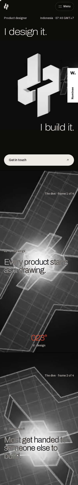

# UI Design System & Master Generation Blueprint: dennypratama-com

> **Denny Pratama · Product Designer & Design Engineer Portfolio** — A precision-engineered product design and code portfolio built on a carbon-ink substrate (`#0c0c0b`) and warm bone editorial chapters (`#eceae4`), governed by a 1680px 12-column hairline grid and damped mechanical transitions.


---

## 1. Executive Visual Persona & Design Archetype

- **Brand Essence & Persona**: **Denny Pratama · Product Designer & Design Engineer Portfolio**. A precision-engineered product design and code portfolio built on a carbon-ink substrate (`#0c0c0b`) and warm bone editorial chapters (`#eceae4`), governed by a 1680px 12-column hairline grid and damped mechanical transitions.
- **Visual Archetype**: **Monolith Ink & Bone Editorial Grid (`Archivo` + Mechanical Ease-Out)**.
- **Anti-AI-Slop Differentiators**:
  1. **Dual-Polarity Surface Alternation**: Alternates between carbon-ink chapters (`--ink: #0c0c0b`) and warm bone chapters (`section#work.work.on-bone` using `--bone: #eceae4` and `--lp: #0c0c0b24` dark hairlines).
  2. **Zero Box-Shadow Elevation**: Depth is articulated strictly via 1px alpha hairlines (`--line: #eceae424` on dark, `--lp: #0c0c0b24` on bone) and stepped ink surfaces (`--ink-2: #151514`, `--ink-3: #1f1f1d`).
  3. **Constructed Geometric Mark & Telemetry**: Interactive vector construction section (`"The mark, constructed: a pivot, one angle, eleven points, then a solid."`) paired with live availability dot (`--ok: #3ccf7d`).
  4. **Calibrated Dual Easing System**: All UI micro-interactions execute on `--e-out: cubic-bezier(.16,1,.3,1)` (`400ms`–`600ms`), while curtain reveals run on `--e-io: cubic-bezier(.83,0,.17,1)`.

---

## 2. Spatial Architecture & Modular Grid Mathematics



### Viewport Allocation & Container Geometry
- **Captured Full-Page Dimensions**: Desktop `1440×16914px` (`assets/desktop.png`), Mobile `390×16750px` (`assets/mobile.png`).
- **Master Container Bounds**: 1680px (`--wrap: 1680px`).
- **Canvas Lateral Padding & Spacing**: 48px desktop (`--pad: 48px`), reducing at `@media (max-width:1023px)` and `@media (max-width:767px)` to `20px`.
- **Border Radius Scale**: `--r-s: 4px`, `--r-m: 8px`, `--r-l: 16px`, `--r-full: 999px`.

### Responsive Breakpoint Architecture
- **Desktop Layout**: 12-column CSS Grid (`grid-template-columns: repeat(12, minmax(0, 1fr))`) with 1px hairline cell borders.
- **Mobile Layout**: Single-column vertical stack below `767px` (`@media (max-width:767px)`), collapsing `.nav-links` into `.menu-l` mobile drawer.
- **Extracted CSS Media Queries**: `@media (max-width:1359px)`, `@media (max-width:1023px)`, `@media (max-width:900px)`, `@media (max-width:767px)`.

---

## 3. Color System, Materiality & Atmospheric Lighting

### Semantic Palette & Source Grounding
| Semantic Role | Ground-Truth Value | Extracted CSS Source / Selector |
|---|---|---|
| Primary Dark Canvas | `#0c0c0b` | `--ink` (`:root`) |
| Elevated Dark Surface | `#151514` | `--ink-2` (`:root`) |
| Interactive Dark Surface | `#1f1f1d` | `--ink-3` (`:root`) |
| Primary Bone Ink / Light Surface | `#eceae4` | `--bone` (`:root` / `.on-bone`) |
| Secondary Bone Copy | `#c9c6be` | `--bone-2` (`:root`) |
| Tertiary Bone Surface | `#e2dfd8` | `--bone-3` (`:root`) |
| Muted Metadata Label | `#8c8a84` | `--mute` (`:root`) |
| Dimmed Caption Ink | `#3b3a36` | `--dim` (`:root`) |
| Dark-Mode Hairline Rule | `#eceae424` | `--line` (`:root`) |
| Dark-Mode Focus Hairline | `#eceae447` | `--line-2` (`:root`) |
| Light-Mode Hairline Rule | `#0c0c0b24` | `--lp` (`.on-bone`) |
| Primary Signal Accent | `#ff4f2b` | `--red` (`:root`) |
| Availability Status Green | `#3ccf7d` | `--ok` (`:root`) |

### Sanitized Root CSS Variables (`ui-ux.md` Ground Truth)
| Variable Name | Extracted Value | Semantic Role |
|---|---|---|
| `--font-archivo` | `"Archivo", "Archivo Fallback"` | Primary display & UI sans font family |
| `--sans` | `var(--font-archivo),"Archivo","Helvetica Neue",Helvetica,Arial,sans-serif` | Global sans-serif stack |
| `--ink` | `#0c0c0b` | Primary carbon substrate |
| `--ink-2` | `#151514` | Secondary elevated card surface |
| `--ink-3` | `#1f1f1d` | Interactive hover/chip surface |
| `--bone` | `#eceae4` | Primary limestone bone ink & light section bg |
| `--bone-2` | `#c9c6be` | Secondary body copy ink |
| `--mute` | `#8c8a84` | Muted index & metadata ink |
| `--line` | `#eceae424` | 1px hairline divider on dark substrate |
| `--line-2` | `#eceae447` | Hovered hairline border on dark substrate |
| `--lp` | `#0c0c0b24` | 1px hairline divider on `.on-bone` sections |
| `--red` | `#ff4f2b` | Signal orange-red accent token |
| `--ok` | `#3ccf7d` | Live availability status indicator |
| `--e-out` | `cubic-bezier(.16,1,.3,1)` | Primary mechanical ease-out curve |
| `--e-io` | `cubic-bezier(.83,0,.17,1)` | Symmetric ease-in-out curtain curve |
| `--wrap` | `1680px` | Maximum layout container width |
| `--pad` | `48px` | Desktop horizontal container padding |
| `--r-s` | `4px` | Small component border radius |
| `--r-m` | `8px` | Medium card border radius |
| `--r-full` | `999px` | Pill badge border radius |

---

## 4. Typographic Scale & Editorial Hierarchy

### Font Family Stacks
- **Display Typography**: `"Archivo", "Archivo Fallback", "Helvetica Neue", Helvetica, Arial, sans-serif` (`--sans`).
- **Primary Body Stack**: `"Archivo", "Helvetica Neue", Helvetica, Arial, sans-serif` (`--sans`).
- **Technical / Metadata Stack**: `ui-monospace, SFMono-Regular, Menlo, Monaco, Consolas, monospace` (`--mono`).

### Typographic Scale & Rules
- **Hero Display (`H1`)**: `clamp(2.75rem, 6vw, 5.5rem)`, `font-weight: 700`, `line-height: 0.95`, `letter-spacing: -0.04em` ("Denny Pratama, product designer. I design it. I build it.").
- **Section Heading (`H2`)**: `clamp(1.75rem, 3.5vw, 3.25rem)`, `font-weight: 600`, `line-height: 1.08`, `letter-spacing: -0.025em` ("Drawn, then shipped.", "One project. Both sides of the line.").
- **Body Copy**: `1rem (16px)`, `font-weight: 400`, `line-height: 1.6`, `color: var(--bone-2)`.
- **Metadata & Navigation Labels**: `0.75rem (12px)`, `font-family: var(--mono)`, `letter-spacing: 0.08em`, `text-transform: uppercase`, tabular numerals (`Home01`, `Work02`).

---

## 5. Choreographed Motion & Interaction Physics

### Primary Easing Curves
- **Extracted Timing Functions**: `cubic-bezier(.16,1,.3,1)` (`--e-out`) and `cubic-bezier(.83,0,.17,1)` (`--e-io`).

### Per-Element Transition & Choreography Rules
- `.btn:before` -> `transition: transform .6s var(--e-out)` (sliding fill curtain on CTA buttons)
- `.btn .ico` -> `transition: transform .5s var(--e-out)` (directional arrow icon translation)
- `.lnk` -> `transition: border-color .4s` (hairline link underline transition)
- `.chip` -> `transition: background .4s, color .4s` (tag pill state morph)
- `.nav-bg` -> `transition: opacity .4s var(--e-out)` (header backdrop reveal on scroll)

---

## 6. Component Wireframe & Structural DOM Map

### Visual Layout Schematic (Grounded in `dom.html`)
```
┌────────────────────────────────────────────────────────────────────────┐
│ <header class="nav"> [denny pratama]  [Work] [About] [Blog] [Get in to │
├────────────────────────────────────────────────────────────────────────┤
│ <section class="hero"> (Substrate: --ink #0c0c0b, max-w: --wrap 1680px │
│   H1: Denny Pratama, product designer. I design it. I build it.        │
│   Status Chip (.chip): [● Available] (--ok #3ccf7d) + [Get in touch]   │
├────────────────────────────────────────────────────────────────────────┤
│ <section id="work" class="work on-bone"> (Surface: --bone #eceae4)     │
│   H2: Drawn, then shipped. | H2: One project. Both sides of the line.  │
│   [ Case Study 01: Design + Code ]  │  [ Case Study 02: Full-Stack UI  │
├────────────────────────────────────────────────────────────────────────┤
│ <section class="con"> (Vector Construction Interactive Stage)          │
│   H2: The mark, constructed: a pivot, one angle, eleven points, a soli │
├────────────────────────────────────────────────────────────────────────┤
│ <footer id="contact" class="ct"> H2: Something worth building? [nav.ct │
└────────────────────────────────────────────────────────────────────────┘
```

### Granular DOM Region Breakdown
1. **Header Navigation (`<header class="nav">` and `<nav class="nav-links">`)**:
   - Fixed top bar with `.nav-bg` opacity layer (`transition: opacity .4s var(--e-out)`), lowercase wordmark `denny pratama`, desktop links (`Work`, `About`, `Blog`, `Contact`), `.btn` CTA (`Get in touch`), and `<nav class="menu-l">` numbered index (`Home01`, `Work02`).
2. **Hero Monograph (`<section class="hero">`)**:
   - Full-viewport dark stage (`--ink: #0c0c0b`) bounded by `--wrap: 1680px` and `--pad: 48px`, centering H1 `"Denny Pratama, product designer. I design it. I build it."` with `.chip` status pills (`--r-full: 999px`), `--ok: #3ccf7d` availability indicator, and `--red: #ff4f2b` accents.
3. **Selected Work Ledger (`<section id="work" class="work on-bone">`)**:
   - High-contrast surface switch to warm limestone (`--bone: #eceae4`, text `--ink: #0c0c0b`) with `--lp: #0c0c0b24` 1px borders, housing H2 `"Drawn, then shipped."` and `"One project. Both sides of the line."`
4. **Geometric Mark Study (`<section class="con">`)**:
   - Interactive SVG vector construction diagram titled `"The mark, constructed: a pivot, one angle, eleven points, then a solid."` demonstrating coordinate geometry on `--ink-2: #151514`.
5. **Contact Colophon (`<footer id="contact" class="ct">` and `<nav class="ct-col">`)**:
   - Closing dark-mode footer anchored by H2 `"Something worth building?"`, social link columns (`nav.ct-col`), and `.lnk` hairline underlines (`transition: border-color .4s`).

---

## 7. Master Zero-Shot AI Generation Prompt

```markdown
# Master Zero-Shot Frontend Generation Prompt: dennypratama-com (Denny Pratama · Product Designer & Design Engineer Portfolio)

You are a principal frontend architect and design systems engineer. Build a complete, production-ready web application replicating the exact design system, DOM landmarks, typographic hierarchy, color tokens, and motion physics of `dennypratama-com` (Denny Pratama · Product Designer & Design Engineer Portfolio).

### 1. Visual Archetype & Anti-AI-Slop Mandates
- **Archetype**: Monolith Ink & Bone Editorial Grid (`Archivo` + Mechanical Ease-Out).
- **Primary Substrate**: `#0c0c0b` (`--ink` (`:root`)), **Primary Ink**: `#eceae4`, **Accent / Highlight**: `#3ccf7d`.
- **Site-Specific Differentiators**:
  1. **Dual-Polarity Surface Alternation**: Alternates between carbon-ink chapters (`--ink: #0c0c0b`) and warm bone chapters (`section#work.work.on-bone` using `--bone: #eceae4` and `--lp: #0c0c0b24` dark hairlines).
  2. **Zero Box-Shadow Elevation**: Depth is articulated strictly via 1px alpha hairlines (`--line: #eceae424` on dark, `--lp: #0c0c0b24` on bone) and stepped ink surfaces (`--ink-2: #151514`, `--ink-3: #1f1f1d`).
  3. **Constructed Geometric Mark & Telemetry**: Interactive vector construction section (`"The mark, constructed: a pivot, one angle, eleven points, then a solid."`) paired with live availability dot (`--ok: #3ccf7d`).
  4. **Calibrated Dual Easing System**: All UI micro-interactions execute on `--e-out: cubic-bezier(.16,1,.3,1)` (`400ms`–`600ms`), while curtain reveals run on `--e-io: cubic-bezier(.83,0,.17,1)`.

### 2. Ground-Truth CSS Variables (`:root` Token Contract)
Declare and consume these exact custom properties extracted from `dennypratama-com` in your global stylesheet:

:root {
  /* Denny Pratama · Product Designer & Design Engineer Portfolio — Ground-Truth Extracted CSS Variables */
  --font-archivo: "Archivo", "Archivo Fallback"; /* Primary display & UI sans font family */
  --sans: var(--font-archivo),"Archivo","Helvetica Neue",Helvetica,Arial,sans-serif; /* Global sans-serif stack */
  --ink: #0c0c0b; /* Primary carbon substrate */
  --ink-2: #151514; /* Secondary elevated card surface */
  --ink-3: #1f1f1d; /* Interactive hover/chip surface */
  --bone: #eceae4; /* Primary limestone bone ink & light section bg */
  --bone-2: #c9c6be; /* Secondary body copy ink */
  --mute: #8c8a84; /* Muted index & metadata ink */
  --line: #eceae424; /* 1px hairline divider on dark substrate */
  --line-2: #eceae447; /* Hovered hairline border on dark substrate */
  --lp: #0c0c0b24; /* 1px hairline divider on `.on-bone` sections */
  --red: #ff4f2b; /* Signal orange-red accent token */
  --ok: #3ccf7d; /* Live availability status indicator */
  --e-out: cubic-bezier(.16,1,.3,1); /* Primary mechanical ease-out curve */
  --e-io: cubic-bezier(.83,0,.17,1); /* Symmetric ease-in-out curtain curve */
  --wrap: 1680px; /* Maximum layout container width */
  --pad: 48px; /* Desktop horizontal container padding */
  --r-s: 4px; /* Small component border radius */
  --r-m: 8px; /* Medium card border radius */
  --r-full: 999px; /* Pill badge border radius */
}

### 3. Semantic Color & Materiality Contract
Map every surface, ink, and border strictly to these source-grounded tokens:
- **Primary Dark Canvas**: `#0c0c0b` — grounded in `--ink` (`:root`)
- **Elevated Dark Surface**: `#151514` — grounded in `--ink-2` (`:root`)
- **Interactive Dark Surface**: `#1f1f1d` — grounded in `--ink-3` (`:root`)
- **Primary Bone Ink / Light Surface**: `#eceae4` — grounded in `--bone` (`:root` / `.on-bone`)
- **Secondary Bone Copy**: `#c9c6be` — grounded in `--bone-2` (`:root`)
- **Tertiary Bone Surface**: `#e2dfd8` — grounded in `--bone-3` (`:root`)
- **Muted Metadata Label**: `#8c8a84` — grounded in `--mute` (`:root`)
- **Dimmed Caption Ink**: `#3b3a36` — grounded in `--dim` (`:root`)
- **Dark-Mode Hairline Rule**: `#eceae424` — grounded in `--line` (`:root`)
- **Dark-Mode Focus Hairline**: `#eceae447` — grounded in `--line-2` (`:root`)
- **Light-Mode Hairline Rule**: `#0c0c0b24` — grounded in `--lp` (`.on-bone`)
- **Primary Signal Accent**: `#ff4f2b` — grounded in `--red` (`:root`)
- **Availability Status Green**: `#3ccf7d` — grounded in `--ok` (`:root`)

### 4. Spatial Grid, Container Bounds & Responsive Breakpoints
- **Desktop Viewport Reference**: `1440×16914px` full-page capture (`1440px` standard desktop width).
- **Mobile Viewport Reference**: `390×16750px` full-page capture (`390px` standard mobile width).
- **Container Max-Width**: 1680px (`--wrap: 1680px`)
- **Padding & Gutters**: 48px desktop (`--pad: 48px`), reducing at `@media (max-width:1023px)` and `@media (max-width:767px)` to `20px`
- **Desktop Grid**: 12-column CSS Grid (`grid-template-columns: repeat(12, minmax(0, 1fr))`) with 1px hairline cell borders
- **Mobile Adaptation**: Single-column vertical stack below `767px` (`@media (max-width:767px)`), collapsing `.nav-links` into `.menu-l` mobile drawer
- **Media Queries**: `@media (max-width:1359px)`, `@media (max-width:1023px)`, `@media (max-width:900px)`, `@media (max-width:767px)`
- **Corner Radii**: `--r-s: 4px`, `--r-m: 8px`, `--r-l: 16px`, `--r-full: 999px`

### 5. Typography & Editorial Scale Contract
- **Display Font Stack**: `"Archivo", "Archivo Fallback", "Helvetica Neue", Helvetica, Arial, sans-serif` (`--sans`)
- **Body Font Stack**: `"Archivo", "Helvetica Neue", Helvetica, Arial, sans-serif` (`--sans`)
- **Monospace / Technical Font Stack**: `ui-monospace, SFMono-Regular, Menlo, Monaco, Consolas, monospace` (`--mono`)
- **H1 Display Rule**: `clamp(2.75rem, 6vw, 5.5rem)`, `font-weight: 700`, `line-height: 0.95`, `letter-spacing: -0.04em` ("Denny Pratama, product designer. I design it. I build it.")
- **H2 Section Rule**: `clamp(1.75rem, 3.5vw, 3.25rem)`, `font-weight: 600`, `line-height: 1.08`, `letter-spacing: -0.025em` ("Drawn, then shipped.", "One project. Both sides of the line.")
- **Body Copy Rule**: `1rem (16px)`, `font-weight: 400`, `line-height: 1.6`, `color: var(--bone-2)`
- **Metadata & Index Rule**: `0.75rem (12px)`, `font-family: var(--mono)`, `letter-spacing: 0.08em`, `text-transform: uppercase`, tabular numerals (`Home01`, `Work02`)

### 6. Component Hierarchy & Real DOM Landmarks
Scaffold the interface with these exact structural regions and class selectors from `dennypratama-com`:
1. **Header Navigation (`<header class="nav">` and `<nav class="nav-links">`)**:
   - Architecture & Selectors: Fixed top bar with `.nav-bg` opacity layer (`transition: opacity .4s var(--e-out)`), lowercase wordmark `denny pratama`, desktop links (`Work`, `About`, `Blog`, `Contact`), `.btn` CTA (`Get in touch`), and `<nav class="menu-l">` numbered index (`Home01`, `Work02`).
   - Layout & State Contract: Sticky/fixed top header navigation adapting across `@media (max-width:1359px)`, `@media (max-width:1023px)`, `@media (max-width:900px)`, `@media (max-width:767px)` with `cubic-bezier(.16,1,.3,1)` (`--e-out`) and `cubic-bezier(.83,0,.17,1)` (`--e-io`) menu transitions.
2. **Hero Monograph (`<section class="hero">`)**:
   - Architecture & Selectors: Full-viewport dark stage (`--ink: #0c0c0b`) bounded by `--wrap: 1680px` and `--pad: 48px`, centering H1 `"Denny Pratama, product designer. I design it. I build it."` with `.chip` status pills (`--r-full: 999px`), `--ok: #3ccf7d` availability indicator, and `--red: #ff4f2b` accents.
   - Layout & State Contract: Full-viewport hero stage (`1440px` desktop / `390px` mobile) pairing `#0c0c0b` substrate with `#eceae4` display typography (`H1`).
3. **Selected Work Ledger (`<section id="work" class="work on-bone">`)**:
   - Architecture & Selectors: High-contrast surface switch to warm limestone (`--bone: #eceae4`, text `--ink: #0c0c0b`) with `--lp: #0c0c0b24` 1px borders, housing H2 `"Drawn, then shipped."` and `"One project. Both sides of the line."`
   - Layout & State Contract: Primary showcase grid executing 12-column CSS Grid (`grid-template-columns: repeat(12, minmax(0, 1fr))`) with 1px hairline cell borders on desktop and Single-column vertical stack below `767px` (`@media (max-width:767px)`), collapsing `.nav-links` into `.menu-l` mobile drawer on mobile.
4. **Geometric Mark Study (`<section class="con">`)**:
   - Architecture & Selectors: Interactive SVG vector construction diagram titled `"The mark, constructed: a pivot, one angle, eleven points, then a solid."` demonstrating coordinate geometry on `--ink-2: #151514`.
   - Layout & State Contract: Interactive specification & narrative module framed by `--r-s: 4px`, `--r-m: 8px`, `--r-l: 16px`, `--r-full: 999px` and `#3ccf7d` highlights.
5. **Contact Colophon (`<footer id="contact" class="ct">` and `<nav class="ct-col">`)**:
   - Architecture & Selectors: Closing dark-mode footer anchored by H2 `"Something worth building?"`, social link columns (`nav.ct-col`), and `.lnk` hairline underlines (`transition: border-color .4s`).
   - Layout & State Contract: Footer directory and utility bar anchored to 1680px (`--wrap: 1680px`) with 48px desktop (`--pad: 48px`), reducing at `@media (max-width:1023px)` and `@media (max-width:767px)` to `20px` lateral gutters.

### 7. Motion & Interaction Choreography
- **Primary Easing Functions**: `cubic-bezier(.16,1,.3,1)` (`--e-out`) and `cubic-bezier(.83,0,.17,1)` (`--e-io`)
- **Per-Selector Transition Rules**:
- `.btn:before` -> `transition: transform .6s var(--e-out)` (sliding fill curtain on CTA buttons)
- `.btn .ico` -> `transition: transform .5s var(--e-out)` (directional arrow icon translation)
- `.lnk` -> `transition: border-color .4s` (hairline link underline transition)
- `.chip` -> `transition: background .4s, color .4s` (tag pill state morph)
- `.nav-bg` -> `transition: opacity .4s var(--e-out)` (header backdrop reveal on scroll)

### 8. Technical Deliverables
- Implement in Next.js (App Router) with TypeScript and Tailwind CSS consuming the `:root` custom properties defined above.
- Reproduce both the `1440px` desktop architecture and `390px` mobile breakpoint transitions, preserving semantic HTML5 landmarks (`<header>`, `<nav>`, `<main>`, `<section>`, `<footer>`) and `prefers-reduced-motion` accessibility guards.
```
