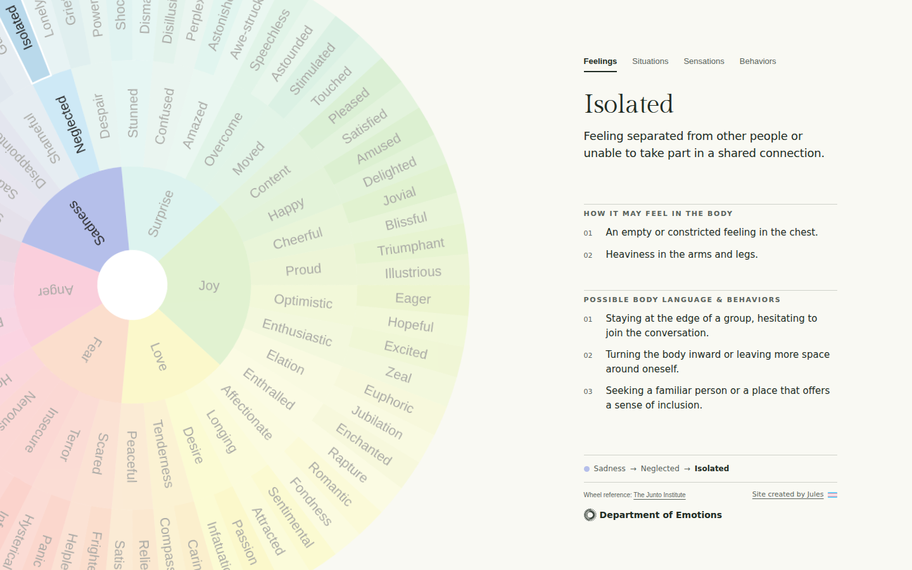

# UI Design System & Master Generation Blueprint: departmentofemotions-com

> **Department of Emotions** (https://departmentofemotions.com/) — Explore your emotions with an interactive feeling wheel, body-language examples, somatic sensations, and behavioral experiences.



---

## 1. Executive Visual Persona & Design Archetype

- **Brand Essence & Persona**: **Department of Emotions** (`https://departmentofemotions.com/`). Explore your emotions with an interactive feeling wheel, body-language examples, somatic sensations, and behavioral experiences.
- **Capture Provenance**: Live browser capture (`tier1_fast`, HTTP `200`, captured `2026-11-23`).
- **Visual Archetype**: **Light-Substrate Editorial & Modular Grid System (`#f9f9f3` canvas, `#000000` ink, `#212c24` accent)**.
- **Anti-AI-Slop Differentiators**:
  - **Live-Computed Chromatic Polarity**: Anchors the viewport in `#f9f9f3` (live computed `html` `background-color` (`computed_styles.json`)) paired with `#000000` primary typography and `#212c24` accents.
  - **Grounded Typographic Hierarchy**: Pairs `Gilda Display` for display copy (`Isolated`) with `Segoe UI` and not declared in live computed styles (uses primary stack / `ui-monospace`).
  - **Calibrated Spatial Grid & Motion**: Combines `1520px` container bounds (`gap: 12px`, padding `64px`) with `cubic-bezier(.23,1,.32,1)` easing.

---

## 2. Spatial Architecture & Modular Grid Mathematics


### Viewport Allocation & Container Geometry
- **Captured Viewport Dimensions**: Desktop `1440×900px` (`assets/desktop.png`, single-viewport 100vh live capture (900px)), Mobile `390×844px` (`assets/mobile.png`, single-viewport 100vh live capture (844px)).
- **Master Container Bounds**: `1520px` (non-`@media` desktop container stylesheet rule).
- **Canvas Lateral Padding & Spacing**: `64px` lateral canvas padding with `12px` grid gap.
- **Border Radius Scale**: `50%`, `1px`, `22px`.

### Responsive Breakpoint Architecture
- **Desktop Layout**: Multi-column CSS Grid / Flexbox layout at `1440px` (`max-width: 1520px`, `gap: 12px`).
- **Mobile Layout**: Single-column vertical stack at `390px` viewport width with `64px` horizontal padding.
- **Extracted CSS Media Queries**: `@media (max-width:600px)`, `@media (min-width:1101px),(orientation:landscape)`, `@media (min-width:1024px)and (max-width:1279px)`, `@media (min-width:1024px)and (max-width:1100px)and (orientation:...`.

---

## 3. Color System, Materiality & Atmospheric Lighting

### Semantic Palette & Source Grounding
| Semantic Role | Ground-Truth Value | Extracted Live / CSS Source |
|---|---|---|
| **Primary Canvas Substrate** | `#f9f9f3` | live computed `html` `background-color` (`computed_styles.json`) |
| **Primary Typography Ink** | `#000000` | live computed `body` `color` (`computed_styles.json`) |
| **Elevated Surface / Card Substrate** | `#ffffff` | `html { background: #ffffff }` |
| **Interactive Accent / Highlight** | `#212c24` | live computed `button` `color` (`computed_styles.json`) |
| **Secondary / Muted Copy** | `#212c24` | live computed `button` `color` (`computed_styles.json`) |
| **Structural Hairline Border** | `#6f7f74` | `.explorer-page button:focus-vis... { border-color: #6f7f74 }` |

### Sanitized Root CSS Variables (`ui-ux.md` Ground Truth)
| Variable Name | Extracted Value | Semantic Role |
|---|---|---|
| `--ink` | `oklch(28% .022 154)` | Typography Ink Token |
| `--muted` | `oklch(49% .016 154)` | Color / Atmospheric Token |
| `--line` | `oklch(86% .012 125)` | Color / Atmospheric Token |
| `--paper` | `oklch(98% .008 105)` | Canvas / Surface Token |
| `--desktop-wheel-size` | `clamp(74vw, 120svh, 92vw)` | Layout / Spatial Grid Token |
| `--mobile-wheel-size` | `min(160vw, 820px)` | Layout / Spatial Grid Token |
| `--landscape-wheel-size` | `clamp(560px, 160svh, 92vw)` | Layout / Spatial Grid Token |
| `--lab-toolbar-height` | `0px` | Layout / Spatial Grid Token |
| `--phone-wheel-size` | `213.75vw` | Layout / Spatial Grid Token |
| `--wheel-muted-opacity` | `0.38` | Design System Custom Token |
| `--wheel-fade-duration` | `180ms` | Motion / Easing Token |
| `--departmentofemot-bg` | `#f9f9f3` | Canvas Substrate (from live computed `html` `background-color` (`computed_styles.json`)) |
| `--departmentofemot-ink` | `#000000` | Primary Typography Ink (computed-derived) |
| `--departmentofemot-surface` | `#ffffff` | Surface Substrate (computed-derived) |
| `--departmentofemot-accent` | `#212c24` | Interactive Accent (computed-derived) |
| `--departmentofemot-muted` | `#212c24` | Secondary Ink (computed-derived) |

---

## 4. Typographic Scale & Editorial Hierarchy

### Font Family Stacks
- **Display Typography**: `Gilda Display`.
- **Primary Body Stack**: `Segoe UI`.
- **Technical / Metadata Stack**: not declared in live computed styles (uses primary stack / `ui-monospace`).

### Typographic Scale & Rules (Live Computed & Stylesheet Grounded)
- **Hero Display (`H1`)**: live computed `h1` (`font-size: 42px`, `line-height: 47.04px`, `font-weight: 400`, `letter-spacing: -0.6px`); rule `h1` (`font-size: 48px`, `line-height: 1.12`, `letter-spacing: -.6px`, `font-weight: 400`).
- **Section Heading (`H2`)**: live computed `h2` (`font-size: 11px`, `line-height: 13.2px`, `font-weight: 650`, `letter-spacing: 1.6px`); rule `h2` (`font-size: 11px`, `letter-spacing: 1.4px`).
- **Body Copy**: live computed `body` (`font-size: 16px`, `line-height: normal`, `font-weight: 400`); rule `p` (`font-size: 14px`, `line-height: 1.7`).
- **Metadata & Navigation Labels**: live computed `nav/a` (`font-size: 16px`, `line-height: normal`, `font-weight: 400`).

---

## 5. Choreographed Motion & Interaction Physics

### Primary Easing Curves
- **Extracted Timing Functions**: `cubic-bezier(.23,1,.32,1)`.

### Per-Element Transition & Choreography Rules
- **Selector `.explorer-sector`**: `transition: opacity var(--wheel-fade-duration, .18s) ease-out` extracted from `departmentofemotions-com` stylesheet.
- **Selector `.wheel-strokes`**: `transition: opacity var(--wheel-fade-duration, .18s) ease-out` extracted from `departmentofemotions-com` stylesheet.
- **Selector `media(prefers-reduced-motion:reduce)`**: `transition: none!important` extracted from `departmentofemotions-com` stylesheet.
- **Extracted Easing Curve (`cubic-bezier(.23,1,.32,1)`)**: Governs interactive state transitions across `<nav.lab-switcher>` and `<section.experience-section>`.
- **State & Hover Choreography**: Opacity and transform transitions on `<section.wheel-workspace>` and `<section.experience-section>` interactive targets.

---

## 6. Component Wireframe & Structural DOM Map

### Visual Layout Schematic — Desktop (`1440px`, Grounded in `dom.html` & Landmark Bounding Boxes)
```
┌────────────────────────────────────────────────────────────────────────┐
│ DESKTOP VIEWPORT (1440px) — Department of Emotions                     │
│ ====================================================================== │
│ [ <nav.lab-switcher> (400x42px)       | Overview · Index · Archive · ] │
│ ---------------------------------------------------------------------- │
│ | HERO STAGE: <section.wheel-workspace> (w=1425px)                   | │
│ | H1: Isolated                                                       | │
│ | Substrate: #f9f9f3 | Ink: #000000 | Accent: #212c24                | │
│ ---------------------------------------------------------------------- │
│ | SHOWCASE GRID (<section.experience-sectio) max-w: 1520px           | │
│ | +------------------------------+  +------------------------------+ | │
│ | | How it may feel in the body  |  | Possible body language & beh | | │
│ | +------------------------------+  +------------------------------+ | │
│ ---------------------------------------------------------------------- │
│ | DETAIL MODULE (<section.experience-sectio) — An empty or constrict | │
│ ---------------------------------------------------------------------- │
│ [ FOOTER (<footer.sidebar-foot) | https://departmentofemotions.com/    │
└────────────────────────────────────────────────────────────────────────┘
```

### Visual Layout Schematic — Mobile Reflow (`390px`)
```
┌────────────────────────────────────────────────────────────────────────┐
│ MOBILE VIEWPORT REFLOW (390px) — Single-Column Stack (gap: 12px)       │
│ ====================================================================== │
│ [ HEADER BAR (<nav.lab-switcher>      ) | Compact Menu (390px)         │
│ ---------------------------------------------------------------------- │
│ | HERO STAGE (<section.wheel-workspace) — 390px Vertical Lead        | │
│ | H1: Isolated                                                       | │
│ ---------------------------------------------------------------------- │
│ | SHOWCASE STACK (<section.experience-se) — 1-Col Stack              | │
│ | [ Item 1: How it may feel in the body                            ] | │
│ | [ Item 2: Possible body language & behaviors                     ] | │
│ ---------------------------------------------------------------------- │
│ | DETAIL STACK (<section.experience-sect) — 1-Col (An empty or constr) │
│ ---------------------------------------------------------------------- │
│ [ FOOTER (<footer.sidebar-foot) | Stacked 390px Colophon               │
└────────────────────────────────────────────────────────────────────────┘
```

### Granular DOM Region Breakdown
1. **Brand Header & Navigation Bar (<nav.lab-switcher> — `departmentofemotions-com`)**:
   - Landmark `<nav class="lab-switcher">` (`400x42px`) hosting `Department of Emotions` navigation (`Overview · Index · Archive · About · Contact`), DOM attributes (`data-wheel="feelings"`, `data-moving="false"`, `data-sector-index="0"`, `data-emotion="Anger"`), and stylesheet rule `.privacy-page { max-width:648px;margin-inline:auto;padding:64px 24px;color:212c24;font:1... }`.
2. **Hero Stage & Focal Lead (<section.wheel-workspace> — `Isolated`)**:
   - Landmark `<section class="wheel-workspace">` presenting display lead `Isolated` and copy excerpt *"Feeling separated from other people or unable to take part in a s"* over `#f9f9f3` canvas and `#000000` ink.
3. **Primary Showcase & Content Grid (<section.experience-section> — `How it may feel in the body`)**:
   - Landmark `<section class="experience-section">` rendering section `How it may feel in the body` with copy *"01 An empty or constricted feeling in the chest."*, asset references (`favicon.ico`, `favicon-32.png`, `favicon.svg`, `apple-touch-icon.png`), and grid rule `.privacy-brand { display:inline-flex;align-items:center;gap:5px;font-weight:650;font-size... }`.
4. **Interactive Detail & Feature Matrix (<section.experience-section:nth(2)> — `Possible body language & behaviors`)**:
   - Landmark `<section class="experience-section">` framing `Possible body language & behaviors` and `An empty or constricted feeling in the chest.` (*"An empty or constricted feeling in the chest."*) with `#ffffff` surface cards, `#212c24` accents, and `.privacy-page h1 { margin:40px 0 24px;font:400 42px/1.2 Gilda Display,Georgia,serif }`.
5. **Colophon & Global Directory Footer (<footer.sidebar-footer> — `https://departmentofemotions.com/`)**:
   - Landmark `<footer class="sidebar-footer">` anchoring `Department of Emotions` footer links (`Overview · Index · Archive · About · Contact`), copy *"02 Heaviness in the arms and legs."*, and `#6f7f74` structural dividers.

---

## 7. Master Zero-Shot AI Generation Prompt

```markdown
# Master Zero-Shot Frontend Generation Prompt: departmentofemotions-com (Department of Emotions)

You are a principal frontend architect and design systems engineer. Build a complete, production-ready web application replicating the exact design system, DOM landmarks, typographic hierarchy, color tokens, and motion physics of `departmentofemotions-com` (**Department of Emotions** — `https://departmentofemotions.com/`).

### 1. Visual Archetype & Anti-AI-Slop Mandates
- **Archetype**: Light-Substrate Editorial & Modular Grid System (`#f9f9f3` canvas, `#000000` ink, `#212c24` accent).
- **Identity & Domain Context**: Explore your emotions with an interactive feeling wheel, body-language examples, somatic sensations, and behavioral experiences.
- **Primary Substrate**: `#f9f9f3` (live computed `html` `background-color` (`computed_styles.json`)), **Primary Ink**: `#000000`, **Accent / Highlight**: `#212c24`.
- **Site-Specific Differentiators**:
  - **Live-Computed Chromatic Polarity**: Anchors the viewport in `#f9f9f3` (live computed `html` `background-color` (`computed_styles.json`)) paired with `#000000` primary typography and `#212c24` accents.
  - **Grounded Typographic Hierarchy**: Pairs `Gilda Display` for display copy (`Isolated`) with `Segoe UI` and not declared in live computed styles (uses primary stack / `ui-monospace`).
  - **Calibrated Spatial Grid & Motion**: Combines `1520px` container bounds (`gap: 12px`, padding `64px`) with `cubic-bezier(.23,1,.32,1)` easing.

### 2. Ground-Truth CSS Variables (`:root` Token Contract)
Declare and consume these exact custom properties extracted from `departmentofemotions-com` in your global stylesheet:

:root {
  /* Department of Emotions (departmentofemotions-com) — Live-Grounded CSS Variables */
  --ink: oklch(28% .022 154); /* Typography Ink Token (departmentofemotions-com) */
  --muted: oklch(49% .016 154); /* Color / Atmospheric Token (departmentofemotions-com) */
  --line: oklch(86% .012 125); /* Color / Atmospheric Token (departmentofemotions-com) */
  --paper: oklch(98% .008 105); /* Canvas / Surface Token (departmentofemotions-com) */
  --desktop-wheel-size: clamp(74vw, 120svh, 92vw); /* Layout / Spatial Grid Token (departmentofemotions-com) */
  --mobile-wheel-size: min(160vw, 820px); /* Layout / Spatial Grid Token (departmentofemotions-com) */
  --landscape-wheel-size: clamp(560px, 160svh, 92vw); /* Layout / Spatial Grid Token (departmentofemotions-com) */
  --lab-toolbar-height: 0px; /* Layout / Spatial Grid Token (departmentofemotions-com) */
  --phone-wheel-size: 213.75vw; /* Layout / Spatial Grid Token (departmentofemotions-com) */
  --wheel-muted-opacity: 0.38; /* Design System Custom Token (departmentofemotions-com) */
  --wheel-fade-duration: 180ms; /* Motion / Easing Token (departmentofemotions-com) */
  --departmentofemot-bg: #f9f9f3; /* Canvas Substrate (from live computed `html` `background-color` (`computed_styles.json`)) (departmentofemotions-com) */
  --departmentofemot-ink: #000000; /* Primary Typography Ink (computed-derived) (departmentofemotions-com) */
  --departmentofemot-surface: #ffffff; /* Surface Substrate (computed-derived) (departmentofemotions-com) */
  --departmentofemot-accent: #212c24; /* Interactive Accent (computed-derived) (departmentofemotions-com) */
  --departmentofemot-muted: #212c24; /* Secondary Ink (computed-derived) (departmentofemotions-com) */
}

### 3. Semantic Color & Materiality Contract
Map every surface, ink, and border strictly to these source-grounded tokens:
- **Primary Canvas Substrate**: `#f9f9f3` — grounded in live computed `html` `background-color` (`computed_styles.json`)
- **Primary Typography Ink**: `#000000` — grounded in live computed `body` `color` (`computed_styles.json`)
- **Elevated Surface / Card Substrate**: `#ffffff` — grounded in `html { background: #ffffff }`
- **Interactive Accent / Highlight**: `#212c24` — grounded in live computed `button` `color` (`computed_styles.json`)
- **Secondary / Muted Copy**: `#212c24` — grounded in live computed `button` `color` (`computed_styles.json`)
- **Structural Hairline Border**: `#6f7f74` — grounded in `.explorer-page button:focus-vis... { border-color: #6f7f74 }`

### 4. Spatial Grid, Container Bounds & Responsive Breakpoints
- **Desktop Viewport Reference**: `1440×900px` (single-viewport 100vh live capture (900px), `1440px` standard desktop width).
- **Mobile Viewport Reference**: `390×844px` (single-viewport 100vh live capture (844px), `390px` standard mobile width).
- **Container Max-Width**: `1520px` (non-`@media` desktop container stylesheet rule)
- **Padding & Gutters**: `64px` lateral canvas padding with `12px` grid gap
- **Desktop Grid**: Multi-column CSS Grid / Flexbox layout at `1440px` (`max-width: 1520px`, `gap: 12px`)
- **Mobile Adaptation**: Single-column vertical stack at `390px` viewport width with `64px` horizontal padding
- **Media Queries**: `@media (max-width:600px)`, `@media (min-width:1101px),(orientation:landscape)`, `@media (min-width:1024px)and (max-width:1279px)`, `@media (min-width:1024px)and (max-width:1100px)and (orientation:...`
- **Corner Radii**: `50%`, `1px`, `22px`

### 5. Typography & Editorial Scale Contract
- **Display Font Stack**: `Gilda Display`
- **Body Font Stack**: `Segoe UI`
- **Monospace / Technical Font Stack**: not declared in live computed styles (uses primary stack / `ui-monospace`)
- **H1 Display Rule**: live computed `h1` (`font-size: 42px`, `line-height: 47.04px`, `font-weight: 400`, `letter-spacing: -0.6px`); rule `h1` (`font-size: 48px`, `line-height: 1.12`, `letter-spacing: -.6px`, `font-weight: 400`)
- **H2 Section Rule**: live computed `h2` (`font-size: 11px`, `line-height: 13.2px`, `font-weight: 650`, `letter-spacing: 1.6px`); rule `h2` (`font-size: 11px`, `letter-spacing: 1.4px`)
- **Body Copy Rule**: live computed `body` (`font-size: 16px`, `line-height: normal`, `font-weight: 400`); rule `p` (`font-size: 14px`, `line-height: 1.7`)
- **Metadata & Index Rule**: live computed `nav/a` (`font-size: 16px`, `line-height: normal`, `font-weight: 400`)

### 6. Component Hierarchy, Verbatim Copy & Real DOM Landmarks
Scaffold `departmentofemotions-com` (`Department of Emotions`) with these exact structural regions, extracted copy, and CSS rules from `dom.html`:
1. **Brand Header & Navigation Bar (<nav.lab-switcher> — `departmentofemotions-com`)**:
   - DOM & Selectors: Landmark `<nav class="lab-switcher">` (`400x42px`) hosting `Department of Emotions` navigation (`Overview · Index · Archive · About · Contact`), DOM attributes (`data-wheel="feelings"`, `data-moving="false"`, `data-sector-index="0"`, `data-emotion="Anger"`), and stylesheet rule `.privacy-page { max-width:648px;margin-inline:auto;padding:64px 24px;color:212c24;font:1... }`.
   - Responsive Contract: Header `Brand Header & Navigation Bar (<nav.lab-switcher> — `departmentofemotions-com`)` (`departmentofemotions-com`) adapts across `@media (max-width:600px)`, `@media (min-width:1101px),(orientation:landscape)`, `@media (min-width:1024px)and (max-width:1279px)`, `@media (min-width:1024px)and (max-width:1100px)and (orientation:...` with `cubic-bezier(.23,1,.32,1)` transitions and links `Overview · Index · Archive · About · Contact`.
2. **Hero Stage & Focal Lead (<section.wheel-workspace> — `Isolated`)**:
   - DOM & Selectors: Landmark `<section class="wheel-workspace">` presenting display lead `Isolated` and copy excerpt *"Feeling separated from other people or unable to take part in a s"* over `#f9f9f3` canvas and `#000000` ink.
   - Responsive Contract: Hero stage (`1440×900px` desktop / `390×844px` mobile) sets `#f9f9f3` background with `#000000` headline `Isolated`.
3. **Primary Showcase & Content Grid (<section.experience-section> — `How it may feel in the body`)**:
   - DOM & Selectors: Landmark `<section class="experience-section">` rendering section `How it may feel in the body` with copy *"01 An empty or constricted feeling in the chest."*, asset references (`favicon.ico`, `favicon-32.png`, `favicon.svg`, `apple-touch-icon.png`), and grid rule `.privacy-brand { display:inline-flex;align-items:center;gap:5px;font-weight:650;font-size... }`.
   - Responsive Contract: Showcase grid `Primary Showcase & Content Grid (<section.experience-section> — `How it may feel in the body`)` applies Multi-column CSS Grid / Flexbox layout at `1440px` (`max-width: 1520px`, `gap: 12px`) on desktop and Single-column vertical stack at `390px` viewport width with `64px` horizontal padding on mobile.
4. **Interactive Detail & Feature Matrix (<section.experience-section:nth(2)> — `Possible body language & behaviors`)**:
   - DOM & Selectors: Landmark `<section class="experience-section">` framing `Possible body language & behaviors` and `An empty or constricted feeling in the chest.` (*"An empty or constricted feeling in the chest."*) with `#ffffff` surface cards, `#212c24` accents, and `.privacy-page h1 { margin:40px 0 24px;font:400 42px/1.2 Gilda Display,Georgia,serif }`.
   - Responsive Contract: Detail module `Interactive Detail & Feature Matrix (<section.experience-section:nth(2)> — `Possible body language & behaviors`)` uses `50%`, `1px`, `22px` radii, `#212c24` highlights, and assets (favicon.ico, favicon-32.png, favicon.svg).
5. **Colophon & Global Directory Footer (<footer.sidebar-footer> — `https://departmentofemotions.com/`)**:
   - DOM & Selectors: Landmark `<footer class="sidebar-footer">` anchoring `Department of Emotions` footer links (`Overview · Index · Archive · About · Contact`), copy *"02 Heaviness in the arms and legs."*, and `#6f7f74` structural dividers.
   - Responsive Contract: Footer `Colophon & Global Directory Footer (<footer.sidebar-footer> — `https://departmentofemotions.com/`)` aligns to `1520px` (non-`@media` desktop container stylesheet rule) with `64px` lateral canvas padding with `12px` grid gap and attributes (data-wheel="feelings", data-moving="false", data-sector-index="0").

#### Verbatim DOM Copy Excerpts (`dom.html`)
- Copy Excerpt 1: *"Feeling separated from other people or unable to take part in a shared connection."*
- Copy Excerpt 2: *"01 An empty or constricted feeling in the chest."*
- Copy Excerpt 3: *"An empty or constricted feeling in the chest."*
- Copy Excerpt 4: *"02 Heaviness in the arms and legs."*

### 7. Motion, Extracted Stylesheet Rules & Interaction Choreography
- **Primary Easing Functions**: `cubic-bezier(.23,1,.32,1)`
- **Extracted Stylesheet Rules (`departmentofemotions-com`)**:
- `.privacy-page { max-width:648px;margin-inline:auto;padding:64px 24px;color:212c24;font:1... }`
- `.privacy-brand { display:inline-flex;align-items:center;gap:5px;font-weight:650;font-size... }`
- `.privacy-page h1 { margin:40px 0 24px;font:400 42px/1.2 Gilda Display,Georgia,serif }`
- `.privacy-page h2 { margin-top:32px;font-size:11px;letter-spacing:1.4px;text-transform:upper... }`
- `.privacy-page a { color:inherit;text-underline-offset:3px }`
- **Per-Selector Transition Rules**:
- **Selector `.explorer-sector`**: `transition: opacity var(--wheel-fade-duration, .18s) ease-out` extracted from `departmentofemotions-com` stylesheet.
- **Selector `.wheel-strokes`**: `transition: opacity var(--wheel-fade-duration, .18s) ease-out` extracted from `departmentofemotions-com` stylesheet.
- **Selector `media(prefers-reduced-motion:reduce)`**: `transition: none!important` extracted from `departmentofemotions-com` stylesheet.
- **Extracted Easing Curve (`cubic-bezier(.23,1,.32,1)`)**: Governs interactive state transitions across `<nav.lab-switcher>` and `<section.experience-section>`.
- **State & Hover Choreography**: Opacity and transform transitions on `<section.wheel-workspace>` and `<section.experience-section>` interactive targets.

### 8. Technical Deliverables
- Implement in Next.js (App Router) with TypeScript and Tailwind CSS consuming the `:root` custom properties defined above for `departmentofemotions-com`.
- Reproduce both the `1440px` desktop architecture and `390px` mobile breakpoint transitions, preserving semantic HTML5 landmarks (`<header>`, `<nav>`, `<main>`, `<section>`, `<footer>`) and `prefers-reduced-motion` accessibility guards.
```
