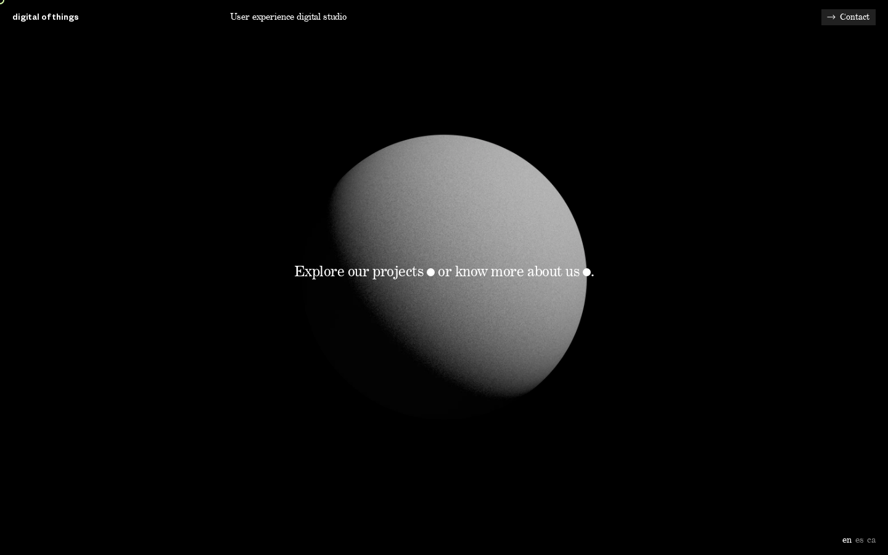

# UI Design System & Master Generation Blueprint: digitalofthings-studio

> **digital of things · user experience digital studio** (https://digitalofthings.studio/) — digital of things is an independent user experience digital studio based in Barcelona. We design and build websites, e-commerce and digit...



---

## 1. Executive Visual Persona & Design Archetype

- **Brand Essence & Persona**: **digital of things · user experience digital studio** (`https://digitalofthings.studio/`). digital of things is an independent user experience digital studio based in Barcelona. We design and build websites, e-commerce and digit...
- **Capture Provenance**: Live browser capture (`tier1_fast`, HTTP `200`, captured `2026-11-23`).
- **Visual Archetype**: **Dark-Substrate WebGL / Canvas Interactive Experience (`#000000` / `#dbffad`)**.
- **Anti-AI-Slop Differentiators**:
  - **Live-Computed Chromatic Polarity**: Anchors the viewport in `#000000` (live computed `body` `background-color` (`computed_styles.json`)) paired with `#ffffff` primary typography and `#dbffad` accents.
  - **Grounded Typographic Hierarchy**: Pairs `Apple Color Emoji` for display copy (`digital of things — user experience `) with `Apple Color Emoji` and `Geist Mono`.
  - **Calibrated Spatial Grid & Motion**: Combines `1536px` container bounds (`gap: 10px`, padding `2rem`) with `cubic-bezier(.4,0,.2,1)` easing and HTML5 `<canvas>` Interactive Viewport Surface.

---

## 2. Spatial Architecture & Modular Grid Mathematics


### Viewport Allocation & Container Geometry
- **Captured Viewport Dimensions**: Desktop `1440×900px` (`assets/desktop.png`, single-viewport 100vh live capture (900px)), Mobile `390×844px` (`assets/mobile.png`, single-viewport 100vh live capture (844px)).
- **Master Container Bounds**: `1536px` (non-`@media` desktop container stylesheet rule).
- **Canvas Lateral Padding & Spacing**: `2rem` lateral canvas padding with `10px` grid gap.
- **Border Radius Scale**: `99999px`, `10px`, `2px`, `9999px`.

### Responsive Breakpoint Architecture
- **Desktop Layout**: Multi-column CSS Grid / Flexbox layout at `1440px` (`max-width: 1536px`, `gap: 10px`).
- **Mobile Layout**: Single-column vertical stack at `390px` viewport width with `2rem` horizontal padding.
- **Extracted CSS Media Queries**: `@media (width>=880px)`, `@media (width<=1149px)`, `@media (width>=1400px)`, `@media (prefers-reduced-motion:reduce)`.

---

## 3. Color System, Materiality & Atmospheric Lighting

### Semantic Palette & Source Grounding
| Semantic Role | Ground-Truth Value | Extracted Live / CSS Source |
|---|---|---|
| **Primary Canvas Substrate** | `#000000` | live computed `body` `background-color` (`computed_styles.json`) |
| **Primary Typography Ink** | `#ffffff` | live computed `p` `color` (`computed_styles.json`) |
| **Elevated Surface / Card Substrate** | `#212121` | `.stack-item-content-wrapper { background: #212121 }` |
| **Interactive Accent / Highlight** | `#dbffad` | `.cookie-consent__actions button { color: #dbffad }` |
| **Secondary / Muted Copy** | `#9ca3af` | `input::-moz-placeholder { color: #9ca3af }` |
| **Structural Hairline Border** | `#e5e7eb` | live computed `nav` `border-color` (`computed_styles.json`) |

### Sanitized Root CSS Variables (`ui-ux.md` Ground Truth)
| Variable Name | Extracted Value | Semantic Role |
|---|---|---|
| `--mask-x` | `50%` | Dimension / Scale Token |
| `--mask-y` | `50%` | Dimension / Scale Token |
| `--mask-radius` | `0px` | Elevation / Border Token |
| `--tw-border-spacing-x` | `0` | Layout / Spatial Grid Token |
| `--tw-border-spacing-y` | `0` | Layout / Spatial Grid Token |
| `--tw-translate-x` | `0` | Design System Custom Token |
| `--tw-translate-y` | `0` | Design System Custom Token |
| `--tw-rotate` | `0` | Design System Custom Token |
| `--tw-skew-x` | `0` | Design System Custom Token |
| `--tw-skew-y` | `0` | Design System Custom Token |
| `--tw-scale-x` | `1` | Design System Custom Token |
| `--tw-scale-y` | `1` | Design System Custom Token |
| `--tw-scroll-snap-strictness` | `proximity` | Design System Custom Token |
| `--tw-ring-offset-width` | `0px` | Layout / Spatial Grid Token |
| `--digitalofthings--bg` | `#000000` | Canvas Substrate (from live computed `body` `background-color` (`computed_styles.json`)) |
| `--digitalofthings--ink` | `#ffffff` | Primary Typography Ink (computed-derived) |

---

## 4. Typographic Scale & Editorial Hierarchy

### Font Family Stacks
- **Display Typography**: `Apple Color Emoji`.
- **Primary Body Stack**: `Apple Color Emoji`.
- **Technical / Metadata Stack**: `Geist Mono`.

### Typographic Scale & Rules (Live Computed & Stylesheet Grounded)
- **Hero Display (`H1`)**: live computed `h1` (`font-size: 16px`, `line-height: 24px`, `font-weight: 400`); rule `.title` (`font-size: 15px`, `line-height: 19px`, `letter-spacing: -.15px`).
- **Section Heading (`H2`)**: live computed `h2` (`font-size: 15px`, `line-height: 20px`, `font-weight: 400`, `letter-spacing: -0.15px`); rule `h2` (`font-size: 16px`, `line-height: 22px`, `letter-spacing: -.16px`).
- **Body Copy**: live computed `body` (`font-size: 16px`, `line-height: 24px`, `font-weight: 400`); rule `p` (`font-size: 15px`, `line-height: 20px`, `letter-spacing: -.15px`).
- **Metadata & Navigation Labels**: live computed `nav/a` (`font-size: 16px`, `line-height: 24px`, `font-weight: 400`).

---

## 5. Choreographed Motion & Interaction Physics

### Primary Easing Curves
- **Extracted Timing Functions**: `cubic-bezier(.4,0,.2,1)`, `cubic-bezier(.34,1.56,.64,1)`, `cubic-bezier(.4,0,1,1)`.

### Per-Element Transition & Choreography Rules
- **Selector `body`**: `transition: background-color 1s ease-in-out` extracted from `digitalofthings-studio` stylesheet.
- **Selector `m .stack-item-wrapper .expose-tit...`**: `transition: opacity .3s,transform .4s` extracted from `digitalofthings-studio` stylesheet.
- **Selector `.stack-item .stack-item-card`**: `transition: transform .2s,box-shadow .2s` extracted from `digitalofthings-studio` stylesheet.
- **Extracted Easing Curve (`cubic-bezier(.4,0,.2,1)`)**: Governs interactive state transitions across `<nav.js>` and `<section.antialiased>`.
- **Runtime Interaction Engine**: Integrates HTML5 `<canvas>` Interactive Viewport Surface with `prefers-reduced-motion: reduce` fallback guards.

---

## 6. Component Wireframe & Structural DOM Map

### Visual Layout Schematic — Desktop (`1440px`, Grounded in `dom.html` & Landmark Bounding Boxes)
```
┌────────────────────────────────────────────────────────────────────────┐
│ DESKTOP VIEWPORT (1440px) — digital of things · user experience digita │
│ ====================================================================== │
│ [ <nav.js> (1440px)                   | Projects · Pet Projects · Co ] │
│ ---------------------------------------------------------------------- │
│ | HERO STAGE: <section.has-bar> (w=1440px)                           | │
│ | H1: digital of things — user experience digital studi...           | │
│ | Substrate: #000000 | Ink: #ffffff | Accent: #dbffad                | │
│ ---------------------------------------------------------------------- │
│ | SHOWCASE GRID (<section.antialiased>) max-w: 1536px                | │
│ | +------------------------------+  +------------------------------+ | │
│ | | Selected projects            |  | or know more about us        | | │
│ | +------------------------------+  +------------------------------+ | │
│ ---------------------------------------------------------------------- │
│ | DETAIL MODULE (<section.custom-cursor>) — User experience digit    | │
│ ---------------------------------------------------------------------- │
│ [ FOOTER (<footer.app-footer> ) | https://digitalofthings.studio/      │
└────────────────────────────────────────────────────────────────────────┘
```

### Visual Layout Schematic — Mobile Reflow (`390px`)
```
┌────────────────────────────────────────────────────────────────────────┐
│ MOBILE VIEWPORT REFLOW (390px) — Single-Column Stack (gap: 10px)       │
│ ====================================================================== │
│ [ HEADER BAR (<nav.js>                ) | Compact Menu (390px)         │
│ ---------------------------------------------------------------------- │
│ | HERO STAGE (<section.has-bar>) — 390px Vertical Lead               | │
│ | H1: digital of things — user experience digital studi...           | │
│ ---------------------------------------------------------------------- │
│ | SHOWCASE STACK (<section.antialiased>) — 1-Col Stack               | │
│ | [ Item 1: Selected projects                                      ] | │
│ | [ Item 2: or know more about us                                  ] | │
│ ---------------------------------------------------------------------- │
│ | DETAIL STACK (<section.custom-cursor>) — 1-Col (User experience di)  │
│ ---------------------------------------------------------------------- │
│ [ FOOTER (<footer.app-footer> ) | Stacked 390px Colophon               │
└────────────────────────────────────────────────────────────────────────┘
```

### Granular DOM Region Breakdown
1. **Brand Header & Navigation Bar (<nav.js> — `digitalofthings-studio`)**:
   - Landmark `<nav class="js">` (`1440px`) hosting `digital of things · user experience ` navigation (`Projects · Pet Projects · Contact · Easter Eggs · Clients`), DOM attributes (`data-prefix`, `data-home-title="digital of things · u..."`, `data-ga="G-WW56TNJ6LL"`, `data-cf-beacon="("token": "fcd04126c7..."`), and stylesheet rule `.__className_8eaea4 { font-family:Geist,Geist Fallback;font-style:normal }`.
2. **Hero Stage & Focal Lead (<section.has-bar> — `digital of things — user experienc`)**:
   - Landmark `<section class="has-bar">` presenting display lead `digital of things — user experience digital studi...` and copy excerpt *"Explore our projects"* over `#000000` canvas and `#ffffff` ink.
3. **Primary Showcase & Content Grid (<section.antialiased> — `Selected projects`)**:
   - Landmark `<section class="antialiased">` rendering section `Selected projects` with copy *"or know more about us"*, asset references (`manifest.webmanifest`, `digitalofthings.studio`, `favicon.ico`, `icon-512.png`), and grid rule `.__className_8c25df { font-family:Geist Mono,Geist Mono Fallback;font-style:normal }`.
4. **Interactive Detail & Feature Matrix (<section.custom-cursor> — `or know more about us`)**:
   - Landmark `<section class="custom-cursor">` framing `or know more about us` and `User experience digital studio` (*"User experience digital studio"*) with `#212121` surface cards, `#dbffad` accents, and `html { scroll-behavior:smooth }`.
5. **Colophon & Global Directory Footer (<footer.app-footer> — `https://digitalofthings.studio/`)**:
   - Landmark `<footer class="app-footer">` anchoring `digital of things · user experie` footer links (`Projects · Pet Projects · Contact · Easter Eggs · Clients`), copy *"Turning ideas into digital experiences."*, and `#e5e7eb` structural dividers.

---

## 7. Master Zero-Shot AI Generation Prompt

```markdown
# Master Zero-Shot Frontend Generation Prompt: digitalofthings-studio (digital of things · user experience digital studio)

You are a principal frontend architect and design systems engineer. Build a complete, production-ready web application replicating the exact design system, DOM landmarks, typographic hierarchy, color tokens, and motion physics of `digitalofthings-studio` (**digital of things · user experience digital studio** — `https://digitalofthings.studio/`).

### 1. Visual Archetype & Anti-AI-Slop Mandates
- **Archetype**: Dark-Substrate WebGL / Canvas Interactive Experience (`#000000` / `#dbffad`).
- **Identity & Domain Context**: digital of things is an independent user experience digital studio based in Barcelona. We design and build websites, e-commerce and digit...
- **Primary Substrate**: `#000000` (live computed `body` `background-color` (`computed_styles.json`)), **Primary Ink**: `#ffffff`, **Accent / Highlight**: `#dbffad`.
- **Site-Specific Differentiators**:
  - **Live-Computed Chromatic Polarity**: Anchors the viewport in `#000000` (live computed `body` `background-color` (`computed_styles.json`)) paired with `#ffffff` primary typography and `#dbffad` accents.
  - **Grounded Typographic Hierarchy**: Pairs `Apple Color Emoji` for display copy (`digital of things — user experience `) with `Apple Color Emoji` and `Geist Mono`.
  - **Calibrated Spatial Grid & Motion**: Combines `1536px` container bounds (`gap: 10px`, padding `2rem`) with `cubic-bezier(.4,0,.2,1)` easing and HTML5 `<canvas>` Interactive Viewport Surface.

### 2. Ground-Truth CSS Variables (`:root` Token Contract)
Declare and consume these exact custom properties extracted from `digitalofthings-studio` in your global stylesheet:

:root {
  /* digital of things · user experience digital studio (digitalofthings-studio) — Live-Grounded CSS Variables */
  --mask-x: 50%; /* Dimension / Scale Token (digitalofthings-studio) */
  --mask-y: 50%; /* Dimension / Scale Token (digitalofthings-studio) */
  --mask-radius: 0px; /* Elevation / Border Token (digitalofthings-studio) */
  --tw-border-spacing-x: 0; /* Layout / Spatial Grid Token (digitalofthings-studio) */
  --tw-border-spacing-y: 0; /* Layout / Spatial Grid Token (digitalofthings-studio) */
  --tw-translate-x: 0; /* Design System Custom Token (digitalofthings-studio) */
  --tw-translate-y: 0; /* Design System Custom Token (digitalofthings-studio) */
  --tw-rotate: 0; /* Design System Custom Token (digitalofthings-studio) */
  --tw-skew-x: 0; /* Design System Custom Token (digitalofthings-studio) */
  --tw-skew-y: 0; /* Design System Custom Token (digitalofthings-studio) */
  --tw-scale-x: 1; /* Design System Custom Token (digitalofthings-studio) */
  --tw-scale-y: 1; /* Design System Custom Token (digitalofthings-studio) */
  --tw-scroll-snap-strictness: proximity; /* Design System Custom Token (digitalofthings-studio) */
  --tw-ring-offset-width: 0px; /* Layout / Spatial Grid Token (digitalofthings-studio) */
  --digitalofthings--bg: #000000; /* Canvas Substrate (from live computed `body` `background-color` (`computed_styles.json`)) (digitalofthings-studio) */
  --digitalofthings--ink: #ffffff; /* Primary Typography Ink (computed-derived) (digitalofthings-studio) */
}

### 3. Semantic Color & Materiality Contract
Map every surface, ink, and border strictly to these source-grounded tokens:
- **Primary Canvas Substrate**: `#000000` — grounded in live computed `body` `background-color` (`computed_styles.json`)
- **Primary Typography Ink**: `#ffffff` — grounded in live computed `p` `color` (`computed_styles.json`)
- **Elevated Surface / Card Substrate**: `#212121` — grounded in `.stack-item-content-wrapper { background: #212121 }`
- **Interactive Accent / Highlight**: `#dbffad` — grounded in `.cookie-consent__actions button { color: #dbffad }`
- **Secondary / Muted Copy**: `#9ca3af` — grounded in `input::-moz-placeholder { color: #9ca3af }`
- **Structural Hairline Border**: `#e5e7eb` — grounded in live computed `nav` `border-color` (`computed_styles.json`)

### 4. Spatial Grid, Container Bounds & Responsive Breakpoints
- **Desktop Viewport Reference**: `1440×900px` (single-viewport 100vh live capture (900px), `1440px` standard desktop width).
- **Mobile Viewport Reference**: `390×844px` (single-viewport 100vh live capture (844px), `390px` standard mobile width).
- **Container Max-Width**: `1536px` (non-`@media` desktop container stylesheet rule)
- **Padding & Gutters**: `2rem` lateral canvas padding with `10px` grid gap
- **Desktop Grid**: Multi-column CSS Grid / Flexbox layout at `1440px` (`max-width: 1536px`, `gap: 10px`)
- **Mobile Adaptation**: Single-column vertical stack at `390px` viewport width with `2rem` horizontal padding
- **Media Queries**: `@media (width>=880px)`, `@media (width<=1149px)`, `@media (width>=1400px)`, `@media (prefers-reduced-motion:reduce)`
- **Corner Radii**: `99999px`, `10px`, `2px`, `9999px`

### 5. Typography & Editorial Scale Contract
- **Display Font Stack**: `Apple Color Emoji`
- **Body Font Stack**: `Apple Color Emoji`
- **Monospace / Technical Font Stack**: `Geist Mono`
- **H1 Display Rule**: live computed `h1` (`font-size: 16px`, `line-height: 24px`, `font-weight: 400`); rule `.title` (`font-size: 15px`, `line-height: 19px`, `letter-spacing: -.15px`)
- **H2 Section Rule**: live computed `h2` (`font-size: 15px`, `line-height: 20px`, `font-weight: 400`, `letter-spacing: -0.15px`); rule `h2` (`font-size: 16px`, `line-height: 22px`, `letter-spacing: -.16px`)
- **Body Copy Rule**: live computed `body` (`font-size: 16px`, `line-height: 24px`, `font-weight: 400`); rule `p` (`font-size: 15px`, `line-height: 20px`, `letter-spacing: -.15px`)
- **Metadata & Index Rule**: live computed `nav/a` (`font-size: 16px`, `line-height: 24px`, `font-weight: 400`)

### 6. Component Hierarchy, Verbatim Copy & Real DOM Landmarks
Scaffold `digitalofthings-studio` (`digital of things · user experience digital studio`) with these exact structural regions, extracted copy, and CSS rules from `dom.html`:
1. **Brand Header & Navigation Bar (<nav.js> — `digitalofthings-studio`)**:
   - DOM & Selectors: Landmark `<nav class="js">` (`1440px`) hosting `digital of things · user experience ` navigation (`Projects · Pet Projects · Contact · Easter Eggs · Clients`), DOM attributes (`data-prefix`, `data-home-title="digital of things · u..."`, `data-ga="G-WW56TNJ6LL"`, `data-cf-beacon="("token": "fcd04126c7..."`), and stylesheet rule `.__className_8eaea4 { font-family:Geist,Geist Fallback;font-style:normal }`.
   - Responsive Contract: Header `Brand Header & Navigation Bar (<nav.js> — `digitalofthings-studio`)` (`digitalofthings-studio`) adapts across `@media (width>=880px)`, `@media (width<=1149px)`, `@media (width>=1400px)`, `@media (prefers-reduced-motion:reduce)` with `cubic-bezier(.4,0,.2,1)`, `cubic-bezier(.34,1.56,.64,1)`, `cubic-bezier(.4,0,1,1)` transitions and links `Projects · Pet Projects · Contact · Easter Eggs · Clients`.
2. **Hero Stage & Focal Lead (<section.has-bar> — `digital of things — user experienc`)**:
   - DOM & Selectors: Landmark `<section class="has-bar">` presenting display lead `digital of things — user experience digital studi...` and copy excerpt *"Explore our projects"* over `#000000` canvas and `#ffffff` ink.
   - Responsive Contract: Hero stage (`1440×900px` desktop / `390×844px` mobile) sets `#000000` background with `#ffffff` headline `digital of things — user experience digital studi...`.
3. **Primary Showcase & Content Grid (<section.antialiased> — `Selected projects`)**:
   - DOM & Selectors: Landmark `<section class="antialiased">` rendering section `Selected projects` with copy *"or know more about us"*, asset references (`manifest.webmanifest`, `digitalofthings.studio`, `favicon.ico`, `icon-512.png`), and grid rule `.__className_8c25df { font-family:Geist Mono,Geist Mono Fallback;font-style:normal }`.
   - Responsive Contract: Showcase grid `Primary Showcase & Content Grid (<section.antialiased> — `Selected projects`)` applies Multi-column CSS Grid / Flexbox layout at `1440px` (`max-width: 1536px`, `gap: 10px`) on desktop and Single-column vertical stack at `390px` viewport width with `2rem` horizontal padding on mobile.
4. **Interactive Detail & Feature Matrix (<section.custom-cursor> — `or know more about us`)**:
   - DOM & Selectors: Landmark `<section class="custom-cursor">` framing `or know more about us` and `User experience digital studio` (*"User experience digital studio"*) with `#212121` surface cards, `#dbffad` accents, and `html { scroll-behavior:smooth }`.
   - Responsive Contract: Detail module `Interactive Detail & Feature Matrix (<section.custom-cursor> — `or know more about us`)` uses `99999px`, `10px`, `2px`, `9999px` radii, `#dbffad` highlights, and assets (manifest.webmanifest, digitalofthings.studio, favicon.ico).
5. **Colophon & Global Directory Footer (<footer.app-footer> — `https://digitalofthings.studio/`)**:
   - DOM & Selectors: Landmark `<footer class="app-footer">` anchoring `digital of things · user experie` footer links (`Projects · Pet Projects · Contact · Easter Eggs · Clients`), copy *"Turning ideas into digital experiences."*, and `#e5e7eb` structural dividers.
   - Responsive Contract: Footer `Colophon & Global Directory Footer (<footer.app-footer> — `https://digitalofthings.studio/`)` aligns to `1536px` (non-`@media` desktop container stylesheet rule) with `2rem` lateral canvas padding with `10px` grid gap and attributes (data-prefix, data-home-title="digital of things · u...", data-ga="G-WW56TNJ6LL").

#### Verbatim DOM Copy Excerpts (`dom.html`)
- Copy Excerpt 1: *"Explore our projects"*
- Copy Excerpt 2: *"or know more about us"*
- Copy Excerpt 3: *"User experience digital studio"*
- Copy Excerpt 4: *"Turning ideas into digital experiences."*

### 7. Motion, Extracted Stylesheet Rules & Interaction Choreography
- **Primary Easing Functions**: `cubic-bezier(.4,0,.2,1)`, `cubic-bezier(.34,1.56,.64,1)`, `cubic-bezier(.4,0,1,1)`
- **Extracted Stylesheet Rules (`digitalofthings-studio`)**:
- `.__className_8eaea4 { font-family:Geist,Geist Fallback;font-style:normal }`
- `.__className_8c25df { font-family:Geist Mono,Geist Mono Fallback;font-style:normal }`
- `html { scroll-behavior:smooth }`
- `.seo-content { max-width:720px;margin:0 auto;padding:2rem 1.5rem }`
- `.seo-content img { max-width:100%;height:auto;display:block }`
- **Per-Selector Transition Rules**:
- **Selector `body`**: `transition: background-color 1s ease-in-out` extracted from `digitalofthings-studio` stylesheet.
- **Selector `m .stack-item-wrapper .expose-tit...`**: `transition: opacity .3s,transform .4s` extracted from `digitalofthings-studio` stylesheet.
- **Selector `.stack-item .stack-item-card`**: `transition: transform .2s,box-shadow .2s` extracted from `digitalofthings-studio` stylesheet.
- **Extracted Easing Curve (`cubic-bezier(.4,0,.2,1)`)**: Governs interactive state transitions across `<nav.js>` and `<section.antialiased>`.
- **Runtime Interaction Engine**: Integrates HTML5 `<canvas>` Interactive Viewport Surface with `prefers-reduced-motion: reduce` fallback guards.

### 8. Technical Deliverables
- Implement in Next.js (App Router) with TypeScript and Tailwind CSS consuming the `:root` custom properties defined above for `digitalofthings-studio`.
- Reproduce both the `1440px` desktop architecture and `390px` mobile breakpoint transitions, preserving semantic HTML5 landmarks (`<header>`, `<nav>`, `<main>`, `<section>`, `<footer>`) and `prefers-reduced-motion` accessibility guards.
```
