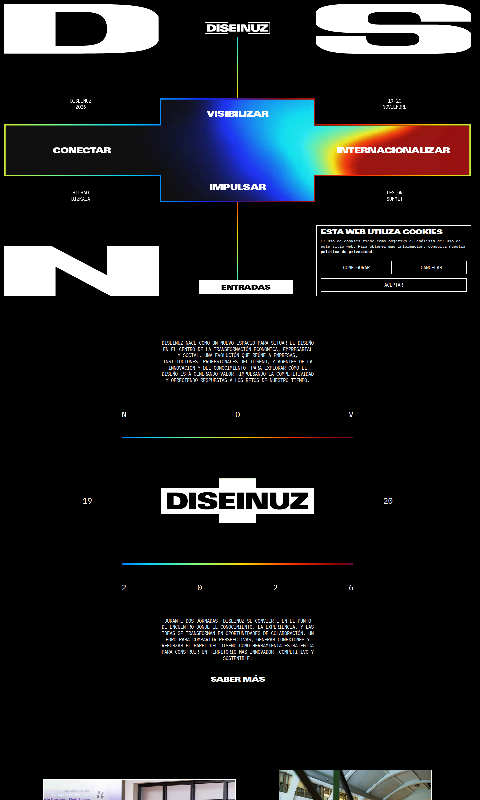
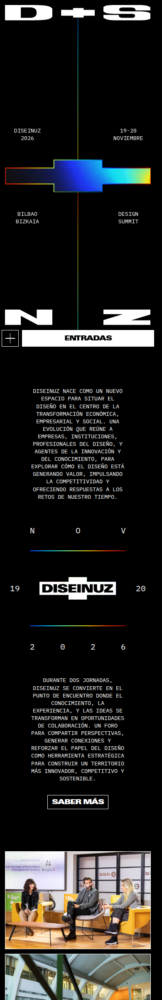

# UI Design System & Master Generation Blueprint: diseinuz-com

> **DISEINUZ — Bilbao Bizkaia Design Summit** (https://diseinuz.com/) — Un encuentro para impulsar el diseño como herramienta de transformación económica, empresarial y social. 19 y 20 de noviembre de 2026 en...



---

## 1. Executive Visual Persona & Design Archetype

- **Brand Essence & Persona**: **DISEINUZ — Bilbao Bizkaia Design Summit** (`https://diseinuz.com/`). Un encuentro para impulsar el diseño como herramienta de transformación económica, empresarial y social. 19 y 20 de noviembre de 2026 en...
- **Visual Archetype**: **Light-Substrate Editorial & Modular Grid System (`#0000` canvas, `#000000` ink, `#830100` accent)**.
- **Anti-AI-Slop Differentiators**:
  - **Source-Grounded Chromatic Polarity**: Anchors the viewport in `#0000` (`.hidden { color: #0000 }`) paired with `#000000` primary typography and `#830100` accents.
  - **Extracted Typographic Hierarchy**: Pairs `UniversPro93ExtraBlackExtended` for display copy (`Configurar Cookies`) with `IBM Plex Mono` and `IBM Plex Mono`.
  - **Calibrated Spatial Grid & Motion**: Combines `680px` container bounds (`gap: var(--grid-gutter)`, padding `1.5rem`) with `cubic-bezier(.48,.1,0,1)` easing and Lenis Smooth Scroll (`data-lenis`), GSAP Timeline & ScrollTrigger.

---

## 2. Spatial Architecture & Modular Grid Mathematics



### Viewport Allocation & Container Geometry
- **Captured Viewport Dimensions**: Desktop `1440×11606px` (`assets/desktop.png`, full-page scroll capture), Mobile `390×2400px` (`assets/mobile.png`, capped at 2400px multi-section capture).
- **Master Container Bounds**: `680px` extracted from `diseinuz-com` stylesheet.
- **Canvas Lateral Padding & Spacing**: `1.5rem` lateral canvas padding with `var(--grid-gutter)` grid gap.
- **Border Radius Scale**: `.5rem`, `4px`, `7px`.

### Responsive Breakpoint Architecture
- **Desktop Layout**: Multi-column CSS Grid / Flexbox layout at `1440px` (`max-width: 680px`, `gap: var(--grid-gutter)`).
- **Mobile Layout**: Single-column vertical stack at `390px` viewport width with `1.5rem` horizontal padding.
- **Extracted CSS Media Queries**: `@media (width<=1180px) and (width>=681px)`, `@media (width<=680px)`, `@media (width<=1180px)`, `@media (width>=1181px)`.

---

## 3. Color System, Materiality & Atmospheric Lighting

### Semantic Palette & Source Grounding
| Semantic Role | Ground-Truth Value | Extracted CSS Source / Selector |
|---|---|---|
| **Primary Canvas Substrate** | `#0000` | `.hidden { color: #0000 }` |
| **Primary Typography Ink** | `#000000` | `body { background: black }` (`#000000`) |
| **Elevated Surface / Card Substrate** | `#ffffff` | `body { color: white }` (`#ffffff`) |
| **Interactive Accent / Highlight** | `#830100` | SVG/DOM `stop-color="#830100"` attribute in `dom.html` |
| **Secondary / Muted Copy** | `#FF2E01` | SVG/DOM `stop-color="#FF2E01"` attribute in `dom.html` |
| **Structural Hairline Border** | `#FFD702` | SVG/DOM `stop-color="#FFD702"` attribute in `dom.html` |

### Sanitized Root CSS Variables (`ui-ux.md` Ground Truth)
| Variable Name | Extracted Value | Semantic Role |
|---|---|---|
| `--grid-gutter` | `.75rem` | Layout / Spatial Grid Token |
| `--grid-margin` | `.75rem` | Layout / Spatial Grid Token |
| `--grid-margin-negative` | `-.75rem` | Layout / Spatial Grid Token |
| `--grid-columns` | `12` | Layout / Spatial Grid Token |
| `--color-black` | `0, 0, 0` | Canvas / Surface Token |
| `--color-white` | `255, 255, 255` | Canvas / Surface Token |
| `--title-letter-spacing` | `-.07em` | Typography / Scale Token |
| `--easing-handle-01` | `cubic-bezier(.48, .1, 0, 1)` | Motion / Easing Token |
| `--easing-handle-02` | `cubic-bezier(.01, .8, .5, 1)` | Motion / Easing Token |
| `--filter-blur` | `blur(5rem)` | Elevation / Border Token |
| `--context` | `1440` | Typography Ink Token |
| `--quarter` | `3.25rem` | Dimension / Scale Token |
| `--menu-width` | `calc(var(--grid-one-column) * var(--grid-columns))` | Layout / Spatial Grid Token |
| `--modal-top` | `2rem` | Dimension / Scale Token |
| `--flashlight-x` | `50%` | Canvas / Surface Token |
| `--flashlight-y` | `50%` | Canvas / Surface Token |

---

## 4. Typographic Scale & Editorial Hierarchy

### Font Family Stacks
- **Display Typography**: `UniversPro93ExtraBlackExtended`.
- **Primary Body Stack**: `IBM Plex Mono`.
- **Technical / Metadata Stack**: `IBM Plex Mono`.

### Typographic Scale & Rules (Extracted from Stylesheet & Variables)
- **Hero Display (`H1`)**: rule `.title` (`font-size: 1.5rem`, `line-height: .91667`).
- **Section Heading (`H2`)**: rule `h2` (`font-size: max(20px,1.5rem)`, `line-height: .91667`, `letter-spacing: var(--title-letter-sp...`, `font-weight: 900`).
- **Body Copy**: rule `p` (`font-size: max(12px,.875rem)`, `line-height: 1.3334`).
- **Metadata & Navigation Labels**: CSS variables `--title-letter-spacing: -.07em`.

---

## 5. Choreographed Motion & Interaction Physics

### Primary Easing Curves
- **Extracted Timing Functions**: `cubic-bezier(.48,.1,0,1)`, `cubic-bezier(.01,.8,.5,1)`, `cubic-bezier(.2,.85,.32,1.2)`.

### Per-Element Transition & Choreography Rules
- **Selector `.underline:before`**: `transition: transform .8s var(--link-handle)` extracted from `diseinuz-com` stylesheet.
- **Selector `footer`**: `transition: opacity .4s var(--easing-handle-01)` extracted from `diseinuz-com` stylesheet.
- **Selector `.hero .title--sp`**: `transition: all 0s .4s` extracted from `diseinuz-com` stylesheet.
- **Extracted Easing Curve (`cubic-bezier(.48,.1,0,1)`)**: Governs interactive state transitions across `<header.header>` and `<section.home__intro>`.
- **Runtime Interaction Engine**: Integrates Lenis Smooth Scroll (`data-lenis`), GSAP Timeline & ScrollTrigger with `prefers-reduced-motion: reduce` fallback guards.

---

## 6. Component Wireframe & Structural DOM Map

### Visual Layout Schematic (Grounded in `dom.html` — `1440px` Desktop & `390px` Mobile Reflow)
```
┌────────────────────────────────────────────────────────────────────────┐
│ DESKTOP VIEWPORT (1440px) — DISEINUZ — Bilbao Bizkaia Design Summit    │
│ ====================================================================== │
│ [ <header.header>          | Aviso legal · Privacidad · Cookies     ]  │
│ ---------------------------------------------------------------------- │
│ | HERO STAGE: <section.home__hero>                                 |   │
│ | H1: Configurar Cookies                                           |   │
│ | Substrate: #0000      | Ink: #000000    | Accent: #830100        |   │
│ ---------------------------------------------------------------------- │
│ | SHOWCASE GRID (<section.home__intro>     ) max-w: 680px          |   │
│ | +------------------------------+  +------------------------------+ | │
│ | | Ponentes                     |  | 19-20 nov sala multibox eitb | | │
│ | +------------------------------+  +------------------------------+ | │
│ ---------------------------------------------------------------------- │
│ | MOBILE VIEWPORT REFLOW (390px) — Single-Column Stack (gap: var(--) | │
│ | [<header.header>] -> [<section.home__her] -> [<section.home__int] |  │
│ ---------------------------------------------------------------------- │
│ [ FOOTER (<footer.page__footer> ) | https://diseinuz.com/              │
└────────────────────────────────────────────────────────────────────────┘
```

### Granular DOM Region Breakdown
1. **Brand Header & Navigation Bar (<header.header> — `diseinuz-com`)**:
   - Landmark `<header class="header top">` hosting `DISEINUZ — Bilbao Bizkaia Design Sum` navigation (`Aviso legal · Privacidad · Cookies`), DOM attributes (`data-type="desktop"`, `data-url="/privacidad"`, `data-to="default__page"`, `data-lenis-prevent`), and stylesheet rule `root { --grid-columns:6;--context:402;--menu-width:calc(var(--grid-one-column)... }`.
2. **Hero Stage & Focal Lead (<section.home__hero> — `Configurar Cookies`)**:
   - Landmark `<section class="home__hero">` presenting display lead `Configurar Cookies` and copy excerpt *"El uso de cookies tiene como objetivo el análisis del uso de este"* over `#0000` canvas and `#000000` ink.
3. **Primary Showcase & Content Grid (<section.home__intro> — `Ponentes`)**:
   - Landmark `<section class="home__intro">` rendering section `Ponentes` with copy *"política de privacidad"*, asset references (`favicon-96x96.png`, `favicon.svg`, `favicon.ico`, `apple-touch-icon.png`), and grid rule `html.lenis body { height:auto }`.
4. **Interactive Detail & Feature Matrix (<section.home__featured> — `19-20 nov sala multibox eitb bilba`)**:
   - Landmark `<section class="home__featured shader__section">` framing `19-20 nov sala multibox eitb bilbao` and `Contacto` (*"Estas cookies son esenciales para el correcto funcionamiento del "*) with `#ffffff` surface cards, `#830100` accents, and `.lenis.lenis-smooth { scroll-behavior:auto!important }`.
5. **Colophon & Global Directory Footer (<footer.page__footer> — `https://diseinuz.com/`)**:
   - Landmark `<footer class="page__footer">` anchoring `DISEINUZ — Bilbao Bizkaia Design` footer links (`Aviso legal · Privacidad · Cookies`), copy *"Estas cookies permiten recopilar información anónima sobre e"*, and `#FFD702` structural dividers.

---

## 7. Master Zero-Shot AI Generation Prompt

```markdown
# Master Zero-Shot Frontend Generation Prompt: diseinuz-com (DISEINUZ — Bilbao Bizkaia Design Summit)

You are a principal frontend architect and design systems engineer. Build a complete, production-ready web application replicating the exact design system, DOM landmarks, typographic hierarchy, color tokens, and motion physics of `diseinuz-com` (**DISEINUZ — Bilbao Bizkaia Design Summit** — `https://diseinuz.com/`).

### 1. Visual Archetype & Anti-AI-Slop Mandates
- **Archetype**: Light-Substrate Editorial & Modular Grid System (`#0000` canvas, `#000000` ink, `#830100` accent).
- **Identity & Domain Context**: Un encuentro para impulsar el diseño como herramienta de transformación económica, empresarial y social. 19 y 20 de noviembre de 2026 en...
- **Primary Substrate**: `#0000` (`.hidden { color: #0000 }`), **Primary Ink**: `#000000`, **Accent / Highlight**: `#830100`.
- **Site-Specific Differentiators**:
  - **Source-Grounded Chromatic Polarity**: Anchors the viewport in `#0000` (`.hidden { color: #0000 }`) paired with `#000000` primary typography and `#830100` accents.
  - **Extracted Typographic Hierarchy**: Pairs `UniversPro93ExtraBlackExtended` for display copy (`Configurar Cookies`) with `IBM Plex Mono` and `IBM Plex Mono`.
  - **Calibrated Spatial Grid & Motion**: Combines `680px` container bounds (`gap: var(--grid-gutter)`, padding `1.5rem`) with `cubic-bezier(.48,.1,0,1)` easing and Lenis Smooth Scroll (`data-lenis`), GSAP Timeline & ScrollTrigger.

### 2. Ground-Truth CSS Variables (`:root` Token Contract)
Declare and consume these exact custom properties extracted from `diseinuz-com` in your global stylesheet:

:root {
  /* DISEINUZ — Bilbao Bizkaia Design Summit (diseinuz-com) — Ground-Truth Extracted CSS Variables */
  --grid-gutter: .75rem; /* Layout / Spatial Grid Token (diseinuz-com) */
  --grid-margin: .75rem; /* Layout / Spatial Grid Token (diseinuz-com) */
  --grid-margin-negative: -.75rem; /* Layout / Spatial Grid Token (diseinuz-com) */
  --grid-columns: 12; /* Layout / Spatial Grid Token (diseinuz-com) */
  --color-black: 0, 0, 0; /* Canvas / Surface Token (diseinuz-com) */
  --color-white: 255, 255, 255; /* Canvas / Surface Token (diseinuz-com) */
  --title-letter-spacing: -.07em; /* Typography / Scale Token (diseinuz-com) */
  --easing-handle-01: cubic-bezier(.48, .1, 0, 1); /* Motion / Easing Token (diseinuz-com) */
  --easing-handle-02: cubic-bezier(.01, .8, .5, 1); /* Motion / Easing Token (diseinuz-com) */
  --filter-blur: blur(5rem); /* Elevation / Border Token (diseinuz-com) */
  --context: 1440; /* Typography Ink Token (diseinuz-com) */
  --quarter: 3.25rem; /* Dimension / Scale Token (diseinuz-com) */
  --menu-width: calc(var(--grid-one-column) * var(--grid-columns)); /* Layout / Spatial Grid Token (diseinuz-com) */
  --modal-top: 2rem; /* Dimension / Scale Token (diseinuz-com) */
  --flashlight-x: 50%; /* Canvas / Surface Token (diseinuz-com) */
  --flashlight-y: 50%; /* Canvas / Surface Token (diseinuz-com) */
}

### 3. Semantic Color & Materiality Contract
Map every surface, ink, and border strictly to these source-grounded tokens:
- **Primary Canvas Substrate**: `#0000` — grounded in `.hidden { color: #0000 }`
- **Primary Typography Ink**: `#000000` — grounded in `body { background: black }` (`#000000`)
- **Elevated Surface / Card Substrate**: `#ffffff` — grounded in `body { color: white }` (`#ffffff`)
- **Interactive Accent / Highlight**: `#830100` — grounded in SVG/DOM `stop-color="#830100"` attribute in `dom.html`
- **Secondary / Muted Copy**: `#FF2E01` — grounded in SVG/DOM `stop-color="#FF2E01"` attribute in `dom.html`
- **Structural Hairline Border**: `#FFD702` — grounded in SVG/DOM `stop-color="#FFD702"` attribute in `dom.html`

### 4. Spatial Grid, Container Bounds & Responsive Breakpoints
- **Desktop Viewport Reference**: `1440×11606px` (full-page scroll capture, `1440px` standard desktop width).
- **Mobile Viewport Reference**: `390×2400px` (capped at 2400px multi-section capture, `390px` standard mobile width).
- **Container Max-Width**: `680px` extracted from `diseinuz-com` stylesheet
- **Padding & Gutters**: `1.5rem` lateral canvas padding with `var(--grid-gutter)` grid gap
- **Desktop Grid**: Multi-column CSS Grid / Flexbox layout at `1440px` (`max-width: 680px`, `gap: var(--grid-gutter)`)
- **Mobile Adaptation**: Single-column vertical stack at `390px` viewport width with `1.5rem` horizontal padding
- **Media Queries**: `@media (width<=1180px) and (width>=681px)`, `@media (width<=680px)`, `@media (width<=1180px)`, `@media (width>=1181px)`
- **Corner Radii**: `.5rem`, `4px`, `7px`

### 5. Typography & Editorial Scale Contract
- **Display Font Stack**: `UniversPro93ExtraBlackExtended`
- **Body Font Stack**: `IBM Plex Mono`
- **Monospace / Technical Font Stack**: `IBM Plex Mono`
- **H1 Display Rule**: rule `.title` (`font-size: 1.5rem`, `line-height: .91667`)
- **H2 Section Rule**: rule `h2` (`font-size: max(20px,1.5rem)`, `line-height: .91667`, `letter-spacing: var(--title-letter-sp...`, `font-weight: 900`)
- **Body Copy Rule**: rule `p` (`font-size: max(12px,.875rem)`, `line-height: 1.3334`)
- **Metadata & Index Rule**: CSS variables `--title-letter-spacing: -.07em`

### 6. Component Hierarchy, Verbatim Copy & Real DOM Landmarks
Scaffold `diseinuz-com` (`DISEINUZ — Bilbao Bizkaia Design Summit`) with these exact structural regions, extracted copy, and CSS rules from `dom.html`:
1. **Brand Header & Navigation Bar (<header.header> — `diseinuz-com`)**:
   - DOM & Selectors: Landmark `<header class="header top">` hosting `DISEINUZ — Bilbao Bizkaia Design Sum` navigation (`Aviso legal · Privacidad · Cookies`), DOM attributes (`data-type="desktop"`, `data-url="/privacidad"`, `data-to="default__page"`, `data-lenis-prevent`), and stylesheet rule `root { --grid-columns:6;--context:402;--menu-width:calc(var(--grid-one-column)... }`.
   - Responsive Contract: Header `Brand Header & Navigation Bar (<header.header> — `diseinuz-com`)` (`diseinuz-com`) adapts across `@media (width<=1180px) and (width>=681px)`, `@media (width<=680px)`, `@media (width<=1180px)`, `@media (width>=1181px)` with `cubic-bezier(.48,.1,0,1)`, `cubic-bezier(.01,.8,.5,1)`, `cubic-bezier(.2,.85,.32,1.2)` transitions and links `Aviso legal · Privacidad · Cookies`.
2. **Hero Stage & Focal Lead (<section.home__hero> — `Configurar Cookies`)**:
   - DOM & Selectors: Landmark `<section class="home__hero">` presenting display lead `Configurar Cookies` and copy excerpt *"El uso de cookies tiene como objetivo el análisis del uso de este"* over `#0000` canvas and `#000000` ink.
   - Responsive Contract: Hero stage (`1440×11606px` desktop / `390×2400px` mobile) sets `#0000` background with `#000000` headline `Configurar Cookies`.
3. **Primary Showcase & Content Grid (<section.home__intro> — `Ponentes`)**:
   - DOM & Selectors: Landmark `<section class="home__intro">` rendering section `Ponentes` with copy *"política de privacidad"*, asset references (`favicon-96x96.png`, `favicon.svg`, `favicon.ico`, `apple-touch-icon.png`), and grid rule `html.lenis body { height:auto }`.
   - Responsive Contract: Showcase grid `Primary Showcase & Content Grid (<section.home__intro> — `Ponentes`)` applies Multi-column CSS Grid / Flexbox layout at `1440px` (`max-width: 680px`, `gap: var(--grid-gutter)`) on desktop and Single-column vertical stack at `390px` viewport width with `1.5rem` horizontal padding on mobile.
4. **Interactive Detail & Feature Matrix (<section.home__featured> — `19-20 nov sala multibox eitb bilba`)**:
   - DOM & Selectors: Landmark `<section class="home__featured shader__section">` framing `19-20 nov sala multibox eitb bilbao` and `Contacto` (*"Estas cookies son esenciales para el correcto funcionamiento del "*) with `#ffffff` surface cards, `#830100` accents, and `.lenis.lenis-smooth { scroll-behavior:auto!important }`.
   - Responsive Contract: Detail module `Interactive Detail & Feature Matrix (<section.home__featured> — `19-20 nov sala multibox eitb bilba`)` uses `.5rem`, `4px`, `7px` radii, `#830100` highlights, and assets (favicon-96x96.png, favicon.svg, favicon.ico).
5. **Colophon & Global Directory Footer (<footer.page__footer> — `https://diseinuz.com/`)**:
   - DOM & Selectors: Landmark `<footer class="page__footer">` anchoring `DISEINUZ — Bilbao Bizkaia Design` footer links (`Aviso legal · Privacidad · Cookies`), copy *"Estas cookies permiten recopilar información anónima sobre e"*, and `#FFD702` structural dividers.
   - Responsive Contract: Footer `Colophon & Global Directory Footer (<footer.page__footer> — `https://diseinuz.com/`)` aligns to `680px` extracted from `diseinuz-com` stylesheet with `1.5rem` lateral canvas padding with `var(--grid-gutter)` grid gap and attributes (data-type="desktop", data-url="/privacidad", data-to="default__page").

#### Verbatim DOM Copy Excerpts (`dom.html`)
- Copy Excerpt 1: *"El uso de cookies tiene como objetivo el análisis del uso de este sitio web. Para..."*
- Copy Excerpt 2: *"política de privacidad"*
- Copy Excerpt 3: *"Estas cookies son esenciales para el correcto funcionamiento del sitio web. Permit..."*
- Copy Excerpt 4: *"Estas cookies permiten recopilar información anónima sobre el uso que hacen los us..."*

### 7. Motion, Extracted Stylesheet Rules & Interaction Choreography
- **Primary Easing Functions**: `cubic-bezier(.48,.1,0,1)`, `cubic-bezier(.01,.8,.5,1)`, `cubic-bezier(.2,.85,.32,1.2)`
- **Extracted Stylesheet Rules (`diseinuz-com`)**:
- `root { --grid-columns:6;--context:402;--menu-width:calc(var(--grid-one-column)... }`
- `html.lenis body { height:auto }`
- `.lenis.lenis-smooth { scroll-behavior:auto!important }`
- `.no--scroll { overflow:hidden }`
- `body { box-sizing:border-box;cursor:default;min-height:100%;margin:0;padding:0;... }`
- **Per-Selector Transition Rules**:
- **Selector `.underline:before`**: `transition: transform .8s var(--link-handle)` extracted from `diseinuz-com` stylesheet.
- **Selector `footer`**: `transition: opacity .4s var(--easing-handle-01)` extracted from `diseinuz-com` stylesheet.
- **Selector `.hero .title--sp`**: `transition: all 0s .4s` extracted from `diseinuz-com` stylesheet.
- **Extracted Easing Curve (`cubic-bezier(.48,.1,0,1)`)**: Governs interactive state transitions across `<header.header>` and `<section.home__intro>`.
- **Runtime Interaction Engine**: Integrates Lenis Smooth Scroll (`data-lenis`), GSAP Timeline & ScrollTrigger with `prefers-reduced-motion: reduce` fallback guards.

### 8. Technical Deliverables
- Implement in Next.js (App Router) with TypeScript and Tailwind CSS consuming the `:root` custom properties defined above for `diseinuz-com`.
- Reproduce both the `1440px` desktop architecture and `390px` mobile breakpoint transitions, preserving semantic HTML5 landmarks (`<header>`, `<nav>`, `<main>`, `<section>`, `<footer>`) and `prefers-reduced-motion` accessibility guards.
```
