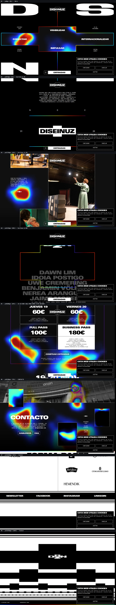
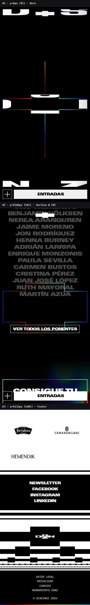

# UI Design System & Master Generation Blueprint: diseinuz-com

> **DISEINUZ — Bilbao Bizkaia Design Summit** (https://diseinuz.com/) — Un encuentro para impulsar el diseño como herramienta de transformación económica, empresarial y social. 19 y 20 de noviembre de 2026 en...





---

## 1. Executive Visual Persona & Design Archetype

- **Brand Essence & Persona**: **DISEINUZ — Bilbao Bizkaia Design Summit** (`https://diseinuz.com/`). Un encuentro para impulsar el diseño como herramienta de transformación económica, empresarial y social. 19 y 20 de noviembre de 2026 en...
- **Capture Provenance**: Live browser capture (`tier1_fast`, HTTP `200`, captured `2026-11-24`).
- **Visual Archetype**: **High-Contrast Obsidian / Atmospheric Design System (`#000000` canvas, `#ffffff` ink, `#ff2e01` accent)**.
- **Anti-AI-Slop Differentiators**:
  - **Live-Computed Chromatic Polarity**: Anchors the viewport in `#000000` (live computed `body` `background-color` (`computed_styles.json`)) paired with `#ffffff` primary typography and `#ff2e01` accents.
  - **Grounded Typographic Hierarchy**: Pairs `Univers LT Std` for display copy (`19-20 nov sala multibox eitb bilbao`) with `IBM Plex Mono` and `IBM Plex Mono`.
  - **Calibrated Spatial Grid & Motion**: Combines `1440px` container bounds (`gap: var(--grid-gutter)`, padding `1.5rem`) with `cubic-bezier(.48,.1,0,1)` easing and Lenis Smooth Scroll (`data-lenis`), GSAP Timeline & ScrollTrigger.

---

## 2. Spatial Architecture & Modular Grid Mathematics

### Viewport Allocation & Container Geometry
- **Captured Journey Filmstrips**: Desktop `1280×6624px` (`assets/desktop-journey.webp`, `8` keyframes up to `y=10706px` / doc `11606px`), Mobile `390×2616px` (`assets/mobile-journey.webp`, `3` keyframes).
- **Master Container Bounds**: `1440px` (full-bleed `100%` desktop stage measured on `1440px` viewport).
- **Canvas Lateral Padding & Spacing**: `1.5rem` lateral canvas padding with `var(--grid-gutter)` grid gap.
- **Border Radius Scale**: `.5rem`, `4px`, `7px`.

### Responsive Breakpoint Architecture
- **Desktop Layout**: Multi-column CSS Grid / Flexbox layout at `1440px` (`max-width: 1440px`, `gap: var(--grid-gutter)`).
- **Mobile Layout**: Single-column vertical stack at `390px` viewport width with `1.5rem` horizontal padding.
- **Extracted CSS Media Queries**: `@media (width<=1180px) and (width>=681px)`, `@media (width<=680px)`, `@media (width<=1180px)`, `@media (width>=1181px)`.

---

## 3. Color System, Materiality & Atmospheric Lighting

### Semantic Palette & Source Grounding
| Semantic Role | Ground-Truth Value | Extracted Live / CSS Source |
|---|---|---|
| **Primary Canvas Substrate** | `#000000` | live computed `body` `background-color` (`computed_styles.json`) |
| **Primary Typography Ink** | `#ffffff` | live computed `main` `color` (`computed_styles.json`) |
| **Elevated Surface / Card Substrate** | `#ffffff` | live computed `footer` `background-color` (`computed_styles.json`) |
| **Interactive Accent / Highlight** | `#ff2e01` | SVG/DOM `stop-color="#FF2E01"` attribute in `dom.html` |
| **Secondary / Muted Copy** | `#ffffff` | secondary opacity step of live computed `main` `color` (`computed_styles.json`) |
| **Structural Hairline Border** | `#ffffff` | `var(--border)` in `:root` (`rgb(var(--color-white))`) |

### Sanitized Root CSS Variables (`ui-ux.md` Ground Truth)
| Variable Name | Extracted Value | Semantic Role |
|---|---|---|
| `--grid-gutter` | `.75rem` | Layout / Spatial Grid Token |
| `--grid-margin` | `.75rem` | Layout / Spatial Grid Token |
| `--grid-margin-negative` | `-.75rem` | Layout / Spatial Grid Token |
| `--grid-columns` | `12` | Layout / Spatial Grid Token |
| `--color-black` | `0, 0, 0` | Canvas / Surface Token |
| `--color-white` | `255, 255, 255` | Canvas / Surface Token |
| `--title-letter-spacing` | `-.07em` | Typography / Scale Token |
| `--easing-handle-01` | `cubic-bezier(.48, .1, 0, 1)` | Motion / Easing Token |
| `--easing-handle-02` | `cubic-bezier(.01, .8, .5, 1)` | Motion / Easing Token |
| `--filter-blur` | `blur(5rem)` | Elevation / Border Token |
| `--context` | `1440` | Typography Ink Token |
| `--quarter` | `3.25rem` | Dimension / Scale Token |
| `--menu-width` | `calc(var(--grid-one-column) * var(--grid-columns))` | Layout / Spatial Grid Token |
| `--modal-top` | `2rem` | Dimension / Scale Token |
| `--flashlight-x` | `50%` | Canvas / Surface Token |
| `--flashlight-y` | `50%` | Canvas / Surface Token |

---

## 4. Typographic Scale & Editorial Hierarchy

### Font Family Stacks
- **Display Typography**: `Univers LT Std`.
- **Primary Body Stack**: `IBM Plex Mono`.
- **Technical / Metadata Stack**: `IBM Plex Mono`.

### Typographic Scale & Rules (Live Computed & Stylesheet Grounded)
- **Hero Display (`H1`)**: rule `.title` (`font-size: 1.5rem`, `line-height: .91667`).
- **Section Heading (`H2`)**: live computed `h2` (`font-size: 192px`, `line-height: 157.44px`, `font-weight: 900`, `letter-spacing: -13.44px`); rule `h2` (`font-size: max(20px,1.5rem)`, `line-height: .91667`, `letter-spacing: var(--title-letter-sp...`, `font-weight: 900`).
- **Body Copy**: live computed `body` (`font-size: 16px`, `line-height: 0px`, `font-weight: 400`); rule `p` (`font-size: max(12px,.875rem)`, `line-height: 1.3334`).
- **Metadata & Navigation Labels**: live computed `nav/a` (`font-size: 16px`, `line-height: 0px`, `font-weight: 400`); CSS variables `--title-letter-spacing: -.07em`.

---

## 5. Choreographed Motion & Interaction Physics

### Primary Easing Curves
- **Extracted Timing Functions**: `cubic-bezier(.48,.1,0,1)`, `cubic-bezier(.01,.8,.5,1)`, `cubic-bezier(.2,.85,.32,1.2)`.

### Per-Element Transition & Choreography Rules
- **Selector `.underline:before`**: `transition: transform .8s var(--link-handle)` extracted from `diseinuz-com` stylesheet.
- **Selector `footer`**: `transition: opacity .4s var(--easing-handle-01)` extracted from `diseinuz-com` stylesheet.
- **Selector `.hero .title--sp`**: `transition: all 0s .4s` extracted from `diseinuz-com` stylesheet.
- **Extracted Easing Curve (`cubic-bezier(.48,.1,0,1)`)**: Governs interactive state transitions across `<header.header>` and `<section.home__intro>`.
- **Runtime Interaction Engine**: Integrates Lenis Smooth Scroll (`data-lenis`), GSAP Timeline & ScrollTrigger with `prefers-reduced-motion: reduce` fallback guards.
### Measured Runtime Scroll & Interaction Telemetry (`behavioral_journey_v2`)
- **Scroll Driver Mode**: `native` (max document height `11606px`, deepest scrollY reached `10706px` across `8` desktop keyframes).
- **Detected Scroll / Motion Libraries**: `Lenis`, `GSAP/ScrollTrigger`, `Locomotive Scroll`.
- **Route Transition Architecture**: First internal navigation (`/summit/`) measured as `direct` in `1036ms`.

---

## 6. Component Wireframe & Structural DOM Map

### Visual Layout Schematic — Desktop (`1440px`, Grounded in `dom.html` & Landmark Bounding Boxes)
```
┌────────────────────────────────────────────────────────────────────────┐
│ DESKTOP VIEWPORT (1440px) — DISEINUZ — Bilbao Bizkaia Design Summit    │
│ ====================================================================== │
│ [ <header.header> (1425x900px)        | Aviso legal · Privacidad     ] │
│ ---------------------------------------------------------------------- │
│ | HERO STAGE: <section.home__hero> (w=1425px)                        | │
│ | H1: 19-20 nov sala multibox eitb bilbao                            | │
│ | Substrate: #000000 | Ink: #ffffff | Accent: #ff2e01                | │
│ ---------------------------------------------------------------------- │
│ | SHOWCASE GRID (<section.home__intro>) max-w: 1440px                | │
│ | +------------------------------+  +------------------------------+ | │
│ | | Ponentes                     |  | Contacto                     | | │
│ | +------------------------------+  +------------------------------+ | │
│ ---------------------------------------------------------------------- │
│ | DETAIL MODULE (<section.home__featured>) — Durante dos jornadas,   | │
│ ---------------------------------------------------------------------- │
│ [ FOOTER (<footer.page__footer) | https://diseinuz.com/                │
└────────────────────────────────────────────────────────────────────────┘
```

### Visual Layout Schematic — Mobile Reflow (`390px`)
```
┌────────────────────────────────────────────────────────────────────────┐
│ MOBILE VIEWPORT REFLOW (390px) — Single-Column Stack (gap: var(--gr)   │
│ ====================================================================== │
│ [ HEADER BAR (<header.header>         ) | Compact Menu (390px)         │
│ ---------------------------------------------------------------------- │
│ | HERO STAGE (<section.home__hero>) — 390px Vertical Lead            | │
│ | H1: 19-20 nov sala multibox eitb bilbao                            | │
│ ---------------------------------------------------------------------- │
│ | SHOWCASE STACK (<section.home__intro>) — 1-Col Stack               | │
│ | [ Item 1: Ponentes                                               ] | │
│ | [ Item 2: Contacto                                               ] | │
│ ---------------------------------------------------------------------- │
│ | DETAIL STACK (<section.home__featured>) — 1-Col (Durante dos jornad) │
│ ---------------------------------------------------------------------- │
│ [ FOOTER (<footer.page__footer) | Stacked 390px Colophon               │
└────────────────────────────────────────────────────────────────────────┘
```

### Granular DOM Region Breakdown
1. **Brand Header & Navigation Bar (<header.header> — `diseinuz-com`)**:
   - Landmark `<header class="header top">` (`1425x900px`) hosting `DISEINUZ — Bilbao Bizkaia Design Sum` navigation (`Aviso legal · Privacidad`), DOM attributes (`data-type="desktop"`, `data-url="/privacidad"`, `data-to="default__page"`, `data-lenis-prevent`), and stylesheet rule `root { --grid-columns:6;--context:402;--menu-width:calc(var(--grid-one-column)... }`.
2. **Hero Stage & Focal Lead (<section.home__hero> — `19-20 nov sala multibox eitb bilba`)**:
   - Landmark `<section class="home__hero">` presenting display lead `19-20 nov sala multibox eitb bilbao` and copy excerpt *"El uso de cookies tiene como objetivo el análisis del uso de este"* over `#000000` canvas and `#ffffff` ink.
3. **Primary Showcase & Content Grid (<section.home__intro> — `Ponentes`)**:
   - Landmark `<section class="home__intro">` rendering section `Ponentes` with copy *"DISEINUZ nace como un nuevo espacio para situar el diseño en el c"*, asset references (`favicon-96x96.png`, `favicon.svg`, `favicon.ico`, `apple-touch-icon.png`), and grid rule `html.lenis body { height:auto }`.
4. **Interactive Detail & Feature Matrix (<section.home__featured> — `Contacto`)**:
   - Landmark `<section class="home__featured shader__section">` framing `Contacto` and `Durante dos jornadas, DISEINUZ se convierte en e` (*"Durante dos jornadas, DISEINUZ se convierte en el punto de encuen"*) with `#ffffff` surface cards, `#ff2e01` accents, and `.lenis.lenis-smooth { scroll-behavior:auto!important }`.
5. **Colophon & Global Directory Footer (<footer.page__footer> — `https://diseinuz.com/`)**:
   - Landmark `<footer class="page__footer">` anchoring `DISEINUZ — Bilbao Bizkaia Design` footer links (`Aviso legal · Privacidad`), copy *"Conectar personas e ideas, compartir conocimiento, y activar"*, and `#ffffff` structural dividers.
### Full Vertical Scroll Sequence (Desktop `1440×900` Keyframes)
- **Step 01** (`y=0px`, `0%`): Active landmark `Hero` · sticky/fixed elements: `4`
- **Step 02** (`y=850px`, `8%`): Active landmark `Section @ 8%` · sticky/fixed elements: `4`
- **Step 03** (`y=2550px`, `24%`): Active landmark `Section @ 24%` · sticky/fixed elements: `4`
- **Step 04** (`y=4250px`, `40%`): Active landmark `Section @ 40%` · sticky/fixed elements: `5`
- **Step 05** (`y=6800px`, `64%`): Active landmark `19-20 NOV SALA MULTIBOX EITB BILBAO` · sticky/fixed elements: `4`
- **Step 06** (`y=8500px`, `79%`): Active landmark `CONTACTO` · sticky/fixed elements: `3`
- **Step 07** (`y=10200px`, `95%`): Active landmark `Footer` · sticky/fixed elements: `2`
- **Step 08** (`y=10706px`, `100%`): Active landmark `Footer` · sticky/fixed elements: `2`

### Multi-Page Internal Route Map
- **Other Route (`/summit/`)**: `https://diseinuz.com/summit/` — H1: `BILBAO BIZKAIA DESIGN SUMMIT`, scrollHeight `9595px`, transition `direct` (`1036ms`)
- **Other Route (`/ponentes/`)**: `https://diseinuz.com/ponentes/` — H1: `LAS VOCES QUE IMPULSAN DISEINUZ`, scrollHeight `8857px`, transition `direct` (`1510ms`)
- **Other Route (`/programa/`)**: `https://diseinuz.com/programa/` — H1: `PROGRAMA`, scrollHeight `8615px`, transition `direct` (`1201ms`)

---

## 7. Master Zero-Shot AI Generation Prompt

```markdown
# Master Zero-Shot Frontend Generation Prompt: diseinuz-com (DISEINUZ — Bilbao Bizkaia Design Summit)

You are a principal frontend architect and design systems engineer. Build a complete, production-ready web application replicating the exact design system, DOM landmarks, typographic hierarchy, color tokens, and motion physics of `diseinuz-com` (**DISEINUZ — Bilbao Bizkaia Design Summit** — `https://diseinuz.com/`).

### 1. Visual Archetype & Anti-AI-Slop Mandates
- **Archetype**: High-Contrast Obsidian / Atmospheric Design System (`#000000` canvas, `#ffffff` ink, `#ff2e01` accent).
- **Identity & Domain Context**: Un encuentro para impulsar el diseño como herramienta de transformación económica, empresarial y social. 19 y 20 de noviembre de 2026 en...
- **Primary Substrate**: `#000000` (live computed `body` `background-color` (`computed_styles.json`)), **Primary Ink**: `#ffffff`, **Accent / Highlight**: `#ff2e01`.
- **Site-Specific Differentiators**:
  - **Live-Computed Chromatic Polarity**: Anchors the viewport in `#000000` (live computed `body` `background-color` (`computed_styles.json`)) paired with `#ffffff` primary typography and `#ff2e01` accents.
  - **Grounded Typographic Hierarchy**: Pairs `Univers LT Std` for display copy (`19-20 nov sala multibox eitb bilbao`) with `IBM Plex Mono` and `IBM Plex Mono`.
  - **Calibrated Spatial Grid & Motion**: Combines `1440px` container bounds (`gap: var(--grid-gutter)`, padding `1.5rem`) with `cubic-bezier(.48,.1,0,1)` easing and Lenis Smooth Scroll (`data-lenis`), GSAP Timeline & ScrollTrigger.

### 2. Ground-Truth CSS Variables (`:root` Token Contract)
Declare and consume these exact custom properties extracted from `diseinuz-com` in your global stylesheet:

:root {
  /* DISEINUZ — Bilbao Bizkaia Design Summit (diseinuz-com) — Live-Grounded CSS Variables */
  --grid-gutter: .75rem; /* Layout / Spatial Grid Token (diseinuz-com) */
  --grid-margin: .75rem; /* Layout / Spatial Grid Token (diseinuz-com) */
  --grid-margin-negative: -.75rem; /* Layout / Spatial Grid Token (diseinuz-com) */
  --grid-columns: 12; /* Layout / Spatial Grid Token (diseinuz-com) */
  --color-black: 0, 0, 0; /* Canvas / Surface Token (diseinuz-com) */
  --color-white: 255, 255, 255; /* Canvas / Surface Token (diseinuz-com) */
  --title-letter-spacing: -.07em; /* Typography / Scale Token (diseinuz-com) */
  --easing-handle-01: cubic-bezier(.48, .1, 0, 1); /* Motion / Easing Token (diseinuz-com) */
  --easing-handle-02: cubic-bezier(.01, .8, .5, 1); /* Motion / Easing Token (diseinuz-com) */
  --filter-blur: blur(5rem); /* Elevation / Border Token (diseinuz-com) */
  --context: 1440; /* Typography Ink Token (diseinuz-com) */
  --quarter: 3.25rem; /* Dimension / Scale Token (diseinuz-com) */
  --menu-width: calc(var(--grid-one-column) * var(--grid-columns)); /* Layout / Spatial Grid Token (diseinuz-com) */
  --modal-top: 2rem; /* Dimension / Scale Token (diseinuz-com) */
  --flashlight-x: 50%; /* Canvas / Surface Token (diseinuz-com) */
  --flashlight-y: 50%; /* Canvas / Surface Token (diseinuz-com) */
}

### 3. Semantic Color & Materiality Contract
Map every surface, ink, and border strictly to these source-grounded tokens:
- **Primary Canvas Substrate**: `#000000` — grounded in live computed `body` `background-color` (`computed_styles.json`)
- **Primary Typography Ink**: `#ffffff` — grounded in live computed `main` `color` (`computed_styles.json`)
- **Elevated Surface / Card Substrate**: `#ffffff` — grounded in live computed `footer` `background-color` (`computed_styles.json`)
- **Interactive Accent / Highlight**: `#ff2e01` — grounded in SVG/DOM `stop-color="#FF2E01"` attribute in `dom.html`
- **Secondary / Muted Copy**: `#ffffff` — grounded in secondary opacity step of live computed `main` `color` (`computed_styles.json`)
- **Structural Hairline Border**: `#ffffff` — grounded in `var(--border)` in `:root` (`rgb(var(--color-white))`)

### 4. Spatial Grid, Container Bounds & Responsive Breakpoints
- **Desktop Viewport Reference**: `1280×6624px` (multi-frame vertical journey filmstrip (6624px), `1440px` standard desktop width).
- **Mobile Viewport Reference**: `390×2616px` (multi-frame vertical journey filmstrip (2616px), `390px` standard mobile width).
- **Container Max-Width**: `1440px` (full-bleed `100%` desktop stage measured on `1440px` viewport)
- **Padding & Gutters**: `1.5rem` lateral canvas padding with `var(--grid-gutter)` grid gap
- **Desktop Grid**: Multi-column CSS Grid / Flexbox layout at `1440px` (`max-width: 1440px`, `gap: var(--grid-gutter)`)
- **Mobile Adaptation**: Single-column vertical stack at `390px` viewport width with `1.5rem` horizontal padding
- **Media Queries**: `@media (width<=1180px) and (width>=681px)`, `@media (width<=680px)`, `@media (width<=1180px)`, `@media (width>=1181px)`
- **Corner Radii**: `.5rem`, `4px`, `7px`

### 5. Typography & Editorial Scale Contract
- **Display Font Stack**: `Univers LT Std`
- **Body Font Stack**: `IBM Plex Mono`
- **Monospace / Technical Font Stack**: `IBM Plex Mono`
- **H1 Display Rule**: rule `.title` (`font-size: 1.5rem`, `line-height: .91667`)
- **H2 Section Rule**: live computed `h2` (`font-size: 192px`, `line-height: 157.44px`, `font-weight: 900`, `letter-spacing: -13.44px`); rule `h2` (`font-size: max(20px,1.5rem)`, `line-height: .91667`, `letter-spacing: var(--title-letter-sp...`, `font-weight: 900`)
- **Body Copy Rule**: live computed `body` (`font-size: 16px`, `line-height: 0px`, `font-weight: 400`); rule `p` (`font-size: max(12px,.875rem)`, `line-height: 1.3334`)
- **Metadata & Index Rule**: live computed `nav/a` (`font-size: 16px`, `line-height: 0px`, `font-weight: 400`); CSS variables `--title-letter-spacing: -.07em`

### 6. Component Hierarchy, Verbatim Copy & Real DOM Landmarks
Scaffold `diseinuz-com` (`DISEINUZ — Bilbao Bizkaia Design Summit`) with these exact structural regions, extracted copy, and CSS rules from `dom.html`:
1. **Brand Header & Navigation Bar (<header.header> — `diseinuz-com`)**:
   - DOM & Selectors: Landmark `<header class="header top">` (`1425x900px`) hosting `DISEINUZ — Bilbao Bizkaia Design Sum` navigation (`Aviso legal · Privacidad`), DOM attributes (`data-type="desktop"`, `data-url="/privacidad"`, `data-to="default__page"`, `data-lenis-prevent`), and stylesheet rule `root { --grid-columns:6;--context:402;--menu-width:calc(var(--grid-one-column)... }`.
   - Responsive Contract: Header `Brand Header & Navigation Bar (<header.header> — `diseinuz-com`)` (`diseinuz-com`) adapts across `@media (width<=1180px) and (width>=681px)`, `@media (width<=680px)`, `@media (width<=1180px)`, `@media (width>=1181px)` with `cubic-bezier(.48,.1,0,1)`, `cubic-bezier(.01,.8,.5,1)`, `cubic-bezier(.2,.85,.32,1.2)` transitions and links `Aviso legal · Privacidad`.
2. **Hero Stage & Focal Lead (<section.home__hero> — `19-20 nov sala multibox eitb bilba`)**:
   - DOM & Selectors: Landmark `<section class="home__hero">` presenting display lead `19-20 nov sala multibox eitb bilbao` and copy excerpt *"El uso de cookies tiene como objetivo el análisis del uso de este"* over `#000000` canvas and `#ffffff` ink.
   - Responsive Contract: Hero stage (`1280×6624px` desktop / `390×2616px` mobile) sets `#000000` background with `#ffffff` headline `19-20 nov sala multibox eitb bilbao`.
3. **Primary Showcase & Content Grid (<section.home__intro> — `Ponentes`)**:
   - DOM & Selectors: Landmark `<section class="home__intro">` rendering section `Ponentes` with copy *"DISEINUZ nace como un nuevo espacio para situar el diseño en el c"*, asset references (`favicon-96x96.png`, `favicon.svg`, `favicon.ico`, `apple-touch-icon.png`), and grid rule `html.lenis body { height:auto }`.
   - Responsive Contract: Showcase grid `Primary Showcase & Content Grid (<section.home__intro> — `Ponentes`)` applies Multi-column CSS Grid / Flexbox layout at `1440px` (`max-width: 1440px`, `gap: var(--grid-gutter)`) on desktop and Single-column vertical stack at `390px` viewport width with `1.5rem` horizontal padding on mobile.
4. **Interactive Detail & Feature Matrix (<section.home__featured> — `Contacto`)**:
   - DOM & Selectors: Landmark `<section class="home__featured shader__section">` framing `Contacto` and `Durante dos jornadas, DISEINUZ se convierte en e` (*"Durante dos jornadas, DISEINUZ se convierte en el punto de encuen"*) with `#ffffff` surface cards, `#ff2e01` accents, and `.lenis.lenis-smooth { scroll-behavior:auto!important }`.
   - Responsive Contract: Detail module `Interactive Detail & Feature Matrix (<section.home__featured> — `Contacto`)` uses `.5rem`, `4px`, `7px` radii, `#ff2e01` highlights, and assets (favicon-96x96.png, favicon.svg, favicon.ico).
5. **Colophon & Global Directory Footer (<footer.page__footer> — `https://diseinuz.com/`)**:
   - DOM & Selectors: Landmark `<footer class="page__footer">` anchoring `DISEINUZ — Bilbao Bizkaia Design` footer links (`Aviso legal · Privacidad`), copy *"Conectar personas e ideas, compartir conocimiento, y activar"*, and `#ffffff` structural dividers.
   - Responsive Contract: Footer `Colophon & Global Directory Footer (<footer.page__footer> — `https://diseinuz.com/`)` aligns to `1440px` (full-bleed `100%` desktop stage measured on `1440px` viewport) with `1.5rem` lateral canvas padding with `var(--grid-gutter)` grid gap and attributes (data-type="desktop", data-url="/privacidad", data-to="default__page").

#### Verbatim DOM Copy Excerpts (`dom.html`)
- Copy Excerpt 1: *"El uso de cookies tiene como objetivo el análisis del uso de este sitio web. Para..."*
- Copy Excerpt 2: *"DISEINUZ nace como un nuevo espacio para situar el diseño en el centro de la trans..."*
- Copy Excerpt 3: *"Durante dos jornadas, DISEINUZ se convierte en el punto de encuentro donde el cono..."*
- Copy Excerpt 4: *"Conectar personas e ideas, compartir conocimiento, y activar oportunidades. Ese es..."*

### 7. Motion, Extracted Stylesheet Rules & Interaction Choreography
- **Primary Easing Functions**: `cubic-bezier(.48,.1,0,1)`, `cubic-bezier(.01,.8,.5,1)`, `cubic-bezier(.2,.85,.32,1.2)`
- **Extracted Stylesheet Rules (`diseinuz-com`)**:
- `root { --grid-columns:6;--context:402;--menu-width:calc(var(--grid-one-column)... }`
- `html.lenis body { height:auto }`
- `.lenis.lenis-smooth { scroll-behavior:auto!important }`
- `.no--scroll { overflow:hidden }`
- `body { box-sizing:border-box;cursor:default;min-height:100%;margin:0;padding:0;... }`
- **Per-Selector Transition Rules**:
- **Selector `.underline:before`**: `transition: transform .8s var(--link-handle)` extracted from `diseinuz-com` stylesheet.
- **Selector `footer`**: `transition: opacity .4s var(--easing-handle-01)` extracted from `diseinuz-com` stylesheet.
- **Selector `.hero .title--sp`**: `transition: all 0s .4s` extracted from `diseinuz-com` stylesheet.
- **Extracted Easing Curve (`cubic-bezier(.48,.1,0,1)`)**: Governs interactive state transitions across `<header.header>` and `<section.home__intro>`.
- **Runtime Interaction Engine**: Integrates Lenis Smooth Scroll (`data-lenis`), GSAP Timeline & ScrollTrigger with `prefers-reduced-motion: reduce` fallback guards.
### 7b. Full-Page Scroll Choreography, Interactive States & Multi-Page Routes
- **Scroll Mechanics**: Implement `native` vertical progression up to `11606px` across 8 distinct viewport chapters using Lenis, GSAP/ScrollTrigger, Locomotive Scroll.
- **Vertical Chapter Sequence**: Hero (0%) -> Section @ 8% (8%) -> Section @ 24% (24%) -> Section @ 40% (40%) -> 19-20 NOV SALA MULTIBOX EIT... (64%) -> CONTACTO (79%) -> Footer (95%) -> Footer (100%).
- **Multi-Page Routes**: Scaffold internal routes `/summit/` (other, direct), `/ponentes/` (other, direct), `/programa/` (other, direct) sharing the global header/footer shell and design tokens.

### 8. Technical Deliverables
- Implement in Next.js (App Router) with TypeScript and Tailwind CSS consuming the `:root` custom properties defined above for `diseinuz-com`.
- Reproduce both the `1440px` desktop architecture and `390px` mobile breakpoint transitions, preserving semantic HTML5 landmarks (`<header>`, `<nav>`, `<main>`, `<section>`, `<footer>`) and `prefers-reduced-motion` accessibility guards.
```
---

## 8. Full-Page Scroll Journey, Interactive States & Subpage Inventory

### Desktop Scroll Keyframes (`1440×900` WebP)
| Step | Scroll Y | Progress | Active Landmark / Section | Sticky/Fixed | Visual Asset |
| :---: | :---: | :---: | :--- | :---: | :--- |
| `#01` | `0px` | `0%` | Hero | `4` | [desktop-step-01.webp](assets/desktop-step-01.webp) |
| `#02` | `850px` | `8%` | Section @ 8% | `4` | [desktop-step-02.webp](assets/desktop-step-02.webp) |
| `#03` | `2550px` | `24%` | Section @ 24% | `4` | [desktop-step-03.webp](assets/desktop-step-03.webp) |
| `#04` | `4250px` | `40%` | Section @ 40% | `5` | [desktop-step-04.webp](assets/desktop-step-04.webp) |
| `#05` | `6800px` | `64%` | 19-20 NOV SALA MULTIBOX EITB BILBAO | `4` | [desktop-step-05.webp](assets/desktop-step-05.webp) |
| `#06` | `8500px` | `79%` | CONTACTO | `3` | [desktop-step-06.webp](assets/desktop-step-06.webp) |
| `#07` | `10200px` | `95%` | Footer | `2` | [desktop-step-07.webp](assets/desktop-step-07.webp) |
| `#08` | `10706px` | `100%` | Footer | `2` | [desktop-step-08.webp](assets/desktop-step-08.webp) |

### Mobile Condensed Keyframes (`390×844` WebP)
| Step | Scroll Y | Progress | Active Landmark | Visual Asset |
| :---: | :---: | :---: | :--- | :--- |
| `#01` | `0px` | `0%` | Hero | [mobile-step-01.webp](assets/mobile-step-01.webp) |
| `#02` | `4566px` | `50%` | Section @ 50% | [mobile-step-02.webp](assets/mobile-step-02.webp) |
| `#03` | `9133px` | `100%` | Footer | [mobile-step-03.webp](assets/mobile-step-03.webp) |

### Internal Subpage Filmstrips (`1080px` Wide WebP)
| # | Template | Route URL | H1 / Title | Scroll Height | Transition | Filmstrip Asset |
| :-: | :---: | :--- | :--- | :---: | :---: | :--- |
| `1` | `other` | `https://diseinuz.com/summit/` | BILBAO BIZKAIA DESIGN SUMMIT | `9595px` | `direct` (`1036ms`) | [subpage-01-summit.webp](assets/subpage-01-summit.webp) |
| `2` | `other` | `https://diseinuz.com/ponentes/` | LAS VOCES QUE IMPULSAN DISEINUZ | `8857px` | `direct` (`1510ms`) | [subpage-02-ponentes.webp](assets/subpage-02-ponentes.webp) |
| `3` | `other` | `https://diseinuz.com/programa/` | PROGRAMA | `8615px` | `direct` (`1201ms`) | [subpage-03-programa.webp](assets/subpage-03-programa.webp) |

