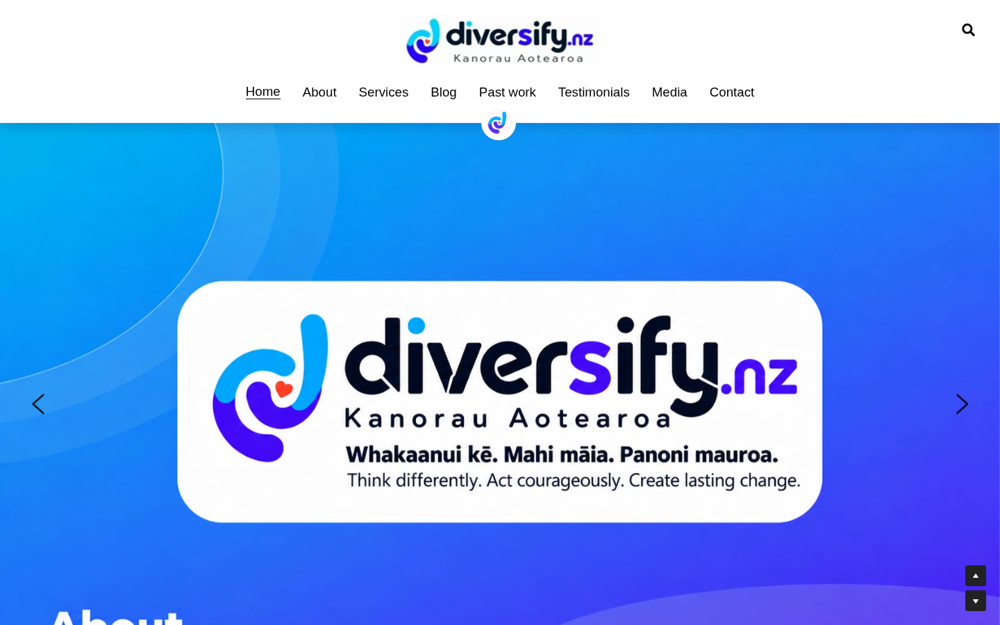

# UI Design System & Master Generation Blueprint: diversify-nz

> **diversify.nz** (https://diversify.nz) — Think differently. Act courageously. Create lasting change.



---

## 1. Executive Visual Persona & Design Archetype

- **Brand Essence & Persona**: **diversify.nz** (`https://diversify.nz`). Think differently. Act courageously. Create lasting change.
- **Final Redirected URL**: [https://www.diversify.nz/](https://www.diversify.nz/)
- **Capture Provenance**: Live browser capture (`tier2_webgl`, HTTP `200`, captured `2026-11-23`).
- **Visual Archetype**: **Light-Substrate Editorial & Modular Grid System (`#ffffff` canvas, `#000000` ink, `#00c1ff` accent)**.
- **Anti-AI-Slop Differentiators**:
  - **Live-Computed Chromatic Polarity**: Anchors the viewport in `#ffffff` (live computed `browser-default` `background-color` (`computed_styles.json`)) paired with `#000000` primary typography and `#00c1ff` accents.
  - **Grounded Typographic Hierarchy**: Pairs `Montserrat` for display copy (`Think differently.`) with `brandon-grotesque` and not declared in live computed styles (uses primary stack / `ui-monospace`).
  - **Calibrated Spatial Grid & Motion**: Combines `100vw` container bounds (`gap: 12px`, padding `5px`) with `cubic-bezier(.08,.82,.17,1)` easing and Three.js / WebGL Canvas Pipeline, Barba.js Page Transition Router.

---

## 2. Spatial Architecture & Modular Grid Mathematics


### Viewport Allocation & Container Geometry
- **Captured Viewport Dimensions**: Desktop `1440×900px` (`assets/desktop.png`, single-viewport 100vh live capture (900px)), Mobile `390×844px` (`assets/mobile.png`, single-viewport 100vh live capture (844px)).
- **Master Container Bounds**: `100vw` (non-`@media` desktop container stylesheet rule).
- **Canvas Lateral Padding & Spacing**: `5px` lateral canvas padding with `12px` grid gap.
- **Border Radius Scale**: `3px`, `4px`, `50%`, `5px`.

### Responsive Breakpoint Architecture
- **Desktop Layout**: Multi-column CSS Grid / Flexbox layout at `1440px` (`max-width: 100vw`, `gap: 12px`).
- **Mobile Layout**: Single-column vertical stack at `390px` viewport width with `5px` horizontal padding.
- **Extracted CSS Media Queries**: `@media only screen and (max-width:479px)`, `@media screen and (max-width:767px)`, `@media screen and (min-width:768px)`, `@media (min-width:768px)`.

---

## 3. Color System, Materiality & Atmospheric Lighting

### Semantic Palette & Source Grounding
| Semantic Role | Ground-Truth Value | Extracted Live / CSS Source |
|---|---|---|
| **Primary Canvas Substrate** | `#ffffff` | live computed `browser-default` `background-color` (`computed_styles.json`) |
| **Primary Typography Ink** | `#000000` | live computed `body` `color` (`computed_styles.json`) |
| **Elevated Surface / Card Substrate** | `#efefef` | live computed `button` `background-color` (`computed_styles.json`) |
| **Interactive Accent / Highlight** | `#00c1ff` | `.s-kit-btn.twitter-blue:hover { background: #00c1ff }` |
| **Secondary / Muted Copy** | `#3937b9` | `var(--textColor)` in `:root` |
| **Structural Hairline Border** | `#1bb0e6` | `t-select-tags .s-kit-select-sel... { border-color: #1bb0e6 }` |
| **Variable Token (`--s-pre-color0`)** | `#09081b` | `var(--s-pre-color0)` in `:root` |
| **Variable Token (`--s-pre-color1`)** | `#21206a` | `var(--s-pre-color1)` in `:root` |
| **Variable Token (`--s-pre-color3`)** | `#7f7dd8` | `var(--s-pre-color3)` in `:root` |
| **Variable Token (`--s-pre-color4`)** | `#cdccf0` | `var(--s-pre-color4)` in `:root` |
| **Variable Token (`--s-pre-color5`)** | `#1a232d` | `var(--s-pre-color5)` in `:root` |
| **Variable Token (`--s-pre-color6`)** | `#3f546e` | `var(--s-pre-color6)` in `:root` |
| **Variable Token (`--s-pre-color7`)** | `#6a87a9` | `var(--s-pre-color7)` in `:root` |

### Sanitized Root CSS Variables (`ui-ux.md` Ground Truth)
| Variable Name | Extracted Value | Semantic Role |
|---|---|---|
| `--s-pre-color0` | `#09081b` | Brand / Palette Token |
| `--s-pre-color0-rgb` | `9,8,27` | Brand / Palette Token |
| `--s-pre-color1` | `#21206a` | Brand / Palette Token |
| `--s-pre-color1-rgb` | `33,32,106` | Brand / Palette Token |
| `--s-pre-color2` | `#3937b9` | Brand / Palette Token |
| `--s-pre-color2-rgb` | `57,55,185` | Brand / Palette Token |
| `--s-pre-color3` | `#7f7dd8` | Brand / Palette Token |
| `--s-pre-color3-rgb` | `127,125,216` | Brand / Palette Token |
| `--s-pre-color4` | `#cdccf0` | Brand / Palette Token |
| `--s-pre-color4-rgb` | `205,204,240` | Brand / Palette Token |
| `--s-pre-color5` | `#1a232d` | Brand / Palette Token |
| `--s-pre-color5-rgb` | `26,35,45` | Brand / Palette Token |
| `--s-pre-color6` | `#3f546e` | Brand / Palette Token |
| `--s-pre-color6-rgb` | `63,84,110` | Brand / Palette Token |
| `--s-pre-color7` | `#6a87a9` | Brand / Palette Token |
| `--s-pre-color7-rgb` | `106,135,169` | Brand / Palette Token |

---

## 4. Typographic Scale & Editorial Hierarchy

### Font Family Stacks
- **Display Typography**: `Montserrat`.
- **Primary Body Stack**: `brandon-grotesque`.
- **Technical / Metadata Stack**: not declared in live computed styles (uses primary stack / `ui-monospace`).

### Typographic Scale & Rules (Live Computed & Stylesheet Grounded)
- **Hero Display (`H1`)**: rule `.title` (`font-weight: 700`).
- **Section Heading (`H2`)**: live computed `h2` (`font-size: 28px`, `line-height: 42px`, `font-weight: 400`); rule `h2` (`font-size: 26px`).
- **Body Copy**: live computed `body` (`font-size: 14px`, `line-height: 14px`, `font-weight: 400`); rule `p` (`line-height: 1.5`).
- **Metadata & Navigation Labels**: live computed `nav/a` (`font-size: 16px`, `line-height: 16px`, `font-weight: 400`); rule `.label` (`font-size: 16px`, `font-weight: normal`).

---

## 5. Choreographed Motion & Interaction Physics

### Primary Easing Curves
- **Extracted Timing Functions**: `cubic-bezier(.08,.82,.17,1)`, `cubic-bezier(.6,.04,.98,.34)`, `cubic-bezier(.23,1,.32,1)`.

### Per-Element Transition & Choreography Rules
- **Selector `.s-kit-motion-collapse-active`**: `transition: height .12s,opacity .12s` extracted from `diversify-nz` stylesheet.
- **Selector `.s-kit-motion-collapse-active`**: `transition: height .12s,opacity .12s` extracted from `diversify-nz` stylesheet.
- **Selector `.s-kit-tag .anticon-cross:before`**: `transition: transform .2s ease` extracted from `diversify-nz` stylesheet.
- **Extracted Easing Curve (`cubic-bezier(.08,.82,.17,1)`)**: Governs interactive state transitions across `<header.show>` and `<div.s-variation-default>`.
- **Runtime Interaction Engine**: Integrates Three.js / WebGL Canvas Pipeline, Barba.js Page Transition Router with `prefers-reduced-motion: reduce` fallback guards.

---

## 6. Component Wireframe & Structural DOM Map

### Visual Layout Schematic — Desktop (`1440px`, Grounded in `dom.html` & Landmark Bounding Boxes)
```
┌────────────────────────────────────────────────────────────────────────┐
│ DESKTOP VIEWPORT (1440px) — diversify.nz                               │
│ ====================================================================== │
│ [ <header.show> (1440px)              | Home · About · Services · Bl ] │
│ ---------------------------------------------------------------------- │
│ | HERO STAGE: <div.locale-en> (w=1440px)                             | │
│ | H1: Think differently.                                             | │
│ | Substrate: #ffffff | Ink: #000000 | Accent: #00c1ff                | │
│ ---------------------------------------------------------------------- │
│ | SHOWCASE GRID (<div.s-variation-default>) max-w: 100vw             | │
│ | +------------------------------+  +------------------------------+ | │
│ | | Act courageously.            |  | Create lasting change.       | | │
│ | +------------------------------+  +------------------------------+ | │
│ ---------------------------------------------------------------------- │
│ | DETAIL MODULE (<div.s-custom-colors>) — WHAT DIVERSIFY NZ BRI      | │
│ ---------------------------------------------------------------------- │
│ [ FOOTER (<footer.s-font-body-) | https://diversify.nz                 │
└────────────────────────────────────────────────────────────────────────┘
```

### Visual Layout Schematic — Mobile Reflow (`390px`)
```
┌────────────────────────────────────────────────────────────────────────┐
│ MOBILE VIEWPORT REFLOW (390px) — Single-Column Stack (gap: 12px)       │
│ ====================================================================== │
│ [ HEADER BAR (<header.show>           ) | Compact Menu (390px)         │
│ ---------------------------------------------------------------------- │
│ | HERO STAGE (<div.locale-en>) — 390px Vertical Lead                 | │
│ | H1: Think differently.                                             | │
│ ---------------------------------------------------------------------- │
│ | SHOWCASE STACK (<div.s-variation-defau) — 1-Col Stack              | │
│ | [ Item 1: Act courageously.                                      ] | │
│ | [ Item 2: Create lasting change.                                 ] | │
│ ---------------------------------------------------------------------- │
│ | DETAIL STACK (<div.s-custom-colors>) — 1-Col (WHAT DIVERSIFY NZ )  | │
│ ---------------------------------------------------------------------- │
│ [ FOOTER (<footer.s-font-body-) | Stacked 390px Colophon               │
└────────────────────────────────────────────────────────────────────────┘
```

### Granular DOM Region Breakdown
1. **Brand Header & Navigation Bar (<header.show> — `diversify-nz`)**:
   - Landmark `<header class="show">` (`1440px`) hosting `diversify.nz` navigation (`Home · About · Services · Blog · Past work`), DOM attributes (`data-emotion`, `data-s`, `data-webpack="bobcat-monorepo:chunk..."`, `data-mobile-new-breakpoint-stage="1"`), and stylesheet rule `tent.s-font-body-helvetica .s-fon... { font-family:helvetica,arial,sans-serif }`.
2. **Hero Stage & Focal Lead (<div.locale-en> — `Think differently.`)**:
   - Landmark `<div class="locale-en">` presenting display lead `Think differently.` and copy excerpt *"CLICK THE PICS ABOVE TO JUMP TO OTHER SITE PAGES."* over `#ffffff` canvas and `#000000` ink.
3. **Primary Showcase & Content Grid (<div.s-variation-default> — `Act courageously.`)**:
   - Landmark `<div class="s-variation-default">` rendering section `Act courageously.` with copy *"… Home About Services Blog Past work Testimonials Media Contact"*, asset references (`bugsnag-3.min.js`, `keen.min.js`, `ga.js`, `static-fonts-css.strikinglycdn.com`), and grid rule `font-heading-helvetica .s-font-he... { font-family:helvetica,arial,sans-serif }`.
4. **Interactive Detail & Feature Matrix (<div.s-custom-colors> — `Create lasting change.`)**:
   - Landmark `<div class="s-custom-colors">` framing `Create lasting change.` and `WHAT DIVERSIFY NZ BRINGS` (*"CLICK THE PICS ABOVE TO JUMP TO OTHER SITE PAGES. Whakaanui kē. T"*) with `#efefef` surface cards, `#00c1ff` accents, and `ont-nav_item-helvetica .s-font-na... { font-family:helvetica,arial,sans-serif }`.
5. **Colophon & Global Directory Footer (<footer.s-font-body-helvetica> — `https://diversify.nz`)**:
   - Landmark `<footer class="s-font-body-helvetica">` anchoring `diversify.nz` footer links (`Home · About · Services · Blog · Past work`), copy *"Think differently."*, and `#1bb0e6` structural dividers.

---

## 7. Master Zero-Shot AI Generation Prompt

```markdown
# Master Zero-Shot Frontend Generation Prompt: diversify-nz (diversify.nz)

You are a principal frontend architect and design systems engineer. Build a complete, production-ready web application replicating the exact design system, DOM landmarks, typographic hierarchy, color tokens, and motion physics of `diversify-nz` (**diversify.nz** — `https://diversify.nz`).

### 1. Visual Archetype & Anti-AI-Slop Mandates
- **Archetype**: Light-Substrate Editorial & Modular Grid System (`#ffffff` canvas, `#000000` ink, `#00c1ff` accent).
- **Identity & Domain Context**: Think differently. Act courageously. Create lasting change.
- **Primary Substrate**: `#ffffff` (live computed `browser-default` `background-color` (`computed_styles.json`)), **Primary Ink**: `#000000`, **Accent / Highlight**: `#00c1ff`.
- **Site-Specific Differentiators**:
  - **Live-Computed Chromatic Polarity**: Anchors the viewport in `#ffffff` (live computed `browser-default` `background-color` (`computed_styles.json`)) paired with `#000000` primary typography and `#00c1ff` accents.
  - **Grounded Typographic Hierarchy**: Pairs `Montserrat` for display copy (`Think differently.`) with `brandon-grotesque` and not declared in live computed styles (uses primary stack / `ui-monospace`).
  - **Calibrated Spatial Grid & Motion**: Combines `100vw` container bounds (`gap: 12px`, padding `5px`) with `cubic-bezier(.08,.82,.17,1)` easing and Three.js / WebGL Canvas Pipeline, Barba.js Page Transition Router.

### 2. Ground-Truth CSS Variables (`:root` Token Contract)
Declare and consume these exact custom properties extracted from `diversify-nz` in your global stylesheet:

:root {
  /* diversify.nz (diversify-nz) — Live-Grounded CSS Variables */
  --s-pre-color0: #09081b; /* Brand / Palette Token (diversify-nz) */
  --s-pre-color0-rgb: 9,8,27; /* Brand / Palette Token (diversify-nz) */
  --s-pre-color1: #21206a; /* Brand / Palette Token (diversify-nz) */
  --s-pre-color1-rgb: 33,32,106; /* Brand / Palette Token (diversify-nz) */
  --s-pre-color2: #3937b9; /* Brand / Palette Token (diversify-nz) */
  --s-pre-color2-rgb: 57,55,185; /* Brand / Palette Token (diversify-nz) */
  --s-pre-color3: #7f7dd8; /* Brand / Palette Token (diversify-nz) */
  --s-pre-color3-rgb: 127,125,216; /* Brand / Palette Token (diversify-nz) */
  --s-pre-color4: #cdccf0; /* Brand / Palette Token (diversify-nz) */
  --s-pre-color4-rgb: 205,204,240; /* Brand / Palette Token (diversify-nz) */
  --s-pre-color5: #1a232d; /* Brand / Palette Token (diversify-nz) */
  --s-pre-color5-rgb: 26,35,45; /* Brand / Palette Token (diversify-nz) */
  --s-pre-color6: #3f546e; /* Brand / Palette Token (diversify-nz) */
  --s-pre-color6-rgb: 63,84,110; /* Brand / Palette Token (diversify-nz) */
  --s-pre-color7: #6a87a9; /* Brand / Palette Token (diversify-nz) */
  --s-pre-color7-rgb: 106,135,169; /* Brand / Palette Token (diversify-nz) */
}

### 3. Semantic Color & Materiality Contract
Map every surface, ink, and border strictly to these source-grounded tokens:
- **Primary Canvas Substrate**: `#ffffff` — grounded in live computed `browser-default` `background-color` (`computed_styles.json`)
- **Primary Typography Ink**: `#000000` — grounded in live computed `body` `color` (`computed_styles.json`)
- **Elevated Surface / Card Substrate**: `#efefef` — grounded in live computed `button` `background-color` (`computed_styles.json`)
- **Interactive Accent / Highlight**: `#00c1ff` — grounded in `.s-kit-btn.twitter-blue:hover { background: #00c1ff }`
- **Secondary / Muted Copy**: `#3937b9` — grounded in `var(--textColor)` in `:root`
- **Structural Hairline Border**: `#1bb0e6` — grounded in `t-select-tags .s-kit-select-sel... { border-color: #1bb0e6 }`
- **Variable Token (`--s-pre-color0`)**: `#09081b` — grounded in `var(--s-pre-color0)` in `:root`
- **Variable Token (`--s-pre-color1`)**: `#21206a` — grounded in `var(--s-pre-color1)` in `:root`
- **Variable Token (`--s-pre-color3`)**: `#7f7dd8` — grounded in `var(--s-pre-color3)` in `:root`
- **Variable Token (`--s-pre-color4`)**: `#cdccf0` — grounded in `var(--s-pre-color4)` in `:root`
- **Variable Token (`--s-pre-color5`)**: `#1a232d` — grounded in `var(--s-pre-color5)` in `:root`
- **Variable Token (`--s-pre-color6`)**: `#3f546e` — grounded in `var(--s-pre-color6)` in `:root`
- **Variable Token (`--s-pre-color7`)**: `#6a87a9` — grounded in `var(--s-pre-color7)` in `:root`

### 4. Spatial Grid, Container Bounds & Responsive Breakpoints
- **Desktop Viewport Reference**: `1440×900px` (single-viewport 100vh live capture (900px), `1440px` standard desktop width).
- **Mobile Viewport Reference**: `390×844px` (single-viewport 100vh live capture (844px), `390px` standard mobile width).
- **Container Max-Width**: `100vw` (non-`@media` desktop container stylesheet rule)
- **Padding & Gutters**: `5px` lateral canvas padding with `12px` grid gap
- **Desktop Grid**: Multi-column CSS Grid / Flexbox layout at `1440px` (`max-width: 100vw`, `gap: 12px`)
- **Mobile Adaptation**: Single-column vertical stack at `390px` viewport width with `5px` horizontal padding
- **Media Queries**: `@media only screen and (max-width:479px)`, `@media screen and (max-width:767px)`, `@media screen and (min-width:768px)`, `@media (min-width:768px)`
- **Corner Radii**: `3px`, `4px`, `50%`, `5px`

### 5. Typography & Editorial Scale Contract
- **Display Font Stack**: `Montserrat`
- **Body Font Stack**: `brandon-grotesque`
- **Monospace / Technical Font Stack**: not declared in live computed styles (uses primary stack / `ui-monospace`)
- **H1 Display Rule**: rule `.title` (`font-weight: 700`)
- **H2 Section Rule**: live computed `h2` (`font-size: 28px`, `line-height: 42px`, `font-weight: 400`); rule `h2` (`font-size: 26px`)
- **Body Copy Rule**: live computed `body` (`font-size: 14px`, `line-height: 14px`, `font-weight: 400`); rule `p` (`line-height: 1.5`)
- **Metadata & Index Rule**: live computed `nav/a` (`font-size: 16px`, `line-height: 16px`, `font-weight: 400`); rule `.label` (`font-size: 16px`, `font-weight: normal`)

### 6. Component Hierarchy, Verbatim Copy & Real DOM Landmarks
Scaffold `diversify-nz` (`diversify.nz`) with these exact structural regions, extracted copy, and CSS rules from `dom.html`:
1. **Brand Header & Navigation Bar (<header.show> — `diversify-nz`)**:
   - DOM & Selectors: Landmark `<header class="show">` (`1440px`) hosting `diversify.nz` navigation (`Home · About · Services · Blog · Past work`), DOM attributes (`data-emotion`, `data-s`, `data-webpack="bobcat-monorepo:chunk..."`, `data-mobile-new-breakpoint-stage="1"`), and stylesheet rule `tent.s-font-body-helvetica .s-fon... { font-family:helvetica,arial,sans-serif }`.
   - Responsive Contract: Header `Brand Header & Navigation Bar (<header.show> — `diversify-nz`)` (`diversify-nz`) adapts across `@media only screen and (max-width:479px)`, `@media screen and (max-width:767px)`, `@media screen and (min-width:768px)`, `@media (min-width:768px)` with `cubic-bezier(.08,.82,.17,1)`, `cubic-bezier(.6,.04,.98,.34)`, `cubic-bezier(.23,1,.32,1)` transitions and links `Home · About · Services · Blog · Past work`.
2. **Hero Stage & Focal Lead (<div.locale-en> — `Think differently.`)**:
   - DOM & Selectors: Landmark `<div class="locale-en">` presenting display lead `Think differently.` and copy excerpt *"CLICK THE PICS ABOVE TO JUMP TO OTHER SITE PAGES."* over `#ffffff` canvas and `#000000` ink.
   - Responsive Contract: Hero stage (`1440×900px` desktop / `390×844px` mobile) sets `#ffffff` background with `#000000` headline `Think differently.`.
3. **Primary Showcase & Content Grid (<div.s-variation-default> — `Act courageously.`)**:
   - DOM & Selectors: Landmark `<div class="s-variation-default">` rendering section `Act courageously.` with copy *"… Home About Services Blog Past work Testimonials Media Contact"*, asset references (`bugsnag-3.min.js`, `keen.min.js`, `ga.js`, `static-fonts-css.strikinglycdn.com`), and grid rule `font-heading-helvetica .s-font-he... { font-family:helvetica,arial,sans-serif }`.
   - Responsive Contract: Showcase grid `Primary Showcase & Content Grid (<div.s-variation-default> — `Act courageously.`)` applies Multi-column CSS Grid / Flexbox layout at `1440px` (`max-width: 100vw`, `gap: 12px`) on desktop and Single-column vertical stack at `390px` viewport width with `5px` horizontal padding on mobile.
4. **Interactive Detail & Feature Matrix (<div.s-custom-colors> — `Create lasting change.`)**:
   - DOM & Selectors: Landmark `<div class="s-custom-colors">` framing `Create lasting change.` and `WHAT DIVERSIFY NZ BRINGS` (*"CLICK THE PICS ABOVE TO JUMP TO OTHER SITE PAGES. Whakaanui kē. T"*) with `#efefef` surface cards, `#00c1ff` accents, and `ont-nav_item-helvetica .s-font-na... { font-family:helvetica,arial,sans-serif }`.
   - Responsive Contract: Detail module `Interactive Detail & Feature Matrix (<div.s-custom-colors> — `Create lasting change.`)` uses `3px`, `4px`, `50%`, `5px` radii, `#00c1ff` highlights, and assets (bugsnag-3.min.js, keen.min.js, ga.js).
5. **Colophon & Global Directory Footer (<footer.s-font-body-helvetica> — `https://diversify.nz`)**:
   - DOM & Selectors: Landmark `<footer class="s-font-body-helvetica">` anchoring `diversify.nz` footer links (`Home · About · Services · Blog · Past work`), copy *"Think differently."*, and `#1bb0e6` structural dividers.
   - Responsive Contract: Footer `Colophon & Global Directory Footer (<footer.s-font-body-helvetica> — `https://diversify.nz`)` aligns to `100vw` (non-`@media` desktop container stylesheet rule) with `5px` lateral canvas padding with `12px` grid gap and attributes (data-emotion, data-s, data-webpack="bobcat-monorepo:chunk...").

#### Verbatim DOM Copy Excerpts (`dom.html`)
- Copy Excerpt 1: *"CLICK THE PICS ABOVE TO JUMP TO OTHER SITE PAGES."*
- Copy Excerpt 2: *"… Home About Services Blog Past work Testimonials Media Contact"*
- Copy Excerpt 3: *"CLICK THE PICS ABOVE TO JUMP TO OTHER SITE PAGES. Whakaanui kē. Think differently...."*
- Copy Excerpt 4: *"Think differently."*

### 7. Motion, Extracted Stylesheet Rules & Interaction Choreography
- **Primary Easing Functions**: `cubic-bezier(.08,.82,.17,1)`, `cubic-bezier(.6,.04,.98,.34)`, `cubic-bezier(.23,1,.32,1)`
- **Extracted Stylesheet Rules (`diversify-nz`)**:
- `tent.s-font-body-helvetica .s-fon... { font-family:helvetica,arial,sans-serif }`
- `font-heading-helvetica .s-font-he... { font-family:helvetica,arial,sans-serif }`
- `ont-nav_item-helvetica .s-font-na... { font-family:helvetica,arial,sans-serif }`
- `body { margin:0;padding:0 }`
- `table { border-collapse:collapse;border-spacing:0 }`
- **Per-Selector Transition Rules**:
- **Selector `.s-kit-motion-collapse-active`**: `transition: height .12s,opacity .12s` extracted from `diversify-nz` stylesheet.
- **Selector `.s-kit-motion-collapse-active`**: `transition: height .12s,opacity .12s` extracted from `diversify-nz` stylesheet.
- **Selector `.s-kit-tag .anticon-cross:before`**: `transition: transform .2s ease` extracted from `diversify-nz` stylesheet.
- **Extracted Easing Curve (`cubic-bezier(.08,.82,.17,1)`)**: Governs interactive state transitions across `<header.show>` and `<div.s-variation-default>`.
- **Runtime Interaction Engine**: Integrates Three.js / WebGL Canvas Pipeline, Barba.js Page Transition Router with `prefers-reduced-motion: reduce` fallback guards.

### 8. Technical Deliverables
- Implement in Next.js (App Router) with TypeScript and Tailwind CSS consuming the `:root` custom properties defined above for `diversify-nz`.
- Reproduce both the `1440px` desktop architecture and `390px` mobile breakpoint transitions, preserving semantic HTML5 landmarks (`<header>`, `<nav>`, `<main>`, `<section>`, `<footer>`) and `prefers-reduced-motion` accessibility guards.
```
