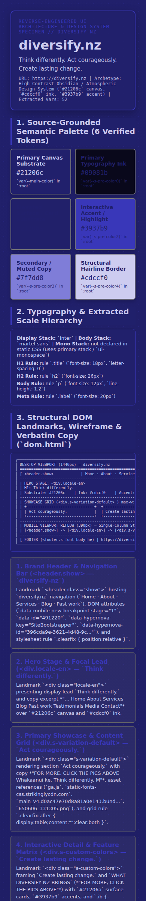

# UI Design System & Master Generation Blueprint: diversify-nz

> **diversify.nz** (https://diversify.nz) — Think differently. Act courageously. Create lasting change.


---

## 1. Executive Visual Persona & Design Archetype

- **Brand Essence & Persona**: **diversify.nz** (`https://diversify.nz`). Think differently. Act courageously. Create lasting change.
- **Visual Archetype**: **High-Contrast Obsidian / Atmospheric Design System (`#21206c` canvas, `#cdccf0` ink, `#3937b9` accent)**.
- **Anti-AI-Slop Differentiators**:
  - **Source-Grounded Chromatic Polarity**: Anchors the viewport in `#21206c` (`var(--main-color)` in `:root`) paired with `#cdccf0` primary typography and `#3937b9` accents.
  - **Extracted Typographic Hierarchy**: Pairs `Inter` for display copy (`Think differently.`) with `martel-sans` and not declared in static CSS (uses primary stack / `ui-monospace`).
  - **Calibrated Spatial Grid & Motion**: Combines `220px` container bounds (`gap: 18px`, padding `7px`) with `cubic-bezier(.7,0,.3,1)` easing and Three.js / WebGL Canvas Pipeline, Barba.js Page Transition Router.

---

## 2. Spatial Architecture & Modular Grid Mathematics



### Viewport Allocation & Container Geometry
- **Captured Viewport Dimensions**: Desktop `1440×2400px` (`assets/desktop.png`, capped at 2400px multi-section capture), Mobile `390×2400px` (`assets/mobile.png`, capped at 2400px multi-section capture).
- **Master Container Bounds**: `220px` extracted from `diversify-nz` stylesheet.
- **Canvas Lateral Padding & Spacing**: `7px` lateral canvas padding with `18px` grid gap.
- **Border Radius Scale**: `3px`, `6px`, `5px`, `4px`.

### Responsive Breakpoint Architecture
- **Desktop Layout**: Multi-column CSS Grid / Flexbox layout at `1440px` (`max-width: 220px`, `gap: 18px`).
- **Mobile Layout**: Single-column vertical stack at `390px` viewport width with `7px` horizontal padding.
- **Extracted CSS Media Queries**: `@media only screen and (max-width:500px)`, `@media only screen and (min-width:501px)`, `@media only screen and (min-width:320px) and (max-width:375px)`, `@media only screen and (max-width:320px)`.

---

## 3. Color System, Materiality & Atmospheric Lighting

### Semantic Palette & Source Grounding
| Semantic Role | Ground-Truth Value | Extracted CSS Source / Selector |
|---|---|---|
| **Primary Canvas Substrate** | `#21206c` | `var(--main-color)` in `:root` |
| **Primary Typography Ink** | `#09081b` | `var(--s-pre-color0)` in `:root` |
| **Elevated Surface / Card Substrate** | `#21206a` | `var(--s-pre-color1)` in `:root` |
| **Interactive Accent / Highlight** | `#3937b9` | `var(--s-pre-color2)` in `:root` |
| **Secondary / Muted Copy** | `#7f7dd8` | `var(--s-pre-color3)` in `:root` |
| **Structural Hairline Border** | `#cdccf0` | `var(--s-pre-color4)` in `:root` |

### Sanitized Root CSS Variables (`ui-ux.md` Ground Truth)
| Variable Name | Extracted Value | Semantic Role |
|---|---|---|
| `--carousel-button-width` | `48px` | Layout / Spatial Grid Token |
| `--carousel-button-height` | `48px` | Layout / Spatial Grid Token |
| `--carousel-button-svg-width` | `24px` | Layout / Spatial Grid Token |
| `--carousel-button-svg-height` | `24px` | Layout / Spatial Grid Token |
| `--carousel-button-svg-stroke-width` | `2.5` | Layout / Spatial Grid Token |
| `--carousel-button-svg-filter` | `drop-shadow(1px 1px 1px rgba(0,0,0,0.4))` | Color / Atmospheric Token |
| `--main-color` | `#21206c` | Brand / Palette Token |
| `--s-pre-color0` | `#09081b` | Brand / Palette Token |
| `--s-pre-color0-rgb` | `9,8,27` | Brand / Palette Token |
| `--s-pre-color1` | `#21206a` | Brand / Palette Token |
| `--s-pre-color1-rgb` | `33,32,106` | Brand / Palette Token |
| `--s-pre-color2` | `#3937b9` | Brand / Palette Token |
| `--s-pre-color2-rgb` | `57,55,185` | Brand / Palette Token |
| `--s-pre-color3` | `#7f7dd8` | Brand / Palette Token |
| `--s-pre-color3-rgb` | `127,125,216` | Brand / Palette Token |
| `--s-pre-color4` | `#cdccf0` | Brand / Palette Token |

---

## 4. Typographic Scale & Editorial Hierarchy

### Font Family Stacks
- **Display Typography**: `Inter`.
- **Primary Body Stack**: `martel-sans`.
- **Technical / Metadata Stack**: not declared in static CSS (uses primary stack / `ui-monospace`).

### Typographic Scale & Rules (Extracted from Stylesheet & Variables)
- **Hero Display (`H1`)**: rule `.title` (`font-size: 18px`, `letter-spacing: 0`).
- **Section Heading (`H2`)**: rule `h2` (`font-size: 26px`).
- **Body Copy**: rule `p` (`font-size: 12px`, `line-height: 1.2`).
- **Metadata & Navigation Labels**: rule `.label` (`font-size: 20px`).

---

## 5. Choreographed Motion & Interaction Physics

### Primary Easing Curves
- **Extracted Timing Functions**: `cubic-bezier(.7,0,.3,1)`, `cubic-bezier(.77,0,.175,1)`.

### Per-Element Transition & Choreography Rules
- **Selector `.s-binary-switcher .capsule .option`**: `transition: all .4s cubic-bezier(.7,0,.3,1)` extracted from `diversify-nz` stylesheet.
- **Selector `.s-check-toggle .capsule`**: `transition: all .4s` extracted from `diversify-nz` stylesheet.
- **Selector `.s-check-toggle .capsule .nub`**: `transition: all .4s` extracted from `diversify-nz` stylesheet.
- **Extracted Easing Curve (`cubic-bezier(.7,0,.3,1)`)**: Governs interactive state transitions across `<header.show>` and `<div.s-variation-default>`.
- **Runtime Interaction Engine**: Integrates Three.js / WebGL Canvas Pipeline, Barba.js Page Transition Router with `prefers-reduced-motion: reduce` fallback guards.

---

## 6. Component Wireframe & Structural DOM Map

### Visual Layout Schematic (Grounded in `dom.html` — `1440px` Desktop & `390px` Mobile Reflow)
```
┌────────────────────────────────────────────────────────────────────────┐
│ DESKTOP VIEWPORT (1440px) — diversify.nz                               │
│ ====================================================================== │
│ [ <header.show>            | Home · About · Services · Blog · Past  ]  │
│ ---------------------------------------------------------------------- │
│ | HERO STAGE: <div.locale-en>                                      |   │
│ | H1: Think differently.                                           |   │
│ | Substrate: #21206c    | Ink: #cdccf0    | Accent: #3937b9        |   │
│ ---------------------------------------------------------------------- │
│ | SHOWCASE GRID (<div.s-variation-default> ) max-w: 220px          |   │
│ | +------------------------------+  +------------------------------+ | │
│ | | Act courageously.            |  | Create lasting change.       | | │
│ | +------------------------------+  +------------------------------+ | │
│ ---------------------------------------------------------------------- │
│ | MOBILE VIEWPORT REFLOW (390px) — Single-Column Stack (gap: 18px  ) | │
│ | [<header.show>] -> [<div.locale-en>] -> [<div.s-variation-d] |       │
│ ---------------------------------------------------------------------- │
│ [ FOOTER (<footer.s-font-body-he) | https://diversify.nz               │
└────────────────────────────────────────────────────────────────────────┘
```

### Granular DOM Region Breakdown
1. **Brand Header & Navigation Bar (<header.show> — `diversify-nz`)**:
   - Landmark `<header class="show">` hosting `diversify.nz` navigation (`Home · About · Services · Blog · Past work`), DOM attributes (`data-mobile-new-breakpoint-stage="1"`, `data-id="491220"`, `data-hypernova-key="SiteBootstrapper"`, `data-hypernova-id="396cda9e-3621-4d48-9c..."`), and stylesheet rule `.clearfix { position:relative }`.
2. **Hero Stage & Focal Lead (<div.locale-en> — `Think differently.`)**:
   - Landmark `<div class="locale-en">` presenting display lead `Think differently.` and copy excerpt *"… Home About Services Blog Past work Testimonials Media Contact"* over `#21206c` canvas and `#cdccf0` ink.
3. **Primary Showcase & Content Grid (<div.s-variation-default> — `Act courageously.`)**:
   - Landmark `<div class="s-variation-default">` rendering section `Act courageously.` with copy *"FOR MORE, CLICK THE PICS ABOVE Whakaanui kē. Think differently. M"*, asset references (`ga.js`, `static-fonts-css.strikinglycdn.com`, `main_v4.d0ac47e70d8a81a0e143.bund...`, `650606_331305.png`), and grid rule `.clearfix:after { display:table;content:"";clear:both }`.
4. **Interactive Detail & Feature Matrix (<div.s-custom-colors> — `Create lasting change.`)**:
   - Landmark `<div class="s-custom-colors">` framing `Create lasting change.` and `WHAT DIVERSIFY NZ BRINGS` (*"FOR MORE, CLICK THE PICS ABOVE"*) with `#21206a` surface cards, `#3937b9` accents, and `.ib { display:inline-block;zoom:1 }`.
5. **Colophon & Global Directory Footer (<footer.s-font-body-helvetica> — `https://diversify.nz`)**:
   - Landmark `<footer class="s-font-body-helvetica">` anchoring `diversify.nz` footer links (`Home · About · Services · Blog · Past work`), copy *"Think differently."*, and `#cdccf0` structural dividers.

---

## 7. Master Zero-Shot AI Generation Prompt

```markdown
# Master Zero-Shot Frontend Generation Prompt: diversify-nz (diversify.nz)

You are a principal frontend architect and design systems engineer. Build a complete, production-ready web application replicating the exact design system, DOM landmarks, typographic hierarchy, color tokens, and motion physics of `diversify-nz` (**diversify.nz** — `https://diversify.nz`).

### 1. Visual Archetype & Anti-AI-Slop Mandates
- **Archetype**: High-Contrast Obsidian / Atmospheric Design System (`#21206c` canvas, `#cdccf0` ink, `#3937b9` accent).
- **Identity & Domain Context**: Think differently. Act courageously. Create lasting change.
- **Primary Substrate**: `#21206c` (`var(--main-color)` in `:root`), **Primary Ink**: `#cdccf0`, **Accent / Highlight**: `#3937b9`.
- **Site-Specific Differentiators**:
  - **Source-Grounded Chromatic Polarity**: Anchors the viewport in `#21206c` (`var(--main-color)` in `:root`) paired with `#cdccf0` primary typography and `#3937b9` accents.
  - **Extracted Typographic Hierarchy**: Pairs `Inter` for display copy (`Think differently.`) with `martel-sans` and not declared in static CSS (uses primary stack / `ui-monospace`).
  - **Calibrated Spatial Grid & Motion**: Combines `220px` container bounds (`gap: 18px`, padding `7px`) with `cubic-bezier(.7,0,.3,1)` easing and Three.js / WebGL Canvas Pipeline, Barba.js Page Transition Router.

### 2. Ground-Truth CSS Variables (`:root` Token Contract)
Declare and consume these exact custom properties extracted from `diversify-nz` in your global stylesheet:

:root {
  /* diversify.nz (diversify-nz) — Ground-Truth Extracted CSS Variables */
  --carousel-button-width: 48px; /* Layout / Spatial Grid Token (diversify-nz) */
  --carousel-button-height: 48px; /* Layout / Spatial Grid Token (diversify-nz) */
  --carousel-button-svg-width: 24px; /* Layout / Spatial Grid Token (diversify-nz) */
  --carousel-button-svg-height: 24px; /* Layout / Spatial Grid Token (diversify-nz) */
  --carousel-button-svg-stroke-width: 2.5; /* Layout / Spatial Grid Token (diversify-nz) */
  --carousel-button-svg-filter: drop-shadow(1px 1px 1px rgba(0,0,0,0.4)); /* Color / Atmospheric Token (diversify-nz) */
  --main-color: #21206c; /* Brand / Palette Token (diversify-nz) */
  --s-pre-color0: #09081b; /* Brand / Palette Token (diversify-nz) */
  --s-pre-color0-rgb: 9,8,27; /* Brand / Palette Token (diversify-nz) */
  --s-pre-color1: #21206a; /* Brand / Palette Token (diversify-nz) */
  --s-pre-color1-rgb: 33,32,106; /* Brand / Palette Token (diversify-nz) */
  --s-pre-color2: #3937b9; /* Brand / Palette Token (diversify-nz) */
  --s-pre-color2-rgb: 57,55,185; /* Brand / Palette Token (diversify-nz) */
  --s-pre-color3: #7f7dd8; /* Brand / Palette Token (diversify-nz) */
  --s-pre-color3-rgb: 127,125,216; /* Brand / Palette Token (diversify-nz) */
  --s-pre-color4: #cdccf0; /* Brand / Palette Token (diversify-nz) */
}

### 3. Semantic Color & Materiality Contract
Map every surface, ink, and border strictly to these source-grounded tokens:
- **Primary Canvas Substrate**: `#21206c` — grounded in `var(--main-color)` in `:root`
- **Primary Typography Ink**: `#09081b` — grounded in `var(--s-pre-color0)` in `:root`
- **Elevated Surface / Card Substrate**: `#21206a` — grounded in `var(--s-pre-color1)` in `:root`
- **Interactive Accent / Highlight**: `#3937b9` — grounded in `var(--s-pre-color2)` in `:root`
- **Secondary / Muted Copy**: `#7f7dd8` — grounded in `var(--s-pre-color3)` in `:root`
- **Structural Hairline Border**: `#cdccf0` — grounded in `var(--s-pre-color4)` in `:root`

### 4. Spatial Grid, Container Bounds & Responsive Breakpoints
- **Desktop Viewport Reference**: `1440×2400px` (capped at 2400px multi-section capture, `1440px` standard desktop width).
- **Mobile Viewport Reference**: `390×2400px` (capped at 2400px multi-section capture, `390px` standard mobile width).
- **Container Max-Width**: `220px` extracted from `diversify-nz` stylesheet
- **Padding & Gutters**: `7px` lateral canvas padding with `18px` grid gap
- **Desktop Grid**: Multi-column CSS Grid / Flexbox layout at `1440px` (`max-width: 220px`, `gap: 18px`)
- **Mobile Adaptation**: Single-column vertical stack at `390px` viewport width with `7px` horizontal padding
- **Media Queries**: `@media only screen and (max-width:500px)`, `@media only screen and (min-width:501px)`, `@media only screen and (min-width:320px) and (max-width:375px)`, `@media only screen and (max-width:320px)`
- **Corner Radii**: `3px`, `6px`, `5px`, `4px`

### 5. Typography & Editorial Scale Contract
- **Display Font Stack**: `Inter`
- **Body Font Stack**: `martel-sans`
- **Monospace / Technical Font Stack**: not declared in static CSS (uses primary stack / `ui-monospace`)
- **H1 Display Rule**: rule `.title` (`font-size: 18px`, `letter-spacing: 0`)
- **H2 Section Rule**: rule `h2` (`font-size: 26px`)
- **Body Copy Rule**: rule `p` (`font-size: 12px`, `line-height: 1.2`)
- **Metadata & Index Rule**: rule `.label` (`font-size: 20px`)

### 6. Component Hierarchy, Verbatim Copy & Real DOM Landmarks
Scaffold `diversify-nz` (`diversify.nz`) with these exact structural regions, extracted copy, and CSS rules from `dom.html`:
1. **Brand Header & Navigation Bar (<header.show> — `diversify-nz`)**:
   - DOM & Selectors: Landmark `<header class="show">` hosting `diversify.nz` navigation (`Home · About · Services · Blog · Past work`), DOM attributes (`data-mobile-new-breakpoint-stage="1"`, `data-id="491220"`, `data-hypernova-key="SiteBootstrapper"`, `data-hypernova-id="396cda9e-3621-4d48-9c..."`), and stylesheet rule `.clearfix { position:relative }`.
   - Responsive Contract: Header `Brand Header & Navigation Bar (<header.show> — `diversify-nz`)` (`diversify-nz`) adapts across `@media only screen and (max-width:500px)`, `@media only screen and (min-width:501px)`, `@media only screen and (min-width:320px) and (max-width:375px)`, `@media only screen and (max-width:320px)` with `cubic-bezier(.7,0,.3,1)`, `cubic-bezier(.77,0,.175,1)` transitions and links `Home · About · Services · Blog · Past work`.
2. **Hero Stage & Focal Lead (<div.locale-en> — `Think differently.`)**:
   - DOM & Selectors: Landmark `<div class="locale-en">` presenting display lead `Think differently.` and copy excerpt *"… Home About Services Blog Past work Testimonials Media Contact"* over `#21206c` canvas and `#cdccf0` ink.
   - Responsive Contract: Hero stage (`1440×2400px` desktop / `390×2400px` mobile) sets `#21206c` background with `#cdccf0` headline `Think differently.`.
3. **Primary Showcase & Content Grid (<div.s-variation-default> — `Act courageously.`)**:
   - DOM & Selectors: Landmark `<div class="s-variation-default">` rendering section `Act courageously.` with copy *"FOR MORE, CLICK THE PICS ABOVE Whakaanui kē. Think differently. M"*, asset references (`ga.js`, `static-fonts-css.strikinglycdn.com`, `main_v4.d0ac47e70d8a81a0e143.bund...`, `650606_331305.png`), and grid rule `.clearfix:after { display:table;content:"";clear:both }`.
   - Responsive Contract: Showcase grid `Primary Showcase & Content Grid (<div.s-variation-default> — `Act courageously.`)` applies Multi-column CSS Grid / Flexbox layout at `1440px` (`max-width: 220px`, `gap: 18px`) on desktop and Single-column vertical stack at `390px` viewport width with `7px` horizontal padding on mobile.
4. **Interactive Detail & Feature Matrix (<div.s-custom-colors> — `Create lasting change.`)**:
   - DOM & Selectors: Landmark `<div class="s-custom-colors">` framing `Create lasting change.` and `WHAT DIVERSIFY NZ BRINGS` (*"FOR MORE, CLICK THE PICS ABOVE"*) with `#21206a` surface cards, `#3937b9` accents, and `.ib { display:inline-block;zoom:1 }`.
   - Responsive Contract: Detail module `Interactive Detail & Feature Matrix (<div.s-custom-colors> — `Create lasting change.`)` uses `3px`, `6px`, `5px`, `4px` radii, `#3937b9` highlights, and assets (ga.js, static-fonts-css.strikinglycdn.com, main_v4.d0ac47e70d8a81a0e143.bund...).
5. **Colophon & Global Directory Footer (<footer.s-font-body-helvetica> — `https://diversify.nz`)**:
   - DOM & Selectors: Landmark `<footer class="s-font-body-helvetica">` anchoring `diversify.nz` footer links (`Home · About · Services · Blog · Past work`), copy *"Think differently."*, and `#cdccf0` structural dividers.
   - Responsive Contract: Footer `Colophon & Global Directory Footer (<footer.s-font-body-helvetica> — `https://diversify.nz`)` aligns to `220px` extracted from `diversify-nz` stylesheet with `7px` lateral canvas padding with `18px` grid gap and attributes (data-mobile-new-breakpoint-stage="1", data-id="491220", data-hypernova-key="SiteBootstrapper").

#### Verbatim DOM Copy Excerpts (`dom.html`)
- Copy Excerpt 1: *"… Home About Services Blog Past work Testimonials Media Contact"*
- Copy Excerpt 2: *"FOR MORE, CLICK THE PICS ABOVE Whakaanui kē. Think differently. Mahi māia. Act cou..."*
- Copy Excerpt 3: *"FOR MORE, CLICK THE PICS ABOVE"*
- Copy Excerpt 4: *"Think differently."*

### 7. Motion, Extracted Stylesheet Rules & Interaction Choreography
- **Primary Easing Functions**: `cubic-bezier(.7,0,.3,1)`, `cubic-bezier(.77,0,.175,1)`
- **Extracted Stylesheet Rules (`diversify-nz`)**:
- `.clearfix { position:relative }`
- `.clearfix:after { display:table;content:"";clear:both }`
- `.ib { display:inline-block;zoom:1 }`
- `.ib.middle { vertical-align:middle }`
- `.absolute { position:absolute }`
- **Per-Selector Transition Rules**:
- **Selector `.s-binary-switcher .capsule .option`**: `transition: all .4s cubic-bezier(.7,0,.3,1)` extracted from `diversify-nz` stylesheet.
- **Selector `.s-check-toggle .capsule`**: `transition: all .4s` extracted from `diversify-nz` stylesheet.
- **Selector `.s-check-toggle .capsule .nub`**: `transition: all .4s` extracted from `diversify-nz` stylesheet.
- **Extracted Easing Curve (`cubic-bezier(.7,0,.3,1)`)**: Governs interactive state transitions across `<header.show>` and `<div.s-variation-default>`.
- **Runtime Interaction Engine**: Integrates Three.js / WebGL Canvas Pipeline, Barba.js Page Transition Router with `prefers-reduced-motion: reduce` fallback guards.

### 8. Technical Deliverables
- Implement in Next.js (App Router) with TypeScript and Tailwind CSS consuming the `:root` custom properties defined above for `diversify-nz`.
- Reproduce both the `1440px` desktop architecture and `390px` mobile breakpoint transitions, preserving semantic HTML5 landmarks (`<header>`, `<nav>`, `<main>`, `<section>`, `<footer>`) and `prefers-reduced-motion` accessibility guards.
```
