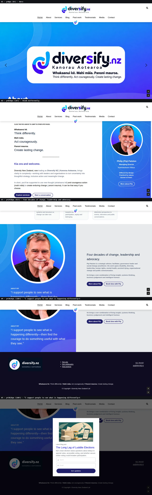
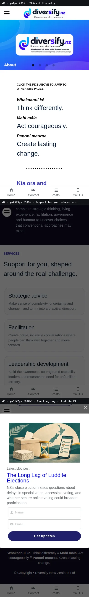

# UI Design System & Master Generation Blueprint: diversify-nz

> **diversify.nz** (https://diversify.nz) — Think differently. Act courageously. Create lasting change.





---

## 1. Executive Visual Persona & Design Archetype

- **Brand Essence & Persona**: **diversify.nz** (`https://diversify.nz`). Think differently. Act courageously. Create lasting change.
- **Final Redirected URL**: [https://www.diversify.nz/](https://www.diversify.nz/)
- **Capture Provenance**: Live browser capture (`tier1_fast`, HTTP `200`, captured `2026-11-24`).
- **Visual Archetype**: **Light-Substrate Editorial & Modular Grid System (`#ffffff` canvas, `#000000` ink, `#ff8900` accent)**.
- **Anti-AI-Slop Differentiators**:
  - **Live-Computed Chromatic Polarity**: Anchors the viewport in `#ffffff` (live computed `browser-default` `background-color` (`computed_styles.json`)) paired with `#000000` primary typography and `#ff8900` accents.
  - **Grounded Typographic Hierarchy**: Pairs `Montserrat` for display copy (`Think differently.`) with `Inter`.
  - **Calibrated Spatial Grid & Motion**: Combines `1060px` container bounds (`gap: 18px`, padding `7px`) with `cubic-bezier(.7,0,.3,1)` easing and Three.js / WebGL Canvas Pipeline, Barba.js Page Transition Router.

---

## 2. Spatial Architecture & Modular Grid Mathematics

### Viewport Allocation & Container Geometry
- **Captured Journey Filmstrips**: Desktop `1280×4140px` (`assets/desktop-journey.webp`, `5` keyframes up to `y=3028px` / doc `3929px`), Mobile `390×2616px` (`assets/mobile-journey.webp`, `3` keyframes).
- **Master Container Bounds**: `1060px` (non-`@media` desktop container stylesheet rule).
- **Canvas Lateral Padding & Spacing**: `7px` lateral canvas padding with `18px` grid gap.
- **Border Radius Scale**: `3px`, `6px`, `5px`, `4px`.

### Responsive Breakpoint Architecture
- **Desktop Layout**: Multi-column CSS Grid / Flexbox layout at `1440px` (`max-width: 1060px`, `gap: 18px`).
- **Mobile Layout**: Single-column vertical stack at `390px` viewport width with `7px` horizontal padding.
- **Extracted CSS Media Queries**: `@media only screen and (max-width:500px)`, `@media only screen and (min-width:501px)`, `@media only screen and (min-width:320px) and (max-width:375px)`, `@media only screen and (max-width:320px)`.

---

## 3. Color System, Materiality & Atmospheric Lighting

### Semantic Palette & Source Grounding
| Semantic Role | Ground-Truth Value | Extracted Live / CSS Source |
|---|---|---|
| **Primary Canvas Substrate** | `#ffffff` | live computed `browser-default` `background-color` (`computed_styles.json`) |
| **Primary Typography Ink** | `#000000` | live computed `body` `color` (`computed_styles.json`) |
| **Elevated Surface / Card Substrate** | `#efefef` | live computed `button` `background-color` (`computed_styles.json`) |
| **Interactive Accent / Highlight** | `#ff8900` | `.edit-btn:hover { background-color: #ff8900 }` |
| **Secondary / Muted Copy** | `#3937b9` | `var(--textColor)` in `:root` |
| **Structural Hairline Border** | `#ebebeb` | `.popover-title { border-bottom: #ebebeb }` |
| **Variable Token (`--main-color`)** | `#21206c` | `var(--main-color)` in `:root` |
| **Variable Token (`--s-pre-color0`)** | `#09081b` | `var(--s-pre-color0)` in `:root` |
| **Variable Token (`--s-pre-color1`)** | `#21206a` | `var(--s-pre-color1)` in `:root` |
| **Variable Token (`--s-pre-color3`)** | `#7f7dd8` | `var(--s-pre-color3)` in `:root` |
| **Variable Token (`--s-pre-color4`)** | `#cdccf0` | `var(--s-pre-color4)` in `:root` |

### Sanitized Root CSS Variables (`ui-ux.md` Ground Truth)
| Variable Name | Extracted Value | Semantic Role |
|---|---|---|
| `--carousel-button-width` | `48px` | Layout / Spatial Grid Token |
| `--carousel-button-height` | `48px` | Layout / Spatial Grid Token |
| `--carousel-button-svg-width` | `24px` | Layout / Spatial Grid Token |
| `--carousel-button-svg-height` | `24px` | Layout / Spatial Grid Token |
| `--carousel-button-svg-stroke-width` | `2.5` | Layout / Spatial Grid Token |
| `--carousel-button-svg-filter` | `drop-shadow(1px 1px 1px rgba(0,0,0,0.4))` | Color / Atmospheric Token |
| `--main-color` | `#21206c` | Brand / Palette Token |
| `--s-pre-color0` | `#09081b` | Brand / Palette Token |
| `--s-pre-color0-rgb` | `9,8,27` | Brand / Palette Token |
| `--s-pre-color1` | `#21206a` | Brand / Palette Token |
| `--s-pre-color1-rgb` | `33,32,106` | Brand / Palette Token |
| `--s-pre-color2` | `#3937b9` | Brand / Palette Token |
| `--s-pre-color2-rgb` | `57,55,185` | Brand / Palette Token |
| `--s-pre-color3` | `#7f7dd8` | Brand / Palette Token |
| `--s-pre-color3-rgb` | `127,125,216` | Brand / Palette Token |
| `--s-pre-color4` | `#cdccf0` | Brand / Palette Token |

---

## 4. Typographic Scale & Editorial Hierarchy

### Font Family Stacks
- **Display Typography**: `Montserrat`.
- **Primary Body Stack**: `Inter`.
- **Technical / Metadata Stack**: not declared in live computed styles (uses primary stack / `ui-monospace`).

### Typographic Scale & Rules (Live Computed & Stylesheet Grounded)
- **Hero Display (`H1`)**: rule `.title` (`font-size: 18px`, `letter-spacing: 0`).
- **Section Heading (`H2`)**: live computed `h2` (`font-size: 36px`, `line-height: 43.2px`, `font-weight: 400`); rule `h2` (`font-size: 26px`).
- **Body Copy**: live computed `body` (`font-size: 14px`, `line-height: 14px`, `font-weight: 400`); rule `p` (`font-size: 12px`, `line-height: 1.2`).
- **Metadata & Navigation Labels**: live computed `nav/a` (`font-size: 16px`, `line-height: 16px`, `font-weight: 400`); rule `.label` (`font-size: 20px`).

---

## 5. Choreographed Motion & Interaction Physics

### Primary Easing Curves
- **Extracted Timing Functions**: `cubic-bezier(.7,0,.3,1)`, `cubic-bezier(.77,0,.175,1)`.

### Per-Element Transition & Choreography Rules
- **Selector `.s-binary-switcher .capsule .option`**: `transition: all .4s cubic-bezier(.7,0,.3,1)` extracted from `diversify-nz` stylesheet.
- **Selector `.s-check-toggle .capsule`**: `transition: all .4s` extracted from `diversify-nz` stylesheet.
- **Selector `.s-check-toggle .capsule .nub`**: `transition: all .4s` extracted from `diversify-nz` stylesheet.
- **Extracted Easing Curve (`cubic-bezier(.7,0,.3,1)`)**: Governs interactive state transitions across `<header.show>` and `<div.s-variation-default>`.
- **Runtime Interaction Engine**: Integrates Three.js / WebGL Canvas Pipeline, Barba.js Page Transition Router with `prefers-reduced-motion: reduce` fallback guards.
### Measured Runtime Scroll & Interaction Telemetry (`behavioral_journey_v2`)
- **Scroll Driver Mode**: `native+wheel` (max document height `3929px`, deepest scrollY reached `3028px` across `5` desktop keyframes).
- **Detected Scroll / Motion Libraries**: Native browser scroll / standard CSS transitions.

---

## 6. Component Wireframe & Structural DOM Map

### Visual Layout Schematic — Desktop (`1440px`, Grounded in `dom.html` & Landmark Bounding Boxes)
```
┌────────────────────────────────────────────────────────────────────────┐
│ DESKTOP VIEWPORT (1440px) — diversify.nz                               │
│ ====================================================================== │
│ [ <header.show> (1440px)              | Home · About · Services · Bl ] │
│ ---------------------------------------------------------------------- │
│ | HERO STAGE: <div.locale-en> (w=1440px)                             | │
│ | H1: Think differently.                                             | │
│ | Substrate: #ffffff | Ink: #000000 | Accent: #ff8900                | │
│ ---------------------------------------------------------------------- │
│ | SHOWCASE GRID (<div.s-variation-default>) max-w: 1060px            | │
│ | +------------------------------+  +------------------------------+ | │
│ | | Act courageously.            |  | Create lasting change.       | | │
│ | +------------------------------+  +------------------------------+ | │
│ ---------------------------------------------------------------------- │
│ | DETAIL MODULE (<div.s-custom-colors>) — WHAT DIVERSIFY NZ BRI      | │
│ ---------------------------------------------------------------------- │
│ [ FOOTER (<footer.s-font-body-) | https://diversify.nz                 │
└────────────────────────────────────────────────────────────────────────┘
```

### Visual Layout Schematic — Mobile Reflow (`390px`)
```
┌────────────────────────────────────────────────────────────────────────┐
│ MOBILE VIEWPORT REFLOW (390px) — Single-Column Stack (gap: 18px)       │
│ ====================================================================== │
│ [ HEADER BAR (<header.show>           ) | Compact Menu (390px)         │
│ ---------------------------------------------------------------------- │
│ | HERO STAGE (<div.locale-en>) — 390px Vertical Lead                 | │
│ | H1: Think differently.                                             | │
│ ---------------------------------------------------------------------- │
│ | SHOWCASE STACK (<div.s-variation-defau) — 1-Col Stack              | │
│ | [ Item 1: Act courageously.                                      ] | │
│ | [ Item 2: Create lasting change.                                 ] | │
│ ---------------------------------------------------------------------- │
│ | DETAIL STACK (<div.s-custom-colors>) — 1-Col (WHAT DIVERSIFY NZ )  | │
│ ---------------------------------------------------------------------- │
│ [ FOOTER (<footer.s-font-body-) | Stacked 390px Colophon               │
└────────────────────────────────────────────────────────────────────────┘
```

### Granular DOM Region Breakdown
1. **Brand Header & Navigation Bar (<header.show> — `diversify-nz`)**:
   - Landmark `<header class="show">` (`1440px`) hosting `diversify.nz` navigation (`Home · About · Services · Blog · Past work`), DOM attributes (`data-mobile-new-breakpoint-stage="1"`, `data-id="491220"`, `data-hypernova-key="SiteBootstrapper"`, `data-hypernova-id="0f36ac11-658b-43d6-88..."`), and stylesheet rule `.clearfix { position:relative }`.
2. **Hero Stage & Focal Lead (<div.locale-en> — `Think differently.`)**:
   - Landmark `<div class="locale-en">` presenting display lead `Think differently.` and copy excerpt *"CLICK THE PICS ABOVE TO JUMP TO OTHER SITE PAGES."* over `#ffffff` canvas and `#000000` ink.
3. **Primary Showcase & Content Grid (<div.s-variation-default> — `Act courageously.`)**:
   - Landmark `<div class="s-variation-default">` rendering section `Act courageously.` with copy *"… Home About Services Blog Past work Testimonials Media Contact"*, asset references (`ga.js`, `static-fonts-css.strikinglycdn.com`, `main_v4.700681709f0b2a82b40c.bund...`, `650606_331305.png`), and grid rule `.clearfix:after { display:table;content:"";clear:both }`.
4. **Interactive Detail & Feature Matrix (<div.s-custom-colors> — `Create lasting change.`)**:
   - Landmark `<div class="s-custom-colors">` framing `Create lasting change.` and `WHAT DIVERSIFY NZ BRINGS` (*"CLICK THE PICS ABOVE TO JUMP TO OTHER SITE PAGES. Whakaanui kē. T"*) with `#efefef` surface cards, `#ff8900` accents, and `.ib { display:inline-block;zoom:1 }`.
5. **Colophon & Global Directory Footer (<footer.s-font-body-helvetica> — `https://diversify.nz`)**:
   - Landmark `<footer class="s-font-body-helvetica">` anchoring `diversify.nz` footer links (`Home · About · Services · Blog · Past work`), copy *"Think differently."*, and `#ebebeb` structural dividers.
### Full Vertical Scroll Sequence (Desktop `1440×900` Keyframes)
- **Step 01** (`y=0px`, `0%`): Active landmark `Hero` · sticky/fixed elements: `1`
- **Step 02** (`y=850px`, `28%`): Active landmark `Think differently.` · sticky/fixed elements: `1`
- **Step 03** (`y=2450px`, `81%`): Active landmark `Four decades of change, leadership and advocacy.` · sticky/fixed elements: `1`
- **Step 04** (`y=3028px`, `100%`): Active landmark `“I support people to see what is happening differ...` · sticky/fixed elements: `1`
- **Step 05** (`y=3028px`, `100%`): Active landmark `“I support people to see what is happening differ...` · sticky/fixed elements: `1`

---

## 7. Master Zero-Shot AI Generation Prompt

```markdown
# Master Zero-Shot Frontend Generation Prompt: diversify-nz (diversify.nz)

You are a principal frontend architect and design systems engineer. Build a complete, production-ready web application replicating the exact design system, DOM landmarks, typographic hierarchy, color tokens, and motion physics of `diversify-nz` (**diversify.nz** — `https://diversify.nz`).

### 1. Visual Archetype & Anti-AI-Slop Mandates
- **Archetype**: Light-Substrate Editorial & Modular Grid System (`#ffffff` canvas, `#000000` ink, `#ff8900` accent).
- **Identity & Domain Context**: Think differently. Act courageously. Create lasting change.
- **Primary Substrate**: `#ffffff` (live computed `browser-default` `background-color` (`computed_styles.json`)), **Primary Ink**: `#000000`, **Accent / Highlight**: `#ff8900`.
- **Site-Specific Differentiators**:
  - **Live-Computed Chromatic Polarity**: Anchors the viewport in `#ffffff` (live computed `browser-default` `background-color` (`computed_styles.json`)) paired with `#000000` primary typography and `#ff8900` accents.
  - **Grounded Typographic Hierarchy**: Pairs `Montserrat` for display copy (`Think differently.`) with `Inter`.
  - **Calibrated Spatial Grid & Motion**: Combines `1060px` container bounds (`gap: 18px`, padding `7px`) with `cubic-bezier(.7,0,.3,1)` easing and Three.js / WebGL Canvas Pipeline, Barba.js Page Transition Router.

### 2. Ground-Truth CSS Variables (`:root` Token Contract)
Declare and consume these exact custom properties extracted from `diversify-nz` in your global stylesheet:

:root {
  /* diversify.nz (diversify-nz) — Live-Grounded CSS Variables */
  --carousel-button-width: 48px; /* Layout / Spatial Grid Token (diversify-nz) */
  --carousel-button-height: 48px; /* Layout / Spatial Grid Token (diversify-nz) */
  --carousel-button-svg-width: 24px; /* Layout / Spatial Grid Token (diversify-nz) */
  --carousel-button-svg-height: 24px; /* Layout / Spatial Grid Token (diversify-nz) */
  --carousel-button-svg-stroke-width: 2.5; /* Layout / Spatial Grid Token (diversify-nz) */
  --carousel-button-svg-filter: drop-shadow(1px 1px 1px rgba(0,0,0,0.4)); /* Color / Atmospheric Token (diversify-nz) */
  --main-color: #21206c; /* Brand / Palette Token (diversify-nz) */
  --s-pre-color0: #09081b; /* Brand / Palette Token (diversify-nz) */
  --s-pre-color0-rgb: 9,8,27; /* Brand / Palette Token (diversify-nz) */
  --s-pre-color1: #21206a; /* Brand / Palette Token (diversify-nz) */
  --s-pre-color1-rgb: 33,32,106; /* Brand / Palette Token (diversify-nz) */
  --s-pre-color2: #3937b9; /* Brand / Palette Token (diversify-nz) */
  --s-pre-color2-rgb: 57,55,185; /* Brand / Palette Token (diversify-nz) */
  --s-pre-color3: #7f7dd8; /* Brand / Palette Token (diversify-nz) */
  --s-pre-color3-rgb: 127,125,216; /* Brand / Palette Token (diversify-nz) */
  --s-pre-color4: #cdccf0; /* Brand / Palette Token (diversify-nz) */
}

### 3. Semantic Color & Materiality Contract
Map every surface, ink, and border strictly to these source-grounded tokens:
- **Primary Canvas Substrate**: `#ffffff` — grounded in live computed `browser-default` `background-color` (`computed_styles.json`)
- **Primary Typography Ink**: `#000000` — grounded in live computed `body` `color` (`computed_styles.json`)
- **Elevated Surface / Card Substrate**: `#efefef` — grounded in live computed `button` `background-color` (`computed_styles.json`)
- **Interactive Accent / Highlight**: `#ff8900` — grounded in `.edit-btn:hover { background-color: #ff8900 }`
- **Secondary / Muted Copy**: `#3937b9` — grounded in `var(--textColor)` in `:root`
- **Structural Hairline Border**: `#ebebeb` — grounded in `.popover-title { border-bottom: #ebebeb }`
- **Variable Token (`--main-color`)**: `#21206c` — grounded in `var(--main-color)` in `:root`
- **Variable Token (`--s-pre-color0`)**: `#09081b` — grounded in `var(--s-pre-color0)` in `:root`
- **Variable Token (`--s-pre-color1`)**: `#21206a` — grounded in `var(--s-pre-color1)` in `:root`
- **Variable Token (`--s-pre-color3`)**: `#7f7dd8` — grounded in `var(--s-pre-color3)` in `:root`
- **Variable Token (`--s-pre-color4`)**: `#cdccf0` — grounded in `var(--s-pre-color4)` in `:root`

### 4. Spatial Grid, Container Bounds & Responsive Breakpoints
- **Desktop Viewport Reference**: `1280×4140px` (multi-frame vertical journey filmstrip (4140px), `1440px` standard desktop width).
- **Mobile Viewport Reference**: `390×2616px` (multi-frame vertical journey filmstrip (2616px), `390px` standard mobile width).
- **Container Max-Width**: `1060px` (non-`@media` desktop container stylesheet rule)
- **Padding & Gutters**: `7px` lateral canvas padding with `18px` grid gap
- **Desktop Grid**: Multi-column CSS Grid / Flexbox layout at `1440px` (`max-width: 1060px`, `gap: 18px`)
- **Mobile Adaptation**: Single-column vertical stack at `390px` viewport width with `7px` horizontal padding
- **Media Queries**: `@media only screen and (max-width:500px)`, `@media only screen and (min-width:501px)`, `@media only screen and (min-width:320px) and (max-width:375px)`, `@media only screen and (max-width:320px)`
- **Corner Radii**: `3px`, `6px`, `5px`, `4px`

### 5. Typography & Editorial Scale Contract
- **Display Font Stack**: `Montserrat`
- **Body Font Stack**: `Inter`
- **Monospace / Technical Font Stack**: not declared in live computed styles (uses primary stack / `ui-monospace`)
- **H1 Display Rule**: rule `.title` (`font-size: 18px`, `letter-spacing: 0`)
- **H2 Section Rule**: live computed `h2` (`font-size: 36px`, `line-height: 43.2px`, `font-weight: 400`); rule `h2` (`font-size: 26px`)
- **Body Copy Rule**: live computed `body` (`font-size: 14px`, `line-height: 14px`, `font-weight: 400`); rule `p` (`font-size: 12px`, `line-height: 1.2`)
- **Metadata & Index Rule**: live computed `nav/a` (`font-size: 16px`, `line-height: 16px`, `font-weight: 400`); rule `.label` (`font-size: 20px`)

### 6. Component Hierarchy, Verbatim Copy & Real DOM Landmarks
Scaffold `diversify-nz` (`diversify.nz`) with these exact structural regions, extracted copy, and CSS rules from `dom.html`:
1. **Brand Header & Navigation Bar (<header.show> — `diversify-nz`)**:
   - DOM & Selectors: Landmark `<header class="show">` (`1440px`) hosting `diversify.nz` navigation (`Home · About · Services · Blog · Past work`), DOM attributes (`data-mobile-new-breakpoint-stage="1"`, `data-id="491220"`, `data-hypernova-key="SiteBootstrapper"`, `data-hypernova-id="0f36ac11-658b-43d6-88..."`), and stylesheet rule `.clearfix { position:relative }`.
   - Responsive Contract: Header `Brand Header & Navigation Bar (<header.show> — `diversify-nz`)` (`diversify-nz`) adapts across `@media only screen and (max-width:500px)`, `@media only screen and (min-width:501px)`, `@media only screen and (min-width:320px) and (max-width:375px)`, `@media only screen and (max-width:320px)` with `cubic-bezier(.7,0,.3,1)`, `cubic-bezier(.77,0,.175,1)` transitions and links `Home · About · Services · Blog · Past work`.
2. **Hero Stage & Focal Lead (<div.locale-en> — `Think differently.`)**:
   - DOM & Selectors: Landmark `<div class="locale-en">` presenting display lead `Think differently.` and copy excerpt *"CLICK THE PICS ABOVE TO JUMP TO OTHER SITE PAGES."* over `#ffffff` canvas and `#000000` ink.
   - Responsive Contract: Hero stage (`1280×4140px` desktop / `390×2616px` mobile) sets `#ffffff` background with `#000000` headline `Think differently.`.
3. **Primary Showcase & Content Grid (<div.s-variation-default> — `Act courageously.`)**:
   - DOM & Selectors: Landmark `<div class="s-variation-default">` rendering section `Act courageously.` with copy *"… Home About Services Blog Past work Testimonials Media Contact"*, asset references (`ga.js`, `static-fonts-css.strikinglycdn.com`, `main_v4.700681709f0b2a82b40c.bund...`, `650606_331305.png`), and grid rule `.clearfix:after { display:table;content:"";clear:both }`.
   - Responsive Contract: Showcase grid `Primary Showcase & Content Grid (<div.s-variation-default> — `Act courageously.`)` applies Multi-column CSS Grid / Flexbox layout at `1440px` (`max-width: 1060px`, `gap: 18px`) on desktop and Single-column vertical stack at `390px` viewport width with `7px` horizontal padding on mobile.
4. **Interactive Detail & Feature Matrix (<div.s-custom-colors> — `Create lasting change.`)**:
   - DOM & Selectors: Landmark `<div class="s-custom-colors">` framing `Create lasting change.` and `WHAT DIVERSIFY NZ BRINGS` (*"CLICK THE PICS ABOVE TO JUMP TO OTHER SITE PAGES. Whakaanui kē. T"*) with `#efefef` surface cards, `#ff8900` accents, and `.ib { display:inline-block;zoom:1 }`.
   - Responsive Contract: Detail module `Interactive Detail & Feature Matrix (<div.s-custom-colors> — `Create lasting change.`)` uses `3px`, `6px`, `5px`, `4px` radii, `#ff8900` highlights, and assets (ga.js, static-fonts-css.strikinglycdn.com, main_v4.700681709f0b2a82b40c.bund...).
5. **Colophon & Global Directory Footer (<footer.s-font-body-helvetica> — `https://diversify.nz`)**:
   - DOM & Selectors: Landmark `<footer class="s-font-body-helvetica">` anchoring `diversify.nz` footer links (`Home · About · Services · Blog · Past work`), copy *"Think differently."*, and `#ebebeb` structural dividers.
   - Responsive Contract: Footer `Colophon & Global Directory Footer (<footer.s-font-body-helvetica> — `https://diversify.nz`)` aligns to `1060px` (non-`@media` desktop container stylesheet rule) with `7px` lateral canvas padding with `18px` grid gap and attributes (data-mobile-new-breakpoint-stage="1", data-id="491220", data-hypernova-key="SiteBootstrapper").

#### Verbatim DOM Copy Excerpts (`dom.html`)
- Copy Excerpt 1: *"CLICK THE PICS ABOVE TO JUMP TO OTHER SITE PAGES."*
- Copy Excerpt 2: *"… Home About Services Blog Past work Testimonials Media Contact"*
- Copy Excerpt 3: *"CLICK THE PICS ABOVE TO JUMP TO OTHER SITE PAGES. Whakaanui kē. Think differently...."*
- Copy Excerpt 4: *"Think differently."*

### 7. Motion, Extracted Stylesheet Rules & Interaction Choreography
- **Primary Easing Functions**: `cubic-bezier(.7,0,.3,1)`, `cubic-bezier(.77,0,.175,1)`
- **Extracted Stylesheet Rules (`diversify-nz`)**:
- `.clearfix { position:relative }`
- `.clearfix:after { display:table;content:"";clear:both }`
- `.ib { display:inline-block;zoom:1 }`
- `.ib.middle { vertical-align:middle }`
- `.absolute { position:absolute }`
- **Per-Selector Transition Rules**:
- **Selector `.s-binary-switcher .capsule .option`**: `transition: all .4s cubic-bezier(.7,0,.3,1)` extracted from `diversify-nz` stylesheet.
- **Selector `.s-check-toggle .capsule`**: `transition: all .4s` extracted from `diversify-nz` stylesheet.
- **Selector `.s-check-toggle .capsule .nub`**: `transition: all .4s` extracted from `diversify-nz` stylesheet.
- **Extracted Easing Curve (`cubic-bezier(.7,0,.3,1)`)**: Governs interactive state transitions across `<header.show>` and `<div.s-variation-default>`.
- **Runtime Interaction Engine**: Integrates Three.js / WebGL Canvas Pipeline, Barba.js Page Transition Router with `prefers-reduced-motion: reduce` fallback guards.
### 7b. Full-Page Scroll Choreography, Interactive States & Multi-Page Routes
- **Scroll Mechanics**: Implement `native+wheel` vertical progression up to `3929px` across 5 distinct viewport chapters.
- **Vertical Chapter Sequence**: Hero (0%) -> Think differently. (28%) -> Four decades of change, lea... (81%) -> “I support people to see wh... (100%) -> “I support people to see wh... (100%).

### 8. Technical Deliverables
- Implement in Next.js (App Router) with TypeScript and Tailwind CSS consuming the `:root` custom properties defined above for `diversify-nz`.
- Reproduce both the `1440px` desktop architecture and `390px` mobile breakpoint transitions, preserving semantic HTML5 landmarks (`<header>`, `<nav>`, `<main>`, `<section>`, `<footer>`) and `prefers-reduced-motion` accessibility guards.
```
---

## 8. Full-Page Scroll Journey, Interactive States & Subpage Inventory

### Desktop Scroll Keyframes (`1440×900` WebP)
| Step | Scroll Y | Progress | Active Landmark / Section | Sticky/Fixed | Visual Asset |
| :---: | :---: | :---: | :--- | :---: | :--- |
| `#01` | `0px` | `0%` | Hero | `1` | [desktop-step-01.webp](assets/desktop-step-01.webp) |
| `#02` | `850px` | `28%` | Think differently. | `1` | [desktop-step-02.webp](assets/desktop-step-02.webp) |
| `#03` | `2450px` | `81%` | Four decades of change, leadership and advocacy. | `1` | [desktop-step-03.webp](assets/desktop-step-03.webp) |
| `#04` | `3028px` | `100%` | “I support people to see what is happening di... | `1` | [desktop-step-04.webp](assets/desktop-step-04.webp) |
| `#05` | `3028px` | `100%` | “I support people to see what is happening di... | `1` | [desktop-step-05.webp](assets/desktop-step-05.webp) |

### Mobile Condensed Keyframes (`390×844` WebP)
| Step | Scroll Y | Progress | Active Landmark | Visual Asset |
| :---: | :---: | :---: | :--- | :--- |
| `#01` | `1px` | `0%` | Think differently. | [mobile-step-01.webp](assets/mobile-step-01.webp) |
| `#02` | `2573px` | `50%` | Support for you, shaped around the real c... | [mobile-step-02.webp](assets/mobile-step-02.webp) |
| `#03` | `5147px` | `100%` | The Long Lag of Luddite Elections | [mobile-step-03.webp](assets/mobile-step-03.webp) |

