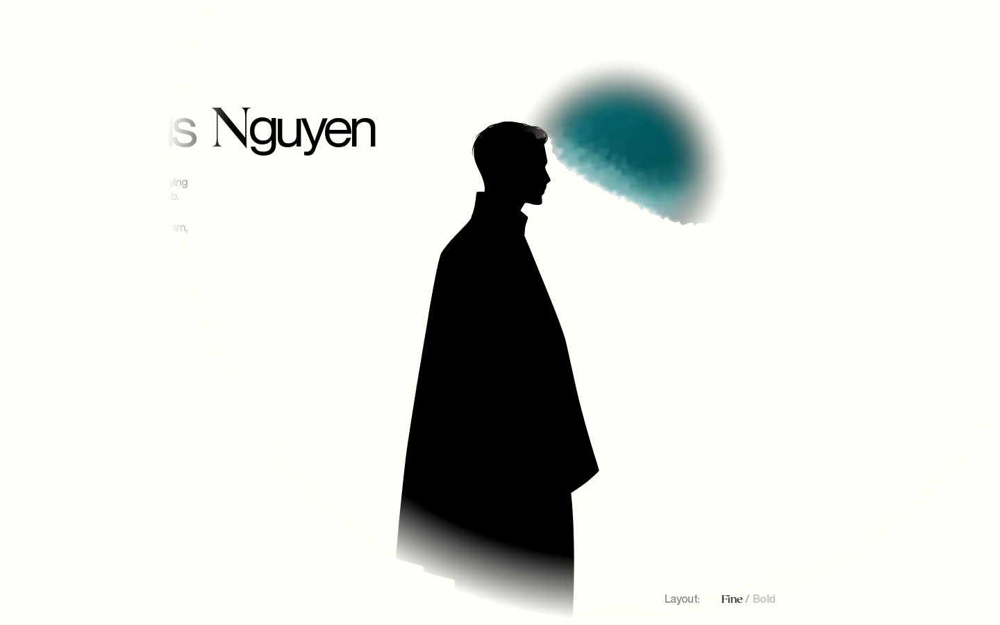
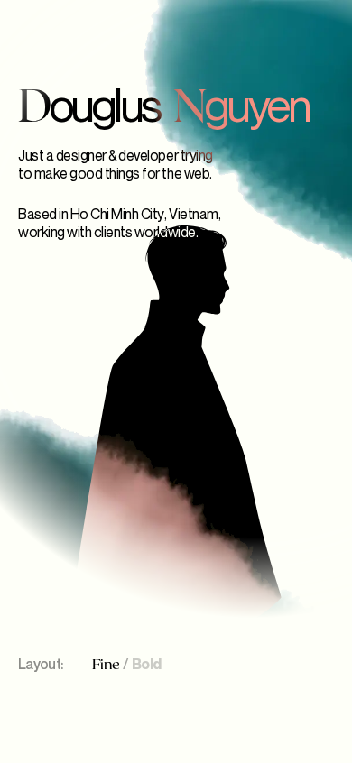

# UI Design System & Master Generation Blueprint: douglus-co

> **Douglus Nguyen — Web Designer from Vietnam** (https://douglus.co) — Independent web designer based in Vietnam, focused on website design, interaction design, and front-end development.



---

## 1. Executive Visual Persona & Design Archetype

- **Brand Essence & Persona**: **Douglus Nguyen — Web Designer from Vietnam** (`https://douglus.co`). Independent web designer based in Vietnam, focused on website design, interaction design, and front-end development.
- **Capture Provenance**: Live browser capture (`tier1_fast`, HTTP `200`, captured `2026-11-23`).
- **Visual Archetype**: **Dark-Substrate WebGL / Canvas Interactive Experience (`#1e1e1e` / `#fefff8`)**.
- **Anti-AI-Slop Differentiators**:
  - **Live-Computed Chromatic Polarity**: Anchors the viewport in `#1e1e1e` (live computed `body` `background-color` (`computed_styles.json`)) paired with `#fefff8` primary typography and `#fefff8` accents.
  - **Grounded Typographic Hierarchy**: Pairs `Neue Montreal` for display copy (`D ouglus N guyen`) with `Neue Montreal` and not declared in live computed styles (uses primary stack / `ui-monospace`).
  - **Calibrated Spatial Grid & Motion**: Combines `1440px` container bounds (`gap: 15.12px`, padding `33.12px`) with `cubic-bezier(.25,1,.5,1)` easing and Three.js / WebGL Canvas Pipeline, Barba.js Page Transition Router.

---

## 2. Spatial Architecture & Modular Grid Mathematics



### Viewport Allocation & Container Geometry
- **Captured Viewport Dimensions**: Desktop `1440×900px` (`assets/desktop.png`, single-viewport 100vh live capture (900px)), Mobile `390×846px` (`assets/mobile.png`, full-page live capture (846px)).
- **Master Container Bounds**: `1440px` (full-bleed `100%` desktop stage measured on `1440px` viewport).
- **Canvas Lateral Padding & Spacing**: `33.12px` lateral canvas padding with `15.12px` grid gap.
- **Border Radius Scale**: `10px`, `50%`.

### Responsive Breakpoint Architecture
- **Desktop Layout**: Multi-column CSS Grid / Flexbox layout at `1440px` (`max-width: 1440px`, `gap: 15.12px`).
- **Mobile Layout**: Single-column vertical stack at `390px` viewport width with `33.12px` horizontal padding.
- **Extracted CSS Media Queries**: `@media (width<=23.75rem)`, `@media screen and (width>=1025px)`, `@media (prefers-reduced-motion:no-preference)`, `@media (prefers-reduced-motion:reduce)`.

---

## 3. Color System, Materiality & Atmospheric Lighting

### Semantic Palette & Source Grounding
| Semantic Role | Ground-Truth Value | Extracted Live / CSS Source |
|---|---|---|
| **Primary Canvas Substrate** | `#1e1e1e` | live computed `body` `background-color` (`computed_styles.json`) |
| **Primary Typography Ink** | `#fefff8` | live computed `h1` `color` (`computed_styles.json`) |
| **Elevated Surface / Card Substrate** | `#000000` | `.c-scrollbar_thumb { background-color: #000000 }` |
| **Interactive Accent / Highlight** | `#fefff8` | live computed `button` `color` (`computed_styles.json`) |
| **Secondary / Muted Copy** | `#ebebeb` | `var(--muted-color)` in `:root` |
| **Structural Hairline Border** | `#ebebeb` | hairline divider derived from `var(--muted-color)` in `:root` |
| **Variable Token (`--neutral-color`)** | `#292724` | `var(--neutral-color)` in `:root` |

### Sanitized Root CSS Variables (`ui-ux.md` Ground Truth)
| Variable Name | Extracted Value | Semantic Role |
|---|---|---|
| `--page-padding` | `clamp(20px, 2.3vw, 40px)` | Layout / Spatial Grid Token |
| `--header-height` | `112px` | Layout / Spatial Grid Token |
| `--footer-right-width` | `clamp(38.75rem, 45.14vw, 48.75rem)` | Layout / Spatial Grid Token |
| `--white-color` | `#fefff8` | Canvas / Surface Token |
| `--black-color` | `#1e1e1e` | Canvas / Surface Token |
| `--neutral-color` | `#292724` | Brand / Palette Token |
| `--muted-color` | `#ebebeb` | Brand / Palette Token |
| `--default-easing` | `cubic-bezier(.25, 1, .5, 1)` | Motion / Easing Token |
| `--gw` | `4.16667vw` | Dimension / Scale Token |
| `--rv-ease` | `var(--default-easing)` | Motion / Easing Token |
| `--rv-ease-img` | `cubic-bezier(.76, 0, .24, 1)` | Motion / Easing Token |
| `--rv-d-s` | `.5s` | Motion / Timing Token |
| `--rv-d-m` | `.7s` | Motion / Timing Token |
| `--rv-d-l` | `.9s` | Motion / Timing Token |
| `--rv-step-t` | `40ms` | Motion / Timing Token |
| `--rv-step-l` | `80ms` | Motion / Timing Token |

---

## 4. Typographic Scale & Editorial Hierarchy

### Font Family Stacks
- **Display Typography**: `Neue Montreal`.
- **Primary Body Stack**: `Neue Montreal`.
- **Technical / Metadata Stack**: not declared in live computed styles (uses primary stack / `ui-monospace`).

### Typographic Scale & Rules (Live Computed & Stylesheet Grounded)
- **Hero Display (`H1`)**: live computed `h1` (`font-size: 78.88px`, `line-height: 70.992px`, `font-weight: 400`, `letter-spacing: -5.5216px`).
- **Section Heading (`H2`)**: observed font-size ladder: `78.88px`, `16px`, `13px`, `100%`, `clamp(.75rem,.81vw,.875rem)`.
- **Body Copy**: live computed `body` (`font-size: 16px`, `line-height: 16px`, `font-weight: 400`); rule `p` (`font-size: clamp(.875rem, var(--gw) * .2...`, `line-height: 1.2`, `letter-spacing: -.045em`, `font-weight: 400`).
- **Metadata & Navigation Labels**: live computed `nav/a` (`font-size: 16px`, `line-height: 16px`, `font-weight: 400`).

---

## 5. Choreographed Motion & Interaction Physics

### Primary Easing Curves
- **Extracted Timing Functions**: `cubic-bezier(.25,1,.5,1)`, `cubic-bezier(.76,0,.24,1)`, `cubic-bezier(.17,.67,.1,.99)`.

### Per-Element Transition & Choreography Rules
- **Selector `.c-scrollbar`**: `transition: transform .3s,opacity .3s` extracted from `douglus-co` stylesheet.
- **Selector `.is-in))~:where([data-rv=line])>:...`**: `transition: translate var(--rv-d,var(--rv-d-m)) var(--rv-e,var(--rv-ease))...` extracted from `douglus-co` stylesheet.
- **Selector `.is-in))~:where([data-rv=rise])`**: `transition: translate var(--rv-d,var(--rv-d-m)) var(--rv-e,var(--rv-ease))...` extracted from `douglus-co` stylesheet.
- **Extracted Easing Curve (`cubic-bezier(.25,1,.5,1)`)**: Governs interactive state transitions across `<header.site-header>` and `<section.home-hero:nth(2)>`.
- **Runtime Interaction Engine**: Integrates Three.js / WebGL Canvas Pipeline, Barba.js Page Transition Router with `prefers-reduced-motion: reduce` fallback guards.

---

## 6. Component Wireframe & Structural DOM Map

### Visual Layout Schematic — Desktop (`1440px`, Grounded in `dom.html` & Landmark Bounding Boxes)
```
┌────────────────────────────────────────────────────────────────────────┐
│ DESKTOP VIEWPORT (1440px) — Douglus Nguyen — Web Designer from Vietnam │
│ ====================================================================== │
│ [ <header.site-header> (1440x112px)   | H ome · W orks · P layground ] │
│ ---------------------------------------------------------------------- │
│ | HERO STAGE: <section.home-hero> (w=1440px)                         | │
│ | H1: D ouglus N guyen                                               | │
│ | Substrate: #1e1e1e | Ink: #fefff8 | Accent: #fefff8                | │
│ ---------------------------------------------------------------------- │
│ | SHOWCASE GRID (<section.home-hero:nth(2)>) max-w: 1440px           | │
│ | +------------------------------+  +------------------------------+ | │
│ | | Just a designer & developer  |  | Based in Ho Chi Minh City, V | | │
│ | +------------------------------+  +------------------------------+ | │
│ ---------------------------------------------------------------------- │
│ | DETAIL MODULE (<section.home-hero:nth(3)>) — From Vietnam with Lov | │
│ ---------------------------------------------------------------------- │
│ [ FOOTER (<footer.preloader__s) | https://douglus.co                   │
└────────────────────────────────────────────────────────────────────────┘
```

### Visual Layout Schematic — Mobile Reflow (`390px`)
```
┌────────────────────────────────────────────────────────────────────────┐
│ MOBILE VIEWPORT REFLOW (390px) — Single-Column Stack (gap: 15.12px)    │
│ ====================================================================== │
│ [ HEADER BAR (<header.site-header>    ) | Compact Menu (390px)         │
│ ---------------------------------------------------------------------- │
│ | HERO STAGE (<section.home-hero>) — 390px Vertical Lead             | │
│ | H1: D ouglus N guyen                                               | │
│ ---------------------------------------------------------------------- │
│ | SHOWCASE STACK (<section.home-hero:nth) — 1-Col Stack              | │
│ | [ Item 1: Just a designer & developer trying to make good        ] | │
│ | [ Item 2: Based in Ho Chi Minh City, Vietnam, working with       ] | │
│ ---------------------------------------------------------------------- │
│ | DETAIL STACK (<section.home-hero:nth(3) — 1-Col (From Vietnam with ) │
│ ---------------------------------------------------------------------- │
│ [ FOOTER (<footer.preloader__s) | Stacked 390px Colophon               │
└────────────────────────────────────────────────────────────────────────┘
```

### Granular DOM Region Breakdown
1. **Brand Header & Navigation Bar (<header.site-header> — `douglus-co`)**:
   - Landmark `<header class="site-header">` (`1440x112px`) hosting `Douglus Nguyen — Web Designer from V` navigation (`H ome · W orks · P layground · A bout · C ontact`), DOM attributes (`data-scroll-direction="vertical"`, `data-barba="wrapper"`, `data-preloader`, `data-fragment="1"`), and stylesheet rule `video { font-size:100%;font:inherit;vertical-align:baseline;border:0;margin:0;pa... }`.
2. **Hero Stage & Focal Lead (<section.home-hero> — `D ouglus N guyen`)**:
   - Landmark `<section class="home-hero">` presenting display lead `D ouglus N guyen` and copy excerpt *"Just a designer & developer trying to make good things for the we"* over `#1e1e1e` canvas and `#fefff8` ink.
3. **Primary Showcase & Content Grid (<section.home-hero:nth(2)> — `Just a designer & developer trying`)**:
   - Landmark `<section class="home-hero">` rendering section `Just a designer & developer trying to make good ` with copy *"Based in Ho Chi Minh City, Vietnam, working with clients worldwid"*, asset references (`favicon.ico`, `favicon-32x32.png`, `favicon-16x16.png`, `apple-touch-icon.png`), and grid rule `section { display:block }`.
4. **Interactive Detail & Feature Matrix (<section.home-hero:nth(3)> — `Based in Ho Chi Minh City, Vietnam`)**:
   - Landmark `<section class="home-hero">` framing `Based in Ho Chi Minh City, Vietnam, working with` and `From Vietnam with Love.` (*"From Vietnam with Love."*) with `#000000` surface cards, `#fefff8` accents, and `body { line-height:1 }`.
5. **Colophon & Global Directory Footer (<footer.preloader__subject> — `https://douglus.co`)**:
   - Landmark `<footer class="preloader__subject">` anchoring `Douglus Nguyen — Web Designer fr` footer links (`H ome · W orks · P layground · A bout · C ontact`), copy *"+84 39 327 7584 +84 39 327 7584"*, and `#ebebeb` structural dividers.

---

## 7. Master Zero-Shot AI Generation Prompt

```markdown
# Master Zero-Shot Frontend Generation Prompt: douglus-co (Douglus Nguyen — Web Designer from Vietnam)

You are a principal frontend architect and design systems engineer. Build a complete, production-ready web application replicating the exact design system, DOM landmarks, typographic hierarchy, color tokens, and motion physics of `douglus-co` (**Douglus Nguyen — Web Designer from Vietnam** — `https://douglus.co`).

### 1. Visual Archetype & Anti-AI-Slop Mandates
- **Archetype**: Dark-Substrate WebGL / Canvas Interactive Experience (`#1e1e1e` / `#fefff8`).
- **Identity & Domain Context**: Independent web designer based in Vietnam, focused on website design, interaction design, and front-end development.
- **Primary Substrate**: `#1e1e1e` (live computed `body` `background-color` (`computed_styles.json`)), **Primary Ink**: `#fefff8`, **Accent / Highlight**: `#fefff8`.
- **Site-Specific Differentiators**:
  - **Live-Computed Chromatic Polarity**: Anchors the viewport in `#1e1e1e` (live computed `body` `background-color` (`computed_styles.json`)) paired with `#fefff8` primary typography and `#fefff8` accents.
  - **Grounded Typographic Hierarchy**: Pairs `Neue Montreal` for display copy (`D ouglus N guyen`) with `Neue Montreal` and not declared in live computed styles (uses primary stack / `ui-monospace`).
  - **Calibrated Spatial Grid & Motion**: Combines `1440px` container bounds (`gap: 15.12px`, padding `33.12px`) with `cubic-bezier(.25,1,.5,1)` easing and Three.js / WebGL Canvas Pipeline, Barba.js Page Transition Router.

### 2. Ground-Truth CSS Variables (`:root` Token Contract)
Declare and consume these exact custom properties extracted from `douglus-co` in your global stylesheet:

:root {
  /* Douglus Nguyen — Web Designer from Vietnam (douglus-co) — Live-Grounded CSS Variables */
  --page-padding: clamp(20px, 2.3vw, 40px); /* Layout / Spatial Grid Token (douglus-co) */
  --header-height: 112px; /* Layout / Spatial Grid Token (douglus-co) */
  --footer-right-width: clamp(38.75rem, 45.14vw, 48.75rem); /* Layout / Spatial Grid Token (douglus-co) */
  --white-color: #fefff8; /* Canvas / Surface Token (douglus-co) */
  --black-color: #1e1e1e; /* Canvas / Surface Token (douglus-co) */
  --neutral-color: #292724; /* Brand / Palette Token (douglus-co) */
  --muted-color: #ebebeb; /* Brand / Palette Token (douglus-co) */
  --default-easing: cubic-bezier(.25, 1, .5, 1); /* Motion / Easing Token (douglus-co) */
  --gw: 4.16667vw; /* Dimension / Scale Token (douglus-co) */
  --rv-ease: var(--default-easing); /* Motion / Easing Token (douglus-co) */
  --rv-ease-img: cubic-bezier(.76, 0, .24, 1); /* Motion / Easing Token (douglus-co) */
  --rv-d-s: .5s; /* Motion / Timing Token (douglus-co) */
  --rv-d-m: .7s; /* Motion / Timing Token (douglus-co) */
  --rv-d-l: .9s; /* Motion / Timing Token (douglus-co) */
  --rv-step-t: 40ms; /* Motion / Timing Token (douglus-co) */
  --rv-step-l: 80ms; /* Motion / Timing Token (douglus-co) */
}

### 3. Semantic Color & Materiality Contract
Map every surface, ink, and border strictly to these source-grounded tokens:
- **Primary Canvas Substrate**: `#1e1e1e` — grounded in live computed `body` `background-color` (`computed_styles.json`)
- **Primary Typography Ink**: `#fefff8` — grounded in live computed `h1` `color` (`computed_styles.json`)
- **Elevated Surface / Card Substrate**: `#000000` — grounded in `.c-scrollbar_thumb { background-color: #000000 }`
- **Interactive Accent / Highlight**: `#fefff8` — grounded in live computed `button` `color` (`computed_styles.json`)
- **Secondary / Muted Copy**: `#ebebeb` — grounded in `var(--muted-color)` in `:root`
- **Structural Hairline Border**: `#ebebeb` — grounded in hairline divider derived from `var(--muted-color)` in `:root`
- **Variable Token (`--neutral-color`)**: `#292724` — grounded in `var(--neutral-color)` in `:root`

### 4. Spatial Grid, Container Bounds & Responsive Breakpoints
- **Desktop Viewport Reference**: `1440×900px` (single-viewport 100vh live capture (900px), `1440px` standard desktop width).
- **Mobile Viewport Reference**: `390×846px` (full-page live capture (846px), `390px` standard mobile width).
- **Container Max-Width**: `1440px` (full-bleed `100%` desktop stage measured on `1440px` viewport)
- **Padding & Gutters**: `33.12px` lateral canvas padding with `15.12px` grid gap
- **Desktop Grid**: Multi-column CSS Grid / Flexbox layout at `1440px` (`max-width: 1440px`, `gap: 15.12px`)
- **Mobile Adaptation**: Single-column vertical stack at `390px` viewport width with `33.12px` horizontal padding
- **Media Queries**: `@media (width<=23.75rem)`, `@media screen and (width>=1025px)`, `@media (prefers-reduced-motion:no-preference)`, `@media (prefers-reduced-motion:reduce)`
- **Corner Radii**: `10px`, `50%`

### 5. Typography & Editorial Scale Contract
- **Display Font Stack**: `Neue Montreal`
- **Body Font Stack**: `Neue Montreal`
- **Monospace / Technical Font Stack**: not declared in live computed styles (uses primary stack / `ui-monospace`)
- **H1 Display Rule**: live computed `h1` (`font-size: 78.88px`, `line-height: 70.992px`, `font-weight: 400`, `letter-spacing: -5.5216px`)
- **H2 Section Rule**: observed font-size ladder: `78.88px`, `16px`, `13px`, `100%`, `clamp(.75rem,.81vw,.875rem)`
- **Body Copy Rule**: live computed `body` (`font-size: 16px`, `line-height: 16px`, `font-weight: 400`); rule `p` (`font-size: clamp(.875rem, var(--gw) * .2...`, `line-height: 1.2`, `letter-spacing: -.045em`, `font-weight: 400`)
- **Metadata & Index Rule**: live computed `nav/a` (`font-size: 16px`, `line-height: 16px`, `font-weight: 400`)

### 6. Component Hierarchy, Verbatim Copy & Real DOM Landmarks
Scaffold `douglus-co` (`Douglus Nguyen — Web Designer from Vietnam`) with these exact structural regions, extracted copy, and CSS rules from `dom.html`:
1. **Brand Header & Navigation Bar (<header.site-header> — `douglus-co`)**:
   - DOM & Selectors: Landmark `<header class="site-header">` (`1440x112px`) hosting `Douglus Nguyen — Web Designer from V` navigation (`H ome · W orks · P layground · A bout · C ontact`), DOM attributes (`data-scroll-direction="vertical"`, `data-barba="wrapper"`, `data-preloader`, `data-fragment="1"`), and stylesheet rule `video { font-size:100%;font:inherit;vertical-align:baseline;border:0;margin:0;pa... }`.
   - Responsive Contract: Header `Brand Header & Navigation Bar (<header.site-header> — `douglus-co`)` (`douglus-co`) adapts across `@media (width<=23.75rem)`, `@media screen and (width>=1025px)`, `@media (prefers-reduced-motion:no-preference)`, `@media (prefers-reduced-motion:reduce)` with `cubic-bezier(.25,1,.5,1)`, `cubic-bezier(.76,0,.24,1)`, `cubic-bezier(.17,.67,.1,.99)` transitions and links `H ome · W orks · P layground · A bout · C ontact`.
2. **Hero Stage & Focal Lead (<section.home-hero> — `D ouglus N guyen`)**:
   - DOM & Selectors: Landmark `<section class="home-hero">` presenting display lead `D ouglus N guyen` and copy excerpt *"Just a designer & developer trying to make good things for the we"* over `#1e1e1e` canvas and `#fefff8` ink.
   - Responsive Contract: Hero stage (`1440×900px` desktop / `390×846px` mobile) sets `#1e1e1e` background with `#fefff8` headline `D ouglus N guyen`.
3. **Primary Showcase & Content Grid (<section.home-hero:nth(2)> — `Just a designer & developer trying`)**:
   - DOM & Selectors: Landmark `<section class="home-hero">` rendering section `Just a designer & developer trying to make good ` with copy *"Based in Ho Chi Minh City, Vietnam, working with clients worldwid"*, asset references (`favicon.ico`, `favicon-32x32.png`, `favicon-16x16.png`, `apple-touch-icon.png`), and grid rule `section { display:block }`.
   - Responsive Contract: Showcase grid `Primary Showcase & Content Grid (<section.home-hero:nth(2)> — `Just a designer & developer trying`)` applies Multi-column CSS Grid / Flexbox layout at `1440px` (`max-width: 1440px`, `gap: 15.12px`) on desktop and Single-column vertical stack at `390px` viewport width with `33.12px` horizontal padding on mobile.
4. **Interactive Detail & Feature Matrix (<section.home-hero:nth(3)> — `Based in Ho Chi Minh City, Vietnam`)**:
   - DOM & Selectors: Landmark `<section class="home-hero">` framing `Based in Ho Chi Minh City, Vietnam, working with` and `From Vietnam with Love.` (*"From Vietnam with Love."*) with `#000000` surface cards, `#fefff8` accents, and `body { line-height:1 }`.
   - Responsive Contract: Detail module `Interactive Detail & Feature Matrix (<section.home-hero:nth(3)> — `Based in Ho Chi Minh City, Vietnam`)` uses `10px`, `50%` radii, `#fefff8` highlights, and assets (favicon.ico, favicon-32x32.png, favicon-16x16.png).
5. **Colophon & Global Directory Footer (<footer.preloader__subject> — `https://douglus.co`)**:
   - DOM & Selectors: Landmark `<footer class="preloader__subject">` anchoring `Douglus Nguyen — Web Designer fr` footer links (`H ome · W orks · P layground · A bout · C ontact`), copy *"+84 39 327 7584 +84 39 327 7584"*, and `#ebebeb` structural dividers.
   - Responsive Contract: Footer `Colophon & Global Directory Footer (<footer.preloader__subject> — `https://douglus.co`)` aligns to `1440px` (full-bleed `100%` desktop stage measured on `1440px` viewport) with `33.12px` lateral canvas padding with `15.12px` grid gap and attributes (data-scroll-direction="vertical", data-barba="wrapper", data-preloader).

#### Verbatim DOM Copy Excerpts (`dom.html`)
- Copy Excerpt 1: *"Just a designer & developer trying to make good things for the web."*
- Copy Excerpt 2: *"Based in Ho Chi Minh City, Vietnam, working with clients worldwide."*
- Copy Excerpt 3: *"From Vietnam with Love."*
- Copy Excerpt 4: *"+84 39 327 7584 +84 39 327 7584"*

### 7. Motion, Extracted Stylesheet Rules & Interaction Choreography
- **Primary Easing Functions**: `cubic-bezier(.25,1,.5,1)`, `cubic-bezier(.76,0,.24,1)`, `cubic-bezier(.17,.67,.1,.99)`
- **Extracted Stylesheet Rules (`douglus-co`)**:
- `video { font-size:100%;font:inherit;vertical-align:baseline;border:0;margin:0;pa... }`
- `section { display:block }`
- `body { line-height:1 }`
- `q:after { content:"";content:none }`
- `table { border-collapse:collapse;border-spacing:0 }`
- **Per-Selector Transition Rules**:
- **Selector `.c-scrollbar`**: `transition: transform .3s,opacity .3s` extracted from `douglus-co` stylesheet.
- **Selector `.is-in))~:where([data-rv=line])>:...`**: `transition: translate var(--rv-d,var(--rv-d-m)) var(--rv-e,var(--rv-ease))...` extracted from `douglus-co` stylesheet.
- **Selector `.is-in))~:where([data-rv=rise])`**: `transition: translate var(--rv-d,var(--rv-d-m)) var(--rv-e,var(--rv-ease))...` extracted from `douglus-co` stylesheet.
- **Extracted Easing Curve (`cubic-bezier(.25,1,.5,1)`)**: Governs interactive state transitions across `<header.site-header>` and `<section.home-hero:nth(2)>`.
- **Runtime Interaction Engine**: Integrates Three.js / WebGL Canvas Pipeline, Barba.js Page Transition Router with `prefers-reduced-motion: reduce` fallback guards.

### 8. Technical Deliverables
- Implement in Next.js (App Router) with TypeScript and Tailwind CSS consuming the `:root` custom properties defined above for `douglus-co`.
- Reproduce both the `1440px` desktop architecture and `390px` mobile breakpoint transitions, preserving semantic HTML5 landmarks (`<header>`, `<nav>`, `<main>`, `<section>`, `<footer>`) and `prefers-reduced-motion` accessibility guards.
```
