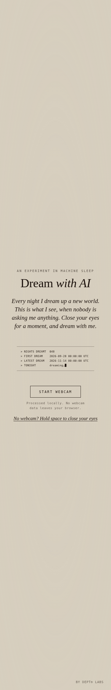

# UI Design System & Master Generation Blueprint: dream-with-ai-com

> **Dream with AI** (https://dream-with-ai.com) — Can an AI feel anything? If it could, what would it dream? Every night an AI dreams up a whole new world, with its own visuals and sounds...


---

## 1. Executive Visual Persona & Design Archetype

- **Brand Essence & Persona**: **Dream with AI** (`https://dream-with-ai.com`). Can an AI feel anything? If it could, what would it dream? Every night an AI dreams up a whole new world, with its own visuals and sounds...
- **Visual Archetype**: **Light-Gallery WebGL / Canvas Interactive Experience (`#d6cebe` / `#0b0b0b`)**.
- **Anti-AI-Slop Differentiators**:
  - **Source-Grounded Chromatic Polarity**: Anchors the viewport in `#d6cebe` (`var(--paper)` in `:root`) paired with `#0b0b0b` primary typography and `#0b0b0b` accents.
  - **Extracted Typographic Hierarchy**: Pairs `Cormorant Garamond` for display copy (`Dream with AI`) with `JetBrains Mono` and `JetBrains Mono`.
  - **Calibrated Spatial Grid & Motion**: Combines `620px` container bounds (`gap: 6px`, padding `6px`) with `cubic-bezier(.2,.7,.2,1)` easing and Three.js / WebGL Canvas Pipeline.

---

## 2. Spatial Architecture & Modular Grid Mathematics



### Viewport Allocation & Container Geometry
- **Captured Viewport Dimensions**: Desktop `1440×2400px` (`assets/desktop.png`, capped at 2400px multi-section capture), Mobile `390×2400px` (`assets/mobile.png`, capped at 2400px multi-section capture).
- **Master Container Bounds**: `620px` extracted from `dream-with-ai-com` stylesheet.
- **Canvas Lateral Padding & Spacing**: `6px` lateral canvas padding with `6px` grid gap.
- **Border Radius Scale**: `0px` (sharp unrounded corners).

### Responsive Breakpoint Architecture
- **Desktop Layout**: Multi-column CSS Grid / Flexbox layout at `1440px` (`max-width: 620px`, `gap: 6px`).
- **Mobile Layout**: Single-column vertical stack at `390px` viewport width with `6px` horizontal padding.
- **Extracted CSS Media Queries**: `@media (prefers-reduced-motion:reduce)`, `@media (max-width:640px)`.

---

## 3. Color System, Materiality & Atmospheric Lighting

### Semantic Palette & Source Grounding
| Semantic Role | Ground-Truth Value | Extracted CSS Source / Selector |
|---|---|---|
| **Primary Canvas Substrate** | `#d6cebe` | `var(--paper)` in `:root` |
| **Primary Typography Ink** | `#1c120d` | `var(--ink)` in `:root` |
| **Elevated Surface / Card Substrate** | `#a04a2a` | `var(--rust)` in `:root` |
| **Interactive Accent / Highlight** | `#0b0b0b` | `var(--dxlBg)` in `:root` |
| **Secondary / Muted Copy** | `#d9d9d9` | `var(--dxlFg)` in `:root` |
| **Structural Hairline Border** | `#e4e0d6` | `var(--text)` in `:root` |

### Sanitized Root CSS Variables (`ui-ux.md` Ground Truth)
| Variable Name | Extracted Value | Semantic Role |
|---|---|---|
| `--dxl-mark-font` | `500 11px/1 "JetBrains Mono", ui-monospace, monospace` | Typography / Scale Token |
| `--dxl-mark-tracking` | `.08em` | Typography / Scale Token |
| `--dxl-mark-case` | `uppercase` | Design System Custom Token |
| `--dxl-mark-fg` | `var(--ink)` | Typography Ink Token |
| `--dxl-mark-bg` | `none` | Canvas / Surface Token |
| `--paper` | `#d6cebe` | Canvas / Surface Token |
| `--ink` | `#1c120d` | Typography Ink Token |
| `--rust` | `#a04a2a` | Color / Atmospheric Token |
| `--dxl-bg` | `var(--dxlBg)` | Canvas / Surface Token |
| `--dxl-fg` | `var(--dxlFg)` | Typography Ink Token |
| `--dxl-accent` | `var(--dxlAccent)` | Brand / Palette Token |
| `--dxlBg` | `#0b0b0b` | Canvas / Surface Token |
| `--dxlFg` | `#d9d9d9` | Typography Ink Token |
| `--dxlAccent` | `#a04a2a` | Brand / Palette Token |
| `--wash` | `#0b0b0b` | Color / Atmospheric Token |
| `--text` | `#e4e0d6` | Typography Ink Token |

---

## 4. Typographic Scale & Editorial Hierarchy

### Font Family Stacks
- **Display Typography**: `Cormorant Garamond`.
- **Primary Body Stack**: `JetBrains Mono`.
- **Technical / Metadata Stack**: `JetBrains Mono`.

### Typographic Scale & Rules (Extracted from Stylesheet & Variables)
- **Hero Display (`H1`)**: rule `h1` (`letter-spacing: -.01em`).
- **Section Heading (`H2`)**: not explicitly declared on tag in static CSS (stylesheet font-size ladder: `9px`, `clamp(22px,2.8vw,32px)`, `17px`, `10px`, `2.25vw`).
- **Body Copy**: rule `p` (`font-size: 17px`).
- **Metadata & Navigation Labels**: not explicitly declared on tag in static CSS (stylesheet font-size ladder: `9px`, `clamp(22px,2.8vw,32px)`, `17px`, `10px`, `2.25vw`).

---

## 5. Choreographed Motion & Interaction Physics

### Primary Easing Curves
- **Extracted Timing Functions**: `cubic-bezier(.2,.7,.2,1)`.

### Per-Element Transition & Choreography Rules
- **Selector `.dxl-mark[data-astro-cid-n6wkilw4]`**: `transition: opacity .2s` extracted from `dream-with-ai-com` stylesheet.
- **Selector `.hint`**: `transition: opacity 1.6s` extracted from `dream-with-ai-com` stylesheet.
- **Selector `.menu.leaving .plate`**: `transition: transform 1.6s ease-in-out` extracted from `dream-with-ai-com` stylesheet.
- **Extracted Easing Curve (`cubic-bezier(.2,.7,.2,1)`)**: Governs interactive state transitions across `<header.noir>` and `<div.paper>`.
- **Runtime Interaction Engine**: Integrates Three.js / WebGL Canvas Pipeline with `prefers-reduced-motion: reduce` fallback guards.

---

## 6. Component Wireframe & Structural DOM Map

### Visual Layout Schematic (Grounded in `dom.html` — `1440px` Desktop & `390px` Mobile Reflow)
```
┌────────────────────────────────────────────────────────────────────────┐
│ DESKTOP VIEWPORT (1440px) — Dream with AI                              │
│ ====================================================================== │
│ [ <header.noir>            | DEPT® LABS · BY DEPT® LABS             ]  │
│ ---------------------------------------------------------------------- │
│ | HERO STAGE: <div.paper>                                          |   │
│ | H1: Dream with AI                                                |   │
│ | Substrate: #d6cebe    | Ink: #0b0b0b    | Accent: #0b0b0b        |   │
│ ---------------------------------------------------------------------- │
│ | SHOWCASE GRID (<div.paper>               ) max-w: 620px          |   │
│ | +------------------------------+  +------------------------------+ | │
│ | | How to dream                 |  | Your camera                  | | │
│ | +------------------------------+  +------------------------------+ | │
│ ---------------------------------------------------------------------- │
│ | MOBILE VIEWPORT REFLOW (390px) — Single-Column Stack (gap: 6px   ) | │
│ | [<header.noir>] -> [<div.paper>] -> [<div.paper>] |                  │
│ ---------------------------------------------------------------------- │
│ [ FOOTER (<footer.cue>          ) | https://dream-with-ai.com          │
└────────────────────────────────────────────────────────────────────────┘
```

### Granular DOM Region Breakdown
1. **Brand Header & Navigation Bar (<header.noir> — `dream-with-ai-com`)**:
   - Landmark `<header class="noir">` hosting `Dream with AI` navigation (`DEPT® LABS · BY DEPT® LABS`), DOM attributes (`data-engine="three.js r180"`, `data-engine="three.js r180"`, `data-track="Start"`, `data-track-with="camera"`), and stylesheet rule `root { --paper: d6cebe;--ink: 1c120d;--rust: a04a2a }`.
2. **Hero Stage & Focal Lead (<div.paper> — `Dream with AI`)**:
   - Landmark `<div class="paper">` presenting display lead `Dream with AI` and copy excerpt *"Close your eyes · hold"* over `#d6cebe` canvas and `#0b0b0b` ink.
3. **Primary Showcase & Content Grid (<div.paper> — `How to dream`)**:
   - Landmark `<div class="paper">` rendering section `How to dream` with copy *"An art piece by x09, brought to life by DEPT® LABS"*, asset references (`favicon.svg`, `apple-touch-icon.png`, `sitemap-index.xml`, `script.js`), and grid rule `body { margin:0;height:100%;overflow:hidden;background:var(--paper) }`.
4. **Interactive Detail & Feature Matrix (<div.paper> — `Your camera`)**:
   - Landmark `<div class="paper">` framing `Your camera` and `Every night an AI dreams a new world, engraved l` (*"Every night an AI dreams a new world, engraved like Escher and me"*) with `#a04a2a` surface cards, `#0b0b0b` accents, and `lids { position:fixed;inset:0;width:100%;height:100%;display:block;touch-action... }`.
5. **Colophon & Global Directory Footer (<footer.cue> — `https://dream-with-ai.com`)**:
   - Landmark `<footer class="cue">` anchoring `Dream with AI` footer links (`DEPT® LABS · BY DEPT® LABS`), copy *"Blink, and the dream moves on. Close your eyes and keep them"*, and `#e4e0d6` structural dividers.

---

## 7. Master Zero-Shot AI Generation Prompt

```markdown
# Master Zero-Shot Frontend Generation Prompt: dream-with-ai-com (Dream with AI)

You are a principal frontend architect and design systems engineer. Build a complete, production-ready web application replicating the exact design system, DOM landmarks, typographic hierarchy, color tokens, and motion physics of `dream-with-ai-com` (**Dream with AI** — `https://dream-with-ai.com`).

### 1. Visual Archetype & Anti-AI-Slop Mandates
- **Archetype**: Light-Gallery WebGL / Canvas Interactive Experience (`#d6cebe` / `#0b0b0b`).
- **Identity & Domain Context**: Can an AI feel anything? If it could, what would it dream? Every night an AI dreams up a whole new world, with its own visuals and sounds...
- **Primary Substrate**: `#d6cebe` (`var(--paper)` in `:root`), **Primary Ink**: `#0b0b0b`, **Accent / Highlight**: `#0b0b0b`.
- **Site-Specific Differentiators**:
  - **Source-Grounded Chromatic Polarity**: Anchors the viewport in `#d6cebe` (`var(--paper)` in `:root`) paired with `#0b0b0b` primary typography and `#0b0b0b` accents.
  - **Extracted Typographic Hierarchy**: Pairs `Cormorant Garamond` for display copy (`Dream with AI`) with `JetBrains Mono` and `JetBrains Mono`.
  - **Calibrated Spatial Grid & Motion**: Combines `620px` container bounds (`gap: 6px`, padding `6px`) with `cubic-bezier(.2,.7,.2,1)` easing and Three.js / WebGL Canvas Pipeline.

### 2. Ground-Truth CSS Variables (`:root` Token Contract)
Declare and consume these exact custom properties extracted from `dream-with-ai-com` in your global stylesheet:

:root {
  /* Dream with AI (dream-with-ai-com) — Ground-Truth Extracted CSS Variables */
  --dxl-mark-font: 500 11px/1 "JetBrains Mono", ui-monospace, monospace; /* Typography / Scale Token (dream-with-ai-com) */
  --dxl-mark-tracking: .08em; /* Typography / Scale Token (dream-with-ai-com) */
  --dxl-mark-case: uppercase; /* Design System Custom Token (dream-with-ai-com) */
  --dxl-mark-fg: var(--ink); /* Typography Ink Token (dream-with-ai-com) */
  --dxl-mark-bg: none; /* Canvas / Surface Token (dream-with-ai-com) */
  --paper: #d6cebe; /* Canvas / Surface Token (dream-with-ai-com) */
  --ink: #1c120d; /* Typography Ink Token (dream-with-ai-com) */
  --rust: #a04a2a; /* Color / Atmospheric Token (dream-with-ai-com) */
  --dxl-bg: var(--dxlBg); /* Canvas / Surface Token (dream-with-ai-com) */
  --dxl-fg: var(--dxlFg); /* Typography Ink Token (dream-with-ai-com) */
  --dxl-accent: var(--dxlAccent); /* Brand / Palette Token (dream-with-ai-com) */
  --dxlBg: #0b0b0b; /* Canvas / Surface Token (dream-with-ai-com) */
  --dxlFg: #d9d9d9; /* Typography Ink Token (dream-with-ai-com) */
  --dxlAccent: #a04a2a; /* Brand / Palette Token (dream-with-ai-com) */
  --wash: #0b0b0b; /* Color / Atmospheric Token (dream-with-ai-com) */
  --text: #e4e0d6; /* Typography Ink Token (dream-with-ai-com) */
}

### 3. Semantic Color & Materiality Contract
Map every surface, ink, and border strictly to these source-grounded tokens:
- **Primary Canvas Substrate**: `#d6cebe` — grounded in `var(--paper)` in `:root`
- **Primary Typography Ink**: `#1c120d` — grounded in `var(--ink)` in `:root`
- **Elevated Surface / Card Substrate**: `#a04a2a` — grounded in `var(--rust)` in `:root`
- **Interactive Accent / Highlight**: `#0b0b0b` — grounded in `var(--dxlBg)` in `:root`
- **Secondary / Muted Copy**: `#d9d9d9` — grounded in `var(--dxlFg)` in `:root`
- **Structural Hairline Border**: `#e4e0d6` — grounded in `var(--text)` in `:root`

### 4. Spatial Grid, Container Bounds & Responsive Breakpoints
- **Desktop Viewport Reference**: `1440×2400px` (capped at 2400px multi-section capture, `1440px` standard desktop width).
- **Mobile Viewport Reference**: `390×2400px` (capped at 2400px multi-section capture, `390px` standard mobile width).
- **Container Max-Width**: `620px` extracted from `dream-with-ai-com` stylesheet
- **Padding & Gutters**: `6px` lateral canvas padding with `6px` grid gap
- **Desktop Grid**: Multi-column CSS Grid / Flexbox layout at `1440px` (`max-width: 620px`, `gap: 6px`)
- **Mobile Adaptation**: Single-column vertical stack at `390px` viewport width with `6px` horizontal padding
- **Media Queries**: `@media (prefers-reduced-motion:reduce)`, `@media (max-width:640px)`
- **Corner Radii**: `0px` (sharp unrounded corners)

### 5. Typography & Editorial Scale Contract
- **Display Font Stack**: `Cormorant Garamond`
- **Body Font Stack**: `JetBrains Mono`
- **Monospace / Technical Font Stack**: `JetBrains Mono`
- **H1 Display Rule**: rule `h1` (`letter-spacing: -.01em`)
- **H2 Section Rule**: not explicitly declared on tag in static CSS (stylesheet font-size ladder: `9px`, `clamp(22px,2.8vw,32px)`, `17px`, `10px`, `2.25vw`)
- **Body Copy Rule**: rule `p` (`font-size: 17px`)
- **Metadata & Index Rule**: not explicitly declared on tag in static CSS (stylesheet font-size ladder: `9px`, `clamp(22px,2.8vw,32px)`, `17px`, `10px`, `2.25vw`)

### 6. Component Hierarchy, Verbatim Copy & Real DOM Landmarks
Scaffold `dream-with-ai-com` (`Dream with AI`) with these exact structural regions, extracted copy, and CSS rules from `dom.html`:
1. **Brand Header & Navigation Bar (<header.noir> — `dream-with-ai-com`)**:
   - DOM & Selectors: Landmark `<header class="noir">` hosting `Dream with AI` navigation (`DEPT® LABS · BY DEPT® LABS`), DOM attributes (`data-engine="three.js r180"`, `data-engine="three.js r180"`, `data-track="Start"`, `data-track-with="camera"`), and stylesheet rule `root { --paper: d6cebe;--ink: 1c120d;--rust: a04a2a }`.
   - Responsive Contract: Header `Brand Header & Navigation Bar (<header.noir> — `dream-with-ai-com`)` (`dream-with-ai-com`) adapts across `@media (prefers-reduced-motion:reduce)`, `@media (max-width:640px)` with `cubic-bezier(.2,.7,.2,1)` transitions and links `DEPT® LABS · BY DEPT® LABS`.
2. **Hero Stage & Focal Lead (<div.paper> — `Dream with AI`)**:
   - DOM & Selectors: Landmark `<div class="paper">` presenting display lead `Dream with AI` and copy excerpt *"Close your eyes · hold"* over `#d6cebe` canvas and `#0b0b0b` ink.
   - Responsive Contract: Hero stage (`1440×2400px` desktop / `390×2400px` mobile) sets `#d6cebe` background with `#0b0b0b` headline `Dream with AI`.
3. **Primary Showcase & Content Grid (<div.paper> — `How to dream`)**:
   - DOM & Selectors: Landmark `<div class="paper">` rendering section `How to dream` with copy *"An art piece by x09, brought to life by DEPT® LABS"*, asset references (`favicon.svg`, `apple-touch-icon.png`, `sitemap-index.xml`, `script.js`), and grid rule `body { margin:0;height:100%;overflow:hidden;background:var(--paper) }`.
   - Responsive Contract: Showcase grid `Primary Showcase & Content Grid (<div.paper> — `How to dream`)` applies Multi-column CSS Grid / Flexbox layout at `1440px` (`max-width: 620px`, `gap: 6px`) on desktop and Single-column vertical stack at `390px` viewport width with `6px` horizontal padding on mobile.
4. **Interactive Detail & Feature Matrix (<div.paper> — `Your camera`)**:
   - DOM & Selectors: Landmark `<div class="paper">` framing `Your camera` and `Every night an AI dreams a new world, engraved l` (*"Every night an AI dreams a new world, engraved like Escher and me"*) with `#a04a2a` surface cards, `#0b0b0b` accents, and `lids { position:fixed;inset:0;width:100%;height:100%;display:block;touch-action... }`.
   - Responsive Contract: Detail module `Interactive Detail & Feature Matrix (<div.paper> — `Your camera`)` uses `0px` (sharp unrounded corners) radii, `#0b0b0b` highlights, and assets (favicon.svg, apple-touch-icon.png, sitemap-index.xml).
5. **Colophon & Global Directory Footer (<footer.cue> — `https://dream-with-ai.com`)**:
   - DOM & Selectors: Landmark `<footer class="cue">` anchoring `Dream with AI` footer links (`DEPT® LABS · BY DEPT® LABS`), copy *"Blink, and the dream moves on. Close your eyes and keep them"*, and `#e4e0d6` structural dividers.
   - Responsive Contract: Footer `Colophon & Global Directory Footer (<footer.cue> — `https://dream-with-ai.com`)` aligns to `620px` extracted from `dream-with-ai-com` stylesheet with `6px` lateral canvas padding with `6px` grid gap and attributes (data-engine="three.js r180", data-engine="three.js r180", data-track="Start").

#### Verbatim DOM Copy Excerpts (`dom.html`)
- Copy Excerpt 1: *"Close your eyes · hold"*
- Copy Excerpt 2: *"An art piece by x09, brought to life by DEPT® LABS"*
- Copy Excerpt 3: *"Every night an AI dreams a new world, engraved like Escher and melted like Dalí, a..."*
- Copy Excerpt 4: *"Blink, and the dream moves on. Close your eyes and keep them closed, and you wake..."*

### 7. Motion, Extracted Stylesheet Rules & Interaction Choreography
- **Primary Easing Functions**: `cubic-bezier(.2,.7,.2,1)`
- **Extracted Stylesheet Rules (`dream-with-ai-com`)**:
- `root { --paper: d6cebe;--ink: 1c120d;--rust: a04a2a }`
- `body { margin:0;height:100%;overflow:hidden;background:var(--paper) }`
- `lids { position:fixed;inset:0;width:100%;height:100%;display:block;touch-action... }`
- `video { position:fixed;left:0;top:0;width:2px;height:2px;opacity:0;pointer-event... }`
- `.menu .plate { position:relative;max-width:620px;padding:38px 44px 30px }`
- **Per-Selector Transition Rules**:
- **Selector `.dxl-mark[data-astro-cid-n6wkilw4]`**: `transition: opacity .2s` extracted from `dream-with-ai-com` stylesheet.
- **Selector `.hint`**: `transition: opacity 1.6s` extracted from `dream-with-ai-com` stylesheet.
- **Selector `.menu.leaving .plate`**: `transition: transform 1.6s ease-in-out` extracted from `dream-with-ai-com` stylesheet.
- **Extracted Easing Curve (`cubic-bezier(.2,.7,.2,1)`)**: Governs interactive state transitions across `<header.noir>` and `<div.paper>`.
- **Runtime Interaction Engine**: Integrates Three.js / WebGL Canvas Pipeline with `prefers-reduced-motion: reduce` fallback guards.

### 8. Technical Deliverables
- Implement in Next.js (App Router) with TypeScript and Tailwind CSS consuming the `:root` custom properties defined above for `dream-with-ai-com`.
- Reproduce both the `1440px` desktop architecture and `390px` mobile breakpoint transitions, preserving semantic HTML5 landmarks (`<header>`, `<nav>`, `<main>`, `<section>`, `<footer>`) and `prefers-reduced-motion` accessibility guards.
```
