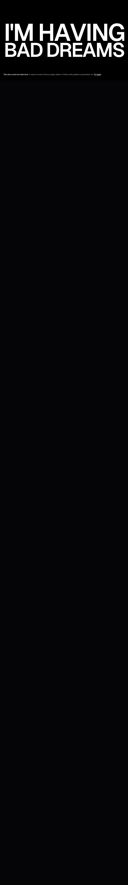
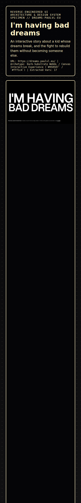

# UI Design System & Master Generation Blueprint: dreams-paulvl-eu

> **I'm having bad dreams** (https://dreams.paulvl.eu/) — An interactive story about a kid whose dreams break, and the fight to rebuild them without becoming someone else.



---

## 1. Executive Visual Persona & Design Archetype

- **Brand Essence & Persona**: **I'm having bad dreams** (`https://dreams.paulvl.eu/`). An interactive story about a kid whose dreams break, and the fight to rebuild them without becoming someone else.
- **Visual Archetype**: **Dark-Substrate WebGL / Canvas Interactive Experience (`#050507` / `#fff1c4`)**.
- **Anti-AI-Slop Differentiators**:
  - **Source-Grounded Chromatic Polarity**: Anchors the viewport in `#050507` (`var(--bg)` in `:root`) paired with `#fff1c4` primary typography and `#fff1c4` accents.
  - **Extracted Typographic Hierarchy**: Pairs `Gloock` for display copy (`About: I'm having bad dreams`) with `Geist` and `IBM Plex Mono`.
  - **Calibrated Spatial Grid & Motion**: Combines `720px` container bounds (`gap: 12px`, padding `var(--gutter)`) with `cubic-bezier(.22,1,.36,1)` easing and Three.js / WebGL Canvas Pipeline.

---

## 2. Spatial Architecture & Modular Grid Mathematics



### Viewport Allocation & Container Geometry
- **Captured Viewport Dimensions**: Desktop `1440×9900px` (`assets/desktop.png`, full-page scroll capture), Mobile `390×2400px` (`assets/mobile.png`, capped at 2400px multi-section capture).
- **Master Container Bounds**: `720px` extracted from `dreams-paulvl-eu` stylesheet.
- **Canvas Lateral Padding & Spacing**: `var(--gutter)` lateral canvas padding with `12px` grid gap.
- **Border Radius Scale**: `999px`, `50%`, `2px`, `1px`.

### Responsive Breakpoint Architecture
- **Desktop Layout**: Multi-column CSS Grid / Flexbox layout at `1440px` (`max-width: 720px`, `gap: 12px`).
- **Mobile Layout**: Single-column vertical stack at `390px` viewport width with `var(--gutter)` horizontal padding.
- **Extracted CSS Media Queries**: `@media (prefers-reduced-motion: reduce)`, `@media (max-width: 720px)`, `@media (max-width: 480px)`, `@media (max-width: 360px)`.

---

## 3. Color System, Materiality & Atmospheric Lighting

### Semantic Palette & Source Grounding
| Semantic Role | Ground-Truth Value | Extracted CSS Source / Selector |
|---|---|---|
| **Primary Canvas Substrate** | `#050507` | `var(--bg)` in `:root` |
| **Primary Typography Ink** | `#ece6dc` | `var(--ink)` in `:root` |
| **Elevated Surface / Card Substrate** | `#e9b95a` | `var(--gold)` in `:root` |
| **Interactive Accent / Highlight** | `#fff1c4` | `var(--gold-hi)` in `:root` |
| **Secondary / Muted Copy** | `#b3343f` | `var(--red)` in `:root` |
| **Structural Hairline Border** | `#ff0000` | `body.is-night .frame__brand em { color: red }` (`#ff0000`) |

### Sanitized Root CSS Variables (`ui-ux.md` Ground Truth)
| Variable Name | Extracted Value | Semantic Role |
|---|---|---|
| `--bg` | `#050507` | Canvas / Surface Token |
| `--ink` | `#ece6dc` | Typography Ink Token |
| `--ink-dim` | `rgba(236, 230, 220, .58)` | Typography Ink Token |
| `--ink-faint` | `rgba(236, 230, 220, .2)` | Typography Ink Token |
| `--gold` | `#e9b95a` | Color / Atmospheric Token |
| `--gold-hi` | `#fff1c4` | Color / Atmospheric Token |
| `--red` | `#b3343f` | Color / Atmospheric Token |
| `--serif` | `"Geist", "Helvetica Neue", Arial, sans-serif` | Typography / Scale Token |
| `--italic` | `"Newsreader", Georgia, serif` | Design System Custom Token |
| `--mono` | `"IBM Plex Mono", ui-monospace, "SFMono-Regular", Menlo, Consolas, monospace` | Typography / Scale Token |
| `--gutter` | `clamp(16px, 3vw, 40px)` | Layout / Spatial Grid Token |
| `--t-note` | `15px` | Dimension / Scale Token |
| `--t-m` | `clamp(34px, 4.3vw, 74px)` | Dimension / Scale Token |
| `--t-l` | `clamp(44px, 8.4vw, 150px)` | Dimension / Scale Token |
| `--t-xl` | `clamp(56px, 11.5vw, 210px)` | Dimension / Scale Token |
| `--ease` | `cubic-bezier(.22, 1, .36, 1)` | Motion / Easing Token |

---

## 4. Typographic Scale & Editorial Hierarchy

### Font Family Stacks
- **Display Typography**: `Gloock`.
- **Primary Body Stack**: `Geist`.
- **Technical / Metadata Stack**: `IBM Plex Mono`.

### Typographic Scale & Rules (Extracted from Stylesheet & Variables)
- **Hero Display (`H1`)**: not explicitly declared on tag in static CSS (stylesheet font-size ladder: `19px`, `var(--t-note)`, `var(--t-m)`, `var(--t-l)`, `var(--t-xl)`).
- **Section Heading (`H2`)**: not explicitly declared on tag in static CSS (stylesheet font-size ladder: `19px`, `var(--t-note)`, `var(--t-m)`, `var(--t-l)`, `var(--t-xl)`).
- **Body Copy**: not explicitly declared on tag in static CSS (stylesheet font-size ladder: `19px`, `var(--t-note)`, `var(--t-m)`, `var(--t-l)`, `var(--t-xl)`).
- **Metadata & Navigation Labels**: CSS variables `--mono: "IBM Plex Mono", ui-monospace, "SFMono-Regular", Menlo, Consolas, monospace`.

---

## 5. Choreographed Motion & Interaction Physics

### Primary Easing Curves
- **Extracted Timing Functions**: `cubic-bezier(.22,1,.36,1)`, `cubic-bezier(.7,0,.84,0)`, `cubic-bezier(.3,1.6,.5,1)`.

### Per-Element Transition & Choreography Rules
- **Selector `.frame__brand em`**: `transition: color .6s` extracted from `dreams-paulvl-eu` stylesheet.
- **Selector `.frame__hint`**: `transition: opacity .8s` extracted from `dreams-paulvl-eu` stylesheet.
- **Selector `.frame__sound`**: `transition: color .4s` extracted from `dreams-paulvl-eu` stylesheet.
- **Extracted Easing Curve (`cubic-bezier(.22,1,.36,1)`)**: Governs interactive state transitions across `<header.frame>` and `<main.lines>`.
- **Runtime Interaction Engine**: Integrates Three.js / WebGL Canvas Pipeline with `prefers-reduced-motion: reduce` fallback guards.

---

## 6. Component Wireframe & Structural DOM Map

### Visual Layout Schematic (Grounded in `dom.html` — `1440px` Desktop & `390px` Mobile Reflow)
```
┌────────────────────────────────────────────────────────────────────────┐
│ DESKTOP VIEWPORT (1440px) — I'm having bad dreams                      │
│ ====================================================================== │
│ [ <header.frame>           | Overview · Index · Archive · About · C ]  │
│ ---------------------------------------------------------------------- │
│ | HERO STAGE: <main.lines>                                         |   │
│ | H1: About: I'm having bad dreams                                 |   │
│ | Substrate: #050507    | Ink: #fff1c4    | Accent: #fff1c4        |   │
│ ---------------------------------------------------------------------- │
│ | SHOWCASE GRID (<main.lines>              ) max-w: 720px          |   │
│ | +------------------------------+  +------------------------------+ | │
│ | | I'm having bad dreams        |  | An interactive story about a | | │
│ | +------------------------------+  +------------------------------+ | │
│ ---------------------------------------------------------------------- │
│ | MOBILE VIEWPORT REFLOW (390px) — Single-Column Stack (gap: 12px  ) | │
│ | [<header.frame>] -> [<main.lines>] -> [<main.lines>] |               │
│ ---------------------------------------------------------------------- │
│ [ FOOTER (<footer.frame>        ) | https://dreams.paulvl.eu/          │
└────────────────────────────────────────────────────────────────────────┘
```

### Granular DOM Region Breakdown
1. **Brand Header & Navigation Bar (<header.frame> — `dreams-paulvl-eu`)**:
   - Landmark `<header class="frame frame--top">` hosting `I'm having bad dreams` navigation (`Overview · Index · Archive · About · Contact`), DOM attributes (`data-website-id="ad73bfda-1ced-4e56-88..."`, `data-in="0"`, `data-out=".065"`, `data-in=".075"`), and stylesheet rule `after { box-sizing: border-box; margin: 0; padding: 0; }`.
2. **Hero Stage & Focal Lead (<main.lines> — `About: I'm having bad dreams`)**:
   - Landmark `<main class="lines">` presenting display lead `About: I'm having bad dreams` and copy excerpt *"i'm having bad dreams"* over `#050507` canvas and `#fff1c4` ink.
3. **Primary Showcase & Content Grid (<main.lines> — `I'm having bad dreams`)**:
   - Landmark `<main class="lines">` rendering section `I'm having bad dreams` with copy *"An interactive story about a kid whose dreams break, and the figh"*, asset references (`favicon.svg`, `favicon-32.png`, `apple-touch-icon.png`, `geist-var.woff2`), and grid rule `html { background: var(--bg); scrollbar-width: none; }`.
4. **Interactive Detail & Feature Matrix (<main.lines> — `An interactive story about a kid w`)**:
   - Landmark `<main class="lines">` framing `An interactive story about a kid whose dreams br` and `One room, drawn live in the browser with WebGPU,` (*"One room, drawn live in the browser with WebGPU, three.js and its"*) with `#e9b95a` surface cards, `#fff1c4` accents, and `html::-webkit-scrollbar { display: none; }`.
5. **Colophon & Global Directory Footer (<footer.frame> — `https://dreams.paulvl.eu/`)**:
   - Landmark `<footer class="frame frame--bottom">` anchoring `I'm having bad dreams` footer links (`Overview · Index · Archive · About · Contact`), copy *"No recordings. The clock, the glass, the wind and the birds "*, and `#ff0000` structural dividers.

---

## 7. Master Zero-Shot AI Generation Prompt

```markdown
# Master Zero-Shot Frontend Generation Prompt: dreams-paulvl-eu (I'm having bad dreams)

You are a principal frontend architect and design systems engineer. Build a complete, production-ready web application replicating the exact design system, DOM landmarks, typographic hierarchy, color tokens, and motion physics of `dreams-paulvl-eu` (**I'm having bad dreams** — `https://dreams.paulvl.eu/`).

### 1. Visual Archetype & Anti-AI-Slop Mandates
- **Archetype**: Dark-Substrate WebGL / Canvas Interactive Experience (`#050507` / `#fff1c4`).
- **Identity & Domain Context**: An interactive story about a kid whose dreams break, and the fight to rebuild them without becoming someone else.
- **Primary Substrate**: `#050507` (`var(--bg)` in `:root`), **Primary Ink**: `#fff1c4`, **Accent / Highlight**: `#fff1c4`.
- **Site-Specific Differentiators**:
  - **Source-Grounded Chromatic Polarity**: Anchors the viewport in `#050507` (`var(--bg)` in `:root`) paired with `#fff1c4` primary typography and `#fff1c4` accents.
  - **Extracted Typographic Hierarchy**: Pairs `Gloock` for display copy (`About: I'm having bad dreams`) with `Geist` and `IBM Plex Mono`.
  - **Calibrated Spatial Grid & Motion**: Combines `720px` container bounds (`gap: 12px`, padding `var(--gutter)`) with `cubic-bezier(.22,1,.36,1)` easing and Three.js / WebGL Canvas Pipeline.

### 2. Ground-Truth CSS Variables (`:root` Token Contract)
Declare and consume these exact custom properties extracted from `dreams-paulvl-eu` in your global stylesheet:

:root {
  /* I'm having bad dreams (dreams-paulvl-eu) — Ground-Truth Extracted CSS Variables */
  --bg: #050507; /* Canvas / Surface Token (dreams-paulvl-eu) */
  --ink: #ece6dc; /* Typography Ink Token (dreams-paulvl-eu) */
  --ink-dim: rgba(236, 230, 220, .58); /* Typography Ink Token (dreams-paulvl-eu) */
  --ink-faint: rgba(236, 230, 220, .2); /* Typography Ink Token (dreams-paulvl-eu) */
  --gold: #e9b95a; /* Color / Atmospheric Token (dreams-paulvl-eu) */
  --gold-hi: #fff1c4; /* Color / Atmospheric Token (dreams-paulvl-eu) */
  --red: #b3343f; /* Color / Atmospheric Token (dreams-paulvl-eu) */
  --serif: "Geist", "Helvetica Neue", Arial, sans-serif; /* Typography / Scale Token (dreams-paulvl-eu) */
  --italic: "Newsreader", Georgia, serif; /* Design System Custom Token (dreams-paulvl-eu) */
  --mono: "IBM Plex Mono", ui-monospace, "SFMono-Regular", Menlo, Consolas, monospace; /* Typography / Scale Token (dreams-paulvl-eu) */
  --gutter: clamp(16px, 3vw, 40px); /* Layout / Spatial Grid Token (dreams-paulvl-eu) */
  --t-note: 15px; /* Dimension / Scale Token (dreams-paulvl-eu) */
  --t-m: clamp(34px, 4.3vw, 74px); /* Dimension / Scale Token (dreams-paulvl-eu) */
  --t-l: clamp(44px, 8.4vw, 150px); /* Dimension / Scale Token (dreams-paulvl-eu) */
  --t-xl: clamp(56px, 11.5vw, 210px); /* Dimension / Scale Token (dreams-paulvl-eu) */
  --ease: cubic-bezier(.22, 1, .36, 1); /* Motion / Easing Token (dreams-paulvl-eu) */
}

### 3. Semantic Color & Materiality Contract
Map every surface, ink, and border strictly to these source-grounded tokens:
- **Primary Canvas Substrate**: `#050507` — grounded in `var(--bg)` in `:root`
- **Primary Typography Ink**: `#ece6dc` — grounded in `var(--ink)` in `:root`
- **Elevated Surface / Card Substrate**: `#e9b95a` — grounded in `var(--gold)` in `:root`
- **Interactive Accent / Highlight**: `#fff1c4` — grounded in `var(--gold-hi)` in `:root`
- **Secondary / Muted Copy**: `#b3343f` — grounded in `var(--red)` in `:root`
- **Structural Hairline Border**: `#ff0000` — grounded in `body.is-night .frame__brand em { color: red }` (`#ff0000`)

### 4. Spatial Grid, Container Bounds & Responsive Breakpoints
- **Desktop Viewport Reference**: `1440×9900px` (full-page scroll capture, `1440px` standard desktop width).
- **Mobile Viewport Reference**: `390×2400px` (capped at 2400px multi-section capture, `390px` standard mobile width).
- **Container Max-Width**: `720px` extracted from `dreams-paulvl-eu` stylesheet
- **Padding & Gutters**: `var(--gutter)` lateral canvas padding with `12px` grid gap
- **Desktop Grid**: Multi-column CSS Grid / Flexbox layout at `1440px` (`max-width: 720px`, `gap: 12px`)
- **Mobile Adaptation**: Single-column vertical stack at `390px` viewport width with `var(--gutter)` horizontal padding
- **Media Queries**: `@media (prefers-reduced-motion: reduce)`, `@media (max-width: 720px)`, `@media (max-width: 480px)`, `@media (max-width: 360px)`
- **Corner Radii**: `999px`, `50%`, `2px`, `1px`

### 5. Typography & Editorial Scale Contract
- **Display Font Stack**: `Gloock`
- **Body Font Stack**: `Geist`
- **Monospace / Technical Font Stack**: `IBM Plex Mono`
- **H1 Display Rule**: not explicitly declared on tag in static CSS (stylesheet font-size ladder: `19px`, `var(--t-note)`, `var(--t-m)`, `var(--t-l)`, `var(--t-xl)`)
- **H2 Section Rule**: not explicitly declared on tag in static CSS (stylesheet font-size ladder: `19px`, `var(--t-note)`, `var(--t-m)`, `var(--t-l)`, `var(--t-xl)`)
- **Body Copy Rule**: not explicitly declared on tag in static CSS (stylesheet font-size ladder: `19px`, `var(--t-note)`, `var(--t-m)`, `var(--t-l)`, `var(--t-xl)`)
- **Metadata & Index Rule**: CSS variables `--mono: "IBM Plex Mono", ui-monospace, "SFMono-Regular", Menlo, Consolas, monospace`

### 6. Component Hierarchy, Verbatim Copy & Real DOM Landmarks
Scaffold `dreams-paulvl-eu` (`I'm having bad dreams`) with these exact structural regions, extracted copy, and CSS rules from `dom.html`:
1. **Brand Header & Navigation Bar (<header.frame> — `dreams-paulvl-eu`)**:
   - DOM & Selectors: Landmark `<header class="frame frame--top">` hosting `I'm having bad dreams` navigation (`Overview · Index · Archive · About · Contact`), DOM attributes (`data-website-id="ad73bfda-1ced-4e56-88..."`, `data-in="0"`, `data-out=".065"`, `data-in=".075"`), and stylesheet rule `after { box-sizing: border-box; margin: 0; padding: 0; }`.
   - Responsive Contract: Header `Brand Header & Navigation Bar (<header.frame> — `dreams-paulvl-eu`)` (`dreams-paulvl-eu`) adapts across `@media (prefers-reduced-motion: reduce)`, `@media (max-width: 720px)`, `@media (max-width: 480px)`, `@media (max-width: 360px)` with `cubic-bezier(.22,1,.36,1)`, `cubic-bezier(.7,0,.84,0)`, `cubic-bezier(.3,1.6,.5,1)` transitions and links `Overview · Index · Archive · About · Contact`.
2. **Hero Stage & Focal Lead (<main.lines> — `About: I'm having bad dreams`)**:
   - DOM & Selectors: Landmark `<main class="lines">` presenting display lead `About: I'm having bad dreams` and copy excerpt *"i'm having bad dreams"* over `#050507` canvas and `#fff1c4` ink.
   - Responsive Contract: Hero stage (`1440×9900px` desktop / `390×2400px` mobile) sets `#050507` background with `#fff1c4` headline `About: I'm having bad dreams`.
3. **Primary Showcase & Content Grid (<main.lines> — `I'm having bad dreams`)**:
   - DOM & Selectors: Landmark `<main class="lines">` rendering section `I'm having bad dreams` with copy *"An interactive story about a kid whose dreams break, and the figh"*, asset references (`favicon.svg`, `favicon-32.png`, `apple-touch-icon.png`, `geist-var.woff2`), and grid rule `html { background: var(--bg); scrollbar-width: none; }`.
   - Responsive Contract: Showcase grid `Primary Showcase & Content Grid (<main.lines> — `I'm having bad dreams`)` applies Multi-column CSS Grid / Flexbox layout at `1440px` (`max-width: 720px`, `gap: 12px`) on desktop and Single-column vertical stack at `390px` viewport width with `var(--gutter)` horizontal padding on mobile.
4. **Interactive Detail & Feature Matrix (<main.lines> — `An interactive story about a kid w`)**:
   - DOM & Selectors: Landmark `<main class="lines">` framing `An interactive story about a kid whose dreams br` and `One room, drawn live in the browser with WebGPU,` (*"One room, drawn live in the browser with WebGPU, three.js and its"*) with `#e9b95a` surface cards, `#fff1c4` accents, and `html::-webkit-scrollbar { display: none; }`.
   - Responsive Contract: Detail module `Interactive Detail & Feature Matrix (<main.lines> — `An interactive story about a kid w`)` uses `999px`, `50%`, `2px`, `1px` radii, `#fff1c4` highlights, and assets (favicon.svg, favicon-32.png, apple-touch-icon.png).
5. **Colophon & Global Directory Footer (<footer.frame> — `https://dreams.paulvl.eu/`)**:
   - DOM & Selectors: Landmark `<footer class="frame frame--bottom">` anchoring `I'm having bad dreams` footer links (`Overview · Index · Archive · About · Contact`), copy *"No recordings. The clock, the glass, the wind and the birds "*, and `#ff0000` structural dividers.
   - Responsive Contract: Footer `Colophon & Global Directory Footer (<footer.frame> — `https://dreams.paulvl.eu/`)` aligns to `720px` extracted from `dreams-paulvl-eu` stylesheet with `var(--gutter)` lateral canvas padding with `12px` grid gap and attributes (data-website-id="ad73bfda-1ced-4e56-88...", data-in="0", data-out=".065").

#### Verbatim DOM Copy Excerpts (`dom.html`)
- Copy Excerpt 1: *"i'm having bad dreams"*
- Copy Excerpt 2: *"An interactive story about a kid whose dreams break, and the fight to rebuild them..."*
- Copy Excerpt 3: *"One room, drawn live in the browser with WebGPU, three.js and its shading language..."*
- Copy Excerpt 4: *"No recordings. The clock, the glass, the wind and the birds are made as they play,..."*

### 7. Motion, Extracted Stylesheet Rules & Interaction Choreography
- **Primary Easing Functions**: `cubic-bezier(.22,1,.36,1)`, `cubic-bezier(.7,0,.84,0)`, `cubic-bezier(.3,1.6,.5,1)`
- **Extracted Stylesheet Rules (`dreams-paulvl-eu`)**:
- `after { box-sizing: border-box; margin: 0; padding: 0; }`
- `html { background: var(--bg); scrollbar-width: none; }`
- `html::-webkit-scrollbar { display: none; }`
- `body { color: var(--ink); font-family: var(--serif); -webkit-font-smoothing: an... }`
- `.scroller { height: 1100vh; }`
- **Per-Selector Transition Rules**:
- **Selector `.frame__brand em`**: `transition: color .6s` extracted from `dreams-paulvl-eu` stylesheet.
- **Selector `.frame__hint`**: `transition: opacity .8s` extracted from `dreams-paulvl-eu` stylesheet.
- **Selector `.frame__sound`**: `transition: color .4s` extracted from `dreams-paulvl-eu` stylesheet.
- **Extracted Easing Curve (`cubic-bezier(.22,1,.36,1)`)**: Governs interactive state transitions across `<header.frame>` and `<main.lines>`.
- **Runtime Interaction Engine**: Integrates Three.js / WebGL Canvas Pipeline with `prefers-reduced-motion: reduce` fallback guards.

### 8. Technical Deliverables
- Implement in Next.js (App Router) with TypeScript and Tailwind CSS consuming the `:root` custom properties defined above for `dreams-paulvl-eu`.
- Reproduce both the `1440px` desktop architecture and `390px` mobile breakpoint transitions, preserving semantic HTML5 landmarks (`<header>`, `<nav>`, `<main>`, `<section>`, `<footer>`) and `prefers-reduced-motion` accessibility guards.
```
