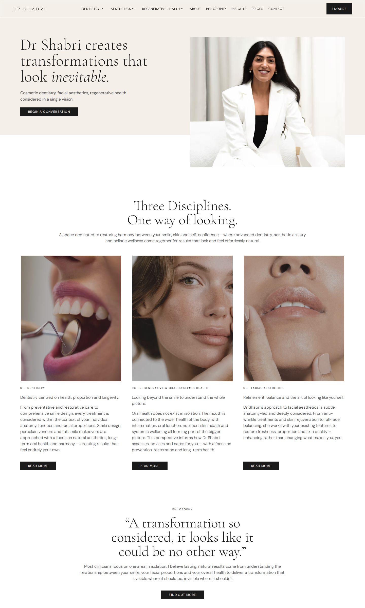

# UI Design System & Master Generation Blueprint: drshabri-com

> **Cosmetic Dentist & Facial Aesthetics, Marylebone** (https://drshabri.com/) — Cosmetic dentist and facial aesthetics in Marylebone and Beaconsfield. Dr Shabri treats the smile, skin and facial proportions as one con...



---

## 1. Executive Visual Persona & Design Archetype

- **Brand Essence & Persona**: **Cosmetic Dentist & Facial Aesthetics, Marylebone** (`https://drshabri.com/`). Cosmetic dentist and facial aesthetics in Marylebone and Beaconsfield. Dr Shabri treats the smile, skin and facial proportions as one con...
- **Capture Provenance**: Live browser capture (`tier1_fast`, HTTP `200`, captured `2026-11-23`).
- **Visual Archetype**: **Light-Substrate Editorial & Modular Grid System (`#ffffff` canvas, `#1a1a1a` ink, `#375efb` accent)**.
- **Anti-AI-Slop Differentiators**:
  - **Live-Computed Chromatic Polarity**: Anchors the viewport in `#ffffff` (live computed `body` `background-color` (`computed_styles.json`)) paired with `#1a1a1a` primary typography and `#375efb` accents.
  - **Grounded Typographic Hierarchy**: Pairs `Cormorant Garamond` for display copy (`Dr Shabri creates transformations th`) with `Segoe UI` and not declared in live computed styles (uses primary stack / `ui-monospace`).
  - **Calibrated Spatial Grid & Motion**: Combines `95vw` container bounds (`gap: 15px`, padding `20px`) with `cubic-bezier(.36,.07,.19,.97)` easing and Three.js / WebGL Canvas Pipeline, Swiper Touch Carousel Engine.

---

## 2. Spatial Architecture & Modular Grid Mathematics


### Viewport Allocation & Container Geometry
- **Captured Viewport Dimensions**: Desktop `1440×2400px` (`assets/desktop.png`, clamped at 2400px live multi-section capture), Mobile `390×2400px` (`assets/mobile.png`, clamped at 2400px live multi-section capture).
- **Master Container Bounds**: `95vw` (non-`@media` desktop container stylesheet rule).
- **Canvas Lateral Padding & Spacing**: `20px` lateral canvas padding with `15px` grid gap.
- **Border Radius Scale**: `3px`, `var(--e-a-border-radius)`, `50%`, `10px`.

### Responsive Breakpoint Architecture
- **Desktop Layout**: Multi-column CSS Grid / Flexbox layout at `1440px` (`max-width: 95vw`, `gap: 15px`).
- **Mobile Layout**: Single-column vertical stack at `390px` viewport width with `20px` horizontal padding.
- **Extracted CSS Media Queries**: `@media (max-width:767px)`, `@media (min-width:1025px)`, `@media (max-width:1024px)`, `@media (max-width:500px)`.

---

## 3. Color System, Materiality & Atmospheric Lighting

### Semantic Palette & Source Grounding
| Semantic Role | Ground-Truth Value | Extracted Live / CSS Source |
|---|---|---|
| **Primary Canvas Substrate** | `#ffffff` | live computed `body` `background-color` (`computed_styles.json`) |
| **Primary Typography Ink** | `#1a1a1a` | live computed `h1` `color` (`computed_styles.json`) |
| **Elevated Surface / Card Substrate** | `#d6f3e6` | `>.ti-inner { background-color: #d6f3e6 }` |
| **Interactive Accent / Highlight** | `#375efb` | `.elementor .e-button-base { background-color: #375efb }` |
| **Secondary / Muted Copy** | `#4a4a4a` | live computed `p` `color` (`computed_styles.json`) |
| **Structural Hairline Border** | `#cccccc` | `var(--iti-border-color)` in `:root` |
| **Variable Token (`--iti-hover-color`)** | `#000000` | `var(--iti-hover-color)` in `:root` |
| **Variable Token (`--iti-icon-color`)** | `#555555` | `var(--iti-icon-color)` in `:root` |

### Sanitized Root CSS Variables (`ui-ux.md` Ground Truth)
| Variable Name | Extracted Value | Semantic Role |
|---|---|---|
| `--wp--style--global--content-size` | `800px` | Layout / Spatial Grid Token |
| `--wp--style--global--wide-size` | `1200px` | Layout / Spatial Grid Token |
| `--wp--style--block-gap` | `24px` | Layout / Spatial Grid Token |
| `--direction-multiplier` | `1` | Design System Custom Token |
| `--page-title-display` | `block` | Design System Custom Token |
| `--iti-flag-width` | `20px` | Layout / Spatial Grid Token |
| `--iti-flag-count` | `244` | Design System Custom Token |
| `--iti-hover-color` | `#0000000d` | Brand / Palette Token |
| `--iti-border-color` | `#ccc` | Brand / Palette Token |
| `--iti-country-selector-bg` | `#fff` | Canvas / Surface Token |
| `--iti-icon-color` | `#555` | Brand / Palette Token |
| `--iti-spacer-horizontal` | `10px` | Layout / Spatial Grid Token |
| `--iti-flag-height` | `calc(var(--iti-flag-width)*3/4)` | Layout / Spatial Grid Token |
| `--iti-globe-icon-size` | `17px` | Layout / Spatial Grid Token |
| `--iti-clear-icon-size` | `15px` | Layout / Spatial Grid Token |
| `--iti-border-width` | `1px` | Layout / Spatial Grid Token |

---

## 4. Typographic Scale & Editorial Hierarchy

### Font Family Stacks
- **Display Typography**: `Cormorant Garamond`.
- **Primary Body Stack**: `Segoe UI`.
- **Technical / Metadata Stack**: not declared in live computed styles (uses primary stack / `ui-monospace`).

### Typographic Scale & Rules (Live Computed & Stylesheet Grounded)
- **Hero Display (`H1`)**: live computed `h1` (`font-size: 63px`, `line-height: 63px`, `font-weight: 300`); CSS variables `--page-title-display: block`, `--display: flex`.
- **Section Heading (`H2`)**: live computed `h3 (primary section heading)` (`font-size: 56px`, `line-height: 56px`, `font-weight: 300`).
- **Body Copy**: live computed `body` (`font-size: 16px`, `line-height: 24px`, `font-weight: 400`).
- **Metadata & Navigation Labels**: live computed `nav/a` (`font-size: 16px`, `line-height: 24px`, `font-weight: 400`).

---

## 5. Choreographed Motion & Interaction Physics

### Primary Easing Curves
- **Extracted Timing Functions**: `cubic-bezier(.36,.07,.19,.97)`, `cubic-bezier(0,.33,.07,1.03)`, `cubic-bezier(.58,.3,.005,1)`.

### Per-Element Transition & Choreography Rules
- **Selector `.dialog-close-button`**: `transition: var(--e-a-transition-hover)` extracted from `drshabri-com` stylesheet.
- **Selector `firm .dialog-buttons-wrapper .dia...`**: `transition: var(--e-a-transition-hover)` extracted from `drshabri-com` stylesheet.
- **Selector `.swiper-pagination`**: `transition: .3s opacity` extracted from `drshabri-com` stylesheet.
- **Extracted Easing Curve (`cubic-bezier(.36,.07,.19,.97)`)**: Governs interactive state transitions across `<header.elementor>` and `<main.post-13>`.
- **Runtime Interaction Engine**: Integrates Three.js / WebGL Canvas Pipeline, Swiper Touch Carousel Engine, Lottie Vector Animation Player with `prefers-reduced-motion: reduce` fallback guards.

---

## 6. Component Wireframe & Structural DOM Map

### Visual Layout Schematic — Desktop (`1440px`, Grounded in `dom.html` & Landmark Bounding Boxes)
```
┌────────────────────────────────────────────────────────────────────────┐
│ DESKTOP VIEWPORT (1440px) — Cosmetic Dentist & Facial Aesthetics, Mary │
│ ====================================================================== │
│ [ <header.elementor> (1440x70px)      | DENTISTRY · Dental Consultat ] │
│ ---------------------------------------------------------------------- │
│ | HERO STAGE: <main.site-main> (w=1440px)                            | │
│ | H1: Dr Shabri creates transformations that look inevi...           | │
│ | Substrate: #ffffff | Ink: #1a1a1a | Accent: #375efb                | │
│ ---------------------------------------------------------------------- │
│ | SHOWCASE GRID (<main.post-13>) max-w: 95vw                         | │
│ | +------------------------------+  +------------------------------+ | │
│ | | Cosmetic dentistry, facial a |  | Three Disciplines. One way o | | │
│ | +------------------------------+  +------------------------------+ | │
│ ---------------------------------------------------------------------- │
│ | DETAIL MODULE (<main.page>) — “A transformation so                 | │
│ ---------------------------------------------------------------------- │
│ [ FOOTER (<footer.elementor>  ) | https://drshabri.com/                │
└────────────────────────────────────────────────────────────────────────┘
```

### Visual Layout Schematic — Mobile Reflow (`390px`)
```
┌────────────────────────────────────────────────────────────────────────┐
│ MOBILE VIEWPORT REFLOW (390px) — Single-Column Stack (gap: 15px)       │
│ ====================================================================== │
│ [ HEADER BAR (<header.elementor>      ) | Compact Menu (390px)         │
│ ---------------------------------------------------------------------- │
│ | HERO STAGE (<main.site-main>) — 390px Vertical Lead                | │
│ | H1: Dr Shabri creates transformations that look inevi...           | │
│ ---------------------------------------------------------------------- │
│ | SHOWCASE STACK (<main.post-13>) — 1-Col Stack                      | │
│ | [ Item 1: Cosmetic dentistry, facial aesthetics, regenerati...   ] | │
│ | [ Item 2: Three Disciplines. One way of looking.                 ] | │
│ ---------------------------------------------------------------------- │
│ | DETAIL STACK (<main.page>) — 1-Col (“A transformation )            | │
│ ---------------------------------------------------------------------- │
│ [ FOOTER (<footer.elementor>  ) | Stacked 390px Colophon               │
└────────────────────────────────────────────────────────────────────────┘
```

### Granular DOM Region Breakdown
1. **Brand Header & Navigation Bar (<header.elementor> — `drshabri-com`)**:
   - Landmark `<header class="elementor elementor-15">` (`1440x70px`) hosting `Cosmetic Dentist & Facial Aesthetics` navigation (`DENTISTRY · Dental Consultation · Gum Contouring · Internal Bleaching · Teeth Whitening`), DOM attributes (`data-wpmeteor-mouseover="true"`, `data-wpmeteor-mouseout="true"`, `data-wpmeteor-nooptimize="true"`, `data-phast-no-defer`), and stylesheet rule `.dialog-message { box-sizing:border-box;line-height:1.5 }`.
2. **Hero Stage & Focal Lead (<main.site-main> — `Dr Shabri creates transformations `)**:
   - Landmark `<main class="site-main post-13">` presenting display lead `Dr Shabri creates transformations that look inevi...` and copy excerpt *"A space dedicated to restoring harmony between your smile, skin a"* over `#ffffff` canvas and `#1a1a1a` ink.
3. **Primary Showcase & Content Grid (<main.post-13> — `Cosmetic dentistry, facial aesthet`)**:
   - Landmark `<main class="site-main post-13">` rendering section `Cosmetic dentistry, facial aesthetics, regenerati...` with copy *"Begin a Conversation"*, asset references (`www.googletagmanager.com`, `embed`, `jquery.min.js`, `jquery-migrate.min.js`), and grid rule `.dialog-close-button:hover { color:var(--e-a-color-txt-hover) }`.
4. **Interactive Detail & Feature Matrix (<main.page> — `Three Disciplines. One way of look`)**:
   - Landmark `<main class="site-main post-13">` framing `Three Disciplines. One way of looking.` and `“A transformation so considered, it looks like it...` (*"Dentistry centred on health, proportion and longevity."*) with `#d6f3e6` surface cards, `#375efb` accents, and `.dialog-prevent-scroll { max-height:100vh;overflow:hidden }`.
5. **Colophon & Global Directory Footer (<footer.elementor> — `https://drshabri.com/`)**:
   - Landmark `<footer class="elementor elementor-314">` anchoring `Cosmetic Dentist & Facial Aesthe` footer links (`DENTISTRY · Dental Consultation · Gum Contouring · Internal Bleaching · Teeth Whitening`), copy *"From preventative and restorative care to comprehensive smil"*, and `#cccccc` structural dividers.

---

## 7. Master Zero-Shot AI Generation Prompt

```markdown
# Master Zero-Shot Frontend Generation Prompt: drshabri-com (Cosmetic Dentist & Facial Aesthetics, Marylebone)

You are a principal frontend architect and design systems engineer. Build a complete, production-ready web application replicating the exact design system, DOM landmarks, typographic hierarchy, color tokens, and motion physics of `drshabri-com` (**Cosmetic Dentist & Facial Aesthetics, Marylebone** — `https://drshabri.com/`).

### 1. Visual Archetype & Anti-AI-Slop Mandates
- **Archetype**: Light-Substrate Editorial & Modular Grid System (`#ffffff` canvas, `#1a1a1a` ink, `#375efb` accent).
- **Identity & Domain Context**: Cosmetic dentist and facial aesthetics in Marylebone and Beaconsfield. Dr Shabri treats the smile, skin and facial proportions as one con...
- **Primary Substrate**: `#ffffff` (live computed `body` `background-color` (`computed_styles.json`)), **Primary Ink**: `#1a1a1a`, **Accent / Highlight**: `#375efb`.
- **Site-Specific Differentiators**:
  - **Live-Computed Chromatic Polarity**: Anchors the viewport in `#ffffff` (live computed `body` `background-color` (`computed_styles.json`)) paired with `#1a1a1a` primary typography and `#375efb` accents.
  - **Grounded Typographic Hierarchy**: Pairs `Cormorant Garamond` for display copy (`Dr Shabri creates transformations th`) with `Segoe UI` and not declared in live computed styles (uses primary stack / `ui-monospace`).
  - **Calibrated Spatial Grid & Motion**: Combines `95vw` container bounds (`gap: 15px`, padding `20px`) with `cubic-bezier(.36,.07,.19,.97)` easing and Three.js / WebGL Canvas Pipeline, Swiper Touch Carousel Engine.

### 2. Ground-Truth CSS Variables (`:root` Token Contract)
Declare and consume these exact custom properties extracted from `drshabri-com` in your global stylesheet:

:root {
  /* Cosmetic Dentist & Facial Aesthetics, Marylebone (drshabri-com) — Live-Grounded CSS Variables */
  --wp--style--global--content-size: 800px; /* Layout / Spatial Grid Token (drshabri-com) */
  --wp--style--global--wide-size: 1200px; /* Layout / Spatial Grid Token (drshabri-com) */
  --wp--style--block-gap: 24px; /* Layout / Spatial Grid Token (drshabri-com) */
  --direction-multiplier: 1; /* Design System Custom Token (drshabri-com) */
  --page-title-display: block; /* Design System Custom Token (drshabri-com) */
  --iti-flag-width: 20px; /* Layout / Spatial Grid Token (drshabri-com) */
  --iti-flag-count: 244; /* Design System Custom Token (drshabri-com) */
  --iti-hover-color: #0000000d; /* Brand / Palette Token (drshabri-com) */
  --iti-border-color: #ccc; /* Brand / Palette Token (drshabri-com) */
  --iti-country-selector-bg: #fff; /* Canvas / Surface Token (drshabri-com) */
  --iti-icon-color: #555; /* Brand / Palette Token (drshabri-com) */
  --iti-spacer-horizontal: 10px; /* Layout / Spatial Grid Token (drshabri-com) */
  --iti-flag-height: calc(var(--iti-flag-width)*3/4); /* Layout / Spatial Grid Token (drshabri-com) */
  --iti-globe-icon-size: 17px; /* Layout / Spatial Grid Token (drshabri-com) */
  --iti-clear-icon-size: 15px; /* Layout / Spatial Grid Token (drshabri-com) */
  --iti-border-width: 1px; /* Layout / Spatial Grid Token (drshabri-com) */
}

### 3. Semantic Color & Materiality Contract
Map every surface, ink, and border strictly to these source-grounded tokens:
- **Primary Canvas Substrate**: `#ffffff` — grounded in live computed `body` `background-color` (`computed_styles.json`)
- **Primary Typography Ink**: `#1a1a1a` — grounded in live computed `h1` `color` (`computed_styles.json`)
- **Elevated Surface / Card Substrate**: `#d6f3e6` — grounded in `>.ti-inner { background-color: #d6f3e6 }`
- **Interactive Accent / Highlight**: `#375efb` — grounded in `.elementor .e-button-base { background-color: #375efb }`
- **Secondary / Muted Copy**: `#4a4a4a` — grounded in live computed `p` `color` (`computed_styles.json`)
- **Structural Hairline Border**: `#cccccc` — grounded in `var(--iti-border-color)` in `:root`
- **Variable Token (`--iti-hover-color`)**: `#000000` — grounded in `var(--iti-hover-color)` in `:root`
- **Variable Token (`--iti-icon-color`)**: `#555555` — grounded in `var(--iti-icon-color)` in `:root`

### 4. Spatial Grid, Container Bounds & Responsive Breakpoints
- **Desktop Viewport Reference**: `1440×2400px` (clamped at 2400px live multi-section capture, `1440px` standard desktop width).
- **Mobile Viewport Reference**: `390×2400px` (clamped at 2400px live multi-section capture, `390px` standard mobile width).
- **Container Max-Width**: `95vw` (non-`@media` desktop container stylesheet rule)
- **Padding & Gutters**: `20px` lateral canvas padding with `15px` grid gap
- **Desktop Grid**: Multi-column CSS Grid / Flexbox layout at `1440px` (`max-width: 95vw`, `gap: 15px`)
- **Mobile Adaptation**: Single-column vertical stack at `390px` viewport width with `20px` horizontal padding
- **Media Queries**: `@media (max-width:767px)`, `@media (min-width:1025px)`, `@media (max-width:1024px)`, `@media (max-width:500px)`
- **Corner Radii**: `3px`, `var(--e-a-border-radius)`, `50%`, `10px`

### 5. Typography & Editorial Scale Contract
- **Display Font Stack**: `Cormorant Garamond`
- **Body Font Stack**: `Segoe UI`
- **Monospace / Technical Font Stack**: not declared in live computed styles (uses primary stack / `ui-monospace`)
- **H1 Display Rule**: live computed `h1` (`font-size: 63px`, `line-height: 63px`, `font-weight: 300`); CSS variables `--page-title-display: block`, `--display: flex`
- **H2 Section Rule**: live computed `h3 (primary section heading)` (`font-size: 56px`, `line-height: 56px`, `font-weight: 300`)
- **Body Copy Rule**: live computed `body` (`font-size: 16px`, `line-height: 24px`, `font-weight: 400`)
- **Metadata & Index Rule**: live computed `nav/a` (`font-size: 16px`, `line-height: 24px`, `font-weight: 400`)

### 6. Component Hierarchy, Verbatim Copy & Real DOM Landmarks
Scaffold `drshabri-com` (`Cosmetic Dentist & Facial Aesthetics, Marylebone`) with these exact structural regions, extracted copy, and CSS rules from `dom.html`:
1. **Brand Header & Navigation Bar (<header.elementor> — `drshabri-com`)**:
   - DOM & Selectors: Landmark `<header class="elementor elementor-15">` (`1440x70px`) hosting `Cosmetic Dentist & Facial Aesthetics` navigation (`DENTISTRY · Dental Consultation · Gum Contouring · Internal Bleaching · Teeth Whitening`), DOM attributes (`data-wpmeteor-mouseover="true"`, `data-wpmeteor-mouseout="true"`, `data-wpmeteor-nooptimize="true"`, `data-phast-no-defer`), and stylesheet rule `.dialog-message { box-sizing:border-box;line-height:1.5 }`.
   - Responsive Contract: Header `Brand Header & Navigation Bar (<header.elementor> — `drshabri-com`)` (`drshabri-com`) adapts across `@media (max-width:767px)`, `@media (min-width:1025px)`, `@media (max-width:1024px)`, `@media (max-width:500px)` with `cubic-bezier(.36,.07,.19,.97)`, `cubic-bezier(0,.33,.07,1.03)`, `cubic-bezier(.58,.3,.005,1)` transitions and links `DENTISTRY · Dental Consultation · Gum Contouring · Internal Bleaching · Teeth Whitening`.
2. **Hero Stage & Focal Lead (<main.site-main> — `Dr Shabri creates transformations `)**:
   - DOM & Selectors: Landmark `<main class="site-main post-13">` presenting display lead `Dr Shabri creates transformations that look inevi...` and copy excerpt *"A space dedicated to restoring harmony between your smile, skin a"* over `#ffffff` canvas and `#1a1a1a` ink.
   - Responsive Contract: Hero stage (`1440×2400px` desktop / `390×2400px` mobile) sets `#ffffff` background with `#1a1a1a` headline `Dr Shabri creates transformations that look inevi...`.
3. **Primary Showcase & Content Grid (<main.post-13> — `Cosmetic dentistry, facial aesthet`)**:
   - DOM & Selectors: Landmark `<main class="site-main post-13">` rendering section `Cosmetic dentistry, facial aesthetics, regenerati...` with copy *"Begin a Conversation"*, asset references (`www.googletagmanager.com`, `embed`, `jquery.min.js`, `jquery-migrate.min.js`), and grid rule `.dialog-close-button:hover { color:var(--e-a-color-txt-hover) }`.
   - Responsive Contract: Showcase grid `Primary Showcase & Content Grid (<main.post-13> — `Cosmetic dentistry, facial aesthet`)` applies Multi-column CSS Grid / Flexbox layout at `1440px` (`max-width: 95vw`, `gap: 15px`) on desktop and Single-column vertical stack at `390px` viewport width with `20px` horizontal padding on mobile.
4. **Interactive Detail & Feature Matrix (<main.page> — `Three Disciplines. One way of look`)**:
   - DOM & Selectors: Landmark `<main class="site-main post-13">` framing `Three Disciplines. One way of looking.` and `“A transformation so considered, it looks like it...` (*"Dentistry centred on health, proportion and longevity."*) with `#d6f3e6` surface cards, `#375efb` accents, and `.dialog-prevent-scroll { max-height:100vh;overflow:hidden }`.
   - Responsive Contract: Detail module `Interactive Detail & Feature Matrix (<main.page> — `Three Disciplines. One way of look`)` uses `3px`, `var(--e-a-border-radius)`, `50%`, `10px` radii, `#375efb` highlights, and assets (www.googletagmanager.com, embed, jquery.min.js).
5. **Colophon & Global Directory Footer (<footer.elementor> — `https://drshabri.com/`)**:
   - DOM & Selectors: Landmark `<footer class="elementor elementor-314">` anchoring `Cosmetic Dentist & Facial Aesthe` footer links (`DENTISTRY · Dental Consultation · Gum Contouring · Internal Bleaching · Teeth Whitening`), copy *"From preventative and restorative care to comprehensive smil"*, and `#cccccc` structural dividers.
   - Responsive Contract: Footer `Colophon & Global Directory Footer (<footer.elementor> — `https://drshabri.com/`)` aligns to `95vw` (non-`@media` desktop container stylesheet rule) with `20px` lateral canvas padding with `15px` grid gap and attributes (data-wpmeteor-mouseover="true", data-wpmeteor-mouseout="true", data-wpmeteor-nooptimize="true").

#### Verbatim DOM Copy Excerpts (`dom.html`)
- Copy Excerpt 1: *"A space dedicated to restoring harmony between your smile, skin and self-confidenc..."*
- Copy Excerpt 2: *"Begin a Conversation"*
- Copy Excerpt 3: *"Dentistry centred on health, proportion and longevity."*
- Copy Excerpt 4: *"From preventative and restorative care to comprehensive smile design, every treatm..."*

### 7. Motion, Extracted Stylesheet Rules & Interaction Choreography
- **Primary Easing Functions**: `cubic-bezier(.36,.07,.19,.97)`, `cubic-bezier(0,.33,.07,1.03)`, `cubic-bezier(.58,.3,.005,1)`
- **Extracted Stylesheet Rules (`drshabri-com`)**:
- `.dialog-message { box-sizing:border-box;line-height:1.5 }`
- `.dialog-close-button:hover { color:var(--e-a-color-txt-hover) }`
- `.dialog-prevent-scroll { max-height:100vh;overflow:hidden }`
- `or-editor-active .elementor-popup... { background-color:initial }`
- `log-type-confirm .dialog-widget-c... { margin:auto;padding:20px;width:400px }`
- **Per-Selector Transition Rules**:
- **Selector `.dialog-close-button`**: `transition: var(--e-a-transition-hover)` extracted from `drshabri-com` stylesheet.
- **Selector `firm .dialog-buttons-wrapper .dia...`**: `transition: var(--e-a-transition-hover)` extracted from `drshabri-com` stylesheet.
- **Selector `.swiper-pagination`**: `transition: .3s opacity` extracted from `drshabri-com` stylesheet.
- **Extracted Easing Curve (`cubic-bezier(.36,.07,.19,.97)`)**: Governs interactive state transitions across `<header.elementor>` and `<main.post-13>`.
- **Runtime Interaction Engine**: Integrates Three.js / WebGL Canvas Pipeline, Swiper Touch Carousel Engine, Lottie Vector Animation Player with `prefers-reduced-motion: reduce` fallback guards.

### 8. Technical Deliverables
- Implement in Next.js (App Router) with TypeScript and Tailwind CSS consuming the `:root` custom properties defined above for `drshabri-com`.
- Reproduce both the `1440px` desktop architecture and `390px` mobile breakpoint transitions, preserving semantic HTML5 landmarks (`<header>`, `<nav>`, `<main>`, `<section>`, `<footer>`) and `prefers-reduced-motion` accessibility guards.
```
