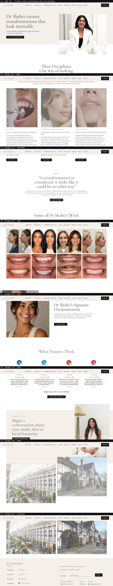
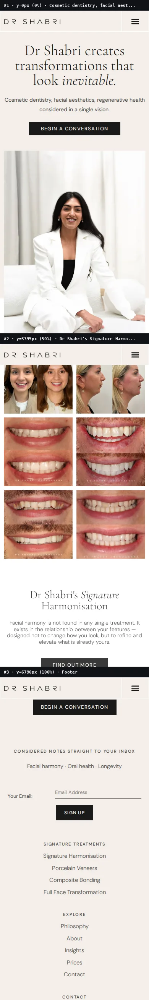

# UI Design System & Master Generation Blueprint: drshabri-com

> **Cosmetic Dentist & Facial Aesthetics, Marylebone** (https://drshabri.com/) — Cosmetic dentist and facial aesthetics in Marylebone and Beaconsfield. Dr Shabri treats the smile, skin and facial proportions as one con...





---

## 1. Executive Visual Persona & Design Archetype

- **Brand Essence & Persona**: **Cosmetic Dentist & Facial Aesthetics, Marylebone** (`https://drshabri.com/`). Cosmetic dentist and facial aesthetics in Marylebone and Beaconsfield. Dr Shabri treats the smile, skin and facial proportions as one con...
- **Capture Provenance**: Live browser capture (`tier1_fast`, HTTP `200`, captured `2026-11-24`).
- **Visual Archetype**: **Light-Substrate Editorial & Modular Grid System (`#ffffff` canvas, `#000000` ink, `#375efb` accent)**.
- **Anti-AI-Slop Differentiators**:
  - **Live-Computed Chromatic Polarity**: Anchors the viewport in `#ffffff` (live computed `body` `background-color` (`computed_styles.json`)) paired with `#000000` primary typography and `#375efb` accents.
  - **Grounded Typographic Hierarchy**: Pairs `Cormorant Garamond` for display copy (`Dr Shabri creates transformations th`) with `Segoe UI`.
  - **Calibrated Spatial Grid & Motion**: Combines `95vw` container bounds (`gap: 60px`, padding `.5rem`) with `cubic-bezier(.36,.07,.19,.97)` easing and Three.js / WebGL Canvas Pipeline, Swiper Touch Carousel Engine.

---

## 2. Spatial Architecture & Modular Grid Mathematics

### Viewport Allocation & Container Geometry
- **Captured Journey Filmstrips**: Desktop `1280×6624px` (`assets/desktop-journey.webp`, `8` keyframes up to `y=5456px` / doc `6727px`), Mobile `390×2616px` (`assets/mobile-journey.webp`, `3` keyframes).
- **Master Container Bounds**: `95vw` (non-`@media` desktop container stylesheet rule).
- **Canvas Lateral Padding & Spacing**: `.5rem` lateral canvas padding with `60px` grid gap.
- **Border Radius Scale**: `3px`, `50%`, `4px`, `var(--e-a-border-radius)`.

### Responsive Breakpoint Architecture
- **Desktop Layout**: Multi-column CSS Grid / Flexbox layout at `1440px` (`max-width: 95vw`, `gap: 60px`).
- **Mobile Layout**: Single-column vertical stack at `390px` viewport width with `.5rem` horizontal padding.
- **Extracted CSS Media Queries**: `@media (max-width:767px)`, `@media (max-width:991px)`, `@media (max-width:575px)`, `@media (min-width:768px)`.

---

## 3. Color System, Materiality & Atmospheric Lighting

### Semantic Palette & Source Grounding
| Semantic Role | Ground-Truth Value | Extracted Live / CSS Source |
|---|---|---|
| **Primary Canvas Substrate** | `#ffffff` | live computed `body` `background-color` (`computed_styles.json`) |
| **Primary Typography Ink** | `#000000` | live computed `a` `color` (`computed_styles.json`) |
| **Elevated Surface / Card Substrate** | `#eeeeee` | `.screen-reader-text:focus { background-color: #eeeeee }` |
| **Interactive Accent / Highlight** | `#375efb` | `.elementor .e-button-base { background-color: #375efb }` |
| **Secondary / Muted Copy** | `#4a4a4a` | live computed `p` `color` (`computed_styles.json`) |
| **Structural Hairline Border** | `#cccccc` | `var(--iti-border-color)` in `:root` |
| **Variable Token (`--iti-icon-color`)** | `#555555` | `var(--iti-icon-color)` in `:root` |

### Sanitized Root CSS Variables (`ui-ux.md` Ground Truth)
| Variable Name | Extracted Value | Semantic Role |
|---|---|---|
| `--wp--style--global--content-size` | `800px` | Layout / Spatial Grid Token |
| `--wp--style--global--wide-size` | `1200px` | Layout / Spatial Grid Token |
| `--wp--style--block-gap` | `24px` | Layout / Spatial Grid Token |
| `--direction-multiplier` | `1` | Design System Custom Token |
| `--page-title-display` | `block` | Design System Custom Token |
| `--iti-flag-width` | `20px` | Layout / Spatial Grid Token |
| `--iti-flag-count` | `244` | Design System Custom Token |
| `--iti-hover-color` | `#0000000d` | Brand / Palette Token |
| `--iti-border-color` | `#ccc` | Brand / Palette Token |
| `--iti-country-selector-bg` | `#fff` | Canvas / Surface Token |
| `--iti-icon-color` | `#555` | Brand / Palette Token |
| `--iti-spacer-horizontal` | `10px` | Layout / Spatial Grid Token |
| `--iti-flag-height` | `calc(var(--iti-flag-width)*3/4)` | Layout / Spatial Grid Token |
| `--iti-globe-icon-size` | `17px` | Layout / Spatial Grid Token |
| `--iti-clear-icon-size` | `15px` | Layout / Spatial Grid Token |
| `--iti-border-width` | `1px` | Layout / Spatial Grid Token |

---

## 4. Typographic Scale & Editorial Hierarchy

### Font Family Stacks
- **Display Typography**: `Cormorant Garamond`.
- **Primary Body Stack**: `Segoe UI`.
- **Technical / Metadata Stack**: not declared in live computed styles (uses primary stack / `ui-monospace`).

### Typographic Scale & Rules (Live Computed & Stylesheet Grounded)
- **Hero Display (`H1`)**: live computed `h1` (`font-size: 63px`, `line-height: 63px`, `font-weight: 300`); CSS variables `--page-title-display: block`, `--display: flex`.
- **Section Heading (`H2`)**: live computed `h2` (`font-size: 56px`, `line-height: 56px`, `font-weight: 300`).
- **Body Copy**: live computed `body` (`font-size: 16px`, `line-height: 24px`, `font-weight: 400`); rule `p` (`font-size: 14px`, `line-height: 1.5em`).
- **Metadata & Navigation Labels**: live computed `nav/a` (`font-size: 16px`, `line-height: 24px`, `font-weight: 400`).

---

## 5. Choreographed Motion & Interaction Physics

### Primary Easing Curves
- **Extracted Timing Functions**: `cubic-bezier(.36,.07,.19,.97)`, `cubic-bezier(0,.25,.07,1)`, `cubic-bezier(.58,.3,.005,1)`.

### Per-Element Transition & Choreography Rules
- **Selector `textarea`**: `transition: all .3s` extracted from `drshabri-com` stylesheet.
- **Selector `button`**: `transition: all .3s` extracted from `drshabri-com` stylesheet.
- **Selector `.dialog-close-button`**: `transition: var(--e-a-transition-hover)` extracted from `drshabri-com` stylesheet.
- **Extracted Easing Curve (`cubic-bezier(.36,.07,.19,.97)`)**: Governs interactive state transitions across `<header.elementor>` and `<main.post-13>`.
- **Runtime Interaction Engine**: Integrates Three.js / WebGL Canvas Pipeline, Swiper Touch Carousel Engine, Lottie Vector Animation Player with `prefers-reduced-motion: reduce` fallback guards.
### Measured Runtime Scroll & Interaction Telemetry (`behavioral_journey_v2`)
- **Scroll Driver Mode**: `native` (max document height `6727px`, deepest scrollY reached `5456px` across `8` desktop keyframes).
- **Detected Scroll / Motion Libraries**: Native browser scroll / standard CSS transitions.
- **Hover Physics (`primary_cta` · `BEGIN A CONVERSATION`)**: `color`: `rgb(244, 239, 233)` -> `rgb(26, 26, 26)`; `backgroundColor`: `rgb(26, 26, 26)` -> `rgb(244, 239, 233)` (`transition-duration: 0.3s`, `timing: ease`).
- **Route Transition Architecture**: First internal navigation (`/category/insights/`) measured as `MPA` in `3028ms`.

---

## 6. Component Wireframe & Structural DOM Map

### Visual Layout Schematic — Desktop (`1440px`, Grounded in `dom.html` & Landmark Bounding Boxes)
```
┌────────────────────────────────────────────────────────────────────────┐
│ DESKTOP VIEWPORT (1440px) — Cosmetic Dentist & Facial Aesthetics, Mary │
│ ====================================================================== │
│ [ <header.elementor> (1440x70px)      | DENTISTRY · Dental Consultat ] │
│ ---------------------------------------------------------------------- │
│ | HERO STAGE: <main.site-main> (w=1440px)                            | │
│ | H1: Dr Shabri creates transformations that look inevi...           | │
│ | Substrate: #ffffff | Ink: #000000 | Accent: #375efb                | │
│ ---------------------------------------------------------------------- │
│ | SHOWCASE GRID (<main.post-13>) max-w: 95vw                         | │
│ | +------------------------------+  +------------------------------+ | │
│ | | Cosmetic dentistry, facial a |  | Three Disciplines. One way o | | │
│ | +------------------------------+  +------------------------------+ | │
│ ---------------------------------------------------------------------- │
│ | DETAIL MODULE (<main.page>) — “A transformation so                 | │
│ ---------------------------------------------------------------------- │
│ [ FOOTER (<footer.elementor>  ) | https://drshabri.com/                │
└────────────────────────────────────────────────────────────────────────┘
```

### Visual Layout Schematic — Mobile Reflow (`390px`)
```
┌────────────────────────────────────────────────────────────────────────┐
│ MOBILE VIEWPORT REFLOW (390px) — Single-Column Stack (gap: 60px)       │
│ ====================================================================== │
│ [ HEADER BAR (<header.elementor>      ) | Compact Menu (390px)         │
│ ---------------------------------------------------------------------- │
│ | HERO STAGE (<main.site-main>) — 390px Vertical Lead                | │
│ | H1: Dr Shabri creates transformations that look inevi...           | │
│ ---------------------------------------------------------------------- │
│ | SHOWCASE STACK (<main.post-13>) — 1-Col Stack                      | │
│ | [ Item 1: Cosmetic dentistry, facial aesthetics, regenerati...   ] | │
│ | [ Item 2: Three Disciplines. One way of looking.                 ] | │
│ ---------------------------------------------------------------------- │
│ | DETAIL STACK (<main.page>) — 1-Col (“A transformation )            | │
│ ---------------------------------------------------------------------- │
│ [ FOOTER (<footer.elementor>  ) | Stacked 390px Colophon               │
└────────────────────────────────────────────────────────────────────────┘
```

### Granular DOM Region Breakdown
1. **Brand Header & Navigation Bar (<header.elementor> — `drshabri-com`)**:
   - Landmark `<header class="elementor elementor-15">` (`1440x70px`) hosting `Cosmetic Dentist & Facial Aesthetics` navigation (`DENTISTRY · Dental Consultation · Gum Contouring · Internal Bleaching · Teeth Whitening`), DOM attributes (`data-wpmeteor-mouseover="true"`, `data-wpmeteor-mouseout="true"`, `data-wpmeteor-nooptimize="true"`, `data-phast-no-defer`), and stylesheet rule `html { line-height:1.15;-webkit-text-size-adjust:100% }`.
2. **Hero Stage & Focal Lead (<main.site-main> — `Dr Shabri creates transformations `)**:
   - Landmark `<main class="site-main post-13">` presenting display lead `Dr Shabri creates transformations that look inevi...` and copy excerpt *"A space dedicated to restoring harmony between your smile, skin a"* over `#ffffff` canvas and `#000000` ink.
3. **Primary Showcase & Content Grid (<main.post-13> — `Cosmetic dentistry, facial aesthet`)**:
   - Landmark `<main class="site-main post-13">` rendering section `Cosmetic dentistry, facial aesthetics, regenerati...` with copy *"Begin a Conversation"*, asset references (`www.googletagmanager.com`, `embed`, `theme.css`, `l0YWxpYyUyQzUwMCUyQzUwMGl0YWxpYyU...`), and grid rule `before { box-sizing:border-box }`.
4. **Interactive Detail & Feature Matrix (<main.page> — `Three Disciplines. One way of look`)**:
   - Landmark `<main class="site-main post-13">` framing `Three Disciplines. One way of looking.` and `“A transformation so considered, it looks like it...` (*"Dentistry centred on health, proportion and longevity."*) with `#eeeeee` surface cards, `#375efb` accents, and `pre { font-family:monospace,monospace;font-size:1em;white-space:pre-wrap }`.
5. **Colophon & Global Directory Footer (<footer.elementor> — `https://drshabri.com/`)**:
   - Landmark `<footer class="elementor elementor-314">` anchoring `Cosmetic Dentist & Facial Aesthe` footer links (`DENTISTRY · Dental Consultation · Gum Contouring · Internal Bleaching · Teeth Whitening`), copy *"From preventative and restorative care to comprehensive smil"*, and `#cccccc` structural dividers.
### Full Vertical Scroll Sequence (Desktop `1440×900` Keyframes)
- **Step 01** (`y=0px`, `0%`): Active landmark `Dr Shabri creates transformations that look inevi...` · sticky/fixed elements: `1`
- **Step 02** (`y=850px`, `16%`): Active landmark `ABOUT` · sticky/fixed elements: `1`
- **Step 03** (`y=1700px`, `31%`): Active landmark `PHILOSOPHY` · sticky/fixed elements: `1`
- **Step 04** (`y=2550px`, `47%`): Active landmark `ABOUT` · sticky/fixed elements: `1`
- **Step 05** (`y=3400px`, `58%`): Active landmark `ABOUT` · sticky/fixed elements: `1`
- **Step 06** (`y=4250px`, `73%`): Active landmark `ABOUT` · sticky/fixed elements: `1`
- **Step 07** (`y=5100px`, `88%`): Active landmark `ABOUT` · sticky/fixed elements: `1`
- **Step 08** (`y=5456px`, `94%`): Active landmark `Marylebone` · sticky/fixed elements: `1`

### Multi-Page Internal Route Map
- **Detail Route (`/category/insights/`)**: `https://drshabri.com/category/insights/` — H1: `Insights`, scrollHeight `3293px`, transition `MPA` (`3028ms`)
- **About Route (`/about/`)**: `https://drshabri.com/about/` — H1: `MY STORY`, scrollHeight `4453px`, transition `direct` (`5199ms`)
- **Detail Route (`/treatments/dental-treatments/dental-consultation/`)**: `https://drshabri.com/treatments/dental-treatments/dental-consultation/` — H1: `Dental Consultation`, scrollHeight `4864px`, transition `direct` (`623ms`)

---

## 7. Master Zero-Shot AI Generation Prompt

```markdown
# Master Zero-Shot Frontend Generation Prompt: drshabri-com (Cosmetic Dentist & Facial Aesthetics, Marylebone)

You are a principal frontend architect and design systems engineer. Build a complete, production-ready web application replicating the exact design system, DOM landmarks, typographic hierarchy, color tokens, and motion physics of `drshabri-com` (**Cosmetic Dentist & Facial Aesthetics, Marylebone** — `https://drshabri.com/`).

### 1. Visual Archetype & Anti-AI-Slop Mandates
- **Archetype**: Light-Substrate Editorial & Modular Grid System (`#ffffff` canvas, `#000000` ink, `#375efb` accent).
- **Identity & Domain Context**: Cosmetic dentist and facial aesthetics in Marylebone and Beaconsfield. Dr Shabri treats the smile, skin and facial proportions as one con...
- **Primary Substrate**: `#ffffff` (live computed `body` `background-color` (`computed_styles.json`)), **Primary Ink**: `#000000`, **Accent / Highlight**: `#375efb`.
- **Site-Specific Differentiators**:
  - **Live-Computed Chromatic Polarity**: Anchors the viewport in `#ffffff` (live computed `body` `background-color` (`computed_styles.json`)) paired with `#000000` primary typography and `#375efb` accents.
  - **Grounded Typographic Hierarchy**: Pairs `Cormorant Garamond` for display copy (`Dr Shabri creates transformations th`) with `Segoe UI`.
  - **Calibrated Spatial Grid & Motion**: Combines `95vw` container bounds (`gap: 60px`, padding `.5rem`) with `cubic-bezier(.36,.07,.19,.97)` easing and Three.js / WebGL Canvas Pipeline, Swiper Touch Carousel Engine.

### 2. Ground-Truth CSS Variables (`:root` Token Contract)
Declare and consume these exact custom properties extracted from `drshabri-com` in your global stylesheet:

:root {
  /* Cosmetic Dentist & Facial Aesthetics, Marylebone (drshabri-com) — Live-Grounded CSS Variables */
  --wp--style--global--content-size: 800px; /* Layout / Spatial Grid Token (drshabri-com) */
  --wp--style--global--wide-size: 1200px; /* Layout / Spatial Grid Token (drshabri-com) */
  --wp--style--block-gap: 24px; /* Layout / Spatial Grid Token (drshabri-com) */
  --direction-multiplier: 1; /* Design System Custom Token (drshabri-com) */
  --page-title-display: block; /* Design System Custom Token (drshabri-com) */
  --iti-flag-width: 20px; /* Layout / Spatial Grid Token (drshabri-com) */
  --iti-flag-count: 244; /* Design System Custom Token (drshabri-com) */
  --iti-hover-color: #0000000d; /* Brand / Palette Token (drshabri-com) */
  --iti-border-color: #ccc; /* Brand / Palette Token (drshabri-com) */
  --iti-country-selector-bg: #fff; /* Canvas / Surface Token (drshabri-com) */
  --iti-icon-color: #555; /* Brand / Palette Token (drshabri-com) */
  --iti-spacer-horizontal: 10px; /* Layout / Spatial Grid Token (drshabri-com) */
  --iti-flag-height: calc(var(--iti-flag-width)*3/4); /* Layout / Spatial Grid Token (drshabri-com) */
  --iti-globe-icon-size: 17px; /* Layout / Spatial Grid Token (drshabri-com) */
  --iti-clear-icon-size: 15px; /* Layout / Spatial Grid Token (drshabri-com) */
  --iti-border-width: 1px; /* Layout / Spatial Grid Token (drshabri-com) */
}

### 3. Semantic Color & Materiality Contract
Map every surface, ink, and border strictly to these source-grounded tokens:
- **Primary Canvas Substrate**: `#ffffff` — grounded in live computed `body` `background-color` (`computed_styles.json`)
- **Primary Typography Ink**: `#000000` — grounded in live computed `a` `color` (`computed_styles.json`)
- **Elevated Surface / Card Substrate**: `#eeeeee` — grounded in `.screen-reader-text:focus { background-color: #eeeeee }`
- **Interactive Accent / Highlight**: `#375efb` — grounded in `.elementor .e-button-base { background-color: #375efb }`
- **Secondary / Muted Copy**: `#4a4a4a` — grounded in live computed `p` `color` (`computed_styles.json`)
- **Structural Hairline Border**: `#cccccc` — grounded in `var(--iti-border-color)` in `:root`
- **Variable Token (`--iti-icon-color`)**: `#555555` — grounded in `var(--iti-icon-color)` in `:root`

### 4. Spatial Grid, Container Bounds & Responsive Breakpoints
- **Desktop Viewport Reference**: `1280×6624px` (multi-frame vertical journey filmstrip (6624px), `1440px` standard desktop width).
- **Mobile Viewport Reference**: `390×2616px` (multi-frame vertical journey filmstrip (2616px), `390px` standard mobile width).
- **Container Max-Width**: `95vw` (non-`@media` desktop container stylesheet rule)
- **Padding & Gutters**: `.5rem` lateral canvas padding with `60px` grid gap
- **Desktop Grid**: Multi-column CSS Grid / Flexbox layout at `1440px` (`max-width: 95vw`, `gap: 60px`)
- **Mobile Adaptation**: Single-column vertical stack at `390px` viewport width with `.5rem` horizontal padding
- **Media Queries**: `@media (max-width:767px)`, `@media (max-width:991px)`, `@media (max-width:575px)`, `@media (min-width:768px)`
- **Corner Radii**: `3px`, `50%`, `4px`, `var(--e-a-border-radius)`

### 5. Typography & Editorial Scale Contract
- **Display Font Stack**: `Cormorant Garamond`
- **Body Font Stack**: `Segoe UI`
- **Monospace / Technical Font Stack**: not declared in live computed styles (uses primary stack / `ui-monospace`)
- **H1 Display Rule**: live computed `h1` (`font-size: 63px`, `line-height: 63px`, `font-weight: 300`); CSS variables `--page-title-display: block`, `--display: flex`
- **H2 Section Rule**: live computed `h2` (`font-size: 56px`, `line-height: 56px`, `font-weight: 300`)
- **Body Copy Rule**: live computed `body` (`font-size: 16px`, `line-height: 24px`, `font-weight: 400`); rule `p` (`font-size: 14px`, `line-height: 1.5em`)
- **Metadata & Index Rule**: live computed `nav/a` (`font-size: 16px`, `line-height: 24px`, `font-weight: 400`)

### 6. Component Hierarchy, Verbatim Copy & Real DOM Landmarks
Scaffold `drshabri-com` (`Cosmetic Dentist & Facial Aesthetics, Marylebone`) with these exact structural regions, extracted copy, and CSS rules from `dom.html`:
1. **Brand Header & Navigation Bar (<header.elementor> — `drshabri-com`)**:
   - DOM & Selectors: Landmark `<header class="elementor elementor-15">` (`1440x70px`) hosting `Cosmetic Dentist & Facial Aesthetics` navigation (`DENTISTRY · Dental Consultation · Gum Contouring · Internal Bleaching · Teeth Whitening`), DOM attributes (`data-wpmeteor-mouseover="true"`, `data-wpmeteor-mouseout="true"`, `data-wpmeteor-nooptimize="true"`, `data-phast-no-defer`), and stylesheet rule `html { line-height:1.15;-webkit-text-size-adjust:100% }`.
   - Responsive Contract: Header `Brand Header & Navigation Bar (<header.elementor> — `drshabri-com`)` (`drshabri-com`) adapts across `@media (max-width:767px)`, `@media (max-width:991px)`, `@media (max-width:575px)`, `@media (min-width:768px)` with `cubic-bezier(.36,.07,.19,.97)`, `cubic-bezier(0,.25,.07,1)`, `cubic-bezier(.58,.3,.005,1)` transitions and links `DENTISTRY · Dental Consultation · Gum Contouring · Internal Bleaching · Teeth Whitening`.
2. **Hero Stage & Focal Lead (<main.site-main> — `Dr Shabri creates transformations `)**:
   - DOM & Selectors: Landmark `<main class="site-main post-13">` presenting display lead `Dr Shabri creates transformations that look inevi...` and copy excerpt *"A space dedicated to restoring harmony between your smile, skin a"* over `#ffffff` canvas and `#000000` ink.
   - Responsive Contract: Hero stage (`1280×6624px` desktop / `390×2616px` mobile) sets `#ffffff` background with `#000000` headline `Dr Shabri creates transformations that look inevi...`.
3. **Primary Showcase & Content Grid (<main.post-13> — `Cosmetic dentistry, facial aesthet`)**:
   - DOM & Selectors: Landmark `<main class="site-main post-13">` rendering section `Cosmetic dentistry, facial aesthetics, regenerati...` with copy *"Begin a Conversation"*, asset references (`www.googletagmanager.com`, `embed`, `theme.css`, `l0YWxpYyUyQzUwMCUyQzUwMGl0YWxpYyU...`), and grid rule `before { box-sizing:border-box }`.
   - Responsive Contract: Showcase grid `Primary Showcase & Content Grid (<main.post-13> — `Cosmetic dentistry, facial aesthet`)` applies Multi-column CSS Grid / Flexbox layout at `1440px` (`max-width: 95vw`, `gap: 60px`) on desktop and Single-column vertical stack at `390px` viewport width with `.5rem` horizontal padding on mobile.
4. **Interactive Detail & Feature Matrix (<main.page> — `Three Disciplines. One way of look`)**:
   - DOM & Selectors: Landmark `<main class="site-main post-13">` framing `Three Disciplines. One way of looking.` and `“A transformation so considered, it looks like it...` (*"Dentistry centred on health, proportion and longevity."*) with `#eeeeee` surface cards, `#375efb` accents, and `pre { font-family:monospace,monospace;font-size:1em;white-space:pre-wrap }`.
   - Responsive Contract: Detail module `Interactive Detail & Feature Matrix (<main.page> — `Three Disciplines. One way of look`)` uses `3px`, `50%`, `4px`, `var(--e-a-border-radius)` radii, `#375efb` highlights, and assets (www.googletagmanager.com, embed, theme.css).
5. **Colophon & Global Directory Footer (<footer.elementor> — `https://drshabri.com/`)**:
   - DOM & Selectors: Landmark `<footer class="elementor elementor-314">` anchoring `Cosmetic Dentist & Facial Aesthe` footer links (`DENTISTRY · Dental Consultation · Gum Contouring · Internal Bleaching · Teeth Whitening`), copy *"From preventative and restorative care to comprehensive smil"*, and `#cccccc` structural dividers.
   - Responsive Contract: Footer `Colophon & Global Directory Footer (<footer.elementor> — `https://drshabri.com/`)` aligns to `95vw` (non-`@media` desktop container stylesheet rule) with `.5rem` lateral canvas padding with `60px` grid gap and attributes (data-wpmeteor-mouseover="true", data-wpmeteor-mouseout="true", data-wpmeteor-nooptimize="true").

#### Verbatim DOM Copy Excerpts (`dom.html`)
- Copy Excerpt 1: *"A space dedicated to restoring harmony between your smile, skin and self-confidenc..."*
- Copy Excerpt 2: *"Begin a Conversation"*
- Copy Excerpt 3: *"Dentistry centred on health, proportion and longevity."*
- Copy Excerpt 4: *"From preventative and restorative care to comprehensive smile design, every treatm..."*

### 7. Motion, Extracted Stylesheet Rules & Interaction Choreography
- **Primary Easing Functions**: `cubic-bezier(.36,.07,.19,.97)`, `cubic-bezier(0,.25,.07,1)`, `cubic-bezier(.58,.3,.005,1)`
- **Extracted Stylesheet Rules (`drshabri-com`)**:
- `html { line-height:1.15;-webkit-text-size-adjust:100% }`
- `before { box-sizing:border-box }`
- `pre { font-family:monospace,monospace;font-size:1em;white-space:pre-wrap }`
- `a:hover { color:336 }`
- `hover { color:inherit;text-decoration:none }`
- **Per-Selector Transition Rules**:
- **Selector `textarea`**: `transition: all .3s` extracted from `drshabri-com` stylesheet.
- **Selector `button`**: `transition: all .3s` extracted from `drshabri-com` stylesheet.
- **Selector `.dialog-close-button`**: `transition: var(--e-a-transition-hover)` extracted from `drshabri-com` stylesheet.
- **Extracted Easing Curve (`cubic-bezier(.36,.07,.19,.97)`)**: Governs interactive state transitions across `<header.elementor>` and `<main.post-13>`.
- **Runtime Interaction Engine**: Integrates Three.js / WebGL Canvas Pipeline, Swiper Touch Carousel Engine, Lottie Vector Animation Player with `prefers-reduced-motion: reduce` fallback guards.
### 7b. Full-Page Scroll Choreography, Interactive States & Multi-Page Routes
- **Scroll Mechanics**: Implement `native` vertical progression up to `6727px` across 8 distinct viewport chapters.
- **Vertical Chapter Sequence**: Dr Shabri creates transform... (0%) -> ABOUT (16%) -> PHILOSOPHY (31%) -> ABOUT (47%) -> ABOUT (58%) -> ABOUT (73%) -> ABOUT (88%) -> Marylebone (94%).
- **Hover Micro-Interaction (`primary_cta`)**: Animate `color, backgroundColor` with `0.3s ease`.
- **Multi-Page Routes**: Scaffold internal routes `/category/insights/` (detail, MPA), `/about/` (about, direct), `/treatments/dental-treatments/dental-consultation/` (detail, direct) sharing the global header/footer shell and design tokens.

### 8. Technical Deliverables
- Implement in Next.js (App Router) with TypeScript and Tailwind CSS consuming the `:root` custom properties defined above for `drshabri-com`.
- Reproduce both the `1440px` desktop architecture and `390px` mobile breakpoint transitions, preserving semantic HTML5 landmarks (`<header>`, `<nav>`, `<main>`, `<section>`, `<footer>`) and `prefers-reduced-motion` accessibility guards.
```
---

## 8. Full-Page Scroll Journey, Interactive States & Subpage Inventory

### Desktop Scroll Keyframes (`1440×900` WebP)
| Step | Scroll Y | Progress | Active Landmark / Section | Sticky/Fixed | Visual Asset |
| :---: | :---: | :---: | :--- | :---: | :--- |
| `#01` | `0px` | `0%` | Dr Shabri creates transformations that look i... | `1` | [desktop-step-01.webp](assets/desktop-step-01.webp) |
| `#02` | `850px` | `16%` | ABOUT | `1` | [desktop-step-02.webp](assets/desktop-step-02.webp) |
| `#03` | `1700px` | `31%` | PHILOSOPHY | `1` | [desktop-step-03.webp](assets/desktop-step-03.webp) |
| `#04` | `2550px` | `47%` | ABOUT | `1` | [desktop-step-04.webp](assets/desktop-step-04.webp) |
| `#05` | `3400px` | `58%` | ABOUT | `1` | [desktop-step-05.webp](assets/desktop-step-05.webp) |
| `#06` | `4250px` | `73%` | ABOUT | `1` | [desktop-step-06.webp](assets/desktop-step-06.webp) |
| `#07` | `5100px` | `88%` | ABOUT | `1` | [desktop-step-07.webp](assets/desktop-step-07.webp) |
| `#08` | `5456px` | `94%` | Marylebone | `1` | [desktop-step-08.webp](assets/desktop-step-08.webp) |

### Mobile Condensed Keyframes (`390×844` WebP)
| Step | Scroll Y | Progress | Active Landmark | Visual Asset |
| :---: | :---: | :---: | :--- | :--- |
| `#01` | `0px` | `0%` | Cosmetic dentistry, facial aesthetics, re... | [mobile-step-01.webp](assets/mobile-step-01.webp) |
| `#02` | `3395px` | `50%` | Dr Shabri's Signature Harmonisation | [mobile-step-02.webp](assets/mobile-step-02.webp) |
| `#03` | `6790px` | `100%` | Footer | [mobile-step-03.webp](assets/mobile-step-03.webp) |

### Internal Subpage Filmstrips (`1080px` Wide WebP)
| # | Template | Route URL | H1 / Title | Scroll Height | Transition | Filmstrip Asset |
| :-: | :---: | :--- | :--- | :---: | :---: | :--- |
| `1` | `detail` | `https://drshabri.com/category/insights/` | Insights | `3293px` | `MPA` (`3028ms`) | [subpage-01-category-insights.webp](assets/subpage-01-category-insights.webp) |
| `2` | `about` | `https://drshabri.com/about/` | MY STORY | `4453px` | `direct` (`5199ms`) | [subpage-02-about.webp](assets/subpage-02-about.webp) |
| `3` | `detail` | `https://drshabri.com/treatments/dental-treatments/dental-consultation/` | Dental Consultation | `4864px` | `direct` (`623ms`) | [subpage-03-treatments-dental-treatments-dental-.webp](assets/subpage-03-treatments-dental-treatments-dental-.webp) |

