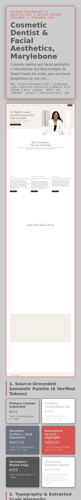

# UI Design System & Master Generation Blueprint: drshabri-com

> **Cosmetic Dentist & Facial Aesthetics, Marylebone** (https://drshabri.com/) — Cosmetic dentist and facial aesthetics in Marylebone and Beaconsfield. Dr Shabri treats the smile, skin and facial proportions as one con...


---

## 1. Executive Visual Persona & Design Archetype

- **Brand Essence & Persona**: **Cosmetic Dentist & Facial Aesthetics, Marylebone** (`https://drshabri.com/`). Cosmetic dentist and facial aesthetics in Marylebone and Beaconsfield. Dr Shabri treats the smile, skin and facial proportions as one con...
- **Visual Archetype**: **Light-Substrate Editorial & Modular Grid System (`#ccc` canvas, `#555` ink, `#d9534f` accent)**.
- **Anti-AI-Slop Differentiators**:
  - **Source-Grounded Chromatic Polarity**: Anchors the viewport in `#ccc` (`var(--iti-border-gray)` in `:root`) paired with `#555` primary typography and `#d9534f` accents.
  - **Extracted Typographic Hierarchy**: Pairs `Trustindex Poppins` for display copy (`Cosmetic Dentistry`) with `gravesend-sans` and not declared in static CSS (uses primary stack / `ui-monospace`).
  - **Calibrated Spatial Grid & Motion**: Combines `100vw` container bounds (`gap: 20px`, padding `10px`) with `cubic-bezier(.58,.3,.005,1)` easing and Three.js / WebGL Canvas Pipeline, Swiper Touch Carousel Engine.

---

## 2. Spatial Architecture & Modular Grid Mathematics



### Viewport Allocation & Container Geometry
- **Captured Viewport Dimensions**: Desktop `1440×5722px` (`assets/desktop.png`, full-page scroll capture), Mobile `390×2400px` (`assets/mobile.png`, capped at 2400px multi-section capture).
- **Master Container Bounds**: `100vw` extracted from `drshabri-com` stylesheet.
- **Canvas Lateral Padding & Spacing**: `10px` lateral canvas padding with `20px` grid gap.
- **Border Radius Scale**: `50%`, `4px`, `2px`, `0px`.

### Responsive Breakpoint Architecture
- **Desktop Layout**: Multi-column CSS Grid / Flexbox layout at `1440px` (`max-width: 100vw`, `gap: 20px`).
- **Mobile Layout**: Single-column vertical stack at `390px` viewport width with `10px` horizontal padding.
- **Extracted CSS Media Queries**: `@media (max-width:1024px)`, `@media (max-width:767px)`, `@media (min-width:-1)`, `@media (max-width:1366px)`.

---

## 3. Color System, Materiality & Atmospheric Lighting

### Semantic Palette & Source Grounding
| Semantic Role | Ground-Truth Value | Extracted CSS Source / Selector |
|---|---|---|
| **Primary Canvas Substrate** | `#ccc` | `var(--iti-border-gray)` in `:root` |
| **Primary Typography Ink** | `#fff` | `var(--iti-input-bg-color)` in `:root` |
| **Elevated Surface / Card Substrate** | `#69727d` | `var(--iti-input-border-color)` in `:root` |
| **Interactive Accent / Highlight** | `#d9534f` | `var(--iti-input-invalid-color)` in `:root` |
| **Secondary / Muted Copy** | `#555` | `var(--iti-icon-color)` in `:root` |
| **Structural Hairline Border** | `#ffffff` | `var(--e-form-steps-indicator-active-secondary-color)` in `:root` |

### Sanitized Root CSS Variables (`ui-ux.md` Ground Truth)
| Variable Name | Extracted Value | Semantic Role |
|---|---|---|
| `--flex-right` | `flex-start` | Design System Custom Token |
| `--justify-content` | `var(--flex-right,flex-end)` | Design System Custom Token |
| `--direction-multiplier` | `1` | Design System Custom Token |
| `--flex-direction` | `initial` | Design System Custom Token |
| `--flex-wrap` | `initial` | Layout / Spatial Grid Token |
| `--align-items` | `initial` | Design System Custom Token |
| `--align-content` | `initial` | Design System Custom Token |
| `--gap` | `initial` | Layout / Spatial Grid Token |
| `--flex-basis` | `initial` | Design System Custom Token |
| `--flex-grow` | `initial` | Design System Custom Token |
| `--flex-shrink` | `initial` | Typography Ink Token |
| `--order` | `initial` | Design System Custom Token |
| `--align-self` | `initial` | Design System Custom Token |
| `--page-title-display` | `block` | Design System Custom Token |
| `--border-radius` | `0` | Elevation / Border Token |
| `--border-top-width` | `0px` | Layout / Spatial Grid Token |

---

## 4. Typographic Scale & Editorial Hierarchy

### Font Family Stacks
- **Display Typography**: `Trustindex Poppins`.
- **Primary Body Stack**: `gravesend-sans`.
- **Technical / Metadata Stack**: not declared in static CSS (uses primary stack / `ui-monospace`).

### Typographic Scale & Rules (Extracted from Stylesheet & Variables)
- **Hero Display (`H1`)**: CSS variables `--page-title-display: block`, `--display: flex`.
- **Section Heading (`H2`)**: not explicitly declared on tag in static CSS (stylesheet font-size ladder: `12px`, `14px`, `2.5em`, `100px`, `15px`).
- **Body Copy**: not explicitly declared on tag in static CSS (stylesheet font-size ladder: `12px`, `14px`, `2.5em`, `100px`, `15px`).
- **Metadata & Navigation Labels**: not explicitly declared on tag in static CSS (stylesheet font-size ladder: `12px`, `14px`, `2.5em`, `100px`, `15px`).

---

## 5. Choreographed Motion & Interaction Physics

### Primary Easing Curves
- **Extracted Timing Functions**: `cubic-bezier(.58,.3,.005,1)`, `cubic-bezier(.23,1,.32,1)`, `cubic-bezier(0.28,0.84,0.42,1)`.

### Per-Element Transition & Choreography Rules
- **Selector `.elementor .e-form-checkbox-base`**: `transition: background-color 200ms` extracted from `drshabri-com` stylesheet.
- **Selector `.elementor .e-form-checkbox-base:...`**: `transition: opacity 200ms` extracted from `drshabri-com` stylesheet.
- **Selector `elementor .e-form-radio-button-ba...`**: `transition: opacity 200ms` extracted from `drshabri-com` stylesheet.
- **Extracted Easing Curve (`cubic-bezier(.58,.3,.005,1)`)**: Governs interactive state transitions across `<header.elementor>` and `<main.site-main>`.
- **Runtime Interaction Engine**: Integrates Three.js / WebGL Canvas Pipeline, Swiper Touch Carousel Engine, Lottie Vector Animation Player with `prefers-reduced-motion: reduce` fallback guards.

---

## 6. Component Wireframe & Structural DOM Map

### Visual Layout Schematic (Grounded in `dom.html` — `1440px` Desktop & `390px` Mobile Reflow)
```
┌────────────────────────────────────────────────────────────────────────┐
│ DESKTOP VIEWPORT (1440px) — Cosmetic Dentist & Facial Aesthetics, Mary │
│ ====================================================================== │
│ [ <header.elementor>       | DENTISTRY · Dental Consultation · Gum  ]  │
│ ---------------------------------------------------------------------- │
│ | HERO STAGE: <main.site-main>                                     |   │
│ | H1: Cosmetic Dentistry                                           |   │
│ | Substrate: #ccc       | Ink: #555       | Accent: #d9534f        |   │
│ ---------------------------------------------------------------------- │
│ | SHOWCASE GRID (<main.site-main>          ) max-w: 100vw          |   │
│ | +------------------------------+  +------------------------------+ | │
│ | | General Dentistry            |  | Orthodontics                 | | │
│ | +------------------------------+  +------------------------------+ | │
│ ---------------------------------------------------------------------- │
│ | MOBILE VIEWPORT REFLOW (390px) — Single-Column Stack (gap: 20px  ) | │
│ | [<header.elementor>] -> [<main.site-main>] -> [<main.site-main>] |   │
│ ---------------------------------------------------------------------- │
│ [ FOOTER (<footer.elementor>    ) | https://drshabri.com/              │
└────────────────────────────────────────────────────────────────────────┘
```

### Granular DOM Region Breakdown
1. **Brand Header & Navigation Bar (<header.elementor> — `drshabri-com`)**:
   - Landmark `<header class="elementor elementor-15">` hosting `Cosmetic Dentist & Facial Aesthetics` navigation (`DENTISTRY · Dental Consultation · Gum Contouring · Internal Bleaching · Teeth Whitening`), DOM attributes (`data-wpmeteor-nooptimize="true"`, `data-phast-no-defer`, `data-wpmeteor-nooptimize="true"`, `data-phast-ie-fallback-url="https://use.typekit.n..."`), and stylesheet rule `.elementor .e-div-block-base { min-width:30px;padding:10px;display:block; }`.
2. **Hero Stage & Focal Lead (<main.site-main> — `Cosmetic Dentistry`)**:
   - Landmark `<main class="site-main post-13">` presenting display lead `Cosmetic Dentistry` and copy excerpt *"DENTISTRY Cosmetic Dentistry Dental Consultation Dr Shabri Signat"* over `#ccc` canvas and `#555` ink.
3. **Primary Showcase & Content Grid (<main.site-main> — `General Dentistry`)**:
   - Landmark `<main class="site-main post-13">` rendering section `General Dentistry` with copy *"Dental Consultation"*, asset references (`www.googletagmanager.com`, `embed`, `header-footer.css`, `custom-frontend.min.css`), and grid rule `.elementor .e-flexbox-base { padding:10px;display:flex;flex-direction:row; }`.
4. **Interactive Detail & Feature Matrix (<main.site-main> — `Orthodontics`)**:
   - Landmark `<main class="site-main post-13">` framing `Orthodontics` and `Preventive Dentistry` (*"Dr Shabri Signature Harmonisation"*) with `#69727d` surface cards, `#d9534f` accents, and `.elementor .e-tabs-base { padding-block-start:0px;display:flex;flex-direction:column;gap:30px; }`.
5. **Colophon & Global Directory Footer (<footer.elementor> — `https://drshabri.com/`)**:
   - Landmark `<footer class="elementor elementor-314">` anchoring `Cosmetic Dentist & Facial Aesthe` footer links (`DENTISTRY · Dental Consultation · Gum Contouring · Internal Bleaching · Teeth Whitening`), copy *"Composite Bonding & Composite Veneers"*, and `#ffffff` structural dividers.

---

## 7. Master Zero-Shot AI Generation Prompt

```markdown
# Master Zero-Shot Frontend Generation Prompt: drshabri-com (Cosmetic Dentist & Facial Aesthetics, Marylebone)

You are a principal frontend architect and design systems engineer. Build a complete, production-ready web application replicating the exact design system, DOM landmarks, typographic hierarchy, color tokens, and motion physics of `drshabri-com` (**Cosmetic Dentist & Facial Aesthetics, Marylebone** — `https://drshabri.com/`).

### 1. Visual Archetype & Anti-AI-Slop Mandates
- **Archetype**: Light-Substrate Editorial & Modular Grid System (`#ccc` canvas, `#555` ink, `#d9534f` accent).
- **Identity & Domain Context**: Cosmetic dentist and facial aesthetics in Marylebone and Beaconsfield. Dr Shabri treats the smile, skin and facial proportions as one con...
- **Primary Substrate**: `#ccc` (`var(--iti-border-gray)` in `:root`), **Primary Ink**: `#555`, **Accent / Highlight**: `#d9534f`.
- **Site-Specific Differentiators**:
  - **Source-Grounded Chromatic Polarity**: Anchors the viewport in `#ccc` (`var(--iti-border-gray)` in `:root`) paired with `#555` primary typography and `#d9534f` accents.
  - **Extracted Typographic Hierarchy**: Pairs `Trustindex Poppins` for display copy (`Cosmetic Dentistry`) with `gravesend-sans` and not declared in static CSS (uses primary stack / `ui-monospace`).
  - **Calibrated Spatial Grid & Motion**: Combines `100vw` container bounds (`gap: 20px`, padding `10px`) with `cubic-bezier(.58,.3,.005,1)` easing and Three.js / WebGL Canvas Pipeline, Swiper Touch Carousel Engine.

### 2. Ground-Truth CSS Variables (`:root` Token Contract)
Declare and consume these exact custom properties extracted from `drshabri-com` in your global stylesheet:

:root {
  /* Cosmetic Dentist & Facial Aesthetics, Marylebone (drshabri-com) — Ground-Truth Extracted CSS Variables */
  --flex-right: flex-start; /* Design System Custom Token (drshabri-com) */
  --justify-content: var(--flex-right,flex-end); /* Design System Custom Token (drshabri-com) */
  --direction-multiplier: 1; /* Design System Custom Token (drshabri-com) */
  --flex-direction: initial; /* Design System Custom Token (drshabri-com) */
  --flex-wrap: initial; /* Layout / Spatial Grid Token (drshabri-com) */
  --align-items: initial; /* Design System Custom Token (drshabri-com) */
  --align-content: initial; /* Design System Custom Token (drshabri-com) */
  --gap: initial; /* Layout / Spatial Grid Token (drshabri-com) */
  --flex-basis: initial; /* Design System Custom Token (drshabri-com) */
  --flex-grow: initial; /* Design System Custom Token (drshabri-com) */
  --flex-shrink: initial; /* Typography Ink Token (drshabri-com) */
  --order: initial; /* Design System Custom Token (drshabri-com) */
  --align-self: initial; /* Design System Custom Token (drshabri-com) */
  --page-title-display: block; /* Design System Custom Token (drshabri-com) */
  --border-radius: 0; /* Elevation / Border Token (drshabri-com) */
  --border-top-width: 0px; /* Layout / Spatial Grid Token (drshabri-com) */
}

### 3. Semantic Color & Materiality Contract
Map every surface, ink, and border strictly to these source-grounded tokens:
- **Primary Canvas Substrate**: `#ccc` — grounded in `var(--iti-border-gray)` in `:root`
- **Primary Typography Ink**: `#fff` — grounded in `var(--iti-input-bg-color)` in `:root`
- **Elevated Surface / Card Substrate**: `#69727d` — grounded in `var(--iti-input-border-color)` in `:root`
- **Interactive Accent / Highlight**: `#d9534f` — grounded in `var(--iti-input-invalid-color)` in `:root`
- **Secondary / Muted Copy**: `#555` — grounded in `var(--iti-icon-color)` in `:root`
- **Structural Hairline Border**: `#ffffff` — grounded in `var(--e-form-steps-indicator-active-secondary-color)` in `:root`

### 4. Spatial Grid, Container Bounds & Responsive Breakpoints
- **Desktop Viewport Reference**: `1440×5722px` (full-page scroll capture, `1440px` standard desktop width).
- **Mobile Viewport Reference**: `390×2400px` (capped at 2400px multi-section capture, `390px` standard mobile width).
- **Container Max-Width**: `100vw` extracted from `drshabri-com` stylesheet
- **Padding & Gutters**: `10px` lateral canvas padding with `20px` grid gap
- **Desktop Grid**: Multi-column CSS Grid / Flexbox layout at `1440px` (`max-width: 100vw`, `gap: 20px`)
- **Mobile Adaptation**: Single-column vertical stack at `390px` viewport width with `10px` horizontal padding
- **Media Queries**: `@media (max-width:1024px)`, `@media (max-width:767px)`, `@media (min-width:-1)`, `@media (max-width:1366px)`
- **Corner Radii**: `50%`, `4px`, `2px`, `0px`

### 5. Typography & Editorial Scale Contract
- **Display Font Stack**: `Trustindex Poppins`
- **Body Font Stack**: `gravesend-sans`
- **Monospace / Technical Font Stack**: not declared in static CSS (uses primary stack / `ui-monospace`)
- **H1 Display Rule**: CSS variables `--page-title-display: block`, `--display: flex`
- **H2 Section Rule**: not explicitly declared on tag in static CSS (stylesheet font-size ladder: `12px`, `14px`, `2.5em`, `100px`, `15px`)
- **Body Copy Rule**: not explicitly declared on tag in static CSS (stylesheet font-size ladder: `12px`, `14px`, `2.5em`, `100px`, `15px`)
- **Metadata & Index Rule**: not explicitly declared on tag in static CSS (stylesheet font-size ladder: `12px`, `14px`, `2.5em`, `100px`, `15px`)

### 6. Component Hierarchy, Verbatim Copy & Real DOM Landmarks
Scaffold `drshabri-com` (`Cosmetic Dentist & Facial Aesthetics, Marylebone`) with these exact structural regions, extracted copy, and CSS rules from `dom.html`:
1. **Brand Header & Navigation Bar (<header.elementor> — `drshabri-com`)**:
   - DOM & Selectors: Landmark `<header class="elementor elementor-15">` hosting `Cosmetic Dentist & Facial Aesthetics` navigation (`DENTISTRY · Dental Consultation · Gum Contouring · Internal Bleaching · Teeth Whitening`), DOM attributes (`data-wpmeteor-nooptimize="true"`, `data-phast-no-defer`, `data-wpmeteor-nooptimize="true"`, `data-phast-ie-fallback-url="https://use.typekit.n..."`), and stylesheet rule `.elementor .e-div-block-base { min-width:30px;padding:10px;display:block; }`.
   - Responsive Contract: Header `Brand Header & Navigation Bar (<header.elementor> — `drshabri-com`)` (`drshabri-com`) adapts across `@media (max-width:1024px)`, `@media (max-width:767px)`, `@media (min-width:-1)`, `@media (max-width:1366px)` with `cubic-bezier(.58,.3,.005,1)`, `cubic-bezier(.23,1,.32,1)`, `cubic-bezier(0.28,0.84,0.42,1)` transitions and links `DENTISTRY · Dental Consultation · Gum Contouring · Internal Bleaching · Teeth Whitening`.
2. **Hero Stage & Focal Lead (<main.site-main> — `Cosmetic Dentistry`)**:
   - DOM & Selectors: Landmark `<main class="site-main post-13">` presenting display lead `Cosmetic Dentistry` and copy excerpt *"DENTISTRY Cosmetic Dentistry Dental Consultation Dr Shabri Signat"* over `#ccc` canvas and `#555` ink.
   - Responsive Contract: Hero stage (`1440×5722px` desktop / `390×2400px` mobile) sets `#ccc` background with `#555` headline `Cosmetic Dentistry`.
3. **Primary Showcase & Content Grid (<main.site-main> — `General Dentistry`)**:
   - DOM & Selectors: Landmark `<main class="site-main post-13">` rendering section `General Dentistry` with copy *"Dental Consultation"*, asset references (`www.googletagmanager.com`, `embed`, `header-footer.css`, `custom-frontend.min.css`), and grid rule `.elementor .e-flexbox-base { padding:10px;display:flex;flex-direction:row; }`.
   - Responsive Contract: Showcase grid `Primary Showcase & Content Grid (<main.site-main> — `General Dentistry`)` applies Multi-column CSS Grid / Flexbox layout at `1440px` (`max-width: 100vw`, `gap: 20px`) on desktop and Single-column vertical stack at `390px` viewport width with `10px` horizontal padding on mobile.
4. **Interactive Detail & Feature Matrix (<main.site-main> — `Orthodontics`)**:
   - DOM & Selectors: Landmark `<main class="site-main post-13">` framing `Orthodontics` and `Preventive Dentistry` (*"Dr Shabri Signature Harmonisation"*) with `#69727d` surface cards, `#d9534f` accents, and `.elementor .e-tabs-base { padding-block-start:0px;display:flex;flex-direction:column;gap:30px; }`.
   - Responsive Contract: Detail module `Interactive Detail & Feature Matrix (<main.site-main> — `Orthodontics`)` uses `50%`, `4px`, `2px`, `0px` radii, `#d9534f` highlights, and assets (www.googletagmanager.com, embed, header-footer.css).
5. **Colophon & Global Directory Footer (<footer.elementor> — `https://drshabri.com/`)**:
   - DOM & Selectors: Landmark `<footer class="elementor elementor-314">` anchoring `Cosmetic Dentist & Facial Aesthe` footer links (`DENTISTRY · Dental Consultation · Gum Contouring · Internal Bleaching · Teeth Whitening`), copy *"Composite Bonding & Composite Veneers"*, and `#ffffff` structural dividers.
   - Responsive Contract: Footer `Colophon & Global Directory Footer (<footer.elementor> — `https://drshabri.com/`)` aligns to `100vw` extracted from `drshabri-com` stylesheet with `10px` lateral canvas padding with `20px` grid gap and attributes (data-wpmeteor-nooptimize="true", data-phast-no-defer, data-wpmeteor-nooptimize="true").

#### Verbatim DOM Copy Excerpts (`dom.html`)
- Copy Excerpt 1: *"DENTISTRY Cosmetic Dentistry Dental Consultation Dr Shabri Signature Harmonisation..."*
- Copy Excerpt 2: *"Dental Consultation"*
- Copy Excerpt 3: *"Dr Shabri Signature Harmonisation"*
- Copy Excerpt 4: *"Composite Bonding & Composite Veneers"*

### 7. Motion, Extracted Stylesheet Rules & Interaction Choreography
- **Primary Easing Functions**: `cubic-bezier(.58,.3,.005,1)`, `cubic-bezier(.23,1,.32,1)`, `cubic-bezier(0.28,0.84,0.42,1)`
- **Extracted Stylesheet Rules (`drshabri-com`)**:
- `.elementor .e-div-block-base { min-width:30px;padding:10px;display:block; }`
- `.elementor .e-flexbox-base { padding:10px;display:flex;flex-direction:row; }`
- `.elementor .e-tabs-base { padding-block-start:0px;display:flex;flex-direction:column;gap:30px; }`
- `.elementor .e-tabs-menu-base { display:flex;justify-content:center; }`
- `.elementor .e-tab-base.e--selected { border-color:0C0D0E;outline-width:0px; }`
- **Per-Selector Transition Rules**:
- **Selector `.elementor .e-form-checkbox-base`**: `transition: background-color 200ms` extracted from `drshabri-com` stylesheet.
- **Selector `.elementor .e-form-checkbox-base:...`**: `transition: opacity 200ms` extracted from `drshabri-com` stylesheet.
- **Selector `elementor .e-form-radio-button-ba...`**: `transition: opacity 200ms` extracted from `drshabri-com` stylesheet.
- **Extracted Easing Curve (`cubic-bezier(.58,.3,.005,1)`)**: Governs interactive state transitions across `<header.elementor>` and `<main.site-main>`.
- **Runtime Interaction Engine**: Integrates Three.js / WebGL Canvas Pipeline, Swiper Touch Carousel Engine, Lottie Vector Animation Player with `prefers-reduced-motion: reduce` fallback guards.

### 8. Technical Deliverables
- Implement in Next.js (App Router) with TypeScript and Tailwind CSS consuming the `:root` custom properties defined above for `drshabri-com`.
- Reproduce both the `1440px` desktop architecture and `390px` mobile breakpoint transitions, preserving semantic HTML5 landmarks (`<header>`, `<nav>`, `<main>`, `<section>`, `<footer>`) and `prefers-reduced-motion` accessibility guards.
```
