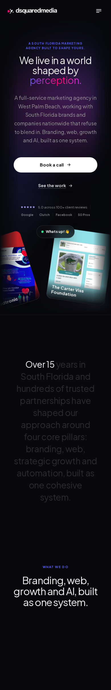

# UI Design System & Master Generation Blueprint: dsquaredmedia-net

> **South Florida Marketing Agency · Branding, Web & AI · Dsquared Media** (https://dsquaredmedia.net) — Dsquared Media is a boutique West Palm Beach marketing agency serving South Florida. Branding, web design, growth, and AI, built as one s...


---

## 1. Executive Visual Persona & Design Archetype

- **Brand Essence & Persona**: **South Florida Marketing Agency · Branding, Web & AI · Dsquared Media** (`https://dsquaredmedia.net`). Dsquared Media is a boutique West Palm Beach marketing agency serving South Florida. Branding, web design, growth, and AI, built as one s...
- **Capture Provenance**: Live browser capture (`tier1_fast`, HTTP `200`, captured `2026-11-23`).
- **Visual Archetype**: **Dark-Substrate WebGL / Canvas Interactive Experience (`#07090d` / `#ff006d`)**.
- **Anti-AI-Slop Differentiators**:
  - **Live-Computed Chromatic Polarity**: Anchors the viewport in `#07090d` (live computed `html` `background-color` (`computed_styles.json`)) paired with `#ffffff` primary typography and `#ff006d` accents.
  - **Grounded Typographic Hierarchy**: Pairs `jakarta` for display copy (`A SOUTH FLORIDA MARKETING AGENCY BUI`) with `jakarta` and `SFMono-Regular`.
  - **Calibrated Spatial Grid & Motion**: Combines `96rem` container bounds (`gap: 8px`, padding `48px`) with `cubic-bezier(.22,.8,.35,1)` easing and HTML5 `<canvas>` Interactive Viewport Surface.

---

## 2. Spatial Architecture & Modular Grid Mathematics



### Viewport Allocation & Container Geometry
- **Captured Viewport Dimensions**: Desktop `1440×2400px` (`assets/desktop.png`, clamped at 2400px live multi-section capture), Mobile `390×2400px` (`assets/mobile.png`, clamped at 2400px live multi-section capture).
- **Master Container Bounds**: `96rem` (non-`@media` desktop container stylesheet rule).
- **Canvas Lateral Padding & Spacing**: `48px` lateral canvas padding with `8px` grid gap.
- **Border Radius Scale**: `100px`, `50%`, `22px`, `18px`.

### Responsive Breakpoint Architecture
- **Desktop Layout**: Multi-column CSS Grid / Flexbox layout at `1440px` (`max-width: 96rem`, `gap: 8px`).
- **Mobile Layout**: Single-column vertical stack at `390px` viewport width with `48px` horizontal padding.
- **Extracted CSS Media Queries**: `@media (min-width:981px)`, `@media (max-width:980px)`, `@media (max-width:340px)`, `@media (prefers-reduced-motion:reduce)`.

---

## 3. Color System, Materiality & Atmospheric Lighting

### Semantic Palette & Source Grounding
| Semantic Role | Ground-Truth Value | Extracted Live / CSS Source |
|---|---|---|
| **Primary Canvas Substrate** | `#07090d` | live computed `html` `background-color` (`computed_styles.json`) |
| **Primary Typography Ink** | `#ffffff` | live computed `button` `color` (`computed_styles.json`) |
| **Elevated Surface / Card Substrate** | `#0e0e14` | live computed `button` `background-color` (`computed_styles.json`) |
| **Interactive Accent / Highlight** | `#ff006d` | `var(--gradient-brand)` in `:root` |
| **Secondary / Muted Copy** | `#5661ff` | live computed `h1` `color` (`computed_styles.json`) |
| **Structural Hairline Border** | `#16171b` | `var(--border-subtle)` in `:root` (`ffffff0f`) |
| **Variable Token (`--color-surface`)** | `#111113` | `var(--color-surface)` in `:root` |
| **Variable Token (`--color-surface-2`)** | `#16161a` | `var(--color-surface-2)` in `:root` |
| **Variable Token (`--color-surface-raised`)** | `#0e0e13` | `var(--color-surface-raised)` in `:root` |
| **Variable Token (`--color-surface-card`)** | `#0c0d12` | `var(--color-surface-card)` in `:root` |
| **Variable Token (`--color-text`)** | `#f1f1f1` | `var(--color-text)` in `:root` |
| **Variable Token (`--color-dim`)** | `#989898` | `var(--color-dim)` in `:root` |
| **Variable Token (`--color-text-80`)** | `#fffc` | `var(--color-text-80)` in `:root` |
| **Variable Token (`--color-text-60`)** | `#fff9` | `var(--color-text-60)` in `:root` |
| **Variable Token (`--color-indigo`)** | `#4b39b4` | `var(--color-indigo)` in `:root` |
| **Variable Token (`--color-lavender`)** | `#a88fff` | `var(--color-lavender)` in `:root` |

### Sanitized Root CSS Variables (`ui-ux.md` Ground Truth)
| Variable Name | Extracted Value | Semantic Role |
|---|---|---|
| `--color-bg` | `#07090d` | Canvas / Surface Token |
| `--color-surface` | `#111113` | Canvas / Surface Token |
| `--color-surface-2` | `#16161a` | Canvas / Surface Token |
| `--color-surface-raised` | `#0e0e13` | Canvas / Surface Token |
| `--color-surface-card` | `#0c0d12` | Canvas / Surface Token |
| `--color-text` | `#f1f1f1` | Typography Ink Token |
| `--color-white` | `#fff` | Canvas / Surface Token |
| `--color-dim` | `#989898` | Brand / Palette Token |
| `--color-text-80` | `#fffc` | Typography Ink Token |
| `--color-text-60` | `#fff9` | Typography Ink Token |
| `--color-text-50` | `#ffffff80` | Typography Ink Token |
| `--color-text-38` | `#ffffff61` | Typography Ink Token |
| `--color-blue` | `#5661ff` | Brand / Palette Token |
| `--color-indigo` | `#4b39b4` | Brand / Palette Token |
| `--color-lavender` | `#a88fff` | Brand / Palette Token |
| `--color-magenta` | `#ff006d` | Brand / Palette Token |

---

## 4. Typographic Scale & Editorial Hierarchy

### Font Family Stacks
- **Display Typography**: `jakarta`.
- **Primary Body Stack**: `jakarta`.
- **Technical / Metadata Stack**: `SFMono-Regular`.

### Typographic Scale & Rules (Live Computed & Stylesheet Grounded)
- **Hero Display (`H1`)**: live computed `h1` (`font-size: 11px`, `line-height: 15.95px`, `font-weight: 700`, `letter-spacing: 1.54px`); rule `,h1` (`font-size: 62px`, `line-height: 1.05`, `letter-spacing: -.03em`, `font-weight: 600`).
- **Section Heading (`H2`)**: live computed `h2` (`font-size: 68px`, `line-height: 70.72px`, `font-weight: 400`, `letter-spacing: -2.38px`); rule `,h2` (`font-size: clamp(32px,4vw,56px)`, `line-height: 1.04`, `letter-spacing: -.025em`, `font-weight: 500`).
- **Body Copy**: live computed `body` (`font-size: 16px`, `line-height: 24px`, `font-weight: 400`).
- **Metadata & Navigation Labels**: live computed `nav/a` (`font-size: 16px`, `line-height: 24px`, `font-weight: 400`); CSS variables `--font-mono: var(--font-victor),ui-monospace,monospace`, `--default-mono-font-family: var(--font-mono)`.

---

## 5. Choreographed Motion & Interaction Physics

### Primary Easing Curves
- **Extracted Timing Functions**: `cubic-bezier(.22,.8,.35,1)`, `cubic-bezier(.4,0,.2,1)`, `cubic-bezier(.34,.01,.2,1)`.

### Per-Element Transition & Choreography Rules
- **Selector `.d2c-launch`**: `transition: transform .3s cubic-bezier(.22,.8,.35,1),box-shadow .3s,paddin...` extracted from `dsquaredmedia-net` stylesheet.
- **Selector `.d2c-launch svg`**: `transition: transform .3s` extracted from `dsquaredmedia-net` stylesheet.
- **Selector `.d2c-panel`**: `transition: opacity .32s cubic-bezier(.22,.8,.35,1),transform .32s cubic-b...` extracted from `dsquaredmedia-net` stylesheet.
- **Extracted Easing Curve (`cubic-bezier(.22,.8,.35,1)`)**: Governs interactive state transitions across `<header.cap-fw-head>` and `<section.statement>`.
- **Runtime Interaction Engine**: Integrates HTML5 `<canvas>` Interactive Viewport Surface with `prefers-reduced-motion: reduce` fallback guards.

---

## 6. Component Wireframe & Structural DOM Map

### Visual Layout Schematic — Desktop (`1440px`, Grounded in `dom.html` & Landmark Bounding Boxes)
```
┌────────────────────────────────────────────────────────────────────────┐
│ DESKTOP VIEWPORT (1440px) — South Florida Marketing Agency · Branding, │
│ ====================================================================== │
│ [ <header.cap-fw-head> (1440x362px)   | About · Services · Flex · Th ] │
│ ---------------------------------------------------------------------- │
│ | HERO STAGE: <section.hero> (w=1440px)                              | │
│ | H1: A SOUTH FLORIDA MARKETING AGENCY BUILT TO SHAPE Y...           | │
│ | Substrate: #07090d | Ink: #ffffff | Accent: #ff006d                | │
│ ---------------------------------------------------------------------- │
│ | SHOWCASE GRID (<section.statement>) max-w: 96rem                   | │
│ | +------------------------------+  +------------------------------+ | │
│ | | A South Florida marketing ag |  | Branding, web, growth and AI | | │
│ | +------------------------------+  +------------------------------+ | │
│ ---------------------------------------------------------------------- │
│ | DETAIL MODULE (<section.cap-fw>) — Graphic Design                  | │
│ ---------------------------------------------------------------------- │
│ [ FOOTER (<footer.caf-footer> ) | https://dsquaredmedia.net            │
└────────────────────────────────────────────────────────────────────────┘
```

### Visual Layout Schematic — Mobile Reflow (`390px`)
```
┌────────────────────────────────────────────────────────────────────────┐
│ MOBILE VIEWPORT REFLOW (390px) — Single-Column Stack (gap: 8px)        │
│ ====================================================================== │
│ [ HEADER BAR (<header.cap-fw-head>    ) | Compact Menu (390px)         │
│ ---------------------------------------------------------------------- │
│ | HERO STAGE (<section.hero>) — 390px Vertical Lead                  | │
│ | H1: A SOUTH FLORIDA MARKETING AGENCY BUILT TO SHAPE Y...           | │
│ ---------------------------------------------------------------------- │
│ | SHOWCASE STACK (<section.statement>) — 1-Col Stack                 | │
│ | [ Item 1: A South Florida marketing agency built to shape y...   ] | │
│ | [ Item 2: Branding, web, growth and AI, built as one system.     ] | │
│ ---------------------------------------------------------------------- │
│ | DETAIL STACK (<section.cap-fw>) — 1-Col (Graphic Design)           | │
│ ---------------------------------------------------------------------- │
│ [ FOOTER (<footer.caf-footer> ) | Stacked 390px Colophon               │
└────────────────────────────────────────────────────────────────────────┘
```

### Granular DOM Region Breakdown
1. **Brand Header & Navigation Bar (<header.cap-fw-head> — `dsquaredmedia-net`)**:
   - Landmark `<header class="cap-fw-head">` (`1440x362px`) hosting `South Florida Marketing Agency · Bra` navigation (`About · Services · Flex · The Hub · Work`), DOM attributes (`data-precedence="next"`, `data-precedence="next"`, `data-precedence="next"`, `data-precedence="next"`), and stylesheet rule `.d2c-launch.d2c-raised { bottom:calc(118px + var(--d2c-consent-lift, 0px)) }`.
2. **Hero Stage & Focal Lead (<section.hero> — `A SOUTH FLORIDA MARKETING AGENCY B`)**:
   - Landmark `<section class="hero hero-in">` presenting display lead `A SOUTH FLORIDA MARKETING AGENCY BUILT TO SHAPE Y...` and copy excerpt *"We live in a world shaped by perception."* over `#07090d` canvas and `#ffffff` ink.
3. **Primary Showcase & Content Grid (<section.statement> — `A South Florida marketing agency b`)**:
   - Landmark `<section class="statement">` rendering section `A South Florida marketing agency built to shape y...` with copy *"A full-service marketing agency in West Palm Beach, working with "*, asset references (`636a5ac981f94f8b-s.p.woff2`, `8d2bb7cdfa09b0c5-s.p.woff2`, `ee62220d3ef0f600.css`, `182c5d4bd48e5167.css`), and grid rule `.nav-chat-anchor { display:none }`.
4. **Interactive Detail & Feature Matrix (<section.cap-fw> — `Branding, web, growth and AI, buil`)**:
   - Landmark `<section class="cap-fw anim">` framing `Branding, web, growth and AI, built as one system.` and `Graphic Design` (*"5.0 across 100+ client reviews"*) with `#0e0e14` surface cards, `#ff006d` accents, and `.d2c-launch.d2c-launch--nav.d2c-r... { bottom:auto }`.
5. **Colophon & Global Directory Footer (<footer.caf-footer> — `https://dsquaredmedia.net`)**:
   - Landmark `<footer class="caf-footer">` anchoring `South Florida Marketing Agency ·` footer links (`About · Services · Flex · The Hub · Work`), copy *"Over 15 years in South Florida and hundreds of trusted partn"*, and `#16171b` structural dividers.

---

## 7. Master Zero-Shot AI Generation Prompt

```markdown
# Master Zero-Shot Frontend Generation Prompt: dsquaredmedia-net (South Florida Marketing Agency · Branding, Web & AI · Dsquared Media)

You are a principal frontend architect and design systems engineer. Build a complete, production-ready web application replicating the exact design system, DOM landmarks, typographic hierarchy, color tokens, and motion physics of `dsquaredmedia-net` (**South Florida Marketing Agency · Branding, Web & AI · Dsquared Media** — `https://dsquaredmedia.net`).

### 1. Visual Archetype & Anti-AI-Slop Mandates
- **Archetype**: Dark-Substrate WebGL / Canvas Interactive Experience (`#07090d` / `#ff006d`).
- **Identity & Domain Context**: Dsquared Media is a boutique West Palm Beach marketing agency serving South Florida. Branding, web design, growth, and AI, built as one s...
- **Primary Substrate**: `#07090d` (live computed `html` `background-color` (`computed_styles.json`)), **Primary Ink**: `#ffffff`, **Accent / Highlight**: `#ff006d`.
- **Site-Specific Differentiators**:
  - **Live-Computed Chromatic Polarity**: Anchors the viewport in `#07090d` (live computed `html` `background-color` (`computed_styles.json`)) paired with `#ffffff` primary typography and `#ff006d` accents.
  - **Grounded Typographic Hierarchy**: Pairs `jakarta` for display copy (`A SOUTH FLORIDA MARKETING AGENCY BUI`) with `jakarta` and `SFMono-Regular`.
  - **Calibrated Spatial Grid & Motion**: Combines `96rem` container bounds (`gap: 8px`, padding `48px`) with `cubic-bezier(.22,.8,.35,1)` easing and HTML5 `<canvas>` Interactive Viewport Surface.

### 2. Ground-Truth CSS Variables (`:root` Token Contract)
Declare and consume these exact custom properties extracted from `dsquaredmedia-net` in your global stylesheet:

:root {
  /* South Florida Marketing Agency · Branding, Web & AI · Dsquared Media (dsquaredmedia-net) — Live-Grounded CSS Variables */
  --color-bg: #07090d; /* Canvas / Surface Token (dsquaredmedia-net) */
  --color-surface: #111113; /* Canvas / Surface Token (dsquaredmedia-net) */
  --color-surface-2: #16161a; /* Canvas / Surface Token (dsquaredmedia-net) */
  --color-surface-raised: #0e0e13; /* Canvas / Surface Token (dsquaredmedia-net) */
  --color-surface-card: #0c0d12; /* Canvas / Surface Token (dsquaredmedia-net) */
  --color-text: #f1f1f1; /* Typography Ink Token (dsquaredmedia-net) */
  --color-white: #fff; /* Canvas / Surface Token (dsquaredmedia-net) */
  --color-dim: #989898; /* Brand / Palette Token (dsquaredmedia-net) */
  --color-text-80: #fffc; /* Typography Ink Token (dsquaredmedia-net) */
  --color-text-60: #fff9; /* Typography Ink Token (dsquaredmedia-net) */
  --color-text-50: #ffffff80; /* Typography Ink Token (dsquaredmedia-net) */
  --color-text-38: #ffffff61; /* Typography Ink Token (dsquaredmedia-net) */
  --color-blue: #5661ff; /* Brand / Palette Token (dsquaredmedia-net) */
  --color-indigo: #4b39b4; /* Brand / Palette Token (dsquaredmedia-net) */
  --color-lavender: #a88fff; /* Brand / Palette Token (dsquaredmedia-net) */
  --color-magenta: #ff006d; /* Brand / Palette Token (dsquaredmedia-net) */
}

### 3. Semantic Color & Materiality Contract
Map every surface, ink, and border strictly to these source-grounded tokens:
- **Primary Canvas Substrate**: `#07090d` — grounded in live computed `html` `background-color` (`computed_styles.json`)
- **Primary Typography Ink**: `#ffffff` — grounded in live computed `button` `color` (`computed_styles.json`)
- **Elevated Surface / Card Substrate**: `#0e0e14` — grounded in live computed `button` `background-color` (`computed_styles.json`)
- **Interactive Accent / Highlight**: `#ff006d` — grounded in `var(--gradient-brand)` in `:root`
- **Secondary / Muted Copy**: `#5661ff` — grounded in live computed `h1` `color` (`computed_styles.json`)
- **Structural Hairline Border**: `#16171b` — grounded in `var(--border-subtle)` in `:root` (`ffffff0f`)
- **Variable Token (`--color-surface`)**: `#111113` — grounded in `var(--color-surface)` in `:root`
- **Variable Token (`--color-surface-2`)**: `#16161a` — grounded in `var(--color-surface-2)` in `:root`
- **Variable Token (`--color-surface-raised`)**: `#0e0e13` — grounded in `var(--color-surface-raised)` in `:root`
- **Variable Token (`--color-surface-card`)**: `#0c0d12` — grounded in `var(--color-surface-card)` in `:root`
- **Variable Token (`--color-text`)**: `#f1f1f1` — grounded in `var(--color-text)` in `:root`
- **Variable Token (`--color-dim`)**: `#989898` — grounded in `var(--color-dim)` in `:root`
- **Variable Token (`--color-text-80`)**: `#fffc` — grounded in `var(--color-text-80)` in `:root`
- **Variable Token (`--color-text-60`)**: `#fff9` — grounded in `var(--color-text-60)` in `:root`
- **Variable Token (`--color-indigo`)**: `#4b39b4` — grounded in `var(--color-indigo)` in `:root`
- **Variable Token (`--color-lavender`)**: `#a88fff` — grounded in `var(--color-lavender)` in `:root`

### 4. Spatial Grid, Container Bounds & Responsive Breakpoints
- **Desktop Viewport Reference**: `1440×2400px` (clamped at 2400px live multi-section capture, `1440px` standard desktop width).
- **Mobile Viewport Reference**: `390×2400px` (clamped at 2400px live multi-section capture, `390px` standard mobile width).
- **Container Max-Width**: `96rem` (non-`@media` desktop container stylesheet rule)
- **Padding & Gutters**: `48px` lateral canvas padding with `8px` grid gap
- **Desktop Grid**: Multi-column CSS Grid / Flexbox layout at `1440px` (`max-width: 96rem`, `gap: 8px`)
- **Mobile Adaptation**: Single-column vertical stack at `390px` viewport width with `48px` horizontal padding
- **Media Queries**: `@media (min-width:981px)`, `@media (max-width:980px)`, `@media (max-width:340px)`, `@media (prefers-reduced-motion:reduce)`
- **Corner Radii**: `100px`, `50%`, `22px`, `18px`

### 5. Typography & Editorial Scale Contract
- **Display Font Stack**: `jakarta`
- **Body Font Stack**: `jakarta`
- **Monospace / Technical Font Stack**: `SFMono-Regular`
- **H1 Display Rule**: live computed `h1` (`font-size: 11px`, `line-height: 15.95px`, `font-weight: 700`, `letter-spacing: 1.54px`); rule `,h1` (`font-size: 62px`, `line-height: 1.05`, `letter-spacing: -.03em`, `font-weight: 600`)
- **H2 Section Rule**: live computed `h2` (`font-size: 68px`, `line-height: 70.72px`, `font-weight: 400`, `letter-spacing: -2.38px`); rule `,h2` (`font-size: clamp(32px,4vw,56px)`, `line-height: 1.04`, `letter-spacing: -.025em`, `font-weight: 500`)
- **Body Copy Rule**: live computed `body` (`font-size: 16px`, `line-height: 24px`, `font-weight: 400`)
- **Metadata & Index Rule**: live computed `nav/a` (`font-size: 16px`, `line-height: 24px`, `font-weight: 400`); CSS variables `--font-mono: var(--font-victor),ui-monospace,monospace`, `--default-mono-font-family: var(--font-mono)`

### 6. Component Hierarchy, Verbatim Copy & Real DOM Landmarks
Scaffold `dsquaredmedia-net` (`South Florida Marketing Agency · Branding, Web & AI · Dsquared Media`) with these exact structural regions, extracted copy, and CSS rules from `dom.html`:
1. **Brand Header & Navigation Bar (<header.cap-fw-head> — `dsquaredmedia-net`)**:
   - DOM & Selectors: Landmark `<header class="cap-fw-head">` (`1440x362px`) hosting `South Florida Marketing Agency · Bra` navigation (`About · Services · Flex · The Hub · Work`), DOM attributes (`data-precedence="next"`, `data-precedence="next"`, `data-precedence="next"`, `data-precedence="next"`), and stylesheet rule `.d2c-launch.d2c-raised { bottom:calc(118px + var(--d2c-consent-lift, 0px)) }`.
   - Responsive Contract: Header `Brand Header & Navigation Bar (<header.cap-fw-head> — `dsquaredmedia-net`)` (`dsquaredmedia-net`) adapts across `@media (min-width:981px)`, `@media (max-width:980px)`, `@media (max-width:340px)`, `@media (prefers-reduced-motion:reduce)` with `cubic-bezier(.22,.8,.35,1)`, `cubic-bezier(.4,0,.2,1)`, `cubic-bezier(.34,.01,.2,1)` transitions and links `About · Services · Flex · The Hub · Work`.
2. **Hero Stage & Focal Lead (<section.hero> — `A SOUTH FLORIDA MARKETING AGENCY B`)**:
   - DOM & Selectors: Landmark `<section class="hero hero-in">` presenting display lead `A SOUTH FLORIDA MARKETING AGENCY BUILT TO SHAPE Y...` and copy excerpt *"We live in a world shaped by perception."* over `#07090d` canvas and `#ffffff` ink.
   - Responsive Contract: Hero stage (`1440×2400px` desktop / `390×2400px` mobile) sets `#07090d` background with `#ffffff` headline `A SOUTH FLORIDA MARKETING AGENCY BUILT TO SHAPE Y...`.
3. **Primary Showcase & Content Grid (<section.statement> — `A South Florida marketing agency b`)**:
   - DOM & Selectors: Landmark `<section class="statement">` rendering section `A South Florida marketing agency built to shape y...` with copy *"A full-service marketing agency in West Palm Beach, working with "*, asset references (`636a5ac981f94f8b-s.p.woff2`, `8d2bb7cdfa09b0c5-s.p.woff2`, `ee62220d3ef0f600.css`, `182c5d4bd48e5167.css`), and grid rule `.nav-chat-anchor { display:none }`.
   - Responsive Contract: Showcase grid `Primary Showcase & Content Grid (<section.statement> — `A South Florida marketing agency b`)` applies Multi-column CSS Grid / Flexbox layout at `1440px` (`max-width: 96rem`, `gap: 8px`) on desktop and Single-column vertical stack at `390px` viewport width with `48px` horizontal padding on mobile.
4. **Interactive Detail & Feature Matrix (<section.cap-fw> — `Branding, web, growth and AI, buil`)**:
   - DOM & Selectors: Landmark `<section class="cap-fw anim">` framing `Branding, web, growth and AI, built as one system.` and `Graphic Design` (*"5.0 across 100+ client reviews"*) with `#0e0e14` surface cards, `#ff006d` accents, and `.d2c-launch.d2c-launch--nav.d2c-r... { bottom:auto }`.
   - Responsive Contract: Detail module `Interactive Detail & Feature Matrix (<section.cap-fw> — `Branding, web, growth and AI, buil`)` uses `100px`, `50%`, `22px`, `18px` radii, `#ff006d` highlights, and assets (636a5ac981f94f8b-s.p.woff2, 8d2bb7cdfa09b0c5-s.p.woff2, ee62220d3ef0f600.css).
5. **Colophon & Global Directory Footer (<footer.caf-footer> — `https://dsquaredmedia.net`)**:
   - DOM & Selectors: Landmark `<footer class="caf-footer">` anchoring `South Florida Marketing Agency ·` footer links (`About · Services · Flex · The Hub · Work`), copy *"Over 15 years in South Florida and hundreds of trusted partn"*, and `#16171b` structural dividers.
   - Responsive Contract: Footer `Colophon & Global Directory Footer (<footer.caf-footer> — `https://dsquaredmedia.net`)` aligns to `96rem` (non-`@media` desktop container stylesheet rule) with `48px` lateral canvas padding with `8px` grid gap and attributes (data-precedence="next", data-precedence="next", data-precedence="next").

#### Verbatim DOM Copy Excerpts (`dom.html`)
- Copy Excerpt 1: *"We live in a world shaped by perception."*
- Copy Excerpt 2: *"A full-service marketing agency in West Palm Beach, working with South Florida bra..."*
- Copy Excerpt 3: *"5.0 across 100+ client reviews"*
- Copy Excerpt 4: *"Over 15 years in South Florida and hundreds of trusted partnerships have shaped ou..."*

### 7. Motion, Extracted Stylesheet Rules & Interaction Choreography
- **Primary Easing Functions**: `cubic-bezier(.22,.8,.35,1)`, `cubic-bezier(.4,0,.2,1)`, `cubic-bezier(.34,.01,.2,1)`
- **Extracted Stylesheet Rules (`dsquaredmedia-net`)**:
- `.d2c-launch.d2c-raised { bottom:calc(118px + var(--d2c-consent-lift, 0px)) }`
- `.nav-chat-anchor { display:none }`
- `.d2c-launch.d2c-launch--nav.d2c-r... { bottom:auto }`
- `.d2c-launch--nav .d2c-label { min-width:0;overflow:hidden;text-overflow:ellipsis }`
- `.d2c-open .d2c-launch.d2c-raised { bottom:calc(24px + var(--d2c-consent-lift, 0px)) }`
- **Per-Selector Transition Rules**:
- **Selector `.d2c-launch`**: `transition: transform .3s cubic-bezier(.22,.8,.35,1),box-shadow .3s,paddin...` extracted from `dsquaredmedia-net` stylesheet.
- **Selector `.d2c-launch svg`**: `transition: transform .3s` extracted from `dsquaredmedia-net` stylesheet.
- **Selector `.d2c-panel`**: `transition: opacity .32s cubic-bezier(.22,.8,.35,1),transform .32s cubic-b...` extracted from `dsquaredmedia-net` stylesheet.
- **Extracted Easing Curve (`cubic-bezier(.22,.8,.35,1)`)**: Governs interactive state transitions across `<header.cap-fw-head>` and `<section.statement>`.
- **Runtime Interaction Engine**: Integrates HTML5 `<canvas>` Interactive Viewport Surface with `prefers-reduced-motion: reduce` fallback guards.

### 8. Technical Deliverables
- Implement in Next.js (App Router) with TypeScript and Tailwind CSS consuming the `:root` custom properties defined above for `dsquaredmedia-net`.
- Reproduce both the `1440px` desktop architecture and `390px` mobile breakpoint transitions, preserving semantic HTML5 landmarks (`<header>`, `<nav>`, `<main>`, `<section>`, `<footer>`) and `prefers-reduced-motion` accessibility guards.
```
