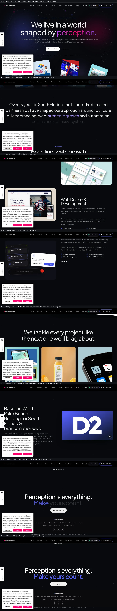
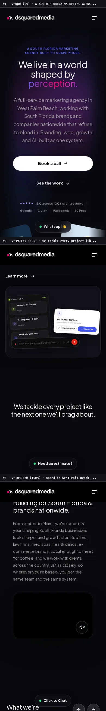

# UI Design System & Master Generation Blueprint: dsquaredmedia-net

> **South Florida Marketing Agency · Branding, Web & AI · Dsquared Media** (https://dsquaredmedia.net) — Dsquared Media is a boutique West Palm Beach marketing agency serving South Florida. Branding, web design, growth, and AI, built as one s...





---

## 1. Executive Visual Persona & Design Archetype

- **Brand Essence & Persona**: **South Florida Marketing Agency · Branding, Web & AI · Dsquared Media** (`https://dsquaredmedia.net`). Dsquared Media is a boutique West Palm Beach marketing agency serving South Florida. Branding, web design, growth, and AI, built as one s...
- **Capture Provenance**: Live browser capture (`tier1_fast`, HTTP `200`, captured `2026-11-24`).
- **Visual Archetype**: **Dark-Substrate WebGL / Canvas Interactive Experience (`#07090d` / `#ff006d`)**.
- **Anti-AI-Slop Differentiators**:
  - **Live-Computed Chromatic Polarity**: Anchors the viewport in `#07090d` (live computed `html` `background-color` (`computed_styles.json`)) paired with `#f1f1f1` primary typography and `#ff006d` accents.
  - **Grounded Typographic Hierarchy**: Uses `jakarta` across display (`A SOUTH FLORIDA MARKETING AGENCY BUI`) and body copy, paired with `SFMono-Regular` for monospace/code.
  - **Calibrated Spatial Grid & Motion**: Combines `96rem` container bounds (`gap: 14px`, padding `48px`) with `cubic-bezier(.4,0,.2,1)` easing and Three.js / WebGL Canvas Pipeline.

---

## 2. Spatial Architecture & Modular Grid Mathematics

### Viewport Allocation & Container Geometry
- **Captured Journey Filmstrips**: Desktop `1280×6624px` (`assets/desktop-journey.webp`, `8` keyframes up to `y=11084px` / doc `11984px`), Mobile `390×2616px` (`assets/mobile-journey.webp`, `3` keyframes).
- **Master Container Bounds**: `96rem` (non-`@media` desktop container stylesheet rule).
- **Canvas Lateral Padding & Spacing**: `48px` lateral canvas padding with `14px` grid gap.
- **Border Radius Scale**: `3px`, `100px`, `.25rem`, `4px`.

### Responsive Breakpoint Architecture
- **Desktop Layout**: Multi-column CSS Grid / Flexbox layout at `1440px` (`max-width: 96rem`, `gap: 14px`).
- **Mobile Layout**: Single-column vertical stack at `390px` viewport width with `48px` horizontal padding.
- **Extracted CSS Media Queries**: `@media (max-width:767px)`, `@media (max-width:720px)`, `@media (min-width:40rem)`, `@media (min-width:48rem)`.

---

## 3. Color System, Materiality & Atmospheric Lighting

### Semantic Palette & Source Grounding
| Semantic Role | Ground-Truth Value | Extracted Live / CSS Source |
|---|---|---|
| **Primary Canvas Substrate** | `#07090d` | live computed `html` `background-color` (`computed_styles.json`) |
| **Primary Typography Ink** | `#f1f1f1` | live computed `main` `color` (`computed_styles.json`) |
| **Elevated Surface / Card Substrate** | `#111113` | `var(--color-surface)` in `:root` |
| **Interactive Accent / Highlight** | `#ff006d` | `var(--gradient-brand)` in `:root` |
| **Secondary / Muted Copy** | `#676977` | `var(--d2cal-muted)` in `:root` |
| **Structural Hairline Border** | `#16171b` | `var(--border-subtle)` in `:root` (`ffffff0f`) |
| **Variable Token (`--color-surface-2`)** | `#16161a` | `var(--color-surface-2)` in `:root` |
| **Variable Token (`--color-surface-raised`)** | `#0e0e13` | `var(--color-surface-raised)` in `:root` |
| **Variable Token (`--color-surface-card`)** | `#0c0d12` | `var(--color-surface-card)` in `:root` |
| **Variable Token (`--color-white`)** | `#ffffff` | `var(--color-white)` in `:root` |
| **Variable Token (`--color-dim`)** | `#989898` | `var(--color-dim)` in `:root` |
| **Variable Token (`--color-text-80`)** | `#fffc` | `var(--color-text-80)` in `:root` |
| **Variable Token (`--color-text-60`)** | `#fff9` | `var(--color-text-60)` in `:root` |
| **Variable Token (`--color-blue`)** | `#5661ff` | `var(--color-blue)` in `:root` |
| **Variable Token (`--color-indigo`)** | `#4b39b4` | `var(--color-indigo)` in `:root` |
| **Variable Token (`--color-lavender`)** | `#a88fff` | `var(--color-lavender)` in `:root` |

### Sanitized Root CSS Variables (`ui-ux.md` Ground Truth)
| Variable Name | Extracted Value | Semantic Role |
|---|---|---|
| `--color-bg` | `#07090d` | Canvas / Surface Token |
| `--color-surface` | `#111113` | Canvas / Surface Token |
| `--color-surface-2` | `#16161a` | Canvas / Surface Token |
| `--color-surface-raised` | `#0e0e13` | Canvas / Surface Token |
| `--color-surface-card` | `#0c0d12` | Canvas / Surface Token |
| `--color-text` | `#f1f1f1` | Typography Ink Token |
| `--color-white` | `#fff` | Canvas / Surface Token |
| `--color-dim` | `#989898` | Brand / Palette Token |
| `--color-text-80` | `#fffc` | Typography Ink Token |
| `--color-text-60` | `#fff9` | Typography Ink Token |
| `--color-text-50` | `#ffffff80` | Typography Ink Token |
| `--color-text-38` | `#ffffff61` | Typography Ink Token |
| `--color-blue` | `#5661ff` | Brand / Palette Token |
| `--color-indigo` | `#4b39b4` | Brand / Palette Token |
| `--color-lavender` | `#a88fff` | Brand / Palette Token |
| `--color-magenta` | `#ff006d` | Brand / Palette Token |

---

## 4. Typographic Scale & Editorial Hierarchy

### Font Family Stacks
- **Display Typography**: `jakarta`.
- **Primary Body Stack**: `jakarta`.
- **Technical / Metadata Stack**: `SFMono-Regular`.

### Typographic Scale & Rules (Live Computed & Stylesheet Grounded)
- **Hero Display (`H1`)**: live computed `h1` (`font-size: 11px`, `line-height: 15.95px`, `font-weight: 700`, `letter-spacing: 1.54px`); rule `,h1` (`font-size: 62px`, `line-height: 1.05`, `letter-spacing: -.03em`, `font-weight: 600`).
- **Section Heading (`H2`)**: live computed `h2` (`font-size: 76px`, `line-height: 74.48px`, `font-weight: 500`, `letter-spacing: -2.66px`); rule `,h2` (`font-size: clamp(32px,4vw,56px)`, `line-height: 1.04`, `letter-spacing: -.025em`, `font-weight: 500`).
- **Body Copy**: live computed `body` (`font-size: 16px`, `line-height: 24px`, `font-weight: 400`); rule `p` (`font-size: 16px`, `line-height: 1.65`).
- **Metadata & Navigation Labels**: live computed `nav/a` (`font-size: 16px`, `line-height: 24px`, `font-weight: 400`); CSS variables `--font-mono: var(--font-victor),ui-monospace,monospace`, `--default-mono-font-family: var(--font-mono)`; rule `small` (`font-size: 11px`, `line-height: 1.5`, `letter-spacing: .04em`, `font-weight: 500`).

---

## 5. Choreographed Motion & Interaction Physics

### Primary Easing Curves
- **Extracted Timing Functions**: `cubic-bezier(.4,0,.2,1)`, `cubic-bezier(.22,.8,.35,1)`, `cubic-bezier(.34,.01,.2,1)`.

### Per-Element Transition & Choreography Rules
- **Selector `.nf-primary`**: `transition: transform .3s var(--ease),box-shadow .3s var(--ease)` extracted from `dsquaredmedia-net` stylesheet.
- **Selector `.nf-links a`**: `transition: color .25s var(--ease)` extracted from `dsquaredmedia-net` stylesheet.
- **Selector `.nf-links a:after`**: `transition: transform .3s var(--ease)` extracted from `dsquaredmedia-net` stylesheet.
- **Extracted Easing Curve (`cubic-bezier(.4,0,.2,1)`)**: Governs interactive state transitions across `<header.cap-fw-head>` and `<section.statement>`.
- **Runtime Interaction Engine**: Integrates Three.js / WebGL Canvas Pipeline with `prefers-reduced-motion: reduce` fallback guards.
### Measured Runtime Scroll & Interaction Telemetry (`behavioral_journey_v2`)
- **Scroll Driver Mode**: `native` (max document height `11984px`, deepest scrollY reached `11084px` across `8` desktop keyframes).
- **Detected Scroll / Motion Libraries**: `WebGL/Canvas`.
- **Nav / Drawer Probe (`Chat with us — Whats up! 👋`)**: Triggered visual change (pixel diff `19.151`, captured in `assets/state-nav.webp`); revealed links: Dsquared Media home, About, Services, Flex, The Hub, Work.
- **Hover Physics (`primary_cta` · `Book a call`)**: `transform`: `none` -> `matrix(1, 0, 0, 1, 0, -...`; `boxShadow`: `none` -> `rgba(255, 255, 255, 0.3...` (`transition-duration: 0.3s, 0.3s`, `timing: cubic-bezier(0.22, 0.8, 0.35, 1), cubic-bezier(0.22, 0.8, 0.35, 1)`).
- **Interactive Control Probe (`carousel_next` · `Next articles`)**: Triggered visual diff `19.351` (attr ` -> `, captured in `assets/state-interactive.webp`).
- **Route Transition Architecture**: First internal navigation (`/services`) measured as `direct` in `9703ms`.

---

## 6. Component Wireframe & Structural DOM Map

### Visual Layout Schematic — Desktop (`1440px`, Grounded in `dom.html` & Landmark Bounding Boxes)
```
┌────────────────────────────────────────────────────────────────────────┐
│ DESKTOP VIEWPORT (1440px) — South Florida Marketing Agency · Branding, │
│ ====================================================================== │
│ [ <header.cap-fw-head> (1440x362px)   | About · Services · Flex · Th ] │
│ ---------------------------------------------------------------------- │
│ | HERO STAGE: <section.hero> (w=1440px)                              | │
│ | H1: A SOUTH FLORIDA MARKETING AGENCY BUILT TO SHAPE Y...           | │
│ | Substrate: #07090d | Ink: #f1f1f1 | Accent: #ff006d                | │
│ ---------------------------------------------------------------------- │
│ | SHOWCASE GRID (<section.statement>) max-w: 96rem                   | │
│ | +------------------------------+  +------------------------------+ | │
│ | | A South Florida marketing ag |  | Branding, web, growth and AI | | │
│ | +------------------------------+  +------------------------------+ | │
│ ---------------------------------------------------------------------- │
│ | DETAIL MODULE (<section.cap-fw>) — Graphic Design                  | │
│ ---------------------------------------------------------------------- │
│ [ FOOTER (<footer.caf-footer> ) | https://dsquaredmedia.net            │
└────────────────────────────────────────────────────────────────────────┘
```

### Visual Layout Schematic — Mobile Reflow (`390px`)
```
┌────────────────────────────────────────────────────────────────────────┐
│ MOBILE VIEWPORT REFLOW (390px) — Single-Column Stack (gap: 14px)       │
│ ====================================================================== │
│ [ HEADER BAR (<header.cap-fw-head>    ) | Compact Menu (390px)         │
│ ---------------------------------------------------------------------- │
│ | HERO STAGE (<section.hero>) — 390px Vertical Lead                  | │
│ | H1: A SOUTH FLORIDA MARKETING AGENCY BUILT TO SHAPE Y...           | │
│ ---------------------------------------------------------------------- │
│ | SHOWCASE STACK (<section.statement>) — 1-Col Stack                 | │
│ | [ Item 1: A South Florida marketing agency built to shape y...   ] | │
│ | [ Item 2: Branding, web, growth and AI, built as one system.     ] | │
│ ---------------------------------------------------------------------- │
│ | DETAIL STACK (<section.cap-fw>) — 1-Col (Graphic Design)           | │
│ ---------------------------------------------------------------------- │
│ [ FOOTER (<footer.caf-footer> ) | Stacked 390px Colophon               │
└────────────────────────────────────────────────────────────────────────┘
```

### Granular DOM Region Breakdown
1. **Brand Header & Navigation Bar (<header.cap-fw-head> — `dsquaredmedia-net`)**:
   - Landmark `<header class="cap-fw-head">` (`1440x362px`) hosting `South Florida Marketing Agency · Bra` navigation (`About · Services · Flex · The Hub · Work`), DOM attributes (`data-precedence="next"`, `data-precedence="next"`, `data-precedence="next"`, `data-precedence="next"`), and stylesheet rule `awwwards { display:none }`.
2. **Hero Stage & Focal Lead (<section.hero> — `A SOUTH FLORIDA MARKETING AGENCY B`)**:
   - Landmark `<section class="hero hero-in">` presenting display lead `A SOUTH FLORIDA MARKETING AGENCY BUILT TO SHAPE Y...` and copy excerpt *"We live in a world shaped by perception."* over `#07090d` canvas and `#f1f1f1` ink.
3. **Primary Showcase & Content Grid (<section.statement> — `A South Florida marketing agency b`)**:
   - Landmark `<section class="statement">` rendering section `A South Florida marketing agency built to shape y...` with copy *"A full-service marketing agency in West Palm Beach, working with "*, asset references (`636a5ac981f94f8b-s.p.woff2`, `8d2bb7cdfa09b0c5-s.p.woff2`, `ee62220d3ef0f600.css`, `fc3610b87831099d.css`), and grid rule `.__className_0860af { font-family:jakarta,jakarta Fallback }`.
4. **Interactive Detail & Feature Matrix (<section.cap-fw> — `Branding, web, growth and AI, buil`)**:
   - Landmark `<section class="cap-fw anim">` framing `Branding, web, growth and AI, built as one system.` and `Graphic Design` (*"5.0 across 100+ client reviews"*) with `#111113` surface cards, `#ff006d` accents, and `.__variable_0860af { --font-jakarta:"jakarta","jakarta Fallback" }`.
5. **Colophon & Global Directory Footer (<footer.caf-footer> — `https://dsquaredmedia.net`)**:
   - Landmark `<footer class="caf-footer">` anchoring `South Florida Marketing Agency ·` footer links (`About · Services · Flex · The Hub · Work`), copy *"Over 15 years in South Florida and hundreds of trusted partn"*, and `#16171b` structural dividers.
### Full Vertical Scroll Sequence (Desktop `1440×900` Keyframes)
- **Step 01** (`y=0px`, `0%`): Active landmark `A SOUTH FLORIDA MARKETING AGENCY BUILT TO SHAPE Y...` · sticky/fixed elements: `3`
- **Step 02** (`y=850px`, `8%`): Active landmark `Branding, web, growth and AI, built as one system.` · sticky/fixed elements: `3`
- **Step 03** (`y=2550px`, `23%`): Active landmark `Web Design & Development` · sticky/fixed elements: `5`
- **Step 04** (`y=5100px`, `46%`): Active landmark `Artificial Intelligence` · sticky/fixed elements: `4`
- **Step 05** (`y=6800px`, `61%`): Active landmark `We tackle every project like the next one we'll b...` · sticky/fixed elements: `3`
- **Step 06** (`y=9350px`, `84%`): Active landmark `Based in West Palm Beach. Building for South Flor...` · sticky/fixed elements: `3`
- **Step 07** (`y=11050px`, `100%`): Active landmark `Perception is everything. Make yours count.` · sticky/fixed elements: `3`
- **Step 08** (`y=11084px`, `100%`): Active landmark `Perception is everything. Make yours count.` · sticky/fixed elements: `3`

### Multi-Page Internal Route Map
- **Listing Route (`/services`)**: `https://dsquaredmedia.net/services` — H1: `Everything you need to grow, under one roof.`, scrollHeight `2705px`, transition `direct` (`9703ms`)
- **Detail Route (`/work/alley-maass`)**: `https://dsquaredmedia.net/work/alley-maass` — H1: `Alley Maass`, scrollHeight `3350px`, transition `direct` (`849ms`)
- **About Route (`/about`)**: `https://dsquaredmedia.net/about` — H1: `We turn how you're seen into how you grow.`, scrollHeight `4494px`, transition `direct` (`618ms`)

---

## 7. Master Zero-Shot AI Generation Prompt

```markdown
# Master Zero-Shot Frontend Generation Prompt: dsquaredmedia-net (South Florida Marketing Agency · Branding, Web & AI · Dsquared Media)

You are a principal frontend architect and design systems engineer. Build a complete, production-ready web application replicating the exact design system, DOM landmarks, typographic hierarchy, color tokens, and motion physics of `dsquaredmedia-net` (**South Florida Marketing Agency · Branding, Web & AI · Dsquared Media** — `https://dsquaredmedia.net`).

### 1. Visual Archetype & Anti-AI-Slop Mandates
- **Archetype**: Dark-Substrate WebGL / Canvas Interactive Experience (`#07090d` / `#ff006d`).
- **Identity & Domain Context**: Dsquared Media is a boutique West Palm Beach marketing agency serving South Florida. Branding, web design, growth, and AI, built as one s...
- **Primary Substrate**: `#07090d` (live computed `html` `background-color` (`computed_styles.json`)), **Primary Ink**: `#f1f1f1`, **Accent / Highlight**: `#ff006d`.
- **Site-Specific Differentiators**:
  - **Live-Computed Chromatic Polarity**: Anchors the viewport in `#07090d` (live computed `html` `background-color` (`computed_styles.json`)) paired with `#f1f1f1` primary typography and `#ff006d` accents.
  - **Grounded Typographic Hierarchy**: Uses `jakarta` across display (`A SOUTH FLORIDA MARKETING AGENCY BUI`) and body copy, paired with `SFMono-Regular` for monospace/code.
  - **Calibrated Spatial Grid & Motion**: Combines `96rem` container bounds (`gap: 14px`, padding `48px`) with `cubic-bezier(.4,0,.2,1)` easing and Three.js / WebGL Canvas Pipeline.

### 2. Ground-Truth CSS Variables (`:root` Token Contract)
Declare and consume these exact custom properties extracted from `dsquaredmedia-net` in your global stylesheet:

:root {
  /* South Florida Marketing Agency · Branding, Web & AI · Dsquared Media (dsquaredmedia-net) — Live-Grounded CSS Variables */
  --color-bg: #07090d; /* Canvas / Surface Token (dsquaredmedia-net) */
  --color-surface: #111113; /* Canvas / Surface Token (dsquaredmedia-net) */
  --color-surface-2: #16161a; /* Canvas / Surface Token (dsquaredmedia-net) */
  --color-surface-raised: #0e0e13; /* Canvas / Surface Token (dsquaredmedia-net) */
  --color-surface-card: #0c0d12; /* Canvas / Surface Token (dsquaredmedia-net) */
  --color-text: #f1f1f1; /* Typography Ink Token (dsquaredmedia-net) */
  --color-white: #fff; /* Canvas / Surface Token (dsquaredmedia-net) */
  --color-dim: #989898; /* Brand / Palette Token (dsquaredmedia-net) */
  --color-text-80: #fffc; /* Typography Ink Token (dsquaredmedia-net) */
  --color-text-60: #fff9; /* Typography Ink Token (dsquaredmedia-net) */
  --color-text-50: #ffffff80; /* Typography Ink Token (dsquaredmedia-net) */
  --color-text-38: #ffffff61; /* Typography Ink Token (dsquaredmedia-net) */
  --color-blue: #5661ff; /* Brand / Palette Token (dsquaredmedia-net) */
  --color-indigo: #4b39b4; /* Brand / Palette Token (dsquaredmedia-net) */
  --color-lavender: #a88fff; /* Brand / Palette Token (dsquaredmedia-net) */
  --color-magenta: #ff006d; /* Brand / Palette Token (dsquaredmedia-net) */
}

### 3. Semantic Color & Materiality Contract
Map every surface, ink, and border strictly to these source-grounded tokens:
- **Primary Canvas Substrate**: `#07090d` — grounded in live computed `html` `background-color` (`computed_styles.json`)
- **Primary Typography Ink**: `#f1f1f1` — grounded in live computed `main` `color` (`computed_styles.json`)
- **Elevated Surface / Card Substrate**: `#111113` — grounded in `var(--color-surface)` in `:root`
- **Interactive Accent / Highlight**: `#ff006d` — grounded in `var(--gradient-brand)` in `:root`
- **Secondary / Muted Copy**: `#676977` — grounded in `var(--d2cal-muted)` in `:root`
- **Structural Hairline Border**: `#16171b` — grounded in `var(--border-subtle)` in `:root` (`ffffff0f`)
- **Variable Token (`--color-surface-2`)**: `#16161a` — grounded in `var(--color-surface-2)` in `:root`
- **Variable Token (`--color-surface-raised`)**: `#0e0e13` — grounded in `var(--color-surface-raised)` in `:root`
- **Variable Token (`--color-surface-card`)**: `#0c0d12` — grounded in `var(--color-surface-card)` in `:root`
- **Variable Token (`--color-white`)**: `#ffffff` — grounded in `var(--color-white)` in `:root`
- **Variable Token (`--color-dim`)**: `#989898` — grounded in `var(--color-dim)` in `:root`
- **Variable Token (`--color-text-80`)**: `#fffc` — grounded in `var(--color-text-80)` in `:root`
- **Variable Token (`--color-text-60`)**: `#fff9` — grounded in `var(--color-text-60)` in `:root`
- **Variable Token (`--color-blue`)**: `#5661ff` — grounded in `var(--color-blue)` in `:root`
- **Variable Token (`--color-indigo`)**: `#4b39b4` — grounded in `var(--color-indigo)` in `:root`
- **Variable Token (`--color-lavender`)**: `#a88fff` — grounded in `var(--color-lavender)` in `:root`

### 4. Spatial Grid, Container Bounds & Responsive Breakpoints
- **Desktop Viewport Reference**: `1280×6624px` (multi-frame vertical journey filmstrip (6624px), `1440px` standard desktop width).
- **Mobile Viewport Reference**: `390×2616px` (multi-frame vertical journey filmstrip (2616px), `390px` standard mobile width).
- **Container Max-Width**: `96rem` (non-`@media` desktop container stylesheet rule)
- **Padding & Gutters**: `48px` lateral canvas padding with `14px` grid gap
- **Desktop Grid**: Multi-column CSS Grid / Flexbox layout at `1440px` (`max-width: 96rem`, `gap: 14px`)
- **Mobile Adaptation**: Single-column vertical stack at `390px` viewport width with `48px` horizontal padding
- **Media Queries**: `@media (max-width:767px)`, `@media (max-width:720px)`, `@media (min-width:40rem)`, `@media (min-width:48rem)`
- **Corner Radii**: `3px`, `100px`, `.25rem`, `4px`

### 5. Typography & Editorial Scale Contract
- **Display Font Stack**: `jakarta`
- **Body Font Stack**: `jakarta`
- **Monospace / Technical Font Stack**: `SFMono-Regular`
- **H1 Display Rule**: live computed `h1` (`font-size: 11px`, `line-height: 15.95px`, `font-weight: 700`, `letter-spacing: 1.54px`); rule `,h1` (`font-size: 62px`, `line-height: 1.05`, `letter-spacing: -.03em`, `font-weight: 600`)
- **H2 Section Rule**: live computed `h2` (`font-size: 76px`, `line-height: 74.48px`, `font-weight: 500`, `letter-spacing: -2.66px`); rule `,h2` (`font-size: clamp(32px,4vw,56px)`, `line-height: 1.04`, `letter-spacing: -.025em`, `font-weight: 500`)
- **Body Copy Rule**: live computed `body` (`font-size: 16px`, `line-height: 24px`, `font-weight: 400`); rule `p` (`font-size: 16px`, `line-height: 1.65`)
- **Metadata & Index Rule**: live computed `nav/a` (`font-size: 16px`, `line-height: 24px`, `font-weight: 400`); CSS variables `--font-mono: var(--font-victor),ui-monospace,monospace`, `--default-mono-font-family: var(--font-mono)`; rule `small` (`font-size: 11px`, `line-height: 1.5`, `letter-spacing: .04em`, `font-weight: 500`)

### 6. Component Hierarchy, Verbatim Copy & Real DOM Landmarks
Scaffold `dsquaredmedia-net` (`South Florida Marketing Agency · Branding, Web & AI · Dsquared Media`) with these exact structural regions, extracted copy, and CSS rules from `dom.html`:
1. **Brand Header & Navigation Bar (<header.cap-fw-head> — `dsquaredmedia-net`)**:
   - DOM & Selectors: Landmark `<header class="cap-fw-head">` (`1440x362px`) hosting `South Florida Marketing Agency · Bra` navigation (`About · Services · Flex · The Hub · Work`), DOM attributes (`data-precedence="next"`, `data-precedence="next"`, `data-precedence="next"`, `data-precedence="next"`), and stylesheet rule `awwwards { display:none }`.
   - Responsive Contract: Header `Brand Header & Navigation Bar (<header.cap-fw-head> — `dsquaredmedia-net`)` (`dsquaredmedia-net`) adapts across `@media (max-width:767px)`, `@media (max-width:720px)`, `@media (min-width:40rem)`, `@media (min-width:48rem)` with `cubic-bezier(.4,0,.2,1)`, `cubic-bezier(.22,.8,.35,1)`, `cubic-bezier(.34,.01,.2,1)` transitions and links `About · Services · Flex · The Hub · Work`.
2. **Hero Stage & Focal Lead (<section.hero> — `A SOUTH FLORIDA MARKETING AGENCY B`)**:
   - DOM & Selectors: Landmark `<section class="hero hero-in">` presenting display lead `A SOUTH FLORIDA MARKETING AGENCY BUILT TO SHAPE Y...` and copy excerpt *"We live in a world shaped by perception."* over `#07090d` canvas and `#f1f1f1` ink.
   - Responsive Contract: Hero stage (`1280×6624px` desktop / `390×2616px` mobile) sets `#07090d` background with `#f1f1f1` headline `A SOUTH FLORIDA MARKETING AGENCY BUILT TO SHAPE Y...`.
3. **Primary Showcase & Content Grid (<section.statement> — `A South Florida marketing agency b`)**:
   - DOM & Selectors: Landmark `<section class="statement">` rendering section `A South Florida marketing agency built to shape y...` with copy *"A full-service marketing agency in West Palm Beach, working with "*, asset references (`636a5ac981f94f8b-s.p.woff2`, `8d2bb7cdfa09b0c5-s.p.woff2`, `ee62220d3ef0f600.css`, `fc3610b87831099d.css`), and grid rule `.__className_0860af { font-family:jakarta,jakarta Fallback }`.
   - Responsive Contract: Showcase grid `Primary Showcase & Content Grid (<section.statement> — `A South Florida marketing agency b`)` applies Multi-column CSS Grid / Flexbox layout at `1440px` (`max-width: 96rem`, `gap: 14px`) on desktop and Single-column vertical stack at `390px` viewport width with `48px` horizontal padding on mobile.
4. **Interactive Detail & Feature Matrix (<section.cap-fw> — `Branding, web, growth and AI, buil`)**:
   - DOM & Selectors: Landmark `<section class="cap-fw anim">` framing `Branding, web, growth and AI, built as one system.` and `Graphic Design` (*"5.0 across 100+ client reviews"*) with `#111113` surface cards, `#ff006d` accents, and `.__variable_0860af { --font-jakarta:"jakarta","jakarta Fallback" }`.
   - Responsive Contract: Detail module `Interactive Detail & Feature Matrix (<section.cap-fw> — `Branding, web, growth and AI, buil`)` uses `3px`, `100px`, `.25rem`, `4px` radii, `#ff006d` highlights, and assets (636a5ac981f94f8b-s.p.woff2, 8d2bb7cdfa09b0c5-s.p.woff2, ee62220d3ef0f600.css).
5. **Colophon & Global Directory Footer (<footer.caf-footer> — `https://dsquaredmedia.net`)**:
   - DOM & Selectors: Landmark `<footer class="caf-footer">` anchoring `South Florida Marketing Agency ·` footer links (`About · Services · Flex · The Hub · Work`), copy *"Over 15 years in South Florida and hundreds of trusted partn"*, and `#16171b` structural dividers.
   - Responsive Contract: Footer `Colophon & Global Directory Footer (<footer.caf-footer> — `https://dsquaredmedia.net`)` aligns to `96rem` (non-`@media` desktop container stylesheet rule) with `48px` lateral canvas padding with `14px` grid gap and attributes (data-precedence="next", data-precedence="next", data-precedence="next").

#### Verbatim DOM Copy Excerpts (`dom.html`)
- Copy Excerpt 1: *"We live in a world shaped by perception."*
- Copy Excerpt 2: *"A full-service marketing agency in West Palm Beach, working with South Florida bra..."*
- Copy Excerpt 3: *"5.0 across 100+ client reviews"*
- Copy Excerpt 4: *"Over 15 years in South Florida and hundreds of trusted partnerships have shaped ou..."*

### 7. Motion, Extracted Stylesheet Rules & Interaction Choreography
- **Primary Easing Functions**: `cubic-bezier(.4,0,.2,1)`, `cubic-bezier(.22,.8,.35,1)`, `cubic-bezier(.34,.01,.2,1)`
- **Extracted Stylesheet Rules (`dsquaredmedia-net`)**:
- `awwwards { display:none }`
- `.__className_0860af { font-family:jakarta,jakarta Fallback }`
- `.__variable_0860af { --font-jakarta:"jakarta","jakarta Fallback" }`
- `.__className_16e9b8 { font-family:victor,victor Fallback }`
- `.__variable_16e9b8 { --font-victor:"victor","victor Fallback" }`
- **Per-Selector Transition Rules**:
- **Selector `.nf-primary`**: `transition: transform .3s var(--ease),box-shadow .3s var(--ease)` extracted from `dsquaredmedia-net` stylesheet.
- **Selector `.nf-links a`**: `transition: color .25s var(--ease)` extracted from `dsquaredmedia-net` stylesheet.
- **Selector `.nf-links a:after`**: `transition: transform .3s var(--ease)` extracted from `dsquaredmedia-net` stylesheet.
- **Extracted Easing Curve (`cubic-bezier(.4,0,.2,1)`)**: Governs interactive state transitions across `<header.cap-fw-head>` and `<section.statement>`.
- **Runtime Interaction Engine**: Integrates Three.js / WebGL Canvas Pipeline with `prefers-reduced-motion: reduce` fallback guards.
### 7b. Full-Page Scroll Choreography, Interactive States & Multi-Page Routes
- **Scroll Mechanics**: Implement `native` vertical progression up to `11984px` across 8 distinct viewport chapters using WebGL/Canvas.
- **Vertical Chapter Sequence**: A SOUTH FLORIDA MARKETING A... (0%) -> Branding, web, growth and A... (8%) -> Web Design & Development (23%) -> Artificial Intelligence (46%) -> We tackle every project lik... (61%) -> Based in West Palm Beach. B... (84%) -> Perception is everything. M... (100%) -> Perception is everything. M... (100%).
- **Navigation Drawer / Menu State**: Replicate interactive menu toggle (`Chat with us — Whats up! 👋`) with Escape-to-close keyboard handling.
- **Hover Micro-Interaction (`primary_cta`)**: Animate `transform, boxShadow` with `0.3s, 0.3s cubic-bezier(0.22, 0.8, 0.35, 1), cubic-bezier(0.22, 0.8, 0.35, 1)`.
- **Multi-Page Routes**: Scaffold internal routes `/services` (listing, direct), `/work/alley-maass` (detail, direct), `/about` (about, direct) sharing the global header/footer shell and design tokens.

### 8. Technical Deliverables
- Implement in Next.js (App Router) with TypeScript and Tailwind CSS consuming the `:root` custom properties defined above for `dsquaredmedia-net`.
- Reproduce both the `1440px` desktop architecture and `390px` mobile breakpoint transitions, preserving semantic HTML5 landmarks (`<header>`, `<nav>`, `<main>`, `<section>`, `<footer>`) and `prefers-reduced-motion` accessibility guards.
```
---

## 8. Full-Page Scroll Journey, Interactive States & Subpage Inventory

### Desktop Scroll Keyframes (`1440×900` WebP)
| Step | Scroll Y | Progress | Active Landmark / Section | Sticky/Fixed | Visual Asset |
| :---: | :---: | :---: | :--- | :---: | :--- |
| `#01` | `0px` | `0%` | A SOUTH FLORIDA MARKETING AGENCY BUILT TO SHA... | `3` | [desktop-step-01.webp](assets/desktop-step-01.webp) |
| `#02` | `850px` | `8%` | Branding, web, growth and AI, built as one sy... | `3` | [desktop-step-02.webp](assets/desktop-step-02.webp) |
| `#03` | `2550px` | `23%` | Web Design & Development | `5` | [desktop-step-03.webp](assets/desktop-step-03.webp) |
| `#04` | `5100px` | `46%` | Artificial Intelligence | `4` | [desktop-step-04.webp](assets/desktop-step-04.webp) |
| `#05` | `6800px` | `61%` | We tackle every project like the next one we'... | `3` | [desktop-step-05.webp](assets/desktop-step-05.webp) |
| `#06` | `9350px` | `84%` | Based in West Palm Beach. Building for South... | `3` | [desktop-step-06.webp](assets/desktop-step-06.webp) |
| `#07` | `11050px` | `100%` | Perception is everything. Make yours count. | `3` | [desktop-step-07.webp](assets/desktop-step-07.webp) |
| `#08` | `11084px` | `100%` | Perception is everything. Make yours count. | `3` | [desktop-step-08.webp](assets/desktop-step-08.webp) |

### Mobile Condensed Keyframes (`390×844` WebP)
| Step | Scroll Y | Progress | Active Landmark | Visual Asset |
| :---: | :---: | :---: | :--- | :--- |
| `#01` | `0px` | `0%` | A SOUTH FLORIDA MARKETING AGENCY BUILT TO... | [mobile-step-01.webp](assets/mobile-step-01.webp) |
| `#02` | `4971px` | `50%` | We tackle every project like the next one... | [mobile-step-02.webp](assets/mobile-step-02.webp) |
| `#03` | `10495px` | `100%` | Based in West Palm Beach. Building for So... | [mobile-step-03.webp](assets/mobile-step-03.webp) |

### Interactive UI State Captures (`1440×900` WebP)
| State Type | Trigger / Observation | Visual Asset |
| :--- | :--- | :--- |
| `nav_menu` | Nav/Menu opened (`Chat with us — Whats up! 👋`, diff `19.151`) | [state-nav.webp](assets/state-nav.webp) |
| `interactive_control` | Control `carousel_next` (`Next articles`, diff `19.351`) | [state-interactive.webp](assets/state-interactive.webp) |

### Internal Subpage Filmstrips (`1080px` Wide WebP)
| # | Template | Route URL | H1 / Title | Scroll Height | Transition | Filmstrip Asset |
| :-: | :---: | :--- | :--- | :---: | :---: | :--- |
| `1` | `listing` | `https://dsquaredmedia.net/services` | Everything you need to grow, under on... | `2705px` | `direct` (`9703ms`) | [subpage-01-services.webp](assets/subpage-01-services.webp) |
| `2` | `detail` | `https://dsquaredmedia.net/work/alley-maass` | Alley Maass | `3350px` | `direct` (`849ms`) | [subpage-02-work-alley-maass.webp](assets/subpage-02-work-alley-maass.webp) |
| `3` | `about` | `https://dsquaredmedia.net/about` | We turn how you're seen into how you... | `4494px` | `direct` (`618ms`) | [subpage-03-about.webp](assets/subpage-03-about.webp) |

