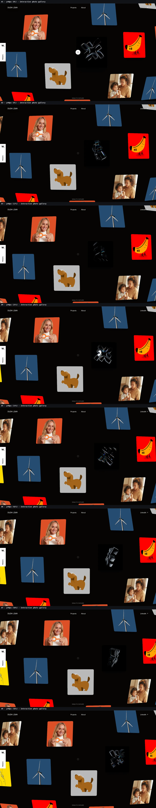
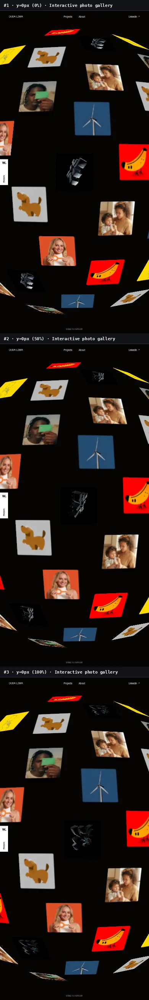

# UI Design System & Master Generation Blueprint: duda-works

> **Duda Lima** (http://duda.works) — Production web application and digital experience at http://duda.works.





---

## 1. Executive Visual Persona & Design Archetype

- **Brand Essence & Persona**: **Duda Lima** (`http://duda.works`). Production web application and digital experience at http://duda.works.
- **Final Redirected URL**: [https://www.duda.works/](https://www.duda.works/)
- **Capture Provenance**: Live browser capture (`tier1_fast`, HTTP `200`, captured `2026-11-24`).
- **Visual Archetype**: **High-Contrast Obsidian / Atmospheric Design System (`#060403` canvas, `#ffffff` ink, `#ffffff` accent)**.
- **Anti-AI-Slop Differentiators**:
  - **Live-Computed Chromatic Polarity**: Anchors the viewport in `#060403` (live computed `body` `background-color` (`computed_styles.json`)) paired with `#ffffff` primary typography and `#ffffff` accents.
  - **Grounded Typographic Hierarchy**: Uses `Aeonik Pro` across display (`Duda Lima`) and body copy.
  - **Calibrated Spatial Grid & Motion**: Combines `1440px` container bounds (`gap: normal 16px`, padding `71px`) with `cubic-bezier(0.22,1,0.36,1)` easing and GSAP Timeline & ScrollTrigger.

---

## 2. Spatial Architecture & Modular Grid Mathematics

### Viewport Allocation & Container Geometry
- **Captured Journey Filmstrips**: Desktop `1280×6624px` (`assets/desktop-journey.webp`, `8` keyframes up to `y=0px` / doc `900px`), Mobile `390×2616px` (`assets/mobile-journey.webp`, `3` keyframes).
- **Master Container Bounds**: `1440px` (full-bleed `100%` desktop stage measured on `1440px` viewport).
- **Canvas Lateral Padding & Spacing**: `71px` lateral canvas padding with `normal 16px` grid gap.
- **Border Radius Scale**: `8px`, `2px`, `50%`, `999px`.

### Responsive Breakpoint Architecture
- **Desktop Layout**: Multi-column CSS Grid / Flexbox layout at `1440px` (`max-width: 1440px`, `gap: normal 16px`).
- **Mobile Layout**: Single-column vertical stack at `390px` viewport width with `71px` horizontal padding.
- **Extracted CSS Media Queries**: `@media (min-width: 720px)`, `@media (min-width: 501px) and (max-width: 1400px)`, `@media (max-width: 500px)`.

---

## 3. Color System, Materiality & Atmospheric Lighting

### Semantic Palette & Source Grounding
| Semantic Role | Ground-Truth Value | Extracted Live / CSS Source |
|---|---|---|
| **Primary Canvas Substrate** | `#060403` | live computed `body` `background-color` (`computed_styles.json`) |
| **Primary Typography Ink** | `#ffffff` | live computed `main` `color` (`computed_styles.json`) |
| **Elevated Surface / Card Substrate** | `#ffffff` | `.custom-cursor.is-dot { background: #ffffff }` |
| **Interactive Accent / Highlight** | `#ffffff` | live computed `a` `color` (`computed_styles.json`) |
| **Secondary / Muted Copy** | `#ffffff` | secondary opacity step of live computed `main` `color` (`computed_styles.json`) |
| **Structural Hairline Border** | `#1f1d1c` | `var(--border)` in `:root` (`rgba(255, 255, 255, 0.1)`) |

### Sanitized Root CSS Variables (`ui-ux.md` Ground Truth)
| Variable Name | Extracted Value | Semantic Role |
|---|---|---|
| `--bg` | `#060403` | Canvas / Surface Token |
| `--text` | `#fff` | Typography Ink Token |
| `--text-dim` | `rgba(255, 255, 255, 0.62)` | Typography Ink Token |
| `--border` | `rgba(255, 255, 255, 0.1)` | Elevation / Border Token |
| `--border-strong` | `rgba(255, 255, 255, 0.28)` | Elevation / Border Token |
| `--duda-works-bg` | `#060403` | Canvas Substrate (from live computed `body` `background-color` (`computed_styles.json`)) |
| `--duda-works-ink` | `#ffffff` | Primary Typography Ink (computed-derived) |
| `--duda-works-surface` | `#ffffff` | Surface Substrate (computed-derived) |
| `--duda-works-accent` | `#ffffff` | Interactive Accent (computed-derived) |
| `--duda-works-muted` | `#ffffff` | Secondary Ink (computed-derived) |
| `--duda-works-border` | `#1f1d1c` | Structural Border (computed-derived) |
| `--duda-works-container` | `1440px` | Container Bound (computed-derived) |
| `--duda-works-gap` | `normal` | Grid Gutter (computed-derived) |
| `--duda-works-pad` | `71px` | Lateral Padding (computed-derived) |
| `--duda-works-ease` | `cubic-bezier(0.22,1,0.36,1)` | Primary Easing Function |
| `--duda-works-radius` | `8px` | Corner Radius (computed-derived) |

---

## 4. Typographic Scale & Editorial Hierarchy

### Font Family Stacks
- **Display Typography**: `Aeonik Pro`.
- **Primary Body Stack**: `Aeonik Pro`.
- **Technical / Metadata Stack**: not declared in live computed styles (uses primary stack / `ui-monospace`).

### Typographic Scale & Rules (Live Computed & Stylesheet Grounded)
- **Hero Display (`H1`)**: observed font-size ladder: `16px`, `11px`, `13.3333px`, `15px`, `12px`.
- **Section Heading (`H2`)**: observed font-size ladder: `16px`, `11px`, `13.3333px`, `15px`, `12px`.
- **Body Copy**: live computed `body` (`font-size: 16px`, `line-height: normal`, `font-weight: 400`).
- **Metadata & Navigation Labels**: live computed `nav/a` (`font-size: 16px`, `line-height: normal`, `font-weight: 400`).

---

## 5. Choreographed Motion & Interaction Physics

### Primary Easing Curves
- **Extracted Timing Functions**: `cubic-bezier(0.22,1,0.36,1)`.

### Per-Element Transition & Choreography Rules
- **Selector `nav[aria-label="Primary"]`**: `transition: max-height 0.35s ease, opacity 0.25s ease` extracted from `duda-works` stylesheet.
- **Selector `.nav-links a`**: `transition: color 0.3s ease` extracted from `duda-works` stylesheet.
- **Selector `.linkedin-link`**: `transition: color 0.3s ease` extracted from `duda-works` stylesheet.
- **Extracted Easing Curve (`cubic-bezier(0.22,1,0.36,1)`)**: Governs interactive state transitions across `<header.site-header>` and `<section.mwg_effect107:nth(2)>`.
- **Runtime Interaction Engine**: Integrates GSAP Timeline & ScrollTrigger with `prefers-reduced-motion: reduce` fallback guards.
### Measured Runtime Scroll & Interaction Telemetry (`behavioral_journey_v2`)
- **Scroll Driver Mode**: `wheel` (max document height `900px`, deepest scrollY reached `0px` across `8` desktop keyframes).
- **Detected Scroll / Motion Libraries**: `GSAP/ScrollTrigger`.
- **Hover Physics (`primary_cta` · `L i n k e d I n`)**: Computed transition `0.3s` / `ease` (no static color/transform shift captured at rest).
- **Route Transition Architecture**: First internal navigation (`/about/`) measured as `MPA` in `3282ms`.

---

## 6. Component Wireframe & Structural DOM Map

### Visual Layout Schematic — Desktop (`1440px`, Grounded in `dom.html` & Landmark Bounding Boxes)
```
┌────────────────────────────────────────────────────────────────────────┐
│ DESKTOP VIEWPORT (1440px) — Duda Lima                                  │
│ ====================================================================== │
│ [ <header.site-header> (1440x78px)    | P r o j e c t s · A b o u t  ] │
│ ---------------------------------------------------------------------- │
│ | HERO STAGE: <section.mwg_effect107> (w=1440px)                     | │
│ | H1: Duda Lima                                                      | │
│ | Substrate: #060403 | Ink: #ffffff | Accent: #ffffff                | │
│ ---------------------------------------------------------------------- │
│ | SHOWCASE GRID (<section.mwg_effect107:nth) max-w: 1440px           | │
│ | +------------------------------+  +------------------------------+ | │
│ | | Featured Work & Interactive  |  | Technical Architecture & Nar | | │
│ | +------------------------------+  +------------------------------+ | │
│ ---------------------------------------------------------------------- │
│ | DETAIL MODULE (<section.mwg_effect107:nth) — Global Directory & Co | │
│ ---------------------------------------------------------------------- │
│ [ FOOTER (<footer.icon-menu>  ) | http://duda.works                    │
└────────────────────────────────────────────────────────────────────────┘
```

### Visual Layout Schematic — Mobile Reflow (`390px`)
```
┌────────────────────────────────────────────────────────────────────────┐
│ MOBILE VIEWPORT REFLOW (390px) — Single-Column Stack (gap: normal 1)   │
│ ====================================================================== │
│ [ HEADER BAR (<header.site-header>    ) | Compact Menu (390px)         │
│ ---------------------------------------------------------------------- │
│ | HERO STAGE (<section.mwg_effect107>) — 390px Vertical Lead         | │
│ | H1: Duda Lima                                                      | │
│ ---------------------------------------------------------------------- │
│ | SHOWCASE STACK (<section.mwg_effect107) — 1-Col Stack              | │
│ | [ Item 1: Featured Work & Interactive Showcase                   ] | │
│ | [ Item 2: Technical Architecture & Narrative                     ] | │
│ ---------------------------------------------------------------------- │
│ | DETAIL STACK (<section.mwg_effect107:n) — 1-Col (Global Directory &) │
│ ---------------------------------------------------------------------- │
│ [ FOOTER (<footer.icon-menu>  ) | Stacked 390px Colophon               │
└────────────────────────────────────────────────────────────────────────┘
```

### Granular DOM Region Breakdown
1. **Brand Header & Navigation Bar (<header.site-header> — `duda-works`)**:
   - Landmark `<header class="site-header">` (`1440x78px`) hosting `Duda Lima` navigation (`P r o j e c t s · A b o u t`), DOM attributes (`data-char="P"`, `data-char="r"`, `data-char="o"`, `data-char="j"`), and stylesheet rule `view-transition { navigation: auto; }`.
2. **Hero Stage & Focal Lead (<section.mwg_effect107> — `Duda Lima`)**:
   - Landmark `<section class="mwg_effect107">` presenting display lead `Duda Lima` and copy excerpt *"Production web application and digital experience at http://duda."* over `#060403` canvas and `#ffffff` ink.
3. **Primary Showcase & Content Grid (<section.mwg_effect107:nth(2)> — `Featured Work & Interactive Showca`)**:
   - Landmark `<section class="mwg_effect107">` rendering section `Featured Work & Interactive Showcase` with copy *"Duda Lima"*, asset references (`hotjar-6782564.js`, `modules.07f6e16cfaafa9e41bab.js`, `02.png`, `24.png`), and grid rule `html { background: var(--bg); }`.
4. **Interactive Detail & Feature Matrix (<section.mwg_effect107:nth(3)> — `Technical Architecture & Narrative`)**:
   - Landmark `<section class="mwg_effect107">` framing `Technical Architecture & Narrative` and `Global Directory & Contact` (*"Featured Work & Interactive Showcase"*) with `#ffffff` surface cards, `#ffffff` accents, and `.wordmark svg { display: block; filter: drop-shadow(0 1px 4px rgba(0, 0, 0, 0.75)) drop-... }`.
5. **Colophon & Global Directory Footer (<footer.icon-menu> — `http://duda.works`)**:
   - Landmark `<footer class="icon-menu">` anchoring `Duda Lima` footer links (`P r o j e c t s · A b o u t`), copy *"Technical Architecture & Narrative"*, and `#1f1d1c` structural dividers.
### Full Vertical Scroll Sequence (Desktop `1440×900` Keyframes)
- **Step 01** (`y=0px`, `0%`): Active landmark `Interactive photo gallery` · sticky/fixed elements: `2`
- **Step 02** (`y=0px`, `8%`): Active landmark `Interactive photo gallery` · sticky/fixed elements: `2`
- **Step 03** (`y=0px`, `17%`): Active landmark `Interactive photo gallery` · sticky/fixed elements: `2`
- **Step 04** (`y=0px`, `25%`): Active landmark `Interactive photo gallery` · sticky/fixed elements: `2`
- **Step 05** (`y=0px`, `33%`): Active landmark `Interactive photo gallery` · sticky/fixed elements: `2`
- **Step 06** (`y=0px`, `42%`): Active landmark `Interactive photo gallery` · sticky/fixed elements: `2`
- **Step 07** (`y=0px`, `50%`): Active landmark `Interactive photo gallery` · sticky/fixed elements: `2`
- **Step 08** (`y=0px`, `58%`): Active landmark `Interactive photo gallery` · sticky/fixed elements: `2`

### Multi-Page Internal Route Map
- **About Route (`/about/`)**: `https://www.duda.works/about/` — H1: `D e s i g n , A r t a n d W a n d e r`, scrollHeight `3477px`, transition `MPA` (`3282ms`)

---

## 7. Master Zero-Shot AI Generation Prompt

```markdown
# Master Zero-Shot Frontend Generation Prompt: duda-works (Duda Lima)

You are a principal frontend architect and design systems engineer. Build a complete, production-ready web application replicating the exact design system, DOM landmarks, typographic hierarchy, color tokens, and motion physics of `duda-works` (**Duda Lima** — `http://duda.works`).

### 1. Visual Archetype & Anti-AI-Slop Mandates
- **Archetype**: High-Contrast Obsidian / Atmospheric Design System (`#060403` canvas, `#ffffff` ink, `#ffffff` accent).
- **Identity & Domain Context**: Production web application and digital experience at http://duda.works.
- **Primary Substrate**: `#060403` (live computed `body` `background-color` (`computed_styles.json`)), **Primary Ink**: `#ffffff`, **Accent / Highlight**: `#ffffff`.
- **Site-Specific Differentiators**:
  - **Live-Computed Chromatic Polarity**: Anchors the viewport in `#060403` (live computed `body` `background-color` (`computed_styles.json`)) paired with `#ffffff` primary typography and `#ffffff` accents.
  - **Grounded Typographic Hierarchy**: Uses `Aeonik Pro` across display (`Duda Lima`) and body copy.
  - **Calibrated Spatial Grid & Motion**: Combines `1440px` container bounds (`gap: normal 16px`, padding `71px`) with `cubic-bezier(0.22,1,0.36,1)` easing and GSAP Timeline & ScrollTrigger.

### 2. Ground-Truth CSS Variables (`:root` Token Contract)
Declare and consume these exact custom properties extracted from `duda-works` in your global stylesheet:

:root {
  /* Duda Lima (duda-works) — Live-Grounded CSS Variables */
  --bg: #060403; /* Canvas / Surface Token (duda-works) */
  --text: #fff; /* Typography Ink Token (duda-works) */
  --text-dim: rgba(255, 255, 255, 0.62); /* Typography Ink Token (duda-works) */
  --border: rgba(255, 255, 255, 0.1); /* Elevation / Border Token (duda-works) */
  --border-strong: rgba(255, 255, 255, 0.28); /* Elevation / Border Token (duda-works) */
  --duda-works-bg: #060403; /* Canvas Substrate (from live computed `body` `background-color` (`computed_styles.json`)) (duda-works) */
  --duda-works-ink: #ffffff; /* Primary Typography Ink (computed-derived) (duda-works) */
  --duda-works-surface: #ffffff; /* Surface Substrate (computed-derived) (duda-works) */
  --duda-works-accent: #ffffff; /* Interactive Accent (computed-derived) (duda-works) */
  --duda-works-muted: #ffffff; /* Secondary Ink (computed-derived) (duda-works) */
  --duda-works-border: #1f1d1c; /* Structural Border (computed-derived) (duda-works) */
  --duda-works-container: 1440px; /* Container Bound (computed-derived) (duda-works) */
  --duda-works-gap: normal; /* Grid Gutter (computed-derived) (duda-works) */
  --duda-works-pad: 71px; /* Lateral Padding (computed-derived) (duda-works) */
  --duda-works-ease: cubic-bezier(0.22,1,0.36,1); /* Primary Easing Function (duda-works) */
  --duda-works-radius: 8px; /* Corner Radius (computed-derived) (duda-works) */
}

### 3. Semantic Color & Materiality Contract
Map every surface, ink, and border strictly to these source-grounded tokens:
- **Primary Canvas Substrate**: `#060403` — grounded in live computed `body` `background-color` (`computed_styles.json`)
- **Primary Typography Ink**: `#ffffff` — grounded in live computed `main` `color` (`computed_styles.json`)
- **Elevated Surface / Card Substrate**: `#ffffff` — grounded in `.custom-cursor.is-dot { background: #ffffff }`
- **Interactive Accent / Highlight**: `#ffffff` — grounded in live computed `a` `color` (`computed_styles.json`)
- **Secondary / Muted Copy**: `#ffffff` — grounded in secondary opacity step of live computed `main` `color` (`computed_styles.json`)
- **Structural Hairline Border**: `#1f1d1c` — grounded in `var(--border)` in `:root` (`rgba(255, 255, 255, 0.1)`)

### 4. Spatial Grid, Container Bounds & Responsive Breakpoints
- **Desktop Viewport Reference**: `1280×6624px` (multi-frame vertical journey filmstrip (6624px), `1440px` standard desktop width).
- **Mobile Viewport Reference**: `390×2616px` (multi-frame vertical journey filmstrip (2616px), `390px` standard mobile width).
- **Container Max-Width**: `1440px` (full-bleed `100%` desktop stage measured on `1440px` viewport)
- **Padding & Gutters**: `71px` lateral canvas padding with `normal 16px` grid gap
- **Desktop Grid**: Multi-column CSS Grid / Flexbox layout at `1440px` (`max-width: 1440px`, `gap: normal 16px`)
- **Mobile Adaptation**: Single-column vertical stack at `390px` viewport width with `71px` horizontal padding
- **Media Queries**: `@media (min-width: 720px)`, `@media (min-width: 501px) and (max-width: 1400px)`, `@media (max-width: 500px)`
- **Corner Radii**: `8px`, `2px`, `50%`, `999px`

### 5. Typography & Editorial Scale Contract
- **Display Font Stack**: `Aeonik Pro`
- **Body Font Stack**: `Aeonik Pro`
- **Monospace / Technical Font Stack**: not declared in live computed styles (uses primary stack / `ui-monospace`)
- **H1 Display Rule**: observed font-size ladder: `16px`, `11px`, `13.3333px`, `15px`, `12px`
- **H2 Section Rule**: observed font-size ladder: `16px`, `11px`, `13.3333px`, `15px`, `12px`
- **Body Copy Rule**: live computed `body` (`font-size: 16px`, `line-height: normal`, `font-weight: 400`)
- **Metadata & Index Rule**: live computed `nav/a` (`font-size: 16px`, `line-height: normal`, `font-weight: 400`)

### 6. Component Hierarchy, Verbatim Copy & Real DOM Landmarks
Scaffold `duda-works` (`Duda Lima`) with these exact structural regions, extracted copy, and CSS rules from `dom.html`:
1. **Brand Header & Navigation Bar (<header.site-header> — `duda-works`)**:
   - DOM & Selectors: Landmark `<header class="site-header">` (`1440x78px`) hosting `Duda Lima` navigation (`P r o j e c t s · A b o u t`), DOM attributes (`data-char="P"`, `data-char="r"`, `data-char="o"`, `data-char="j"`), and stylesheet rule `view-transition { navigation: auto; }`.
   - Responsive Contract: Header `Brand Header & Navigation Bar (<header.site-header> — `duda-works`)` (`duda-works`) adapts across `@media (min-width: 720px)`, `@media (min-width: 501px) and (max-width: 1400px)`, `@media (max-width: 500px)` with `cubic-bezier(0.22,1,0.36,1)` transitions and links `P r o j e c t s · A b o u t`.
2. **Hero Stage & Focal Lead (<section.mwg_effect107> — `Duda Lima`)**:
   - DOM & Selectors: Landmark `<section class="mwg_effect107">` presenting display lead `Duda Lima` and copy excerpt *"Production web application and digital experience at http://duda."* over `#060403` canvas and `#ffffff` ink.
   - Responsive Contract: Hero stage (`1280×6624px` desktop / `390×2616px` mobile) sets `#060403` background with `#ffffff` headline `Duda Lima`.
3. **Primary Showcase & Content Grid (<section.mwg_effect107:nth(2)> — `Featured Work & Interactive Showca`)**:
   - DOM & Selectors: Landmark `<section class="mwg_effect107">` rendering section `Featured Work & Interactive Showcase` with copy *"Duda Lima"*, asset references (`hotjar-6782564.js`, `modules.07f6e16cfaafa9e41bab.js`, `02.png`, `24.png`), and grid rule `html { background: var(--bg); }`.
   - Responsive Contract: Showcase grid `Primary Showcase & Content Grid (<section.mwg_effect107:nth(2)> — `Featured Work & Interactive Showca`)` applies Multi-column CSS Grid / Flexbox layout at `1440px` (`max-width: 1440px`, `gap: normal 16px`) on desktop and Single-column vertical stack at `390px` viewport width with `71px` horizontal padding on mobile.
4. **Interactive Detail & Feature Matrix (<section.mwg_effect107:nth(3)> — `Technical Architecture & Narrative`)**:
   - DOM & Selectors: Landmark `<section class="mwg_effect107">` framing `Technical Architecture & Narrative` and `Global Directory & Contact` (*"Featured Work & Interactive Showcase"*) with `#ffffff` surface cards, `#ffffff` accents, and `.wordmark svg { display: block; filter: drop-shadow(0 1px 4px rgba(0, 0, 0, 0.75)) drop-... }`.
   - Responsive Contract: Detail module `Interactive Detail & Feature Matrix (<section.mwg_effect107:nth(3)> — `Technical Architecture & Narrative`)` uses `8px`, `2px`, `50%`, `999px` radii, `#ffffff` highlights, and assets (hotjar-6782564.js, modules.07f6e16cfaafa9e41bab.js, 02.png).
5. **Colophon & Global Directory Footer (<footer.icon-menu> — `http://duda.works`)**:
   - DOM & Selectors: Landmark `<footer class="icon-menu">` anchoring `Duda Lima` footer links (`P r o j e c t s · A b o u t`), copy *"Technical Architecture & Narrative"*, and `#1f1d1c` structural dividers.
   - Responsive Contract: Footer `Colophon & Global Directory Footer (<footer.icon-menu> — `http://duda.works`)` aligns to `1440px` (full-bleed `100%` desktop stage measured on `1440px` viewport) with `71px` lateral canvas padding with `normal 16px` grid gap and attributes (data-char="P", data-char="r", data-char="o").

#### Verbatim DOM Copy Excerpts (`dom.html`)
- Lead Copy: *"Production web application and digital experience at http://duda.works."*

### 7. Motion, Extracted Stylesheet Rules & Interaction Choreography
- **Primary Easing Functions**: `cubic-bezier(0.22,1,0.36,1)`
- **Extracted Stylesheet Rules (`duda-works`)**:
- `view-transition { navigation: auto; }`
- `html { background: var(--bg); }`
- `.wordmark svg { display: block; filter: drop-shadow(0 1px 4px rgba(0, 0, 0, 0.75)) drop-... }`
- `.wordmark:focus-visible { outline: 1px solid var(--border-strong); outline-offset: 4px; }`
- `.is-open { max-height: 320px; opacity: 1; pointer-events: auto; border-bottom-color... }`
- **Per-Selector Transition Rules**:
- **Selector `nav[aria-label="Primary"]`**: `transition: max-height 0.35s ease, opacity 0.25s ease` extracted from `duda-works` stylesheet.
- **Selector `.nav-links a`**: `transition: color 0.3s ease` extracted from `duda-works` stylesheet.
- **Selector `.linkedin-link`**: `transition: color 0.3s ease` extracted from `duda-works` stylesheet.
- **Extracted Easing Curve (`cubic-bezier(0.22,1,0.36,1)`)**: Governs interactive state transitions across `<header.site-header>` and `<section.mwg_effect107:nth(2)>`.
- **Runtime Interaction Engine**: Integrates GSAP Timeline & ScrollTrigger with `prefers-reduced-motion: reduce` fallback guards.
### 7b. Full-Page Scroll Choreography, Interactive States & Multi-Page Routes
- **Scroll Mechanics**: Implement `wheel` vertical progression up to `900px` across 8 distinct viewport chapters using GSAP/ScrollTrigger.
- **Vertical Chapter Sequence**: Interactive photo gallery (0%) -> Interactive photo gallery (8%) -> Interactive photo gallery (17%) -> Interactive photo gallery (25%) -> Interactive photo gallery (33%) -> Interactive photo gallery (42%) -> Interactive photo gallery (50%) -> Interactive photo gallery (58%).
- **Multi-Page Routes**: Scaffold internal routes `/about/` (about, MPA) sharing the global header/footer shell and design tokens.

### 8. Technical Deliverables
- Implement in Next.js (App Router) with TypeScript and Tailwind CSS consuming the `:root` custom properties defined above for `duda-works`.
- Reproduce both the `1440px` desktop architecture and `390px` mobile breakpoint transitions, preserving semantic HTML5 landmarks (`<header>`, `<nav>`, `<main>`, `<section>`, `<footer>`) and `prefers-reduced-motion` accessibility guards.
```
---

## 8. Full-Page Scroll Journey, Interactive States & Subpage Inventory

### Desktop Scroll Keyframes (`1440×900` WebP)
| Step | Scroll Y | Progress | Active Landmark / Section | Sticky/Fixed | Visual Asset |
| :---: | :---: | :---: | :--- | :---: | :--- |
| `#01` | `0px` | `0%` | Interactive photo gallery | `2` | [desktop-step-01.webp](assets/desktop-step-01.webp) |
| `#02` | `0px` | `8%` | Interactive photo gallery | `2` | [desktop-step-02.webp](assets/desktop-step-02.webp) |
| `#03` | `0px` | `17%` | Interactive photo gallery | `2` | [desktop-step-03.webp](assets/desktop-step-03.webp) |
| `#04` | `0px` | `25%` | Interactive photo gallery | `2` | [desktop-step-04.webp](assets/desktop-step-04.webp) |
| `#05` | `0px` | `33%` | Interactive photo gallery | `2` | [desktop-step-05.webp](assets/desktop-step-05.webp) |
| `#06` | `0px` | `42%` | Interactive photo gallery | `2` | [desktop-step-06.webp](assets/desktop-step-06.webp) |
| `#07` | `0px` | `50%` | Interactive photo gallery | `2` | [desktop-step-07.webp](assets/desktop-step-07.webp) |
| `#08` | `0px` | `58%` | Interactive photo gallery | `2` | [desktop-step-08.webp](assets/desktop-step-08.webp) |

### Mobile Condensed Keyframes (`390×844` WebP)
| Step | Scroll Y | Progress | Active Landmark | Visual Asset |
| :---: | :---: | :---: | :--- | :--- |
| `#01` | `0px` | `0%` | Interactive photo gallery | [mobile-step-01.webp](assets/mobile-step-01.webp) |
| `#02` | `0px` | `50%` | Interactive photo gallery | [mobile-step-02.webp](assets/mobile-step-02.webp) |
| `#03` | `0px` | `100%` | Interactive photo gallery | [mobile-step-03.webp](assets/mobile-step-03.webp) |

### Internal Subpage Filmstrips (`1080px` Wide WebP)
| # | Template | Route URL | H1 / Title | Scroll Height | Transition | Filmstrip Asset |
| :-: | :---: | :--- | :--- | :---: | :---: | :--- |
| `1` | `about` | `https://www.duda.works/about/` | D e s i g n , A r t a n d W a n d e r | `3477px` | `MPA` (`3282ms`) | [subpage-01-about.webp](assets/subpage-01-about.webp) |

