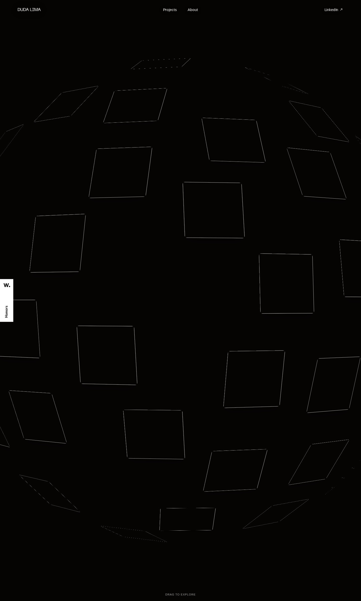
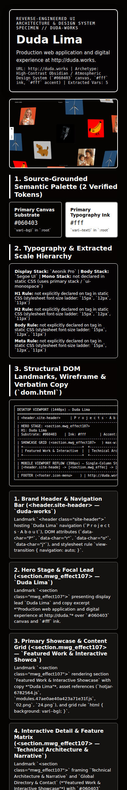

# UI Design System & Master Generation Blueprint: duda-works

> **Duda Lima** (http://duda.works) — Production web application and digital experience at http://duda.works.



---

## 1. Executive Visual Persona & Design Archetype

- **Brand Essence & Persona**: **Duda Lima** (`http://duda.works`). Production web application and digital experience at http://duda.works.
- **Visual Archetype**: **High-Contrast Obsidian / Atmospheric Design System (`#060403` canvas, `#fff` ink, `#fff` accent)**.
- **Anti-AI-Slop Differentiators**:
  - **Source-Grounded Chromatic Polarity**: Anchors the viewport in `#060403` (`var(--bg)` in `:root`) paired with `#fff` primary typography and `#fff` accents.
  - **Extracted Typographic Hierarchy**: Pairs `Aeonik Pro` for display copy (`Duda Lima`) with `Segoe UI` and not declared in static CSS (uses primary stack / `ui-monospace`).
  - **Calibrated Spatial Grid & Motion**: Combines `1400px` container bounds (`gap: 16px`, padding `24px`) with `cubic-bezier(0.22,1,0.36,1)` easing and GSAP Timeline & ScrollTrigger.

---

## 2. Spatial Architecture & Modular Grid Mathematics



### Viewport Allocation & Container Geometry
- **Captured Viewport Dimensions**: Desktop `1440×2400px` (`assets/desktop.png`, capped at 2400px multi-section capture), Mobile `390×2400px` (`assets/mobile.png`, capped at 2400px multi-section capture).
- **Master Container Bounds**: `1400px` extracted from `duda-works` stylesheet.
- **Canvas Lateral Padding & Spacing**: `24px` lateral canvas padding with `16px` grid gap.
- **Border Radius Scale**: `8px`, `2px`, `50%`, `999px`.

### Responsive Breakpoint Architecture
- **Desktop Layout**: Multi-column CSS Grid / Flexbox layout at `1440px` (`max-width: 1400px`, `gap: 16px`).
- **Mobile Layout**: Single-column vertical stack at `390px` viewport width with `24px` horizontal padding.
- **Extracted CSS Media Queries**: `@media (min-width: 720px)`, `@media (min-width: 501px) and (max-width: 1400px)`, `@media (max-width: 500px)`.

---

## 3. Color System, Materiality & Atmospheric Lighting

### Semantic Palette & Source Grounding
| Semantic Role | Ground-Truth Value | Extracted CSS Source / Selector |
|---|---|---|
| **Primary Canvas Substrate** | `#060403` | `var(--bg)` in `:root` |
| **Primary Typography Ink** | `#fff` | `var(--text)` in `:root` |

### Sanitized Root CSS Variables (`ui-ux.md` Ground Truth)
| Variable Name | Extracted Value | Semantic Role |
|---|---|---|
| `--bg` | `#060403` | Canvas / Surface Token |
| `--text` | `#fff` | Typography Ink Token |
| `--text-dim` | `rgba(255, 255, 255, 0.62)` | Typography Ink Token |
| `--border` | `rgba(255, 255, 255, 0.1)` | Elevation / Border Token |
| `--border-strong` | `rgba(255, 255, 255, 0.28)` | Elevation / Border Token |
| `--duda-works-bg` | `#060403` | Canvas Substrate (from `var(--bg)` in `:root`) |
| `--duda-works-ink` | `#fff` | Primary Typography Ink (stylesheet-derived) |
| `--duda-works-surface` | `#060403` | Surface Substrate (stylesheet-derived) |
| `--duda-works-accent` | `#fff` | Interactive Accent (stylesheet-derived) |
| `--duda-works-muted` | `#fff` | Secondary Ink (stylesheet-derived) |
| `--duda-works-border` | `#fff` | Structural Border (stylesheet-derived) |
| `--duda-works-container` | `1400px` | Container Bound (stylesheet-derived) |
| `--duda-works-gap` | `16px` | Grid Gutter (stylesheet-derived) |
| `--duda-works-pad` | `24px` | Lateral Padding (stylesheet-derived) |
| `--duda-works-ease` | `cubic-bezier(0.22,1,0.36,1)` | Primary Easing Function |
| `--duda-works-radius` | `8px` | Corner Radius (stylesheet-derived) |

---

## 4. Typographic Scale & Editorial Hierarchy

### Font Family Stacks
- **Display Typography**: `Aeonik Pro`.
- **Primary Body Stack**: `Segoe UI`.
- **Technical / Metadata Stack**: not declared in static CSS (uses primary stack / `ui-monospace`).

### Typographic Scale & Rules (Extracted from Stylesheet & Variables)
- **Hero Display (`H1`)**: not explicitly declared on tag in static CSS (stylesheet font-size ladder: `15px`, `12px`, `11px`).
- **Section Heading (`H2`)**: not explicitly declared on tag in static CSS (stylesheet font-size ladder: `15px`, `12px`, `11px`).
- **Body Copy**: not explicitly declared on tag in static CSS (stylesheet font-size ladder: `15px`, `12px`, `11px`).
- **Metadata & Navigation Labels**: not explicitly declared on tag in static CSS (stylesheet font-size ladder: `15px`, `12px`, `11px`).

---

## 5. Choreographed Motion & Interaction Physics

### Primary Easing Curves
- **Extracted Timing Functions**: `cubic-bezier(0.22,1,0.36,1)`.

### Per-Element Transition & Choreography Rules
- **Selector `nav[aria-label="Primary"]`**: `transition: max-height 0.35s ease, opacity 0.25s ease` extracted from `duda-works` stylesheet.
- **Selector `.nav-links a`**: `transition: color 0.3s ease` extracted from `duda-works` stylesheet.
- **Selector `.linkedin-link`**: `transition: color 0.3s ease` extracted from `duda-works` stylesheet.
- **Extracted Easing Curve (`cubic-bezier(0.22,1,0.36,1)`)**: Governs interactive state transitions across `<header.site-header>` and `<section.mwg_effect107>`.
- **Runtime Interaction Engine**: Integrates GSAP Timeline & ScrollTrigger with `prefers-reduced-motion: reduce` fallback guards.

---

## 6. Component Wireframe & Structural DOM Map

### Visual Layout Schematic (Grounded in `dom.html` — `1440px` Desktop & `390px` Mobile Reflow)
```
┌────────────────────────────────────────────────────────────────────────┐
│ DESKTOP VIEWPORT (1440px) — Duda Lima                                  │
│ ====================================================================== │
│ [ <header.site-header>     | P r o j e c t s · A b o u t            ]  │
│ ---------------------------------------------------------------------- │
│ | HERO STAGE: <section.mwg_effect107>                              |   │
│ | H1: Duda Lima                                                    |   │
│ | Substrate: #060403    | Ink: #fff       | Accent: #fff           |   │
│ ---------------------------------------------------------------------- │
│ | SHOWCASE GRID (<section.mwg_effect107>   ) max-w: 1400px         |   │
│ | +------------------------------+  +------------------------------+ | │
│ | | Featured Work & Interactive  |  | Technical Architecture & Nar | | │
│ | +------------------------------+  +------------------------------+ | │
│ ---------------------------------------------------------------------- │
│ | MOBILE VIEWPORT REFLOW (390px) — Single-Column Stack (gap: 16px  ) | │
│ | [<header.site-heade] -> [<section.mwg_effec] -> [<section.mwg_effec] │
│ ---------------------------------------------------------------------- │
│ [ FOOTER (<footer.icon-menu>    ) | http://duda.works                  │
└────────────────────────────────────────────────────────────────────────┘
```

### Granular DOM Region Breakdown
1. **Brand Header & Navigation Bar (<header.site-header> — `duda-works`)**:
   - Landmark `<header class="site-header">` hosting `Duda Lima` navigation (`P r o j e c t s · A b o u t`), DOM attributes (`data-char="P"`, `data-char="r"`, `data-char="o"`, `data-char="j"`), and stylesheet rule `view-transition { navigation: auto; }`.
2. **Hero Stage & Focal Lead (<section.mwg_effect107> — `Duda Lima`)**:
   - Landmark `<section class="mwg_effect107">` presenting display lead `Duda Lima` and copy excerpt *"Production web application and digital experience at http://duda."* over `#060403` canvas and `#fff` ink.
3. **Primary Showcase & Content Grid (<section.mwg_effect107> — `Featured Work & Interactive Showca`)**:
   - Landmark `<section class="mwg_effect107">` rendering section `Featured Work & Interactive Showcase` with copy *"Duda Lima"*, asset references (`hotjar-6782564.js`, `modules.47ae0ae40a423a71e31f.js`, `02.png`, `24.png`), and grid rule `html { background: var(--bg); }`.
4. **Interactive Detail & Feature Matrix (<section.mwg_effect107> — `Technical Architecture & Narrative`)**:
   - Landmark `<section class="mwg_effect107">` framing `Technical Architecture & Narrative` and `Global Directory & Contact` (*"Featured Work & Interactive Showcase"*) with `#060403` surface cards, `#fff` accents, and `.wordmark svg { display: block; filter: drop-shadow(0 1px 4px rgba(0, 0, 0, 0.75)) drop-... }`.
5. **Colophon & Global Directory Footer (<footer.icon-menu> — `http://duda.works`)**:
   - Landmark `<footer class="icon-menu">` anchoring `Duda Lima` footer links (`P r o j e c t s · A b o u t`), copy *"Technical Architecture & Narrative"*, and `#fff` structural dividers.

---

## 7. Master Zero-Shot AI Generation Prompt

```markdown
# Master Zero-Shot Frontend Generation Prompt: duda-works (Duda Lima)

You are a principal frontend architect and design systems engineer. Build a complete, production-ready web application replicating the exact design system, DOM landmarks, typographic hierarchy, color tokens, and motion physics of `duda-works` (**Duda Lima** — `http://duda.works`).

### 1. Visual Archetype & Anti-AI-Slop Mandates
- **Archetype**: High-Contrast Obsidian / Atmospheric Design System (`#060403` canvas, `#fff` ink, `#fff` accent).
- **Identity & Domain Context**: Production web application and digital experience at http://duda.works.
- **Primary Substrate**: `#060403` (`var(--bg)` in `:root`), **Primary Ink**: `#fff`, **Accent / Highlight**: `#fff`.
- **Site-Specific Differentiators**:
  - **Source-Grounded Chromatic Polarity**: Anchors the viewport in `#060403` (`var(--bg)` in `:root`) paired with `#fff` primary typography and `#fff` accents.
  - **Extracted Typographic Hierarchy**: Pairs `Aeonik Pro` for display copy (`Duda Lima`) with `Segoe UI` and not declared in static CSS (uses primary stack / `ui-monospace`).
  - **Calibrated Spatial Grid & Motion**: Combines `1400px` container bounds (`gap: 16px`, padding `24px`) with `cubic-bezier(0.22,1,0.36,1)` easing and GSAP Timeline & ScrollTrigger.

### 2. Ground-Truth CSS Variables (`:root` Token Contract)
Declare and consume these exact custom properties extracted from `duda-works` in your global stylesheet:

:root {
  /* Duda Lima (duda-works) — Ground-Truth Extracted CSS Variables */
  --bg: #060403; /* Canvas / Surface Token (duda-works) */
  --text: #fff; /* Typography Ink Token (duda-works) */
  --text-dim: rgba(255, 255, 255, 0.62); /* Typography Ink Token (duda-works) */
  --border: rgba(255, 255, 255, 0.1); /* Elevation / Border Token (duda-works) */
  --border-strong: rgba(255, 255, 255, 0.28); /* Elevation / Border Token (duda-works) */
  --duda-works-bg: #060403; /* Canvas Substrate (from `var(--bg)` in `:root`) (duda-works) */
  --duda-works-ink: #fff; /* Primary Typography Ink (stylesheet-derived) (duda-works) */
  --duda-works-surface: #060403; /* Surface Substrate (stylesheet-derived) (duda-works) */
  --duda-works-accent: #fff; /* Interactive Accent (stylesheet-derived) (duda-works) */
  --duda-works-muted: #fff; /* Secondary Ink (stylesheet-derived) (duda-works) */
  --duda-works-border: #fff; /* Structural Border (stylesheet-derived) (duda-works) */
  --duda-works-container: 1400px; /* Container Bound (stylesheet-derived) (duda-works) */
  --duda-works-gap: 16px; /* Grid Gutter (stylesheet-derived) (duda-works) */
  --duda-works-pad: 24px; /* Lateral Padding (stylesheet-derived) (duda-works) */
  --duda-works-ease: cubic-bezier(0.22,1,0.36,1); /* Primary Easing Function (duda-works) */
  --duda-works-radius: 8px; /* Corner Radius (stylesheet-derived) (duda-works) */
}

### 3. Semantic Color & Materiality Contract
Map every surface, ink, and border strictly to these source-grounded tokens:
- **Primary Canvas Substrate**: `#060403` — grounded in `var(--bg)` in `:root`
- **Primary Typography Ink**: `#fff` — grounded in `var(--text)` in `:root`

### 4. Spatial Grid, Container Bounds & Responsive Breakpoints
- **Desktop Viewport Reference**: `1440×2400px` (capped at 2400px multi-section capture, `1440px` standard desktop width).
- **Mobile Viewport Reference**: `390×2400px` (capped at 2400px multi-section capture, `390px` standard mobile width).
- **Container Max-Width**: `1400px` extracted from `duda-works` stylesheet
- **Padding & Gutters**: `24px` lateral canvas padding with `16px` grid gap
- **Desktop Grid**: Multi-column CSS Grid / Flexbox layout at `1440px` (`max-width: 1400px`, `gap: 16px`)
- **Mobile Adaptation**: Single-column vertical stack at `390px` viewport width with `24px` horizontal padding
- **Media Queries**: `@media (min-width: 720px)`, `@media (min-width: 501px) and (max-width: 1400px)`, `@media (max-width: 500px)`
- **Corner Radii**: `8px`, `2px`, `50%`, `999px`

### 5. Typography & Editorial Scale Contract
- **Display Font Stack**: `Aeonik Pro`
- **Body Font Stack**: `Segoe UI`
- **Monospace / Technical Font Stack**: not declared in static CSS (uses primary stack / `ui-monospace`)
- **H1 Display Rule**: not explicitly declared on tag in static CSS (stylesheet font-size ladder: `15px`, `12px`, `11px`)
- **H2 Section Rule**: not explicitly declared on tag in static CSS (stylesheet font-size ladder: `15px`, `12px`, `11px`)
- **Body Copy Rule**: not explicitly declared on tag in static CSS (stylesheet font-size ladder: `15px`, `12px`, `11px`)
- **Metadata & Index Rule**: not explicitly declared on tag in static CSS (stylesheet font-size ladder: `15px`, `12px`, `11px`)

### 6. Component Hierarchy, Verbatim Copy & Real DOM Landmarks
Scaffold `duda-works` (`Duda Lima`) with these exact structural regions, extracted copy, and CSS rules from `dom.html`:
1. **Brand Header & Navigation Bar (<header.site-header> — `duda-works`)**:
   - DOM & Selectors: Landmark `<header class="site-header">` hosting `Duda Lima` navigation (`P r o j e c t s · A b o u t`), DOM attributes (`data-char="P"`, `data-char="r"`, `data-char="o"`, `data-char="j"`), and stylesheet rule `view-transition { navigation: auto; }`.
   - Responsive Contract: Header `Brand Header & Navigation Bar (<header.site-header> — `duda-works`)` (`duda-works`) adapts across `@media (min-width: 720px)`, `@media (min-width: 501px) and (max-width: 1400px)`, `@media (max-width: 500px)` with `cubic-bezier(0.22,1,0.36,1)` transitions and links `P r o j e c t s · A b o u t`.
2. **Hero Stage & Focal Lead (<section.mwg_effect107> — `Duda Lima`)**:
   - DOM & Selectors: Landmark `<section class="mwg_effect107">` presenting display lead `Duda Lima` and copy excerpt *"Production web application and digital experience at http://duda."* over `#060403` canvas and `#fff` ink.
   - Responsive Contract: Hero stage (`1440×2400px` desktop / `390×2400px` mobile) sets `#060403` background with `#fff` headline `Duda Lima`.
3. **Primary Showcase & Content Grid (<section.mwg_effect107> — `Featured Work & Interactive Showca`)**:
   - DOM & Selectors: Landmark `<section class="mwg_effect107">` rendering section `Featured Work & Interactive Showcase` with copy *"Duda Lima"*, asset references (`hotjar-6782564.js`, `modules.47ae0ae40a423a71e31f.js`, `02.png`, `24.png`), and grid rule `html { background: var(--bg); }`.
   - Responsive Contract: Showcase grid `Primary Showcase & Content Grid (<section.mwg_effect107> — `Featured Work & Interactive Showca`)` applies Multi-column CSS Grid / Flexbox layout at `1440px` (`max-width: 1400px`, `gap: 16px`) on desktop and Single-column vertical stack at `390px` viewport width with `24px` horizontal padding on mobile.
4. **Interactive Detail & Feature Matrix (<section.mwg_effect107> — `Technical Architecture & Narrative`)**:
   - DOM & Selectors: Landmark `<section class="mwg_effect107">` framing `Technical Architecture & Narrative` and `Global Directory & Contact` (*"Featured Work & Interactive Showcase"*) with `#060403` surface cards, `#fff` accents, and `.wordmark svg { display: block; filter: drop-shadow(0 1px 4px rgba(0, 0, 0, 0.75)) drop-... }`.
   - Responsive Contract: Detail module `Interactive Detail & Feature Matrix (<section.mwg_effect107> — `Technical Architecture & Narrative`)` uses `8px`, `2px`, `50%`, `999px` radii, `#fff` highlights, and assets (hotjar-6782564.js, modules.47ae0ae40a423a71e31f.js, 02.png).
5. **Colophon & Global Directory Footer (<footer.icon-menu> — `http://duda.works`)**:
   - DOM & Selectors: Landmark `<footer class="icon-menu">` anchoring `Duda Lima` footer links (`P r o j e c t s · A b o u t`), copy *"Technical Architecture & Narrative"*, and `#fff` structural dividers.
   - Responsive Contract: Footer `Colophon & Global Directory Footer (<footer.icon-menu> — `http://duda.works`)` aligns to `1400px` extracted from `duda-works` stylesheet with `24px` lateral canvas padding with `16px` grid gap and attributes (data-char="P", data-char="r", data-char="o").

#### Verbatim DOM Copy Excerpts (`dom.html`)
- Lead Copy: *"Production web application and digital experience at http://duda.works."*

### 7. Motion, Extracted Stylesheet Rules & Interaction Choreography
- **Primary Easing Functions**: `cubic-bezier(0.22,1,0.36,1)`
- **Extracted Stylesheet Rules (`duda-works`)**:
- `view-transition { navigation: auto; }`
- `html { background: var(--bg); }`
- `.wordmark svg { display: block; filter: drop-shadow(0 1px 4px rgba(0, 0, 0, 0.75)) drop-... }`
- `.wordmark:focus-visible { outline: 1px solid var(--border-strong); outline-offset: 4px; }`
- `.is-open { max-height: 320px; opacity: 1; pointer-events: auto; border-bottom-color... }`
- **Per-Selector Transition Rules**:
- **Selector `nav[aria-label="Primary"]`**: `transition: max-height 0.35s ease, opacity 0.25s ease` extracted from `duda-works` stylesheet.
- **Selector `.nav-links a`**: `transition: color 0.3s ease` extracted from `duda-works` stylesheet.
- **Selector `.linkedin-link`**: `transition: color 0.3s ease` extracted from `duda-works` stylesheet.
- **Extracted Easing Curve (`cubic-bezier(0.22,1,0.36,1)`)**: Governs interactive state transitions across `<header.site-header>` and `<section.mwg_effect107>`.
- **Runtime Interaction Engine**: Integrates GSAP Timeline & ScrollTrigger with `prefers-reduced-motion: reduce` fallback guards.

### 8. Technical Deliverables
- Implement in Next.js (App Router) with TypeScript and Tailwind CSS consuming the `:root` custom properties defined above for `duda-works`.
- Reproduce both the `1440px` desktop architecture and `390px` mobile breakpoint transitions, preserving semantic HTML5 landmarks (`<header>`, `<nav>`, `<main>`, `<section>`, `<footer>`) and `prefers-reduced-motion` accessibility guards.
```
