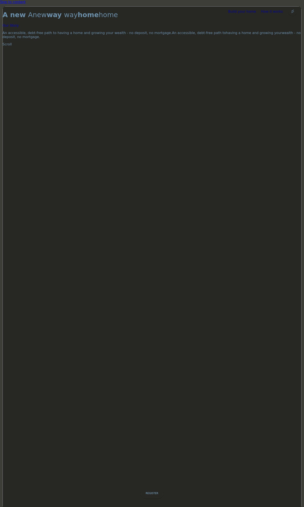
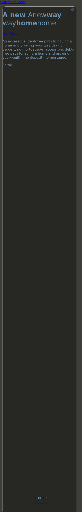

# UI Design System & Master Generation Blueprint: dwell-au

> **Dwell · A new way home** (https://dwell.au/) — Dwell is a third housing option that lets you have a home and build wealth without a deposit or mortgage. Discover a new way home.



---

## 1. Executive Visual Persona & Design Archetype

- **Brand Essence & Persona**: **Dwell · A new way home** (`https://dwell.au/`). Dwell is a third housing option that lets you have a home and build wealth without a deposit or mortgage. Discover a new way home.
- **Visual Archetype**: **Dark-Substrate WebGL / Canvas Interactive Experience (`#3e3e38` / `#badcf7`)**.
- **Anti-AI-Slop Differentiators**:
  - **Source-Grounded Chromatic Polarity**: Anchors the viewport in `#3e3e38` (`var(--g-native-base)` in `:root`) paired with `#d1e5f4` primary typography and `#badcf7` accents.
  - **Extracted Typographic Hierarchy**: Pairs `bo` for display copy (`A new A n e w way w a y home h o m e`) with `fr` and not declared in static CSS (uses primary stack / `ui-monospace`).
  - **Calibrated Spatial Grid & Motion**: Combines `1200px` container bounds (`gap: var(--space-md)`, padding `1px`) with `cubic-bezier(.22,1,.36,1)` easing and HTML5 `<canvas>` Interactive Viewport Surface.

---

## 2. Spatial Architecture & Modular Grid Mathematics



### Viewport Allocation & Container Geometry
- **Captured Viewport Dimensions**: Desktop `1440×2400px` (`assets/desktop.png`, capped at 2400px multi-section capture), Mobile `390×2400px` (`assets/mobile.png`, capped at 2400px multi-section capture).
- **Master Container Bounds**: `1200px` extracted from `dwell-au` stylesheet.
- **Canvas Lateral Padding & Spacing**: `1px` lateral canvas padding with `var(--space-md)` grid gap.
- **Border Radius Scale**: `50%`, `var(--radius-lg)`, `var(--radius-md)`, `999px`.

### Responsive Breakpoint Architecture
- **Desktop Layout**: Multi-column CSS Grid / Flexbox layout at `1440px` (`max-width: 1200px`, `gap: var(--space-md)`).
- **Mobile Layout**: Single-column vertical stack at `390px` viewport width with `1px` horizontal padding.
- **Extracted CSS Media Queries**: `@media (min-aspect-ratio:1440/865)`, `@media (max-width:1200px)`, `@media (max-width:1200px) and (min-aspect-ratio:400/800)`, `@media (max-width:700px) and (orientation:portrait)`.

---

## 3. Color System, Materiality & Atmospheric Lighting

### Semantic Palette & Source Grounding
| Semantic Role | Ground-Truth Value | Extracted CSS Source / Selector |
|---|---|---|
| **Primary Canvas Substrate** | `#3e3e38` | `var(--g-native-base)` in `:root` |
| **Primary Typography Ink** | `#87b6d9` | `var(--field-selector-hover)` in `:root` |
| **Elevated Surface / Card Substrate** | `#aad1ee` | `var(--color-sky)` in `:root` |
| **Interactive Accent / Highlight** | `#badcf7` | `var(--color-dawn)` in `:root` |
| **Secondary / Muted Copy** | `#c4dcee` | `var(--color-mist)` in `:root` |
| **Structural Hairline Border** | `#d1e5f4` | `var(--color-cloud)` in `:root` |

### Sanitized Root CSS Variables (`ui-ux.md` Ground Truth)
| Variable Name | Extracted Value | Semantic Role |
|---|---|---|
| `--header-height` | `calc(108*max(1px,min(.0661376vw,.124069svh)))` | Layout / Spatial Grid Token |
| `--viewport-height` | `100vh` | Layout / Spatial Grid Token |
| `--v-fade` | `opacity .6s var(--io2)` | Design System Custom Token |
| `--n-toggle` | `2.91667vw` | Dimension / Scale Token |
| `--n-gap` | `3.75vw` | Layout / Spatial Grid Token |
| `--menu-offset` | `calc(var(--n-toggle)*-3.8/42)` | Design System Custom Token |
| `--n-img` | `36.1111vw` | Dimension / Scale Token |
| `--n-cut` | `33.3333vw` | Dimension / Scale Token |
| `--n-cut-w` | `min(calc(360*max(1px,min(.0661376vw,.124069svh))),var(--n-cut))` | Dimension / Scale Token |
| `--n-cut-x` | `calc(-58*max(1px,min(.0661376vw,.124069svh)))` | Dimension / Scale Token |
| `--n-cut-y` | `calc(143*max(1px,min(.0661376vw,.124069svh)))` | Dimension / Scale Token |
| `--n-font` | `calc(40.06*max(1px,min(.0661376vw,.124069svh)))` | Typography / Scale Token |
| `--n-photo` | `min(calc(400*max(1px,min(.0661376vw,.124069svh))),var(--n-img))` | Dimension / Scale Token |
| `--n-font-s` | `9.25vw` | Typography / Scale Token |
| `--n-art-y` | `126.5vw` | Dimension / Scale Token |
| `--n-phone-unit` | `clamp(.75px,100svh/764,1px)` | Dimension / Scale Token |

---

## 4. Typographic Scale & Editorial Hierarchy

### Font Family Stacks
- **Display Typography**: `bo`.
- **Primary Body Stack**: `fr`.
- **Technical / Metadata Stack**: not declared in static CSS (uses primary stack / `ui-monospace`).

### Typographic Scale & Rules (Extracted from Stylesheet & Variables)
- **Hero Display (`H1`)**: not explicitly declared on tag in static CSS (stylesheet font-size ladder: `var(--n-font)`, `clamp(16*max(1px,min(.0661376vw,....`, `14vw`, `clamp(30*max(1px,min(.0661376vw,....`, `clamp(28px,5svh,34*max(1px,min(.0...`).
- **Section Heading (`H2`)**: rule `h2` (`font-size: calc(34*max(1px,min(.0661376v...`, `line-height: 1.02`).
- **Body Copy**: CSS variables `--font-weight-body: 359`, `--font-width-body: 95%`; rule `p` (`line-height: 1.05`).
- **Metadata & Navigation Labels**: CSS variables `--field-label: var(--color-moss)`, `--step-label-top: 12%`, `--font-mono: "fr",monospace`.

---

## 5. Choreographed Motion & Interaction Physics

### Primary Easing Curves
- **Extracted Timing Functions**: `cubic-bezier(.22,1,.36,1)`, `cubic-bezier(.4,0,.2,1)`, `cubic-bezier(.33,1,.68,1)`.

### Per-Element Transition & Choreography Rules
- **Selector `.video-preview`**: `transition: var(--v-fade)` extracted from `dwell-au` stylesheet.
- **Selector `media (forced-colors:active)`**: `transition: none` extracted from `dwell-au` stylesheet.
- **Selector `#h-links`**: `transition: opacity .3s var(--io2),visibility 0s` extracted from `dwell-au` stylesheet.
- **Extracted Easing Curve (`cubic-bezier(.22,1,.36,1)`)**: Governs interactive state transitions across `<header.skip-link>` and `<section.scroll>`.
- **Runtime Interaction Engine**: Integrates HTML5 `<canvas>` Interactive Viewport Surface with `prefers-reduced-motion: reduce` fallback guards.

---

## 6. Component Wireframe & Structural DOM Map

### Visual Layout Schematic (Grounded in `dom.html` — `1440px` Desktop & `390px` Mobile Reflow)
```
┌────────────────────────────────────────────────────────────────────────┐
│ DESKTOP VIEWPORT (1440px) — Dwell · A new way home                     │
│ ====================================================================== │
│ [ <header.skip-link>       | Overview · Index · Archive · About · C ]  │
│ ---------------------------------------------------------------------- │
│ | HERO STAGE: <section.hero-scroll>                                |   │
│ | H1: A new A n e w way w a y home h o m e                         |   │
│ | Substrate: #3e3e38    | Ink: #d1e5f4    | Accent: #badcf7        |   │
│ ---------------------------------------------------------------------- │
│ | SHOWCASE GRID (<section.scroll>          ) max-w: 1200px         |   │
│ | +------------------------------+  +------------------------------+ | │
│ | | meet m e e t Dwell D w e l l |  | Build B u i l d for the f o  | | │
│ | +------------------------------+  +------------------------------+ | │
│ ---------------------------------------------------------------------- │
│ | MOBILE VIEWPORT REFLOW (390px) — Single-Column Stack (gap: var(--) | │
│ | [<header.skip-link>] -> [<section.hero-scro] -> [<section.scroll>] | │
│ ---------------------------------------------------------------------- │
│ [ FOOTER (<footer.button-text>  ) | https://dwell.au/                  │
└────────────────────────────────────────────────────────────────────────┘
```

### Granular DOM Region Breakdown
1. **Brand Header & Navigation Bar (<header.skip-link> — `dwell-au`)**:
   - Landmark `<header class="skip-link">` hosting `Dwell · A new way home` navigation (`Overview · Index · Archive · About · Contact`), DOM attributes (`data-fab-register`, `data-header="sky"`, `data-hero="true"`, `data-hero-title="true"`), and stylesheet rule `body { background-image:none }`.
2. **Hero Stage & Focal Lead (<section.hero-scroll> — `A new A n e w way w a y home h o m`)**:
   - Landmark `<section class="hero-scroll hero-rest">` presenting display lead `A new A n e w way w a y home h o m e` and copy excerpt *"Build your home Build your home Build your home Build your home"* over `#3e3e38` canvas and `#d1e5f4` ink.
3. **Primary Showcase & Content Grid (<section.scroll> — `meet m e e t Dwell D w e l l`)**:
   - Landmark `<section class="scroll">` rendering section `meet m e e t Dwell D w e l l` with copy *"Build your home Build your home"*, asset references (`loader-house.webp`, `favicon-96x96.png`, `favicon.svg`, `favicon.ico`), and grid rule `main { flex:1;min-block-size:0 }`.
4. **Interactive Detail & Feature Matrix (<section.scroll> — `Build B u i l d for the f o r t h `)**:
   - Landmark `<section class="scroll">` framing `Build B u i l d for the f o r t h e future f u t...` and `The T h e freedom f r e e d o m to move t o m o v e` (*"How it works How it works How it works How it works"*) with `#aad1ee` surface cards, `#badcf7` accents, and `.page_ { display:block;overflow:visible;block-size:auto }`.
5. **Colophon & Global Directory Footer (<footer.button-text> — `https://dwell.au/`)**:
   - Landmark `<footer class="button-text">` anchoring `Dwell · A new way home` footer links (`Overview · Index · Archive · About · Contact`), copy *"How it works How it works"*, and `#d1e5f4` structural dividers.

---

## 7. Master Zero-Shot AI Generation Prompt

```markdown
# Master Zero-Shot Frontend Generation Prompt: dwell-au (Dwell · A new way home)

You are a principal frontend architect and design systems engineer. Build a complete, production-ready web application replicating the exact design system, DOM landmarks, typographic hierarchy, color tokens, and motion physics of `dwell-au` (**Dwell · A new way home** — `https://dwell.au/`).

### 1. Visual Archetype & Anti-AI-Slop Mandates
- **Archetype**: Dark-Substrate WebGL / Canvas Interactive Experience (`#3e3e38` / `#badcf7`).
- **Identity & Domain Context**: Dwell is a third housing option that lets you have a home and build wealth without a deposit or mortgage. Discover a new way home.
- **Primary Substrate**: `#3e3e38` (`var(--g-native-base)` in `:root`), **Primary Ink**: `#d1e5f4`, **Accent / Highlight**: `#badcf7`.
- **Site-Specific Differentiators**:
  - **Source-Grounded Chromatic Polarity**: Anchors the viewport in `#3e3e38` (`var(--g-native-base)` in `:root`) paired with `#d1e5f4` primary typography and `#badcf7` accents.
  - **Extracted Typographic Hierarchy**: Pairs `bo` for display copy (`A new A n e w way w a y home h o m e`) with `fr` and not declared in static CSS (uses primary stack / `ui-monospace`).
  - **Calibrated Spatial Grid & Motion**: Combines `1200px` container bounds (`gap: var(--space-md)`, padding `1px`) with `cubic-bezier(.22,1,.36,1)` easing and HTML5 `<canvas>` Interactive Viewport Surface.

### 2. Ground-Truth CSS Variables (`:root` Token Contract)
Declare and consume these exact custom properties extracted from `dwell-au` in your global stylesheet:

:root {
  /* Dwell · A new way home (dwell-au) — Ground-Truth Extracted CSS Variables */
  --header-height: calc(108*max(1px,min(.0661376vw,.124069svh))); /* Layout / Spatial Grid Token (dwell-au) */
  --viewport-height: 100vh; /* Layout / Spatial Grid Token (dwell-au) */
  --v-fade: opacity .6s var(--io2); /* Design System Custom Token (dwell-au) */
  --n-toggle: 2.91667vw; /* Dimension / Scale Token (dwell-au) */
  --n-gap: 3.75vw; /* Layout / Spatial Grid Token (dwell-au) */
  --menu-offset: calc(var(--n-toggle)*-3.8/42); /* Design System Custom Token (dwell-au) */
  --n-img: 36.1111vw; /* Dimension / Scale Token (dwell-au) */
  --n-cut: 33.3333vw; /* Dimension / Scale Token (dwell-au) */
  --n-cut-w: min(calc(360*max(1px,min(.0661376vw,.124069svh))),var(--n-cut)); /* Dimension / Scale Token (dwell-au) */
  --n-cut-x: calc(-58*max(1px,min(.0661376vw,.124069svh))); /* Dimension / Scale Token (dwell-au) */
  --n-cut-y: calc(143*max(1px,min(.0661376vw,.124069svh))); /* Dimension / Scale Token (dwell-au) */
  --n-font: calc(40.06*max(1px,min(.0661376vw,.124069svh))); /* Typography / Scale Token (dwell-au) */
  --n-photo: min(calc(400*max(1px,min(.0661376vw,.124069svh))),var(--n-img)); /* Dimension / Scale Token (dwell-au) */
  --n-font-s: 9.25vw; /* Typography / Scale Token (dwell-au) */
  --n-art-y: 126.5vw; /* Dimension / Scale Token (dwell-au) */
  --n-phone-unit: clamp(.75px,100svh/764,1px); /* Dimension / Scale Token (dwell-au) */
}

### 3. Semantic Color & Materiality Contract
Map every surface, ink, and border strictly to these source-grounded tokens:
- **Primary Canvas Substrate**: `#3e3e38` — grounded in `var(--g-native-base)` in `:root`
- **Primary Typography Ink**: `#87b6d9` — grounded in `var(--field-selector-hover)` in `:root`
- **Elevated Surface / Card Substrate**: `#aad1ee` — grounded in `var(--color-sky)` in `:root`
- **Interactive Accent / Highlight**: `#badcf7` — grounded in `var(--color-dawn)` in `:root`
- **Secondary / Muted Copy**: `#c4dcee` — grounded in `var(--color-mist)` in `:root`
- **Structural Hairline Border**: `#d1e5f4` — grounded in `var(--color-cloud)` in `:root`

### 4. Spatial Grid, Container Bounds & Responsive Breakpoints
- **Desktop Viewport Reference**: `1440×2400px` (capped at 2400px multi-section capture, `1440px` standard desktop width).
- **Mobile Viewport Reference**: `390×2400px` (capped at 2400px multi-section capture, `390px` standard mobile width).
- **Container Max-Width**: `1200px` extracted from `dwell-au` stylesheet
- **Padding & Gutters**: `1px` lateral canvas padding with `var(--space-md)` grid gap
- **Desktop Grid**: Multi-column CSS Grid / Flexbox layout at `1440px` (`max-width: 1200px`, `gap: var(--space-md)`)
- **Mobile Adaptation**: Single-column vertical stack at `390px` viewport width with `1px` horizontal padding
- **Media Queries**: `@media (min-aspect-ratio:1440/865)`, `@media (max-width:1200px)`, `@media (max-width:1200px) and (min-aspect-ratio:400/800)`, `@media (max-width:700px) and (orientation:portrait)`
- **Corner Radii**: `50%`, `var(--radius-lg)`, `var(--radius-md)`, `999px`

### 5. Typography & Editorial Scale Contract
- **Display Font Stack**: `bo`
- **Body Font Stack**: `fr`
- **Monospace / Technical Font Stack**: not declared in static CSS (uses primary stack / `ui-monospace`)
- **H1 Display Rule**: not explicitly declared on tag in static CSS (stylesheet font-size ladder: `var(--n-font)`, `clamp(16*max(1px,min(.0661376vw,....`, `14vw`, `clamp(30*max(1px,min(.0661376vw,....`, `clamp(28px,5svh,34*max(1px,min(.0...`)
- **H2 Section Rule**: rule `h2` (`font-size: calc(34*max(1px,min(.0661376v...`, `line-height: 1.02`)
- **Body Copy Rule**: CSS variables `--font-weight-body: 359`, `--font-width-body: 95%`; rule `p` (`line-height: 1.05`)
- **Metadata & Index Rule**: CSS variables `--field-label: var(--color-moss)`, `--step-label-top: 12%`, `--font-mono: "fr",monospace`

### 6. Component Hierarchy, Verbatim Copy & Real DOM Landmarks
Scaffold `dwell-au` (`Dwell · A new way home`) with these exact structural regions, extracted copy, and CSS rules from `dom.html`:
1. **Brand Header & Navigation Bar (<header.skip-link> — `dwell-au`)**:
   - DOM & Selectors: Landmark `<header class="skip-link">` hosting `Dwell · A new way home` navigation (`Overview · Index · Archive · About · Contact`), DOM attributes (`data-fab-register`, `data-header="sky"`, `data-hero="true"`, `data-hero-title="true"`), and stylesheet rule `body { background-image:none }`.
   - Responsive Contract: Header `Brand Header & Navigation Bar (<header.skip-link> — `dwell-au`)` (`dwell-au`) adapts across `@media (min-aspect-ratio:1440/865)`, `@media (max-width:1200px)`, `@media (max-width:1200px) and (min-aspect-ratio:400/800)`, `@media (max-width:700px) and (orientation:portrait)` with `cubic-bezier(.22,1,.36,1)`, `cubic-bezier(.4,0,.2,1)`, `cubic-bezier(.33,1,.68,1)` transitions and links `Overview · Index · Archive · About · Contact`.
2. **Hero Stage & Focal Lead (<section.hero-scroll> — `A new A n e w way w a y home h o m`)**:
   - DOM & Selectors: Landmark `<section class="hero-scroll hero-rest">` presenting display lead `A new A n e w way w a y home h o m e` and copy excerpt *"Build your home Build your home Build your home Build your home"* over `#3e3e38` canvas and `#d1e5f4` ink.
   - Responsive Contract: Hero stage (`1440×2400px` desktop / `390×2400px` mobile) sets `#3e3e38` background with `#d1e5f4` headline `A new A n e w way w a y home h o m e`.
3. **Primary Showcase & Content Grid (<section.scroll> — `meet m e e t Dwell D w e l l`)**:
   - DOM & Selectors: Landmark `<section class="scroll">` rendering section `meet m e e t Dwell D w e l l` with copy *"Build your home Build your home"*, asset references (`loader-house.webp`, `favicon-96x96.png`, `favicon.svg`, `favicon.ico`), and grid rule `main { flex:1;min-block-size:0 }`.
   - Responsive Contract: Showcase grid `Primary Showcase & Content Grid (<section.scroll> — `meet m e e t Dwell D w e l l`)` applies Multi-column CSS Grid / Flexbox layout at `1440px` (`max-width: 1200px`, `gap: var(--space-md)`) on desktop and Single-column vertical stack at `390px` viewport width with `1px` horizontal padding on mobile.
4. **Interactive Detail & Feature Matrix (<section.scroll> — `Build B u i l d for the f o r t h `)**:
   - DOM & Selectors: Landmark `<section class="scroll">` framing `Build B u i l d for the f o r t h e future f u t...` and `The T h e freedom f r e e d o m to move t o m o v e` (*"How it works How it works How it works How it works"*) with `#aad1ee` surface cards, `#badcf7` accents, and `.page_ { display:block;overflow:visible;block-size:auto }`.
   - Responsive Contract: Detail module `Interactive Detail & Feature Matrix (<section.scroll> — `Build B u i l d for the f o r t h `)` uses `50%`, `var(--radius-lg)`, `var(--radius-md)`, `999px` radii, `#badcf7` highlights, and assets (loader-house.webp, favicon-96x96.png, favicon.svg).
5. **Colophon & Global Directory Footer (<footer.button-text> — `https://dwell.au/`)**:
   - DOM & Selectors: Landmark `<footer class="button-text">` anchoring `Dwell · A new way home` footer links (`Overview · Index · Archive · About · Contact`), copy *"How it works How it works"*, and `#d1e5f4` structural dividers.
   - Responsive Contract: Footer `Colophon & Global Directory Footer (<footer.button-text> — `https://dwell.au/`)` aligns to `1200px` extracted from `dwell-au` stylesheet with `1px` lateral canvas padding with `var(--space-md)` grid gap and attributes (data-fab-register, data-header="sky", data-hero="true").

#### Verbatim DOM Copy Excerpts (`dom.html`)
- Copy Excerpt 1: *"Build your home Build your home Build your home Build your home"*
- Copy Excerpt 2: *"Build your home Build your home"*
- Copy Excerpt 3: *"How it works How it works How it works How it works"*
- Copy Excerpt 4: *"How it works How it works"*

### 7. Motion, Extracted Stylesheet Rules & Interaction Choreography
- **Primary Easing Functions**: `cubic-bezier(.22,1,.36,1)`, `cubic-bezier(.4,0,.2,1)`, `cubic-bezier(.33,1,.68,1)`
- **Extracted Stylesheet Rules (`dwell-au`)**:
- `body { background-image:none }`
- `main { flex:1;min-block-size:0 }`
- `.page_ { display:block;overflow:visible;block-size:auto }`
- `.page { display:flow-root;overflow:clip;min-block-size:100%;padding-block-start:... }`
- `gl { position:fixed;z-index:var(--z-gl);pointer-events:none;visibility:hidden... }`
- **Per-Selector Transition Rules**:
- **Selector `.video-preview`**: `transition: var(--v-fade)` extracted from `dwell-au` stylesheet.
- **Selector `media (forced-colors:active)`**: `transition: none` extracted from `dwell-au` stylesheet.
- **Selector `#h-links`**: `transition: opacity .3s var(--io2),visibility 0s` extracted from `dwell-au` stylesheet.
- **Extracted Easing Curve (`cubic-bezier(.22,1,.36,1)`)**: Governs interactive state transitions across `<header.skip-link>` and `<section.scroll>`.
- **Runtime Interaction Engine**: Integrates HTML5 `<canvas>` Interactive Viewport Surface with `prefers-reduced-motion: reduce` fallback guards.

### 8. Technical Deliverables
- Implement in Next.js (App Router) with TypeScript and Tailwind CSS consuming the `:root` custom properties defined above for `dwell-au`.
- Reproduce both the `1440px` desktop architecture and `390px` mobile breakpoint transitions, preserving semantic HTML5 landmarks (`<header>`, `<nav>`, `<main>`, `<section>`, `<footer>`) and `prefers-reduced-motion` accessibility guards.
```
