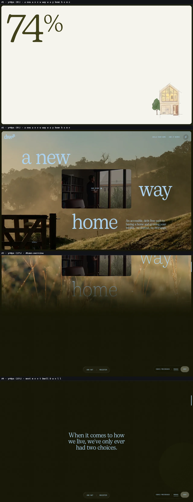
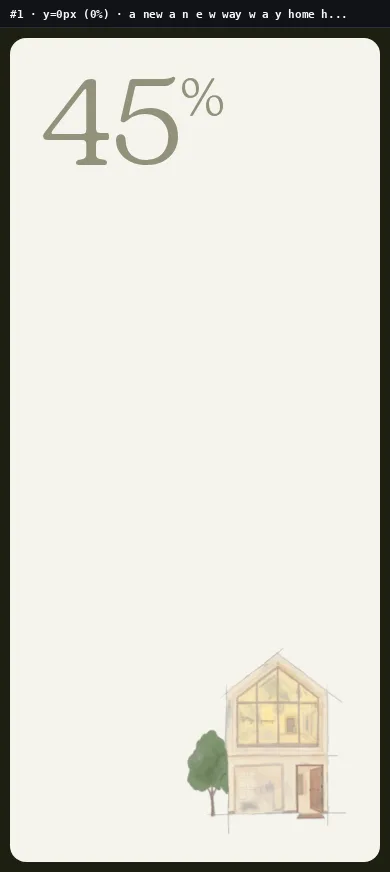

# UI Design System & Master Generation Blueprint: dwell-au

> **Dwell · A new way home** (https://dwell.au/) — Dwell is a third housing option that lets you have a home and build wealth without a deposit or mortgage. Discover a new way home.





---

## 1. Executive Visual Persona & Design Archetype

- **Brand Essence & Persona**: **Dwell · A new way home** (`https://dwell.au/`). Dwell is a third housing option that lets you have a home and build wealth without a deposit or mortgage. Discover a new way home.
- **Capture Provenance**: Live browser capture (`tier1_fast`, HTTP `200`, captured `2026-11-24`).
- **Visual Archetype**: **Dark-Substrate WebGL / Canvas Interactive Experience (`#161605` / `#373710`)**.
- **Anti-AI-Slop Differentiators**:
  - **Live-Computed Chromatic Polarity**: Anchors the viewport in `#161605` (live computed `body` `background-color` (`computed_styles.json`)) paired with `#f5f4ed` primary typography and `#373710` accents.
  - **Grounded Typographic Hierarchy**: Uses `bo` across display (`a new a n e w way w a y home h o m e`) and body copy.
  - **Calibrated Spatial Grid & Motion**: Combines `1416px` container bounds (`gap: 20px`, padding `32px`) with `cubic-bezier(.22,1,.36,1)` easing and HTML5 `<canvas>` Interactive Viewport Surface.

---

## 2. Spatial Architecture & Modular Grid Mathematics

### Viewport Allocation & Container Geometry
- **Captured Journey Filmstrips**: Desktop `1280×3312px` (`assets/desktop-journey.webp`, `4` keyframes up to `y=0px` / doc `900px`), Mobile `390×872px` (`assets/mobile-journey.webp`, `1` keyframes).
- **Master Container Bounds**: `1416px` (measured widest bounded `<section>` landmark width on `1440px` desktop).
- **Canvas Lateral Padding & Spacing**: `32px` lateral canvas padding with `20px` grid gap.
- **Border Radius Scale**: `50%`, `var(--radius-lg)`, `var(--radius-md)`, `999px`.

### Responsive Breakpoint Architecture
- **Desktop Layout**: Multi-column CSS Grid / Flexbox layout at `1440px` (`max-width: 1416px`, `gap: 20px`).
- **Mobile Layout**: Single-column vertical stack at `390px` viewport width with `32px` horizontal padding.
- **Extracted CSS Media Queries**: `@media (min-aspect-ratio:1440/865)`, `@media (max-width:1200px)`, `@media (max-width:1200px) and (min-aspect-ratio:400/800)`, `@media (max-width:700px) and (orientation:portrait)`.

---

## 3. Color System, Materiality & Atmospheric Lighting

### Semantic Palette & Source Grounding
| Semantic Role | Ground-Truth Value | Extracted Live / CSS Source |
|---|---|---|
| **Primary Canvas Substrate** | `#161605` | live computed `body` `background-color` (`computed_styles.json`) |
| **Primary Typography Ink** | `#f5f4ed` | live computed `main` `color` (`computed_styles.json`) |
| **Elevated Surface / Card Substrate** | `#3e3e38` | `.glass:before { background: #3e3e38 }` |
| **Interactive Accent / Highlight** | `#373710` | live computed `button` `color` (`computed_styles.json`) |
| **Secondary / Muted Copy** | `#aad1ee` | live computed `h1` `color` (`computed_styles.json`) |
| **Structural Hairline Border** | `#3a3a27` | `var(--field-hover-border)` in `:root` (`5d5d4980`) |

### Sanitized Root CSS Variables (`ui-ux.md` Ground Truth)
| Variable Name | Extracted Value | Semantic Role |
|---|---|---|
| `--header-height` | `calc(108*max(1px,min(.0661376vw,.124069svh)))` | Layout / Spatial Grid Token |
| `--viewport-height` | `100vh` | Layout / Spatial Grid Token |
| `--v-fade` | `opacity .6s var(--io2)` | Design System Custom Token |
| `--n-toggle` | `2.91667vw` | Dimension / Scale Token |
| `--n-gap` | `3.75vw` | Layout / Spatial Grid Token |
| `--menu-offset` | `calc(var(--n-toggle)*-3.8/42)` | Design System Custom Token |
| `--n-img` | `36.1111vw` | Dimension / Scale Token |
| `--n-cut` | `33.3333vw` | Dimension / Scale Token |
| `--n-cut-w` | `min(calc(360*max(1px,min(.0661376vw,.124069svh))),var(--n-cut))` | Dimension / Scale Token |
| `--n-cut-x` | `calc(-58*max(1px,min(.0661376vw,.124069svh)))` | Dimension / Scale Token |
| `--n-cut-y` | `calc(143*max(1px,min(.0661376vw,.124069svh)))` | Dimension / Scale Token |
| `--n-font` | `calc(40.06*max(1px,min(.0661376vw,.124069svh)))` | Typography / Scale Token |
| `--n-photo` | `min(calc(400*max(1px,min(.0661376vw,.124069svh))),var(--n-img))` | Dimension / Scale Token |
| `--n-font-s` | `9.25vw` | Typography / Scale Token |
| `--n-art-y` | `126.5vw` | Dimension / Scale Token |
| `--n-phone-unit` | `clamp(.75px,100svh/764,1px)` | Dimension / Scale Token |

---

## 4. Typographic Scale & Editorial Hierarchy

### Font Family Stacks
- **Display Typography**: `bo`.
- **Primary Body Stack**: `bo`.
- **Technical / Metadata Stack**: not declared in live computed styles (uses primary stack / `ui-monospace`).

### Typographic Scale & Rules (Live Computed & Stylesheet Grounded)
- **Hero Display (`H1`)**: live computed `h1` (`font-size: 160px`, `line-height: 147.2px`, `font-weight: 360`, `letter-spacing: -4.80001px`).
- **Section Heading (`H2`)**: live computed `h2` (`font-size: 140.849px`, `line-height: 108.454px`, `font-weight: 359`, `letter-spacing: -8.45094px`); rule `h2` (`font-size: calc(34*max(1px,min(.0661376v...`, `line-height: 1.02`).
- **Body Copy**: live computed `body` (`font-size: 16px`, `line-height: normal`, `font-weight: 360`); CSS variables `--font-weight-body: 359`, `--font-width-body: 95%`; rule `p` (`line-height: 1.05`).
- **Metadata & Navigation Labels**: live computed `nav/a` (`font-size: 16px`, `line-height: 16px`, `font-weight: 360`); CSS variables `--field-label: var(--color-moss)`, `--step-label-top: 12%`, `--font-mono: "fr",monospace`.

---

## 5. Choreographed Motion & Interaction Physics

### Primary Easing Curves
- **Extracted Timing Functions**: `cubic-bezier(.22,1,.36,1)`, `cubic-bezier(.4,0,.2,1)`, `cubic-bezier(.33,1,.68,1)`.

### Per-Element Transition & Choreography Rules
- **Selector `.video-preview`**: `transition: var(--v-fade)` extracted from `dwell-au` stylesheet.
- **Selector `media (forced-colors:active)`**: `transition: none` extracted from `dwell-au` stylesheet.
- **Selector `#h-links`**: `transition: opacity .3s var(--io2),visibility 0s` extracted from `dwell-au` stylesheet.
- **Extracted Easing Curve (`cubic-bezier(.22,1,.36,1)`)**: Governs interactive state transitions across `<header.skip-link>` and `<section.scroll>`.
- **Runtime Interaction Engine**: Integrates HTML5 `<canvas>` Interactive Viewport Surface with `prefers-reduced-motion: reduce` fallback guards.
### Measured Runtime Scroll & Interaction Telemetry (`behavioral_journey_v2`)
- **Scroll Driver Mode**: `wheel` (max document height `900px`, deepest scrollY reached `0px` across `4` desktop keyframes).
- **Detected Scroll / Motion Libraries**: `WebGL/Canvas`.
- **Hover Physics (`primary_cta` · `ASK NAT ASK NAT`)**: Computed transition `0s` / `ease` (no static color/transform shift captured at rest).
- **Route Transition Architecture**: First internal navigation (`/how-it-works/video`) measured as `direct` in `1646ms`.

---

## 6. Component Wireframe & Structural DOM Map

### Visual Layout Schematic — Desktop (`1440px`, Grounded in `dom.html` & Landmark Bounding Boxes)
```
┌────────────────────────────────────────────────────────────────────────┐
│ DESKTOP VIEWPORT (1440px) — Dwell · A new way home                     │
│ ====================================================================== │
│ [ <header.skip-link> (1440x108px)     | Overview · Index · Archive · ] │
│ ---------------------------------------------------------------------- │
│ | HERO STAGE: <section.hero-scroll> (w=1440px)                       | │
│ | H1: a new a n e w way w a y home h o m e                           | │
│ | Substrate: #161605 | Ink: #f5f4ed | Accent: #373710                | │
│ ---------------------------------------------------------------------- │
│ | SHOWCASE GRID (<section.scroll>) max-w: 1416px                     | │
│ | +------------------------------+  +------------------------------+ | │
│ | | A new A n e w way w a y home |  | meet m e e t Dwell D w e l l | | │
│ | +------------------------------+  +------------------------------+ | │
│ ---------------------------------------------------------------------- │
│ | DETAIL MODULE (<section.scroll:nth(2)>) — Build B u i l d for t    | │
│ ---------------------------------------------------------------------- │
│ [ FOOTER (<footer.button-text>) | https://dwell.au/                    │
└────────────────────────────────────────────────────────────────────────┘
```

### Visual Layout Schematic — Mobile Reflow (`390px`)
```
┌────────────────────────────────────────────────────────────────────────┐
│ MOBILE VIEWPORT REFLOW (390px) — Single-Column Stack (gap: 20px)       │
│ ====================================================================== │
│ [ HEADER BAR (<header.skip-link>      ) | Compact Menu (390px)         │
│ ---------------------------------------------------------------------- │
│ | HERO STAGE (<section.hero-scroll>) — 390px Vertical Lead           | │
│ | H1: a new a n e w way w a y home h o m e                           | │
│ ---------------------------------------------------------------------- │
│ | SHOWCASE STACK (<section.scroll>) — 1-Col Stack                    | │
│ | [ Item 1: A new A n e w way w a y home h o m e                   ] | │
│ | [ Item 2: meet m e e t Dwell D w e l l                           ] | │
│ ---------------------------------------------------------------------- │
│ | DETAIL STACK (<section.scroll:nth(2)>) — 1-Col (Build B u i l d fo)  │
│ ---------------------------------------------------------------------- │
│ [ FOOTER (<footer.button-text>) | Stacked 390px Colophon               │
└────────────────────────────────────────────────────────────────────────┘
```

### Granular DOM Region Breakdown
1. **Brand Header & Navigation Bar (<header.skip-link> — `dwell-au`)**:
   - Landmark `<header class="skip-link">` (`1440x108px`) hosting `Dwell · A new way home` navigation (`Overview · Index · Archive · About · Contact`), DOM attributes (`data-fab-register`, `data-header="sky"`, `data-hero="true"`, `data-hero-title="true"`), and stylesheet rule `body { background-image:none }`.
2. **Hero Stage & Focal Lead (<section.hero-scroll> — `a new a n e w way w a y home h o m`)**:
   - Landmark `<section class="hero-scroll hero-rest">` presenting display lead `a new a n e w way w a y home h o m e` and copy excerpt *"An accessible, debt-free path to having a home and growing your w"* over `#161605` canvas and `#f5f4ed` ink.
3. **Primary Showcase & Content Grid (<section.scroll> — `A new A n e w way w a y home h o m`)**:
   - Landmark `<section class="scroll">` rendering section `A new A n e w way w a y home h o m e` with copy *"An accessible, debt-free path to"*, asset references (`loader-house.webp`, `favicon-96x96.png`, `favicon.svg`, `favicon.ico`), and grid rule `main { flex:1;min-block-size:0 }`.
4. **Interactive Detail & Feature Matrix (<section.scroll:nth(2)> — `meet m e e t Dwell D w e l l`)**:
   - Landmark `<section class="scroll">` framing `meet m e e t Dwell D w e l l` and `Build B u i l d for the f o r t h e future f u t...` (*"having a home and growing your"*) with `#3e3e38` surface cards, `#373710` accents, and `.page_ { display:block;overflow:visible;block-size:auto }`.
5. **Colophon & Global Directory Footer (<footer.button-text> — `https://dwell.au/`)**:
   - Landmark `<footer class="button-text">` anchoring `Dwell · A new way home` footer links (`Overview · Index · Archive · About · Contact`), copy *"wealth - no deposit, no mortgage."*, and `#3a3a27` structural dividers.
### Full Vertical Scroll Sequence (Desktop `1440×900` Keyframes)
- **Step 01** (`y=0px`, `0%`): Active landmark `a new a n e w way w a y home h o m e` · sticky/fixed elements: `2`
- **Step 02** (`y=0px`, `8%`): Active landmark `a new a n e w way w a y home h o m e` · sticky/fixed elements: `3`
- **Step 03** (`y=0px`, `17%`): Active landmark `#home-overview` · sticky/fixed elements: `3`
- **Step 04** (`y=0px`, `25%`): Active landmark `meet m e e t Dwell D w e l l` · sticky/fixed elements: `3`

### Multi-Page Internal Route Map
- **Detail Route (`/how-it-works/video`)**: `https://dwell.au/how-it-works/video` — H1: `how h o w Dwell D w e l l works w o r k s`, scrollHeight `900px`, transition `direct` (`1646ms`)
- **About Route (`/about`)**: `https://dwell.au/about` — H1: `a third a t h i r d housing h o u s i n g option...`, scrollHeight `900px`, transition `direct` (`1147ms`)
- **Detail Route (`/about/video`)**: `https://dwell.au/about/video` — H1: `a third a t h i r d housing h o u s i n g option...`, scrollHeight `900px`, transition `direct` (`1779ms`)

---

## 7. Master Zero-Shot AI Generation Prompt

```markdown
# Master Zero-Shot Frontend Generation Prompt: dwell-au (Dwell · A new way home)

You are a principal frontend architect and design systems engineer. Build a complete, production-ready web application replicating the exact design system, DOM landmarks, typographic hierarchy, color tokens, and motion physics of `dwell-au` (**Dwell · A new way home** — `https://dwell.au/`).

### 1. Visual Archetype & Anti-AI-Slop Mandates
- **Archetype**: Dark-Substrate WebGL / Canvas Interactive Experience (`#161605` / `#373710`).
- **Identity & Domain Context**: Dwell is a third housing option that lets you have a home and build wealth without a deposit or mortgage. Discover a new way home.
- **Primary Substrate**: `#161605` (live computed `body` `background-color` (`computed_styles.json`)), **Primary Ink**: `#f5f4ed`, **Accent / Highlight**: `#373710`.
- **Site-Specific Differentiators**:
  - **Live-Computed Chromatic Polarity**: Anchors the viewport in `#161605` (live computed `body` `background-color` (`computed_styles.json`)) paired with `#f5f4ed` primary typography and `#373710` accents.
  - **Grounded Typographic Hierarchy**: Uses `bo` across display (`a new a n e w way w a y home h o m e`) and body copy.
  - **Calibrated Spatial Grid & Motion**: Combines `1416px` container bounds (`gap: 20px`, padding `32px`) with `cubic-bezier(.22,1,.36,1)` easing and HTML5 `<canvas>` Interactive Viewport Surface.

### 2. Ground-Truth CSS Variables (`:root` Token Contract)
Declare and consume these exact custom properties extracted from `dwell-au` in your global stylesheet:

:root {
  /* Dwell · A new way home (dwell-au) — Live-Grounded CSS Variables */
  --header-height: calc(108*max(1px,min(.0661376vw,.124069svh))); /* Layout / Spatial Grid Token (dwell-au) */
  --viewport-height: 100vh; /* Layout / Spatial Grid Token (dwell-au) */
  --v-fade: opacity .6s var(--io2); /* Design System Custom Token (dwell-au) */
  --n-toggle: 2.91667vw; /* Dimension / Scale Token (dwell-au) */
  --n-gap: 3.75vw; /* Layout / Spatial Grid Token (dwell-au) */
  --menu-offset: calc(var(--n-toggle)*-3.8/42); /* Design System Custom Token (dwell-au) */
  --n-img: 36.1111vw; /* Dimension / Scale Token (dwell-au) */
  --n-cut: 33.3333vw; /* Dimension / Scale Token (dwell-au) */
  --n-cut-w: min(calc(360*max(1px,min(.0661376vw,.124069svh))),var(--n-cut)); /* Dimension / Scale Token (dwell-au) */
  --n-cut-x: calc(-58*max(1px,min(.0661376vw,.124069svh))); /* Dimension / Scale Token (dwell-au) */
  --n-cut-y: calc(143*max(1px,min(.0661376vw,.124069svh))); /* Dimension / Scale Token (dwell-au) */
  --n-font: calc(40.06*max(1px,min(.0661376vw,.124069svh))); /* Typography / Scale Token (dwell-au) */
  --n-photo: min(calc(400*max(1px,min(.0661376vw,.124069svh))),var(--n-img)); /* Dimension / Scale Token (dwell-au) */
  --n-font-s: 9.25vw; /* Typography / Scale Token (dwell-au) */
  --n-art-y: 126.5vw; /* Dimension / Scale Token (dwell-au) */
  --n-phone-unit: clamp(.75px,100svh/764,1px); /* Dimension / Scale Token (dwell-au) */
}

### 3. Semantic Color & Materiality Contract
Map every surface, ink, and border strictly to these source-grounded tokens:
- **Primary Canvas Substrate**: `#161605` — grounded in live computed `body` `background-color` (`computed_styles.json`)
- **Primary Typography Ink**: `#f5f4ed` — grounded in live computed `main` `color` (`computed_styles.json`)
- **Elevated Surface / Card Substrate**: `#3e3e38` — grounded in `.glass:before { background: #3e3e38 }`
- **Interactive Accent / Highlight**: `#373710` — grounded in live computed `button` `color` (`computed_styles.json`)
- **Secondary / Muted Copy**: `#aad1ee` — grounded in live computed `h1` `color` (`computed_styles.json`)
- **Structural Hairline Border**: `#3a3a27` — grounded in `var(--field-hover-border)` in `:root` (`5d5d4980`)

### 4. Spatial Grid, Container Bounds & Responsive Breakpoints
- **Desktop Viewport Reference**: `1280×3312px` (multi-frame vertical journey filmstrip (3312px), `1440px` standard desktop width).
- **Mobile Viewport Reference**: `390×872px` (full-page live capture (872px), `390px` standard mobile width).
- **Container Max-Width**: `1416px` (measured widest bounded `<section>` landmark width on `1440px` desktop)
- **Padding & Gutters**: `32px` lateral canvas padding with `20px` grid gap
- **Desktop Grid**: Multi-column CSS Grid / Flexbox layout at `1440px` (`max-width: 1416px`, `gap: 20px`)
- **Mobile Adaptation**: Single-column vertical stack at `390px` viewport width with `32px` horizontal padding
- **Media Queries**: `@media (min-aspect-ratio:1440/865)`, `@media (max-width:1200px)`, `@media (max-width:1200px) and (min-aspect-ratio:400/800)`, `@media (max-width:700px) and (orientation:portrait)`
- **Corner Radii**: `50%`, `var(--radius-lg)`, `var(--radius-md)`, `999px`

### 5. Typography & Editorial Scale Contract
- **Display Font Stack**: `bo`
- **Body Font Stack**: `bo`
- **Monospace / Technical Font Stack**: not declared in live computed styles (uses primary stack / `ui-monospace`)
- **H1 Display Rule**: live computed `h1` (`font-size: 160px`, `line-height: 147.2px`, `font-weight: 360`, `letter-spacing: -4.80001px`)
- **H2 Section Rule**: live computed `h2` (`font-size: 140.849px`, `line-height: 108.454px`, `font-weight: 359`, `letter-spacing: -8.45094px`); rule `h2` (`font-size: calc(34*max(1px,min(.0661376v...`, `line-height: 1.02`)
- **Body Copy Rule**: live computed `body` (`font-size: 16px`, `line-height: normal`, `font-weight: 360`); CSS variables `--font-weight-body: 359`, `--font-width-body: 95%`; rule `p` (`line-height: 1.05`)
- **Metadata & Index Rule**: live computed `nav/a` (`font-size: 16px`, `line-height: 16px`, `font-weight: 360`); CSS variables `--field-label: var(--color-moss)`, `--step-label-top: 12%`, `--font-mono: "fr",monospace`

### 6. Component Hierarchy, Verbatim Copy & Real DOM Landmarks
Scaffold `dwell-au` (`Dwell · A new way home`) with these exact structural regions, extracted copy, and CSS rules from `dom.html`:
1. **Brand Header & Navigation Bar (<header.skip-link> — `dwell-au`)**:
   - DOM & Selectors: Landmark `<header class="skip-link">` (`1440x108px`) hosting `Dwell · A new way home` navigation (`Overview · Index · Archive · About · Contact`), DOM attributes (`data-fab-register`, `data-header="sky"`, `data-hero="true"`, `data-hero-title="true"`), and stylesheet rule `body { background-image:none }`.
   - Responsive Contract: Header `Brand Header & Navigation Bar (<header.skip-link> — `dwell-au`)` (`dwell-au`) adapts across `@media (min-aspect-ratio:1440/865)`, `@media (max-width:1200px)`, `@media (max-width:1200px) and (min-aspect-ratio:400/800)`, `@media (max-width:700px) and (orientation:portrait)` with `cubic-bezier(.22,1,.36,1)`, `cubic-bezier(.4,0,.2,1)`, `cubic-bezier(.33,1,.68,1)` transitions and links `Overview · Index · Archive · About · Contact`.
2. **Hero Stage & Focal Lead (<section.hero-scroll> — `a new a n e w way w a y home h o m`)**:
   - DOM & Selectors: Landmark `<section class="hero-scroll hero-rest">` presenting display lead `a new a n e w way w a y home h o m e` and copy excerpt *"An accessible, debt-free path to having a home and growing your w"* over `#161605` canvas and `#f5f4ed` ink.
   - Responsive Contract: Hero stage (`1280×3312px` desktop / `390×872px` mobile) sets `#161605` background with `#f5f4ed` headline `a new a n e w way w a y home h o m e`.
3. **Primary Showcase & Content Grid (<section.scroll> — `A new A n e w way w a y home h o m`)**:
   - DOM & Selectors: Landmark `<section class="scroll">` rendering section `A new A n e w way w a y home h o m e` with copy *"An accessible, debt-free path to"*, asset references (`loader-house.webp`, `favicon-96x96.png`, `favicon.svg`, `favicon.ico`), and grid rule `main { flex:1;min-block-size:0 }`.
   - Responsive Contract: Showcase grid `Primary Showcase & Content Grid (<section.scroll> — `A new A n e w way w a y home h o m`)` applies Multi-column CSS Grid / Flexbox layout at `1440px` (`max-width: 1416px`, `gap: 20px`) on desktop and Single-column vertical stack at `390px` viewport width with `32px` horizontal padding on mobile.
4. **Interactive Detail & Feature Matrix (<section.scroll:nth(2)> — `meet m e e t Dwell D w e l l`)**:
   - DOM & Selectors: Landmark `<section class="scroll">` framing `meet m e e t Dwell D w e l l` and `Build B u i l d for the f o r t h e future f u t...` (*"having a home and growing your"*) with `#3e3e38` surface cards, `#373710` accents, and `.page_ { display:block;overflow:visible;block-size:auto }`.
   - Responsive Contract: Detail module `Interactive Detail & Feature Matrix (<section.scroll:nth(2)> — `meet m e e t Dwell D w e l l`)` uses `50%`, `var(--radius-lg)`, `var(--radius-md)`, `999px` radii, `#373710` highlights, and assets (loader-house.webp, favicon-96x96.png, favicon.svg).
5. **Colophon & Global Directory Footer (<footer.button-text> — `https://dwell.au/`)**:
   - DOM & Selectors: Landmark `<footer class="button-text">` anchoring `Dwell · A new way home` footer links (`Overview · Index · Archive · About · Contact`), copy *"wealth - no deposit, no mortgage."*, and `#3a3a27` structural dividers.
   - Responsive Contract: Footer `Colophon & Global Directory Footer (<footer.button-text> — `https://dwell.au/`)` aligns to `1416px` (measured widest bounded `<section>` landmark width on `1440px` desktop) with `32px` lateral canvas padding with `20px` grid gap and attributes (data-fab-register, data-header="sky", data-hero="true").

#### Verbatim DOM Copy Excerpts (`dom.html`)
- Copy Excerpt 1: *"An accessible, debt-free path to having a home and growing your wealth - no deposi..."*
- Copy Excerpt 2: *"An accessible, debt-free path to"*
- Copy Excerpt 3: *"having a home and growing your"*
- Copy Excerpt 4: *"wealth - no deposit, no mortgage."*

### 7. Motion, Extracted Stylesheet Rules & Interaction Choreography
- **Primary Easing Functions**: `cubic-bezier(.22,1,.36,1)`, `cubic-bezier(.4,0,.2,1)`, `cubic-bezier(.33,1,.68,1)`
- **Extracted Stylesheet Rules (`dwell-au`)**:
- `body { background-image:none }`
- `main { flex:1;min-block-size:0 }`
- `.page_ { display:block;overflow:visible;block-size:auto }`
- `.page { display:flow-root;overflow:clip;min-block-size:100%;padding-block-start:... }`
- `gl { position:fixed;z-index:var(--z-gl);pointer-events:none;visibility:hidden... }`
- **Per-Selector Transition Rules**:
- **Selector `.video-preview`**: `transition: var(--v-fade)` extracted from `dwell-au` stylesheet.
- **Selector `media (forced-colors:active)`**: `transition: none` extracted from `dwell-au` stylesheet.
- **Selector `#h-links`**: `transition: opacity .3s var(--io2),visibility 0s` extracted from `dwell-au` stylesheet.
- **Extracted Easing Curve (`cubic-bezier(.22,1,.36,1)`)**: Governs interactive state transitions across `<header.skip-link>` and `<section.scroll>`.
- **Runtime Interaction Engine**: Integrates HTML5 `<canvas>` Interactive Viewport Surface with `prefers-reduced-motion: reduce` fallback guards.
### 7b. Full-Page Scroll Choreography, Interactive States & Multi-Page Routes
- **Scroll Mechanics**: Implement `wheel` vertical progression up to `900px` across 4 distinct viewport chapters using WebGL/Canvas.
- **Vertical Chapter Sequence**: a new a n e w way w a y hom... (0%) -> a new a n e w way w a y hom... (8%) -> #home-overview (17%) -> meet m e e t Dwell D w e l l (25%).
- **Multi-Page Routes**: Scaffold internal routes `/how-it-works/video` (detail, direct), `/about` (about, direct), `/about/video` (detail, direct) sharing the global header/footer shell and design tokens.

### 8. Technical Deliverables
- Implement in Next.js (App Router) with TypeScript and Tailwind CSS consuming the `:root` custom properties defined above for `dwell-au`.
- Reproduce both the `1440px` desktop architecture and `390px` mobile breakpoint transitions, preserving semantic HTML5 landmarks (`<header>`, `<nav>`, `<main>`, `<section>`, `<footer>`) and `prefers-reduced-motion` accessibility guards.
```
---

## 8. Full-Page Scroll Journey, Interactive States & Subpage Inventory

### Desktop Scroll Keyframes (`1440×900` WebP)
| Step | Scroll Y | Progress | Active Landmark / Section | Sticky/Fixed | Visual Asset |
| :---: | :---: | :---: | :--- | :---: | :--- |
| `#01` | `0px` | `0%` | a new a n e w way w a y home h o m e | `2` | [desktop-step-01.webp](assets/desktop-step-01.webp) |
| `#02` | `0px` | `8%` | a new a n e w way w a y home h o m e | `3` | [desktop-step-02.webp](assets/desktop-step-02.webp) |
| `#03` | `0px` | `17%` | #home-overview | `3` | [desktop-step-03.webp](assets/desktop-step-03.webp) |
| `#04` | `0px` | `25%` | meet m e e t Dwell D w e l l | `3` | [desktop-step-04.webp](assets/desktop-step-04.webp) |

### Mobile Condensed Keyframes (`390×844` WebP)
| Step | Scroll Y | Progress | Active Landmark | Visual Asset |
| :---: | :---: | :---: | :--- | :--- |
| `#01` | `0px` | `0%` | a new a n e w way w a y home h o m e | [mobile-step-01.webp](assets/mobile-step-01.webp) |

### Internal Subpage Filmstrips (`1080px` Wide WebP)
| # | Template | Route URL | H1 / Title | Scroll Height | Transition | Filmstrip Asset |
| :-: | :---: | :--- | :--- | :---: | :---: | :--- |
| `1` | `detail` | `https://dwell.au/how-it-works/video` | how h o w Dwell D w e l l works w o r... | `900px` | `direct` (`1646ms`) | [subpage-01-how-it-works-video.webp](assets/subpage-01-how-it-works-video.webp) |
| `2` | `about` | `https://dwell.au/about` | a third a t h i r d housing h o u s i... | `900px` | `direct` (`1147ms`) | [subpage-02-about.webp](assets/subpage-02-about.webp) |
| `3` | `detail` | `https://dwell.au/about/video` | a third a t h i r d housing h o u s i... | `900px` | `direct` (`1779ms`) | [subpage-03-about-video.webp](assets/subpage-03-about-video.webp) |

