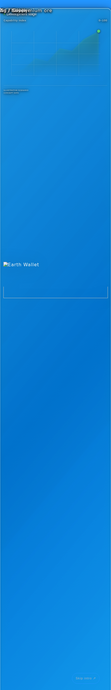

# UI Design System & Master Generation Blueprint: earthwallet-com

> **Earth Wallet — Real assets for unreal markets** (https://earthwallet.com/) — Financial claims can be created at will. Metal has to be found, dug and processed. Earth Wallet on hard assets, critical minerals and Can...


---

## 1. Executive Visual Persona & Design Archetype

- **Brand Essence & Persona**: **Earth Wallet — Real assets for unreal markets** (`https://earthwallet.com/`). Financial claims can be created at will. Metal has to be found, dug and processed. Earth Wallet on hard assets, critical minerals and Can...
- **Visual Archetype**: **Light-Gallery WebGL / Canvas Interactive Experience (`#2496FF` / `#55D171`)**.
- **Anti-AI-Slop Differentiators**:
  - **Source-Grounded Chromatic Polarity**: Anchors the viewport in `#2496FF` (`var(--ew-social-blue)` in `:root`) paired with `#D3EAFF` primary typography and `#55D171` accents.
  - **Extracted Typographic Hierarchy**: Pairs `Gilroy` for display copy (`Look at Canada from ABOVE`) with `Urbanist` and not declared in static CSS (uses primary stack / `ui-monospace`).
  - **Calibrated Spatial Grid & Motion**: Combines `700px` container bounds (`gap: 12px`, padding `12px`) with `cubic-bezier(.2,.6,.2,1)` easing and GSAP Timeline & ScrollTrigger, Three.js / WebGL Canvas Pipeline.

---

## 2. Spatial Architecture & Modular Grid Mathematics



### Viewport Allocation & Container Geometry
- **Captured Viewport Dimensions**: Desktop `1440×2400px` (`assets/desktop.png`, capped at 2400px multi-section capture), Mobile `390×2400px` (`assets/mobile.png`, capped at 2400px multi-section capture).
- **Master Container Bounds**: `700px` extracted from `earthwallet-com` stylesheet.
- **Canvas Lateral Padding & Spacing**: `12px` lateral canvas padding with `12px` grid gap.
- **Border Radius Scale**: `60px`, `16px`, `20px`, `18px`.

### Responsive Breakpoint Architecture
- **Desktop Layout**: Multi-column CSS Grid / Flexbox layout at `1440px` (`max-width: 700px`, `gap: 12px`).
- **Mobile Layout**: Single-column vertical stack at `390px` viewport width with `12px` horizontal padding.
- **Extracted CSS Media Queries**: `@media (max-width:700px)`, `@media (max-width:600px)`, `@media (prefers-reduced-motion:reduce)`, `@media (max-width:540px)`.

---

## 3. Color System, Materiality & Atmospheric Lighting

### Semantic Palette & Source Grounding
| Semantic Role | Ground-Truth Value | Extracted CSS Source / Selector |
|---|---|---|
| **Primary Canvas Substrate** | `#2496FF` | `var(--ew-social-blue)` in `:root` |
| **Primary Typography Ink** | `#7CC0FF` | `var(--ew-social-blue-60)` in `:root` |
| **Elevated Surface / Card Substrate** | `#D3EAFF` | `var(--ew-social-blue-20)` in `:root` |
| **Interactive Accent / Highlight** | `#55D171` | `var(--ew-forest-green)` in `:root` |
| **Secondary / Muted Copy** | `#FFD600` | `var(--ew-electric-yellow)` in `:root` |
| **Structural Hairline Border** | `#FFA800` | `var(--ew-gold)` in `:root` |
| **Variable Token (`--ew-electric-violet`)** | `#691FDD` | `var(--ew-electric-violet)` in `:root` |
| **Variable Token (`--ew-electric-violet-60`)** | `#A579EB` | `var(--ew-electric-violet-60)` in `:root` |
| **Variable Token (`--ew-crimson`)** | `#E22D3F` | `var(--ew-crimson)` in `:root` |
| **Variable Token (`--ew-crimson-20`)** | `#F9D5D9` | `var(--ew-crimson-20)` in `:root` |
| **Variable Token (`--ew-moonlight-grey`)** | `#E6E9ED` | `var(--ew-moonlight-grey)` in `:root` |
| **Variable Token (`--ew-shuttle-gray`)** | `#A5ACBB` | `var(--ew-shuttle-gray)` in `:root` |
| **Variable Token (`--ew-outer-space`)** | `#0F1726` | `var(--ew-outer-space)` in `:root` |
| **Variable Token (`--ew-outer-space-80`)** | `#3F4551` | `var(--ew-outer-space-80)` in `:root` |
| **Variable Token (`--ew-outer-space-60`)** | `#6F747D` | `var(--ew-outer-space-60)` in `:root` |
| **Variable Token (`--ew-outer-space-20`)** | `#CFD1D4` | `var(--ew-outer-space-20)` in `:root` |

### Sanitized Root CSS Variables (`ui-ux.md` Ground Truth)
| Variable Name | Extracted Value | Semantic Role |
|---|---|---|
| `--ew-social-blue` | `#2496FF` | Color / Atmospheric Token |
| `--ew-social-blue-60` | `#7CC0FF` | Color / Atmospheric Token |
| `--ew-social-blue-20` | `#D3EAFF` | Color / Atmospheric Token |
| `--ew-forest-green` | `#55D171` | Color / Atmospheric Token |
| `--ew-electric-yellow` | `#FFD600` | Color / Atmospheric Token |
| `--ew-gold` | `#FFA800` | Color / Atmospheric Token |
| `--ew-electric-violet` | `#691FDD` | Color / Atmospheric Token |
| `--ew-electric-violet-60` | `#A579EB` | Color / Atmospheric Token |
| `--ew-crimson` | `#E22D3F` | Color / Atmospheric Token |
| `--ew-crimson-20` | `#F9D5D9` | Color / Atmospheric Token |
| `--ew-moonlight-grey` | `#E6E9ED` | Canvas / Surface Token |
| `--ew-shuttle-gray` | `#A5ACBB` | Color / Atmospheric Token |
| `--ew-outer-space` | `#0F1726` | Layout / Spatial Grid Token |
| `--ew-outer-space-80` | `#3F4551` | Layout / Spatial Grid Token |
| `--ew-outer-space-60` | `#6F747D` | Layout / Spatial Grid Token |
| `--ew-outer-space-20` | `#CFD1D4` | Layout / Spatial Grid Token |

---

## 4. Typographic Scale & Editorial Hierarchy

### Font Family Stacks
- **Display Typography**: `Gilroy`.
- **Primary Body Stack**: `Urbanist`.
- **Technical / Metadata Stack**: not declared in static CSS (uses primary stack / `ui-monospace`).

### Typographic Scale & Rules (Extracted from Stylesheet & Variables)
- **Hero Display (`H1`)**: CSS variables `--font-display: Gilroy,Urbanist,sans-serif`; rule `h1` (`line-height: 1`, `letter-spacing: -.045em`, `font-weight: 500`).
- **Section Heading (`H2`)**: rule `h2` (`line-height: 1.08`).
- **Body Copy**: CSS variables `--font-body: Poppins,sans-serif`; rule `body` (`font-weight: 300`).
- **Metadata & Navigation Labels**: rule `small` (`font-size: 11px`).

---

## 5. Choreographed Motion & Interaction Physics

### Primary Easing Curves
- **Extracted Timing Functions**: `cubic-bezier(.2,.6,.2,1)`, `cubic-bezier(.2,.7,.2,1)`, `cubic-bezier(.16,1,.3,1)`.

### Per-Element Transition & Choreography Rules
- **Selector `.strata-return`**: `transition: background-color .2s,color .2s` extracted from `earthwallet-com` stylesheet.
- **Selector `.strata-return`**: `transition: opacity .6s,background-color .2s` extracted from `earthwallet-com` stylesheet.
- **Selector `.newsletter-form input[type=email]`**: `transition: border-color .2s,background-color .2s` extracted from `earthwallet-com` stylesheet.
- **Extracted Easing Curve (`cubic-bezier(.2,.6,.2,1)`)**: Governs interactive state transitions across `<header.hero-orbit>` and `<section.descent-copy>`.
- **Runtime Interaction Engine**: Integrates GSAP Timeline & ScrollTrigger, Three.js / WebGL Canvas Pipeline with `prefers-reduced-motion: reduce` fallback guards.

---

## 6. Component Wireframe & Structural DOM Map

### Visual Layout Schematic (Grounded in `dom.html` — `1440px` Desktop & `390px` Mobile Reflow)
```
┌────────────────────────────────────────────────────────────────────────┐
│ DESKTOP VIEWPORT (1440px) — Earth Wallet — Real assets for unreal mark │
│ ====================================================================== │
│ [ <header.hero-orbit>      | Overview · Index · Archive · About · C ]  │
│ ---------------------------------------------------------------------- │
│ | HERO STAGE: <section.orbit-ui>                                   |   │
│ | H1: Look at Canada from ABOVE                                    |   │
│ | Substrate: #2496FF    | Ink: #D3EAFF    | Accent: #55D171        |   │
│ ---------------------------------------------------------------------- │
│ | SHOWCASE GRID (<section.descent-copy>    ) max-w: 700px          |   │
│ | +------------------------------+  +------------------------------+ | │
│ | | Not from the side.           |  | From the ground. Into our fu | | │
│ | +------------------------------+  +------------------------------+ | │
│ ---------------------------------------------------------------------- │
│ | MOBILE VIEWPORT REFLOW (390px) — Single-Column Stack (gap: 12px  ) | │
│ | [<header.hero-orbit] -> [<section.orbit-ui>] -> [<section.descent-c] │
│ ---------------------------------------------------------------------- │
│ [ FOOTER (<footer.planet-rendere) | https://earthwallet.com/           │
└────────────────────────────────────────────────────────────────────────┘
```

### Granular DOM Region Breakdown
1. **Brand Header & Navigation Bar (<header.hero-orbit> — `earthwallet-com`)**:
   - Landmark `<header class="hero-orbit">` hosting `Earth Wallet — Real assets for unrea` navigation (`Overview · Index · Archive · About · Contact`), DOM attributes (`data-frame-ms="7232.6"`, `data-scene-progress="0.0"`, `data-engine="three.js r160"`), and stylesheet rule `font-face { font-family:Gilroy;src:local('Gilroy-Medium'),local('Gilroy Medium');fon... }`.
2. **Hero Stage & Focal Lead (<section.orbit-ui> — `Look at Canada from ABOVE`)**:
   - Landmark `<section class="orbit-ui">` presenting display lead `Look at Canada from ABOVE` and copy excerpt *"A CHANGE IN PERSPECTIVE"* over `#2496FF` canvas and `#D3EAFF` ink.
3. **Primary Showcase & Content Grid (<section.descent-copy> — `Not from the side.`)**:
   - Landmark `<section class="descent-copy">` rendering section `Not from the side.` with copy *"Look at Canada from"*, asset references (`site.webmanifest`, `favicon-32.png`, `icon-192.png`, `apple-touch-icon.png`), and grid rule `body { font-family:var(--font-body);font-weight:300 }`.
4. **Interactive Detail & Feature Matrix (<section.cloud-copy> — `From the ground. Into our future.`)**:
   - Landmark `<section class="cloud-copy">` framing `From the ground. Into our future.` and `The world’s demand for critical minerals is outpa...` (*"An uninterrupted journey that begins in polar orbit and descends "*) with `#D3EAFF` surface cards, `#55D171` accents, and `.ending-chart h3 { font-family:var(--font-display);font-weight:600;letter-spacing:-.01em }`.
5. **Colophon & Global Directory Footer (<footer.planet-rendered> — `https://earthwallet.com/`)**:
   - Landmark `<footer class="planet-rendered">` anchoring `Earth Wallet — Real assets for u` footer links (`Overview · Index · Archive · About · Contact`), copy *"Forty years of exporting raw concentrate and importing the f"*, and `#FFA800` structural dividers.

---

## 7. Master Zero-Shot AI Generation Prompt

```markdown
# Master Zero-Shot Frontend Generation Prompt: earthwallet-com (Earth Wallet — Real assets for unreal markets)

You are a principal frontend architect and design systems engineer. Build a complete, production-ready web application replicating the exact design system, DOM landmarks, typographic hierarchy, color tokens, and motion physics of `earthwallet-com` (**Earth Wallet — Real assets for unreal markets** — `https://earthwallet.com/`).

### 1. Visual Archetype & Anti-AI-Slop Mandates
- **Archetype**: Light-Gallery WebGL / Canvas Interactive Experience (`#2496FF` / `#55D171`).
- **Identity & Domain Context**: Financial claims can be created at will. Metal has to be found, dug and processed. Earth Wallet on hard assets, critical minerals and Can...
- **Primary Substrate**: `#2496FF` (`var(--ew-social-blue)` in `:root`), **Primary Ink**: `#D3EAFF`, **Accent / Highlight**: `#55D171`.
- **Site-Specific Differentiators**:
  - **Source-Grounded Chromatic Polarity**: Anchors the viewport in `#2496FF` (`var(--ew-social-blue)` in `:root`) paired with `#D3EAFF` primary typography and `#55D171` accents.
  - **Extracted Typographic Hierarchy**: Pairs `Gilroy` for display copy (`Look at Canada from ABOVE`) with `Urbanist` and not declared in static CSS (uses primary stack / `ui-monospace`).
  - **Calibrated Spatial Grid & Motion**: Combines `700px` container bounds (`gap: 12px`, padding `12px`) with `cubic-bezier(.2,.6,.2,1)` easing and GSAP Timeline & ScrollTrigger, Three.js / WebGL Canvas Pipeline.

### 2. Ground-Truth CSS Variables (`:root` Token Contract)
Declare and consume these exact custom properties extracted from `earthwallet-com` in your global stylesheet:

:root {
  /* Earth Wallet — Real assets for unreal markets (earthwallet-com) — Ground-Truth Extracted CSS Variables */
  --ew-social-blue: #2496FF; /* Color / Atmospheric Token (earthwallet-com) */
  --ew-social-blue-60: #7CC0FF; /* Color / Atmospheric Token (earthwallet-com) */
  --ew-social-blue-20: #D3EAFF; /* Color / Atmospheric Token (earthwallet-com) */
  --ew-forest-green: #55D171; /* Color / Atmospheric Token (earthwallet-com) */
  --ew-electric-yellow: #FFD600; /* Color / Atmospheric Token (earthwallet-com) */
  --ew-gold: #FFA800; /* Color / Atmospheric Token (earthwallet-com) */
  --ew-electric-violet: #691FDD; /* Color / Atmospheric Token (earthwallet-com) */
  --ew-electric-violet-60: #A579EB; /* Color / Atmospheric Token (earthwallet-com) */
  --ew-crimson: #E22D3F; /* Color / Atmospheric Token (earthwallet-com) */
  --ew-crimson-20: #F9D5D9; /* Color / Atmospheric Token (earthwallet-com) */
  --ew-moonlight-grey: #E6E9ED; /* Canvas / Surface Token (earthwallet-com) */
  --ew-shuttle-gray: #A5ACBB; /* Color / Atmospheric Token (earthwallet-com) */
  --ew-outer-space: #0F1726; /* Layout / Spatial Grid Token (earthwallet-com) */
  --ew-outer-space-80: #3F4551; /* Layout / Spatial Grid Token (earthwallet-com) */
  --ew-outer-space-60: #6F747D; /* Layout / Spatial Grid Token (earthwallet-com) */
  --ew-outer-space-20: #CFD1D4; /* Layout / Spatial Grid Token (earthwallet-com) */
}

### 3. Semantic Color & Materiality Contract
Map every surface, ink, and border strictly to these source-grounded tokens:
- **Primary Canvas Substrate**: `#2496FF` — grounded in `var(--ew-social-blue)` in `:root`
- **Primary Typography Ink**: `#7CC0FF` — grounded in `var(--ew-social-blue-60)` in `:root`
- **Elevated Surface / Card Substrate**: `#D3EAFF` — grounded in `var(--ew-social-blue-20)` in `:root`
- **Interactive Accent / Highlight**: `#55D171` — grounded in `var(--ew-forest-green)` in `:root`
- **Secondary / Muted Copy**: `#FFD600` — grounded in `var(--ew-electric-yellow)` in `:root`
- **Structural Hairline Border**: `#FFA800` — grounded in `var(--ew-gold)` in `:root`
- **Variable Token (`--ew-electric-violet`)**: `#691FDD` — grounded in `var(--ew-electric-violet)` in `:root`
- **Variable Token (`--ew-electric-violet-60`)**: `#A579EB` — grounded in `var(--ew-electric-violet-60)` in `:root`
- **Variable Token (`--ew-crimson`)**: `#E22D3F` — grounded in `var(--ew-crimson)` in `:root`
- **Variable Token (`--ew-crimson-20`)**: `#F9D5D9` — grounded in `var(--ew-crimson-20)` in `:root`
- **Variable Token (`--ew-moonlight-grey`)**: `#E6E9ED` — grounded in `var(--ew-moonlight-grey)` in `:root`
- **Variable Token (`--ew-shuttle-gray`)**: `#A5ACBB` — grounded in `var(--ew-shuttle-gray)` in `:root`
- **Variable Token (`--ew-outer-space`)**: `#0F1726` — grounded in `var(--ew-outer-space)` in `:root`
- **Variable Token (`--ew-outer-space-80`)**: `#3F4551` — grounded in `var(--ew-outer-space-80)` in `:root`
- **Variable Token (`--ew-outer-space-60`)**: `#6F747D` — grounded in `var(--ew-outer-space-60)` in `:root`
- **Variable Token (`--ew-outer-space-20`)**: `#CFD1D4` — grounded in `var(--ew-outer-space-20)` in `:root`

### 4. Spatial Grid, Container Bounds & Responsive Breakpoints
- **Desktop Viewport Reference**: `1440×2400px` (capped at 2400px multi-section capture, `1440px` standard desktop width).
- **Mobile Viewport Reference**: `390×2400px` (capped at 2400px multi-section capture, `390px` standard mobile width).
- **Container Max-Width**: `700px` extracted from `earthwallet-com` stylesheet
- **Padding & Gutters**: `12px` lateral canvas padding with `12px` grid gap
- **Desktop Grid**: Multi-column CSS Grid / Flexbox layout at `1440px` (`max-width: 700px`, `gap: 12px`)
- **Mobile Adaptation**: Single-column vertical stack at `390px` viewport width with `12px` horizontal padding
- **Media Queries**: `@media (max-width:700px)`, `@media (max-width:600px)`, `@media (prefers-reduced-motion:reduce)`, `@media (max-width:540px)`
- **Corner Radii**: `60px`, `16px`, `20px`, `18px`

### 5. Typography & Editorial Scale Contract
- **Display Font Stack**: `Gilroy`
- **Body Font Stack**: `Urbanist`
- **Monospace / Technical Font Stack**: not declared in static CSS (uses primary stack / `ui-monospace`)
- **H1 Display Rule**: CSS variables `--font-display: Gilroy,Urbanist,sans-serif`; rule `h1` (`line-height: 1`, `letter-spacing: -.045em`, `font-weight: 500`)
- **H2 Section Rule**: rule `h2` (`line-height: 1.08`)
- **Body Copy Rule**: CSS variables `--font-body: Poppins,sans-serif`; rule `body` (`font-weight: 300`)
- **Metadata & Index Rule**: rule `small` (`font-size: 11px`)

### 6. Component Hierarchy, Verbatim Copy & Real DOM Landmarks
Scaffold `earthwallet-com` (`Earth Wallet — Real assets for unreal markets`) with these exact structural regions, extracted copy, and CSS rules from `dom.html`:
1. **Brand Header & Navigation Bar (<header.hero-orbit> — `earthwallet-com`)**:
   - DOM & Selectors: Landmark `<header class="hero-orbit">` hosting `Earth Wallet — Real assets for unrea` navigation (`Overview · Index · Archive · About · Contact`), DOM attributes (`data-frame-ms="7232.6"`, `data-scene-progress="0.0"`, `data-engine="three.js r160"`), and stylesheet rule `font-face { font-family:Gilroy;src:local('Gilroy-Medium'),local('Gilroy Medium');fon... }`.
   - Responsive Contract: Header `Brand Header & Navigation Bar (<header.hero-orbit> — `earthwallet-com`)` (`earthwallet-com`) adapts across `@media (max-width:700px)`, `@media (max-width:600px)`, `@media (prefers-reduced-motion:reduce)`, `@media (max-width:540px)` with `cubic-bezier(.2,.6,.2,1)`, `cubic-bezier(.2,.7,.2,1)`, `cubic-bezier(.16,1,.3,1)` transitions and links `Overview · Index · Archive · About · Contact`.
2. **Hero Stage & Focal Lead (<section.orbit-ui> — `Look at Canada from ABOVE`)**:
   - DOM & Selectors: Landmark `<section class="orbit-ui">` presenting display lead `Look at Canada from ABOVE` and copy excerpt *"A CHANGE IN PERSPECTIVE"* over `#2496FF` canvas and `#D3EAFF` ink.
   - Responsive Contract: Hero stage (`1440×2400px` desktop / `390×2400px` mobile) sets `#2496FF` background with `#D3EAFF` headline `Look at Canada from ABOVE`.
3. **Primary Showcase & Content Grid (<section.descent-copy> — `Not from the side.`)**:
   - DOM & Selectors: Landmark `<section class="descent-copy">` rendering section `Not from the side.` with copy *"Look at Canada from"*, asset references (`site.webmanifest`, `favicon-32.png`, `icon-192.png`, `apple-touch-icon.png`), and grid rule `body { font-family:var(--font-body);font-weight:300 }`.
   - Responsive Contract: Showcase grid `Primary Showcase & Content Grid (<section.descent-copy> — `Not from the side.`)` applies Multi-column CSS Grid / Flexbox layout at `1440px` (`max-width: 700px`, `gap: 12px`) on desktop and Single-column vertical stack at `390px` viewport width with `12px` horizontal padding on mobile.
4. **Interactive Detail & Feature Matrix (<section.cloud-copy> — `From the ground. Into our future.`)**:
   - DOM & Selectors: Landmark `<section class="cloud-copy">` framing `From the ground. Into our future.` and `The world’s demand for critical minerals is outpa...` (*"An uninterrupted journey that begins in polar orbit and descends "*) with `#D3EAFF` surface cards, `#55D171` accents, and `.ending-chart h3 { font-family:var(--font-display);font-weight:600;letter-spacing:-.01em }`.
   - Responsive Contract: Detail module `Interactive Detail & Feature Matrix (<section.cloud-copy> — `From the ground. Into our future.`)` uses `60px`, `16px`, `20px`, `18px` radii, `#55D171` highlights, and assets (site.webmanifest, favicon-32.png, icon-192.png).
5. **Colophon & Global Directory Footer (<footer.planet-rendered> — `https://earthwallet.com/`)**:
   - DOM & Selectors: Landmark `<footer class="planet-rendered">` anchoring `Earth Wallet — Real assets for u` footer links (`Overview · Index · Archive · About · Contact`), copy *"Forty years of exporting raw concentrate and importing the f"*, and `#FFA800` structural dividers.
   - Responsive Contract: Footer `Colophon & Global Directory Footer (<footer.planet-rendered> — `https://earthwallet.com/`)` aligns to `700px` extracted from `earthwallet-com` stylesheet with `12px` lateral canvas padding with `12px` grid gap and attributes (data-frame-ms="7232.6", data-scene-progress="0.0", data-engine="three.js r160").

#### Verbatim DOM Copy Excerpts (`dom.html`)
- Copy Excerpt 1: *"A CHANGE IN PERSPECTIVE"*
- Copy Excerpt 2: *"Look at Canada from"*
- Copy Excerpt 3: *"An uninterrupted journey that begins in polar orbit and descends to the ground ben..."*
- Copy Excerpt 4: *"Forty years of exporting raw concentrate and importing the finished product."*

### 7. Motion, Extracted Stylesheet Rules & Interaction Choreography
- **Primary Easing Functions**: `cubic-bezier(.2,.6,.2,1)`, `cubic-bezier(.2,.7,.2,1)`, `cubic-bezier(.16,1,.3,1)`
- **Extracted Stylesheet Rules (`earthwallet-com`)**:
- `font-face { font-family:Gilroy;src:local('Gilroy-Medium'),local('Gilroy Medium');fon... }`
- `body { font-family:var(--font-body);font-weight:300 }`
- `.ending-chart h3 { font-family:var(--font-display);font-weight:600;letter-spacing:-.01em }`
- `.cloud-copy p { line-height:1.25 }`
- `.after-journey h2 { line-height:1.08 }`
- **Per-Selector Transition Rules**:
- **Selector `.strata-return`**: `transition: background-color .2s,color .2s` extracted from `earthwallet-com` stylesheet.
- **Selector `.strata-return`**: `transition: opacity .6s,background-color .2s` extracted from `earthwallet-com` stylesheet.
- **Selector `.newsletter-form input[type=email]`**: `transition: border-color .2s,background-color .2s` extracted from `earthwallet-com` stylesheet.
- **Extracted Easing Curve (`cubic-bezier(.2,.6,.2,1)`)**: Governs interactive state transitions across `<header.hero-orbit>` and `<section.descent-copy>`.
- **Runtime Interaction Engine**: Integrates GSAP Timeline & ScrollTrigger, Three.js / WebGL Canvas Pipeline with `prefers-reduced-motion: reduce` fallback guards.

### 8. Technical Deliverables
- Implement in Next.js (App Router) with TypeScript and Tailwind CSS consuming the `:root` custom properties defined above for `earthwallet-com`.
- Reproduce both the `1440px` desktop architecture and `390px` mobile breakpoint transitions, preserving semantic HTML5 landmarks (`<header>`, `<nav>`, `<main>`, `<section>`, `<footer>`) and `prefers-reduced-motion` accessibility guards.
```
