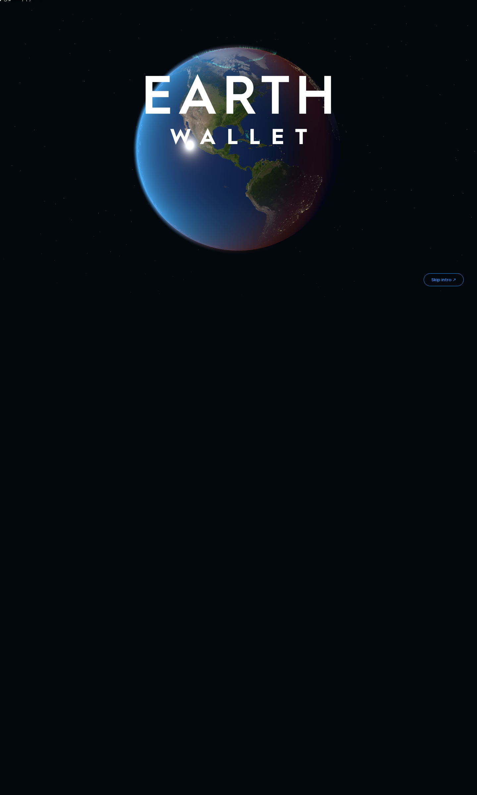

# UI Design System & Master Generation Blueprint: earthwallet-com

> **Earth Wallet — Real assets for unreal markets** (https://earthwallet.com/) — Financial claims can be created at will. Metal has to be found, dug and processed. Earth Wallet on hard assets, critical minerals and Can...



---

## 1. Executive Visual Persona & Design Archetype

- **Brand Essence & Persona**: **Earth Wallet — Real assets for unreal markets** (`https://earthwallet.com/`). Financial claims can be created at will. Metal has to be found, dug and processed. Earth Wallet on hard assets, critical minerals and Can...
- **Capture Provenance**: Live browser capture (`tier1_fast`, HTTP `200`, captured `2026-11-23`).
- **Visual Archetype**: **Dark-Substrate WebGL / Canvas Interactive Experience (`#03080d` / `#0000ff`)**.
- **Anti-AI-Slop Differentiators**:
  - **Live-Computed Chromatic Polarity**: Anchors the viewport in `#03080d` (live computed `html` `background-color` (`computed_styles.json`)) paired with `#ffffff` primary typography and `#0000ff` accents.
  - **Grounded Typographic Hierarchy**: Pairs `Gilroy` for display copy (`Lookat CanadafromABOVE`) with `Poppins` and not declared in live computed styles (uses primary stack / `ui-monospace`).
  - **Calibrated Spatial Grid & Motion**: Combines `1440px` container bounds (`gap: 10px`, padding `69.12px`) with `cubic-bezier(.2,.7,.2,1)` easing and GSAP Timeline & ScrollTrigger, Three.js / WebGL Canvas Pipeline.

---

## 2. Spatial Architecture & Modular Grid Mathematics


### Viewport Allocation & Container Geometry
- **Captured Viewport Dimensions**: Desktop `1440×2400px` (`assets/desktop.png`, clamped at 2400px live multi-section capture), Mobile `390×2400px` (`assets/mobile.png`, clamped at 2400px live multi-section capture).
- **Master Container Bounds**: `1440px` (non-`@media` desktop container stylesheet rule).
- **Canvas Lateral Padding & Spacing**: `69.12px` lateral canvas padding with `10px` grid gap.
- **Border Radius Scale**: `60px`, `14px`, `11px`, `12px`.

### Responsive Breakpoint Architecture
- **Desktop Layout**: Multi-column CSS Grid / Flexbox layout at `1440px` (`max-width: 1440px`, `gap: 10px`).
- **Mobile Layout**: Single-column vertical stack at `390px` viewport width with `69.12px` horizontal padding.
- **Extracted CSS Media Queries**: `@media (max-width:700px)`, `@media (max-width:540px)`, `@media (min-width:701px)`, `@media (prefers-reduced-motion:reduce)`.

---

## 3. Color System, Materiality & Atmospheric Lighting

### Semantic Palette & Source Grounding
| Semantic Role | Ground-Truth Value | Extracted Live / CSS Source |
|---|---|---|
| **Primary Canvas Substrate** | `#03080d` | live computed `html` `background-color` (`computed_styles.json`) |
| **Primary Typography Ink** | `#ffffff` | live computed `button` `color` (`computed_styles.json`) |
| **Elevated Surface / Card Substrate** | `#263848` | `.mineral-pin { background: #263848 }` |
| **Interactive Accent / Highlight** | `#0000ff` | `button:hover { color: blue }` (`#0000ff`) |
| **Secondary / Muted Copy** | `#869599` | `var(--muted)` in `:root` |
| **Structural Hairline Border** | `#2b3338` | `var(--line)` in `:root` (`rgba(202,223,229,.2)`) |
| **Variable Token (`--ink`)** | `#e7efef` | `var(--ink)` in `:root` |
| **Variable Token (`--ew-social-blue`)** | `#2496ff` | `var(--ew-social-blue)` in `:root` |
| **Variable Token (`--ew-social-blue-60`)** | `#7cc0ff` | `var(--ew-social-blue-60)` in `:root` |
| **Variable Token (`--ew-social-blue-20`)** | `#d3eaff` | `var(--ew-social-blue-20)` in `:root` |
| **Variable Token (`--ew-forest-green`)** | `#55d171` | `var(--ew-forest-green)` in `:root` |
| **Variable Token (`--ew-electric-yellow`)** | `#ffd600` | `var(--ew-electric-yellow)` in `:root` |
| **Variable Token (`--ew-gold`)** | `#ffa800` | `var(--ew-gold)` in `:root` |
| **Variable Token (`--ew-electric-violet`)** | `#691fdd` | `var(--ew-electric-violet)` in `:root` |
| **Variable Token (`--ew-electric-violet-60`)** | `#a579eb` | `var(--ew-electric-violet-60)` in `:root` |
| **Variable Token (`--ew-crimson`)** | `#e22d3f` | `var(--ew-crimson)` in `:root` |
| **Variable Token (`--ew-crimson-20`)** | `#f9d5d9` | `var(--ew-crimson-20)` in `:root` |
| **Variable Token (`--ew-moonlight-grey`)** | `#e6e9ed` | `var(--ew-moonlight-grey)` in `:root` |
| **Variable Token (`--ew-shuttle-gray`)** | `#a5acbb` | `var(--ew-shuttle-gray)` in `:root` |
| **Variable Token (`--ew-outer-space`)** | `#0f1726` | `var(--ew-outer-space)` in `:root` |

### Sanitized Root CSS Variables (`ui-ux.md` Ground Truth)
| Variable Name | Extracted Value | Semantic Role |
|---|---|---|
| `--ink` | `#e7efef` | Typography Ink Token |
| `--muted` | `#869599` | Color / Atmospheric Token |
| `--line` | `rgba(202,223,229,.2)` | Color / Atmospheric Token |
| `--ew-social-blue` | `#2496FF` | Color / Atmospheric Token |
| `--ew-social-blue-60` | `#7CC0FF` | Color / Atmospheric Token |
| `--ew-social-blue-20` | `#D3EAFF` | Color / Atmospheric Token |
| `--ew-forest-green` | `#55D171` | Color / Atmospheric Token |
| `--ew-electric-yellow` | `#FFD600` | Color / Atmospheric Token |
| `--ew-gold` | `#FFA800` | Color / Atmospheric Token |
| `--ew-electric-violet` | `#691FDD` | Color / Atmospheric Token |
| `--ew-electric-violet-60` | `#A579EB` | Color / Atmospheric Token |
| `--ew-crimson` | `#E22D3F` | Color / Atmospheric Token |
| `--ew-crimson-20` | `#F9D5D9` | Color / Atmospheric Token |
| `--ew-moonlight-grey` | `#E6E9ED` | Canvas / Surface Token |
| `--ew-shuttle-gray` | `#A5ACBB` | Color / Atmospheric Token |
| `--ew-outer-space` | `#0F1726` | Layout / Spatial Grid Token |

---

## 4. Typographic Scale & Editorial Hierarchy

### Font Family Stacks
- **Display Typography**: `Gilroy`.
- **Primary Body Stack**: `Poppins`.
- **Technical / Metadata Stack**: not declared in live computed styles (uses primary stack / `ui-monospace`).

### Typographic Scale & Rules (Live Computed & Stylesheet Grounded)
- **Hero Display (`H1`)**: live computed `h1` (`font-size: 66.24px`, `line-height: 66.24px`, `font-weight: 500`, `letter-spacing: -2.9808px`); CSS variables `--font-display: Gilroy,Urbanist,sans-serif`; rule `h1` (`line-height: 1`, `letter-spacing: -.045em`, `font-weight: 500`).
- **Section Heading (`H2`)**: live computed `h2` (`font-size: 80px`, `line-height: 86.4px`, `font-weight: 600`, `letter-spacing: -0.8px`); rule `h2` (`font-size: clamp(27px,3.35vw,48px)`, `line-height: 1.1`, `letter-spacing: -.055em`, `font-weight: 400`).
- **Body Copy**: live computed `body` (`font-size: 16px`, `line-height: normal`, `font-weight: 300`); CSS variables `--font-body: Poppins,sans-serif`; rule `p` (`font-size: clamp(24px,3.05vw,47px)`, `line-height: 1.4`, `letter-spacing: -1.2px`, `font-weight: 400`).
- **Metadata & Navigation Labels**: live computed `nav/a` (`font-size: 21.6px`, `line-height: normal`, `font-weight: 500`, `letter-spacing: -1.188px`); rule `small` (`font-size: 12px`, `letter-spacing: 0`, `font-weight: 300`).

---

## 5. Choreographed Motion & Interaction Physics

### Primary Easing Curves
- **Extracted Timing Functions**: `cubic-bezier(.2,.7,.2,1)`, `cubic-bezier(.2,.6,.2,1)`, `cubic-bezier(.16,1,.3,1)`.

### Per-Element Transition & Choreography Rules
- **Selector `media(hover:hover) and (pointer:f...`**: `transition: transform .28s cubic-bezier(.2,.7,.2,1),box-shadow .28s` extracted from `earthwallet-com` stylesheet.
- **Selector `media(prefers-reduced-motion:reduce)`**: `transition: none!important` extracted from `earthwallet-com` stylesheet.
- **Selector `.coordinates`**: `transition: opacity .3s` extracted from `earthwallet-com` stylesheet.
- **Extracted Easing Curve (`cubic-bezier(.2,.7,.2,1)`)**: Governs interactive state transitions across `<header.hero-orbit>` and `<section.descent-copy>`.
- **Runtime Interaction Engine**: Integrates GSAP Timeline & ScrollTrigger, Three.js / WebGL Canvas Pipeline with `prefers-reduced-motion: reduce` fallback guards.

---

## 6. Component Wireframe & Structural DOM Map

### Visual Layout Schematic — Desktop (`1440px`, Grounded in `dom.html` & Landmark Bounding Boxes)
```
┌────────────────────────────────────────────────────────────────────────┐
│ DESKTOP VIEWPORT (1440px) — Earth Wallet — Real assets for unreal mark │
│ ====================================================================== │
│ [ <header.hero-orbit> (1440x72px)     | Overview · Index · Archive · ] │
│ ---------------------------------------------------------------------- │
│ | HERO STAGE: <section.orbit-ui> (w=1440px)                          | │
│ | H1: Lookat CanadafromABOVE                                         | │
│ | Substrate: #03080d | Ink: #ffffff | Accent: #0000ff                | │
│ ---------------------------------------------------------------------- │
│ | SHOWCASE GRID (<section.descent-copy>) max-w: 1440px               | │
│ | +------------------------------+  +------------------------------+ | │
│ | | Look at Canada from ABOVE    |  | Not from the side.           | | │
│ | +------------------------------+  +------------------------------+ | │
│ ---------------------------------------------------------------------- │
│ | DETAIL MODULE (<section.cloud-copy>) — From the ground. Into       | │
│ ---------------------------------------------------------------------- │
│ [ FOOTER (<footer.planet-rende) | https://earthwallet.com/             │
└────────────────────────────────────────────────────────────────────────┘
```

### Visual Layout Schematic — Mobile Reflow (`390px`)
```
┌────────────────────────────────────────────────────────────────────────┐
│ MOBILE VIEWPORT REFLOW (390px) — Single-Column Stack (gap: 10px)       │
│ ====================================================================== │
│ [ HEADER BAR (<header.hero-orbit>     ) | Compact Menu (390px)         │
│ ---------------------------------------------------------------------- │
│ | HERO STAGE (<section.orbit-ui>) — 390px Vertical Lead              | │
│ | H1: Lookat CanadafromABOVE                                         | │
│ ---------------------------------------------------------------------- │
│ | SHOWCASE STACK (<section.descent-copy>) — 1-Col Stack              | │
│ | [ Item 1: Look at Canada from ABOVE                              ] | │
│ | [ Item 2: Not from the side.                                     ] | │
│ ---------------------------------------------------------------------- │
│ | DETAIL STACK (<section.cloud-copy>) — 1-Col (From the ground. I)   | │
│ ---------------------------------------------------------------------- │
│ [ FOOTER (<footer.planet-rende) | Stacked 390px Colophon               │
└────────────────────────────────────────────────────────────────────────┘
```

### Granular DOM Region Breakdown
1. **Brand Header & Navigation Bar (<header.hero-orbit> — `earthwallet-com`)**:
   - Landmark `<header class="hero-orbit">` (`1440x72px`) hosting `Earth Wallet — Real assets for unrea` navigation (`Overview · Index · Archive · About · Contact`), DOM attributes (`data-frame-ms="1933.3"`, `data-scene-progress="3.0"`, `data-engine="three.js r160"`), and stylesheet rule `.survey-status { display:none }`.
2. **Hero Stage & Focal Lead (<section.orbit-ui> — `Lookat CanadafromABOVE`)**:
   - Landmark `<section class="orbit-ui">` presenting display lead `Lookat CanadafromABOVE` and copy excerpt *"04 / THE STOCKPILE"* over `#03080d` canvas and `#ffffff` ink.
3. **Primary Showcase & Content Grid (<section.descent-copy> — `Look at Canada from ABOVE`)**:
   - Landmark `<section class="descent-copy">` rendering section `Look at Canada from ABOVE` with copy *"A CHANGE IN PERSPECTIVE"*, asset references (`site.webmanifest`, `favicon-32.png`, `icon-192.png`, `apple-touch-icon.png`), and grid rule `.survey-heading h2 { font-size:clamp(27px,3.35vw,48px);line-height:1.1;letter-spacing:-.055em... }`.
4. **Interactive Detail & Feature Matrix (<section.cloud-copy> — `Not from the side.`)**:
   - Landmark `<section class="cloud-copy">` framing `Not from the side.` and `From the ground. Into our future.` (*"Look at Canada from"*) with `#263848` surface cards, `#0000ff` accents, and `.survey-subtitle { font-size:clamp(10px,1vw,14px);line-height:1.4;color:d5dfe8 }`.
5. **Colophon & Global Directory Footer (<footer.planet-rendered> — `https://earthwallet.com/`)**:
   - Landmark `<footer class="planet-rendered">` anchoring `Earth Wallet — Real assets for u` footer links (`Overview · Index · Archive · About · Contact`), copy *"An uninterrupted journey that begins in polar orbit and desc"*, and `#2b3338` structural dividers.

---

## 7. Master Zero-Shot AI Generation Prompt

```markdown
# Master Zero-Shot Frontend Generation Prompt: earthwallet-com (Earth Wallet — Real assets for unreal markets)

You are a principal frontend architect and design systems engineer. Build a complete, production-ready web application replicating the exact design system, DOM landmarks, typographic hierarchy, color tokens, and motion physics of `earthwallet-com` (**Earth Wallet — Real assets for unreal markets** — `https://earthwallet.com/`).

### 1. Visual Archetype & Anti-AI-Slop Mandates
- **Archetype**: Dark-Substrate WebGL / Canvas Interactive Experience (`#03080d` / `#0000ff`).
- **Identity & Domain Context**: Financial claims can be created at will. Metal has to be found, dug and processed. Earth Wallet on hard assets, critical minerals and Can...
- **Primary Substrate**: `#03080d` (live computed `html` `background-color` (`computed_styles.json`)), **Primary Ink**: `#ffffff`, **Accent / Highlight**: `#0000ff`.
- **Site-Specific Differentiators**:
  - **Live-Computed Chromatic Polarity**: Anchors the viewport in `#03080d` (live computed `html` `background-color` (`computed_styles.json`)) paired with `#ffffff` primary typography and `#0000ff` accents.
  - **Grounded Typographic Hierarchy**: Pairs `Gilroy` for display copy (`Lookat CanadafromABOVE`) with `Poppins` and not declared in live computed styles (uses primary stack / `ui-monospace`).
  - **Calibrated Spatial Grid & Motion**: Combines `1440px` container bounds (`gap: 10px`, padding `69.12px`) with `cubic-bezier(.2,.7,.2,1)` easing and GSAP Timeline & ScrollTrigger, Three.js / WebGL Canvas Pipeline.

### 2. Ground-Truth CSS Variables (`:root` Token Contract)
Declare and consume these exact custom properties extracted from `earthwallet-com` in your global stylesheet:

:root {
  /* Earth Wallet — Real assets for unreal markets (earthwallet-com) — Live-Grounded CSS Variables */
  --ink: #e7efef; /* Typography Ink Token (earthwallet-com) */
  --muted: #869599; /* Color / Atmospheric Token (earthwallet-com) */
  --line: rgba(202,223,229,.2); /* Color / Atmospheric Token (earthwallet-com) */
  --ew-social-blue: #2496FF; /* Color / Atmospheric Token (earthwallet-com) */
  --ew-social-blue-60: #7CC0FF; /* Color / Atmospheric Token (earthwallet-com) */
  --ew-social-blue-20: #D3EAFF; /* Color / Atmospheric Token (earthwallet-com) */
  --ew-forest-green: #55D171; /* Color / Atmospheric Token (earthwallet-com) */
  --ew-electric-yellow: #FFD600; /* Color / Atmospheric Token (earthwallet-com) */
  --ew-gold: #FFA800; /* Color / Atmospheric Token (earthwallet-com) */
  --ew-electric-violet: #691FDD; /* Color / Atmospheric Token (earthwallet-com) */
  --ew-electric-violet-60: #A579EB; /* Color / Atmospheric Token (earthwallet-com) */
  --ew-crimson: #E22D3F; /* Color / Atmospheric Token (earthwallet-com) */
  --ew-crimson-20: #F9D5D9; /* Color / Atmospheric Token (earthwallet-com) */
  --ew-moonlight-grey: #E6E9ED; /* Canvas / Surface Token (earthwallet-com) */
  --ew-shuttle-gray: #A5ACBB; /* Color / Atmospheric Token (earthwallet-com) */
  --ew-outer-space: #0F1726; /* Layout / Spatial Grid Token (earthwallet-com) */
}

### 3. Semantic Color & Materiality Contract
Map every surface, ink, and border strictly to these source-grounded tokens:
- **Primary Canvas Substrate**: `#03080d` — grounded in live computed `html` `background-color` (`computed_styles.json`)
- **Primary Typography Ink**: `#ffffff` — grounded in live computed `button` `color` (`computed_styles.json`)
- **Elevated Surface / Card Substrate**: `#263848` — grounded in `.mineral-pin { background: #263848 }`
- **Interactive Accent / Highlight**: `#0000ff` — grounded in `button:hover { color: blue }` (`#0000ff`)
- **Secondary / Muted Copy**: `#869599` — grounded in `var(--muted)` in `:root`
- **Structural Hairline Border**: `#2b3338` — grounded in `var(--line)` in `:root` (`rgba(202,223,229,.2)`)
- **Variable Token (`--ink`)**: `#e7efef` — grounded in `var(--ink)` in `:root`
- **Variable Token (`--ew-social-blue`)**: `#2496ff` — grounded in `var(--ew-social-blue)` in `:root`
- **Variable Token (`--ew-social-blue-60`)**: `#7cc0ff` — grounded in `var(--ew-social-blue-60)` in `:root`
- **Variable Token (`--ew-social-blue-20`)**: `#d3eaff` — grounded in `var(--ew-social-blue-20)` in `:root`
- **Variable Token (`--ew-forest-green`)**: `#55d171` — grounded in `var(--ew-forest-green)` in `:root`
- **Variable Token (`--ew-electric-yellow`)**: `#ffd600` — grounded in `var(--ew-electric-yellow)` in `:root`
- **Variable Token (`--ew-gold`)**: `#ffa800` — grounded in `var(--ew-gold)` in `:root`
- **Variable Token (`--ew-electric-violet`)**: `#691fdd` — grounded in `var(--ew-electric-violet)` in `:root`
- **Variable Token (`--ew-electric-violet-60`)**: `#a579eb` — grounded in `var(--ew-electric-violet-60)` in `:root`
- **Variable Token (`--ew-crimson`)**: `#e22d3f` — grounded in `var(--ew-crimson)` in `:root`
- **Variable Token (`--ew-crimson-20`)**: `#f9d5d9` — grounded in `var(--ew-crimson-20)` in `:root`
- **Variable Token (`--ew-moonlight-grey`)**: `#e6e9ed` — grounded in `var(--ew-moonlight-grey)` in `:root`
- **Variable Token (`--ew-shuttle-gray`)**: `#a5acbb` — grounded in `var(--ew-shuttle-gray)` in `:root`
- **Variable Token (`--ew-outer-space`)**: `#0f1726` — grounded in `var(--ew-outer-space)` in `:root`

### 4. Spatial Grid, Container Bounds & Responsive Breakpoints
- **Desktop Viewport Reference**: `1440×2400px` (clamped at 2400px live multi-section capture, `1440px` standard desktop width).
- **Mobile Viewport Reference**: `390×2400px` (clamped at 2400px live multi-section capture, `390px` standard mobile width).
- **Container Max-Width**: `1440px` (non-`@media` desktop container stylesheet rule)
- **Padding & Gutters**: `69.12px` lateral canvas padding with `10px` grid gap
- **Desktop Grid**: Multi-column CSS Grid / Flexbox layout at `1440px` (`max-width: 1440px`, `gap: 10px`)
- **Mobile Adaptation**: Single-column vertical stack at `390px` viewport width with `69.12px` horizontal padding
- **Media Queries**: `@media (max-width:700px)`, `@media (max-width:540px)`, `@media (min-width:701px)`, `@media (prefers-reduced-motion:reduce)`
- **Corner Radii**: `60px`, `14px`, `11px`, `12px`

### 5. Typography & Editorial Scale Contract
- **Display Font Stack**: `Gilroy`
- **Body Font Stack**: `Poppins`
- **Monospace / Technical Font Stack**: not declared in live computed styles (uses primary stack / `ui-monospace`)
- **H1 Display Rule**: live computed `h1` (`font-size: 66.24px`, `line-height: 66.24px`, `font-weight: 500`, `letter-spacing: -2.9808px`); CSS variables `--font-display: Gilroy,Urbanist,sans-serif`; rule `h1` (`line-height: 1`, `letter-spacing: -.045em`, `font-weight: 500`)
- **H2 Section Rule**: live computed `h2` (`font-size: 80px`, `line-height: 86.4px`, `font-weight: 600`, `letter-spacing: -0.8px`); rule `h2` (`font-size: clamp(27px,3.35vw,48px)`, `line-height: 1.1`, `letter-spacing: -.055em`, `font-weight: 400`)
- **Body Copy Rule**: live computed `body` (`font-size: 16px`, `line-height: normal`, `font-weight: 300`); CSS variables `--font-body: Poppins,sans-serif`; rule `p` (`font-size: clamp(24px,3.05vw,47px)`, `line-height: 1.4`, `letter-spacing: -1.2px`, `font-weight: 400`)
- **Metadata & Index Rule**: live computed `nav/a` (`font-size: 21.6px`, `line-height: normal`, `font-weight: 500`, `letter-spacing: -1.188px`); rule `small` (`font-size: 12px`, `letter-spacing: 0`, `font-weight: 300`)

### 6. Component Hierarchy, Verbatim Copy & Real DOM Landmarks
Scaffold `earthwallet-com` (`Earth Wallet — Real assets for unreal markets`) with these exact structural regions, extracted copy, and CSS rules from `dom.html`:
1. **Brand Header & Navigation Bar (<header.hero-orbit> — `earthwallet-com`)**:
   - DOM & Selectors: Landmark `<header class="hero-orbit">` (`1440x72px`) hosting `Earth Wallet — Real assets for unrea` navigation (`Overview · Index · Archive · About · Contact`), DOM attributes (`data-frame-ms="1933.3"`, `data-scene-progress="3.0"`, `data-engine="three.js r160"`), and stylesheet rule `.survey-status { display:none }`.
   - Responsive Contract: Header `Brand Header & Navigation Bar (<header.hero-orbit> — `earthwallet-com`)` (`earthwallet-com`) adapts across `@media (max-width:700px)`, `@media (max-width:540px)`, `@media (min-width:701px)`, `@media (prefers-reduced-motion:reduce)` with `cubic-bezier(.2,.7,.2,1)`, `cubic-bezier(.2,.6,.2,1)`, `cubic-bezier(.16,1,.3,1)` transitions and links `Overview · Index · Archive · About · Contact`.
2. **Hero Stage & Focal Lead (<section.orbit-ui> — `Lookat CanadafromABOVE`)**:
   - DOM & Selectors: Landmark `<section class="orbit-ui">` presenting display lead `Lookat CanadafromABOVE` and copy excerpt *"04 / THE STOCKPILE"* over `#03080d` canvas and `#ffffff` ink.
   - Responsive Contract: Hero stage (`1440×2400px` desktop / `390×2400px` mobile) sets `#03080d` background with `#ffffff` headline `Lookat CanadafromABOVE`.
3. **Primary Showcase & Content Grid (<section.descent-copy> — `Look at Canada from ABOVE`)**:
   - DOM & Selectors: Landmark `<section class="descent-copy">` rendering section `Look at Canada from ABOVE` with copy *"A CHANGE IN PERSPECTIVE"*, asset references (`site.webmanifest`, `favicon-32.png`, `icon-192.png`, `apple-touch-icon.png`), and grid rule `.survey-heading h2 { font-size:clamp(27px,3.35vw,48px);line-height:1.1;letter-spacing:-.055em... }`.
   - Responsive Contract: Showcase grid `Primary Showcase & Content Grid (<section.descent-copy> — `Look at Canada from ABOVE`)` applies Multi-column CSS Grid / Flexbox layout at `1440px` (`max-width: 1440px`, `gap: 10px`) on desktop and Single-column vertical stack at `390px` viewport width with `69.12px` horizontal padding on mobile.
4. **Interactive Detail & Feature Matrix (<section.cloud-copy> — `Not from the side.`)**:
   - DOM & Selectors: Landmark `<section class="cloud-copy">` framing `Not from the side.` and `From the ground. Into our future.` (*"Look at Canada from"*) with `#263848` surface cards, `#0000ff` accents, and `.survey-subtitle { font-size:clamp(10px,1vw,14px);line-height:1.4;color:d5dfe8 }`.
   - Responsive Contract: Detail module `Interactive Detail & Feature Matrix (<section.cloud-copy> — `Not from the side.`)` uses `60px`, `14px`, `11px`, `12px` radii, `#0000ff` highlights, and assets (site.webmanifest, favicon-32.png, icon-192.png).
5. **Colophon & Global Directory Footer (<footer.planet-rendered> — `https://earthwallet.com/`)**:
   - DOM & Selectors: Landmark `<footer class="planet-rendered">` anchoring `Earth Wallet — Real assets for u` footer links (`Overview · Index · Archive · About · Contact`), copy *"An uninterrupted journey that begins in polar orbit and desc"*, and `#2b3338` structural dividers.
   - Responsive Contract: Footer `Colophon & Global Directory Footer (<footer.planet-rendered> — `https://earthwallet.com/`)` aligns to `1440px` (non-`@media` desktop container stylesheet rule) with `69.12px` lateral canvas padding with `10px` grid gap and attributes (data-frame-ms="1933.3", data-scene-progress="3.0", data-engine="three.js r160").

#### Verbatim DOM Copy Excerpts (`dom.html`)
- Copy Excerpt 1: *"04 / THE STOCKPILE"*
- Copy Excerpt 2: *"A CHANGE IN PERSPECTIVE"*
- Copy Excerpt 3: *"Look at Canada from"*
- Copy Excerpt 4: *"An uninterrupted journey that begins in polar orbit and descends to the ground ben..."*

### 7. Motion, Extracted Stylesheet Rules & Interaction Choreography
- **Primary Easing Functions**: `cubic-bezier(.2,.7,.2,1)`, `cubic-bezier(.2,.6,.2,1)`, `cubic-bezier(.16,1,.3,1)`
- **Extracted Stylesheet Rules (`earthwallet-com`)**:
- `.survey-status { display:none }`
- `.survey-heading h2 { font-size:clamp(27px,3.35vw,48px);line-height:1.1;letter-spacing:-.055em... }`
- `.survey-subtitle { font-size:clamp(10px,1vw,14px);line-height:1.4;color:d5dfe8 }`
- `.mineral-card-heading { display:flex;gap:10px;align-items:center;min-height:56px;margin-bottom:18px }`
- `.mineral-name { font-size:14px;color:f2f5fa;letter-spacing:-.3px;line-height:1.3 }`
- **Per-Selector Transition Rules**:
- **Selector `media(hover:hover) and (pointer:f...`**: `transition: transform .28s cubic-bezier(.2,.7,.2,1),box-shadow .28s` extracted from `earthwallet-com` stylesheet.
- **Selector `media(prefers-reduced-motion:reduce)`**: `transition: none!important` extracted from `earthwallet-com` stylesheet.
- **Selector `.coordinates`**: `transition: opacity .3s` extracted from `earthwallet-com` stylesheet.
- **Extracted Easing Curve (`cubic-bezier(.2,.7,.2,1)`)**: Governs interactive state transitions across `<header.hero-orbit>` and `<section.descent-copy>`.
- **Runtime Interaction Engine**: Integrates GSAP Timeline & ScrollTrigger, Three.js / WebGL Canvas Pipeline with `prefers-reduced-motion: reduce` fallback guards.

### 8. Technical Deliverables
- Implement in Next.js (App Router) with TypeScript and Tailwind CSS consuming the `:root` custom properties defined above for `earthwallet-com`.
- Reproduce both the `1440px` desktop architecture and `390px` mobile breakpoint transitions, preserving semantic HTML5 landmarks (`<header>`, `<nav>`, `<main>`, `<section>`, `<footer>`) and `prefers-reduced-motion` accessibility guards.
```
