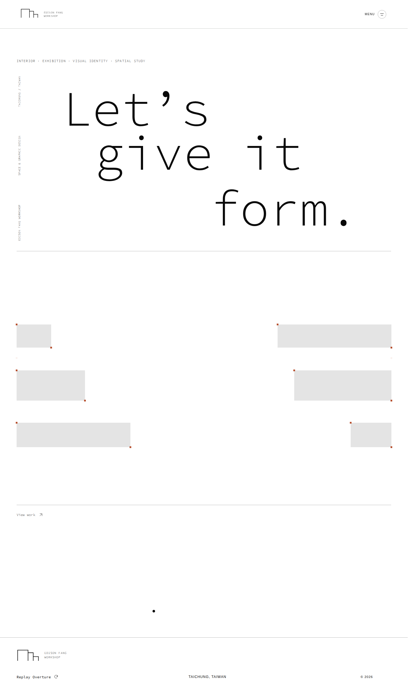
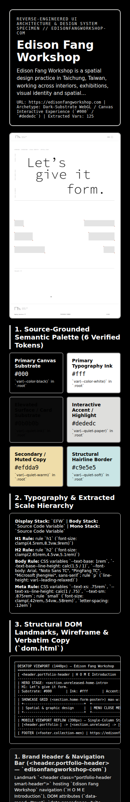

# UI Design System & Master Generation Blueprint: edisonfangworkshop-com

> **Edison Fang Workshop** (https://edisonfangworkshop.com) — Edison Fang Workshop is a spatial design practice in Taichung, Taiwan, working across interiors, exhibitions, visual identity and spatial...



---

## 1. Executive Visual Persona & Design Archetype

- **Brand Essence & Persona**: **Edison Fang Workshop** (`https://edisonfangworkshop.com`). Edison Fang Workshop is a spatial design practice in Taichung, Taiwan, working across interiors, exhibitions, visual identity and spatial...
- **Visual Archetype**: **Dark-Substrate WebGL / Canvas Interactive Experience (`#000` / `#dededc`)**.
- **Anti-AI-Slop Differentiators**:
  - **Source-Grounded Chromatic Polarity**: Anchors the viewport in `#000` (`var(--color-black)` in `:root`) paired with `#fff` primary typography and `#dededc` accents.
  - **Extracted Typographic Hierarchy**: Pairs `EFW` for display copy (`Let’s give it form.`) with `Source Code Variable` and `Source Code Variable`.
  - **Calibrated Spatial Grid & Motion**: Combines `28ch` container bounds (`gap: 20px`, padding `10px`) with `cubic-bezier(0,0,.2,1)` easing and HTML5 `<canvas>` Interactive Viewport Surface.

---

## 2. Spatial Architecture & Modular Grid Mathematics



### Viewport Allocation & Container Geometry
- **Captured Viewport Dimensions**: Desktop `1440×2411px` (`assets/desktop.png`, full-page scroll capture), Mobile `390×2400px` (`assets/mobile.png`, capped at 2400px multi-section capture).
- **Master Container Bounds**: `28ch` extracted from `edisonfangworkshop-com` stylesheet.
- **Canvas Lateral Padding & Spacing**: `10px` lateral canvas padding with `20px` grid gap.
- **Border Radius Scale**: `50%`, `.25rem`, `2px`, `4px`.

### Responsive Breakpoint Architecture
- **Desktop Layout**: Multi-column CSS Grid / Flexbox layout at `1440px` (`max-width: 28ch`, `gap: 20px`).
- **Mobile Layout**: Single-column vertical stack at `390px` viewport width with `10px` horizontal padding.
- **Extracted CSS Media Queries**: `@media (width<=760px)`, `@media (prefers-reduced-motion:reduce)`, `@media (width>=40rem)`, `@media (width>=48rem)`.

---

## 3. Color System, Materiality & Atmospheric Lighting

### Semantic Palette & Source Grounding
| Semantic Role | Ground-Truth Value | Extracted CSS Source / Selector |
|---|---|---|
| **Primary Canvas Substrate** | `#000` | `var(--color-black)` in `:root` |
| **Primary Typography Ink** | `#fff` | `var(--color-white)` in `:root` |
| **Elevated Surface / Card Substrate** | `#0b0b0b` | `var(--quiet-ink)` in `:root` |
| **Interactive Accent / Highlight** | `#dededc` | `var(--quiet-paper)` in `:root` |
| **Secondary / Muted Copy** | `#efdda9` | `var(--quiet-warm)` in `:root` |
| **Structural Hairline Border** | `#c9e5e5` | `var(--quiet-soft)` in `:root` |

### Sanitized Root CSS Variables (`ui-ux.md` Ground Truth)
| Variable Name | Extracted Value | Semantic Role |
|---|---|---|
| `--mood-line` | `color-mix(in srgb,var(--mood-fg) 30%,transparent)` | Dimension / Scale Token |
| `--project-bg` | `var(--mood-bg)` | Canvas / Surface Token |
| `--project-text` | `var(--mood-fg)` | Typography Ink Token |
| `--project-muted` | `var(--mood-fg)` | Design System Custom Token |
| `--echo-paper` | `var(--mood-bg)` | Canvas / Surface Token |
| `--echo-ink` | `var(--mood-fg)` | Typography Ink Token |
| `--echo-muted` | `var(--project-muted)` | Design System Custom Token |
| `--color-black` | `#000` | Canvas / Surface Token |
| `--color-white` | `#fff` | Canvas / Surface Token |
| `--spacing` | `.25rem` | Layout / Spatial Grid Token |
| `--container-xs` | `20rem` | Layout / Spatial Grid Token |
| `--container-sm` | `24rem` | Layout / Spatial Grid Token |
| `--container-lg` | `32rem` | Layout / Spatial Grid Token |
| `--text-xs` | `.75rem` | Typography Ink Token |
| `--text-xs--line-height` | `calc(1 / .75)` | Typography Ink Token |
| `--text-sm` | `.875rem` | Typography Ink Token |

---

## 4. Typographic Scale & Editorial Hierarchy

### Font Family Stacks
- **Display Typography**: `EFW`.
- **Primary Body Stack**: `Source Code Variable`.
- **Technical / Metadata Stack**: `Source Code Variable`.

### Typographic Scale & Rules (Extracted from Stylesheet & Variables)
- **Hero Display (`H1`)**: rule `h1` (`font-size: clamp(4.5rem,8.3vw,9rem)`).
- **Section Heading (`H2`)**: rule `h2` (`font-size: clamp(2.65rem,4.5vw,5.1rem)`).
- **Body Copy**: CSS variables `--text-base: 1rem`, `--text-base--line-height: calc(1.5 / 1)`, `--font-body: Arial, "Noto Sans TC", "PingFang TC", "Microsoft JhengHei", sans-serif`; rule `p` (`line-height: var(--leading-relaxed)`).
- **Metadata & Navigation Labels**: CSS variables `--text-xs: .75rem`, `--text-xs--line-height: calc(1 / .75)`, `--text-sm: .875rem`; rule `small` (`font-size: clamp(.42rem,.54vw,.58rem)`, `letter-spacing: .12em`).

---

## 5. Choreographed Motion & Interaction Physics

### Primary Easing Curves
- **Extracted Timing Functions**: `cubic-bezier(0,0,.2,1)`, `cubic-bezier(.4,0,.2,1)`, `cubic-bezier(.4,0,.6,1)`.

### Per-Element Transition & Choreography Rules
- **Selector `.mood-toggle[data-state=open]>span`**: `transition: none` extracted from `edisonfangworkshop-com` stylesheet.
- **Selector `.mood-orbit-knob`**: `transition: opacity .18s` extracted from `edisonfangworkshop-com` stylesheet.
- **Selector `media (prefers-reduced-motion:red...`**: `transition: none` extracted from `edisonfangworkshop-com` stylesheet.
- **Extracted Easing Curve (`cubic-bezier(0,0,.2,1)`)**: Governs interactive state transitions across `<header.portfolio-header>` and `<section.home-form-poster>`.
- **Runtime Interaction Engine**: Integrates HTML5 `<canvas>` Interactive Viewport Surface with `prefers-reduced-motion: reduce` fallback guards.

---

## 6. Component Wireframe & Structural DOM Map

### Visual Layout Schematic (Grounded in `dom.html` — `1440px` Desktop & `390px` Mobile Reflow)
```
┌────────────────────────────────────────────────────────────────────────┐
│ DESKTOP VIEWPORT (1440px) — Edison Fang Workshop                       │
│ ====================================================================== │
│ [ <header.portfolio-header | H O M E Introduction                   ]  │
│ ---------------------------------------------------------------------- │
│ | HERO STAGE: <section.unreleased-home-intro>                      |   │
│ | H1: Let’s give it form.                                          |   │
│ | Substrate: #000       | Ink: #fff       | Accent: #dededc        |   │
│ ---------------------------------------------------------------------- │
│ | SHOWCASE GRID (<section.home-form-poster>) max-w: 28ch           |   │
│ | +------------------------------+  +------------------------------+ | │
│ | | Spatial & graphic design     |  | MENU CLOSE MENU CLOSE        | | │
│ | +------------------------------+  +------------------------------+ | │
│ ---------------------------------------------------------------------- │
│ | MOBILE VIEWPORT REFLOW (390px) — Single-Column Stack (gap: 20px  ) | │
│ | [<header.portfolio-] -> [<section.unrelease] -> [<section.home-form] │
│ ---------------------------------------------------------------------- │
│ [ FOOTER (<footer.collection-men) | https://edisonfangworkshop.com     │
└────────────────────────────────────────────────────────────────────────┘
```

### Granular DOM Region Breakdown
1. **Brand Header & Navigation Bar (<header.portfolio-header> — `edisonfangworkshop-com`)**:
   - Landmark `<header class="portfolio-header smart-header">` hosting `Edison Fang Workshop` navigation (`H O M E Introduction`), DOM attributes (`data-mood="true"`, `data-precedence="vite-rsc/client-refer..."`, `data-precedence="vite-rsc/client-refer..."`, `data-rsc-css-href="/assets/index-CHG0PVT..."`), and stylesheet rule `main { margin:0;width:100%;height:100%;overflow:hidden;background:var(--paper,e... }`.
2. **Hero Stage & Focal Lead (<section.unreleased-home-intro> — `Let’s give it form.`)**:
   - Landmark `<section class="unreleased-home-intro home-formation">` presenting display lead `Let’s give it form.` and copy excerpt *"EDISON FANG WORKSHOP"* over `#000` canvas and `#fff` ink.
3. **Primary Showcase & Content Grid (<section.home-form-poster> — `Spatial & graphic design`)**:
   - Landmark `<section class="home-form-poster home-train-poster">` rendering section `Spatial & graphic design` with copy *"MENU CLOSE MENU CLOSE"*, asset references (`source-code-pro-variable-latin.woff2`, `workshop-shell-qHtOR3l2.css`, `page-Cg2bIiDZ.css`, `index-CHG0PVT-.css`), and grid rule `svg { display:block;width:100%;height:100%;font-family:EFW,monospace }`.
4. **Interactive Detail & Feature Matrix (<section.portfolio-contact> — `MENU CLOSE MENU CLOSE`)**:
   - Landmark `<section class="portfolio-contact home-contact-invitation">` framing `MENU CLOSE MENU CLOSE` and `COLLECTION INDEX SPATIAL / GRAPHIC` (*"COLLECTION INDEX SPATIAL / GRAPHIC"*) with `#0b0b0b` surface cards, `#dededc` accents, and `number { font-weight:300;letter-spacing:.03em;font-variant-numeric:tabular-nums }`.
5. **Colophon & Global Directory Footer (<footer.collection-menu-footer> — `https://edisonfangworkshop.com`)**:
   - Landmark `<footer class="collection-menu-footer">` anchoring `Edison Fang Workshop` footer links (`H O M E Introduction`), copy *"H O M E Introduction"*, and `#c9e5e5` structural dividers.

---

## 7. Master Zero-Shot AI Generation Prompt

```markdown
# Master Zero-Shot Frontend Generation Prompt: edisonfangworkshop-com (Edison Fang Workshop)

You are a principal frontend architect and design systems engineer. Build a complete, production-ready web application replicating the exact design system, DOM landmarks, typographic hierarchy, color tokens, and motion physics of `edisonfangworkshop-com` (**Edison Fang Workshop** — `https://edisonfangworkshop.com`).

### 1. Visual Archetype & Anti-AI-Slop Mandates
- **Archetype**: Dark-Substrate WebGL / Canvas Interactive Experience (`#000` / `#dededc`).
- **Identity & Domain Context**: Edison Fang Workshop is a spatial design practice in Taichung, Taiwan, working across interiors, exhibitions, visual identity and spatial...
- **Primary Substrate**: `#000` (`var(--color-black)` in `:root`), **Primary Ink**: `#fff`, **Accent / Highlight**: `#dededc`.
- **Site-Specific Differentiators**:
  - **Source-Grounded Chromatic Polarity**: Anchors the viewport in `#000` (`var(--color-black)` in `:root`) paired with `#fff` primary typography and `#dededc` accents.
  - **Extracted Typographic Hierarchy**: Pairs `EFW` for display copy (`Let’s give it form.`) with `Source Code Variable` and `Source Code Variable`.
  - **Calibrated Spatial Grid & Motion**: Combines `28ch` container bounds (`gap: 20px`, padding `10px`) with `cubic-bezier(0,0,.2,1)` easing and HTML5 `<canvas>` Interactive Viewport Surface.

### 2. Ground-Truth CSS Variables (`:root` Token Contract)
Declare and consume these exact custom properties extracted from `edisonfangworkshop-com` in your global stylesheet:

:root {
  /* Edison Fang Workshop (edisonfangworkshop-com) — Ground-Truth Extracted CSS Variables */
  --mood-line: color-mix(in srgb,var(--mood-fg) 30%,transparent); /* Dimension / Scale Token (edisonfangworkshop-com) */
  --project-bg: var(--mood-bg); /* Canvas / Surface Token (edisonfangworkshop-com) */
  --project-text: var(--mood-fg); /* Typography Ink Token (edisonfangworkshop-com) */
  --project-muted: var(--mood-fg); /* Design System Custom Token (edisonfangworkshop-com) */
  --echo-paper: var(--mood-bg); /* Canvas / Surface Token (edisonfangworkshop-com) */
  --echo-ink: var(--mood-fg); /* Typography Ink Token (edisonfangworkshop-com) */
  --echo-muted: var(--project-muted); /* Design System Custom Token (edisonfangworkshop-com) */
  --color-black: #000; /* Canvas / Surface Token (edisonfangworkshop-com) */
  --color-white: #fff; /* Canvas / Surface Token (edisonfangworkshop-com) */
  --spacing: .25rem; /* Layout / Spatial Grid Token (edisonfangworkshop-com) */
  --container-xs: 20rem; /* Layout / Spatial Grid Token (edisonfangworkshop-com) */
  --container-sm: 24rem; /* Layout / Spatial Grid Token (edisonfangworkshop-com) */
  --container-lg: 32rem; /* Layout / Spatial Grid Token (edisonfangworkshop-com) */
  --text-xs: .75rem; /* Typography Ink Token (edisonfangworkshop-com) */
  --text-xs--line-height: calc(1 / .75); /* Typography Ink Token (edisonfangworkshop-com) */
  --text-sm: .875rem; /* Typography Ink Token (edisonfangworkshop-com) */
}

### 3. Semantic Color & Materiality Contract
Map every surface, ink, and border strictly to these source-grounded tokens:
- **Primary Canvas Substrate**: `#000` — grounded in `var(--color-black)` in `:root`
- **Primary Typography Ink**: `#fff` — grounded in `var(--color-white)` in `:root`
- **Elevated Surface / Card Substrate**: `#0b0b0b` — grounded in `var(--quiet-ink)` in `:root`
- **Interactive Accent / Highlight**: `#dededc` — grounded in `var(--quiet-paper)` in `:root`
- **Secondary / Muted Copy**: `#efdda9` — grounded in `var(--quiet-warm)` in `:root`
- **Structural Hairline Border**: `#c9e5e5` — grounded in `var(--quiet-soft)` in `:root`

### 4. Spatial Grid, Container Bounds & Responsive Breakpoints
- **Desktop Viewport Reference**: `1440×2411px` (full-page scroll capture, `1440px` standard desktop width).
- **Mobile Viewport Reference**: `390×2400px` (capped at 2400px multi-section capture, `390px` standard mobile width).
- **Container Max-Width**: `28ch` extracted from `edisonfangworkshop-com` stylesheet
- **Padding & Gutters**: `10px` lateral canvas padding with `20px` grid gap
- **Desktop Grid**: Multi-column CSS Grid / Flexbox layout at `1440px` (`max-width: 28ch`, `gap: 20px`)
- **Mobile Adaptation**: Single-column vertical stack at `390px` viewport width with `10px` horizontal padding
- **Media Queries**: `@media (width<=760px)`, `@media (prefers-reduced-motion:reduce)`, `@media (width>=40rem)`, `@media (width>=48rem)`
- **Corner Radii**: `50%`, `.25rem`, `2px`, `4px`

### 5. Typography & Editorial Scale Contract
- **Display Font Stack**: `EFW`
- **Body Font Stack**: `Source Code Variable`
- **Monospace / Technical Font Stack**: `Source Code Variable`
- **H1 Display Rule**: rule `h1` (`font-size: clamp(4.5rem,8.3vw,9rem)`)
- **H2 Section Rule**: rule `h2` (`font-size: clamp(2.65rem,4.5vw,5.1rem)`)
- **Body Copy Rule**: CSS variables `--text-base: 1rem`, `--text-base--line-height: calc(1.5 / 1)`, `--font-body: Arial, "Noto Sans TC", "PingFang TC", "Microsoft JhengHei", sans-serif`; rule `p` (`line-height: var(--leading-relaxed)`)
- **Metadata & Index Rule**: CSS variables `--text-xs: .75rem`, `--text-xs--line-height: calc(1 / .75)`, `--text-sm: .875rem`; rule `small` (`font-size: clamp(.42rem,.54vw,.58rem)`, `letter-spacing: .12em`)

### 6. Component Hierarchy, Verbatim Copy & Real DOM Landmarks
Scaffold `edisonfangworkshop-com` (`Edison Fang Workshop`) with these exact structural regions, extracted copy, and CSS rules from `dom.html`:
1. **Brand Header & Navigation Bar (<header.portfolio-header> — `edisonfangworkshop-com`)**:
   - DOM & Selectors: Landmark `<header class="portfolio-header smart-header">` hosting `Edison Fang Workshop` navigation (`H O M E Introduction`), DOM attributes (`data-mood="true"`, `data-precedence="vite-rsc/client-refer..."`, `data-precedence="vite-rsc/client-refer..."`, `data-rsc-css-href="/assets/index-CHG0PVT..."`), and stylesheet rule `main { margin:0;width:100%;height:100%;overflow:hidden;background:var(--paper,e... }`.
   - Responsive Contract: Header `Brand Header & Navigation Bar (<header.portfolio-header> — `edisonfangworkshop-com`)` (`edisonfangworkshop-com`) adapts across `@media (width<=760px)`, `@media (prefers-reduced-motion:reduce)`, `@media (width>=40rem)`, `@media (width>=48rem)` with `cubic-bezier(0,0,.2,1)`, `cubic-bezier(.4,0,.2,1)`, `cubic-bezier(.4,0,.6,1)` transitions and links `H O M E Introduction`.
2. **Hero Stage & Focal Lead (<section.unreleased-home-intro> — `Let’s give it form.`)**:
   - DOM & Selectors: Landmark `<section class="unreleased-home-intro home-formation">` presenting display lead `Let’s give it form.` and copy excerpt *"EDISON FANG WORKSHOP"* over `#000` canvas and `#fff` ink.
   - Responsive Contract: Hero stage (`1440×2411px` desktop / `390×2400px` mobile) sets `#000` background with `#fff` headline `Let’s give it form.`.
3. **Primary Showcase & Content Grid (<section.home-form-poster> — `Spatial & graphic design`)**:
   - DOM & Selectors: Landmark `<section class="home-form-poster home-train-poster">` rendering section `Spatial & graphic design` with copy *"MENU CLOSE MENU CLOSE"*, asset references (`source-code-pro-variable-latin.woff2`, `workshop-shell-qHtOR3l2.css`, `page-Cg2bIiDZ.css`, `index-CHG0PVT-.css`), and grid rule `svg { display:block;width:100%;height:100%;font-family:EFW,monospace }`.
   - Responsive Contract: Showcase grid `Primary Showcase & Content Grid (<section.home-form-poster> — `Spatial & graphic design`)` applies Multi-column CSS Grid / Flexbox layout at `1440px` (`max-width: 28ch`, `gap: 20px`) on desktop and Single-column vertical stack at `390px` viewport width with `10px` horizontal padding on mobile.
4. **Interactive Detail & Feature Matrix (<section.portfolio-contact> — `MENU CLOSE MENU CLOSE`)**:
   - DOM & Selectors: Landmark `<section class="portfolio-contact home-contact-invitation">` framing `MENU CLOSE MENU CLOSE` and `COLLECTION INDEX SPATIAL / GRAPHIC` (*"COLLECTION INDEX SPATIAL / GRAPHIC"*) with `#0b0b0b` surface cards, `#dededc` accents, and `number { font-weight:300;letter-spacing:.03em;font-variant-numeric:tabular-nums }`.
   - Responsive Contract: Detail module `Interactive Detail & Feature Matrix (<section.portfolio-contact> — `MENU CLOSE MENU CLOSE`)` uses `50%`, `.25rem`, `2px`, `4px` radii, `#dededc` highlights, and assets (source-code-pro-variable-latin.woff2, workshop-shell-qHtOR3l2.css, page-Cg2bIiDZ.css).
5. **Colophon & Global Directory Footer (<footer.collection-menu-footer> — `https://edisonfangworkshop.com`)**:
   - DOM & Selectors: Landmark `<footer class="collection-menu-footer">` anchoring `Edison Fang Workshop` footer links (`H O M E Introduction`), copy *"H O M E Introduction"*, and `#c9e5e5` structural dividers.
   - Responsive Contract: Footer `Colophon & Global Directory Footer (<footer.collection-menu-footer> — `https://edisonfangworkshop.com`)` aligns to `28ch` extracted from `edisonfangworkshop-com` stylesheet with `10px` lateral canvas padding with `20px` grid gap and attributes (data-mood="true", data-precedence="vite-rsc/client-refer...", data-precedence="vite-rsc/client-refer...").

#### Verbatim DOM Copy Excerpts (`dom.html`)
- Copy Excerpt 1: *"EDISON FANG WORKSHOP"*
- Copy Excerpt 2: *"MENU CLOSE MENU CLOSE"*
- Copy Excerpt 3: *"COLLECTION INDEX SPATIAL / GRAPHIC"*
- Copy Excerpt 4: *"H O M E Introduction"*

### 7. Motion, Extracted Stylesheet Rules & Interaction Choreography
- **Primary Easing Functions**: `cubic-bezier(0,0,.2,1)`, `cubic-bezier(.4,0,.2,1)`, `cubic-bezier(.4,0,.6,1)`
- **Extracted Stylesheet Rules (`edisonfangworkshop-com`)**:
- `main { margin:0;width:100%;height:100%;overflow:hidden;background:var(--paper,e... }`
- `svg { display:block;width:100%;height:100%;font-family:EFW,monospace }`
- `number { font-weight:300;letter-spacing:.03em;font-variant-numeric:tabular-nums }`
- `caption { font-weight:300;letter-spacing:.1em }`
- `formWord { font-family:Baskerville,'Times New Roman',serif;font-weight:400;letter-s... }`
- **Per-Selector Transition Rules**:
- **Selector `.mood-toggle[data-state=open]>span`**: `transition: none` extracted from `edisonfangworkshop-com` stylesheet.
- **Selector `.mood-orbit-knob`**: `transition: opacity .18s` extracted from `edisonfangworkshop-com` stylesheet.
- **Selector `media (prefers-reduced-motion:red...`**: `transition: none` extracted from `edisonfangworkshop-com` stylesheet.
- **Extracted Easing Curve (`cubic-bezier(0,0,.2,1)`)**: Governs interactive state transitions across `<header.portfolio-header>` and `<section.home-form-poster>`.
- **Runtime Interaction Engine**: Integrates HTML5 `<canvas>` Interactive Viewport Surface with `prefers-reduced-motion: reduce` fallback guards.

### 8. Technical Deliverables
- Implement in Next.js (App Router) with TypeScript and Tailwind CSS consuming the `:root` custom properties defined above for `edisonfangworkshop-com`.
- Reproduce both the `1440px` desktop architecture and `390px` mobile breakpoint transitions, preserving semantic HTML5 landmarks (`<header>`, `<nav>`, `<main>`, `<section>`, `<footer>`) and `prefers-reduced-motion` accessibility guards.
```
