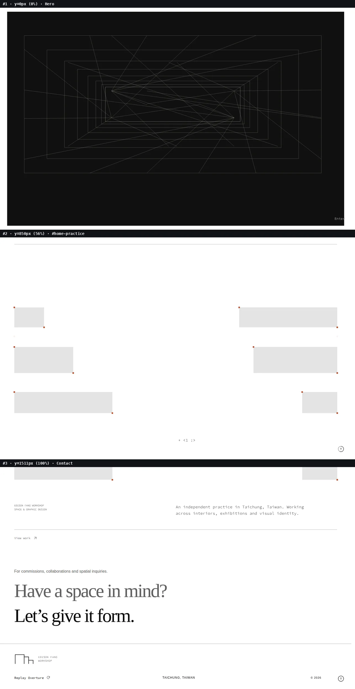
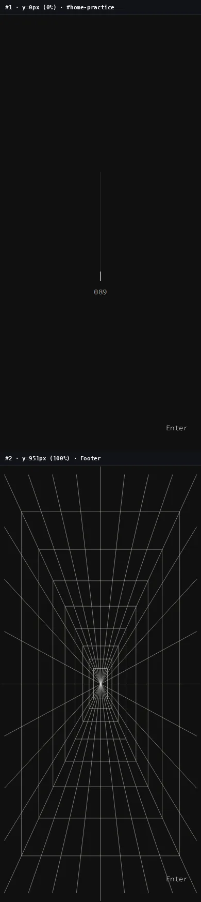

# UI Design System & Master Generation Blueprint: edisonfangworkshop-com

> **Edison Fang Workshop** (https://edisonfangworkshop.com) — Edison Fang Workshop is a spatial design practice in Taichung, Taiwan, working across interiors, exhibitions, visual identity and spatial...





---

## 1. Executive Visual Persona & Design Archetype

- **Brand Essence & Persona**: **Edison Fang Workshop** (`https://edisonfangworkshop.com`). Edison Fang Workshop is a spatial design practice in Taichung, Taiwan, working across interiors, exhibitions, visual identity and spatial...
- **Capture Provenance**: Live browser capture (`tier1_fast`, HTTP `200`, captured `2026-11-24`).
- **Visual Archetype**: **Light-Gallery WebGL / Canvas Interactive Experience (`#ffffff` / `#d8ed42`)**.
- **Anti-AI-Slop Differentiators**:
  - **Live-Computed Chromatic Polarity**: Anchors the viewport in `#ffffff` (live computed `body` `background-color` (`computed_styles.json`)) paired with `#090909` primary typography and `#d8ed42` accents.
  - **Grounded Typographic Hierarchy**: Pairs `Source Code Variable` for display copy (`Let’s give it form.`) with `Noto Sans TC` and `Source Code Variable`.
  - **Calibrated Spatial Grid & Motion**: Combines `96rem` container bounds (`gap: 24px`, padding `71.25px`) with `cubic-bezier(.4,0,.2,1)` easing and HTML5 `<canvas>` Interactive Viewport Surface.

---

## 2. Spatial Architecture & Modular Grid Mathematics

### Viewport Allocation & Container Geometry
- **Captured Journey Filmstrips**: Desktop `1280×2484px` (`assets/desktop-journey.webp`, `3` keyframes up to `y=1511px` / doc `2526px`), Mobile `390×1744px` (`assets/mobile-journey.webp`, `2` keyframes).
- **Master Container Bounds**: `96rem` (non-`@media` desktop container stylesheet rule).
- **Canvas Lateral Padding & Spacing**: `71.25px` lateral canvas padding with `24px` grid gap.
- **Border Radius Scale**: `50%`, `3px`, `1px`, `2px`.

### Responsive Breakpoint Architecture
- **Desktop Layout**: Multi-column CSS Grid / Flexbox layout at `1440px` (`max-width: 96rem`, `gap: 24px`).
- **Mobile Layout**: Single-column vertical stack at `390px` viewport width with `71.25px` horizontal padding.
- **Extracted CSS Media Queries**: `@media (prefers-reduced-motion:reduce)`, `@media (width<=760px)`, `@media (width>=761px)`, `@media (width>=761px) and (width<=1100px) and (orientation:portr...`.

---

## 3. Color System, Materiality & Atmospheric Lighting

### Semantic Palette & Source Grounding
| Semantic Role | Ground-Truth Value | Extracted Live / CSS Source |
|---|---|---|
| **Primary Canvas Substrate** | `#ffffff` | live computed `body` `background-color` (`computed_styles.json`) |
| **Primary Typography Ink** | `#090909` | live computed `h1` `color` (`computed_styles.json`) |
| **Elevated Surface / Card Substrate** | `#dfddd5` | `var(--paper)` in `:root` |
| **Interactive Accent / Highlight** | `#d8ed42` | `var(--fourth-accent)` in `:root` |
| **Secondary / Muted Copy** | `#8b8982` | `var(--muted)` in `:root` |
| **Structural Hairline Border** | `#f7f7f5` | `var(--line)` in `:root` (`dfddd53d`) |
| **Variable Token (`--ink`)** | `#080808` | `var(--ink)` in `:root` |
| **Variable Token (`--ink-soft`)** | `#101010` | `var(--ink-soft)` in `:root` |
| **Variable Token (`--paper-bright`)** | `#f1efe8` | `var(--paper-bright)` in `:root` |
| **Variable Token (`--red`)** | `#3b0d0d` | `var(--red)` in `:root` |

### Sanitized Root CSS Variables (`ui-ux.md` Ground Truth)
| Variable Name | Extracted Value | Semantic Role |
|---|---|---|
| `--menu-control-gap` | `10px` | Layout / Spatial Grid Token |
| `--menu-control-stop` | `calc(var(--menu-control-gap) - 1px)` | Dimension / Scale Token |
| `--font-editorial` | `"Iowan Old Style", "Baskerville", "Times New Roman", "Noto Serif TC", serif` | Typography / Scale Token |
| `--font-body` | `Arial, "Noto Sans TC", "PingFang TC", "Microsoft JhengHei", sans-serif` | Typography / Scale Token |
| `--ink` | `#080808` | Typography Ink Token |
| `--ink-soft` | `#101010` | Typography Ink Token |
| `--paper` | `#dfddd5` | Canvas / Surface Token |
| `--paper-bright` | `#f1efe8` | Canvas / Surface Token |
| `--muted` | `#8b8982` | Color / Atmospheric Token |
| `--line` | `#dfddd53d` | Color / Atmospheric Token |
| `--red` | `#3b0d0d` | Color / Atmospheric Token |
| `--page-pad` | `clamp(1.25rem, 4vw, 4.5rem)` | Layout / Spatial Grid Token |
| `--desktop-media-max` | `min(68rem, 126svh)` | Dimension / Scale Token |
| `--lightningcss-light` | `initial` | Canvas / Surface Token |
| `--size` | `340px` | Layout / Spatial Grid Token |
| `--case-depth` | `11.9px` | Dimension / Scale Token |

---

## 4. Typographic Scale & Editorial Hierarchy

### Font Family Stacks
- **Display Typography**: `Source Code Variable`.
- **Primary Body Stack**: `Noto Sans TC`.
- **Technical / Metadata Stack**: `Source Code Variable`.

### Typographic Scale & Rules (Live Computed & Stylesheet Grounded)
- **Hero Display (`H1`)**: live computed `h1` (`font-size: 144px`, `line-height: 155.52px`, `font-weight: 300`, `letter-spacing: -7.92px`); rule `h1` (`letter-spacing: -.055em`).
- **Section Heading (`H2`)**: live computed `h2` (`font-size: 16px`, `line-height: 24px`, `font-weight: 400`); rule `h2` (`letter-spacing: -.06em`).
- **Body Copy**: live computed `body` (`font-size: 16px`, `line-height: 24px`, `font-weight: 400`); CSS variables `--font-body: Arial, "Noto Sans TC", "PingFang TC", "Microsoft JhengHei", sans-serif`, `--text-base: 1rem`, `--text-base--line-height: calc(1.5 / 1)`; rule `p` (`font-size: 12px`).
- **Metadata & Navigation Labels**: live computed `nav/a` (`font-size: 99.6795px`, `line-height: 109.647px`, `font-weight: 300`); CSS variables `--text-xs: .75rem`, `--text-xs--line-height: calc(1 / .75)`, `--text-sm: .875rem`; rule `small` (`font-size: 9px`, `letter-spacing: .08em`).

---

## 5. Choreographed Motion & Interaction Physics

### Primary Easing Curves
- **Extracted Timing Functions**: `cubic-bezier(.4,0,.2,1)`, `cubic-bezier(.22,.61,.36,1)`, `cubic-bezier(.55,0,1,1)`.

### Per-Element Transition & Choreography Rules
- **Selector `.home-form-work svg`**: `transition: transform .2s` extracted from `edisonfangworkshop-com` stylesheet.
- **Selector `media (prefers-reduced-motion:red...`**: `transition: none` extracted from `edisonfangworkshop-com` stylesheet.
- **Selector `.home-practice-paragraph`**: `transition: opacity .18s` extracted from `edisonfangworkshop-com` stylesheet.
- **Extracted Easing Curve (`cubic-bezier(.4,0,.2,1)`)**: Governs interactive state transitions across `<header.portfolio-header>` and `<section.home-form-poster>`.
- **Runtime Interaction Engine**: Integrates HTML5 `<canvas>` Interactive Viewport Surface with `prefers-reduced-motion: reduce` fallback guards.
### Measured Runtime Scroll & Interaction Telemetry (`behavioral_journey_v2`)
- **Scroll Driver Mode**: `native` (max document height `2526px`, deepest scrollY reached `1511px` across `3` desktop keyframes).
- **Detected Scroll / Motion Libraries**: `WebGL/Canvas`.
- **Hover Physics (`primary_cta` · `EDISON FANG WORKSHOP`)**: Computed transition `0s` / `ease` (no static color/transform shift captured at rest).
- **Route Transition Architecture**: First internal navigation (`/work`) measured as `direct` in `244ms`.

---

## 6. Component Wireframe & Structural DOM Map

### Visual Layout Schematic — Desktop (`1440px`, Grounded in `dom.html` & Landmark Bounding Boxes)
```
┌────────────────────────────────────────────────────────────────────────┐
│ DESKTOP VIEWPORT (1440px) — Edison Fang Workshop                       │
│ ====================================================================== │
│ [ <header.portfolio-head (1425x100px) | H O M E Introduction         ] │
│ ---------------------------------------------------------------------- │
│ | HERO STAGE: <section.unreleased-home-intro> (w=1425px)             | │
│ | H1: Let’s give it form.                                            | │
│ | Substrate: #ffffff | Ink: #090909 | Accent: #d8ed42                | │
│ ---------------------------------------------------------------------- │
│ | SHOWCASE GRID (<section.home-form-poster>) max-w: 96rem            | │
│ | +------------------------------+  +------------------------------+ | │
│ | | Spatial & graphic design     |  | MENU CLOSE MENU CLOSE        | | │
│ | +------------------------------+  +------------------------------+ | │
│ ---------------------------------------------------------------------- │
│ | DETAIL MODULE (<section.portfolio-contact) — COLLECTION INDEX SPAT | │
│ ---------------------------------------------------------------------- │
│ [ FOOTER (<footer.collection-m) | https://edisonfangworkshop.com       │
└────────────────────────────────────────────────────────────────────────┘
```

### Visual Layout Schematic — Mobile Reflow (`390px`)
```
┌────────────────────────────────────────────────────────────────────────┐
│ MOBILE VIEWPORT REFLOW (390px) — Single-Column Stack (gap: 24px)       │
│ ====================================================================== │
│ [ HEADER BAR (<header.portfolio-header) | Compact Menu (390px)         │
│ ---------------------------------------------------------------------- │
│ | HERO STAGE (<section.unreleased-home) — 390px Vertical Lead        | │
│ | H1: Let’s give it form.                                            | │
│ ---------------------------------------------------------------------- │
│ | SHOWCASE STACK (<section.home-form-pos) — 1-Col Stack              | │
│ | [ Item 1: Spatial & graphic design                               ] | │
│ | [ Item 2: MENU CLOSE MENU CLOSE                                  ] | │
│ ---------------------------------------------------------------------- │
│ | DETAIL STACK (<section.portfolio-conta) — 1-Col (COLLECTION INDEX S) │
│ ---------------------------------------------------------------------- │
│ [ FOOTER (<footer.collection-m) | Stacked 390px Colophon               │
└────────────────────────────────────────────────────────────────────────┘
```

### Granular DOM Region Breakdown
1. **Brand Header & Navigation Bar (<header.portfolio-header> — `edisonfangworkshop-com`)**:
   - Landmark `<header class="portfolio-header smart-header">` (`1425x100px`) hosting `Edison Fang Workshop` navigation (`H O M E Introduction`), DOM attributes (`data-mood="true"`, `data-overture-boot="true"`, `data-precedence="vite-rsc/client-refer..."`, `data-precedence="vite-rsc/client-refer..."`), and stylesheet rule `.home-form-poster { padding:clamp(1rem,3vw,3rem) var(--home-pad) clamp(2rem,4vw,4rem);color:... }`.
2. **Hero Stage & Focal Lead (<section.unreleased-home-intro> — `Let’s give it form.`)**:
   - Landmark `<section class="unreleased-home-intro home-formation">` presenting display lead `Let’s give it form.` and copy excerpt *"EDISON FANG WORKSHOP"* over `#ffffff` canvas and `#090909` ink.
3. **Primary Showcase & Content Grid (<section.home-form-poster> — `Spatial & graphic design`)**:
   - Landmark `<section class="home-form-poster home-train-poster">` rendering section `Spatial & graphic design` with copy *"MENU CLOSE MENU CLOSE"*, asset references (`source-code-pro-variable-latin.woff2`, `workshop-shell-qHtOR3l2.css`, `page-Cg2bIiDZ.css`, `index-CHG0PVT-.css`), and grid rule `.home-form-stage { isolation:isolate;contain:layout paint;width:100%;height:clamp(440px,47v... }`.
4. **Interactive Detail & Feature Matrix (<section.portfolio-contact> — `MENU CLOSE MENU CLOSE`)**:
   - Landmark `<section class="portfolio-contact home-contact-invitation">` framing `MENU CLOSE MENU CLOSE` and `COLLECTION INDEX SPATIAL / GRAPHIC` (*"COLLECTION INDEX SPATIAL / GRAPHIC"*) with `#dfddd5` surface cards, `#d8ed42` accents, and `.home-form-column { transform-origin:0 0;will-change:transform;pointer-events:none;width:1px... }`.
5. **Colophon & Global Directory Footer (<footer.collection-menu-footer> — `https://edisonfangworkshop.com`)**:
   - Landmark `<footer class="collection-menu-footer">` anchoring `Edison Fang Workshop` footer links (`H O M E Introduction`), copy *"H O M E Introduction"*, and `#f7f7f5` structural dividers.
### Full Vertical Scroll Sequence (Desktop `1440×900` Keyframes)
- **Step 01** (`y=0px`, `0%`): Active landmark `Hero` · sticky/fixed elements: `2`
- **Step 02** (`y=850px`, `56%`): Active landmark `#home-practice` · sticky/fixed elements: `1`
- **Step 03** (`y=1511px`, `100%`): Active landmark `Contact` · sticky/fixed elements: `1`

### Multi-Page Internal Route Map
- **Listing Route (`/work`)**: `https://edisonfangworkshop.com/work` — H1: `Christina’s World`, scrollHeight `900px`, transition `direct` (`244ms`)
- **About Route (`/about`)**: `https://edisonfangworkshop.com/about` — H1: `About Edison Fang`, scrollHeight `900px`, transition `direct` (`548ms`)
- **About Route (`/contact`)**: `https://edisonfangworkshop.com/contact` — H1: `Contact — Edison Fang Workshop`, scrollHeight `2087px`, transition `direct` (`575ms`)

---

## 7. Master Zero-Shot AI Generation Prompt

```markdown
# Master Zero-Shot Frontend Generation Prompt: edisonfangworkshop-com (Edison Fang Workshop)

You are a principal frontend architect and design systems engineer. Build a complete, production-ready web application replicating the exact design system, DOM landmarks, typographic hierarchy, color tokens, and motion physics of `edisonfangworkshop-com` (**Edison Fang Workshop** — `https://edisonfangworkshop.com`).

### 1. Visual Archetype & Anti-AI-Slop Mandates
- **Archetype**: Light-Gallery WebGL / Canvas Interactive Experience (`#ffffff` / `#d8ed42`).
- **Identity & Domain Context**: Edison Fang Workshop is a spatial design practice in Taichung, Taiwan, working across interiors, exhibitions, visual identity and spatial...
- **Primary Substrate**: `#ffffff` (live computed `body` `background-color` (`computed_styles.json`)), **Primary Ink**: `#090909`, **Accent / Highlight**: `#d8ed42`.
- **Site-Specific Differentiators**:
  - **Live-Computed Chromatic Polarity**: Anchors the viewport in `#ffffff` (live computed `body` `background-color` (`computed_styles.json`)) paired with `#090909` primary typography and `#d8ed42` accents.
  - **Grounded Typographic Hierarchy**: Pairs `Source Code Variable` for display copy (`Let’s give it form.`) with `Noto Sans TC` and `Source Code Variable`.
  - **Calibrated Spatial Grid & Motion**: Combines `96rem` container bounds (`gap: 24px`, padding `71.25px`) with `cubic-bezier(.4,0,.2,1)` easing and HTML5 `<canvas>` Interactive Viewport Surface.

### 2. Ground-Truth CSS Variables (`:root` Token Contract)
Declare and consume these exact custom properties extracted from `edisonfangworkshop-com` in your global stylesheet:

:root {
  /* Edison Fang Workshop (edisonfangworkshop-com) — Live-Grounded CSS Variables */
  --menu-control-gap: 10px; /* Layout / Spatial Grid Token (edisonfangworkshop-com) */
  --menu-control-stop: calc(var(--menu-control-gap) - 1px); /* Dimension / Scale Token (edisonfangworkshop-com) */
  --font-editorial: "Iowan Old Style", "Baskerville", "Times New Roman", "Noto Serif TC", serif; /* Typography / Scale Token (edisonfangworkshop-com) */
  --font-body: Arial, "Noto Sans TC", "PingFang TC", "Microsoft JhengHei", sans-serif; /* Typography / Scale Token (edisonfangworkshop-com) */
  --ink: #080808; /* Typography Ink Token (edisonfangworkshop-com) */
  --ink-soft: #101010; /* Typography Ink Token (edisonfangworkshop-com) */
  --paper: #dfddd5; /* Canvas / Surface Token (edisonfangworkshop-com) */
  --paper-bright: #f1efe8; /* Canvas / Surface Token (edisonfangworkshop-com) */
  --muted: #8b8982; /* Color / Atmospheric Token (edisonfangworkshop-com) */
  --line: #dfddd53d; /* Color / Atmospheric Token (edisonfangworkshop-com) */
  --red: #3b0d0d; /* Color / Atmospheric Token (edisonfangworkshop-com) */
  --page-pad: clamp(1.25rem, 4vw, 4.5rem); /* Layout / Spatial Grid Token (edisonfangworkshop-com) */
  --desktop-media-max: min(68rem, 126svh); /* Dimension / Scale Token (edisonfangworkshop-com) */
  --lightningcss-light: initial; /* Canvas / Surface Token (edisonfangworkshop-com) */
  --size: 340px; /* Layout / Spatial Grid Token (edisonfangworkshop-com) */
  --case-depth: 11.9px; /* Dimension / Scale Token (edisonfangworkshop-com) */
}

### 3. Semantic Color & Materiality Contract
Map every surface, ink, and border strictly to these source-grounded tokens:
- **Primary Canvas Substrate**: `#ffffff` — grounded in live computed `body` `background-color` (`computed_styles.json`)
- **Primary Typography Ink**: `#090909` — grounded in live computed `h1` `color` (`computed_styles.json`)
- **Elevated Surface / Card Substrate**: `#dfddd5` — grounded in `var(--paper)` in `:root`
- **Interactive Accent / Highlight**: `#d8ed42` — grounded in `var(--fourth-accent)` in `:root`
- **Secondary / Muted Copy**: `#8b8982` — grounded in `var(--muted)` in `:root`
- **Structural Hairline Border**: `#f7f7f5` — grounded in `var(--line)` in `:root` (`dfddd53d`)
- **Variable Token (`--ink`)**: `#080808` — grounded in `var(--ink)` in `:root`
- **Variable Token (`--ink-soft`)**: `#101010` — grounded in `var(--ink-soft)` in `:root`
- **Variable Token (`--paper-bright`)**: `#f1efe8` — grounded in `var(--paper-bright)` in `:root`
- **Variable Token (`--red`)**: `#3b0d0d` — grounded in `var(--red)` in `:root`

### 4. Spatial Grid, Container Bounds & Responsive Breakpoints
- **Desktop Viewport Reference**: `1280×2484px` (multi-frame vertical journey filmstrip (2484px), `1440px` standard desktop width).
- **Mobile Viewport Reference**: `390×1744px` (full-page live capture (1744px), `390px` standard mobile width).
- **Container Max-Width**: `96rem` (non-`@media` desktop container stylesheet rule)
- **Padding & Gutters**: `71.25px` lateral canvas padding with `24px` grid gap
- **Desktop Grid**: Multi-column CSS Grid / Flexbox layout at `1440px` (`max-width: 96rem`, `gap: 24px`)
- **Mobile Adaptation**: Single-column vertical stack at `390px` viewport width with `71.25px` horizontal padding
- **Media Queries**: `@media (prefers-reduced-motion:reduce)`, `@media (width<=760px)`, `@media (width>=761px)`, `@media (width>=761px) and (width<=1100px) and (orientation:portr...`
- **Corner Radii**: `50%`, `3px`, `1px`, `2px`

### 5. Typography & Editorial Scale Contract
- **Display Font Stack**: `Source Code Variable`
- **Body Font Stack**: `Noto Sans TC`
- **Monospace / Technical Font Stack**: `Source Code Variable`
- **H1 Display Rule**: live computed `h1` (`font-size: 144px`, `line-height: 155.52px`, `font-weight: 300`, `letter-spacing: -7.92px`); rule `h1` (`letter-spacing: -.055em`)
- **H2 Section Rule**: live computed `h2` (`font-size: 16px`, `line-height: 24px`, `font-weight: 400`); rule `h2` (`letter-spacing: -.06em`)
- **Body Copy Rule**: live computed `body` (`font-size: 16px`, `line-height: 24px`, `font-weight: 400`); CSS variables `--font-body: Arial, "Noto Sans TC", "PingFang TC", "Microsoft JhengHei", sans-serif`, `--text-base: 1rem`, `--text-base--line-height: calc(1.5 / 1)`; rule `p` (`font-size: 12px`)
- **Metadata & Index Rule**: live computed `nav/a` (`font-size: 99.6795px`, `line-height: 109.647px`, `font-weight: 300`); CSS variables `--text-xs: .75rem`, `--text-xs--line-height: calc(1 / .75)`, `--text-sm: .875rem`; rule `small` (`font-size: 9px`, `letter-spacing: .08em`)

### 6. Component Hierarchy, Verbatim Copy & Real DOM Landmarks
Scaffold `edisonfangworkshop-com` (`Edison Fang Workshop`) with these exact structural regions, extracted copy, and CSS rules from `dom.html`:
1. **Brand Header & Navigation Bar (<header.portfolio-header> — `edisonfangworkshop-com`)**:
   - DOM & Selectors: Landmark `<header class="portfolio-header smart-header">` (`1425x100px`) hosting `Edison Fang Workshop` navigation (`H O M E Introduction`), DOM attributes (`data-mood="true"`, `data-overture-boot="true"`, `data-precedence="vite-rsc/client-refer..."`, `data-precedence="vite-rsc/client-refer..."`), and stylesheet rule `.home-form-poster { padding:clamp(1rem,3vw,3rem) var(--home-pad) clamp(2rem,4vw,4rem);color:... }`.
   - Responsive Contract: Header `Brand Header & Navigation Bar (<header.portfolio-header> — `edisonfangworkshop-com`)` (`edisonfangworkshop-com`) adapts across `@media (prefers-reduced-motion:reduce)`, `@media (width<=760px)`, `@media (width>=761px)`, `@media (width>=761px) and (width<=1100px) and (orientation:portr...` with `cubic-bezier(.4,0,.2,1)`, `cubic-bezier(.22,.61,.36,1)`, `cubic-bezier(.55,0,1,1)` transitions and links `H O M E Introduction`.
2. **Hero Stage & Focal Lead (<section.unreleased-home-intro> — `Let’s give it form.`)**:
   - DOM & Selectors: Landmark `<section class="unreleased-home-intro home-formation">` presenting display lead `Let’s give it form.` and copy excerpt *"EDISON FANG WORKSHOP"* over `#ffffff` canvas and `#090909` ink.
   - Responsive Contract: Hero stage (`1280×2484px` desktop / `390×1744px` mobile) sets `#ffffff` background with `#090909` headline `Let’s give it form.`.
3. **Primary Showcase & Content Grid (<section.home-form-poster> — `Spatial & graphic design`)**:
   - DOM & Selectors: Landmark `<section class="home-form-poster home-train-poster">` rendering section `Spatial & graphic design` with copy *"MENU CLOSE MENU CLOSE"*, asset references (`source-code-pro-variable-latin.woff2`, `workshop-shell-qHtOR3l2.css`, `page-Cg2bIiDZ.css`, `index-CHG0PVT-.css`), and grid rule `.home-form-stage { isolation:isolate;contain:layout paint;width:100%;height:clamp(440px,47v... }`.
   - Responsive Contract: Showcase grid `Primary Showcase & Content Grid (<section.home-form-poster> — `Spatial & graphic design`)` applies Multi-column CSS Grid / Flexbox layout at `1440px` (`max-width: 96rem`, `gap: 24px`) on desktop and Single-column vertical stack at `390px` viewport width with `71.25px` horizontal padding on mobile.
4. **Interactive Detail & Feature Matrix (<section.portfolio-contact> — `MENU CLOSE MENU CLOSE`)**:
   - DOM & Selectors: Landmark `<section class="portfolio-contact home-contact-invitation">` framing `MENU CLOSE MENU CLOSE` and `COLLECTION INDEX SPATIAL / GRAPHIC` (*"COLLECTION INDEX SPATIAL / GRAPHIC"*) with `#dfddd5` surface cards, `#d8ed42` accents, and `.home-form-column { transform-origin:0 0;will-change:transform;pointer-events:none;width:1px... }`.
   - Responsive Contract: Detail module `Interactive Detail & Feature Matrix (<section.portfolio-contact> — `MENU CLOSE MENU CLOSE`)` uses `50%`, `3px`, `1px`, `2px` radii, `#d8ed42` highlights, and assets (source-code-pro-variable-latin.woff2, workshop-shell-qHtOR3l2.css, page-Cg2bIiDZ.css).
5. **Colophon & Global Directory Footer (<footer.collection-menu-footer> — `https://edisonfangworkshop.com`)**:
   - DOM & Selectors: Landmark `<footer class="collection-menu-footer">` anchoring `Edison Fang Workshop` footer links (`H O M E Introduction`), copy *"H O M E Introduction"*, and `#f7f7f5` structural dividers.
   - Responsive Contract: Footer `Colophon & Global Directory Footer (<footer.collection-menu-footer> — `https://edisonfangworkshop.com`)` aligns to `96rem` (non-`@media` desktop container stylesheet rule) with `71.25px` lateral canvas padding with `24px` grid gap and attributes (data-mood="true", data-overture-boot="true", data-precedence="vite-rsc/client-refer...").

#### Verbatim DOM Copy Excerpts (`dom.html`)
- Copy Excerpt 1: *"EDISON FANG WORKSHOP"*
- Copy Excerpt 2: *"MENU CLOSE MENU CLOSE"*
- Copy Excerpt 3: *"COLLECTION INDEX SPATIAL / GRAPHIC"*
- Copy Excerpt 4: *"H O M E Introduction"*

### 7. Motion, Extracted Stylesheet Rules & Interaction Choreography
- **Primary Easing Functions**: `cubic-bezier(.4,0,.2,1)`, `cubic-bezier(.22,.61,.36,1)`, `cubic-bezier(.55,0,1,1)`
- **Extracted Stylesheet Rules (`edisonfangworkshop-com`)**:
- `.home-form-poster { padding:clamp(1rem,3vw,3rem) var(--home-pad) clamp(2rem,4vw,4rem);color:... }`
- `.home-form-stage { isolation:isolate;contain:layout paint;width:100%;height:clamp(440px,47v... }`
- `.home-form-column { transform-origin:0 0;will-change:transform;pointer-events:none;width:1px... }`
- `.home-form-plane { background:color-mix(in srgb,currentColor 11%,transparent);z-index:0 }`
- `.home-form-fallback { display:none }`
- **Per-Selector Transition Rules**:
- **Selector `.home-form-work svg`**: `transition: transform .2s` extracted from `edisonfangworkshop-com` stylesheet.
- **Selector `media (prefers-reduced-motion:red...`**: `transition: none` extracted from `edisonfangworkshop-com` stylesheet.
- **Selector `.home-practice-paragraph`**: `transition: opacity .18s` extracted from `edisonfangworkshop-com` stylesheet.
- **Extracted Easing Curve (`cubic-bezier(.4,0,.2,1)`)**: Governs interactive state transitions across `<header.portfolio-header>` and `<section.home-form-poster>`.
- **Runtime Interaction Engine**: Integrates HTML5 `<canvas>` Interactive Viewport Surface with `prefers-reduced-motion: reduce` fallback guards.
### 7b. Full-Page Scroll Choreography, Interactive States & Multi-Page Routes
- **Scroll Mechanics**: Implement `native` vertical progression up to `2526px` across 3 distinct viewport chapters using WebGL/Canvas.
- **Vertical Chapter Sequence**: Hero (0%) -> #home-practice (56%) -> Contact (100%).
- **Multi-Page Routes**: Scaffold internal routes `/work` (listing, direct), `/about` (about, direct), `/contact` (about, direct) sharing the global header/footer shell and design tokens.

### 8. Technical Deliverables
- Implement in Next.js (App Router) with TypeScript and Tailwind CSS consuming the `:root` custom properties defined above for `edisonfangworkshop-com`.
- Reproduce both the `1440px` desktop architecture and `390px` mobile breakpoint transitions, preserving semantic HTML5 landmarks (`<header>`, `<nav>`, `<main>`, `<section>`, `<footer>`) and `prefers-reduced-motion` accessibility guards.
```
---

## 8. Full-Page Scroll Journey, Interactive States & Subpage Inventory

### Desktop Scroll Keyframes (`1440×900` WebP)
| Step | Scroll Y | Progress | Active Landmark / Section | Sticky/Fixed | Visual Asset |
| :---: | :---: | :---: | :--- | :---: | :--- |
| `#01` | `0px` | `0%` | Hero | `2` | [desktop-step-01.webp](assets/desktop-step-01.webp) |
| `#02` | `850px` | `56%` | #home-practice | `1` | [desktop-step-02.webp](assets/desktop-step-02.webp) |
| `#03` | `1511px` | `100%` | Contact | `1` | [desktop-step-03.webp](assets/desktop-step-03.webp) |

### Mobile Condensed Keyframes (`390×844` WebP)
| Step | Scroll Y | Progress | Active Landmark | Visual Asset |
| :---: | :---: | :---: | :--- | :--- |
| `#01` | `0px` | `0%` | #home-practice | [mobile-step-01.webp](assets/mobile-step-01.webp) |
| `#02` | `951px` | `100%` | Footer | [mobile-step-02.webp](assets/mobile-step-02.webp) |

### Internal Subpage Filmstrips (`1080px` Wide WebP)
| # | Template | Route URL | H1 / Title | Scroll Height | Transition | Filmstrip Asset |
| :-: | :---: | :--- | :--- | :---: | :---: | :--- |
| `1` | `listing` | `https://edisonfangworkshop.com/work` | Christina’s World | `900px` | `direct` (`244ms`) | [subpage-01-work.webp](assets/subpage-01-work.webp) |
| `2` | `about` | `https://edisonfangworkshop.com/about` | About Edison Fang | `900px` | `direct` (`548ms`) | [subpage-02-about.webp](assets/subpage-02-about.webp) |
| `3` | `about` | `https://edisonfangworkshop.com/contact` | Contact — Edison Fang Workshop | `2087px` | `direct` (`575ms`) | [subpage-03-contact.webp](assets/subpage-03-contact.webp) |

