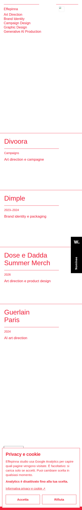

# UI Design System & Master Generation Blueprint: effepinnastudio-com

> **Fabio Pinna — Art Director e Graphic Designer · Effepinna Studio** (https://effepinnastudio.com/) — Direzione artistica, progettazione grafica e produzione di immagini, video e animazioni per agenzie e brand. Fabio Pinna, freelance a Gra...


---

## 1. Executive Visual Persona & Design Archetype

- **Brand Essence & Persona**: **Fabio Pinna — Art Director e Graphic Designer · Effepinna Studio** (`https://effepinnastudio.com/`). Direzione artistica, progettazione grafica e produzione di immagini, video e animazioni per agenzie e brand. Fabio Pinna, freelance a Gra...
- **Visual Archetype**: **Dark-Substrate WebGL / Canvas Interactive Experience (`#ef233c` / `#ee2c3d`)**.
- **Anti-AI-Slop Differentiators**:
  - **Source-Grounded Chromatic Polarity**: Anchors the viewport in `#ef233c` (`var(--red)` in `:root`) paired with `#fff` primary typography and `#ee2c3d` accents.
  - **Extracted Typographic Hierarchy**: Pairs `Instrument Sans` for display copy (`Fabio Pinna - Art Direction, Multime`) with `clamp(34px` and not declared in static CSS (uses primary stack / `ui-monospace`).
  - **Calibrated Spatial Grid & Motion**: Combines `360px` container bounds (`gap: 12px`, padding `8px`) with `cubic-bezier(.22,.78,.24,1)` easing and GSAP Timeline & ScrollTrigger, HTML5 `<canvas>` Interactive Viewport Surface.

---

## 2. Spatial Architecture & Modular Grid Mathematics



### Viewport Allocation & Container Geometry
- **Captured Viewport Dimensions**: Desktop `1440×2400px` (`assets/desktop.png`, capped at 2400px multi-section capture), Mobile `390×2400px` (`assets/mobile.png`, capped at 2400px multi-section capture).
- **Master Container Bounds**: `360px` extracted from `effepinnastudio-com` stylesheet.
- **Canvas Lateral Padding & Spacing**: `8px` lateral canvas padding with `12px` grid gap.
- **Border Radius Scale**: `50%`, `999px`.

### Responsive Breakpoint Architecture
- **Desktop Layout**: Multi-column CSS Grid / Flexbox layout at `1440px` (`max-width: 360px`, `gap: 12px`).
- **Mobile Layout**: Single-column vertical stack at `390px` viewport width with `8px` horizontal padding.
- **Extracted CSS Media Queries**: `@media (prefers-reduced-motion: reduce)`, `@media (max-width: 760px)`, `@media (max-width: 760px), (hover: none), (pointer: coarse), (pr...`, `@media (max-width: 1100px)`.

---

## 3. Color System, Materiality & Atmospheric Lighting

### Semantic Palette & Source Grounding
| Semantic Role | Ground-Truth Value | Extracted CSS Source / Selector |
|---|---|---|
| **Primary Canvas Substrate** | `#ef233c` | `var(--red)` in `:root` |
| **Primary Typography Ink** | `#f3f2ef` | `var(--paper)` in `:root` |
| **Elevated Surface / Card Substrate** | `#0a0a0a` | `var(--ink)` in `:root` |
| **Interactive Accent / Highlight** | `#ee2c3d` | `var(--menu-background)` in `:root` |
| **Secondary / Muted Copy** | `#fff` | `var(--menu-foreground)` in `:root` |
| **Structural Hairline Border** | `#fdc400` | `var(--work-hover-color)` in `:root` |

### Sanitized Root CSS Variables (`ui-ux.md` Ground Truth)
| Variable Name | Extracted Value | Semantic Role |
|---|---|---|
| `--red` | `#ef233c` | Color / Atmospheric Token |
| `--paper` | `#f3f2ef` | Canvas / Surface Token |
| `--ink` | `#0a0a0a` | Typography Ink Token |
| `--menu-background` | `#ee2c3d` | Canvas / Surface Token |
| `--menu-foreground` | `#fff` | Typography Ink Token |
| `--menu-pixel-color` | `#ee2c3d` | Brand / Palette Token |
| `--menu-button-background` | `#ee2c3d` | Canvas / Surface Token |
| `--menu-button-foreground` | `#fff` | Typography Ink Token |
| `--menu-button-open-background` | `#fff` | Canvas / Surface Token |
| `--menu-button-open-foreground` | `#ee2c3d` | Typography Ink Token |
| `--loader-mask-size` | `220px` | Layout / Spatial Grid Token |
| `--ragdoll-hint-x` | `0px` | Dimension / Scale Token |
| `--ragdoll-hint-y` | `0px` | Dimension / Scale Token |
| `--manifesto-progress` | `0` | Design System Custom Token |
| `--path-opacity` | `.9` | Design System Custom Token |
| `--audiences-progress` | `0` | Design System Custom Token |

---

## 4. Typographic Scale & Editorial Hierarchy

### Font Family Stacks
- **Display Typography**: `Instrument Sans`.
- **Primary Body Stack**: `clamp(34px`.
- **Technical / Metadata Stack**: not declared in static CSS (uses primary stack / `ui-monospace`).

### Typographic Scale & Rules (Extracted from Stylesheet & Variables)
- **Hero Display (`H1`)**: CSS variables `--type-display: 6rem`, `--leading-display: 6.25rem`; rule `h1` (`font-size: 2rem`, `line-height: 2.25rem`, `font-weight: 500`).
- **Section Heading (`H2`)**: rule `h2` (`font-size: var(--type-section)`, `line-height: var(--leading-section)`, `font-weight: var(--weight-...`).
- **Body Copy**: CSS variables `--type-body: 1.125rem`, `--leading-body: 1.75rem`, `--space-paragraph: 1.5rem`; rule `p` (`font-size: var(--type-block)`, `line-height: var(--leading-block)`, `font-weight: var(--weight-...`).
- **Metadata & Navigation Labels**: CSS variables `--weight-label: 500`, `--type-meta: .875rem`, `--leading-meta: 1.25rem`.

---

## 5. Choreographed Motion & Interaction Physics

### Primary Easing Curves
- **Extracted Timing Functions**: `cubic-bezier(.22,.78,.24,1)`, `cubic-bezier(.22,1,.36,1)`, `cubic-bezier(.16,1,.3,1)`.

### Per-Element Transition & Choreography Rules
- **Selector `.menu-toggle span`**: `transition: transform .28s ease, background-color .2s ease` extracted from `effepinnastudio-com` stylesheet.
- **Selector `.ragdoll-cursor-hint`**: `transition: opacity 155ms ease, visibility 0s linear 155ms` extracted from `effepinnastudio-com` stylesheet.
- **Selector `.ragdoll-cursor-hint.is-visible`**: `transition: opacity 200ms ease, visibility 0s` extracted from `effepinnastudio-com` stylesheet.
- **Extracted Easing Curve (`cubic-bezier(.22,.78,.24,1)`)**: Governs interactive state transitions across `<header.hero>` and `<section.work>`.
- **Runtime Interaction Engine**: Integrates GSAP Timeline & ScrollTrigger, HTML5 `<canvas>` Interactive Viewport Surface with `prefers-reduced-motion: reduce` fallback guards.

---

## 6. Component Wireframe & Structural DOM Map

### Visual Layout Schematic (Grounded in `dom.html` — `1440px` Desktop & `390px` Mobile Reflow)
```
┌────────────────────────────────────────────────────────────────────────┐
│ DESKTOP VIEWPORT (1440px) — Fabio Pinna — Art Director e Graphic Desig │
│ ====================================================================== │
│ [ <header.hero>            | Home ↗ · Work ↗ · Agenzie e brand ↗ ·  ]  │
│ ---------------------------------------------------------------------- │
│ | HERO STAGE: <section.manifesto>                                  |   │
│ | H1: Fabio Pinna - Art Direction, Multimedia Graphic D...         |   │
│ | Substrate: #ef233c    | Ink: #fff       | Accent: #ee2c3d        |   │
│ ---------------------------------------------------------------------- │
│ | SHOWCASE GRID (<section.work>            ) max-w: 360px          |   │
│ | +------------------------------+  +------------------------------+ | │
│ | | Selezione Lavori             |  | Fastweb Tu sei Futuro        | | │
│ | +------------------------------+  +------------------------------+ | │
│ ---------------------------------------------------------------------- │
│ | MOBILE VIEWPORT REFLOW (390px) — Single-Column Stack (gap: 12px  ) | │
│ | [<header.hero>] -> [<section.manifesto] -> [<section.work>] |        │
│ ---------------------------------------------------------------------- │
│ [ FOOTER (<footer.site-footer>  ) | https://effepinnastudio.com/       │
└────────────────────────────────────────────────────────────────────────┘
```

### Granular DOM Region Breakdown
1. **Brand Header & Navigation Bar (<header.hero> — `effepinnastudio-com`)**:
   - Landmark `<header class="hero">` hosting `Fabio Pinna — Art Director e Graphic` navigation (`Home ↗ · Work ↗ · Agenzie e brand ↗ · Chi sono ↗ · Contatti ↗`), DOM attributes (`data-work-preview-loading="true"`, `data-loading-theme="red"`, `data-loading-state="ready"`, `data-font-status="instrument-sans"`), and stylesheet rule `root { color-scheme: light;--red: ef233c;--paper: f3f2ef;--ink: 0a0a0a; }`.
2. **Hero Stage & Focal Lead (<section.manifesto> — `Fabio Pinna - Art Direction, Multi`)**:
   - Landmark `<section class="manifesto editorial-grid">` presenting display lead `Fabio Pinna - Art Direction, Multimedia Graphic D...` and copy excerpt *"DISPONIBILE PER COLLABORAZIONI FREELANCE."* over `#ef233c` canvas and `#fff` ink.
3. **Primary Showcase & Content Grid (<section.work> — `Selezione Lavori`)**:
   - Landmark `<section class="work">` rendering section `Selezione Lavori` with copy *"Generative AI Production"*, asset references (`motion-policy-20261012.js`, `favicon-192.png`, `favicon.ico`, `apple-touch-icon.png`), and grid rule `body { touch-action: manipulation;touch-action: pan-x pan-y; }`.
4. **Interactive Detail & Feature Matrix (<article.work-row> — `Fastweb Tu sei Futuro`)**:
   - Landmark `<article class="work-row">` framing `Fastweb Tu sei Futuro` and `Divoora` (*"Mi occupo di direzione artistica e graphic design multimediale. M"*) with `#0a0a0a` surface cards, `#ee2c3d` accents, and `focus-visible { outline: 2px solid currentColor;outline-offset: 4px; }`.
5. **Colophon & Global Directory Footer (<footer.site-footer> — `https://effepinnastudio.com/`)**:
   - Landmark `<footer class="site-footer">` anchoring `Fabio Pinna — Art Director e Gra` footer links (`Home ↗ · Work ↗ · Agenzie e brand ↗ · Chi sono ↗ · Contatti ↗`), copy *"Mi occupo di direzione artistica e graphic design multimedia"*, and `#fdc400` structural dividers.

---

## 7. Master Zero-Shot AI Generation Prompt

```markdown
# Master Zero-Shot Frontend Generation Prompt: effepinnastudio-com (Fabio Pinna — Art Director e Graphic Designer · Effepinna Studio)

You are a principal frontend architect and design systems engineer. Build a complete, production-ready web application replicating the exact design system, DOM landmarks, typographic hierarchy, color tokens, and motion physics of `effepinnastudio-com` (**Fabio Pinna — Art Director e Graphic Designer · Effepinna Studio** — `https://effepinnastudio.com/`).

### 1. Visual Archetype & Anti-AI-Slop Mandates
- **Archetype**: Dark-Substrate WebGL / Canvas Interactive Experience (`#ef233c` / `#ee2c3d`).
- **Identity & Domain Context**: Direzione artistica, progettazione grafica e produzione di immagini, video e animazioni per agenzie e brand. Fabio Pinna, freelance a Gra...
- **Primary Substrate**: `#ef233c` (`var(--red)` in `:root`), **Primary Ink**: `#fff`, **Accent / Highlight**: `#ee2c3d`.
- **Site-Specific Differentiators**:
  - **Source-Grounded Chromatic Polarity**: Anchors the viewport in `#ef233c` (`var(--red)` in `:root`) paired with `#fff` primary typography and `#ee2c3d` accents.
  - **Extracted Typographic Hierarchy**: Pairs `Instrument Sans` for display copy (`Fabio Pinna - Art Direction, Multime`) with `clamp(34px` and not declared in static CSS (uses primary stack / `ui-monospace`).
  - **Calibrated Spatial Grid & Motion**: Combines `360px` container bounds (`gap: 12px`, padding `8px`) with `cubic-bezier(.22,.78,.24,1)` easing and GSAP Timeline & ScrollTrigger, HTML5 `<canvas>` Interactive Viewport Surface.

### 2. Ground-Truth CSS Variables (`:root` Token Contract)
Declare and consume these exact custom properties extracted from `effepinnastudio-com` in your global stylesheet:

:root {
  /* Fabio Pinna — Art Director e Graphic Designer · Effepinna Studio (effepinnastudio-com) — Ground-Truth Extracted CSS Variables */
  --red: #ef233c; /* Color / Atmospheric Token (effepinnastudio-com) */
  --paper: #f3f2ef; /* Canvas / Surface Token (effepinnastudio-com) */
  --ink: #0a0a0a; /* Typography Ink Token (effepinnastudio-com) */
  --menu-background: #ee2c3d; /* Canvas / Surface Token (effepinnastudio-com) */
  --menu-foreground: #fff; /* Typography Ink Token (effepinnastudio-com) */
  --menu-pixel-color: #ee2c3d; /* Brand / Palette Token (effepinnastudio-com) */
  --menu-button-background: #ee2c3d; /* Canvas / Surface Token (effepinnastudio-com) */
  --menu-button-foreground: #fff; /* Typography Ink Token (effepinnastudio-com) */
  --menu-button-open-background: #fff; /* Canvas / Surface Token (effepinnastudio-com) */
  --menu-button-open-foreground: #ee2c3d; /* Typography Ink Token (effepinnastudio-com) */
  --loader-mask-size: 220px; /* Layout / Spatial Grid Token (effepinnastudio-com) */
  --ragdoll-hint-x: 0px; /* Dimension / Scale Token (effepinnastudio-com) */
  --ragdoll-hint-y: 0px; /* Dimension / Scale Token (effepinnastudio-com) */
  --manifesto-progress: 0; /* Design System Custom Token (effepinnastudio-com) */
  --path-opacity: .9; /* Design System Custom Token (effepinnastudio-com) */
  --audiences-progress: 0; /* Design System Custom Token (effepinnastudio-com) */
}

### 3. Semantic Color & Materiality Contract
Map every surface, ink, and border strictly to these source-grounded tokens:
- **Primary Canvas Substrate**: `#ef233c` — grounded in `var(--red)` in `:root`
- **Primary Typography Ink**: `#f3f2ef` — grounded in `var(--paper)` in `:root`
- **Elevated Surface / Card Substrate**: `#0a0a0a` — grounded in `var(--ink)` in `:root`
- **Interactive Accent / Highlight**: `#ee2c3d` — grounded in `var(--menu-background)` in `:root`
- **Secondary / Muted Copy**: `#fff` — grounded in `var(--menu-foreground)` in `:root`
- **Structural Hairline Border**: `#fdc400` — grounded in `var(--work-hover-color)` in `:root`

### 4. Spatial Grid, Container Bounds & Responsive Breakpoints
- **Desktop Viewport Reference**: `1440×2400px` (capped at 2400px multi-section capture, `1440px` standard desktop width).
- **Mobile Viewport Reference**: `390×2400px` (capped at 2400px multi-section capture, `390px` standard mobile width).
- **Container Max-Width**: `360px` extracted from `effepinnastudio-com` stylesheet
- **Padding & Gutters**: `8px` lateral canvas padding with `12px` grid gap
- **Desktop Grid**: Multi-column CSS Grid / Flexbox layout at `1440px` (`max-width: 360px`, `gap: 12px`)
- **Mobile Adaptation**: Single-column vertical stack at `390px` viewport width with `8px` horizontal padding
- **Media Queries**: `@media (prefers-reduced-motion: reduce)`, `@media (max-width: 760px)`, `@media (max-width: 760px), (hover: none), (pointer: coarse), (pr...`, `@media (max-width: 1100px)`
- **Corner Radii**: `50%`, `999px`

### 5. Typography & Editorial Scale Contract
- **Display Font Stack**: `Instrument Sans`
- **Body Font Stack**: `clamp(34px`
- **Monospace / Technical Font Stack**: not declared in static CSS (uses primary stack / `ui-monospace`)
- **H1 Display Rule**: CSS variables `--type-display: 6rem`, `--leading-display: 6.25rem`; rule `h1` (`font-size: 2rem`, `line-height: 2.25rem`, `font-weight: 500`)
- **H2 Section Rule**: rule `h2` (`font-size: var(--type-section)`, `line-height: var(--leading-section)`, `font-weight: var(--weight-...`)
- **Body Copy Rule**: CSS variables `--type-body: 1.125rem`, `--leading-body: 1.75rem`, `--space-paragraph: 1.5rem`; rule `p` (`font-size: var(--type-block)`, `line-height: var(--leading-block)`, `font-weight: var(--weight-...`)
- **Metadata & Index Rule**: CSS variables `--weight-label: 500`, `--type-meta: .875rem`, `--leading-meta: 1.25rem`

### 6. Component Hierarchy, Verbatim Copy & Real DOM Landmarks
Scaffold `effepinnastudio-com` (`Fabio Pinna — Art Director e Graphic Designer · Effepinna Studio`) with these exact structural regions, extracted copy, and CSS rules from `dom.html`:
1. **Brand Header & Navigation Bar (<header.hero> — `effepinnastudio-com`)**:
   - DOM & Selectors: Landmark `<header class="hero">` hosting `Fabio Pinna — Art Director e Graphic` navigation (`Home ↗ · Work ↗ · Agenzie e brand ↗ · Chi sono ↗ · Contatti ↗`), DOM attributes (`data-work-preview-loading="true"`, `data-loading-theme="red"`, `data-loading-state="ready"`, `data-font-status="instrument-sans"`), and stylesheet rule `root { color-scheme: light;--red: ef233c;--paper: f3f2ef;--ink: 0a0a0a; }`.
   - Responsive Contract: Header `Brand Header & Navigation Bar (<header.hero> — `effepinnastudio-com`)` (`effepinnastudio-com`) adapts across `@media (prefers-reduced-motion: reduce)`, `@media (max-width: 760px)`, `@media (max-width: 760px), (hover: none), (pointer: coarse), (pr...`, `@media (max-width: 1100px)` with `cubic-bezier(.22,.78,.24,1)`, `cubic-bezier(.22,1,.36,1)`, `cubic-bezier(.16,1,.3,1)` transitions and links `Home ↗ · Work ↗ · Agenzie e brand ↗ · Chi sono ↗ · Contatti ↗`.
2. **Hero Stage & Focal Lead (<section.manifesto> — `Fabio Pinna - Art Direction, Multi`)**:
   - DOM & Selectors: Landmark `<section class="manifesto editorial-grid">` presenting display lead `Fabio Pinna - Art Direction, Multimedia Graphic D...` and copy excerpt *"DISPONIBILE PER COLLABORAZIONI FREELANCE."* over `#ef233c` canvas and `#fff` ink.
   - Responsive Contract: Hero stage (`1440×2400px` desktop / `390×2400px` mobile) sets `#ef233c` background with `#fff` headline `Fabio Pinna - Art Direction, Multimedia Graphic D...`.
3. **Primary Showcase & Content Grid (<section.work> — `Selezione Lavori`)**:
   - DOM & Selectors: Landmark `<section class="work">` rendering section `Selezione Lavori` with copy *"Generative AI Production"*, asset references (`motion-policy-20261012.js`, `favicon-192.png`, `favicon.ico`, `apple-touch-icon.png`), and grid rule `body { touch-action: manipulation;touch-action: pan-x pan-y; }`.
   - Responsive Contract: Showcase grid `Primary Showcase & Content Grid (<section.work> — `Selezione Lavori`)` applies Multi-column CSS Grid / Flexbox layout at `1440px` (`max-width: 360px`, `gap: 12px`) on desktop and Single-column vertical stack at `390px` viewport width with `8px` horizontal padding on mobile.
4. **Interactive Detail & Feature Matrix (<article.work-row> — `Fastweb Tu sei Futuro`)**:
   - DOM & Selectors: Landmark `<article class="work-row">` framing `Fastweb Tu sei Futuro` and `Divoora` (*"Mi occupo di direzione artistica e graphic design multimediale. M"*) with `#0a0a0a` surface cards, `#ee2c3d` accents, and `focus-visible { outline: 2px solid currentColor;outline-offset: 4px; }`.
   - Responsive Contract: Detail module `Interactive Detail & Feature Matrix (<article.work-row> — `Fastweb Tu sei Futuro`)` uses `50%`, `999px` radii, `#ee2c3d` highlights, and assets (motion-policy-20261012.js, favicon-192.png, favicon.ico).
5. **Colophon & Global Directory Footer (<footer.site-footer> — `https://effepinnastudio.com/`)**:
   - DOM & Selectors: Landmark `<footer class="site-footer">` anchoring `Fabio Pinna — Art Director e Gra` footer links (`Home ↗ · Work ↗ · Agenzie e brand ↗ · Chi sono ↗ · Contatti ↗`), copy *"Mi occupo di direzione artistica e graphic design multimedia"*, and `#fdc400` structural dividers.
   - Responsive Contract: Footer `Colophon & Global Directory Footer (<footer.site-footer> — `https://effepinnastudio.com/`)` aligns to `360px` extracted from `effepinnastudio-com` stylesheet with `8px` lateral canvas padding with `12px` grid gap and attributes (data-work-preview-loading="true", data-loading-theme="red", data-loading-state="ready").

#### Verbatim DOM Copy Excerpts (`dom.html`)
- Copy Excerpt 1: *"DISPONIBILE PER COLLABORAZIONI FREELANCE."*
- Copy Excerpt 2: *"Generative AI Production"*
- Copy Excerpt 3: *"Mi occupo di direzione artistica e graphic design multimediale. Mi occupo di direz..."*
- Copy Excerpt 4: *"Mi occupo di direzione artistica e graphic design multimediale."*

### 7. Motion, Extracted Stylesheet Rules & Interaction Choreography
- **Primary Easing Functions**: `cubic-bezier(.22,.78,.24,1)`, `cubic-bezier(.22,1,.36,1)`, `cubic-bezier(.16,1,.3,1)`
- **Extracted Stylesheet Rules (`effepinnastudio-com`)**:
- `root { color-scheme: light;--red: ef233c;--paper: f3f2ef;--ink: 0a0a0a; }`
- `body { touch-action: manipulation;touch-action: pan-x pan-y; }`
- `focus-visible { outline: 2px solid currentColor;outline-offset: 4px; }`
- `body.is-loader-active { overflow: hidden; }`
- `body.is-menu-open { overflow: hidden; }`
- **Per-Selector Transition Rules**:
- **Selector `.menu-toggle span`**: `transition: transform .28s ease, background-color .2s ease` extracted from `effepinnastudio-com` stylesheet.
- **Selector `.ragdoll-cursor-hint`**: `transition: opacity 155ms ease, visibility 0s linear 155ms` extracted from `effepinnastudio-com` stylesheet.
- **Selector `.ragdoll-cursor-hint.is-visible`**: `transition: opacity 200ms ease, visibility 0s` extracted from `effepinnastudio-com` stylesheet.
- **Extracted Easing Curve (`cubic-bezier(.22,.78,.24,1)`)**: Governs interactive state transitions across `<header.hero>` and `<section.work>`.
- **Runtime Interaction Engine**: Integrates GSAP Timeline & ScrollTrigger, HTML5 `<canvas>` Interactive Viewport Surface with `prefers-reduced-motion: reduce` fallback guards.

### 8. Technical Deliverables
- Implement in Next.js (App Router) with TypeScript and Tailwind CSS consuming the `:root` custom properties defined above for `effepinnastudio-com`.
- Reproduce both the `1440px` desktop architecture and `390px` mobile breakpoint transitions, preserving semantic HTML5 landmarks (`<header>`, `<nav>`, `<main>`, `<section>`, `<footer>`) and `prefers-reduced-motion` accessibility guards.
```
