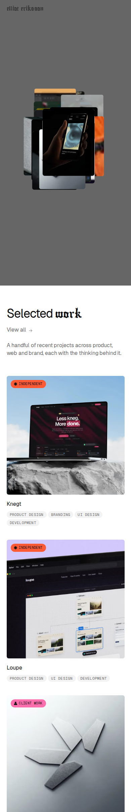

# UI Design System & Master Generation Blueprint: ellioteriksson-com

> **Elliot Eriksson — UI/UX, web & brand design, Stockholm & Åland** (https://ellioteriksson.com/) — Elliot Eriksson is a digital designer in Stockholm, designing clear, accessible websites and interfaces from first sketch to final polish.


---

## 1. Executive Visual Persona & Design Archetype

- **Brand Essence & Persona**: **Elliot Eriksson — UI/UX, web & brand design, Stockholm & Åland** (`https://ellioteriksson.com/`). Elliot Eriksson is a digital designer in Stockholm, designing clear, accessible websites and interfaces from first sketch to final polish.
- **Visual Archetype**: **Light-Substrate Editorial & Modular Grid System (`#c6f432` canvas, `#0c0c0c` ink, `#ff5a36` accent)**.
- **Anti-AI-Slop Differentiators**:
  - **Source-Grounded Chromatic Polarity**: Anchors the viewport in `#c6f432` (`var(--accent)` in `:root`) paired with `#0c0c0c` primary typography and `#ff5a36` accents.
  - **Extracted Typographic Hierarchy**: Pairs `Gossip Fallback` for display copy (`I’m Elliot , an award winning design`) with `wordmark` and `Geist Mono`.
  - **Calibrated Spatial Grid & Motion**: Combines `767px` container bounds (`gap: 11px`, padding `5px`) with `cubic-bezier(.19,1,.22,1)` easing and Lenis Smooth Scroll (`data-lenis`), Three.js / WebGL Canvas Pipeline.

---

## 2. Spatial Architecture & Modular Grid Mathematics



### Viewport Allocation & Container Geometry
- **Captured Viewport Dimensions**: Desktop `1440×7593px` (`assets/desktop.png`, full-page scroll capture), Mobile `390×2400px` (`assets/mobile.png`, capped at 2400px multi-section capture).
- **Master Container Bounds**: `767px` extracted from `ellioteriksson-com` stylesheet.
- **Canvas Lateral Padding & Spacing**: `5px` lateral canvas padding with `11px` grid gap.
- **Border Radius Scale**: `999px`, `6px`, `var(--radius-img)`, `36px`.

### Responsive Breakpoint Architecture
- **Desktop Layout**: Multi-column CSS Grid / Flexbox layout at `1440px` (`max-width: 767px`, `gap: 11px`).
- **Mobile Layout**: Single-column vertical stack at `390px` viewport width with `5px` horizontal padding.
- **Extracted CSS Media Queries**: `@media (prefers-reduced-motion:reduce)`, `@media (prefers-reduced-motion:no-preference)`, `@media (max-width:767px)`, `@media (min-width:1024px)`.

---

## 3. Color System, Materiality & Atmospheric Lighting

### Semantic Palette & Source Grounding
| Semantic Role | Ground-Truth Value | Extracted CSS Source / Selector |
|---|---|---|
| **Primary Canvas Substrate** | `#c6f432` | `var(--accent)` in `:root` |
| **Primary Typography Ink** | `#0c0c0c` | `var(--on-accent)` in `:root` |
| **Elevated Surface / Card Substrate** | `#ff6fae` | `var(--kind-client)` in `:root` |
| **Interactive Accent / Highlight** | `#ff5a36` | `var(--kind-personal)` in `:root` |
| **Secondary / Muted Copy** | `#fff` | `var(--bg)` in `:root` |
| **Structural Hairline Border** | `#6b6b6b` | `var(--muted)` in `:root` |

### Sanitized Root CSS Variables (`ui-ux.md` Ground Truth)
| Variable Name | Extracted Value | Semantic Role |
|---|---|---|
| `--accent` | `#c6f432` | Brand / Palette Token |
| `--on-accent` | `#0c0c0c` | Brand / Palette Token |
| `--highlight` | `#c6f432` | Canvas / Surface Token |
| `--on-highlight` | `#0c0c0c` | Canvas / Surface Token |
| `--kind-agency` | `var(--highlight)` | Design System Custom Token |
| `--kind-client` | `#ff6fae` | Color / Atmospheric Token |
| `--kind-personal` | `#ff5a36` | Color / Atmospheric Token |
| `--font-wordmark` | `var(--font-wordmark-face,"Gossip"), Georgia, serif` | Typography / Scale Token |
| `--font-mono` | `var(--font-mono-face,"Geist Mono"), ui-monospace, Menlo, monospace` | Typography / Scale Token |
| `--gutter` | `3vw` | Layout / Spatial Grid Token |
| `--gap` | `11px` | Layout / Spatial Grid Token |
| `--header-h` | `52px` | Layout / Spatial Grid Token |
| `--section` | `clamp(96px, 11vw, 180px)` | Dimension / Scale Token |
| `--fs-body` | `16px` | Dimension / Scale Token |
| `--fs-md` | `clamp(20px, 1.8vw, 30px)` | Dimension / Scale Token |
| `--fs-lg` | `clamp(24px, 2.4vw, 40px)` | Dimension / Scale Token |

---

## 4. Typographic Scale & Editorial Hierarchy

### Font Family Stacks
- **Display Typography**: `Gossip Fallback`.
- **Primary Body Stack**: `wordmark`.
- **Technical / Metadata Stack**: `Geist Mono`.

### Typographic Scale & Rules (Extracted from Stylesheet & Variables)
- **Hero Display (`H1`)**: CSS variables `--fs-display: clamp(36px, 4vw, 72px)`.
- **Section Heading (`H2`)**: CSS variables `--fs-lg: clamp(24px, 2.4vw, 40px)`.
- **Body Copy**: CSS variables `--fs-body: 16px`.
- **Metadata & Navigation Labels**: CSS variables `--font-mono: var(--font-mono-face,"Geist Mono"), ui-monospace, Menlo, monospace`, `--font-mono-face: "Geist Mono", "Geist Mono Fallback"`; rule `,.mono` (`font-size: 12px`, `line-height: 1.4`, `letter-spacing: .02em`, `font-weight: 400`).

---

## 5. Choreographed Motion & Interaction Physics

### Primary Easing Curves
- **Extracted Timing Functions**: `cubic-bezier(.19,1,.22,1)`, `cubic-bezier(.76,0,.24,1)`, `cubic-bezier(.16,1,.3,1)`.

### Per-Element Transition & Choreography Rules
- **Selector `.arrow-link`**: `transition: color .3s` extracted from `ellioteriksson-com` stylesheet.
- **Selector `.icon`**: `transition: transform .4s var(--ease-out)` extracted from `ellioteriksson-com` stylesheet.
- **Selector `.skip-link`**: `transition: transform .2s` extracted from `ellioteriksson-com` stylesheet.
- **Extracted Easing Curve (`cubic-bezier(.19,1,.22,1)`)**: Governs interactive state transitions across `<header.site-header>` and `<section.showcase>`.
- **Runtime Interaction Engine**: Integrates Lenis Smooth Scroll (`data-lenis`), Three.js / WebGL Canvas Pipeline with `prefers-reduced-motion: reduce` fallback guards.

---

## 6. Component Wireframe & Structural DOM Map

### Visual Layout Schematic (Grounded in `dom.html` — `1440px` Desktop & `390px` Mobile Reflow)
```
┌────────────────────────────────────────────────────────────────────────┐
│ DESKTOP VIEWPORT (1440px) — Elliot Eriksson — UI/UX, web & brand desig │
│ ====================================================================== │
│ [ <header.site-header>     | Home H o m e · Cases C a s e s · EN E  ]  │
│ ---------------------------------------------------------------------- │
│ | HERO STAGE: <section.hero>                                       |   │
│ | H1: I’m Elliot , an award winning designer creating i...         |   │
│ | Substrate: #c6f432    | Ink: #0c0c0c    | Accent: #ff5a36        |   │
│ ---------------------------------------------------------------------- │
│ | SHOWCASE GRID (<section.showcase>        ) max-w: 767px          |   │
│ | +------------------------------+  +------------------------------+ | │
│ | | Selected work Selected work  |  | More projects                | | │
│ | +------------------------------+  +------------------------------+ | │
│ ---------------------------------------------------------------------- │
│ | MOBILE VIEWPORT REFLOW (390px) — Single-Column Stack (gap: 11px  ) | │
│ | [<header.site-heade] -> [<section.hero>] -> [<section.showcase>] |   │
│ ---------------------------------------------------------------------- │
│ [ FOOTER (<footer.site-footer>  ) | https://ellioteriksson.com/        │
└────────────────────────────────────────────────────────────────────────┘
```

### Granular DOM Region Breakdown
1. **Brand Header & Navigation Bar (<header.site-header> — `ellioteriksson-com`)**:
   - Landmark `<header class="site-header">` hosting `Elliot Eriksson — UI/UX, web & brand` navigation (`Home H o m e · Cases C a s e s · EN E N – English · SV S V – Svenska`), DOM attributes (`data-precedence="next"`, `data-href="/_next/static/immutab..."`, `data-sdkn="@vercel/analytics/next"`, `data-sdkv="2.0.1"`), and stylesheet rule `after { box-sizing:border-box }`.
2. **Hero Stage & Focal Lead (<section.hero> — `I’m Elliot , an award winning desi`)**:
   - Landmark `<section class="hero">` presenting display lead `I’m Elliot , an award winning designer creating i...` and copy excerpt *"Elliot Eriksson E l l i o t E r i k s s o n"* over `#c6f432` canvas and `#0c0c0c` ink.
3. **Primary Showcase & Content Grid (<section.showcase> — `Selected work Selected work`)**:
   - Landmark `<section class="showcase showcase--roomy">` rendering section `Selected work Selected work` with copy *"E l l i o t E r i k s s o n"*, asset references (`1dm-4pi_h5ujm.js`, `41lrt_djk18al.js`, `1x62cbew_54xo.js`, `2jqd0dpb7brv_.js`), and grid rule `img { max-width:100%;height:auto;display:block }`.
4. **Interactive Detail & Feature Matrix (<section.projects> — `More projects`)**:
   - Landmark `<section class="projects">` framing `More projects` and `Strand Properties` (*"Currently in Stockholm 20 : 22"*) with `#ff6fae` surface cards, `#ff5a36` accents, and `button { font:inherit;letter-spacing:inherit;color:inherit;cursor:pointer;backgro... }`.
5. **Colophon & Global Directory Footer (<footer.site-footer> — `https://ellioteriksson.com/`)**:
   - Landmark `<footer class="site-footer">` anchoring `Elliot Eriksson — UI/UX, web & b` footer links (`Home H o m e · Cases C a s e s · EN E N – English · SV S V – Svenska`), copy *"Contact C o n t a c t"*, and `#6b6b6b` structural dividers.

---

## 7. Master Zero-Shot AI Generation Prompt

```markdown
# Master Zero-Shot Frontend Generation Prompt: ellioteriksson-com (Elliot Eriksson — UI/UX, web & brand design, Stockholm & Åland)

You are a principal frontend architect and design systems engineer. Build a complete, production-ready web application replicating the exact design system, DOM landmarks, typographic hierarchy, color tokens, and motion physics of `ellioteriksson-com` (**Elliot Eriksson — UI/UX, web & brand design, Stockholm & Åland** — `https://ellioteriksson.com/`).

### 1. Visual Archetype & Anti-AI-Slop Mandates
- **Archetype**: Light-Substrate Editorial & Modular Grid System (`#c6f432` canvas, `#0c0c0c` ink, `#ff5a36` accent).
- **Identity & Domain Context**: Elliot Eriksson is a digital designer in Stockholm, designing clear, accessible websites and interfaces from first sketch to final polish.
- **Primary Substrate**: `#c6f432` (`var(--accent)` in `:root`), **Primary Ink**: `#0c0c0c`, **Accent / Highlight**: `#ff5a36`.
- **Site-Specific Differentiators**:
  - **Source-Grounded Chromatic Polarity**: Anchors the viewport in `#c6f432` (`var(--accent)` in `:root`) paired with `#0c0c0c` primary typography and `#ff5a36` accents.
  - **Extracted Typographic Hierarchy**: Pairs `Gossip Fallback` for display copy (`I’m Elliot , an award winning design`) with `wordmark` and `Geist Mono`.
  - **Calibrated Spatial Grid & Motion**: Combines `767px` container bounds (`gap: 11px`, padding `5px`) with `cubic-bezier(.19,1,.22,1)` easing and Lenis Smooth Scroll (`data-lenis`), Three.js / WebGL Canvas Pipeline.

### 2. Ground-Truth CSS Variables (`:root` Token Contract)
Declare and consume these exact custom properties extracted from `ellioteriksson-com` in your global stylesheet:

:root {
  /* Elliot Eriksson — UI/UX, web & brand design, Stockholm & Åland (ellioteriksson-com) — Ground-Truth Extracted CSS Variables */
  --accent: #c6f432; /* Brand / Palette Token (ellioteriksson-com) */
  --on-accent: #0c0c0c; /* Brand / Palette Token (ellioteriksson-com) */
  --highlight: #c6f432; /* Canvas / Surface Token (ellioteriksson-com) */
  --on-highlight: #0c0c0c; /* Canvas / Surface Token (ellioteriksson-com) */
  --kind-agency: var(--highlight); /* Design System Custom Token (ellioteriksson-com) */
  --kind-client: #ff6fae; /* Color / Atmospheric Token (ellioteriksson-com) */
  --kind-personal: #ff5a36; /* Color / Atmospheric Token (ellioteriksson-com) */
  --font-wordmark: var(--font-wordmark-face,"Gossip"), Georgia, serif; /* Typography / Scale Token (ellioteriksson-com) */
  --font-mono: var(--font-mono-face,"Geist Mono"), ui-monospace, Menlo, monospace; /* Typography / Scale Token (ellioteriksson-com) */
  --gutter: 3vw; /* Layout / Spatial Grid Token (ellioteriksson-com) */
  --gap: 11px; /* Layout / Spatial Grid Token (ellioteriksson-com) */
  --header-h: 52px; /* Layout / Spatial Grid Token (ellioteriksson-com) */
  --section: clamp(96px, 11vw, 180px); /* Dimension / Scale Token (ellioteriksson-com) */
  --fs-body: 16px; /* Dimension / Scale Token (ellioteriksson-com) */
  --fs-md: clamp(20px, 1.8vw, 30px); /* Dimension / Scale Token (ellioteriksson-com) */
  --fs-lg: clamp(24px, 2.4vw, 40px); /* Dimension / Scale Token (ellioteriksson-com) */
}

### 3. Semantic Color & Materiality Contract
Map every surface, ink, and border strictly to these source-grounded tokens:
- **Primary Canvas Substrate**: `#c6f432` — grounded in `var(--accent)` in `:root`
- **Primary Typography Ink**: `#0c0c0c` — grounded in `var(--on-accent)` in `:root`
- **Elevated Surface / Card Substrate**: `#ff6fae` — grounded in `var(--kind-client)` in `:root`
- **Interactive Accent / Highlight**: `#ff5a36` — grounded in `var(--kind-personal)` in `:root`
- **Secondary / Muted Copy**: `#fff` — grounded in `var(--bg)` in `:root`
- **Structural Hairline Border**: `#6b6b6b` — grounded in `var(--muted)` in `:root`

### 4. Spatial Grid, Container Bounds & Responsive Breakpoints
- **Desktop Viewport Reference**: `1440×7593px` (full-page scroll capture, `1440px` standard desktop width).
- **Mobile Viewport Reference**: `390×2400px` (capped at 2400px multi-section capture, `390px` standard mobile width).
- **Container Max-Width**: `767px` extracted from `ellioteriksson-com` stylesheet
- **Padding & Gutters**: `5px` lateral canvas padding with `11px` grid gap
- **Desktop Grid**: Multi-column CSS Grid / Flexbox layout at `1440px` (`max-width: 767px`, `gap: 11px`)
- **Mobile Adaptation**: Single-column vertical stack at `390px` viewport width with `5px` horizontal padding
- **Media Queries**: `@media (prefers-reduced-motion:reduce)`, `@media (prefers-reduced-motion:no-preference)`, `@media (max-width:767px)`, `@media (min-width:1024px)`
- **Corner Radii**: `999px`, `6px`, `var(--radius-img)`, `36px`

### 5. Typography & Editorial Scale Contract
- **Display Font Stack**: `Gossip Fallback`
- **Body Font Stack**: `wordmark`
- **Monospace / Technical Font Stack**: `Geist Mono`
- **H1 Display Rule**: CSS variables `--fs-display: clamp(36px, 4vw, 72px)`
- **H2 Section Rule**: CSS variables `--fs-lg: clamp(24px, 2.4vw, 40px)`
- **Body Copy Rule**: CSS variables `--fs-body: 16px`
- **Metadata & Index Rule**: CSS variables `--font-mono: var(--font-mono-face,"Geist Mono"), ui-monospace, Menlo, monospace`, `--font-mono-face: "Geist Mono", "Geist Mono Fallback"`; rule `,.mono` (`font-size: 12px`, `line-height: 1.4`, `letter-spacing: .02em`, `font-weight: 400`)

### 6. Component Hierarchy, Verbatim Copy & Real DOM Landmarks
Scaffold `ellioteriksson-com` (`Elliot Eriksson — UI/UX, web & brand design, Stockholm & Åland`) with these exact structural regions, extracted copy, and CSS rules from `dom.html`:
1. **Brand Header & Navigation Bar (<header.site-header> — `ellioteriksson-com`)**:
   - DOM & Selectors: Landmark `<header class="site-header">` hosting `Elliot Eriksson — UI/UX, web & brand` navigation (`Home H o m e · Cases C a s e s · EN E N – English · SV S V – Svenska`), DOM attributes (`data-precedence="next"`, `data-href="/_next/static/immutab..."`, `data-sdkn="@vercel/analytics/next"`, `data-sdkv="2.0.1"`), and stylesheet rule `after { box-sizing:border-box }`.
   - Responsive Contract: Header `Brand Header & Navigation Bar (<header.site-header> — `ellioteriksson-com`)` (`ellioteriksson-com`) adapts across `@media (prefers-reduced-motion:reduce)`, `@media (prefers-reduced-motion:no-preference)`, `@media (max-width:767px)`, `@media (min-width:1024px)` with `cubic-bezier(.19,1,.22,1)`, `cubic-bezier(.76,0,.24,1)`, `cubic-bezier(.16,1,.3,1)` transitions and links `Home H o m e · Cases C a s e s · EN E N – English · SV S V – Svenska`.
2. **Hero Stage & Focal Lead (<section.hero> — `I’m Elliot , an award winning desi`)**:
   - DOM & Selectors: Landmark `<section class="hero">` presenting display lead `I’m Elliot , an award winning designer creating i...` and copy excerpt *"Elliot Eriksson E l l i o t E r i k s s o n"* over `#c6f432` canvas and `#0c0c0c` ink.
   - Responsive Contract: Hero stage (`1440×7593px` desktop / `390×2400px` mobile) sets `#c6f432` background with `#0c0c0c` headline `I’m Elliot , an award winning designer creating i...`.
3. **Primary Showcase & Content Grid (<section.showcase> — `Selected work Selected work`)**:
   - DOM & Selectors: Landmark `<section class="showcase showcase--roomy">` rendering section `Selected work Selected work` with copy *"E l l i o t E r i k s s o n"*, asset references (`1dm-4pi_h5ujm.js`, `41lrt_djk18al.js`, `1x62cbew_54xo.js`, `2jqd0dpb7brv_.js`), and grid rule `img { max-width:100%;height:auto;display:block }`.
   - Responsive Contract: Showcase grid `Primary Showcase & Content Grid (<section.showcase> — `Selected work Selected work`)` applies Multi-column CSS Grid / Flexbox layout at `1440px` (`max-width: 767px`, `gap: 11px`) on desktop and Single-column vertical stack at `390px` viewport width with `5px` horizontal padding on mobile.
4. **Interactive Detail & Feature Matrix (<section.projects> — `More projects`)**:
   - DOM & Selectors: Landmark `<section class="projects">` framing `More projects` and `Strand Properties` (*"Currently in Stockholm 20 : 22"*) with `#ff6fae` surface cards, `#ff5a36` accents, and `button { font:inherit;letter-spacing:inherit;color:inherit;cursor:pointer;backgro... }`.
   - Responsive Contract: Detail module `Interactive Detail & Feature Matrix (<section.projects> — `More projects`)` uses `999px`, `6px`, `var(--radius-img)`, `36px` radii, `#ff5a36` highlights, and assets (1dm-4pi_h5ujm.js, 41lrt_djk18al.js, 1x62cbew_54xo.js).
5. **Colophon & Global Directory Footer (<footer.site-footer> — `https://ellioteriksson.com/`)**:
   - DOM & Selectors: Landmark `<footer class="site-footer">` anchoring `Elliot Eriksson — UI/UX, web & b` footer links (`Home H o m e · Cases C a s e s · EN E N – English · SV S V – Svenska`), copy *"Contact C o n t a c t"*, and `#6b6b6b` structural dividers.
   - Responsive Contract: Footer `Colophon & Global Directory Footer (<footer.site-footer> — `https://ellioteriksson.com/`)` aligns to `767px` extracted from `ellioteriksson-com` stylesheet with `5px` lateral canvas padding with `11px` grid gap and attributes (data-precedence="next", data-href="/_next/static/immutab...", data-sdkn="@vercel/analytics/next").

#### Verbatim DOM Copy Excerpts (`dom.html`)
- Copy Excerpt 1: *"Elliot Eriksson E l l i o t E r i k s s o n"*
- Copy Excerpt 2: *"E l l i o t E r i k s s o n"*
- Copy Excerpt 3: *"Currently in Stockholm 20 : 22"*
- Copy Excerpt 4: *"Contact C o n t a c t"*

### 7. Motion, Extracted Stylesheet Rules & Interaction Choreography
- **Primary Easing Functions**: `cubic-bezier(.19,1,.22,1)`, `cubic-bezier(.76,0,.24,1)`, `cubic-bezier(.16,1,.3,1)`
- **Extracted Stylesheet Rules (`ellioteriksson-com`)**:
- `after { box-sizing:border-box }`
- `img { max-width:100%;height:auto;display:block }`
- `button { font:inherit;letter-spacing:inherit;color:inherit;cursor:pointer;backgro... }`
- `selection { background:var(--highlight);color:var(--on-highlight) }`
- `focus-visible { outline:2px solid var(--fg);outline-offset:3px }`
- **Per-Selector Transition Rules**:
- **Selector `.arrow-link`**: `transition: color .3s` extracted from `ellioteriksson-com` stylesheet.
- **Selector `.icon`**: `transition: transform .4s var(--ease-out)` extracted from `ellioteriksson-com` stylesheet.
- **Selector `.skip-link`**: `transition: transform .2s` extracted from `ellioteriksson-com` stylesheet.
- **Extracted Easing Curve (`cubic-bezier(.19,1,.22,1)`)**: Governs interactive state transitions across `<header.site-header>` and `<section.showcase>`.
- **Runtime Interaction Engine**: Integrates Lenis Smooth Scroll (`data-lenis`), Three.js / WebGL Canvas Pipeline with `prefers-reduced-motion: reduce` fallback guards.

### 8. Technical Deliverables
- Implement in Next.js (App Router) with TypeScript and Tailwind CSS consuming the `:root` custom properties defined above for `ellioteriksson-com`.
- Reproduce both the `1440px` desktop architecture and `390px` mobile breakpoint transitions, preserving semantic HTML5 landmarks (`<header>`, `<nav>`, `<main>`, `<section>`, `<footer>`) and `prefers-reduced-motion` accessibility guards.
```
