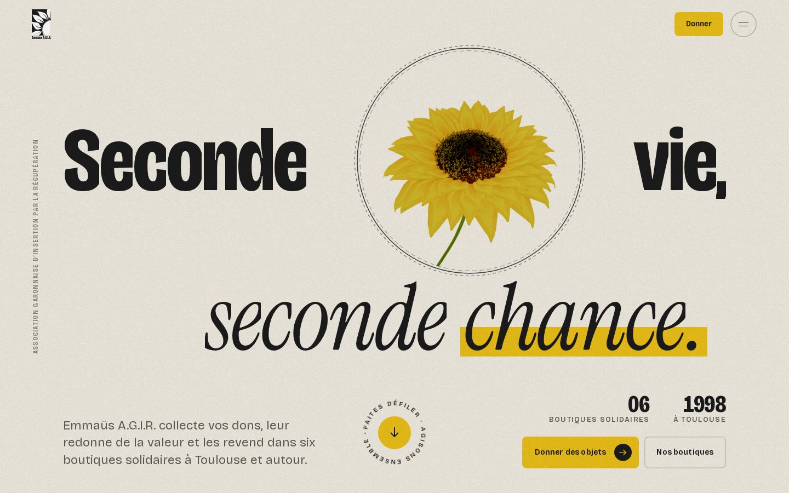
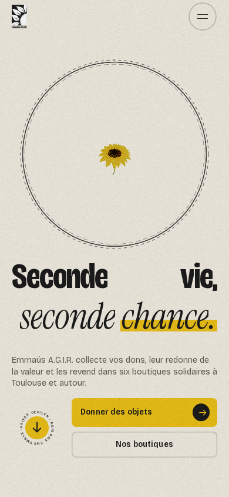

# UI Design System & Master Generation Blueprint: emmaus-agir-31-fr

> **Emmaüs A.G.I.R. — Boutiques solidaires à Toulouse et autour** (https://emmaus-agir-31.fr/) — Donnez une seconde vie à vos objets. Emmaüs A.G.I.R. collecte, trie et revend vos dons dans six boutiques solidaires à Toulouse et autour...



---

## 1. Executive Visual Persona & Design Archetype

- **Brand Essence & Persona**: **Emmaüs A.G.I.R. — Boutiques solidaires à Toulouse et autour** (`https://emmaus-agir-31.fr/`). Donnez une seconde vie à vos objets. Emmaüs A.G.I.R. collecte, trie et revend vos dons dans six boutiques solidaires à Toulouse et autour...
- **Capture Provenance**: Live browser capture (`tier1_fast`, HTTP `200`, captured `2026-11-23`).
- **Visual Archetype**: **Light-Gallery WebGL / Canvas Interactive Experience (`#f1ece1` / `#ebc017`)**.
- **Anti-AI-Slop Differentiators**:
  - **Live-Computed Chromatic Polarity**: Anchors the viewport in `#f1ece1` (live computed `body` `background-color` (`computed_styles.json`)) paired with `#1b1b1b` primary typography and `#ebc017` accents.
  - **Grounded Typographic Hierarchy**: Pairs `Bricolage Grotesque` for display copy (`Seconde vie, seconde chance.`) with `Bricolage Grotesque` and not declared in live computed styles (uses primary stack / `ui-monospace`).
  - **Calibrated Spatial Grid & Motion**: Combines `1440px` container bounds (`gap: 28px 24px`, padding `57.6px`) with `cubic-bezier(0.16,1,0.3,1)` easing and Lenis Smooth Scroll (`data-lenis`), Three.js / WebGL Canvas Pipeline.

---

## 2. Spatial Architecture & Modular Grid Mathematics



### Viewport Allocation & Container Geometry
- **Captured Viewport Dimensions**: Desktop `1440×900px` (`assets/desktop.png`, single-viewport 100vh live capture (900px)), Mobile `390×844px` (`assets/mobile.png`, single-viewport 100vh live capture (844px)).
- **Master Container Bounds**: `1440px` (full-bleed `100%` desktop stage measured on `1440px` viewport).
- **Canvas Lateral Padding & Spacing**: `57.6px` lateral canvas padding with `28px 24px` grid gap.
- **Border Radius Scale**: `50%`, `999px`, `var(--radius-pill)`, `8px`.

### Responsive Breakpoint Architecture
- **Desktop Layout**: Multi-column CSS Grid / Flexbox layout at `1440px` (`max-width: 1440px`, `gap: 28px 24px`).
- **Mobile Layout**: Single-column vertical stack at `390px` viewport width with `57.6px` horizontal padding.
- **Extracted CSS Media Queries**: `@media (prefers-reduced-motion:reduce)`, `@media (max-width:640px)`, `@media (max-width:1024px)`, `@media (max-width:1024px)and (orientation:portrait)`.

---

## 3. Color System, Materiality & Atmospheric Lighting

### Semantic Palette & Source Grounding
| Semantic Role | Ground-Truth Value | Extracted Live / CSS Source |
|---|---|---|
| **Primary Canvas Substrate** | `#f1ece1` | live computed `body` `background-color` (`computed_styles.json`) |
| **Primary Typography Ink** | `#1b1b1b` | live computed `h1` `color` (`computed_styles.json`) |
| **Elevated Surface / Card Substrate** | `#ebc017` | live computed `a` `background-color` (`computed_styles.json`) |
| **Interactive Accent / Highlight** | `#ebc017` | live computed `a` `background-color` (`computed_styles.json`) |
| **Secondary / Muted Copy** | `#5f5d57` | live computed `p` `color` (`computed_styles.json`) |
| **Structural Hairline Border** | `#d1cdc3` | `.menu__shop { border-top: #d1cdc3 }` |
| **Variable Token (`--fond-2`)** | `#e7e1d3` | `var(--fond-2)` in `:root` |
| **Variable Token (`--bleu`)** | `#33669b` | `var(--bleu)` in `:root` |
| **Variable Token (`--vert`)** | `#43744e` | `var(--vert)` in `:root` |

### Sanitized Root CSS Variables (`ui-ux.md` Ground Truth)
| Variable Name | Extracted Value | Semantic Role |
|---|---|---|
| `--fond` | `#f1ece1` | Color / Atmospheric Token |
| `--fond-2` | `#e7e1d3` | Color / Atmospheric Token |
| `--gris` | `#1b1b1b` | Color / Atmospheric Token |
| `--gris-doux` | `#5f5d57` | Color / Atmospheric Token |
| `--ligne` | `rgba(27,27,27,0.18)` | Color / Atmospheric Token |
| `--jaune` | `#ebc017` | Color / Atmospheric Token |
| `--bleu` | `#33669b` | Color / Atmospheric Token |
| `--vert` | `#43744e` | Color / Atmospheric Token |
| `--ink` | `var(--gris)` | Typography Ink Token |
| `--header-h` | `clamp(56px,8vw,88px)` | Layout / Spatial Grid Token |
| `--radius-pill` | `999px` | Elevation / Border Token |
| `--tap` | `44px` | Dimension / Scale Token |
| `--z-flower` | `2` | Elevation / Border Token |
| `--z-guide` | `3` | Elevation / Border Token |
| `--z-scene` | `4` | Elevation / Border Token |
| `--z-scene-raised` | `5` | Elevation / Border Token |

---

## 4. Typographic Scale & Editorial Hierarchy

### Font Family Stacks
- **Display Typography**: `Bricolage Grotesque`.
- **Primary Body Stack**: `Bricolage Grotesque`.
- **Technical / Metadata Stack**: not declared in live computed styles (uses primary stack / `ui-monospace`).

### Typographic Scale & Rules (Live Computed & Stylesheet Grounded)
- **Hero Display (`H1`)**: live computed `h1` (`font-size: 164.8px`, `line-height: 138.432px`, `font-weight: 740`, `letter-spacing: -6.592px`); CSS variables `--fs-display: clamp(3.2rem,0.8rem + 7.2vw,11.5rem)`.
- **Section Heading (`H2`)**: live computed `h2` (`font-size: 27px`, `line-height: 40.5px`, `font-weight: 700`); CSS variables `--fs-h2: clamp(2.5rem,1.3rem + 4.6vw,6.5rem)`; rule `.h2` (`font-size: clamp(1.5rem,8dvh,2.6rem)`).
- **Body Copy**: live computed `body` (`font-size: 18px`, `line-height: 27px`, `font-weight: 400`); CSS variables `--fs-body: clamp(1rem,0.95rem + 0.2vw,1.125rem)`; rule `p` (`font-size: var(--fs-lead)`, `line-height: 1.45`).
- **Metadata & Navigation Labels**: live computed `nav/a` (`font-size: 14px`, `line-height: 21px`, `font-weight: 400`); CSS variables `--fs-small: 0.9375rem`, `--fs-label: clamp(0.75rem,0.72rem + 0.12vw,0.8125rem)`; rule `.label` (`font-size: .6875rem`).

---

## 5. Choreographed Motion & Interaction Physics

### Primary Easing Curves
- **Extracted Timing Functions**: `cubic-bezier(0.16,1,0.3,1)`, `cubic-bezier(0.65,0,0.35,1)`, `cubic-bezier(0.34,1.8,0.64,1)`.

### Per-Element Transition & Choreography Rules
- **Selector `media(prefers-reduced-motion:reduce)`**: `transition: .01ms!important` extracted from `emmaus-agir-31-fr` stylesheet.
- **Selector `.btn`**: `transition: color .45s var(--ease-out)` extracted from `emmaus-agir-31-fr` stylesheet.
- **Selector `.btn:before`**: `transition: scale .6s var(--ease-out)` extracted from `emmaus-agir-31-fr` stylesheet.
- **Extracted Easing Curve (`cubic-bezier(0.16,1,0.3,1)`)**: Governs interactive state transitions across `<header.header>` and `<section.activites>`.
- **Runtime Interaction Engine**: Integrates Lenis Smooth Scroll (`data-lenis`), Three.js / WebGL Canvas Pipeline with `prefers-reduced-motion: reduce` fallback guards.

---

## 6. Component Wireframe & Structural DOM Map

### Visual Layout Schematic — Desktop (`1440px`, Grounded in `dom.html` & Landmark Bounding Boxes)
```
┌────────────────────────────────────────────────────────────────────────┐
│ DESKTOP VIEWPORT (1440px) — Emmaüs A.G.I.R. — Boutiques solidaires à T │
│ ====================================================================== │
│ [ <header.header> (1440x88px)         | 0 1 Accueil Accueil · 05 61  ] │
│ ---------------------------------------------------------------------- │
│ | HERO STAGE: <section.hero> (w=1440px)                              | │
│ | H1: Seconde vie, seconde chance.                                   | │
│ | Substrate: #f1ece1 | Ink: #1b1b1b | Accent: #ebc017                | │
│ ---------------------------------------------------------------------- │
│ | SHOWCASE GRID (<section.activites>) max-w: 1440px                  | │
│ | +------------------------------+  +------------------------------+ | │
│ | | S e c o n d e v i e , s e c  |  | Le parcours d’un don.        | | │
│ | +------------------------------+  +------------------------------+ | │
│ ---------------------------------------------------------------------- │
│ | DETAIL MODULE (<article.activites__text>) — Réception des dons     | │
│ ---------------------------------------------------------------------- │
│ [ FOOTER (<footer.footer>     ) | https://emmaus-agir-31.fr/           │
└────────────────────────────────────────────────────────────────────────┘
```

### Visual Layout Schematic — Mobile Reflow (`390px`)
```
┌────────────────────────────────────────────────────────────────────────┐
│ MOBILE VIEWPORT REFLOW (390px) — Single-Column Stack (gap: 28px 24p)   │
│ ====================================================================== │
│ [ HEADER BAR (<header.header>         ) | Compact Menu (390px)         │
│ ---------------------------------------------------------------------- │
│ | HERO STAGE (<section.hero>) — 390px Vertical Lead                  | │
│ | H1: Seconde vie, seconde chance.                                   | │
│ ---------------------------------------------------------------------- │
│ | SHOWCASE STACK (<section.activites>) — 1-Col Stack                 | │
│ | [ Item 1: S e c o n d e v i e , s e c o n d e c h a n c e .      ] | │
│ | [ Item 2: Le parcours d’un don.                                  ] | │
│ ---------------------------------------------------------------------- │
│ | DETAIL STACK (<article.activites__text) — 1-Col (Réception des dons) │
│ ---------------------------------------------------------------------- │
│ [ FOOTER (<footer.footer>     ) | Stacked 390px Colophon               │
└────────────────────────────────────────────────────────────────────────┘
```

### Granular DOM Region Breakdown
1. **Brand Header & Navigation Bar (<header.header> — `emmaus-agir-31-fr`)**:
   - Landmark `<header class="header">` (`1440x88px`) hosting `Emmaüs A.G.I.R. — Boutiques solidair` navigation (`0 1 Accueil Accueil · 05 61 63 14 94 · 05 61 52 02 23 · 09 53 53 93 05 · 09 84 12 80 62`), DOM attributes (`data-next-head`, `data-next-font="size-adjust"`, `data-next-font="size-adjust"`, `data-next-font="size-adjust"`), and stylesheet rule `.__className_2a1a39 { font-family:Bricolage Grotesque,Bricolage Grotesque Fallback;font-style:... }`.
2. **Hero Stage & Focal Lead (<section.hero> — `Seconde vie, seconde chance.`)**:
   - Landmark `<section class="hero">` presenting display lead `Seconde vie, seconde chance.` and copy excerpt *"ASSOCIATION GARONNAISE D’INSERTION PAR LA RÉCUPÉRATION"* over `#f1ece1` canvas and `#1b1b1b` ink.
3. **Primary Showcase & Content Grid (<section.activites> — `S e c o n d e v i e , s e c o n d `)**:
   - Landmark `<section class="activites">` rendering section `S e c o n d e v i e , s e c o n d e c h a n c e .` with copy *"Association Garonnaise d’Insertion par la Récupération"*, asset references (`logo.svg`, `favicon.ico`, `favicon-32x32.png`, `apple-icon-180x180.png`), and grid rule `.__className_ae301a { font-family:"Instrument Serif","Instrument Serif Fallback";font-weight:400 }`.
4. **Interactive Detail & Feature Matrix (<article.activites__text> — `Le parcours d’un don.`)**:
   - Landmark `<article class="activites__text is-active">` framing `Le parcours d’un don.` and `Réception des dons` (*"S e c o n d e v i e ,"*) with `#ebc017` surface cards, `#ebc017` accents, and `before { box-sizing:border-box }`.
5. **Colophon & Global Directory Footer (<footer.footer> — `https://emmaus-agir-31.fr/`)**:
   - Landmark `<footer class="footer">` anchoring `Emmaüs A.G.I.R. — Boutiques soli` footer links (`0 1 Accueil Accueil · 05 61 63 14 94 · 05 61 52 02 23 · 09 53 53 93 05 · 09 84 12 80 62`), copy *"s e c o n d e c h a n c e ."*, and `#d1cdc3` structural dividers.

---

## 7. Master Zero-Shot AI Generation Prompt

```markdown
# Master Zero-Shot Frontend Generation Prompt: emmaus-agir-31-fr (Emmaüs A.G.I.R. — Boutiques solidaires à Toulouse et autour)

You are a principal frontend architect and design systems engineer. Build a complete, production-ready web application replicating the exact design system, DOM landmarks, typographic hierarchy, color tokens, and motion physics of `emmaus-agir-31-fr` (**Emmaüs A.G.I.R. — Boutiques solidaires à Toulouse et autour** — `https://emmaus-agir-31.fr/`).

### 1. Visual Archetype & Anti-AI-Slop Mandates
- **Archetype**: Light-Gallery WebGL / Canvas Interactive Experience (`#f1ece1` / `#ebc017`).
- **Identity & Domain Context**: Donnez une seconde vie à vos objets. Emmaüs A.G.I.R. collecte, trie et revend vos dons dans six boutiques solidaires à Toulouse et autour...
- **Primary Substrate**: `#f1ece1` (live computed `body` `background-color` (`computed_styles.json`)), **Primary Ink**: `#1b1b1b`, **Accent / Highlight**: `#ebc017`.
- **Site-Specific Differentiators**:
  - **Live-Computed Chromatic Polarity**: Anchors the viewport in `#f1ece1` (live computed `body` `background-color` (`computed_styles.json`)) paired with `#1b1b1b` primary typography and `#ebc017` accents.
  - **Grounded Typographic Hierarchy**: Pairs `Bricolage Grotesque` for display copy (`Seconde vie, seconde chance.`) with `Bricolage Grotesque` and not declared in live computed styles (uses primary stack / `ui-monospace`).
  - **Calibrated Spatial Grid & Motion**: Combines `1440px` container bounds (`gap: 28px 24px`, padding `57.6px`) with `cubic-bezier(0.16,1,0.3,1)` easing and Lenis Smooth Scroll (`data-lenis`), Three.js / WebGL Canvas Pipeline.

### 2. Ground-Truth CSS Variables (`:root` Token Contract)
Declare and consume these exact custom properties extracted from `emmaus-agir-31-fr` in your global stylesheet:

:root {
  /* Emmaüs A.G.I.R. — Boutiques solidaires à Toulouse et autour (emmaus-agir-31-fr) — Live-Grounded CSS Variables */
  --fond: #f1ece1; /* Color / Atmospheric Token (emmaus-agir-31-fr) */
  --fond-2: #e7e1d3; /* Color / Atmospheric Token (emmaus-agir-31-fr) */
  --gris: #1b1b1b; /* Color / Atmospheric Token (emmaus-agir-31-fr) */
  --gris-doux: #5f5d57; /* Color / Atmospheric Token (emmaus-agir-31-fr) */
  --ligne: rgba(27,27,27,0.18); /* Color / Atmospheric Token (emmaus-agir-31-fr) */
  --jaune: #ebc017; /* Color / Atmospheric Token (emmaus-agir-31-fr) */
  --bleu: #33669b; /* Color / Atmospheric Token (emmaus-agir-31-fr) */
  --vert: #43744e; /* Color / Atmospheric Token (emmaus-agir-31-fr) */
  --ink: var(--gris); /* Typography Ink Token (emmaus-agir-31-fr) */
  --header-h: clamp(56px,8vw,88px); /* Layout / Spatial Grid Token (emmaus-agir-31-fr) */
  --radius-pill: 999px; /* Elevation / Border Token (emmaus-agir-31-fr) */
  --tap: 44px; /* Dimension / Scale Token (emmaus-agir-31-fr) */
  --z-flower: 2; /* Elevation / Border Token (emmaus-agir-31-fr) */
  --z-guide: 3; /* Elevation / Border Token (emmaus-agir-31-fr) */
  --z-scene: 4; /* Elevation / Border Token (emmaus-agir-31-fr) */
  --z-scene-raised: 5; /* Elevation / Border Token (emmaus-agir-31-fr) */
}

### 3. Semantic Color & Materiality Contract
Map every surface, ink, and border strictly to these source-grounded tokens:
- **Primary Canvas Substrate**: `#f1ece1` — grounded in live computed `body` `background-color` (`computed_styles.json`)
- **Primary Typography Ink**: `#1b1b1b` — grounded in live computed `h1` `color` (`computed_styles.json`)
- **Elevated Surface / Card Substrate**: `#ebc017` — grounded in live computed `a` `background-color` (`computed_styles.json`)
- **Interactive Accent / Highlight**: `#ebc017` — grounded in live computed `a` `background-color` (`computed_styles.json`)
- **Secondary / Muted Copy**: `#5f5d57` — grounded in live computed `p` `color` (`computed_styles.json`)
- **Structural Hairline Border**: `#d1cdc3` — grounded in `.menu__shop { border-top: #d1cdc3 }`
- **Variable Token (`--fond-2`)**: `#e7e1d3` — grounded in `var(--fond-2)` in `:root`
- **Variable Token (`--bleu`)**: `#33669b` — grounded in `var(--bleu)` in `:root`
- **Variable Token (`--vert`)**: `#43744e` — grounded in `var(--vert)` in `:root`

### 4. Spatial Grid, Container Bounds & Responsive Breakpoints
- **Desktop Viewport Reference**: `1440×900px` (single-viewport 100vh live capture (900px), `1440px` standard desktop width).
- **Mobile Viewport Reference**: `390×844px` (single-viewport 100vh live capture (844px), `390px` standard mobile width).
- **Container Max-Width**: `1440px` (full-bleed `100%` desktop stage measured on `1440px` viewport)
- **Padding & Gutters**: `57.6px` lateral canvas padding with `28px 24px` grid gap
- **Desktop Grid**: Multi-column CSS Grid / Flexbox layout at `1440px` (`max-width: 1440px`, `gap: 28px 24px`)
- **Mobile Adaptation**: Single-column vertical stack at `390px` viewport width with `57.6px` horizontal padding
- **Media Queries**: `@media (prefers-reduced-motion:reduce)`, `@media (max-width:640px)`, `@media (max-width:1024px)`, `@media (max-width:1024px)and (orientation:portrait)`
- **Corner Radii**: `50%`, `999px`, `var(--radius-pill)`, `8px`

### 5. Typography & Editorial Scale Contract
- **Display Font Stack**: `Bricolage Grotesque`
- **Body Font Stack**: `Bricolage Grotesque`
- **Monospace / Technical Font Stack**: not declared in live computed styles (uses primary stack / `ui-monospace`)
- **H1 Display Rule**: live computed `h1` (`font-size: 164.8px`, `line-height: 138.432px`, `font-weight: 740`, `letter-spacing: -6.592px`); CSS variables `--fs-display: clamp(3.2rem,0.8rem + 7.2vw,11.5rem)`
- **H2 Section Rule**: live computed `h2` (`font-size: 27px`, `line-height: 40.5px`, `font-weight: 700`); CSS variables `--fs-h2: clamp(2.5rem,1.3rem + 4.6vw,6.5rem)`; rule `.h2` (`font-size: clamp(1.5rem,8dvh,2.6rem)`)
- **Body Copy Rule**: live computed `body` (`font-size: 18px`, `line-height: 27px`, `font-weight: 400`); CSS variables `--fs-body: clamp(1rem,0.95rem + 0.2vw,1.125rem)`; rule `p` (`font-size: var(--fs-lead)`, `line-height: 1.45`)
- **Metadata & Index Rule**: live computed `nav/a` (`font-size: 14px`, `line-height: 21px`, `font-weight: 400`); CSS variables `--fs-small: 0.9375rem`, `--fs-label: clamp(0.75rem,0.72rem + 0.12vw,0.8125rem)`; rule `.label` (`font-size: .6875rem`)

### 6. Component Hierarchy, Verbatim Copy & Real DOM Landmarks
Scaffold `emmaus-agir-31-fr` (`Emmaüs A.G.I.R. — Boutiques solidaires à Toulouse et autour`) with these exact structural regions, extracted copy, and CSS rules from `dom.html`:
1. **Brand Header & Navigation Bar (<header.header> — `emmaus-agir-31-fr`)**:
   - DOM & Selectors: Landmark `<header class="header">` (`1440x88px`) hosting `Emmaüs A.G.I.R. — Boutiques solidair` navigation (`0 1 Accueil Accueil · 05 61 63 14 94 · 05 61 52 02 23 · 09 53 53 93 05 · 09 84 12 80 62`), DOM attributes (`data-next-head`, `data-next-font="size-adjust"`, `data-next-font="size-adjust"`, `data-next-font="size-adjust"`), and stylesheet rule `.__className_2a1a39 { font-family:Bricolage Grotesque,Bricolage Grotesque Fallback;font-style:... }`.
   - Responsive Contract: Header `Brand Header & Navigation Bar (<header.header> — `emmaus-agir-31-fr`)` (`emmaus-agir-31-fr`) adapts across `@media (prefers-reduced-motion:reduce)`, `@media (max-width:640px)`, `@media (max-width:1024px)`, `@media (max-width:1024px)and (orientation:portrait)` with `cubic-bezier(0.16,1,0.3,1)`, `cubic-bezier(0.65,0,0.35,1)`, `cubic-bezier(0.34,1.8,0.64,1)` transitions and links `0 1 Accueil Accueil · 05 61 63 14 94 · 05 61 52 02 23 · 09 53 53 93 05 · 09 84 12 80 62`.
2. **Hero Stage & Focal Lead (<section.hero> — `Seconde vie, seconde chance.`)**:
   - DOM & Selectors: Landmark `<section class="hero">` presenting display lead `Seconde vie, seconde chance.` and copy excerpt *"ASSOCIATION GARONNAISE D’INSERTION PAR LA RÉCUPÉRATION"* over `#f1ece1` canvas and `#1b1b1b` ink.
   - Responsive Contract: Hero stage (`1440×900px` desktop / `390×844px` mobile) sets `#f1ece1` background with `#1b1b1b` headline `Seconde vie, seconde chance.`.
3. **Primary Showcase & Content Grid (<section.activites> — `S e c o n d e v i e , s e c o n d `)**:
   - DOM & Selectors: Landmark `<section class="activites">` rendering section `S e c o n d e v i e , s e c o n d e c h a n c e .` with copy *"Association Garonnaise d’Insertion par la Récupération"*, asset references (`logo.svg`, `favicon.ico`, `favicon-32x32.png`, `apple-icon-180x180.png`), and grid rule `.__className_ae301a { font-family:"Instrument Serif","Instrument Serif Fallback";font-weight:400 }`.
   - Responsive Contract: Showcase grid `Primary Showcase & Content Grid (<section.activites> — `S e c o n d e v i e , s e c o n d `)` applies Multi-column CSS Grid / Flexbox layout at `1440px` (`max-width: 1440px`, `gap: 28px 24px`) on desktop and Single-column vertical stack at `390px` viewport width with `57.6px` horizontal padding on mobile.
4. **Interactive Detail & Feature Matrix (<article.activites__text> — `Le parcours d’un don.`)**:
   - DOM & Selectors: Landmark `<article class="activites__text is-active">` framing `Le parcours d’un don.` and `Réception des dons` (*"S e c o n d e v i e ,"*) with `#ebc017` surface cards, `#ebc017` accents, and `before { box-sizing:border-box }`.
   - Responsive Contract: Detail module `Interactive Detail & Feature Matrix (<article.activites__text> — `Le parcours d’un don.`)` uses `50%`, `999px`, `var(--radius-pill)`, `8px` radii, `#ebc017` highlights, and assets (logo.svg, favicon.ico, favicon-32x32.png).
5. **Colophon & Global Directory Footer (<footer.footer> — `https://emmaus-agir-31.fr/`)**:
   - DOM & Selectors: Landmark `<footer class="footer">` anchoring `Emmaüs A.G.I.R. — Boutiques soli` footer links (`0 1 Accueil Accueil · 05 61 63 14 94 · 05 61 52 02 23 · 09 53 53 93 05 · 09 84 12 80 62`), copy *"s e c o n d e c h a n c e ."*, and `#d1cdc3` structural dividers.
   - Responsive Contract: Footer `Colophon & Global Directory Footer (<footer.footer> — `https://emmaus-agir-31.fr/`)` aligns to `1440px` (full-bleed `100%` desktop stage measured on `1440px` viewport) with `57.6px` lateral canvas padding with `28px 24px` grid gap and attributes (data-next-head, data-next-font="size-adjust", data-next-font="size-adjust").

#### Verbatim DOM Copy Excerpts (`dom.html`)
- Copy Excerpt 1: *"ASSOCIATION GARONNAISE D’INSERTION PAR LA RÉCUPÉRATION"*
- Copy Excerpt 2: *"Association Garonnaise d’Insertion par la Récupération"*
- Copy Excerpt 3: *"S e c o n d e v i e ,"*
- Copy Excerpt 4: *"s e c o n d e c h a n c e ."*

### 7. Motion, Extracted Stylesheet Rules & Interaction Choreography
- **Primary Easing Functions**: `cubic-bezier(0.16,1,0.3,1)`, `cubic-bezier(0.65,0,0.35,1)`, `cubic-bezier(0.34,1.8,0.64,1)`
- **Extracted Stylesheet Rules (`emmaus-agir-31-fr`)**:
- `.__className_2a1a39 { font-family:Bricolage Grotesque,Bricolage Grotesque Fallback;font-style:... }`
- `.__className_ae301a { font-family:"Instrument Serif","Instrument Serif Fallback";font-weight:400 }`
- `before { box-sizing:border-box }`
- `html { text-size-adjust:100%;background:var(--fond);color:var(--ink) }`
- `html.lenis body { height:auto }`
- **Per-Selector Transition Rules**:
- **Selector `media(prefers-reduced-motion:reduce)`**: `transition: .01ms!important` extracted from `emmaus-agir-31-fr` stylesheet.
- **Selector `.btn`**: `transition: color .45s var(--ease-out)` extracted from `emmaus-agir-31-fr` stylesheet.
- **Selector `.btn:before`**: `transition: scale .6s var(--ease-out)` extracted from `emmaus-agir-31-fr` stylesheet.
- **Extracted Easing Curve (`cubic-bezier(0.16,1,0.3,1)`)**: Governs interactive state transitions across `<header.header>` and `<section.activites>`.
- **Runtime Interaction Engine**: Integrates Lenis Smooth Scroll (`data-lenis`), Three.js / WebGL Canvas Pipeline with `prefers-reduced-motion: reduce` fallback guards.

### 8. Technical Deliverables
- Implement in Next.js (App Router) with TypeScript and Tailwind CSS consuming the `:root` custom properties defined above for `emmaus-agir-31-fr`.
- Reproduce both the `1440px` desktop architecture and `390px` mobile breakpoint transitions, preserving semantic HTML5 landmarks (`<header>`, `<nav>`, `<main>`, `<section>`, `<footer>`) and `prefers-reduced-motion` accessibility guards.
```
