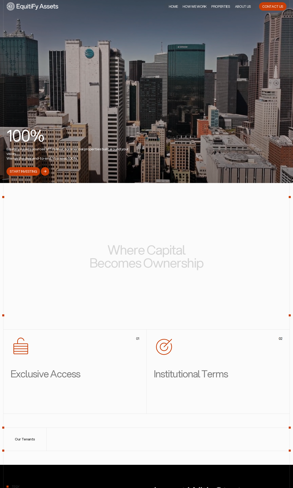
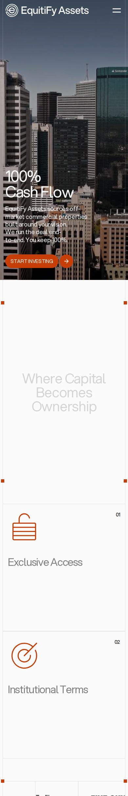

# UI Design System & Master Generation Blueprint: equitifyasset-com

> **EquitiFy Assets · Home** (https://equitifyasset.com/) — We source off-market commercial property, run the acquisition end to end, and hand you 100% ownership. No syndicates, no partners.



---

## 1. Executive Visual Persona & Design Archetype

- **Brand Essence & Persona**: **EquitiFy Assets · Home** (`https://equitifyasset.com/`). We source off-market commercial property, run the acquisition end to end, and hand you 100% ownership. No syndicates, no partners.
- **Visual Archetype**: **Light-Substrate Editorial & Modular Grid System (`#e2e2e2` canvas, `#000` ink, `#f4f4e8` accent)**.
- **Anti-AI-Slop Differentiators**:
  - **Source-Grounded Chromatic Polarity**: Anchors the viewport in `#e2e2e2` (`var(--token-e5145d68-ee3f-43dc-8638-41389fb43644)` in `:root`) paired with `#000` primary typography and `#f4f4e8` accents.
  - **Extracted Typographic Hierarchy**: Pairs `Inter` for display copy (`Tax Benefits`) with `Aspekta Variable Variable` and not declared in static CSS (uses primary stack / `ui-monospace`).
  - **Calibrated Spatial Grid & Motion**: Combines `1199.98px` container bounds (`gap: 10px`, padding `36px`) with `cubic-bezier(.4,0,.2,1)` easing and Lenis Smooth Scroll (`data-lenis`), Framer Motion Layout Physics.

---

## 2. Spatial Architecture & Modular Grid Mathematics



### Viewport Allocation & Container Geometry
- **Captured Viewport Dimensions**: Desktop `1440×8426px` (`assets/desktop.png`, full-page scroll capture), Mobile `390×2400px` (`assets/mobile.png`, capped at 2400px multi-section capture).
- **Master Container Bounds**: `1199.98px` extracted from `equitifyasset-com` stylesheet.
- **Canvas Lateral Padding & Spacing**: `36px` lateral canvas padding with `10px` grid gap.
- **Border Radius Scale**: `10px`, `8px`, `15px`, `40px`.

### Responsive Breakpoint Architecture
- **Desktop Layout**: Multi-column CSS Grid / Flexbox layout at `1440px` (`max-width: 1199.98px`, `gap: 10px`).
- **Mobile Layout**: Single-column vertical stack at `390px` viewport width with `36px` horizontal padding.
- **Extracted CSS Media Queries**: `@media (min-width: 1200px)`, `@media (min-width: 720px) and (max-width: 1199.98px)`, `@media (max-width: 719.98px)`, `@media (max-width:1199px) and (min-width:720px)`.

---

## 3. Color System, Materiality & Atmospheric Lighting

### Semantic Palette & Source Grounding
| Semantic Role | Ground-Truth Value | Extracted CSS Source / Selector |
|---|---|---|
| **Primary Canvas Substrate** | `#e2e2e2` | `var(--token-e5145d68-ee3f-43dc-8638-41389fb43644)` in `:root` |
| **Primary Typography Ink** | `#d1ff00` | `var(--token-f277370d-904c-4e87-88c6-49451f154e33)` in `:root` |
| **Elevated Surface / Card Substrate** | `#000` | `var(--token-d33926f3-e1ef-47a7-a2fc-872ea608e7c8)` in `:root` |
| **Interactive Accent / Highlight** | `#f4f4e8` | `var(--token-33c8dbd0-eb94-4e90-8099-e7a3fee4ad2f)` in `:root` |
| **Secondary / Muted Copy** | `#534f4d` | `var(--token-82d92470-f077-4c9d-9673-709d01132847)` in `:root` |
| **Structural Hairline Border** | `#bcbcbc` | `var(--token-1486dbb4-cc20-4852-a20d-db81362153cb)` in `:root` |
| **Variable Token (`--token-08d07ee3-fce8-41f2-9d02-9c41009dd49d`)** | `#3d3d3d` | `var(--token-08d07ee3-fce8-41f2-9d02-9c41009dd49d)` in `:root` |
| **Variable Token (`--token-6e62038c-0066-4a2a-9fbd-3ca05d5d5284`)** | `#1c1e19` | `var(--token-6e62038c-0066-4a2a-9fbd-3ca05d5d5284)` in `:root` |
| **Variable Token (`--token-27d215b1-9859-4ed9-910b-49be7f89fc94`)** | `#fbfbfb` | `var(--token-27d215b1-9859-4ed9-910b-49be7f89fc94)` in `:root` |
| **Variable Token (`--token-52433e3c-3bdd-4e8f-b4eb-8bd6681644d3`)** | `#ffffed` | `var(--token-52433e3c-3bdd-4e8f-b4eb-8bd6681644d3)` in `:root` |
| **Variable Token (`--token-19fadcaa-97dd-4766-8f90-eb9a72bcc235`)** | `#c83e07` | `var(--token-19fadcaa-97dd-4766-8f90-eb9a72bcc235)` in `:root` |
| **Variable Token (`--token-5e7f03a9-6226-4578-8399-febb83abe7c0`)** | `#050505` | `var(--token-5e7f03a9-6226-4578-8399-febb83abe7c0)` in `:root` |
| **Variable Token (`--token-b22324d1-617e-4b7c-9516-d41489048918`)** | `#9c9c9c26` | `var(--token-b22324d1-617e-4b7c-9516-d41489048918)` in `:root` |

### Sanitized Root CSS Variables (`ui-ux.md` Ground Truth)
| Variable Name | Extracted Value | Semantic Role |
|---|---|---|
| `--token-e5145d68-ee3f-43dc-8638-41389fb43644` | `#e2e2e2` | Color / Atmospheric Token |
| `--token-f277370d-904c-4e87-88c6-49451f154e33` | `#d1ff00` | Color / Atmospheric Token |
| `--token-d33926f3-e1ef-47a7-a2fc-872ea608e7c8` | `#000` | Color / Atmospheric Token |
| `--token-33c8dbd0-eb94-4e90-8099-e7a3fee4ad2f` | `#f4f4e8` | Color / Atmospheric Token |
| `--token-82d92470-f077-4c9d-9673-709d01132847` | `#534f4d` | Color / Atmospheric Token |
| `--token-1486dbb4-cc20-4852-a20d-db81362153cb` | `#bcbcbc` | Color / Atmospheric Token |
| `--token-08d07ee3-fce8-41f2-9d02-9c41009dd49d` | `#3d3d3d` | Color / Atmospheric Token |
| `--token-6e62038c-0066-4a2a-9fbd-3ca05d5d5284` | `#1c1e19` | Color / Atmospheric Token |
| `--token-27d215b1-9859-4ed9-910b-49be7f89fc94` | `#fbfbfb` | Color / Atmospheric Token |
| `--token-52433e3c-3bdd-4e8f-b4eb-8bd6681644d3` | `#ffffed` | Color / Atmospheric Token |
| `--token-19fadcaa-97dd-4766-8f90-eb9a72bcc235` | `#c83e07` | Color / Atmospheric Token |
| `--token-a5e091a2-859c-44ea-91df-ecdc98f39d88` | `#f4f4e8` | Color / Atmospheric Token |
| `--token-1f8b4914-6c8e-4506-b0ec-24a02142f4ba` | `#d1ff00` | Color / Atmospheric Token |
| `--token-5e7f03a9-6226-4578-8399-febb83abe7c0` | `#050505` | Color / Atmospheric Token |
| `--token-b5be0a90-9b43-4c58-8ca5-f5dd60fafe9f` | `#bcbcbc` | Color / Atmospheric Token |
| `--token-b22324d1-617e-4b7c-9516-d41489048918` | `#9c9c9c26` | Color / Atmospheric Token |

---

## 4. Typographic Scale & Editorial Hierarchy

### Font Family Stacks
- **Display Typography**: `Inter`.
- **Primary Body Stack**: `Aspekta Variable Variable`.
- **Technical / Metadata Stack**: not declared in static CSS (uses primary stack / `ui-monospace`).

### Typographic Scale & Rules (Extracted from Stylesheet & Variables)
- **Hero Display (`H1`)**: rule `h1` (`font-size: calc(var(--framer-root-font-s...`, `line-height: 1em`, `letter-spacing: -.03em`, `font-weight: 400`).
- **Section Heading (`H2`)**: rule `h2` (`font-size: calc(var(--framer-root-font-s...`, `line-height: 1.1em`, `letter-spacing: -.04em`, `font-weight: 400`).
- **Body Copy**: rule `p` (`font-size: calc(var(--framer-root-font-s...`, `line-height: 1.3em`, `letter-spacing: -.02em`, `font-weight: 400`).
- **Metadata & Navigation Labels**: CSS variables `--letter-spacing: var(--framer-letter-spacing)`.

---

## 5. Choreographed Motion & Interaction Physics

### Primary Easing Curves
- **Extracted Timing Functions**: `cubic-bezier(.4,0,.2,1)`, `cubic-bezier(0.32,0.72,0,1)`.

### Per-Element Transition & Choreography Rules
- **Selector `.lenis.lenis-autoToggle`**: `transition: 1ms` extracted from `equitifyasset-com` stylesheet.
- **Selector `er-styles-preset-3w9o9k.rich-text...`**: `transition: color .4s cubic-bezier(.4,0,.2,1)` extracted from `equitifyasset-com` stylesheet.
- **Selector `er-styles-preset-cxxcqs.rich-text...`**: `transition: color .4s cubic-bezier(.4,0,.2,1)` extracted from `equitifyasset-com` stylesheet.
- **Extracted Easing Curve (`cubic-bezier(.4,0,.2,1)`)**: Governs interactive state transitions across `<header.lenis>` and `<div.framer-gMKHR>`.
- **Runtime Interaction Engine**: Integrates Lenis Smooth Scroll (`data-lenis`), Framer Motion Layout Physics with `prefers-reduced-motion: reduce` fallback guards.

---

## 6. Component Wireframe & Structural DOM Map

### Visual Layout Schematic (Grounded in `dom.html` — `1440px` Desktop & `390px` Mobile Reflow)
```
┌────────────────────────────────────────────────────────────────────────┐
│ DESKTOP VIEWPORT (1440px) — EquitiFy Assets · Home                     │
│ ====================================================================== │
│ [ <header.lenis>           | Home · How We Work · Properties · abou ]  │
│ ---------------------------------------------------------------------- │
│ | HERO STAGE: <div.lenis-autoToggle>                               |   │
│ | H1: Tax Benefits                                                 |   │
│ | Substrate: #e2e2e2    | Ink: #000       | Accent: #f4f4e8        |   │
│ ---------------------------------------------------------------------- │
│ | SHOWCASE GRID (<div.framer-gMKHR>        ) max-w: 1199.98px      |   │
│ | +------------------------------+  +------------------------------+ | │
│ | | W h e r e C a p i t a l B e  |  | Exclusive Access             | | │
│ | +------------------------------+  +------------------------------+ | │
│ ---------------------------------------------------------------------- │
│ | MOBILE VIEWPORT REFLOW (390px) — Single-Column Stack (gap: 10px  ) | │
│ | [<header.lenis>] -> [<div.lenis-autoTog] -> [<div.framer-gMKHR>] |   │
│ ---------------------------------------------------------------------- │
│ [ FOOTER (<footer.framer-R6CO3> ) | https://equitifyasset.com/         │
└────────────────────────────────────────────────────────────────────────┘
```

### Granular DOM Region Breakdown
1. **Brand Header & Navigation Bar (<header.lenis> — `equitifyasset-com`)**:
   - Landmark `<header class="lenis">` hosting `EquitiFy Assets · Home` navigation (`Home · How We Work · Properties · about us · Contact Us`), DOM attributes (`data-redirect-timezone="1"`, `data-framer-font-css`, `data-framer-breakpoint-css`, `data-framer-css-ssr-minified`), and stylesheet rule `html.lenis body { height:auto }`.
2. **Hero Stage & Focal Lead (<div.lenis-autoToggle> — `Tax Benefits`)**:
   - Landmark `<div class="lenis-autoToggle">` presenting display lead `Tax Benefits` and copy excerpt *"EquitiFy Assets sources off-market commercial properties built ar"* over `#e2e2e2` canvas and `#000` ink.
3. **Primary Showcase & Content Grid (<div.framer-gMKHR> — `W h e r e C a p i t a l B e c o m `)**:
   - Landmark `<div class="framer-gMKHR">` rendering section `W h e r e C a p i t a l B e c o m e s O w n e r s...` with copy *"We run the deal end-to-end. You keep 100%."*, asset references (`suGqY6sVqYrEl8vVN4Ar3ufRvmw.png`, `p8gmopxLkGo6Ily14ZQSTHPOFo0.png`, `3TkAWwL2xbK4k3fwlVTZWqigw.png`, `script`), and grid rule `.lenis-stopped { overflow:clip }`.
4. **Interactive Detail & Feature Matrix (<div.framer-7dSme> — `Exclusive Access`)**:
   - Landmark `<div class="framer-7dSme">` framing `Exclusive Access` and `Institutional Terms` (*"The best properties never reach a listing. Ours come through an o"*) with `#000` surface cards, `#f4f4e8` accents, and `.lenis.lenis-smooth iframe { pointer-events:none }`.
5. **Colophon & Global Directory Footer (<footer.framer-R6CO3> — `https://equitifyasset.com/`)**:
   - Landmark `<footer class="framer-R6CO3 framer-m1Hmn">` anchoring `EquitiFy Assets · Home` footer links (`Home · How We Work · Properties · about us · Contact Us`), copy *"We buy the same properties we bring to you, in the same mark"*, and `#bcbcbc` structural dividers.

---

## 7. Master Zero-Shot AI Generation Prompt

```markdown
# Master Zero-Shot Frontend Generation Prompt: equitifyasset-com (EquitiFy Assets · Home)

You are a principal frontend architect and design systems engineer. Build a complete, production-ready web application replicating the exact design system, DOM landmarks, typographic hierarchy, color tokens, and motion physics of `equitifyasset-com` (**EquitiFy Assets · Home** — `https://equitifyasset.com/`).

### 1. Visual Archetype & Anti-AI-Slop Mandates
- **Archetype**: Light-Substrate Editorial & Modular Grid System (`#e2e2e2` canvas, `#000` ink, `#f4f4e8` accent).
- **Identity & Domain Context**: We source off-market commercial property, run the acquisition end to end, and hand you 100% ownership. No syndicates, no partners.
- **Primary Substrate**: `#e2e2e2` (`var(--token-e5145d68-ee3f-43dc-8638-41389fb43644)` in `:root`), **Primary Ink**: `#000`, **Accent / Highlight**: `#f4f4e8`.
- **Site-Specific Differentiators**:
  - **Source-Grounded Chromatic Polarity**: Anchors the viewport in `#e2e2e2` (`var(--token-e5145d68-ee3f-43dc-8638-41389fb43644)` in `:root`) paired with `#000` primary typography and `#f4f4e8` accents.
  - **Extracted Typographic Hierarchy**: Pairs `Inter` for display copy (`Tax Benefits`) with `Aspekta Variable Variable` and not declared in static CSS (uses primary stack / `ui-monospace`).
  - **Calibrated Spatial Grid & Motion**: Combines `1199.98px` container bounds (`gap: 10px`, padding `36px`) with `cubic-bezier(.4,0,.2,1)` easing and Lenis Smooth Scroll (`data-lenis`), Framer Motion Layout Physics.

### 2. Ground-Truth CSS Variables (`:root` Token Contract)
Declare and consume these exact custom properties extracted from `equitifyasset-com` in your global stylesheet:

:root {
  /* EquitiFy Assets · Home (equitifyasset-com) — Ground-Truth Extracted CSS Variables */
  --token-e5145d68-ee3f-43dc-8638-41389fb43644: #e2e2e2; /* Color / Atmospheric Token (equitifyasset-com) */
  --token-f277370d-904c-4e87-88c6-49451f154e33: #d1ff00; /* Color / Atmospheric Token (equitifyasset-com) */
  --token-d33926f3-e1ef-47a7-a2fc-872ea608e7c8: #000; /* Color / Atmospheric Token (equitifyasset-com) */
  --token-33c8dbd0-eb94-4e90-8099-e7a3fee4ad2f: #f4f4e8; /* Color / Atmospheric Token (equitifyasset-com) */
  --token-82d92470-f077-4c9d-9673-709d01132847: #534f4d; /* Color / Atmospheric Token (equitifyasset-com) */
  --token-1486dbb4-cc20-4852-a20d-db81362153cb: #bcbcbc; /* Color / Atmospheric Token (equitifyasset-com) */
  --token-08d07ee3-fce8-41f2-9d02-9c41009dd49d: #3d3d3d; /* Color / Atmospheric Token (equitifyasset-com) */
  --token-6e62038c-0066-4a2a-9fbd-3ca05d5d5284: #1c1e19; /* Color / Atmospheric Token (equitifyasset-com) */
  --token-27d215b1-9859-4ed9-910b-49be7f89fc94: #fbfbfb; /* Color / Atmospheric Token (equitifyasset-com) */
  --token-52433e3c-3bdd-4e8f-b4eb-8bd6681644d3: #ffffed; /* Color / Atmospheric Token (equitifyasset-com) */
  --token-19fadcaa-97dd-4766-8f90-eb9a72bcc235: #c83e07; /* Color / Atmospheric Token (equitifyasset-com) */
  --token-a5e091a2-859c-44ea-91df-ecdc98f39d88: #f4f4e8; /* Color / Atmospheric Token (equitifyasset-com) */
  --token-1f8b4914-6c8e-4506-b0ec-24a02142f4ba: #d1ff00; /* Color / Atmospheric Token (equitifyasset-com) */
  --token-5e7f03a9-6226-4578-8399-febb83abe7c0: #050505; /* Color / Atmospheric Token (equitifyasset-com) */
  --token-b5be0a90-9b43-4c58-8ca5-f5dd60fafe9f: #bcbcbc; /* Color / Atmospheric Token (equitifyasset-com) */
  --token-b22324d1-617e-4b7c-9516-d41489048918: #9c9c9c26; /* Color / Atmospheric Token (equitifyasset-com) */
}

### 3. Semantic Color & Materiality Contract
Map every surface, ink, and border strictly to these source-grounded tokens:
- **Primary Canvas Substrate**: `#e2e2e2` — grounded in `var(--token-e5145d68-ee3f-43dc-8638-41389fb43644)` in `:root`
- **Primary Typography Ink**: `#d1ff00` — grounded in `var(--token-f277370d-904c-4e87-88c6-49451f154e33)` in `:root`
- **Elevated Surface / Card Substrate**: `#000` — grounded in `var(--token-d33926f3-e1ef-47a7-a2fc-872ea608e7c8)` in `:root`
- **Interactive Accent / Highlight**: `#f4f4e8` — grounded in `var(--token-33c8dbd0-eb94-4e90-8099-e7a3fee4ad2f)` in `:root`
- **Secondary / Muted Copy**: `#534f4d` — grounded in `var(--token-82d92470-f077-4c9d-9673-709d01132847)` in `:root`
- **Structural Hairline Border**: `#bcbcbc` — grounded in `var(--token-1486dbb4-cc20-4852-a20d-db81362153cb)` in `:root`
- **Variable Token (`--token-08d07ee3-fce8-41f2-9d02-9c41009dd49d`)**: `#3d3d3d` — grounded in `var(--token-08d07ee3-fce8-41f2-9d02-9c41009dd49d)` in `:root`
- **Variable Token (`--token-6e62038c-0066-4a2a-9fbd-3ca05d5d5284`)**: `#1c1e19` — grounded in `var(--token-6e62038c-0066-4a2a-9fbd-3ca05d5d5284)` in `:root`
- **Variable Token (`--token-27d215b1-9859-4ed9-910b-49be7f89fc94`)**: `#fbfbfb` — grounded in `var(--token-27d215b1-9859-4ed9-910b-49be7f89fc94)` in `:root`
- **Variable Token (`--token-52433e3c-3bdd-4e8f-b4eb-8bd6681644d3`)**: `#ffffed` — grounded in `var(--token-52433e3c-3bdd-4e8f-b4eb-8bd6681644d3)` in `:root`
- **Variable Token (`--token-19fadcaa-97dd-4766-8f90-eb9a72bcc235`)**: `#c83e07` — grounded in `var(--token-19fadcaa-97dd-4766-8f90-eb9a72bcc235)` in `:root`
- **Variable Token (`--token-5e7f03a9-6226-4578-8399-febb83abe7c0`)**: `#050505` — grounded in `var(--token-5e7f03a9-6226-4578-8399-febb83abe7c0)` in `:root`
- **Variable Token (`--token-b22324d1-617e-4b7c-9516-d41489048918`)**: `#9c9c9c26` — grounded in `var(--token-b22324d1-617e-4b7c-9516-d41489048918)` in `:root`

### 4. Spatial Grid, Container Bounds & Responsive Breakpoints
- **Desktop Viewport Reference**: `1440×8426px` (full-page scroll capture, `1440px` standard desktop width).
- **Mobile Viewport Reference**: `390×2400px` (capped at 2400px multi-section capture, `390px` standard mobile width).
- **Container Max-Width**: `1199.98px` extracted from `equitifyasset-com` stylesheet
- **Padding & Gutters**: `36px` lateral canvas padding with `10px` grid gap
- **Desktop Grid**: Multi-column CSS Grid / Flexbox layout at `1440px` (`max-width: 1199.98px`, `gap: 10px`)
- **Mobile Adaptation**: Single-column vertical stack at `390px` viewport width with `36px` horizontal padding
- **Media Queries**: `@media (min-width: 1200px)`, `@media (min-width: 720px) and (max-width: 1199.98px)`, `@media (max-width: 719.98px)`, `@media (max-width:1199px) and (min-width:720px)`
- **Corner Radii**: `10px`, `8px`, `15px`, `40px`

### 5. Typography & Editorial Scale Contract
- **Display Font Stack**: `Inter`
- **Body Font Stack**: `Aspekta Variable Variable`
- **Monospace / Technical Font Stack**: not declared in static CSS (uses primary stack / `ui-monospace`)
- **H1 Display Rule**: rule `h1` (`font-size: calc(var(--framer-root-font-s...`, `line-height: 1em`, `letter-spacing: -.03em`, `font-weight: 400`)
- **H2 Section Rule**: rule `h2` (`font-size: calc(var(--framer-root-font-s...`, `line-height: 1.1em`, `letter-spacing: -.04em`, `font-weight: 400`)
- **Body Copy Rule**: rule `p` (`font-size: calc(var(--framer-root-font-s...`, `line-height: 1.3em`, `letter-spacing: -.02em`, `font-weight: 400`)
- **Metadata & Index Rule**: CSS variables `--letter-spacing: var(--framer-letter-spacing)`

### 6. Component Hierarchy, Verbatim Copy & Real DOM Landmarks
Scaffold `equitifyasset-com` (`EquitiFy Assets · Home`) with these exact structural regions, extracted copy, and CSS rules from `dom.html`:
1. **Brand Header & Navigation Bar (<header.lenis> — `equitifyasset-com`)**:
   - DOM & Selectors: Landmark `<header class="lenis">` hosting `EquitiFy Assets · Home` navigation (`Home · How We Work · Properties · about us · Contact Us`), DOM attributes (`data-redirect-timezone="1"`, `data-framer-font-css`, `data-framer-breakpoint-css`, `data-framer-css-ssr-minified`), and stylesheet rule `html.lenis body { height:auto }`.
   - Responsive Contract: Header `Brand Header & Navigation Bar (<header.lenis> — `equitifyasset-com`)` (`equitifyasset-com`) adapts across `@media (min-width: 1200px)`, `@media (min-width: 720px) and (max-width: 1199.98px)`, `@media (max-width: 719.98px)`, `@media (max-width:1199px) and (min-width:720px)` with `cubic-bezier(.4,0,.2,1)`, `cubic-bezier(0.32,0.72,0,1)` transitions and links `Home · How We Work · Properties · about us · Contact Us`.
2. **Hero Stage & Focal Lead (<div.lenis-autoToggle> — `Tax Benefits`)**:
   - DOM & Selectors: Landmark `<div class="lenis-autoToggle">` presenting display lead `Tax Benefits` and copy excerpt *"EquitiFy Assets sources off-market commercial properties built ar"* over `#e2e2e2` canvas and `#000` ink.
   - Responsive Contract: Hero stage (`1440×8426px` desktop / `390×2400px` mobile) sets `#e2e2e2` background with `#000` headline `Tax Benefits`.
3. **Primary Showcase & Content Grid (<div.framer-gMKHR> — `W h e r e C a p i t a l B e c o m `)**:
   - DOM & Selectors: Landmark `<div class="framer-gMKHR">` rendering section `W h e r e C a p i t a l B e c o m e s O w n e r s...` with copy *"We run the deal end-to-end. You keep 100%."*, asset references (`suGqY6sVqYrEl8vVN4Ar3ufRvmw.png`, `p8gmopxLkGo6Ily14ZQSTHPOFo0.png`, `3TkAWwL2xbK4k3fwlVTZWqigw.png`, `script`), and grid rule `.lenis-stopped { overflow:clip }`.
   - Responsive Contract: Showcase grid `Primary Showcase & Content Grid (<div.framer-gMKHR> — `W h e r e C a p i t a l B e c o m `)` applies Multi-column CSS Grid / Flexbox layout at `1440px` (`max-width: 1199.98px`, `gap: 10px`) on desktop and Single-column vertical stack at `390px` viewport width with `36px` horizontal padding on mobile.
4. **Interactive Detail & Feature Matrix (<div.framer-7dSme> — `Exclusive Access`)**:
   - DOM & Selectors: Landmark `<div class="framer-7dSme">` framing `Exclusive Access` and `Institutional Terms` (*"The best properties never reach a listing. Ours come through an o"*) with `#000` surface cards, `#f4f4e8` accents, and `.lenis.lenis-smooth iframe { pointer-events:none }`.
   - Responsive Contract: Detail module `Interactive Detail & Feature Matrix (<div.framer-7dSme> — `Exclusive Access`)` uses `10px`, `8px`, `15px`, `40px` radii, `#f4f4e8` highlights, and assets (suGqY6sVqYrEl8vVN4Ar3ufRvmw.png, p8gmopxLkGo6Ily14ZQSTHPOFo0.png, 3TkAWwL2xbK4k3fwlVTZWqigw.png).
5. **Colophon & Global Directory Footer (<footer.framer-R6CO3> — `https://equitifyasset.com/`)**:
   - DOM & Selectors: Landmark `<footer class="framer-R6CO3 framer-m1Hmn">` anchoring `EquitiFy Assets · Home` footer links (`Home · How We Work · Properties · about us · Contact Us`), copy *"We buy the same properties we bring to you, in the same mark"*, and `#bcbcbc` structural dividers.
   - Responsive Contract: Footer `Colophon & Global Directory Footer (<footer.framer-R6CO3> — `https://equitifyasset.com/`)` aligns to `1199.98px` extracted from `equitifyasset-com` stylesheet with `36px` lateral canvas padding with `10px` grid gap and attributes (data-redirect-timezone="1", data-framer-font-css, data-framer-breakpoint-css).

#### Verbatim DOM Copy Excerpts (`dom.html`)
- Copy Excerpt 1: *"EquitiFy Assets sources off-market commercial properties built around your vision."*
- Copy Excerpt 2: *"We run the deal end-to-end. You keep 100%."*
- Copy Excerpt 3: *"The best properties never reach a listing. Ours come through an ownership network..."*
- Copy Excerpt 4: *"We buy the same properties we bring to you, in the same markets, held to the stand..."*

### 7. Motion, Extracted Stylesheet Rules & Interaction Choreography
- **Primary Easing Functions**: `cubic-bezier(.4,0,.2,1)`, `cubic-bezier(0.32,0.72,0,1)`
- **Extracted Stylesheet Rules (`equitifyasset-com`)**:
- `html.lenis body { height:auto }`
- `.lenis-stopped { overflow:clip }`
- `.lenis.lenis-smooth iframe { pointer-events:none }`
- `.lenis.lenis-autoToggle { transition-property:overflow;transition-duration:1ms;transition-behavior... }`
- `.hidden-coh9ff { display:none!important }`
- **Per-Selector Transition Rules**:
- **Selector `.lenis.lenis-autoToggle`**: `transition: 1ms` extracted from `equitifyasset-com` stylesheet.
- **Selector `er-styles-preset-3w9o9k.rich-text...`**: `transition: color .4s cubic-bezier(.4,0,.2,1)` extracted from `equitifyasset-com` stylesheet.
- **Selector `er-styles-preset-cxxcqs.rich-text...`**: `transition: color .4s cubic-bezier(.4,0,.2,1)` extracted from `equitifyasset-com` stylesheet.
- **Extracted Easing Curve (`cubic-bezier(.4,0,.2,1)`)**: Governs interactive state transitions across `<header.lenis>` and `<div.framer-gMKHR>`.
- **Runtime Interaction Engine**: Integrates Lenis Smooth Scroll (`data-lenis`), Framer Motion Layout Physics with `prefers-reduced-motion: reduce` fallback guards.

### 8. Technical Deliverables
- Implement in Next.js (App Router) with TypeScript and Tailwind CSS consuming the `:root` custom properties defined above for `equitifyasset-com`.
- Reproduce both the `1440px` desktop architecture and `390px` mobile breakpoint transitions, preserving semantic HTML5 landmarks (`<header>`, `<nav>`, `<main>`, `<section>`, `<footer>`) and `prefers-reduced-motion` accessibility guards.
```
